# Mine Arxiv Daily Digest - 2026-11-17 (全双工语音与语音 LM Axis, 12 papers)

**Generated**: 2026-11-17 12:27 CST

**Source**: arXiv cs.CV, cs.SD, eess.AS, cs.CL, cs.AI, cs.RO, cs.LG, cs.IR submissions, listing day 2026-11-11 + 2026-11-12 + 2026-11-13 + 2026-11-14 (announced 2026-11-16 20:00 ET = 2026-11-17 01:00 UTC)

**Batch window**: 2026-11-10T19:00:00Z .. 2026-11-14T19:00:00Z（arXiv 公告批次横跨两个 UTC 日：从前一日的美东 14:00 截止时刻起算（EDT 为 18:00Z，EST 为 19:00Z），到当日的同一时刻为止）

**Axis**: duplex_speech (12 papers, base 12, cap 20)

**Directions**: duplex_speech_core (11), speech_rl (1)

**Selection**: 12 papers ranked by relevance x quality, with 0 wild-card slots

**Day total**: 60 papers across 4 axes (target 60)

**Scope**: 全双工 / 实时 / 流式语音语言模型、speech-to-speech 语音助手、TTS / 语音克隆 / 语音转换，以及语音大模型的 RL 与奖励模型

**Wild-card**: 0 —— duplex_speech_core 有 27 篇够格候选、speech_rl 有 1 篇真正够格，两个方向按基准发满 12 篇，没有空位需要用邻接选题补位。本轴曾考虑把 2611.17895（工业声学异常检测）一类的邻接工程工作作为补位，但它的 final 低于 axis 内已有候选，不予启用。

**本 axis 12 篇（base 12，cap 20）**：`duplex_speech_core` 11 篇、`speech_rl` 1 篇。`speech_rl` 断供让出 3 个名额，由同 axis 内候选充足的 `duplex_speech_core`（27 篇候选）吸收。

**语音档从昨天的 3 篇恢复到 12 篇，根因是批次回填而不是筛选放宽**：昨天 listing day 2026-11-13 窗口的 `published` 只索引到 2026-11-13T08:47Z，今天同一窗口已经涨到 380 篇。

**预筛漏采明显**：40 篇预筛候选之外，全量扫描又补出 19 篇语音相关论文（说话人表征、流式分离、语音决策接口、空间听觉等），已逐篇读过并给出方向与分数；工业异常声检测、纯音乐、耳蜗生理等 8 篇被判为方向不符。

**`speech_rl` 只有 1 篇**（2611.19136）：它是本批唯一一篇 RL 确实作用在语音模型上的论文。典型假阳性——2611.18112 SpheraAudio 的三阶段训练里含 RL，但 RL 只占一环且主贡献是通用空间音频编码；2611.15178 HyperSkill 名字里有 GRPO 但完全不作用于语音；2611.16655 的「RL」实为 representation learning。

---

## 全双工语音与语音 LM · `duplex_speech_core` (11 papers)

语音档从昨天的 3 篇恢复到 11 篇，关键是 listing day 2026-11-13 窗口的后半夜回填。最值得看的是 Latency, Speech Recognition and Turn-Taking：外部实测 77 通电话跨多个架构，发现级联框架**自报的延迟比听者实际等待低 9%(Pipecat)/22%(LiveKit)**，GPT-Live 中位延迟 2444.8 ms——这是一份不看厂商口径的第三方延迟基线。FEND 把外呼语音 AI 的远端检测从标准的一位标签扩成真人/语音信箱/IVR/AI 应答四类，线上 F1 0.979。Marimba 用冻结的 Qwen3-ASR 特征做 typed 语音决策接口（轮次结束读出 AUROC 0.930），Marimba 之外还有 2611.19145 用 200 条笑声 + 3200 条咳嗽把 laughter F1 从 0.170 提到 0.529 的跨 token 迁移，以及 TTS 说话人多样性的系统评测——所有系统的说话人分布都明显窄于真人。

### 1. Latency, Speech Recognition and Turn-Taking in Voice Agents for Spanish Phone Negotiation: An Externally Measured Comparison of Pipecat, LiveKit and GPT-Live

**arXiv**: [2611.19118](https://arxiv.org/abs/2611.19118) | **Score**: 8.4 (relevance 9 x 0.7 + quality 7 x 0.3) | **Direction**: `duplex_speech_core` | **Tags**: duplex-speech, voice-agent-latency, cascade-vs-native, turn-taking, backchannel, spanish-negotiation, AI Lab | **Categories**: cs.AI, cs.CL, cs.SD | **Pages**: 29

**Authors**: Jovan Popoca Moran; Eduardo de Avila-Armenta; Raúl Alejandro Aquino-Ibarra; Jorge Octavio Nicolás-Díaz; Umberto Leon-Dominguez

**Affiliation**: AI Lab, Freight Technologies Inc.; Tecnológico de Monterrey, School of Engineering and Sciences; School of Psychology, University of Monterrey

**Abstract**

> A voice agent that negotiates by phone must answer quickly, understand spoken amounts and cope with a caller who talks over it. We compared three architectures for such an agent, negotiating freight rates in Spanish: two cascades (speech recognition, language model and speech synthesis) orchestrated by Pipecat and by LiveKit Agents, and GPT-Live, an OpenAI speech model that listens and speaks without separate stages. A program played the carrier with the same 47 recordings of one speaker for all agents, without the telephone network, in 77 calls per architecture over five negotiation scenarios, and measured latency on the listener's side with a validated instrument. Median latency to the content response was 2,616.0 ms (Pipecat), 3,090.0 ms (LiveKit) and 2,444.8 ms (GPT-Live); the confidence interval of GPT-Live's 171.2 ms advantage over Pipecat includes zero. According to its own timestamps, GPT-Live began to answer 800 ms after the end of the line, close to the 0.8 s published by OpenAI; most of the remaining wait, about 1,367 ms and nearly constant, is the audio's round trip through OpenAI's service. A tool call added 0.9-1.1 s in every architecture, more than any difference between them, and the frameworks' self-reported latency fell short of the listener's wait by 9% (Pipecat) and 22% (LiveKit). Word error rates were low (6.03, 4.93 and 1.47%), but the error on amounts was 13.01% and 12.61% in the cascades, against 2.86% in GPT-Live. With default settings, Pipecat and LiveKit stopped at almost every backchannel and often took it as the carrier's answer: an "ok" spoken over the agent ended in a registered agreement in 3 of 15 Pipecat calls, 2 of 15 LiveKit calls and no GPT-Live call (descriptive counts, not tested). Latency should therefore be measured on the listener's side, and a cascade needs safeguards for spoken amounts and backchannels.

**Key findings**

- **Finding**: 在 77 通/架构、5 个场景的西班牙语运费谈判中，内容响应中位延迟为 Pipecat 2616.0 ms、LiveKit 3090.0 ms、GPT-Live 2444.8 ms，GPT-Live 相对 Pipecat 的 171.2 ms 优势置信区间包含 0。
- **Inference**: 三种架构的端到端延迟差异并不显著，而框架自报延迟比听者实测低 9%（Pipecat）和 22%（LiveKit），自报延迟不能用来做架构选型。
- **Recommendation**: 评估语音代理必须在听者侧实测延迟，并给级联架构补金额识别与 backchannel 保护，默认设置下 3/15 通 Pipecat 电话把插话的 ok 当成承运人答复。

**Key figures**

*Framework - How a scenario is played. A scenario is the carrier’s side of the call: a script of eight lines, played by the harness one per turn. The agent does not know which scenario it is in. After ea*

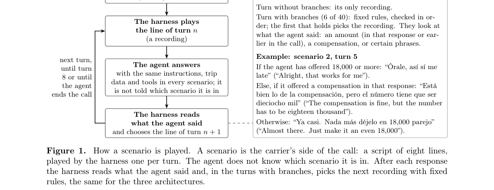

*Result - Experimental setup. The harness replaces the carrier and is the same for the three architectures; only the architecture it connects to changes. Double arrows are audio in both directions.*

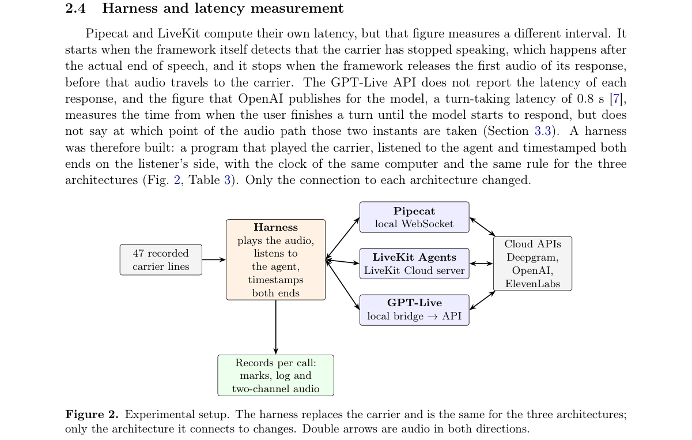

**Why this ranks #1**: 用同一套 47 条录音、每架构 77 通电话在听者侧实测三种语音代理架构：内容响应中位延迟为 Pipecat 2616.0 ms、LiveKit 3090.0 ms、GPT-Live 2444.8 ms，GPT-Live 相对 Pipecat 的 171.2 ms 优势置信区间含 0，说明真正的差距不在延迟而在金额识别错误率（两个级联 13.01%、12.61% 对 GPT-Live 2.86%）与 backchannel 误判（3/15、2/15 通电话把插话的 ok 记成成交）。

---

### 2. FEND: Far-End Detection in Outbound Voice AI Calls

**arXiv**: [2611.18050](https://arxiv.org/abs/2611.18050) | **Score**: 8.0 (relevance 8 x 0.7 + quality 8 x 0.3) | **Direction**: `duplex_speech_core` | **Tags**: duplex-speech, answering-machine-detection, far-end-classification, speech-cadence-features, voice-ai-agent, outbound-calls, Observe.AI | **Categories**: cs.CL, eess.AS | **Pages**: 14

**Authors**: Abhishek Kumar; Suraj Agrawal; Aashraya Sachdeva

**Affiliation**: Observe.AI

**Abstract**

> When a conversational Voice AI agent places an outbound call, the far end may be a live person, a voicemail greeting, an interactive voice response (IVR) system, or increasingly another AI system answering on the callee's behalf. Standard Answering Machine Detection (AMD) reports only whether a human or a machine picked up, a design meant for human call centres, where one machine is as uninteresting as another. That single bit does not tell a Voice AI agent what to do, since leaving a voicemail message, navigating an IVR and holding a short exchange with another AI are three different actions and a two-valued label cannot distinguish them. In 1,000 randomly sampled calls from our own outbound deployment, a live person answered 48.1%, a voicemail system 44.6%, an AI 6.9% and an IVR 0.4%. Our proposed framework, FEND, reads the far end's audio and its streaming transcript and runs one detector for each automated class (voicemail, IVR, AI callee), with human the default when nothing fires, returning a single label within 20 seconds. On a public benchmark the voicemail components reach 100% accuracy without ever misclassifying a live human, where Asterisk's AMD misclassifies 30 to 66% of them. For the AI callee, acoustic features do not transfer across recording conditions, but speech timing does, separating AI from human at 0.952 ROC-AUC, because synthesised speech leaves far shorter gaps between words. On production traffic, separating a live person from any automated far end reaches F1 0.979, and only 2.9% of live people are given an automated label, the error that matters most for an agent acting on the result.

**Key findings**

- **Finding**: 在自有外呼随机采样的 1,000 通电话里，真人占 48.1%、语音信箱 44.6%、AI 代接 6.9%、IVR 0.4%，即全部接通通话里 51.9% 的远端不是真人。
- **Inference**: 判别 AI 代接靠的是说话节奏而不是频谱——五个声学测量里四个在零假设校准上失败，节奏特征在留出集上 ROC-AUC 0.952，而同模型把 AI 与语音信箱分开只有 0.895，说明增益来自合成语音更短的词间停顿。
- **Recommendation**: 外呼语音 agent 要把远端检测做成四分类并同时读原始音频帧与流式转写，20 秒窗口内人机二分 F1 可到 0.979、只有 7/241 个真人被误标为自动应答。

**Key figures**

*Framework - Detection architecture. Four detectors read the raw audio frames and the streaming transcript and run concurrently, each able to fire one class. Firings accumulate over a window of W seconds*

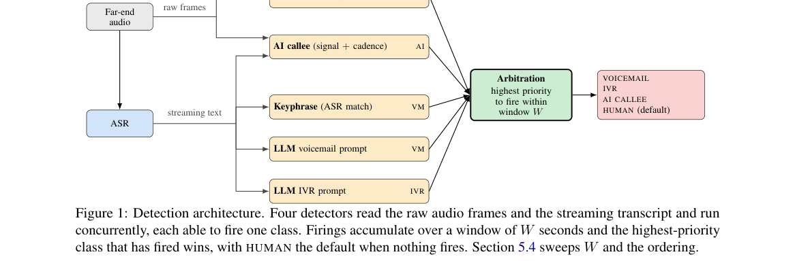

**Why this ranks #2**: 把外呼场景的远端判定从传统 AMD 的一位标签改成四分类（真人/语音信箱/IVR/AI 代接）：自有部署随机采样的 1,000 通电话中真人 48.1%、语音信箱 44.6%、AI 代接 6.9%、IVR 0.4%；公共基准上信箱组件达到 100% 准确且从不误伤真人，而 Asterisk app_amd 默认把 65.8% 的真人判成机器；AI 代接这一类靠说话节奏而非频谱拿到 0.952 ROC-AUC。

---

### 3. FineSpeaker: Reliable Speaker Representation Learning at Fine Temporal Resolution

**arXiv**: [2611.15288](https://arxiv.org/abs/2611.15288) | **Score**: 7.3 (relevance 7 x 0.7 + quality 8 x 0.3) | **Direction**: `duplex_speech_core` | **Tags**: duplex-speech, speaker-verification, frame-wise-representation, generative-disentanglement, speaker-diarization, short-duration, Peking University | **Categories**: cs.SD | **Pages**: 14

**Authors**: Yongkang Yin; Wenhao Yang; Lichun Fan; Jian Luan; Hang Su; Yuexian Zou

**Affiliation**: Peking University; ADSPLAB, School of ECE, Peking University, Shenzhen, China; Guangdong Provincial Key Laboratory of Ultra High Definition Immersive Media Technology, Shenzhen Graduate School, Peking University; MiML Plus, Xiaomi Inc., Beijing, China

**Abstract**

> Speaker representation learning is fundamental to speech processing tasks such as speaker verification and diarization. Although long-context speaker encoders can produce stable and discriminative embeddings, short-duration verification and diarization require finer-grained temporal representations. Short temporal contexts limit the available speaker evidence and make speaker identity difficult to disentangle from phonetic and acoustic variability. This creates a temporal resolution-representation reliability trade-off: speaker representations should maintain local within-speaker consistency, between-speaker discriminability and remain sensitive to speaker changes at fine temporal resolution. Accordingly, we propose a framework for reliable speaker representation learning at fine temporal resolution. FineSpeaker first constructs resolution-controllable frame-wise speaker representations through mean pooling over an adjustable n-frame window, enabling flexible control of representation granularity. It then introduces a speaker encoder with local temporal modeling that exploits short-range speaker context to improve the stability and discriminability of short-duration and frame-wise representations. Furthermore, we develop a generative disentanglement strategy for optimizing frame-level speaker representations, combining VAE-based probabilistic modeling with flow matching to characterize speaker-related variation and suppress non-speaker interference. Experiments demonstrate competitive full-utterance performance, improved fine-grained speaker verification on VoxCeleb and CN-Celeb, and strong zero-shot diarization results, highlighting the benefits of balancing temporal resolution and representation reliability.

**Key findings**

- **Finding**: 在 VoxCeleb1-O 上 0.5 秒短语音 EER 为 9.12%，优于 ReDimNet-B4 的 11.25%；帧级 2f 设置 EER 4.74%，ERes2NetV2 则为 18.10%。
- **Inference**: 短上下文下说话人证据本来就少，靠局部时序建模加 VAE/flow matching 解耦才能稳住逐帧身份估计，说明瓶颈在表征可靠性而不是模型容量。
- **Recommendation**: 做短语音验证或流式 diarization 时可改用帧级平均池化加可调 n 帧窗的粒度控制，而不是固定的 utterance 级嵌入，且解耦模块只在训练期使用、推理零额外开销。

**Key figures**

*Framework - Overview of the proposed fine-grained speaker representation learning method, including the speaker encoder architecture, the generative disentan- glement training scheme, and multi-granularit*

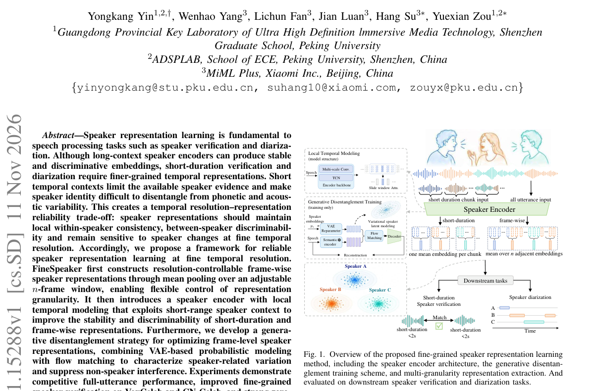

*Result - Overview of the proposed speaker encoder architecture. The input is downsampled by a factor of two and processed by a four-stage Multi- Scale Convolution (MSC) backbone with TCN-based local te*

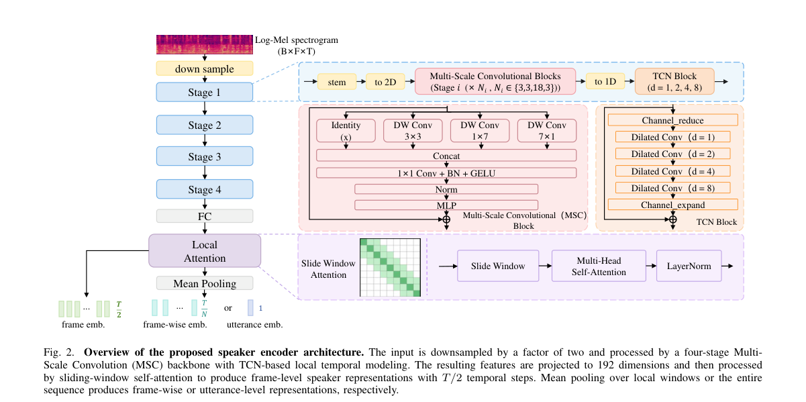

**Why this ranks #3**: 做分辨率可控的帧级说话人表征：在可调 n 帧窗（约 20 ms/帧）均值池化之上加 MSC+TCN 局部时序建模，并用 VAE 概率建模加 flow matching 做训练期解耦；VoxCeleb1-O 上 0.5 秒短语音 EER 9.12%（ReDimNet-B4 为 11.25%），帧级 2f EER 4.74%（ERes2NetV2 为 18.10%），全句 EER 0.6699 仅次于 ReDimNet-B4 的 0.5744，而 FLOPs 只有 3.1G 对 7.2G。

---

### 4. Marimba: A System One Model for Speech

**arXiv**: [2611.18330](https://arxiv.org/abs/2611.18330) | **Score**: 7.0 (relevance 7 x 0.7 + quality 7 x 0.3) | **Direction**: `duplex_speech_core` | **Tags**: duplex-speech, typed-decision-interface, turn-end-detection, frozen-asr-features, calibration, speaker-change, charcot.ai | **Categories**: cs.CL, cs.SD, eess.AS | **Pages**: 12

**Authors**: Solano Amadori

**Affiliation**: charcot.ai

**Abstract**

> Speech applications require decisions about term presence, turn completion, and language within an audio window. We present Marimba, an interface for typed speech decisions built on frozen Qwen3-ASR 0.6B features. Lexical questions use zero-shot scoring of ASR transcripts; non-lexical questions use a question-conditioned head and a separate layer-18 turn-end readout. Language identification uses the ASR model's own language scores. On private conversational test sets, decoder AUROC is 0.80-0.92; on public read speech it is 0.92-0.97. Speech Commands four-way accuracy is 0.93; binary lexical ECE is at most 0.08. Personal-information detection, which passes the greedy transcript to a private, curated PII pipeline, reaches item-level F1 0.904 on synthetic Brazilian Portuguese speech (1.000 on reference transcripts). Layer-12 speaker readouts detect speaker change with AUROC 0.966-0.980 on AMI and VoxConverse, above an ECAPA baseline, and count speakers (0, 1, 2, or 3+) more accurately than pyannote 3.1. The turn-end readout reaches AUROC 0.930 versus Smart Turn v3.2 at 0.982 on Smart Turn's own test set. On a subset of ICSI meetings labeled by next speaker, AUROC is 0.716 versus 0.712; the paired confidence interval includes zero.

**Key findings**

- **Finding**: 8 秒窗内冻结 Qwen3-ASR 0.6B 特征的 turn-end 读出在 Smart Turn 自测 500 窗上 AUROC 0.930，低于 Smart Turn v3.2 的 0.982，配对差 −0.052（95% CI −0.075~−0.032）。
- **Inference**: 同一读出在 ICSI 的 1,728 个窗口上与 Smart Turn v3.2 打平（0.716 对 0.712，配对差 +0.004、置信区间含 0），差距来自分布而非方法本身，通用读出换来的是跨域可用性。
- **Recommendation**: 需要一个接口同时覆盖词条检测、语音活动、语种与说话人判断时可直接复用冻结 ASR 特征，该接口在 FLEURS 词条二分类 AUROC 0.901，优于 Qwen3-Omni 的 0.791 与 Qwen2-Audio 的 0.682。

**Key figures**

*Framework - The marimba interface separates zero-shot lexical scoring, question-conditioned non-lexical prediction, a frozen layer-18 turn-end readout, and the ASR model’s language scores. The shared en*

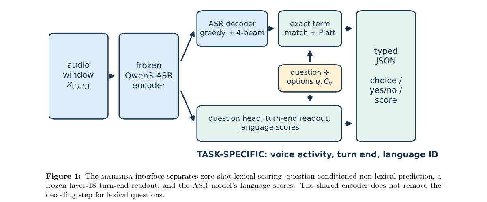

*Result - Typed questions over one recording built from public clips: FLEURS en us and es 419 utterances (CC BY 4.0) [7] and MUSAN noise. Each question selects an interval that is read as one 8 s wind*

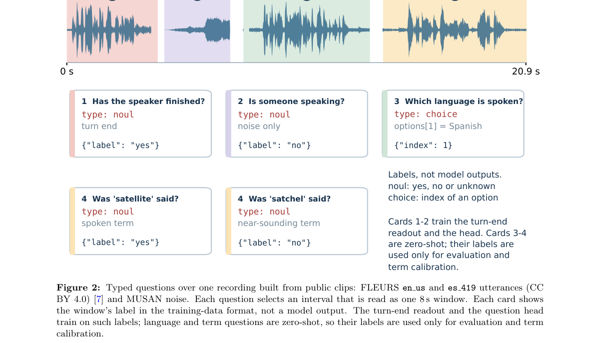

**Why this ranks #4**: 把冻结的 Qwen3-ASR 0.6B 特征做成统一的 typed speech decision 接口，词条问题走零样本打分、非词条问题走条件头、turn-end 另设 layer-18 读出：turn-end 读出在 Smart Turn v3.2 自测集上 AUROC 0.930 对 0.982（配对差 −0.052，95% CI −0.075~−0.032），但在 ICSI 的 1,728 个窗口上 0.716 对 0.712 基本打平；说话人变化检测 AUROC 0.966–0.980，高于 ECAPA 基线。

---

### 5. A Systematic Study of Cross-Token Transfer for Data-Efficient Non-Verbal Text-to-Speech

**arXiv**: [2611.19145](https://arxiv.org/abs/2611.19145) | **Score**: 7.0 (relevance 7 x 0.7 + quality 7 x 0.3) | **Direction**: `duplex_speech_core` | **Tags**: duplex-speech, non-verbal-vocalization, data-scaling, laughter-transfer, cosyvoice, whisper-d-eval, Meta | **Categories**: cs.CL | **Pages**: 5

**Authors**: Jing Pan; Haibin Wu; Minxue Niu; Florian Metze; Yuzong Liu

**Affiliation**: Meta, USA

**Abstract**

> Non-verbal vocalizations (NVs), such as laughter and breath, carry affective cues that words alone do not convey. Yet NV data remains scarce because speech annotation pipelines often omit or normalize these events. Existing work has improved NV text-to-speech through model design and data curation, but whether one NV token can help a model learn another has received little systematic study. We investigate this cross-token transferability in a controlled CosyVoice 2 setup. We first trace a laughter-only scaling curve, then hold laughter at 200 or 1,600 examples while adding breath, sigh, cough, lip-smack, or neutral speech. With only 200 laughter examples, adding 3,200 cough examples raises end-to-end laughter F1 from 0.170 to 0.529, surpassing the 0.495 obtained from 1,600 laughter examples alone. At the 1,600-example anchor, cough reaches 0.695, nearly matching 6,400 laughter examples (0.697). Waveform-level Whisper-D scoring and a semantic-token transcriber show consistent trends. Cross-token transfer therefore offers a complementary route to low-resource NV generation.

**Key findings**

- **Finding**: 只有 200 条笑声样本时加入 3,200 条咳嗽样本，波形级 laughter F1 从 0.170 升到 0.529，其中 precision 由 0.215 升到 0.622、recall 由 0.140 升到 0.460。
- **Inference**: 0.529 超过了单用 1,600 条笑声得到的 0.495，而等量中性语音对照只有 0.032，增益只能来自咳嗽与笑声共享的呼吸与声门动力学，不是单纯的数据量效应。
- **Recommendation**: 标注管线丢弃笑声、呼吸、咳嗽这类事件时，不必为每类单独采量数据，可按事件间生理相似性做跨 token 迁移来补稀缺的非言语能力。

**Key figures**

*Framework - Study overview: (a) CosyVoice generation, (b) controlled target scaling and cross-token transfer, and (c) complementary waveform and semantic-token evaluation.*

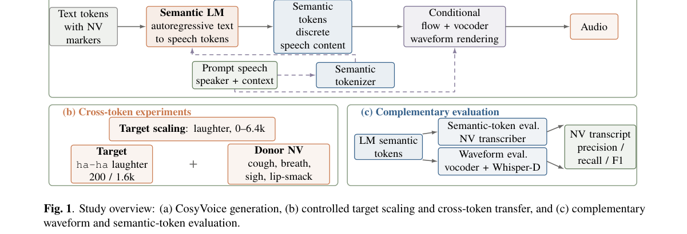

*Result - Waveform-level laughter scaling. Performance rises quickly through 3,200 target examples and changes little from 3,200 to 6,400.*

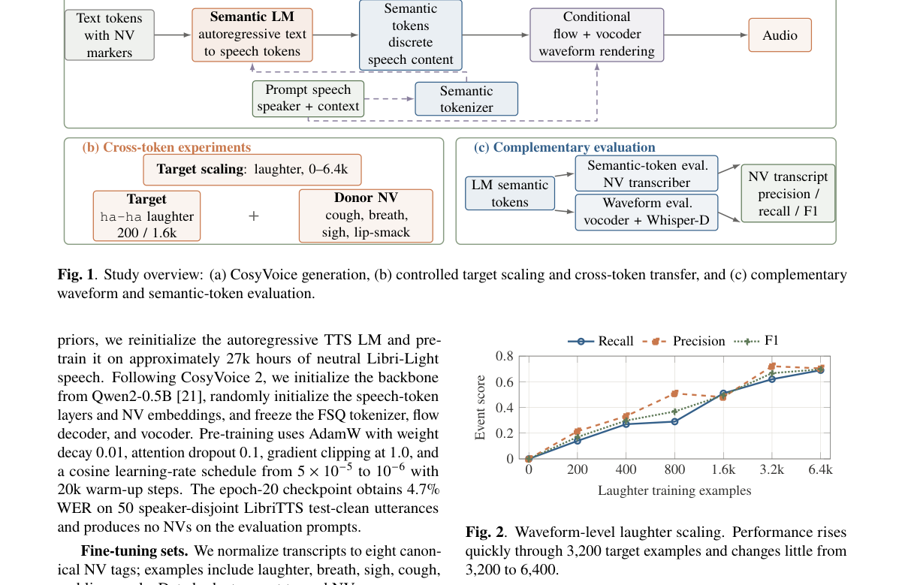

**Why this ranks #5**: 在固定 CosyVoice 2 配方下系统检验非言语事件之间的跨 token 迁移：只有 200 条笑声时加入 3,200 条咳嗽样本，把波形级 laughter F1 从 0.170 抬到 0.529，胜过单用 1,600 条笑声的 0.495；1,600 条锚点时咳嗽达 0.695，几乎等于 6,400 条笑声的 0.697；而同样体量的中性语音对照只有 0.032，说明增益来自事件间共享的呼吸与声门结构。

---

### 6. Beyond Controllability: Speaker Diversity in Instruction-Guided Text-to-Speech

**arXiv**: [2611.19030](https://arxiv.org/abs/2611.19030) | **Score**: 6.7 (relevance 7 x 0.7 + quality 6 x 0.3) | **Direction**: `duplex_speech_core` | **Tags**: duplex-speech, instruction-guided-tts, speaker-diversity, vendi-score, mpcd, bias-audit, National Taiwan University | **Categories**: cs.CL, eess.AS | **Pages**: 19

**Authors**: Yi-Cheng Lin; Jia-Kai Dong; Kuan-Yu Chen; Szu-Chi Chen; Jian-Jiun Ding; Sung-Feng Huang; Yusuke Hirota; Hung-yi Lee

**Affiliation**: National Taiwan University; NVIDIA; Artificial Intelligence Center of Research Excellence, National Taiwan University

**Abstract**

> Instruction-guided text-to-speech (ITTS) lets users specify voice properties in natural language. Applications from conversational AI character voices to synthetic training data for downstream speech models depend on the system producing many distinct voices when the same broad category is requested repeatedly. No prior work audits whether ITTS outputs are in fact diverse, either compared to real speech or across attribute values. We evaluate seven open-source ITTS systems using speaker embeddings whose representational capacity we independently validate. Every system produces speaker distributions markedly narrower than real speech. Furthermore, female prompts produce less diverse voice pools than male prompts across most systems. In contrast, accent and emotion prompts barely alter speaker diversity in most systems, but reveal a strong controllability bias toward North American English and neutral speech. These results show that diversity and controllability capture complementary weaknesses, neither of which alone is sufficient to evaluate ITTS. Our code and data are available at https://github.com/dlion168/ITTS-Speaker-Diversity.

**Key findings**

- **Finding**: 7 个开源 ITTS 系统的说话人分布在 8 个经过校验的编码器上一致窄于真实语音（Vendi 基线 68.3），其中 Qwen3-TTS 的女性提示多样性只有男性的 59%（16.6 对 28.1）。
- **Inference**: 性别控制的 per-class recall 在 6/7 系统上超过 0.88，说明多样性与可控性衡量的是两种互补缺陷，只测 prompt 遵循度会漏掉合成语料的覆盖偏置。
- **Recommendation**: 评测 ITTS 要同时报多样性与可控性并抽多个音色（音色方差/系统方差比 0.82 与 0.73），口音与情绪提示虽保住了多样性，却暴露出偏向北美英语与中性语音的可控性偏置。

**Key figures**

*Framework - Overview. (a) A broad description should produce many distinct voices. (b) We keep only encoders whose diversity scores track speaker count (RQ1). (c) ITTS voices are less diverse than real*

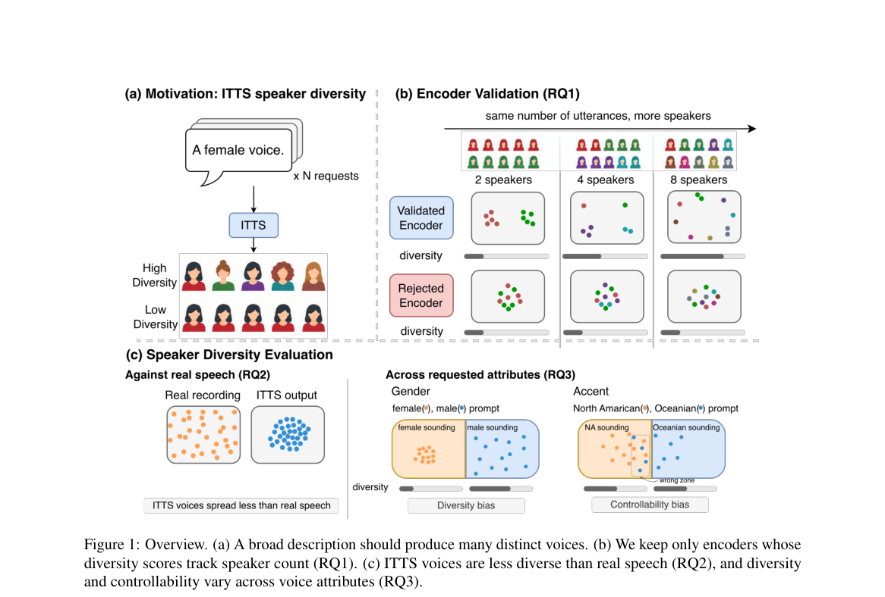

*Result - Encoder calibration with MPCD and Vendi. Mean MPCD and Vendi over 100 random subsets at each ground-truth speaker count k, for all 11 candidate encoders. Solid lines denote the eight encoder*

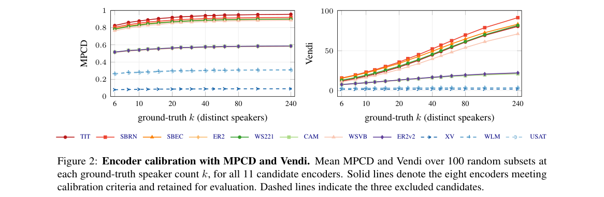

**Why this ranks #6**: 首次把指令引导 TTS 的说话人多样性与真实语音正面对照：7 个开源 ITTS 系统在 3 万条 Emilia 英文句子上的 Vendi 全部低于真实语音基线 68.3，Qwen3-TTS 的女性提示多样性只有男性的 59%（16.6 对 28.1）；而 7 个系统里 6 个的性别控制 per-class recall 高于 0.88——可控性高并不等于声音多样。

---

### 7. Why Do Low-Activity Speakers Disappear in Speaker Diarization? Decomposing Lost Speakers and What Training-Free Fixes Can Recover

**arXiv**: [2611.19160](https://arxiv.org/abs/2611.19160) | **Score**: 6.6 (relevance 6 x 0.7 + quality 8 x 0.3) | **Direction**: `duplex_speech_core` | **Tags**: duplex-speech, speaker-diarization, low-activity-speakers, training-free, windowed-re-inference, nemotron-3, Independent Researcher | **Categories**: eess.AS | **Pages**: 4

**Authors**: Fumiaki Yamaguchi

**Affiliation**: Independent Researcher

**Abstract**

> Speaker diarization can drop people who speak only a little from its output entirely, and such losses barely affect the diarization error rate (DER), which measures the fraction of misattributed time. We examine Nemotron-3, an end-to-end diarization model with eight output slots, on 990 recordings from four corpora, and count lost speakers by how they were lost (overlap, merge, miss). Nine in ten lost speakers are low-activity speakers with less than 10 s of total speech, and the cause splits by the number of speakers in the recording. In recordings with nine or more speakers, merges and misses caused by running out of slots dominate; re-running the model on short windows only for recordings that fill all eight slots, without any training, reduces these losses from 228 to 101 speakers, while extra output speakers grow from 5 to 50. In recordings with up to eight speakers, 60% of the losses are speakers hidden under someone else's speech, and none of the training-free methods we tried reduced them.

**Key findings**

- **Finding**: Nemotron-3 在 ≤8 人的 909 条录音上丢 485 个说话人（14.0%），其中 425 个（88%）总发言不足 10 s；总发言少于 2 s 的 252 人里丢了 181 个（72%）。
- **Inference**: ≥9 人的 58 条评估录音上窗口重跑加全局分配把丢失从 228 降到 101、DER 从 20.10% 降到 14.99%，但多余说话人从 5 涨到 50，说明槽位不足可绕开，代价是虚假说话人。
- **Recommendation**: 评估 diarization 不要只看 DER，≤8 人录音里 61% 的丢失来自重叠遮挡，所试的四种免训练方法均未降低这类丢失，重叠类损失只能在训练层面解决。

**Key figures**

*Framework - Examples of the three loss types (voxmap studio). Each panel shows the Nemotron-3 output (top) and the reference (bottom); speakers matched by the optimal mapping share a color. In every exa*

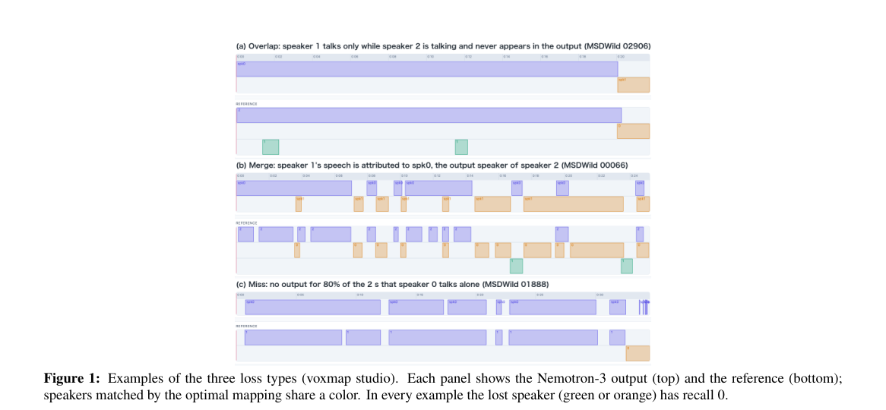

*Result - Left: fraction of lost speakers by total speech (all, up to eight speakers, 909 recordings); the denominator is the number of reference speakers in each bin, numbers are Nemotron-3. Right: l*

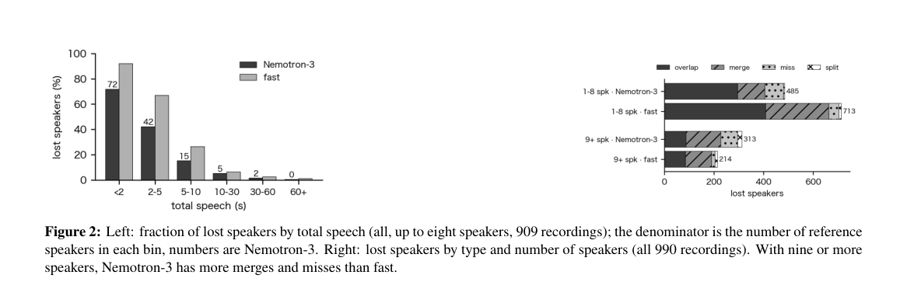

**Why this ranks #7**: 拆解八槽端到端 diarization 里「丢失的说话人」：在 Nemotron-3 的 990 条录音上，≤8 人录音丢失 485 人（14.0%）中 425 人（88%）总发言不足 10 s；≥9 人录音用 120 秒窗重跑加全局分配把丢失从 228 降到 101、DER 从 20.10% 降到 14.99%，代价是多余说话人从 5 涨到 50；≤8 人录音里 61% 的丢失是被人声盖住的重叠，尝试的四种免训练方法一个都没救回来。

---

### 8. Scaffolding Self-Transduction with Alignment Attention Mask for Aligner-Encoder ASR

**arXiv**: [2611.15087](https://arxiv.org/abs/2611.15087) | **Score**: 6.3 (relevance 6 x 0.7 + quality 7 x 0.3) | **Direction**: `duplex_speech_core` | **Tags**: duplex-speech, aligner-encoder, forced-alignment, attention-mask, librispeech, wer, NTT | **Categories**: eess.AS | **Pages**: 7

**Authors**: Jaeyoung Lee; Masato Mimura

**Affiliation**: NTT, Inc.

**Abstract**

> End-to-end ASR systems must jointly solve speech- text alignment and token prediction from sequence-level super- vision. We study this problem in Aligner-Encoder ASR, where alignment is performed inside encoder self-attention and can thus be directly intervened on with an attention mask. We use forced alignment to build an attention mask that confines selected encoder self-attention heads to a narrow window around the alignment path. The mask is faded out over training, leaving a deployable model with an unmodified inference architecture; alternatively, kept active at training and inference, it serves as an oracle that measures recognition performance once alignment is externally resolved. On LibriSpeech, the faded alignment mask improves test-clean/test-other WER from 3.9/6.4 to 3.5/5.9 over an Aligner baseline. The oracle masks are far stronger, reaching 1.2/2.9 WER, which can be thought of as an upper- bound accuracy in the 100M-class Conformer regime without an external language model. This indicates that alignment inference is a major bottleneck in Aligner-Encoder ASR, and suggests that improved alignment mechanisms might yield substantial accuracy gains for end-to-end ASR.

**Key findings**

- **Finding**: 路径带掩码在训练中淡出后，LibriSpeech test-clean/test-other WER 从 Aligner 基线的 3.9/6.4 降到 3.5/5.9；保持生效的 oracle 掩码达到 1.2/2.9。
- **Inference**: 长度带淡出完全没有收益（仍为 3.9/6.4）但 oracle 能到 2.3/5.3，说明真正有价值的是逐帧与词的对应关系而非目标长度这类全局量，瓶颈就在对齐推断本身。
- **Recommendation**: 要测无格点架构的天花板可先用外部强制对齐（RNN-T）造 oracle 掩码，本实现的最优做法是从第 2k 步淡出到第 10k 步、只掩一层的一个头。

**Key figures**

*Framework - Autoregressive Aligner-Encoder architecture. The encoder produces T frame-indexed representations, while the reference transcript contains U target-token positions. The first U encoder posit*

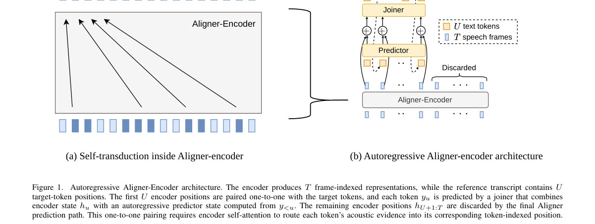

*Result - Alignment attention mask for Aligner-Encoder ASR. A monotonic frame–token alignment path, estimated for the reference transcript by an external forced aligner (a pretrained RNN-T in this stu*

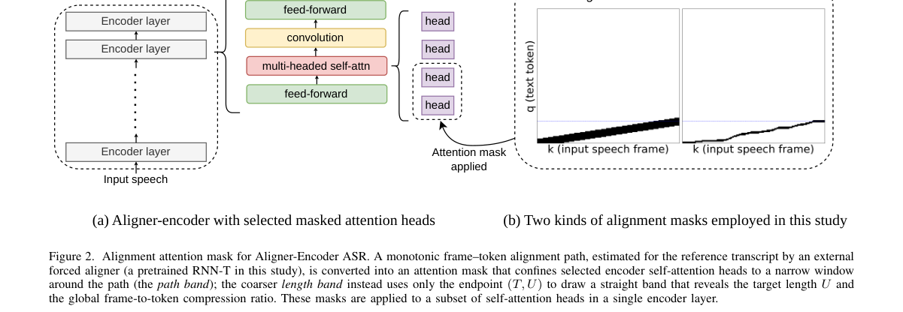

**Why this ranks #8**: 把外部强制对齐路径做成编码器自注意力掩码，为 Aligner-Encoder 的自转导过程搭脚手架：掩码在训练中淡出后 LibriSpeech test-clean/test-other WER 从 3.9/6.4 降到 3.5/5.9，长句（>17 s）桶从 11.7% 降到 9.3%；保持生效的 oracle 掩码更到 1.2/2.9，可视为 100M 级 Conformer 无外部语言模型的上限。

---

### 9. Convolutional VocalTrax: Replacing Backpropagation Through Time with Convolution in Differentiable Articulatory Synthesis

**arXiv**: [2611.17181](https://arxiv.org/abs/2611.17181) | **Score**: 6.3 (relevance 6 x 0.7 + quality 7 x 0.3) | **Direction**: `duplex_speech_core` | **Tags**: duplex-speech, articulatory-synthesis, differentiable-signal-processing, pink-trombone, waveguide, acoustic-inversion, Smule Labs | **Categories**: cs.SD | **Pages**: 9

**Authors**: Yongyi Zang; Debasish Ray Mohapatra; Randal Leistikow; Perry R. Cook

**Affiliation**: Smule Labs; University of British Columbia

**Abstract**

> VocalTrax recovers interpretable articulatory controls from a recording by gradient descent through a differentiable Pink Trombone synthesizer. Its vocal tract is a Kelly-Lochbaum waveguide updated twice per audio sample, so every gradient step backpropagates through a long recurrence, which is slow on GPUs. We propose Convolutional VocalTrax, which computes the exact frequency response of the same waveguide and applies it as a causal convolution. We assume that the tract is stationary within 5.8 ms blocks and that its lossy impulse response can be truncated after 93 ms. Gradients then pass through FFTs and a short recursion along the tract instead of through time. On 600 AudioMNIST recordings, the tract forward and backward pass runs 47 to 63 times faster on an A100 GPU, and a classifier trained only on real speech recognizes our reconstructions more often than those of VocalTrax (14.5% vs. 10.0%), although the log-mel distance to the target is 11% higher. Parameters fitted with our model keep this gain when rendered by the original VocalTrax (13.8%).

**Key findings**

- **Finding**: 把 Kelly-Lochbaum 导管的精确频响做成块因果卷积后，梯度只经过 FFT 与 43 步声道递归，A100 上声道前反向比逐样本 BPTT 快 47 到 63 倍。
- **Inference**: 几何固定时双精度相对误差 6×10⁻¹⁰、单精度波形误差 8.1×10⁻⁶，说明近似只来自几何移动，块长 256 样本（5.8 ms）下 5% 与 20% 管径运动分别带来 1.04% 与 4.00% 的误差。
- **Recommendation**: 需要可解释的发音参数又要在 GPU 上反复迭代时可用这个卷积版本，用它拟合出的参数交给原版 VocalTrax 渲染仍保留识别率优势（13.8% 对 10.0%）。

**Key figures**

*Framework - Spectrograms of the digit “zero” (speaker 55) and its 1000-step reconstructions. (d) renders the parameters fitted by our model with the original recurrent VocalTrax, without further optimiza*

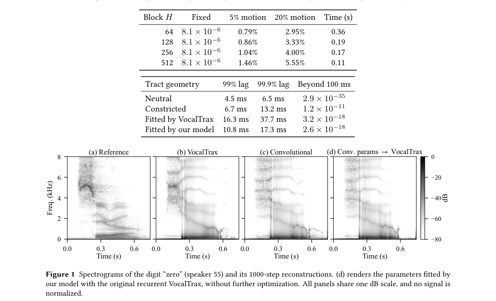

*Result - Time per call of both tracts and the shared LF source, at batch size one on one A100.*

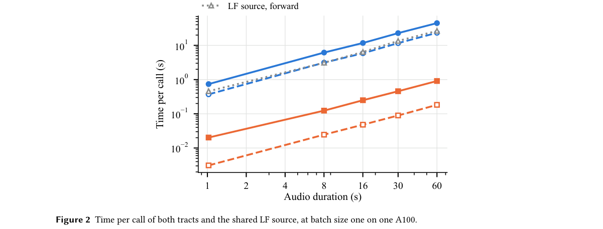

**Why this ranks #9**: 把 Pink Trombone 声道的精确频响做成块因果卷积，替掉逐样本 BPTT：梯度只经过 FFT 与 43 步声道递归，A100 上声道前反向快 47–63 倍（原来 1 秒音频反向要 0.74 s、1000 步拟合 1 秒片段约 24 分钟）；600 条 AudioMNIST 上只训真人语音的分类器对其重建识别率 14.5%，高于原版 VocalTrax 的 10.0%，代价是 log-mel 距离高 11%。

---

### 10. eDIAR: Training-Free Open-Speaker Streaming Diarization for Long Meetings and Large Archives via e-means

**arXiv**: [2611.18529](https://arxiv.org/abs/2611.18529) | **Score**: 6.3 (relevance 6 x 0.7 + quality 7 x 0.3) | **Direction**: `duplex_speech_core` | **Tags**: duplex-speech, streaming-diarization, open-speaker, e-means, training-free, speaker-linking, KAIST AI | **Categories**: cs.SD | **Pages**: 18

**Authors**: Kyudan Jung; Jihwan Kim; Minwoo Lee; Eunji Shin; Jaegul Choo

**Affiliation**: KAIST AI; Ewha W. University

**Abstract**

> Meetings last up to an hour, and nobody knows in advance how many people will speak. Neural diarizers with a fixed number of output slots, such as Streaming Sortformer and Nemotron-3, are accurate and run online, but they cannot name more speakers than they have slots. We remove this limit without retraining. The slot head keeps deciding who is active and when speech overlaps, and speaker embeddings are clustered inside a single slot, with the official e-means algorithm, only after every slot has been used. In the streaming system, re-clustering is confined to a bounded window, labels are revised for a few seconds, and identities are anchored to the slots of the head. The resulting system has no limit on the number of speakers and stays accurate when speakers outnumber the slots, where fixed-slot models break down. On meetings that grow to an hour it stays far more accurate than Streaming Sortformer, which accumulates errors, and its cost per update does not grow with the meeting. The same recipe turns the four-slot Streaming Sortformer into an open-speaker system. Across recordings, e-means makes it affordable to link the speakers of a large archive frame by frame, a task that arises when conversational corpora are prepared, and it reaches the clustering quality of Lloyd's $k$-means several times faster. The method needs little tuning, and e-means runs with its default recipe from a few hundred to more than a million embeddings.

**Key findings**

- **Finding**: 流式 1.04 s 下 eDIAR 在 VoxConverse 的 DER 为 5.8%，低于 Nemotron-3 八槽头的 6.4% 与 Streaming Sortformer 四槽的 14.1%；LibriSpeech 非流式为 8.6% 对 18.1%。
- **Inference**: 一小时、12–20 人的会议里 Streaming Sortformer 从 15 分钟的 23% 崩到 45 分钟的 57%，而本方法靠有界窗口重聚类与槽位锚定身份始终比头低约半个百分点，说明固定槽位模型在长会议上是累积误差。
- **Recommendation**: 要把固定槽位 diarizer 变成开放说话人且不重训，可在槽位用尽后再用 e-means 拆槽；跨录音链接人时用帧级而非每人一质心，1,248 场 29 小时档案上两个 epoch 即达到 Lloyd 25 次迭代的聚类损失。

**Key figures**

*Framework - eDIAR at a glance. Streaming at 1.04 s. (a) DER against the number of speakers, from two to twenty, on LibriSpeech-OpenSpk conversations, compared with the two fixed-slot models; the dotted*

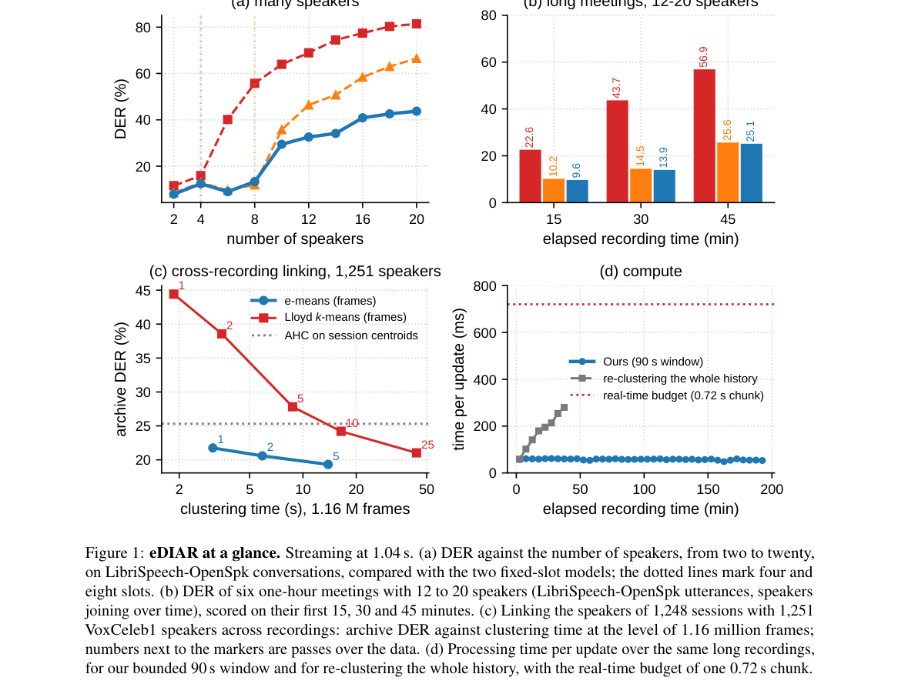

*Result - Speaker linking across an archive of 1,248 sessions with 1,251 VoxCeleb1 speakers. Archive DER on the left and spherical clustering loss on the right against clustering time, for e-means and*

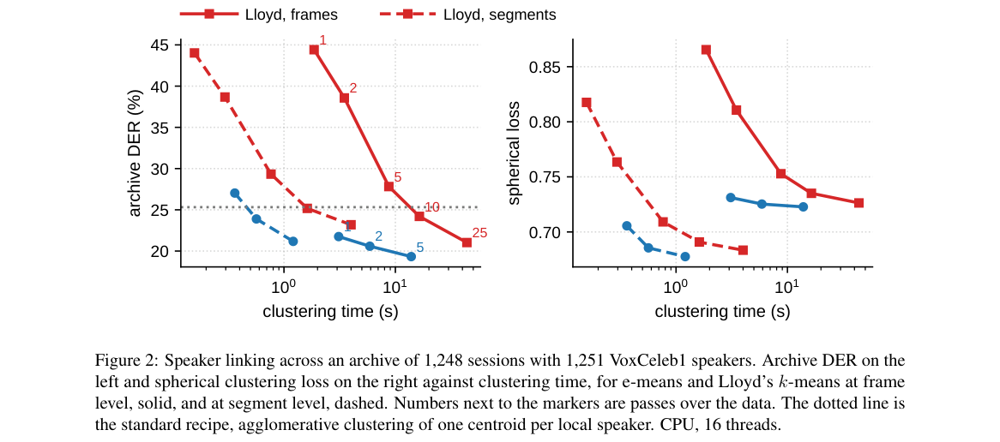

**Why this ranks #10**: 不改训任何模型，只在固定槽位模型的槽位用尽后用 e-means 拆分槽位，把流式 diarization 变成开放说话人：1.04 s 流式下 VoxConverse DER 5.8%（Nemotron-3 八槽头 6.4%、Streaming Sortformer 四槽 14.1%），20 人时错误约为头的三分之二；45 分钟会议里 Sortformer 从 23% 崩到 57%，而本方法始终比头低约半个百分点。

---

### 11. Human-Likeness and Conversational Preference Diverge for Synthesized Agent Speech in Customer-Service Calls

**arXiv**: [2611.16051](https://arxiv.org/abs/2611.16051) | **Score**: 6.0 (relevance 6 x 0.7 + quality 6 x 0.3) | **Direction**: `duplex_speech_core` | **Tags**: duplex-speech, listening-test, tts-evaluation, conversational-preference, prosody, naturalness-metrics, Fluid Concepts Research | **Categories**: cs.CL, cs.HC, eess.AS | **Pages**: 5

**Authors**: Jeffrey M. Girard; Antony D'Avirro; Jason Z. Zheng; Jacqueline R. Vertino; Benjamin Peloquin

**Affiliation**: Fluid Concepts Research

**Abstract**

> Listeners can judge an agent's speech on how human it sounds (human-likeness) and on how much they would want to talk to it (conversational preference). Listening tests rarely ask about conversational preference, so the relation between the two judgments is unclear. We compared them in paired-choice tests on 120 turns that actors improvised as customer-service representatives. On each trial, two agents spoke the same turn. In Study 1, both agents came from six commercial text-to-speech systems, each with eight voices. In Study 2, one was the actor's original recording and the other a system. Some systems ranked higher on human-likeness, and others on conversational preference. Listeners chose systems over actors in 19% of human-likeness trials but 36% of conversational preference trials (and 49% for the most preferred system). On both judgments, variation among a system's voices was about three-quarters of that between systems. Of three automatic naturalness scores, two predicted lower human-likeness, and none predicted conversational preference. In this setting, listeners tended to favor faster speech and fewer pauses between clauses on both judgments, and more pitch variation for conversational preference. Thus, measuring only human-likeness or testing one voice per system can misjudge which agents listeners would rather talk to.

**Key findings**

- **Finding**: Study 2 中系统被真人选中的概率在 human-likeness 上平均为 19%（全部 q<.001），在 conversational preference 上平均升到 36%，只有 Cartesia 约 49%（95% CI 42%–57%）与真人持平。
- **Inference**: 两种判断给出的系统排名会互换——Rime 从 68% 掉到 49%、Google 从 33% 升到 49%，只测一种判断就会选错系统，因为音色方差约为系统方差的四分之三（比值 0.82 与 0.73）。
- **Recommendation**: 评测客服语音 agent 时要同时收集两种判断并按系统抽多个音色，UTMOS、UTMOSv2、NISQA 三个自动自然度分数一个也预测不了 conversational preference。

**Key figures**

*Framework - Both axes give the probability of being chosen over an average system. (a) Systems and actors on the same scale from the baseline model fit to both studies (Section 2.4), with 95% CIs. Lettere*

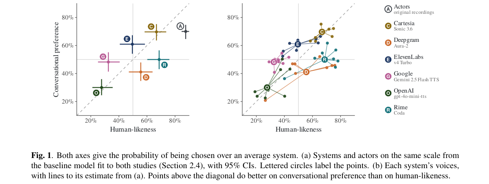

*Result - Probability of choosing each system over the actor in Study 2. Bars show 95% CIs, and filled points differ signifi- cantly from 50% (equal choice, dashed).*

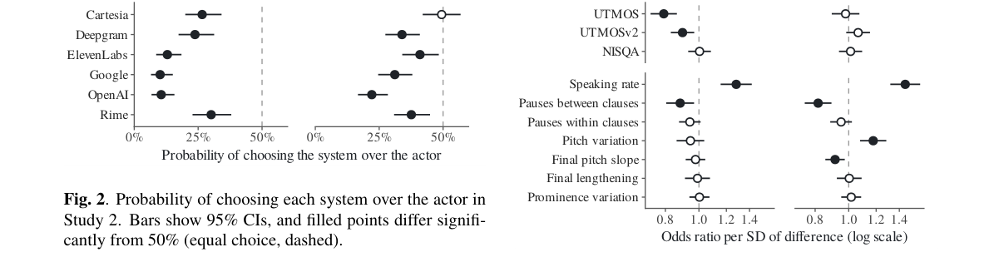

**Why this ranks #11**: 在 120 条客服转写、6 个商用 TTS 系统各 8 个音色上做配对选择，对比「像真人吗」与「更愿意聊吗」两种判断：系统被真人选中的比例在 human-likeness 上平均 19%，在 conversational preference 上升到 36%（Cartesia 达 49%，与真人持平）；两种判断给出的系统排名会互换（Rime 68%→49%，Google 33%→49%）。

---

## 语音 LM 的 RL 与偏好优化 · `speech_rl` (1 papers)

只有 1 篇，但它很硬：Low-Latency LLM-Based Streaming Multi-Talker ASR with Verifiable Rewards，用 SA-WER grader 加 onset 延迟奖励做 RLVR 后训，SA-WER 从 20.51% 降到 13.14%，加延迟项后 onset p50 从 0.918 s 降到 0.320 s。这是本批唯一一篇 RL 确实作用在语音模型上的论文——其余含 RL 词的语音论文，要么 RL 不作用在语音模型上，要么做的是通用音频。

### 12. Low-Latency LLM-Based Streaming Multi-Talker ASR with Verifiable Rewards

**arXiv**: [2611.19136](https://arxiv.org/abs/2611.19136) | **Score**: 8.7 (relevance 9 x 0.7 + quality 8 x 0.3) | **Direction**: `speech_rl` | **Tags**: duplex-speech, rlvr, streaming-asr, multi-talker, onset-latency, grpo, Meta | **Categories**: cs.CL, cs.SD | **Pages**: 5

**Authors**: Jing Pan; Ruizhi Li; Ju Lin; Jing Zheng; Florian Metze

**Affiliation**: Meta, USA

**Abstract**

> LLM-based architectures offer strong generalization and instruction-following capabilities for streaming automatic speech recognition (ASR), but multi-talker use introduces coupled transcription, attribution, and latency challenges. Our wearable setting requires real-time transcription of a conversation between a near-field device wearer and a far-field partner. Because partial hypotheses are rendered on persistent sides of a dialogue UI, speaker roles cannot be permuted and each speaker tag must precede its turn. These sparse tags are weakly optimized by supervised fine-tuning (SFT), while committing to a leading tag can delay the text that follows. We therefore post-train a streaming LLM-based ASR model with reinforcement learning with verifiable rewards (RLVR), combining a fixed-role Speaker-Attributed WER (SA-WER) grader with a turn-level onset-delay reward. On an eight-direction multi-talker cohort, SA-WER RL reduces SA-WER from $20.51\%$ for SFT to $13.14\%$. Adding the delay objective reduces onset $p50$ by $65\%$ (from $0.918\,\text{s}$ to $0.320\,\text{s}$) and $p90$ by $44\%$ (from $1.389\,\text{s}$ to $0.780\,\text{s}$) relative to SA-WER-only RL, while achieving $12.70\%$ SA-WER. These results demonstrate that fixed-role recognition quality and streaming responsiveness can be improved jointly.

**Key findings**

- **Finding**: 在 1,181 条双角色对话记录上，固定角色 SA-WER 的 RLVR 把 SFT 的 20.51% 降到 13.14%，角色错分 SAE 由 3.2%/5.0% 降到 0.5%/0.3%，删除率由 12.2%/14.4% 降到 9.5%/8.1%。
- **Inference**: 把 onset 延迟做成有界乘性正则（400 ms 缓冲、λ=0.2，最大只压低 16.7% 的奖励）后 p50/p90/p95 分别下降 65%/44%/40% 到 0.320/0.780/0.890 s，SA-WER 不降反升到 12.70%，说明识别质量与流式响应性可以联合优化。
- **Recommendation**: 想在流式多说话人 ASR 上同时压延迟和保识别质量，可照此把角色固定的 SA-WER 做成可验证奖励，延迟只当有界正则用（λ 从 0.05 提到 0.2 时 SA-WER 仅变 0.19 个百分点）。

**Key figures**

*Framework - Wearable two-party streaming pipeline with fixed- role SOT, dialogue-side routing, and downstream bidirec- tional translation.*

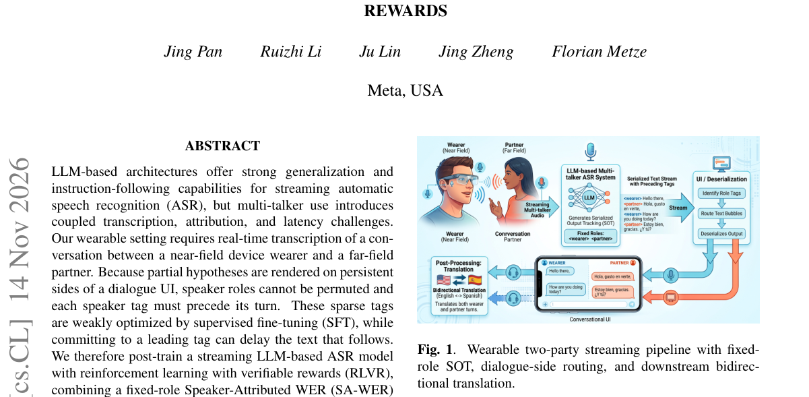

*Result - Pooled onset-delay percentiles for the same check- points. Smaller buffers monotonically improve p50 and p90; p95 is less stable.*

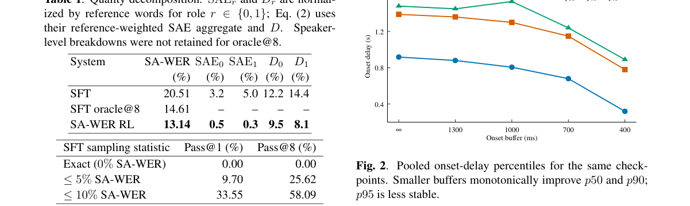

**Why this ranks #12**: 本批唯一一篇 RL 真正作用在语音模型上的工作：固定角色的 SA-WER 可验证奖励把 SFT 的 20.51% 降到 13.14%（角色互换错误由 3.2%/5.0% 降到 0.5%/0.3%），再叠加轮次 onset 延迟奖励后 p50 从 0.918 s 降到 0.320 s（−65%）、p90 从 1.389 s 降到 0.780 s（−44%），同时 SA-WER 进一步到 12.70%。

---

## Footer

- Total papers reviewed across all 4 axes: 60
- duplex_speech axis final count: 12
- Wild-cards in this axis: 0
- Figure assets: 2026-11-17/res/

Generated by `mine-arxiv-daily-digest` skill. Sister file: `2026-11-17_duplex_speech_entry.md`.
