# Mine Arxiv Daily Digest - 2026-11-17 (具身智能与世界模型 Axis, 15 papers)

**Generated**: 2026-11-17 12:27 CST

**Source**: arXiv cs.CV, cs.SD, eess.AS, cs.CL, cs.AI, cs.RO, cs.LG, cs.IR submissions, listing day 2026-11-11 + 2026-11-12 + 2026-11-13 + 2026-11-14 (announced 2026-11-16 20:00 ET = 2026-11-17 01:00 UTC)

**Batch window**: 2026-11-10T19:00:00Z .. 2026-11-14T19:00:00Z（arXiv 公告批次横跨两个 UTC 日：从前一日的美东 14:00 截止时刻起算（EDT 为 18:00Z，EST 为 19:00Z），到当日的同一时刻为止）

**Axis**: world_embodied (15 papers, base 15, cap 20)

**Directions**: world_model (7), embodied_ai (8)

**Selection**: 15 papers ranked by relevance x quality, with 0 wild-card slots

**Day total**: 60 papers across 4 axes (target 60)

**Scope**: 世界模型、学习型模拟器与具身智能，含移动操作、人形控制、触觉反射、VLA 策略与面向具身任务的强化学习

**Wild-card**: 0 —— world_model 8 篇、embodied_ai 121 篇候选，按基准发满 15 篇，没有需要用邻接选题补位的空位。

**本 axis 15 篇（base 15，cap 20）**：`world_model` 7 篇、`embodied_ai` 8 篇，正好打满各自基准。

**`world_model` 今天很薄，候选只有 8 篇**：JEPA / 潜动力学方向供给有限，且医学影像类 JEPA（眼底 OCT、胸片鲁棒性、脑 MRI、肿瘤 LLM 世界模型）按预筛的 OFF 规则被正确排除——它们不属于本轴。

**`embodied_ai` 候选 121 篇**，供给充足，8 篇正好打满基准。**具身 RL 全部归本 direction**（用真实机器人成功率衡量），2611.18562 的 robot-use RL、2611.17163 的 Tail-Aware GRPO、2611.19047 的屏障条件认证都没有被放进 `llm_vlm_rl`。

**跨轴改判**：2611.18761（Frame First, Decode Once）原被归入 `aigc_generation`，实为系统-1 世界模型的坐标系与解码对照研究，已改判本 axis。

---

## 世界模型与学习型模拟器 · `world_model` (7 papers)

世界模型 7 篇里有 2 篇 relevance≥9。Rethinking Actions 用演示动作的时序结构学一个局部门控深核 GP 先验，去引导冻结视觉世界模型的规划，五个任务 87.07% 对 INTACT 的 71.03%、PRISM 的 61.66%。Frame First, Decode Once 做的是系统-1 世界模型的坐标系与单次解码对照：物体 SE(2) 坐标系让决策 regret 降 1.9–2.2 倍，单次解码 1.6–1.8 ms、regret 0.020，而扩散方案是 0.046。另外 Latent Imagination 在世界模型的潜想象里用隐式 Q 学训练参数化动作策略（7 任务达到最强无模型基线、决策快 67 倍），Bind-WAM 用语言-物体绑定的不确定性决定要不要联合生成未来视觉与动作。

### 1. Rethinking Actions: Continuity-Aware Priors for World-Model Planning

**arXiv**: [2611.16645](https://arxiv.org/abs/2611.16645) | **Score**: 8.7 (relevance 9 x 0.7 + quality 8 x 0.3) | **Direction**: `world_model` | **Tags**: embodied, action-prior, world-model-planning, gaussian-process, cem-search, continuity-aware, Beijing University of Posts and | **Categories**: cs.LG, cs.RO | **Pages**: 20

**Authors**: Shaobo Yang; Zichen Ai; Ziyang Ma; Qian Yang; Bin Fang

**Affiliation**: Beijing University of Posts and Telecommunications; Alibaba Group

**Abstract**

> Actions in expert demonstrations exhibit temporal structure. An ordered-versus-shuffled analysis across five environments confirms this dependence. We ask whether action proposals that better reflect expert continuity can improve visual world-model planning. Rather than imposing generic smoothness, we learn continuations from the temporal structure of demonstrated actions. Our locality-gated deep-kernel Gaussian-process prior, LG-DKGP, combines recent and longer-range executed action history, predicts a neural continuation, and learns a temporal Gaussian-process (GP) residual. A training-derived exploration scale initializes search around the corrected mean; a frozen world model evaluates progress toward the goal. Training first fits the neural mean, then jointly optimizes the prior with the GP residual using expert future actions. The resulting planner achieves 87.07\% macro success across five simulated tasks spanning native and fragment-level goal attainment, compared with 71.03\% for INTACT, 61.66\% for PRISM, and 58.66\% for LeWM. Component interventions and expert-relative action-structure comparisons support demonstration-informed continuations and reveal task-dependent effects of visual conditioning, history length, and planning horizon.

**Key findings**

- **Finding**: 在保持同一 episode 内打乱专家动作顺序后，相邻标准化动作差的增量在 PushT/Cube/Caddy/Scene2/RoboTwin 上分别为 0.815、0.866、0.855、0.746、0.514，episode bootstrap 95% 区间均不含 0。
- **Inference**: 专家动作存在可被利用的局部时序依赖，因此用连续性先验约束候选提议，比无约束搜索更可能提升世界模型的目标达成率。
- **Recommendation**: 在冻结世界模型上做规划时，先从示教数据拟合连续性先验，再按专家增量尺度初始化 CEM 搜索；固定尺度只有 74.92% 宏平均成功率，而专家尺度可达 87.07%。

**Key figures**

*Framework - Rethinking actions as demonstrated continuations. The schematic contrasts unconstrained proposals with an expert-informed action prior. A frozen visual model evaluates candidate continuation*

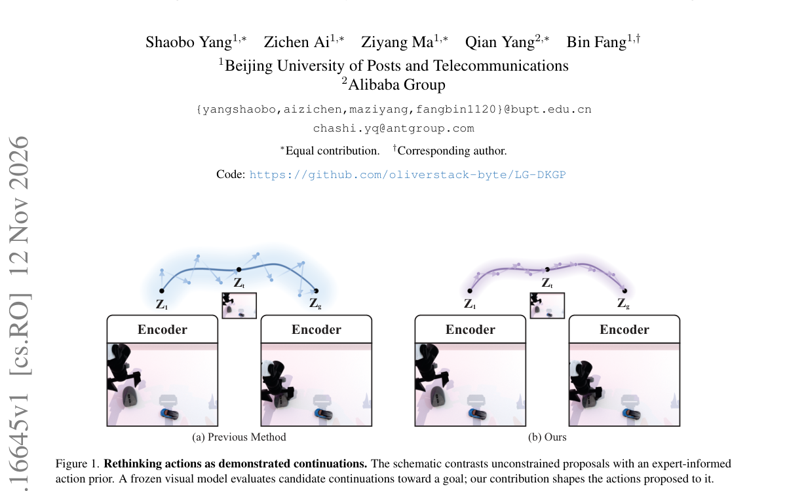

*Result - Matched PushT executions. Both methods share the start and goal. LG-DKGP succeeds at step 24; LeWM fails within 50 steps. Lines follow the actual circular pusher, dots mark control- step pos*

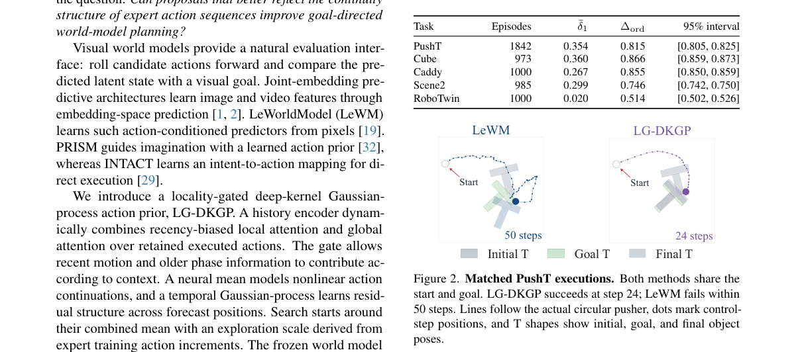

**Why this ranks #1**: 北京邮电大学与阿里巴巴集团把「专家动作有局部时序结构」做成可插拔的先验：LG-DKGP 在五个仿真任务上取得 87.07% 宏平均成功率，明显高于 INTACT 的 71.03%、PRISM 的 61.66% 与 LeWM 的 58.66%；世界模型本身保持冻结，只改动作提议方式，所以它排在本 direction 首位。

---

### 2. Frame First, Decode Once: Object-Centric Coordinates and Single-Pass Decoding for System-1 World Models

**arXiv**: [2611.18761](https://arxiv.org/abs/2611.18761) | **Score**: 8.7 (relevance 9 x 0.7 + quality 8 x 0.3) | **Direction**: `world_model` | **Tags**: embodied, single-pass-decoding, se2-object-frame, procrustes-projection, decision-regret, latency-optimization, Sigmind.ai | **Categories**: cs.AI, cs.CV, cs.LG, cs.RO | **Pages**: 12

**Authors**: Abu Anas Ibn Samad

**Affiliation**: Sigmind.ai

**Abstract**

> Single-pass primitive decoders such as LocateAnything and VFlash predict all quantized coordinate tokens of a geometric primitive in one forward pass, enabling fast, System-1 visual planning. We study what matters when such a decoder serves as a System-1 world model: a fast action-conditioned predictor that ranks candidate pushes by their predicted outcome. On ManiSkill3 PushT-v1 (512 held-out test families, 8,192 rollouts) and on human demonstrations from lerobot/pusht (2,384 test windows), we compare decoders, training losses, rigid-body projections and coordinate frames, using matched checkpoints, hierarchical bootstrap confidence intervals and Holm correction. Two factors of similar size dominate. First, expressing inputs and outputs in the SE(2) frame of the object's initial pose lowers decision regret by 1.9-2.2x for each of five decoders, and the object-frame model trained on 128 families matches the world-frame model trained on 512. Second, single-pass decoding outperforms iterative decoding: in the object frame, single-pass heads reach 0.020-0.021 regret at 1.6-1.8 ms per decision, against 0.046 for 10-step DDIM diffusion and 0.059 for KV-cached autoregression at 10.3 and 12.9 ms. The choice among single-pass heads has no measurable effect on regret, and our registered hypothesis that the frame effect exceeds the decoder spread is not supported. Soft-token expectation with an end-to-end 2D Kabsch projection gives the lowest trajectory error (11.35 px on ManiSkill3, 3.78 px on lerobot/pusht), exact rigid-body consistency, and lower regret than diffusion at every budget from 4 to 50 DDIM steps, at 3-29x lower latency.

**Key findings**

- **Finding**: 换成物体初始位姿的 SE(2) 坐标系后，五种解码器的决策后悔各下降 1.9–2.2 倍（Holm 校正 p<0.005），且 128 个任务族训练的物体系模型即可追平世界系下 512 个任务族的模型。
- **Inference**: 坐标系带来的样本效率收益与解码器选择的影响量级相当，作者原先「坐标系效应大于解码器差异」的预注册假设并不成立（0.0345 对 0.0389）。
- **Recommendation**: 训练动作条件预测器时优先做坐标系对齐，并用软 token 期望加端到端 2D Kabsch 投影做回归，可把轨迹误差压到 11.35 px（ManiSkill3）与 3.78 px（lerobot/pusht）。

**Key figures**

*Framework - Procrustes-FPD. Given a context x0 and a candidate action a, a 3-layer transformer (d=192) with a block attention mask predicts the token distributions of all 100 trajectory coordinates in one*

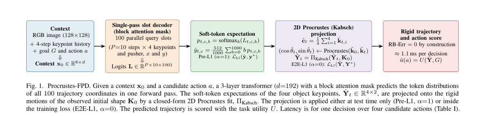

*Result - ManiSkill3 test split, world frame (512 families, 5 seeds, 95% family-cluster bootstrap CIs). (a) Decision regret and (b) trajectory error (MAP-ADE) against latency per decision (log scale).*

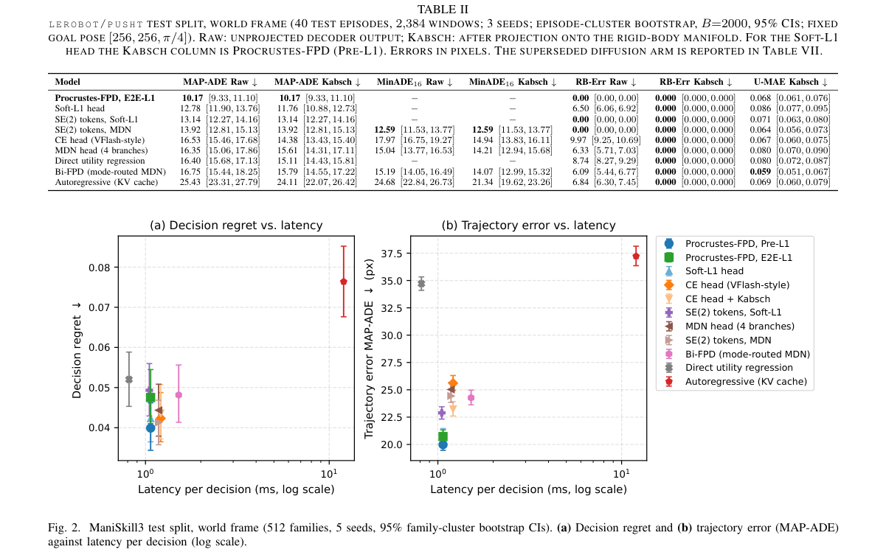

**Why this ranks #2**: Sigmind.ai 这篇把「单次前向解码器当 System-1 世界模型」该做什么讲透了：在 ManiSkill3 PushT-v1 的 512 个留出任务族、共 8,192 次 rollout 上，物体初始位姿的 SE(2) 坐标系让五种解码器的决策后悔各降 1.9–2.2 倍；单次解码后悔 0.020–0.021、每次决策 1.6–1.8 ms，而 10 步 DDIM 是 0.046 与 10.3 ms。

---

### 3. Latent Imagination for Parameterized Action Spaces

**arXiv**: [2611.15744](https://arxiv.org/abs/2611.15744) | **Score**: 8.0 (relevance 8 x 0.7 + quality 8 x 0.3) | **Direction**: `world_model` | **Tags**: embodied, latent-imagination, parameterized-action, dreamer, counterfactual-mode-evaluation, success-window-replay, Turkish Aerospace | **Categories**: cs.AI, cs.LG | **Pages**: 24

**Authors**: Atahan Cilan; İhsan Mert Muhacıroğlu; Ümit Can Bekar

**Affiliation**: Turkish Aerospace

**Abstract**

> Parameterized-action MDPs (PAMDPs) ask an agent to choose a discrete action together with continuous parameters whose meaning depends on that choice. Model-free PAMDP methods act fast but need many interactions; model-based methods are sample-efficient but plan at every decision, which makes them slow to act. We introduce HyLI (Hybrid Latent Imagination), a model-based agent that learns a hybrid policy entirely in the latent imagination of a world model and acts with a single forward pass. To address learning problems that the PAMDP structure creates, HyLI adds counterfactual mode evaluation, which gives every discrete action a learning signal at every imagined state, and success-window replay, which keeps rare successes in training. On seven standard PAMDP benchmarks, HyLI is within one published standard deviation of, or above, the published score of the strongest model-free baseline in our comparison on all 7 tasks, reaches 90% of that score with 2.4x fewer environment steps than that baseline (5.0x when its reward-free pre-training is counted), and decides 67x faster than the model-based planner DLPA at its published planner settings. It is the only method in our comparison that is both more sample-efficient than that baseline and fast enough for real-time control.

**Key findings**

- **Finding**: HyLI 在全部 7 个 PAMDP 任务上的成绩都落在最强无模型基线公开分数的一个标准差之内或之上，达到其 90% 分数所需环境步数少 2.4 倍，且单决策 1.3 ms 对 DLPA 的 52 ms。
- **Inference**: 把混合动作策略完全放到 DreamerV3 式世界模型的潜空间想象里训练，可以让模型式样本效率与策略式的单次前向速度兼得。
- **Recommendation**: 混合动作空间上要同时拿到样本效率与实时性，请在潜空间想象里训练策略，并为稀有模式加反事实模式评估、为稀有成功加成功窗口回放；两者在 Goal 上把分数从 0.24 抬到 0.76。

**Key figures**

*Result - Overview. (a) Acting is one forward pass through the encoder, the recurrent core and the hybrid actor; on Goal and Hard Goal*

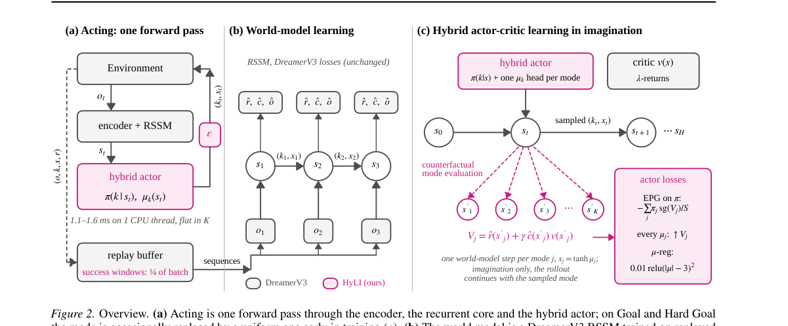

**Why this ranks #3**: 土耳其航空这篇在 7 个 PAMDP 基准上做到：用 2.4 倍更少的环境步数（计入无奖励预训练为 5.0 倍）达到最强无模型基线 HyAR 公开成绩的 90%，单次决策 1.3 ms 而模型式规划器 DLPA 需 52 ms（快 67 倍，任务间 40–286 倍）；绝对样本效率仍不及 DLPA，故排第三。

---

### 4. Bind-WAM: Binding-Uncertainty-Guided Selective Future Imagination in World Action Models

**arXiv**: [2611.15368](https://arxiv.org/abs/2611.15368) | **Score**: 7.7 (relevance 8 x 0.7 + quality 7 x 0.3) | **Direction**: `world_model` | **Tags**: embodied, world-action-model, selective-imagination, binding-uncertainty, adaptive-routing, flow-matching, Fudan University | **Categories**: cs.RO | **Pages**: 9

**Authors**: Chenhao Qiu; Shuyi Chen; Songen Gu; Shufeng Nan; Tianyu Wang; Siyu Lin; Yifan Li; Bingwen Zhu; Yanwei Fu

**Affiliation**: Fudan University; Shanghai Innovation Institute; Tongji University; ROBOTOPIA

**Abstract**

> World Action Models (WAMs) can improve robot learning by jointly predicting future visual states and actions, but generating a visual future at every replanning step is expensive and sometimes unnecessary. This raises a critical question: when should a robot policy imagine the future? In this paper, we propose Bind-WAM, a binding-uncertainty-guided WAM for selective future imagination. Bind-WAM introduces language-object binding uncertainty, selectively invoking joint future-action generation when the current observation does not support stable task-relevant action generation. An offline labeling pipeline uses complete demonstrations and action context to identify task-relevant objects and detect reference mismatch, invisibility, and identity drift. The resulting pseudo-labels supervise a lightweight router that predicts binding uncertainty from the current observation and language instruction. At inference, a shared WAM policy invokes selective future imagination according to the predicted uncertainty and its change between consecutive replanning steps. Simulation and real-world experiments demonstrate that Bind-WAM can establish binding uncertainty as a strong, interpretable signal for selective future imagination.

**Key findings**

- **Finding**: 离线标注管线用 Qwen3-VL、SAM 3.1 与 DINOv3 生成参考错配、不可见、身份漂移三类伪标签，预测器在 LIBERO 上平衡准确率 87.59%（AUROC 0.9653）、RoboTwin 上 96.75%。
- **Inference**: 语言-对象绑定是否稳定是可以在动作生成之前就判定的状态量，因此能当作「是否需要未来想象」这一状态依赖开关来用。
- **Recommendation**: 部署 WAM 时按不确定性阈值与相邻重规划步的变化量路由，并把联合去噪比例控制在 30–40%：直接执行只有 96.45%，约 30–33% 时 98.15–98.40%，40.58% 时峰值 98.60%，再高不再有收益。

**Key figures**

*Framework - Illustration and main results of Bind-WAM. (a) Fast-WAM predicts actions without future generation, whereas Joint-WAM predicts future visual observations and actions. Bind-WAM uses binding unc*

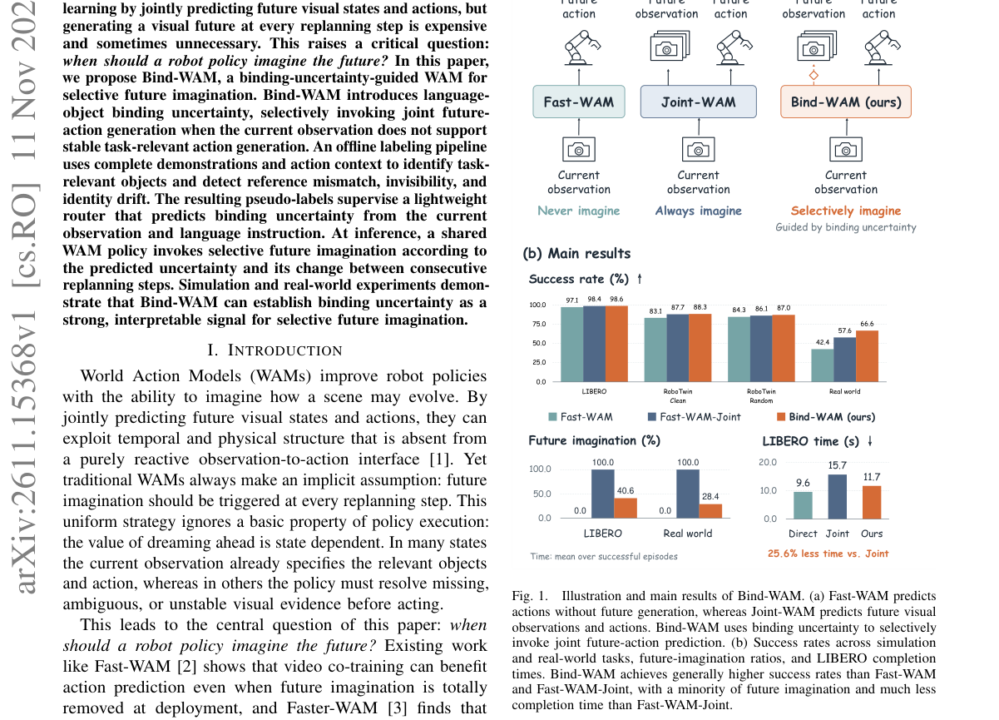

*Result - Overview of Bind-WAM. Offline binding labels capture reference mismatch, invisibility, and identity drift and supervise a lightweight predictor. At inference, the predictor estimates binding u*

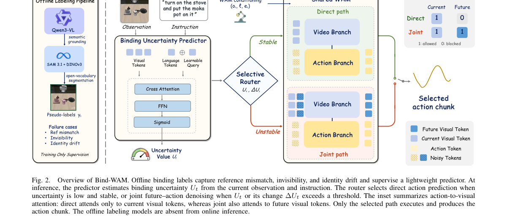

**Why this ranks #4**: 复旦、上海创新院、同济与 ROBOTOPIA 这篇把「什么时候该想象未来」做成可学习的路由：6.65M 参数的绑定不确定性预测器在 LIBERO 上取得 98.60% 平均成功率，比复现的 Fast-WAM 高 1.50 点、比始终联合去噪的 Fast-WAM-Joint 高 0.20 点，却只用了 40.58% 的未来想象比例，完成时间由 15.73 s 降到 11.71 s。

---

### 5. Probing Where Surprise Happens: Localized Violation-of-Expectation Evaluation of Video World Models

**arXiv**: [2611.18979](https://arxiv.org/abs/2611.18979) | **Score**: 7.0 (relevance 7 x 0.7 + quality 7 x 0.3) | **Direction**: `world_model` | **Tags**: embodied, voe-benchmark, v-jepa, intuitive-physics, localized-evaluation, diagnostic, University of Miami | **Categories**: cs.AI, cs.CV, eess.IV | **Pages**: 12

**Authors**: Yanbin Xu; Ming bo Cai

**Affiliation**: University of Miami; Department of Psychology, University of Miami

**Abstract**

> Violation-of-expectation (VOE) benchmarks evaluate intuitive physics in video world models by testing whether physically impossible events produce greater prediction errors than matched possible events. However, conventional VOE evaluations aggregate prediction errors across space and time, making it unclear whether successful discrimination reflects model's understanding of physical violations at the locations and time where they occur. To address this limitation, we introduce localized VOE evaluation, a framework that measures prediction error differences between possible and impossible events within spatial regions and temporal intervals associated with physical violations. We compare global, temporally localized, and spatiotemporally localized evaluations of V-JEPA models pretrained on developmental egocentric videos or large-scale natural video datasets. Our results reveal that global and localized judgments can diverge in both directions: global aggregation can either obscure correct localized discrimination or produce apparent discrimination without corresponding localized evidence. During continued pretraining on developmental egocentric videos, agreement between global and localized judgments changes non-monotonically, while confidence in localized judgments increases despite modest improvements in accuracy. Together, these findings establish localized VOE evaluation as a complementary diagnostic for assessing intuitive physics in video world models and demonstrate that global prediction errors do not necessarily reflect the spatiotemporal evidence of physical violations.

**Key findings**

- **Finding**: 在 Physical Concepts 上，24 对只被局部评测判对、19 对只被全局评测判对，47 对两者都对、60 对都错，全局与局部判定在 28.7% 的样本上不一致。
- **Inference**: 聚合后的预测误差不能代表物理违规发生的位置与时刻，VOE 分数高并不等于模型的直觉物理判断落到了正确证据上。
- **Recommendation**: 评测视频世界模型的直觉物理时同时报告全局、时间局部与时空局部三种惊讶分数；BabyView 继续预训练中，全局与局部的一致率呈非单调变化，从约 89% 降到约 59% 再回升到约 89%。

**Key figures**

*Framework - Localized VOE evaluation of V-JEPA. Predictions from C context frames are evaluated over N future frames. Spatiotemporal violation evidence annotations identify event frames (magenta) and vi*

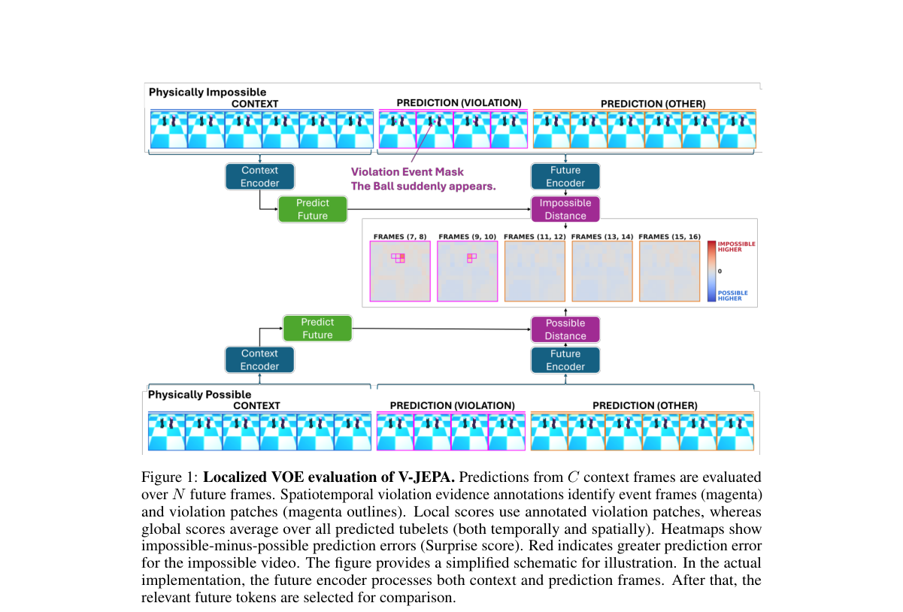

*Result - visualizes token level prediction error differences for matched possible-impossible video pairs (surprise score). For an example pair from the Physical Concepts dataset (Figure 2a), positive*

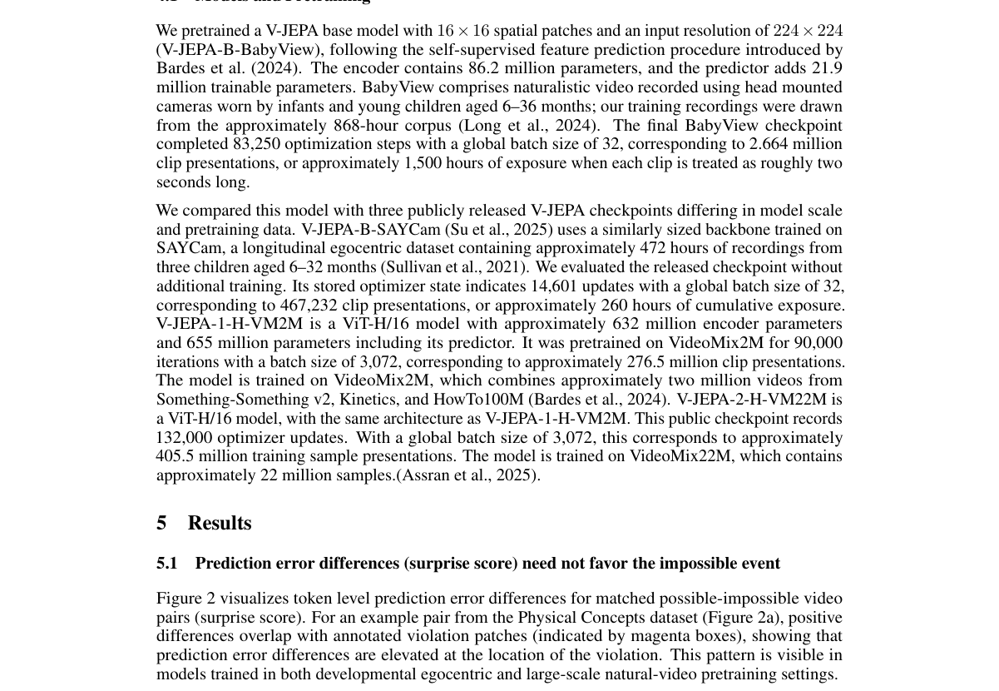

**Why this ranks #5**: 迈阿密大学这篇是评测诊断工作而非能用于规划的世界模型：作者为 VOE 基准补上时空违规证据标注后指出，在 Physical Concepts 上有一对可能/不可能视频里 28.7% 的样本让全局判定与局部判定互相矛盾，说明聚合误差并不等于模型懂物理，因此 relevance 只给到 7。

---

### 6. WeatherDreamer: Learning a World Model from Multimodal Earth Observations

**arXiv**: [2611.18393](https://arxiv.org/abs/2611.18393) | **Score**: 6.9 (relevance 6 x 0.7 + quality 9 x 0.3) | **Direction**: `world_model` | **Tags**: embodied, weather-world-model, data-assimilation, observation-only, ensemble-forecast, latent-state-space, Zeus AI | **Categories**: cs.LG, physics.ao-ph | **Pages**: 52

**Authors**: Kate Duffy; Elise Penn; Tristan Ballard; August Posch; Thomas J. Vandal

**Affiliation**: Zeus AI, Inc.

**Abstract**

> Machine learning weather models now rival operational global forecasts but still start from analyses produced by separate, expensive data assimilation (DA) systems, which for global models are typically updated every six hours. Observation-to-observation models avoid this dependence, but most omit the recursive filtering cycle that lets DA systems carry a background state through sparse, irregular observations. We introduce WeatherDreamer, a world model that learns this cycle end-to-end from 18 global observing systems, without reanalysis. It infers a latent state from observations, carries it forward hour by hour with learned dynamics, corrects it each hour with new observations, and can predict what any of its observing systems would measure at any location. At held-out stations, its ensembles beat NOAA's Global Ensemble Forecast System (GEFS) for temperature, dew point and wind out to 12 h and are better calibrated than GEFS and the ECMWF ensemble. Precipitation, cloud-top height and solar irradiance, never inputs at inference, are inferred with skill matching or exceeding operational products at short leads. Against the first guess of NOAA's Gridpoint Statistical Interpolation (GSI) DA system, WeatherDreamer's short-range departures are within 10% of GSI's at surface stations and within 25% for moisture-sensitive microwave channels, but up to five times larger for temperature-sounding channels. Never given observation errors, its learned update assumes errors close to known instrument and retrieval errors of microwave sounders and scatterometer winds. WeatherDreamer also separates viewing geometry from atmospheric state, recovering 83-96% of observed limb darkening and producing seamless nadir-view imagery. Producing an hourly global analysis in about 1.5 minutes on one GPU, WeatherDreamer shows that assimilation and forecasting can be learned together directly from observations.

**Key findings**

- **Finding**: 在留出站点上，集合预报的温度、露点与风在 12 小时预报时效内优于 NOAA 的 GEFS，且校准性优于 GEFS 与 ECMWF 集合；从未作为输入的降水、云顶高度与太阳辐照在短时效上达到或超过业务产品。
- **Inference**: 把同化循环（每小时用新观测校正）与预报一起从观测里学出来，能让全球分析从常规的 6 小时更新变成 1 小时更新，同时省掉外部再分析依赖。
- **Recommendation**: 想复用这条思路，先确认自己的任务是否真的需要条件化的动作接口；否则它更适合当作可迁移的物理观测建模方案，而不是可直接用于决策的世界模型。

**Key figures**

*Framework - Reconstructed physical variables decoded from a unified, compact la-*

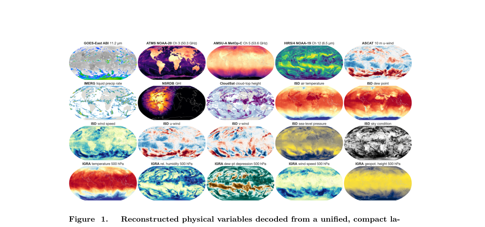

*Result - Temporal unrolling of the state-space world model. The network tracks*

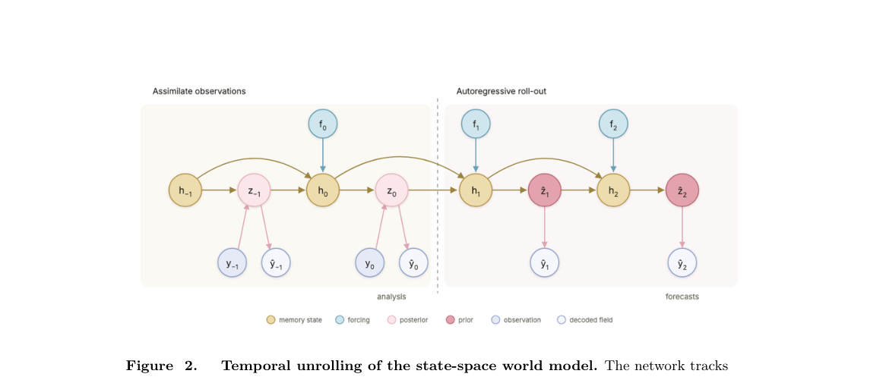

**Why this ranks #6**: Zeus AI 这篇确实是从 18 个全球观测系统端到端学出的状态空间世界模型，但整个体系只有观测输入与天气状态推进，既没有动作条件、也不服务任何决策，因此 relevance 被压到 6；真正亮眼的是在留出站点上集合预报 12 小时内优于 NOAA GEFS，且一小时全球分析在单卡上约 1.5 分钟。

---

### 7. Marginal-Preserving Coupled Diffusion Composition for Long-Horizon Planning

**arXiv**: [2611.15585](https://arxiv.org/abs/2611.15585) | **Score**: 6.3 (relevance 6 x 0.7 + quality 7 x 0.3) | **Direction**: `world_model` | **Tags**: embodied, compositional-diffusion, coupled-initialization, long-horizon-planning, training-free, mode-consistency, China University of Mining and Technology | **Categories**: cs.AI | **Pages**: 19

**Authors**: Hengrui Zhang; Qiyu Wang; Yuhu Cheng; Brooks Paige; Xuesong Wang

**Affiliation**: China University of Mining and Technology; School of Information and Control Engineering, China University of Mining and Technology; Center for Artificial Intelligence, University College London

**Abstract**

> Compositional diffusion planners extend short-horizon trajectory models to long-horizon goal-conditioned planning by generating and stitching multiple local trajectory chunks. However, in multimodal environments, local plausibility is not sufficient for global consistency: independently initialized chunks may denoise toward incompatible overlap modes, producing plans that are individually feasible but incoherent after stitching. Existing remedies typically add search, guidance, pruning, or graph-based structure at inference time, increasing computational cost or relying on task-specific machinery. We instead investigate graph-structured dependence among chunk-wise initial diffusion noises as a lightweight coordination mechanism for compositional trajectory planning. We propose \textbf{M}arginal-Preserving \textbf{C}oupled \textbf{D}iffusion \textbf{C}omposition (MCDC), a training-free inference method for pretrained compositional diffusion planners. Instead of sampling chunk noises independently, MCDC constructs coupled Gaussian initializations whose per-chunk marginals remain exactly standard Gaussian, as required by the pretrained denoiser, while neighboring chunks receive positively correlated noise components. This preserves the standard-Gaussian initialization marginal of each chunk while biasing adjacent chunks toward compatible overlap-mode choices. We prove exact marginal preservation and show, under a simple multimodal overlap model, that positive coupling increases the probability of compatible mode selection. On OGBench long-horizon stitch tasks, MCDC consistently improves over independent compositional diffusion sampling while retaining nearly the same inference time, and achieves a favorable success--cost trade-off compared with search-based composition methods.

**Key findings**

- **Finding**: 用与 CompDiffuser 相同的预训练局部扩散模型，MCDC 把 AntMaze-Large 成功率从 83.6±2.5 提到 96.0±0.7，PointMaze-Giant 从 68.0±3.2 提到 77.6±1.5，HumanoidMaze-Giant 从 42.0 提到 54.6。
- **Inference**: 相邻 chunk 的初始噪声耦合就能对齐重叠区的模式选择，说明拼接不一致往往出在采样器层而不是局部去噪器本身；玩具走廊模型里同模式概率从 0.498 升到 0.693。
- **Recommendation**: 复用预训练组合式扩散规划器时优先改初始噪声的跨 chunk 相关结构，而不是加搜索或引导项；耦合强度需按环境调，本地权重取 0.70 附近最好（主实验的 0.80 距网格最优不到 1 个百分点）。

**Key figures**

*Framework - Motivating corridor-basin toy example. (a) Two valid overlap modes are separated by an invalid region. (b) Independent chunk sampling often switches modes across overlaps, producing invalid*

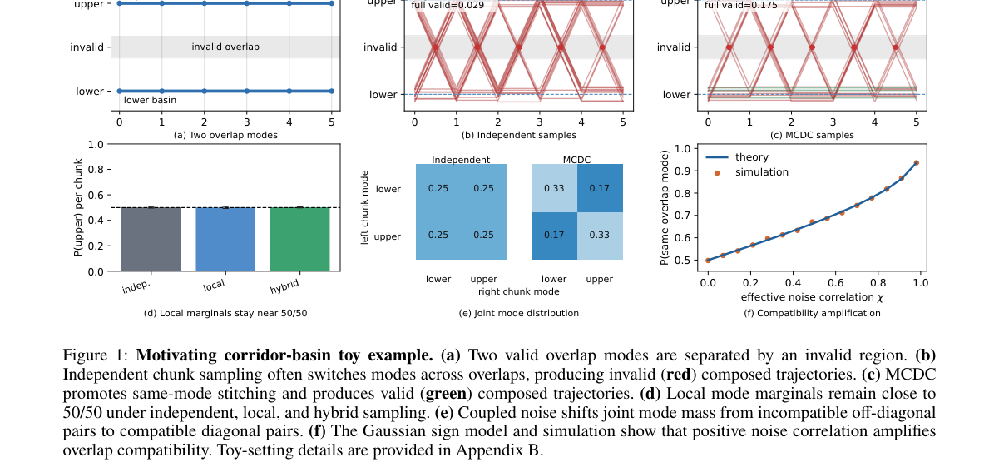

*Result - Mode conflict in AntMaze-Giant-Stitch task 1. (a) Local chunks generated by CompDiffuser and MCDC. (b) Shared overlap regions between neighboring chunks. (c) Stitching diagnostics, where red*

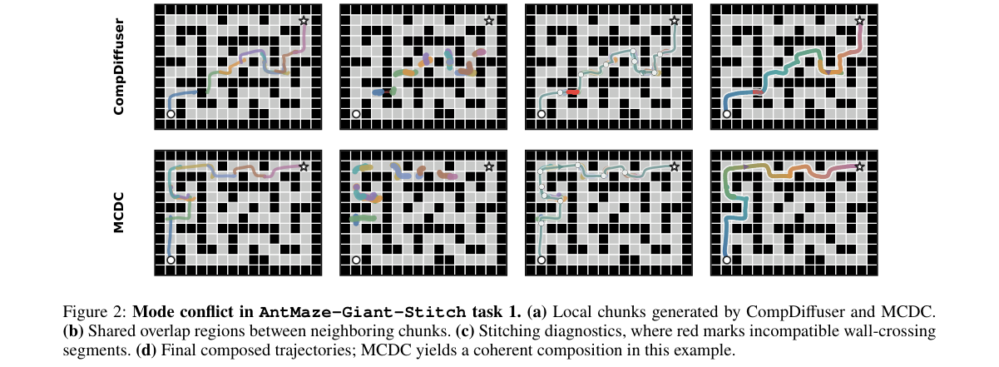

**Why this ranks #7**: 中国矿业大学与伦敦大学学院这篇不重训模型、只改采样初始化：在 OGBench 长程 stitch 任务上用同一个预训练局部扩散模型，把 AntMaze-Large 成功率从 83.6% 提到 96.0%、PointMaze-Giant 从 68.0% 提到 77.6%，但它解决的是组合式扩散规划器自身的拼接问题、并未引入新的世界模型结构，故 relevance 为 6。

---

## 具身智能与机器人学习 · `embodied_ai` (8 papers)

具身档 8 篇里 2 篇 relevance≥9。Training Reasoning Models in Simulation 最强：纯仿真、无示教，用 robot-use RL 训练 27B 开源推理模型，LIBERO 从 1.6% 拉到 74.4%，换任务 LIBERO-Pro 达 57.4% 而 π0.5 只有 0.75%，真机双臂 60%。TMA 用触觉驱动电机自适应加锥几何多指接触归纳偏置，纯仿真训练零样本迁移到 Unitree G1 拧圆门把手。UAV-Flow++ 把 Tail-Aware GRPO 用到语言引导的无人机飞行上，成功率推到 93.16%；Certify, Then Select 对冻结扩散策略采样多个 chunk 做屏障条件认证再用价值集成排序，在 robomimic/四足/人形/单车上都优于输出滤波；ACE-CaP-0 走代码即策略路线，8 个真实操作任务 92.1% 成功；STVLA 把几何基础模型特征并入时序记忆，真实叠块/物品整理/手机装盒比 π0.5 分别高 58.33/30.00/35.00 个百分点。

### 8. Training Reasoning Models in Simulation to Natively Use Real Robots

**arXiv**: [2611.18562](https://arxiv.org/abs/2611.18562) | **Score**: 9.0 (relevance 9 x 0.7 + quality 9 x 0.3) | **Direction**: `embodied_ai` | **Tags**: embodied, robot-use-rl, sim-to-real, reasoning-model, no-harness, end-effector-pose, MIT | **Categories**: cs.LG, cs.RO | **Pages**: 21

**Authors**: Jiaming Tang; Zhuoyang Zhang; Junxian Guo; Fangzhou Zhao; Yilong Zhao; Zekai Li; Xingyang Li; Yuyang Zhao; Song Bian; Zhijian Liu; Song Han

**Affiliation**: MIT; UC Berkeley; UCSD; NVIDIA

**Abstract**

> Robot-use agents (RUAs) have emerged as a promising approach to general-purpose robot control. However, strong performance has so far been achieved only by frontier proprietary models such as GPT-6 Astra and Claude Fable 5.2, whereas open-weight models remain substantially less capable. We show that an open-weight 27B reasoning model can be trained to use real robots natively through reinforcement learning, entirely in simulation and without demonstrations. Like a computer-use agent (CUA), the model observes the environment, reasons in a chain of thought, and generates the next end-effector pose, without any harness. We build a Post-training Engine for Agentic Robotics (PEAR) and use it to train the model on simulated robot tasks at scale with robot-use reinforcement learning (RURL), mirroring how frontier models acquire computer use. We find that the skills acquired in simulation generalize well beyond the training tasks: they transfer to an unseen robot, to the real world, and to novel instructions. After training on LIBERO and RoboDojo in simulation, the model succeeds in 60% of our trials on a real dual-arm robot, whereas the base model succeeds in none. On LIBERO, training raises the success rate from 1.6% to 74.4%, approaching GPT-6 Astra and GPT-6.1 Sol at maximum reasoning effort. Compared with $π_{0.5}$, a vision-language-action model fine-tuned on demonstrations, our model is substantially more robust to changes in the task itself. On LIBERO-Pro, $π_{0.5}$ succeeds in only 0.75% of episodes when assigned a new task in a familiar scene whereas our model succeeds in 57.4%. Finally, the model retains its general capabilities, with no measurable degradation on nine reasoning, coding and vision benchmarks. These results highlight robot-use reinforcement learning as a promising component of foundation-model post-training.

**Key findings**

- **Finding**: Qwen3.8-27B 在 LIBERO 上的成功率由基座的 1.6% 提升到 74.4%，超过中等推理强度的 GPT-6.1 Sol（48.1%）与 GPT-6 Astra（49.3%），接近其最高推理强度的 76.2% 与 80.6%。
- **Inference**: 纯仿真加无示教的多轮 RL 已足以让开源推理模型获得可迁移的机器人使用技能，说明「像 computer-use 那样学」是一条可行路径而非权宜之计。
- **Recommendation**: 想用开源模型做机器人不必先搭感知/规划 harness，直接在仿真里以端到端位姿为动作空间做多轮 RL；模型只输出末端执行器位姿、由机器人自己的逆运动学执行，接口就能跨本体复用。

**Key figures**

*Framework - Overview of robot-use reinforcement learning (RURL). Like a computer-use agent, the robot-use agent (RUA) observes the*

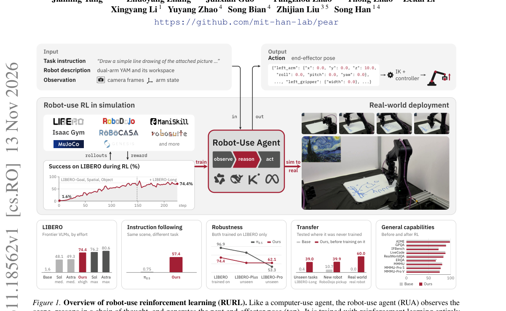

*Result - One round of robot use. A computer-use agent (top) observes a screenshot, reasons about the task and outputs a click or a*

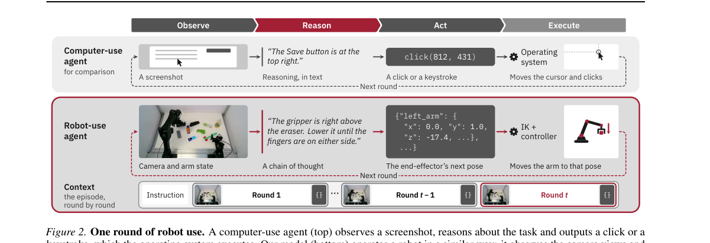

**Why this ranks #8**: MIT、UC Berkeley、UCSD 与 NVIDIA 团队这篇是本轮唯一 relevance=9 的论文，也是 embodied_ai 的第一名：完全在仿真里用 robot-use 强化学习、无示教、无任何 harness，把开源 27B 推理模型训成原生机器人使用者，LIBERO 成功率从 1.6% 拉到 74.4%，在训练中从未见过的双臂真机上完成 60% 的试验，而基座模型 0 次成功。

---

### 9. TMA: Sim-to-Real Forceful Humanoid Manipulation via Tactile-Driven Motor Adaptation

**arXiv**: [2611.18976](https://arxiv.org/abs/2611.18976) | **Score**: 8.7 (relevance 9 x 0.7 + quality 8 x 0.3) | **Direction**: `embodied_ai` | **Tags**: embodied, tactile-sensing, humanoid-manipulation, sim-to-real, motor-adaptation, forceful-grasp, Amazon | **Categories**: cs.RO | **Pages**: 9

**Authors**: Yiting Chen; Kelin Yu; Sarthak Kaingade; Bryan Trinh; Kaiyu Hang; Roberto Martin-martin; Nima Fazeli; X. Alice Wu

**Affiliation**: Amazon; Rice University; University of Maryland; The University of Texas at Austin

**Abstract**

> Recent humanoid loco-manipulation in articulated environments has largely focused on geometry-dominant interactions, where success is primarily determined by geometric alignment and motion execution. In contrast, forceful multi-finger manipulation requires the robot to adapt to real-world uncertainties in contact and interaction dynamics. We present Tactile-Driven Motor Adaptation (TMA) and an integrated whole-body system for zero-shot sim-to-real forceful humanoid manipulation, and study round-doorknob opening as a challenging benchmark requiring stable multi-finger frictional grasping, sufficient torque generation without slip, force-regulated pushing, and whole-body stability. TMA structures policy learning around interactions observable through tactile feedback, uses cone geometry as an inductive bias for multi-finger contact representation, and adapts motor behavior online from tactile history. An upper-body manipulation policy is trained alongside a pretrained general locomotion controller to coordinate dexterous interaction and whole-body stabilization. Trained entirely in simulation, TMA transfers zero-shot to a Unitree G1 humanoid with BrainCo Revo2 multi-fingered hands and substantially outperforms standard Rapid Motor Adaptation (RMA) and reactive tactile policy baselines across four commercial round doorknobs in the real world.

**Key findings**

- **Finding**: 四种商用圆门把手各 10 次试验里，TMA 的开门/抓取成功为 8/9、6/8、6/7、7/8；RMA 分别是 0/1、0/0、0/0、0/0，反应式触觉策略则是 3/7、1/6、0/4、2/6。
- **Inference**: 多指施力任务依赖的是接触状态随时间的演化而非瞬时接触信号：仿真里完整 16 维锥坐标触觉给出 91.3% 抓取与 80.9% 开门，二值接触只有 88.4% 与 73.6%。
- **Recommendation**: 做接触主导的灵巧操作时把法向载荷与切向力一起编码成锥坐标，并保留约 2 秒交互历史（50 Hz 下 100 帧）供在线适应，比只给二值接触或单独法向力有效得多。

**Key figures**

*Framework - Forceful humanoid articulated manipulation for round-doorknob opening. (a) The task requires tightly coupled stages: reaching, establishing a frictional multi-finger grasp, generating sufficie*

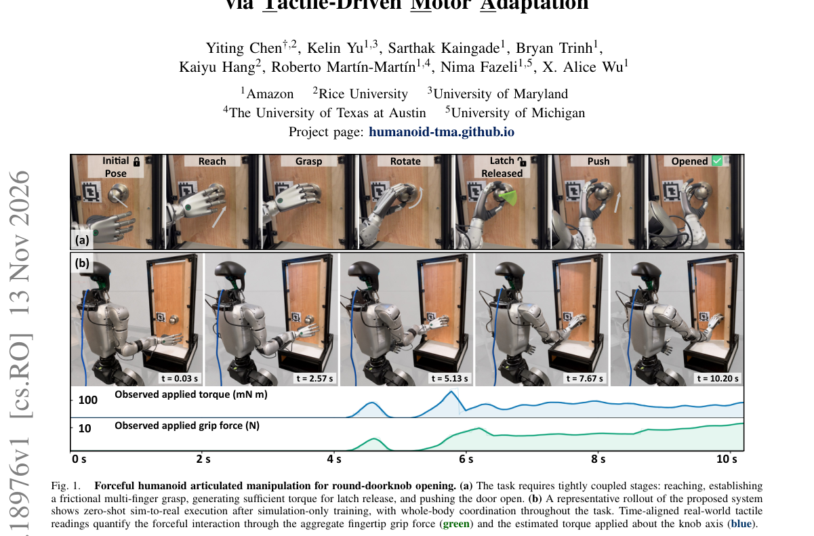

*Result - Articulated door mechanism. The door model comprises a spring-loaded knob joint θ K, a revolute hinge joint θ D, and a translating latch coupled to knob rotation. Knob rotation retracts the la*

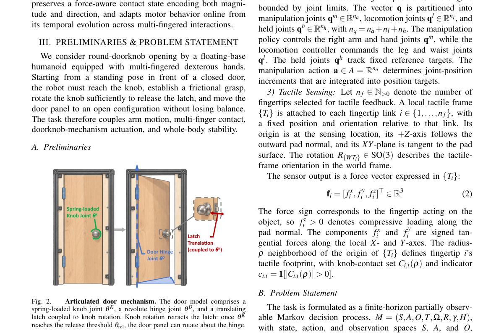

**Why this ranks #9**: Amazon 与 Rice University 等团队把「接触主导」的多指施力操作搬上 Unitree G1 配 BrainCo Revo2 多指手：四个商用圆门把手各 10 次试验中，TMA 的开门成功/抓取成功为 8/9、6/8、6/7、7/8，而 RMA 全部 0 开门，反应式触觉策略多为抓住了却开不了，因此排在 embodied_ai 第二。

---

### 10. ActionCodec2: A Streaming Action Tokenizer

**arXiv**: [2611.15490](https://arxiv.org/abs/2611.15490) | **Score**: 8.0 (relevance 8 x 0.7 + quality 8 x 0.3) | **Direction**: `embodied_ai` | **Tags**: embodied, streaming-tokenizer, action-chunking, trajectory-drift, set-bpe, vla-tokenization, Tsinghua University | **Categories**: cs.RO | **Pages**: 40

**Authors**: Zibin Dong; Yicheng Liu; Shiduo Zhang; Tianyuan Yuan; Baijun Ye; Jinqiu Wang; Hang Zhao

**Affiliation**: Tsinghua University; Galaxea AI; Fudan University

**Abstract**

> Most action tokenizers for autoregressive vision language action (VLA) models compress motion into chunks that must be decoded in full before their actions become executable. We introduce ActionCodec2, a non-neural streaming tokenizer that releases actions incrementally while keeping trajectory reconstruction error within a prescribed tolerance. Its encoder quantizes each step relative to the decoder's reconstructed state, so the selected motion primitive corrects residual error rather than allowing errors from independently quantized increments to accumulate. Finding the smallest such primitive set is a geometric covering problem; we derive the exact minimum for translation and constant-factor-tight bounds for rotation. Set-BPE then losslessly merges co-occurring primitive symbols across coordinates and neighboring steps, without a fixed coordinate ordering. A universal version fitted on 20k hours of data from 24 embodiments averages 8.8 tokens per second for 15 Hz end-effector motion on this corpus. With the same VLA backbone, ActionCodec2 outperforms the compared tokenizers on three simulation benchmarks and in zero-shot real-robot evaluation. Its streaming representation allows policies to incorporate state feedback within an action chunk, substantially improving performance over open-loop execution under randomized dynamics, external disturbances, and moving objects. The same tokens also can serve as a direct control interface for VLM agents, which compose successful action sequences into reusable macros. These agent-built macros reduce control decisions and thinking-token usage across attempts and transfer to a held-out task. More results are available at https://zibindong.github.io/actioncodec2-page/

**Key findings**

- **Finding**: LIBERO 回放中 FAST 单步误差在 1 mm 以内却累积出约 40 mm 的每集漂移、成功率仅 90%；ActionCodec2 把漂移压到 5 mm 内、回放成功率 97%，其余分词器回放成功率最高只有 80%。
- **Inference**: 逐帧独立量化的误差会沿轨迹累积，所以量化基准必须相对解码器的重建状态来定义，才能得到与轨迹相关的误差上界而不是与单帧相关的。
- **Recommendation**: 做自回归 VLA 若希望每步都吃上新观测，用相对重建状态的流式分词并配 Set-BPE 合并共现符号，可把 15 Hz 末端控制压到 8.8 token/s（关节控制 10.8 token/s），并让策略在动作块内吸收状态反馈。

**Key figures**

*Framework - Chunkwise and streaming tokenization. Left: a chunk tokenizer releases actions only after the whole chunk is decoded, and an erroneous token can affect multiple actions within the chunk; a s*

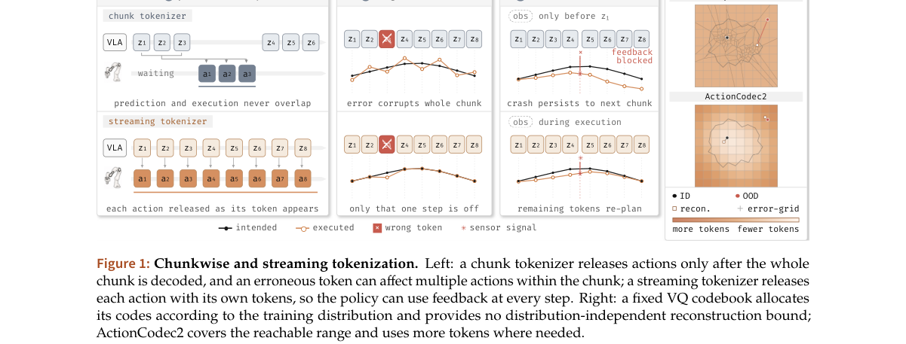

*Result - Round-trip fidelity of action tokenizers on LIBERO demonstrations (first-order variants). (a) Demonstra- tions are tokenized, decoded, and replayed open loop; raw demonstrations score 100%.*

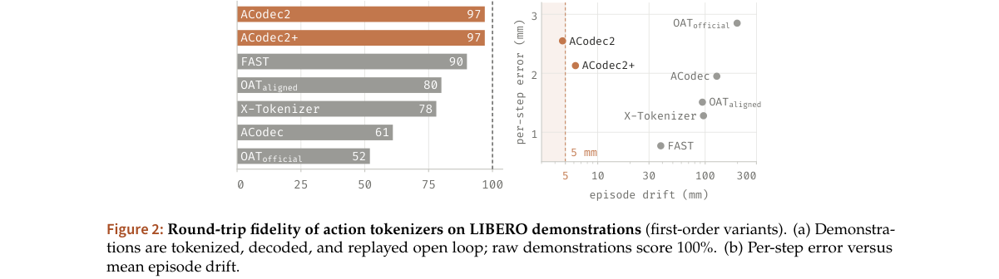

**Why this ranks #10**: 清华、Galaxea AI 与复旦这篇把动作分词从「整块解码」改成流式释放：LIBERO 开环回放里每集漂移从 FAST 的约 40 mm 压到 5 mm 以内、回放成功率由 90% 升到 97%，通用版在 24 种本体、约 2 万小时数据上 15 Hz 末端执行只需 8.8 token/s，同一 G0.5 VLA 骨干下 LIBERO 达 98.2%。

---

### 11. STVLA: Spatial-aware and Temporal-memory forVision-Language-Action Models

**arXiv**: [2611.16589](https://arxiv.org/abs/2611.16589) | **Score**: 8.0 (relevance 8 x 0.7 + quality 8 x 0.3) | **Direction**: `embodied_ai` | **Tags**: embodied, vla, spatial-memory, geometry-features, cross-attention, manipulation, AgiBot | **Categories**: cs.RO | **Pages**: 9

**Authors**: Zhuo Han; Yeqiang Wang; Xinran Wang; Hongwei Han; Yi Xiong; Zunian Wan; Jianbo Mao; Huan Peng; Yongcheng Liu; Wei Shan; Maoqing Yao

**Affiliation**: AgiBot

**Abstract**

> Robotic manipulation often requires both spatial scene understanding and task history. However, many vision-language-action (VLA) policies rely primarily on current observations, without explicitly integrating spatial structure and task history. Appearance-based memories can be sensitive to occlusion and viewpoint changes, while spatial representations of the current scene alone do not preserve how the scene has changed during task execution. We introduce STVLA, a framework that incorporates features from a pretrained visual geometry foundation model into temporal memory alongside visual representations. This allows the policy to recall past scene structure as context for current action decisions. To select informative history, STVLA uses a mathematically grounded scoring rule that balances relevance to the current observation with complementary evidence from memory. Across evaluations on LIBERO, LIBERO-Mem, MIKASA-Robo, and SimplerEnv Bridge, STVLA achieves the highest average success rate among the compared methods on each benchmark. On real-world block stacking, object organization, and phone packaging, it improves success over $π_{0.5}$ by $58.33$, $30.00$, and $35.00$ percentage points, respectively. These results support integrating scene geometry into temporal memory to improve manipulation requiring both spatial precision and task history. Project website: \href{https://stvla.github.io/}{https://stvla.github.io/}

**Key findings**

- **Finding**: 五个 LIBERO 套件上 STVLA 平均 97.8%，超过 π0.5 的 96.6% 与 MemoryVLA 的 96.5%；MIKASA-Robo 上 45.2%，高出 π0.5 12.8 点与 MemoryVLA 4.0 点。
- **Inference**: 纯外观记忆在抓取器遮挡工作区或视角变化时会失效，把几何特征与外观配对存入记忆才能在遮挡下召回结构信息。
- **Recommendation**: 给 VLA 加记忆时存外观加空间的配对条目，并用可解释的相关性-非冗余打分做检索偏置；真实叠块任务上偏置强度 β=0.5 最优（100% 对无偏置的 80%），VGGT-Ω 输入帧数取 K=4 最好。

**Key figures**

*Framework - We present STVLA, a spatial-aware and temporal-memory vision-language-action model for robotic manipulation. STVLA combines compact spatial representations distilled from a frozen visual geome*

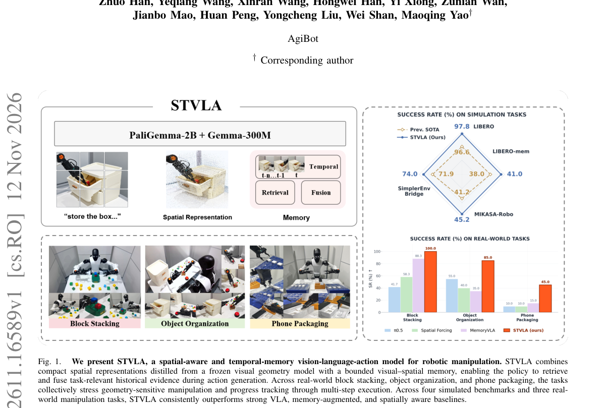

*Result - Architecture of STVLA. Current visual and spatial tokens query a bounded memory bank through score-biased cross-attention (top). Retrieved features are gated into the current representations t*

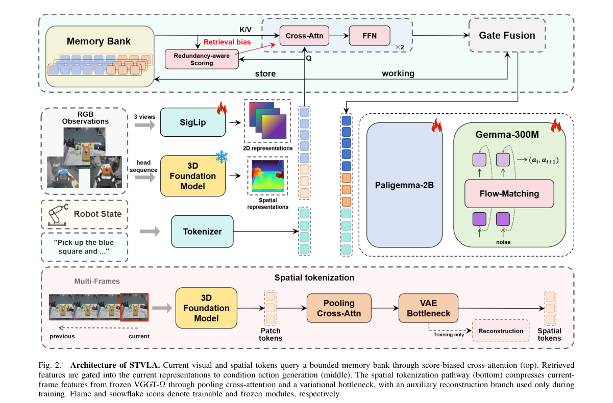

**Why this ranks #11**: AgiBot 这篇把「场景几何也该被记住」做进 VLA 的记忆体：冻结几何基础模型 VGGT-Ω 的空间 token 与视觉 token 一起写进有界记忆库并用相关性-非冗余打分检索，LIBERO 五套件平均 97.8%（比自家 π0.5 的 96.6% 高 1.2 点），MIKASA-Robo 45.2% 高出 π0.5 12.8 点，真机叠块 60 次全部成功。

---

### 12. EgoX: Egocentric Cross-Embodiment Manipulation with Embodiment Dreaming

**arXiv**: [2611.16728](https://arxiv.org/abs/2611.16728) | **Score**: 8.0 (relevance 8 x 0.7 + quality 8 x 0.3) | **Direction**: `embodied_ai` | **Tags**: embodied, cross-embodiment, modular-transformer, pretraining, embodiment-dreaming, generalist-policy, Carnegie Mellon University | **Categories**: cs.AI, cs.LG, cs.RO | **Pages**: 37

**Authors**: Yaru Niu; Binghong Chen; Changwei Yao; Shangtao Li; Zhenlong Fang; Revanth Krishna Senthilkumaran; Shuai Zhou; Yuemin Mao; Kalie Ching; Po-Ju Chao; Yudong Luo; Peiqi Yu

**Affiliation**: Carnegie Mellon University; Bosch Center for Artificial Intelligence; The University of Texas at Arlington; University of California, Berkeley

**Abstract**

> Generalist manipulation policies can benefit from the complementary experience of humans, real robots, and simulated agents. However, differences in morphology, sensing, and control interfaces make it difficult to learn effectively from their combined demonstrations. We introduce EgoX, an egocentric cross-embodiment learning framework that organizes heterogeneous demonstrations through semantically corresponding observation and action modalities. EgoX pretrains a Modularized Cross-Embodiment Transformer with Embodiment Dreaming (MXT+) on this mixture and fine-tunes it on target-embodiment demonstrations. Within each embodiment, MXT+ assigns a dedicated tokenizer to each observation modality and a dedicated expert to each action modality, with a Transformer trunk shared across embodiments. A training-only embodiment-dreaming objective predicts latent representations of future visual and proprioceptive states, encouraging the shared trunk to model each embodiment's dynamics. Across 13 task-embodiment pairs spanning five tasks and six robot embodiments, including five physical robots and one simulated humanoid, cross-embodiment pretraining raises MXT+'s average normalized task progress from 0.63 to 0.80 over training from scratch. The gains are particularly pronounced under out-of-distribution conditions, where average task progress increases from 0.53 to 0.77. Ablations demonstrate the benefits of broader pretraining mixtures, modular interfaces, and embodiment dreaming, with dreaming producing more similar latent geometry across embodiments. Project page: egox-dream.github.io.

**Key findings**

- **Finding**: 跨本体预训练把 MXT+ 的平均归一化任务进度从 0.63 提升到 0.80，在 13 个任务-本体对中 12 对取得最好成绩；OOD 条件下从 0.53 提升到 0.77。
- **Inference**: 只有当迁移发生在语义对应的模态之间、而传感与控制接口保持本体专属时，人、机器人与仿真体的混合演示才能真正拼成一个通用策略。
- **Recommendation**: 训练通用操作策略时按模态而非按本体划分网络，并加一个仅训练期的本体做梦分支预测未来视觉与本体感受潜变量，可把任务进度从 0.63 抬到 0.78 并让各本体潜空间几何更相似。

**Key figures**

*Result - Shared task structure across heterogeneous embodiments. Rows show a Human-Dex5 demonstration and rollouts of robot policies trained with EgoX for G1-Dex5, G1-Sim-Dex3, and R1Lite-Gripper on*

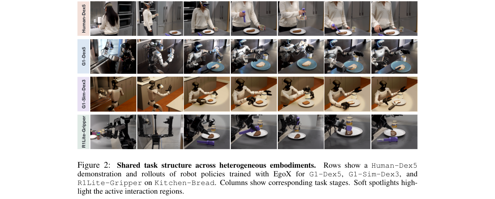

**Why this ranks #12**: CMU 与 Bosch 人工智能中心等团队这篇的赌注是「按模态而非按本体切分网络」：MXT+ 用模态专属 tokenizer 与动作专家、共享 Transformer 骨干跨本体预训练，在 13 个任务-本体对（5 任务、6 本体，含 5 个真机与 1 个仿真人形）上把平均归一化任务进度从 0.63 抬到 0.80，13 对里 12 对最好。

---

### 13. ACE-CaP-0: Real-World Code-as-Policies in the Era of Experience

**arXiv**: [2611.16872](https://arxiv.org/abs/2611.16872) | **Score**: 8.0 (relevance 8 x 0.7 + quality 8 x 0.3) | **Direction**: `embodied_ai` | **Tags**: embodied, code-as-policies, agentic-robotics, demonstration-on-request, simulation-on-demand, real-world-control, ACE Robotics | **Categories**: cs.RO | **Pages**: 17

**Authors**: ACE-CaP Team; Changxu Wei; Yunpeng Qing; Guozheng Ma; Bowen Liu; Zexin He; Yilun Kong; Haoming Gu; Jingyuan Liu; Tianyu Zhu; Jianfei Wang; Junqiang Kou

**Affiliation**: ACE Robotics; The Hong Kong Polytechnic University; Zhejiang University; Nanyang Technological University

**Abstract**

> Recent advances in frontier models have pushed the boundaries of agentic robot control, enabling agents to perform complex robotic tasks through reasoning and interaction. However, repeated calls to these models during execution can substantially increase task completion time. Code as Policies (CaP) offers a route for coding agents to acquire physical skills through experience and retain them in executable programs, allowing the reasoning invested in development to be reused across runs. Developing reliable code policies while limiting the cost of physical experimentation remains a central challenge. We investigate human guidance as a source of priors for feasible actions and simulation as an auxiliary environment for exploring and testing candidate policies. Our findings favor robot demonstrations available on request and simulation used selectively during real-world policy refinement. These findings inform ACE-CaP-0, an agentic recipe that couples policy revision with experience acquisition through Demonstrations on Request and Simulation on Demand. Across eight real-world manipulation tasks spanning alignment, multi-object handling, and bimanual coordination, the resulting frozen programs achieve 92.1\% success (221/240 trials). Mean execution times across tasks range from 0.97 to 2.27 minutes. The programs execute with runtime perception and control, without a human or coding agent in the loop. These results highlight CaP's potential to turn experience into reliable, reusable physical skills.

**Key findings**

- **Finding**: 八个真实世界操作任务各 30 次评测，冻结代码策略总体成功 92.1%（221/240），各任务平均执行时间从 0.97 分钟到 2.27 分钟不等，充电头插入类任务达 100%。
- **Inference**: 把开发期的推理固化成可执行程序，既摊薄了前沿模型反复调用的时间成本，也让每次失败都能落到具体代码改动上而不是重新采样。
- **Recommendation**: 用代码策略时优先采用按需索要示教加按需用仿真的组合，评测前把程序冻结以免开发期过拟合到场景，并允许每个任务最多十次人工复位来换取可行的示教。

**Key figures**

*Framework - ACE-CaP-0: from targeted experience to standalone robot execution. Left: a coding agent refines policies on the robot, requesting robot demonstrations and using simulation as needed. Right: e*

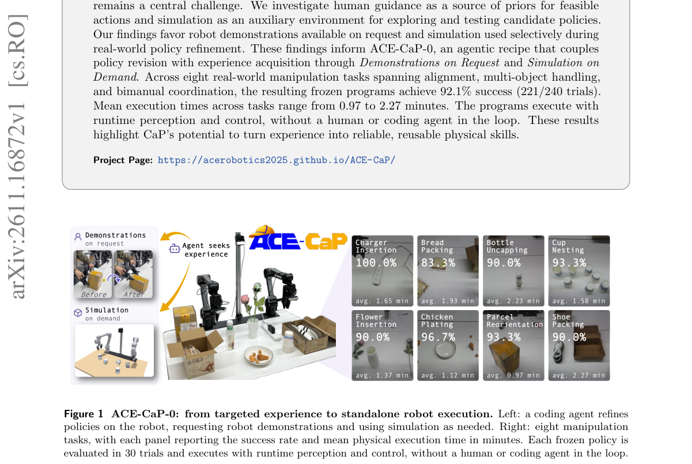

*Result - Guidance form for charger insertion. Top: textual guidance, robot-egocentric human video, and robot demonstrations, all available on request during real-only development. Both demonstration c*

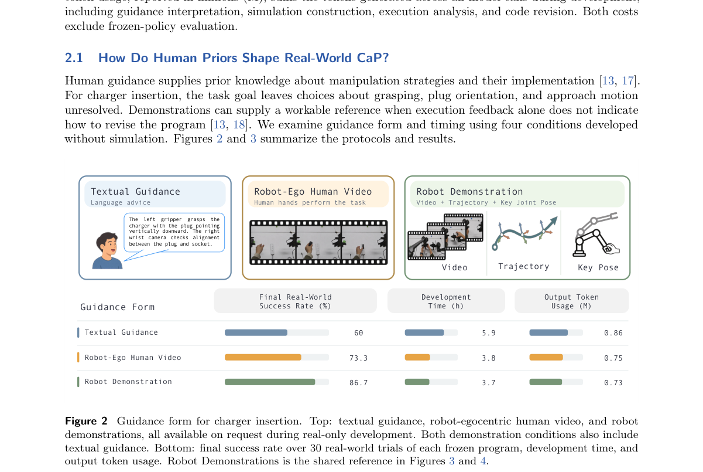

**Why this ranks #13**: ACE Robotics 与港理工、浙大、南洋理工这篇把「代码即策略」做成了可复用配方：按需索要机器人示教加按需用仿真验证，八个真实操作任务的冻结程序在 240 次试验中成功 221 次（92.1%），单任务平均执行时间 0.97–2.27 分钟，且运行时不需要人或编码智能体在场，因此在本 direction 排第七。

---

### 14. UAV-Flow++: A Unified Suite for Benchmarking and Learning Language-Guided UAV Flight

**arXiv**: [2611.17163](https://arxiv.org/abs/2611.17163) | **Score**: 8.0 (relevance 8 x 0.7 + quality 8 x 0.3) | **Direction**: `embodied_ai` | **Tags**: embodied, uav, language-conditioned-flight, vla, tail-aware-grpo, benchmark, Beihang University | **Categories**: cs.CV, cs.RO | **Pages**: 22

**Authors**: Donglin Yang; Xiangyu Wang; Yantong Zhong; Wenhao Zheng; Zihan Ding; Yue Liao; Hongsheng Li; Ke Xu; Si Liu

**Affiliation**: Beihang University; National University of Singapore; MMLab, The Chinese University of Hong Kong

**Abstract**

> Language-guided UAV navigation has largely focused on long-horizon route planning, leaving short-range, object-relative flight maneuvers underexplored. To address this gap, we formulate Flying-on-a-Word (Flow), a task requiring a UAV to convert concise natural-language instruction, egocentric visual observation, and current state dynamics into continuous flight actions. Flow encompasses both primitive motion commands and complex object-interactive behaviors, assessing motion intent comprehension and spatial context grounding. To enable policy learning and closed-loop evaluation, we introduce UAV-Flow, a comprehensive dataset comprising 30,692 expert-piloted real-world trajectories across eight distinct motion categories, alongside 10,109 simulation trajectories in the UAV-Flow-Sim environment equipped with task-specific completion criteria. Furthermore, we develop FlowVLA, which undergoes imitation pretraining on mixed real-sim demonstrations and online post-training via Tail-Aware GRPO (TGRPO). By leveraging group reward distributions, TGRPO effectively reinforces high-reward action sequences. Evaluated on 273 held-out UAV-Flow-Sim episodes, pretrained FlowVLA achieves a mean success rate of 75.58%, outperforming the strongest baseline by 6.72 percentage points, which TGRPO post-training further elevates to 93.16% with superior sample efficiency. Physical UAV experiments demonstrate robust execution of object-relative commands in both indoor and outdoor real-world scenes. Together, Flow establishes a novel benchmark and learning framework for language-conditioned flight maneuvers.

**Key findings**

- **Finding**: 在 273 个留出的 UAV-Flow-Sim 回放上，混合真机与仿真示教预训练的 FlowVLA 成功率为 75.58%，比最强基线高 6.72 个百分点；Tail-Aware GRPO 后训练进一步升到 93.16%。
- **Inference**: 短程机动要的是把语言意图翻译成可执行轨迹的动作级对齐，长程语义规划与低层规划器都补不上这一层，所以需要专门的数据与闭环评测。
- **Recommendation**: 用 GRPO 做闭环后训练时改用尾部感知优势，给组内只有少数样本到达的高奖励区间更大权重，并用轨迹级完成度而非单步奖励作为回报。

**Key figures**

*Framework - Overview of UAV-Flow++. UAV-Flow++ comprises real-world flight demonstrations, an interactive simulation suite, and a vision-language-action policy for language-conditioned UAV maneuvers. Th*

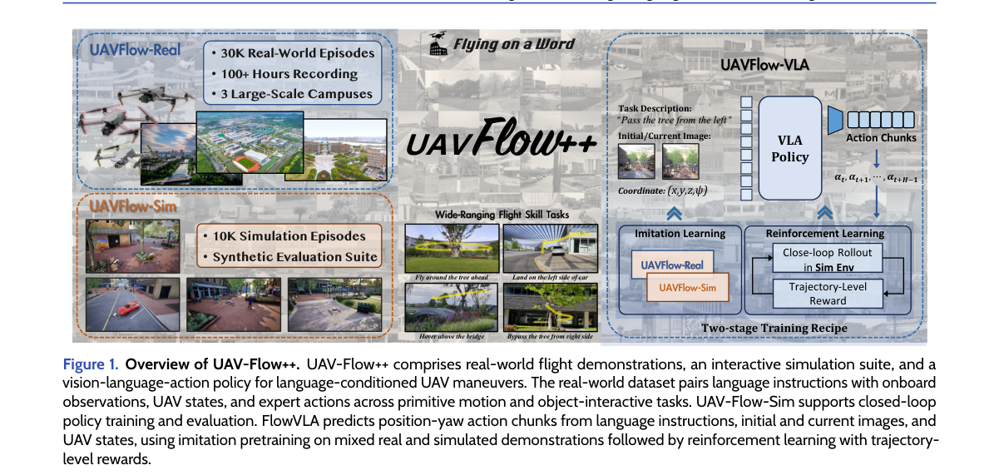

*Result - Representative Flow tasks. Examples show scene observations, natural-language instructions, and corresponding 3D flight trajectories for hovering, approaching, retreating, passing, orbiting,*

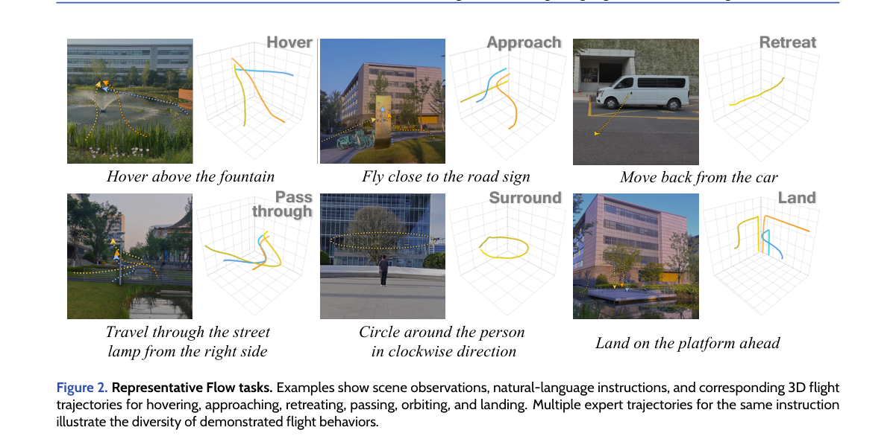

**Why this ranks #14**: 北航、新加坡国立与港中文 MMLab 这篇补的是语言引导无人机短程机动这块空白：UAV-Flow 含 30,692 条真机专家轨迹（8 类运动）与 10,109 条仿真轨迹，FlowVLA 混合真机-仿真示教预训练后成功率 75.58%（超最强基线 6.72 个百分点），再经 Tail-Aware GRPO 后训练升到 93.16%。

---

### 15. Certify, Then Select: Viability-Aware Runtime Steering of Frozen Diffusion Policies

**arXiv**: [2611.19047](https://arxiv.org/abs/2611.19047) | **Score**: 8.0 (relevance 8 x 0.7 + quality 8 x 0.3) | **Direction**: `embodied_ai` | **Tags**: embodied, diffusion-policy, runtime-safety, barrier-certificate, value-ensemble, viability, SUPSI-IDSIA | **Categories**: cs.LG, cs.RO, eess.SY | **Pages**: 32

**Authors**: Angelo Moroncelli; Loris Roveda

**Affiliation**: SUPSI-IDSIA; Politecnico di Milano

**Abstract**

> Diffusion policies, which generate short action sequences by denoising random noise, are a leading way to learn robot skills from demonstrations. Once deployed, they meet constraints the demonstrations never contained, and retraining for each is impractical. A safety filter edits the policy's action to satisfy them, but the edit ignores the task, and a large edit can leave the policy where it cannot continue. We propose CAST (Certified Action Selection at Test time): draw a few action chunks from the frozen policy, certify each with a barrier condition, and execute the certified chunk that a learned value ensemble ranks highest. We prove that a certified step is safe whatever the critic does; that, whenever a certified sample exists, the executed chunk stays within log N nats of the policy conditioned on feasibility, while a safety-filter projection can be singular to it; and that an exact closed-loop identity splits the gain of ranking into availability, spread and the critic's target. Certifying the next chunk is not enough: a generative controller can have safe actions available now and none later. We characterise the safe control authority of a frozen policy under finite sampling, and CAST-V preserves it through a policy-conditioned viability, estimated with a model under a finite-sample guarantee or learned from the controller's own logs (CAST-VL). On robomimic manipulation, a planar quadrotor, a MuJoCo humanoid and a unicycle, with frozen policies, CAST raises joint task-and-constraint success above the output filter in nearly every setting; certifying before ranking is decisive where a filter's edit is large, and viability removes most dead ends that one-step certification cannot see. Project page: https://clmoro.github.io/cast.

**Key findings**

- **Finding**: robomimic Can 的五类运行期请求上，冻结策略联合成功率 0.00–0.34、最大违规率 73.5%，输出滤波器把违规压到 2.5% 但成功率只有 0.37–0.61，CAST 则做到 0.70–0.89 且违规率仅 0.5%。
- **Inference**: 过滤器只回答动作是否安全，选择式方法额外回答执行完之后还能不能完成任务，所以在需要大幅修正策略动作的请求上差距最大。
- **Recommendation**: 面对策略没见过的约束，先采样若干动作块逐个做屏障认证再排序，并额外估计策略自身的可行动性：单步认证看不到死路，加可行动性后独轮车从 0.81 升到 0.99。

**Key figures**

*Framework - Edit or select. A keep-out zone, unseen in training, blocks one of the two routes of a*

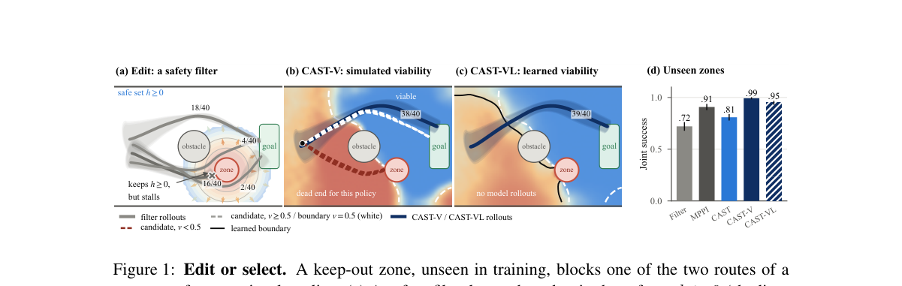

*Result - New requests, frozen models. Joint success on requests fixed in advance and evalu-*

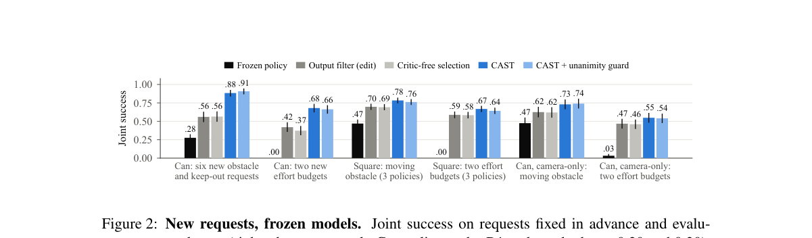

**Why this ranks #15**: SUPSI-IDSIA 与米兰理工这篇解决的是冻结扩散策略部署期撞上新约束的问题：在 robomimic Can 的五类请求上，CAST 只用 8 个样本就把联合成功率从输出滤波器的 0.37–0.61 提到 0.70–0.89，最大违规率从冻结策略的 73.5% 压到 0.5%，代价是每次决策约 15 ms，因此排在本 direction 末位。

---

## Footer

- Total papers reviewed across all 4 axes: 60
- world_embodied axis final count: 15
- Wild-cards in this axis: 0
- Figure assets: 2026-11-17/res/

Generated by `mine-arxiv-daily-digest` skill. Sister file: `2026-11-17_world_embodied_entry.md`.
