# Mine Arxiv Daily Digest - 2026-11-18 (AIGC 视觉生成与编辑 Axis, 13 papers)

**Generated**: 2026-11-18 12:30 CST

**Source**: arXiv cs.CV, cs.SD, eess.AS, cs.CL, cs.AI, cs.RO, cs.LG, cs.IR submissions, listing day 2026-11-13..2026-11-16 (announced 2026-11-16 20:00 ET = 2026-11-17 01:00 UTC)

**Batch window**: 2026-11-12T19:00:00Z .. 2026-11-17T19:00:00Z（arXiv 公告批次横跨两个 UTC 日：从前一日的美东 14:00 截止时刻起算（EDT 为 18:00Z，EST 为 19:00Z），到当日的同一时刻为止）

**Axis**: aigc_visual (13 papers, base 15, cap 20)

**Directions**: aigc_generation (9), aigc_editing (3), aigc_rl (1)

**Selection**: 13 papers ranked by relevance x quality, with 0 wild-card slots

**Day total**: 60 papers across 4 axes (target 60)

**Scope**: 图像 / 视频 / 3D / 4D 内容的生成与编辑，以及面向视觉生成的 RL / 偏好优化与奖励模型

**Wild-card**: 0（本 axis 本批次够格供给充足，未启用补位名额）

---

## AIGC 生成（图像 / 视频 / 3D / 4D） · `aigc_generation` (9 papers)

### 1. TetraCoder: Adaptive Tetrahedral Encoding for Neural Fields

**arXiv**: [2611.18267](https://arxiv.org/abs/2611.18267) | **Score**: 8.7 (relevance 9 x 0.7 + quality 8 x 0.3) | **Direction**: `aigc_generation` | **Tags**: AIGC-visual, neural-field, tetrahedral-encoding, hash-free, implicit-sdf, novel-view-synthesis, University of Trento | **Categories**: cs.CV, cs.GR | **Pages**: 11

**Authors**: Daniele Della Pietra; Antonella Rech; Nicola Conci; Nicola Garau

**Affiliation**: University of Trento

**Abstract**

> Implicit and explicit representations of geometry are central in computer graphics applications and come with their pros and cons. With surface sampling being faster on explicit representations and spatial queries being faster on implicit representations, finding efficient conversions between them is a highly desirable property. We present TetraCoder, a single resolution hash-free adaptive tetrahedral encoding that links an explicit tetrahedral spatial encoder with an underlying implicit signed distance field (SDF). The resulting hybrid implicit-explicit space is continuous piecewise affine (CPWA) by design, allowing to obtain an exact correspondence between the implicit SDF and the explicit analytic mesh. TetraCoder's design comes with additional perks, in particular: (a) it scales better than multi-resolution encoding methods due to its single resolution optimizable grid, (b) unlike hash-based methods, it is not affected by collisions, (c) it enables fast tetrahedral ray-tracing, geometry and appearance editing, directly through its adaptive tetrahedral scaffold. We demonstrate the versatility of TetraCoder by showing an improvement over state-of-the-art methods on multiple tasks: 2D/3D fitting from images and point clouds, 3D novel view synthesis, 3D reconstruction, and geometry/appearance editing.

**Key findings**

- **Finding**: Stanford 表面重建上 TetraCoder 的平均 Chamfer 距离为 1.611×10⁻³（TetraSDF Large 为 1.718×10⁻³），解析提取 0.446 s 对 2.859 s，参数量 5.221 M 对 16.778 M，瘦长三角形占比 9.14% 对 19.55%。
- **Inference**: 单一分辨率网格没有哈希碰撞、只需优化一层，所以在精度、提取速度和内存三项上能同时压过多分辨率哈希，说明显式四面体骨架足以替代生成管线的几何基底。
- **Recommendation**: 做 3D 资产或新视角合成时可直接换用四面体编码基座，并利用「显式网格 = 隐式 SDF」的对应关系在四面体骨架上直接改形改色，无需另训编辑分支。

**Key figures**

*Framework - We present TetraCoder, an adaptive tetrahedral encoding for neural fields. Multiresolution hash encoding (left) interpolates features on fixed spatial grids at multiple resolutions. Its trilin*

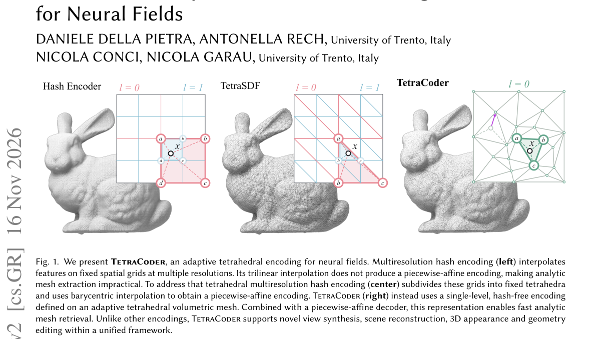

*Result - Tetrahedral ray tracing. For a sample 𝑥𝑗along the ray 𝑟(𝑡) = 𝑜+𝑡𝑑, an adjacency walk (purple) locates the containing cell. Shading highlights the visited cells, while green arrows indicate fac*

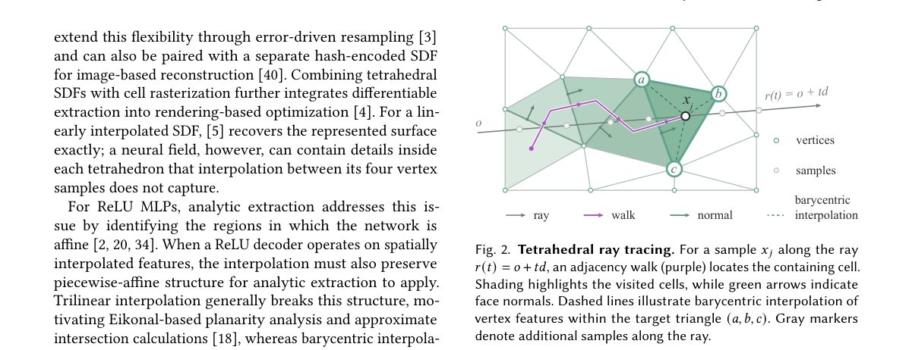

**Why this ranks #1**: 单分辨率、无哈希的自适应四面体编码把隐式 SDF 与显式网格一一对应，等于换掉了生成管线里的几何基底：Stanford 表面重建上平均 Chamfer 距离从 TetraSDF Large 的 1.718×10⁻³ 降到 1.611×10⁻³，解析网格提取耗时从 2.859 s 缩到 0.446 s、参数量从 16.778 M 降到 5.221 M，瘦长三角形占比也从 19.55% 降到 9.14%；新视角合成在 NeRF Synthetic 与 DTU 上均值 PSNR 32.81 dB、SSIM 0.9560，高于 Instant-NGP 的 32.51 dB 与 0.9510。

---

### 2. LongCat-Video-Avatar 1.6 Technical Report

**arXiv**: [2611.18822](https://arxiv.org/abs/2611.18822) | **Score**: 8.7 (relevance 9 x 0.7 + quality 8 x 0.3) | **Direction**: `aigc_generation` | **Tags**: AIGC-visual, audio-driven-avatar, grpo, dmd2-distillation, on-policy-self-distillation, long-video-rollout, Meituan | **Categories**: cs.CV | **Pages**: 15

**Authors**: Meituan LongCat Team; Xunliang Cai; Yiqi Chen; Feng Gao; Xiaoyu Kong; Le Li; Hongyu Liu; Xiaoming Wei; Tianyu Yang; Yong Zhang; Sijie Zhao

**Affiliation**: Meituan

**Abstract**

> Recent advances in audio-driven avatar video generation have enabled increasingly realistic synthesis, yet achieving precise lip-audio synchronization, natural, human-like motion, and visual consistency over long sequences remains challenging. We present LongCat-Video-Avatar 1.6, which builds on LongCat-Video-Avatar 1.5 to improve expressive naturalness and reduce error accumulation during extended generation, e.g., exaggerated lip movements and overly red, temporally unstable lip coloration, enhance the naturalness of facial expressions and coordinated head and body movements. These improvements are driven by a refined post-training pipeline that integrates reinforcement learning, improved classifier-free guidance strategies for DMD-based few-step distillation, long-video rollouts, and on-policy distillation. Together, these refinements improve expressive realism and enable the generation of videos exceeding 10 minutes while maintaining visual quality and temporal consistency. Arena evaluations show that LongCat-Video-Avatar 1.6 outperforms its predecessor and competing commercial audio-driven avatar models, demonstrating the effectiveness of the improved post-training pipeline.

**Key findings**

- **Finding**: 在 33,051 张有效投票、15 组模型对的 Avatar Arena 中，LongCat-Video-Avatar 1.6 的 Bradley–Terry Elo 为 1068.1，在六个模型里排第二，落后闭源 OmniHuman-2.0 的 1236.7，但领先 1.5 版、HeyGen、OmniHuman-1.5 与 Kling Avatar 2.0。
- **Inference**: 把蒸馏、奖励优化与自蒸馏 rollout 拆成两条独立 LoRA 分支再合并启用，说明长视频数字人的瓶颈是误差累积与唇动不自然这类后训练问题，而不是底模容量不足。
- **Recommendation**: 复刻音频驱动数字人时优先投资后训练：底模保持冻结、GRPO 与 on-policy 自蒸馏分成两条 LoRA，并对唇周偏红和长时漂移单独设计损失与评测项。

**Key figures**

*Framework - Arena. Human preference comparison across six avatar generation models, based on 33,051 valid individual votes across 15 model pairs. Models are ranked by Bradley–Terry Elo scores, with high*

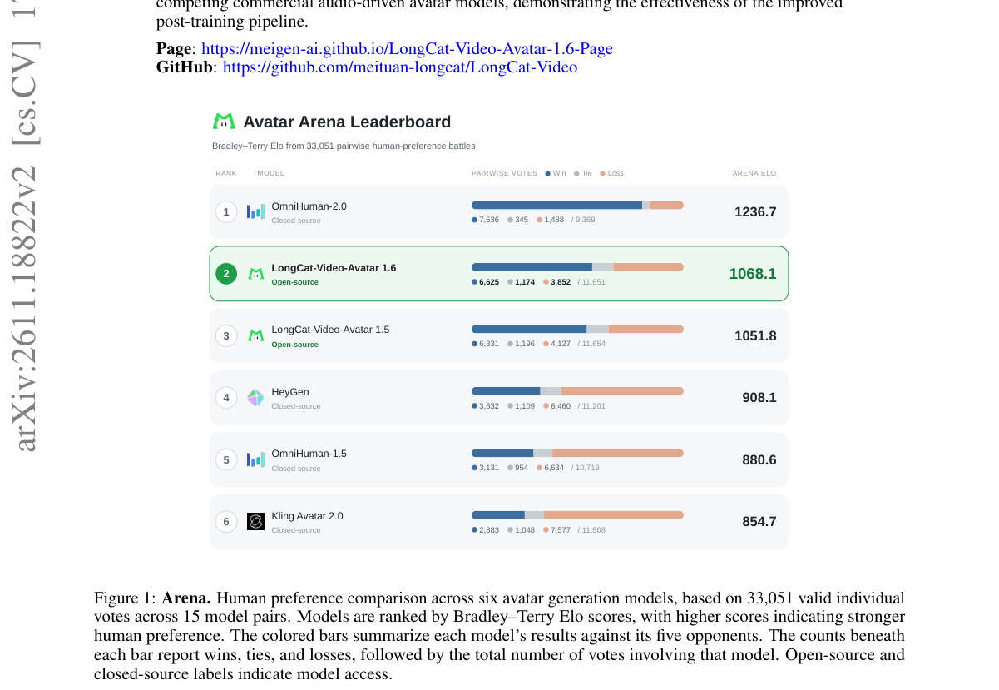

*Result - Demonstration of video frames generated by LongCat-Video-Avatar 1.6 across various application scenarios, including interviews, acting, singing, and animation.*

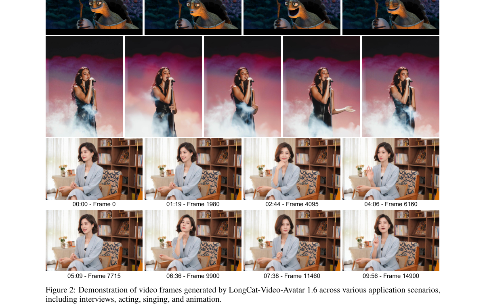

**Why this ranks #2**: 音频驱动数字人的长视频质量瓶颈在「夸张唇动 + 唇周偏红 + 长时误差累积」，本文把这些都交给后训练管线：底模冻结，GRPO 奖励优化与 DMD2 少步蒸馏加 on-policy 自蒸馏各挂一条 LoRA，推理时合并启用；采样从 50 步压到 8 步，视频长度超过 10 分钟；在 33,051 张有效票、15 组模型对的人类偏好 Arena 中以 Bradley–Terry Elo 1068.1 位列六个模型第二，仅次于闭源 OmniHuman-2.0 的 1236.7，并超过 1.5 版、HeyGen、OmniHuman-1.5 与 Kling Avatar 2.0。

---

### 3. MORE: Merge Once, Route Early for Training-Free Multi-Subject Composition from Large LoRA Pools

**arXiv**: [2611.21077](https://arxiv.org/abs/2611.21077) | **Score**: 8.7 (relevance 9 x 0.7 + quality 8 x 0.3) | **Direction**: `aigc_generation` | **Tags**: AIGC-visual, lora-pool, training-free, multi-subject-composition, subspace-regression, flux, [unverified] | **Categories**: cs.CV | **Pages**: 27

**Authors**: Tian Xia

**Affiliation**: [unverified]

**Abstract**

> Public hubs offer many personalized LoRAs per text-to-image backbone, yet composing two of them in one image remains fragile. In FLUX, keeping a pool of $K=10$ or $20$ subject LoRAs loaded makes their deltas interfere, and even loading only the two requested LoRAs keeps both subjects in fewer than 4% of images: one subject vanishes, the two fuse, or the image splits into a collage. We present MORE (Merge Once, Route Early), a training-free two-stage pipeline for FLUX. Merge once: the whole pool is folded into a single fixed-rank adapter by the subspace-regression router of SSR-Merge, made reliable by ridge, rank and calibration choices, and factored exactly into a shared part and per-subject parts. Route early: during the first 30% of the denoising steps each subject's part is gated to its layout region; a decaying soft attention bias ties every region to its own subject tokens, and a cyclic swap guidance extrapolates away from the prediction with the subjects' regions permuted, which counteracts region homogenization. On held-out seeds, MORE keeps both subjects in 94.2% ($K=10$) and 78.3% ($K=20$) of images, against 50.8% / 35.8% for FreeFuse and 25.0% / 24.2% for LoRAShop, and reaches an ImageReward of 1.32 (best baseline 0.07), while all $K$ subjects stay in one adapter. With layouts inferred automatically it still keeps both subjects in 70.0% / 55.0% of images.

**Key findings**

- **Finding**: 留出种子上 MORE 保持双主体共存的图片比例为 94.2%（K=10）与 78.3%（K=20），对照 FreeFuse 的 50.8%/35.8% 与 LoRAShop 的 25.0%/24.2%；ImageReward 达 1.32，最好基线仅 0.07，且全部 K 个主体共用同一个 rank-8/16 适配器。
- **Inference**: 只要在去噪前 30% 把每个主体的分区参数门控到自己的区域、再用循环交换引导抵消区域同质化，静态合并引入的互相干扰就能被早期路由压下去。
- **Recommendation**: 生产环境要维护几十个主体 LoRA 时可照搬「一次合并 + 早期路由」的两段式管线，并把双主体共存率与 ImageReward 当作合并质量的验收指标。

**Key figures**

*Framework - Composing personalized subjects from a pool of K LoRAs in FLUX. All K subject LoRAs are merged once into a single rank-8 (K=10) or rank-16 (K=20) adapter; at inference, the subjects named in*

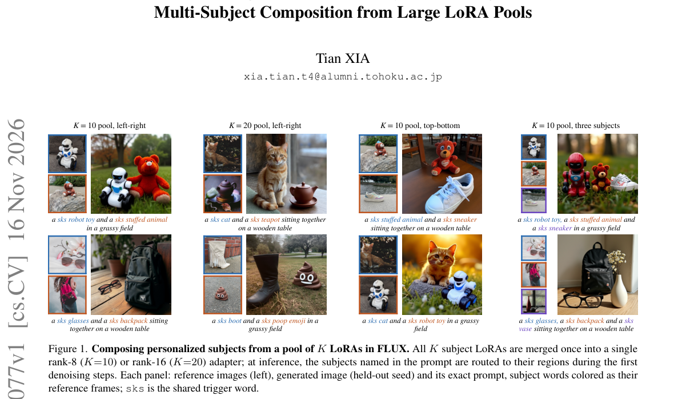

*Result - Overview. Stage 1 merges the pool once with the SSR-Merge router on our calibration statistics, compresses it to rank r, and factors it exactly into a shared part W0 and per-subject parts Wk*

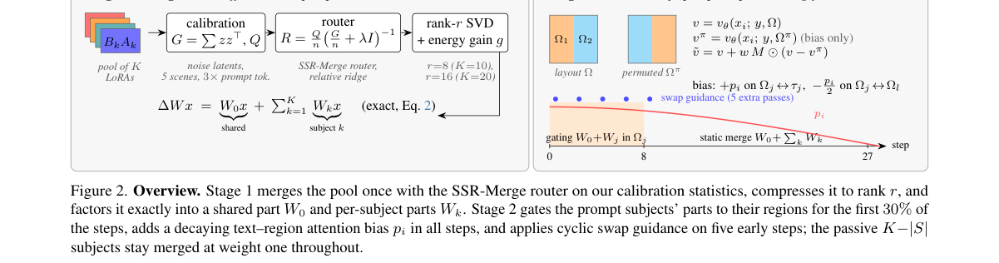

**Why this ranks #3**: 解决的是生产环境最常见的痛点：同一个 FLUX 底模上池化 K 个主体 LoRA 后，单纯加载两个目标 LoRA 也只有不到 4% 的图能同时保住两个主体。本文用 SSR-Merge 的子空间回归路由器把整个 K=10/K=20 的 LoRA 池一次性压成单个 rank-8/rank-16 适配器并精确分解成共享部分与各主体部分，再在前 30% 去噪步把各主体门控到自己的布局区域、用循环交换引导抵消区域同质化；留出种子上双主体共存率从 FreeFuse 的 50.8%/35.8%、LoRAShop 的 25.0%/24.2% 提到 94.2%/78.3%，ImageReward 1.32 而最好基线只有 0.07。

---

### 4. Reference Forcing: Long Video Generation with Region-Guided Drift Correction

**arXiv**: [2611.21559](https://arxiv.org/abs/2611.21559) | **Score**: 8.7 (relevance 9 x 0.7 + quality 8 x 0.3) | **Direction**: `aigc_generation` | **Tags**: AIGC-visual, long-video, drift-correction, kv-cache, attention-mask-distillation, subject-consistency, University of Rochester | **Categories**: cs.CV | **Pages**: 17

**Authors**: Sheng Zhao; Haitian Zheng; Weikai Lin; Junjie Zhao; Yuhao Zhu

**Affiliation**: University of Rochester; Adobe

**Abstract**

> Long video generation should keep the subject and background consistent while supporting rich, natural motion. However, autoregressive models are often distilled with distribution matching distillation (DMD) over short windows, which does not train them to keep this consistency over long ranges. As a result, the subject and background can drift over time. Methods that manage the key-value (KV) cache retain or retrieve history to reduce drift. Yet this history may itself have drifted. We propose Reference Forcing, which uses the initial frames as an appearance reference. We first build a teacher that uses attention masks to force each region of a new frame to attend to the same region in the initial frames. The teacher finds these regions with off-the-shelf segmentation models. We then distill this behavior into a separate attention path of the student, which needs no external models at inference. We further introduce value correction, which corrects drifted values in the KV cache toward the matching values of drift-free initial frames. Experiments show that Reference Forcing achieves state-of-the-art subject and background consistency among long-video methods on different base models, and its advantage grows with video length. Ablations show both components are needed to gain consistency without losing motion. More visualizations and code are available at https://zhaosheng-thu.github.io/reference-force/

**Key findings**

- **Finding**: MovieGenBench 上 VBench-Long 30 秒时主体一致性 97.55、背景一致性 96.70，60 秒时仍为 97.56/96.67，平均排名在六个对比方法中均为第一；同时能单次生成两小时视频，0/30/60/90/120 分钟抽帧的一致性保持稳定。
- **Inference**: 漂移同时来自「短窗蒸馏不惩罚外观漂移」和「缓存历史本身已漂移」，因此必须从注意力锚点与 KV 值修正两端同时下手，单修一处不够。
- **Recommendation**: 做长视频时把首帧做成外观参考（教师用 Grounding DINO 加 SAM 2 分割、光流配背景），推理侧不引入任何外部模型，只保留训练时的 value 修正项。

**Key figures**

*Framework - Examples of two-hour videos generated by Reference Forcing. Each row shows frames at 0, 30, 60, 90, and 120 minutes and, on the right, the consistency of the subject and the background, meas*

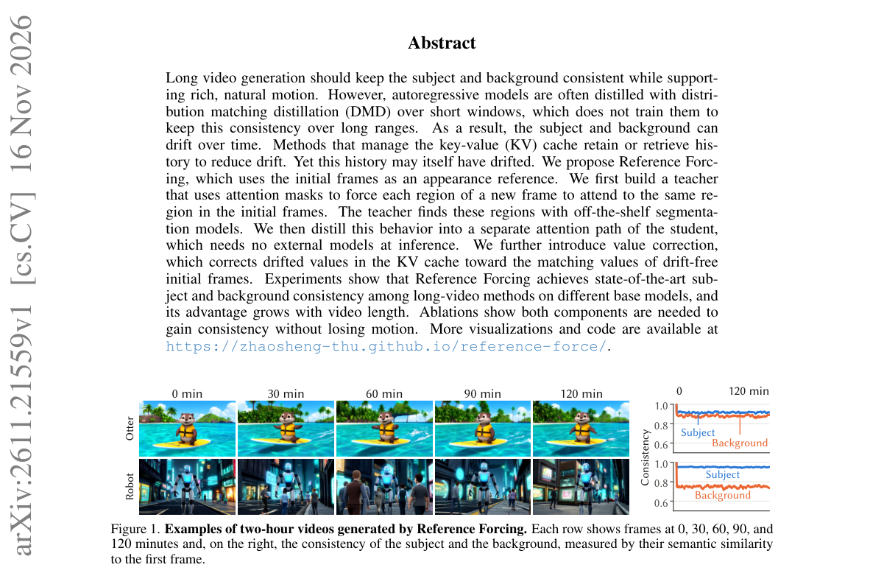

*Result - Overview of Reference Forcing. (a) Each chunk Xn is generated from the first chunk X0, the recent window, and noisy tokens, with the anchor path of (b) and the value correction of (c). (b) I*

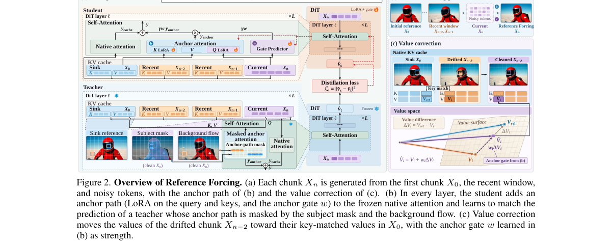

**Why this ranks #4**: 长视频自回归生成的红外套会慢慢变橙，根因是 DMD 只在短窗口内做分布匹配、不要求主体外观保持不变，而缓存里的历史本身可能已经漂移。本文把首帧当外观参考：教师用现成分割模型找到各区域并以注意力掩码强制新帧的每个区域只关注首帧同区域，再把这一行为蒸馏进学生的独立注意力通路（推理时不需要任何外部模型），并额外做免训练的 KV value 修正把漂移值拉回无漂移首帧；在 MovieGenBench 上 30 秒时主体一致性 97.55、背景 96.70，60 秒仍有 97.56/96.67，平均排名在对比方法中均为第一，且能一次生成两小时视频。

---

### 5. Découpage: Directorial Audio-Visual Control for Long Multi-Shot Video Generation

**arXiv**: [2611.18866](https://arxiv.org/abs/2611.18866) | **Score**: 8.4 (relevance 9 x 0.7 + quality 7 x 0.3) | **Direction**: `aigc_generation` | **Tags**: AIGC-visual, audio-video-generation, script-driven, lip-sync, cross-attention, multi-shot, Hong Kong University of Science and | **Categories**: cs.AI, cs.SD | **Pages**: 16

**Authors**: Yifan Wang; Hao Ouyang; Qiuyu Wang; Yihao Meng; Wen Wang; Zeyue Tian; Yichong Lu; Hanlin Wang; Qingyan Bai; Zichen Liu; Yujun Shen; Qifeng Chen

**Affiliation**: The Hong Kong University of Science and Technology; Ant Group; Zhejiang University

**Abstract**

> In cinematic storytelling, sound and visual transitions do not always coincide in lockstep: dialogue frequently bridges across cuts to reveal reactions or introduces new scenes via J- and L-cuts, while deliberate silences pace the scene. Existing audio-visual generative frameworks, however, lack explicit mechanisms to coordinate independent visual and acoustic timing over extended horizons. As narrative duration and shot complexity scale, these systems struggle to maintain long-range dialogue pacing, often hallucinating speech during intended silences or erroneously driving mouth movements on silent listeners. To enable fine-grained cinematic control, we present DECOUPAGE, a screenplay-driven framework for long-form, multi-shot, and multi-character joint audio-video generation. Rather than coupling modality boundaries by default, DECOUPAGE uncouples generation into independently bounded visual and acoustic tracks governed by persistent character identities. DECOUPAGE builds on a joint audio-video diffusion model with dual-schedule temporal cross-attention, incorporating a directorial Lip-sync mechanism that selectively decouples speech conditioning from visual facial dynamics during off-screen dialogue. On multi-shot conversational benchmarks, DECOUPAGE achieves precise control over shot transitions, audio timing, and visibility-aware lip synchronization, directing 15- to 60-second screenplay-driven audio-video generation with multimodal coherence.

**Key findings**

- **Finding**: 15 秒基准上 Cut F1 0.99、Count MAE 0.05、WER 4.59%、对话 containment 93.01%、静音泄漏 1.12%；60 秒上 Cut F1 0.76、containment 91.12%、静音泄漏 4.46%，而 LTX-2.3 Base 跌到 0.05 Cut F1、11.88% containment 与 32.71% 静音泄漏。
- **Inference**: 长时段音视频生成的主要失效模式是节奏被绑死（对白跨镜、沉默被误配音），把视觉与声学轨道解耦并各自定时，比单纯加大模型更能改善多镜头一致性。
- **Recommendation**: 要做带对白的电影级长视频，建议采用「视觉/声学双时间轴 + 剧本切点约束」的结构，并务必加可见性感知的口型门控，否则沉默段落会出现幻觉语音。

**Key figures**

*Framework - Screenplay-directed audio-video generation. D´ECOUPAGE directs visual and audio timing tracks across multi-shot scenes. Four 15-second examples demonstrate precise control over speech bridgi*

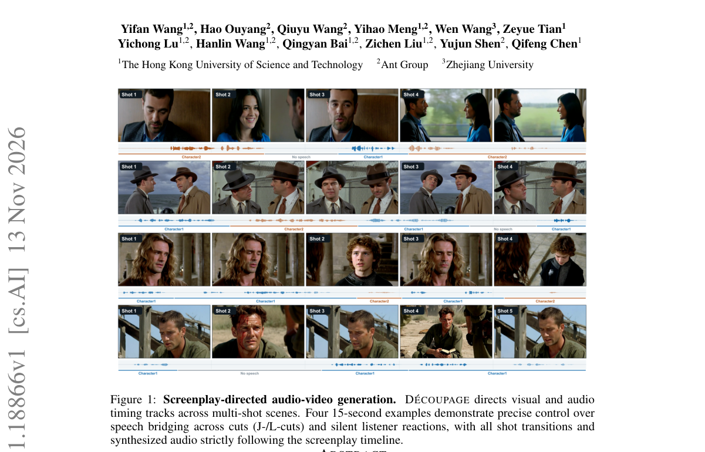

*Result - Joint audio-video data pipeline. Adjacent shots form audiovisual sequences. Faster- Whisper establishes a fixed speech timeline and filters out empty or non-English transcripts. Gemini 3.0 P*

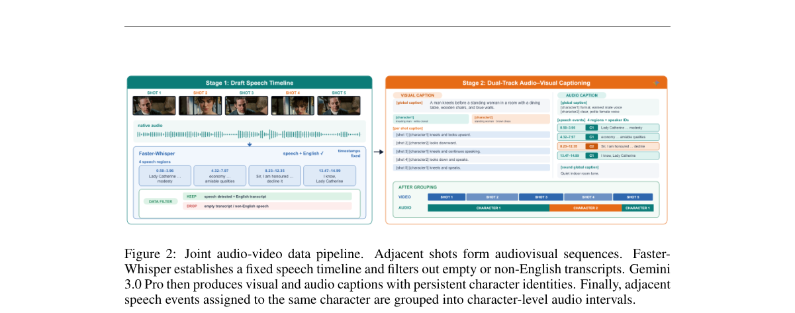

**Why this ranks #5**: 剧本驱动的长多镜头音视频联合生成，关键是把视觉与声学两条轨道解耦、各自独立定时：对白可以跨切点延续（J-cut/L-cut），沉默段落也不能被硬塞语音；本文用双调度时间交叉注意力把文本条件与视觉/声学时间轴分开控制，再加推理期的 directorial Lip-sync，按角色是否在画面内决定要不要驱动口型。15 秒基准上 Cut F1 0.99、WER 4.59%、对话 containment 93.01%、静音泄漏 1.12%；60 秒上仍有 Cut F1 0.76、91.12% containment，而 LTX-2.3 Base 在同条件跌到 0.05 Cut F1、11.88% containment 与 32.71% 静音泄漏。

---

### 6. Few-Shot Visual Concept Extraction for Steering Diffusion Transformers

**arXiv**: [2611.19440](https://arxiv.org/abs/2611.19440) | **Score**: 8.4 (relevance 9 x 0.7 + quality 7 x 0.3) | **Direction**: `aigc_generation` | **Tags**: AIGC-visual, concept-steering, training-free, diffusion-transformer, activation-editing, few-shot, Inria Centre at Université Côte d’Azur | **Categories**: cs.CV | **Pages**: 30

**Authors**: Nabyl Quignon; Antitza Dantcheva

**Affiliation**: Inria Centre at Université Côte d’Azur

**Abstract**

> Image steering aims to provide fine-grained control over concepts in generated images, enabling targeted and continuous manipulation without broadly altering the generation process. Recent steering methods for diffusion models primarily focus on the text-conditioning space or rely on costly auxiliary training. Deviating from that, we here propose a novel steering approach that extracts visual concept directions directly from the image-side activations of Diffusion Transformers. Specifically, we showcase few-shot concept extraction in the activation space using a simple difference-of-means estimator over intermediate residuals. We observe (a) scene-level concepts such as lighting, weather, and style are distributed across image tokens, as well as (b) local concepts such as object colors, textures, materials, and facial attributes are concentrated in specific regions. Towards controlling both concepts, we introduce a new unified training-free framework that uses global difference-of-means for (a) distributed concepts and masked difference-of-means for (b) local concepts, preventing local signals from being diluted by global averaging. Notably, using only a handful of positive and negative prompt pairs, our method identifies and extracts reusable concept directions that can be injected at inference for continuous steering. Quantitatively, our method outperforms text-encoder steering and training-free activation-editing baselines, as well as is competitive with specialized editing models. Our results suggest that as concept directions can be applied at patch level, our method enables precise targeted and compositional steering, manipulating multiple concepts in the same image.

**Key findings**

- **Finding**: FLUX.1-dev 上用 5 对提示时方法的 ∆VQA 为 0.29、LPIPS 为 0.34；FLUX.1-schnell 上 5/10/20 对分别为 0.32/0.29、0.32/0.29、0.31/0.29，而 SAEdit 为 0.19/0.28、FluxSpace 为 0.17/0.21、需训练的 SliderEdit 为 0.35/0.44。
- **Inference**: 场景级概念分布在全部图像 token 上、局部概念集中在特定区域，所以同一种差分均值估计不能通吃，必须按概念的空间尺度在全局与掩码两种取法之间切换。
- **Recommendation**: 需要连续可调的图像控制时可用 5 对提示抽方向，抽取固定在第 18 层与首个去噪步，推理时注入第 18–56 块可拿到最高平均 ∆VQA 0.317 且 LPIPS 仍只有 0.286。

**Key figures**

*Framework - Overview of our few-shot concept extraction and steering pipeline. (1) We start from a small set of negative and positive prompt pairs, optionally with masks for localized concepts extractio*

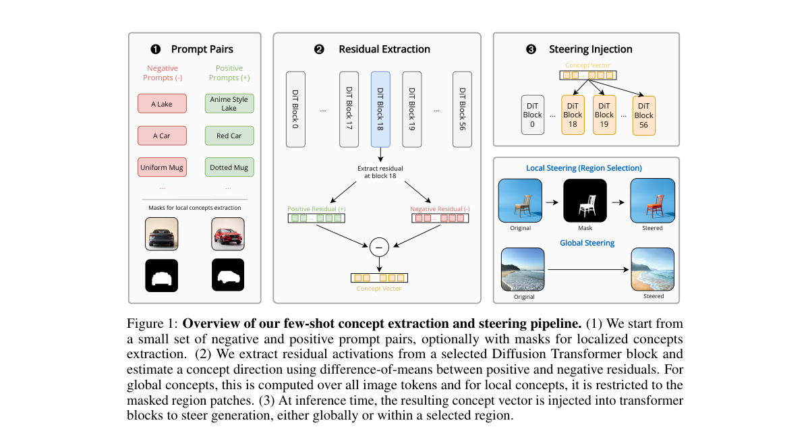

*Result - Qualitative examples of concept steering. We show representative examples of our method across different concept families. Each row corresponds to a held-out prompt and visualizes the effect*

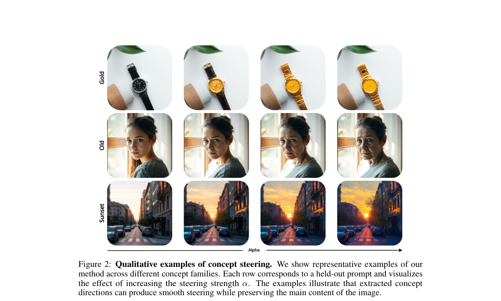

**Why this ranks #6**: 免训练地在 DiT 的图像侧激活里抽概念方向，而不是走文本条件空间或训练额外编辑模型：作者观察到场景级概念（光照、天气、风格）分布在所有图像 token 上、局部概念（颜色、材质、面部属性）集中在特定区域，于是全局概念用全局差分均值、局部概念用掩码差分均值避免被平均稀释；只要 5 对正负提示就能抽出可复用方向，FLUX.1-schnell 上 ∆VQA 0.32、LPIPS 0.29，优于 SAEdit 的 0.19/0.28 与 FluxSpace 的 0.17/0.21，已接近需训练的 SliderEdit（0.35/0.44）与 K. Kontext（0.36/0.32）。

---

### 7. FastGRN: Few-Step Generative Refinement Networks

**arXiv**: [2611.20021](https://arxiv.org/abs/2611.20021) | **Score**: 8.4 (relevance 9 x 0.7 + quality 7 x 0.3) | **Direction**: `aigc_generation` | **Tags**: AIGC-visual, few-step-generation, discrete-latent, distribution-matching, image-generation, text-to-image, Ritsumeikan University | **Categories**: cs.CV | **Pages**: 31

**Authors**: Haoyang Hu; Masataka Seo; Liang Li; Yen-wei Chen

**Affiliation**: Ritsumeikan University; Osaka Institute of Technology

**Abstract**

> Generative Refinement Networks (GRN) generate an image by repeatedly re-predicting and refining every token of a discrete latent. They reach high fidelity, but need dozens of Markov steps. We therefore train few-step GRNs on the distribution of their own samples. We use its own uniform-state corruption to perform distribution matching on discrete tokens, which lets a discrete generator learn by backpropagation, and we pair noise with samples in the manner of rectified flow. We find that the steps of a few-step GRN do not carry the same amount of information or the same repair load. We therefore exploit its discrete refinement during training and build few-step GRNs in three parts. Oversampling samples the student with more steps than it was trained for and refines its judge on these samples. Non-uniform sampling trains only the last step and hands it most of the information at sampling time. Refinement confidence keeping holds on to the tokens the student is already sure of. We train a fast class-conditional generator on ImageNet 256 and, with the same method, a 2B text-to-image model. On ImageNet 256, the 3-step FastGRN beats the FID of GRN. On a 2B binary-token text-to-image GRN, a 4-step student also nearly matches the GenEval of GRN-T2I 2B.

**Key findings**

- **Finding**: ImageNet 256 上 GRN-B 教师（50 步、79 NFE）FID-50k 为 3.73、每图 835 ms；FastGRN 2 步（66 ms）为 3.73、3 步为 3.42（IS 318.8），而直接把 GRN 截到 8 步会退化到 FID 8.13、IS 189.8。
- **Inference**: 少步 GRN 的各步承载的信息量与修复量并不相同，因此必须用随机步采样、过采样与非均匀末步分配把信息集中到最后一步，而不是均匀地减少步数。
- **Recommendation**: 要在离散 token 生成器上做实时生成，可直接套用窗口随机步匹配、过采样、非均匀采样与置信保持这四件套，注意它不需要 GAN 损失或真实数据。

**Key figures**

*Framework - FastGRN turns a 50-step Generative Refinement Network into a 2–4 step generator. Left: 2562 samples (GRN-T2I 2B, same noise per column; GRN-B). Right: ImageNet FID-50k vs. latency (numerals:*

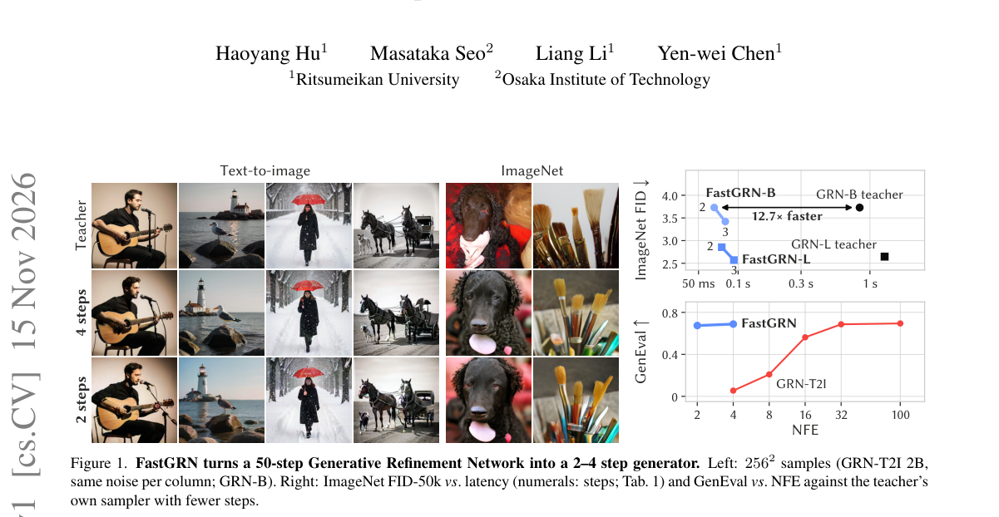

*Result - FastGRN trains a few-step GRN on its own samples. (a) Paired-noise initialization. (b) Only the student’s last step receives the gradient of Eq. (2). ❶The window (W) skips the nearly clean n*

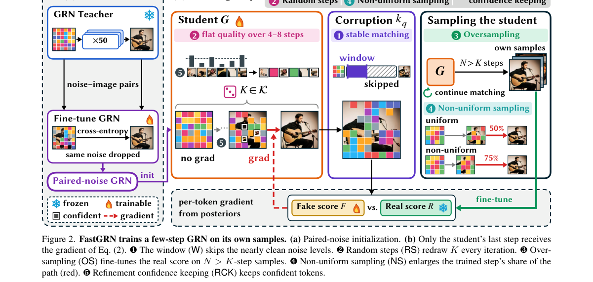

**Why this ranks #7**: 离散潜变量的生成式精修网络（GRN）保真度高但要几十个 Markov 步，本文让它在自己的样本分布上做分布匹配蒸馏，把 50 步压到 2–4 步：ImageNet 256 上 2 步学生 FID 3.73 与教师持平（教师 50 步每图 835 ms，学生 66 ms），3 步学生 FID 3.42 反超教师，而朴素截到 8 步会退化到 8.13；2B 文本到图像上 2 步 GenEval 0.67（教师的 97%）、4 步 0.69（99%），而教师自己的采样器 4 步就崩。

---

### 8. GlyphAtlas: Disentangling Stroke Detail from Layout for Scene Text Synthesis

**arXiv**: [2611.20192](https://arxiv.org/abs/2611.20192) | **Score**: 8.4 (relevance 9 x 0.7 + quality 7 x 0.3) | **Direction**: `aigc_generation` | **Tags**: AIGC-visual, scene-text-synthesis, glyph-atlas, flow-matching, stroke-accuracy, zero-shot-multilingual, Xiamen University | **Categories**: cs.CV | **Pages**: 22

**Authors**: Luozheng Qin; Changhai Zhou; Yiyi Zhou

**Affiliation**: Xiamen University; Fudan University

**Abstract**

> Scene text synthesis requires stroke-accurate characters rendered in a specified layout, as well as visual coherence with the surrounding scene. To achieve this, existing methods commonly pre-render the target text at its intended locations to form a glyph image that jointly specifies layout and glyph structure. However, this representation ties the resolution of each glyph to its target region, limiting fine-grained stroke guidance for small, densely packed, or structurally complex text. To tackle this, we propose GlyphAtlas, a scene text synthesis framework that retains the glyph image as a spatial anchor and supplies fine-grained stroke references through a dedicated glyph atlas. The atlas renders and encodes each character or word in a separate cell, decoupling reference resolution from target-region size. We further introduce atlas-anchored attention, which lets each text region retrieve stroke detail only from its corresponding atlas cells to refine the coarse glyph structure provided by the glyph image. This coarse-to-fine conditioning simplifies stroke rendering while preserving explicit layout correspondence. We optimize GlyphAtlas with a mask-weighted flow matching objective and a timestep-weighted text perceptual loss for writing accuracy and background consistency. Random resolution augmentation of atlas cells supports adjustable atlas budgets at inference. Extensive experiments demonstrate that GlyphAtlas achieves stroke-accurate synthesis of small, dense, and structurally complex text, zero-shot transfer to languages unseen during task-specific training, and leading performance in scenes with many text regions. project page: https://fr0zencrane.github.io/project-glyphatlas/

**Key findings**

- **Finding**: AnyText 基准上英文 ACC 88.68 / NED 0.9555 / FID 11.99、中文 ACC 77.92 / NED 0.8806 / FID 11.50 均为最好；场景文字编辑上 TextOCR ACC 33.15、Total-Text 73.17、ReCTS 69.27，分别领先最好基线 5.4、9.1、19.0 个点。
- **Inference**: 消融显示 glyph image 单独在英文与弯曲文字上领先 3.6 和 2.5 个点，而 atlas 单独在中文与小字上领先 6.4 和 4.8 个点，两者结合才能在所有子集同时拿到最高准确率，说明两个角色必须解耦但要互相绑定。
- **Recommendation**: 做小字或密集文字渲染时不要只喂预渲染 glyph image，可改用 atlas 提供独立分辨率的笔画参考，并在推理期用 token 分配器压预算（中文 atlas 由 1200 缩到 794 token，平均准确率只掉不到 11%）。

**Key figures**

*Framework - GlyphAtlas renders stroke-accurate text that blends seamlessly into real scenes. It keeps every text region correct in dense, multi-line layouts, harmonizes typography with scene geometry an*

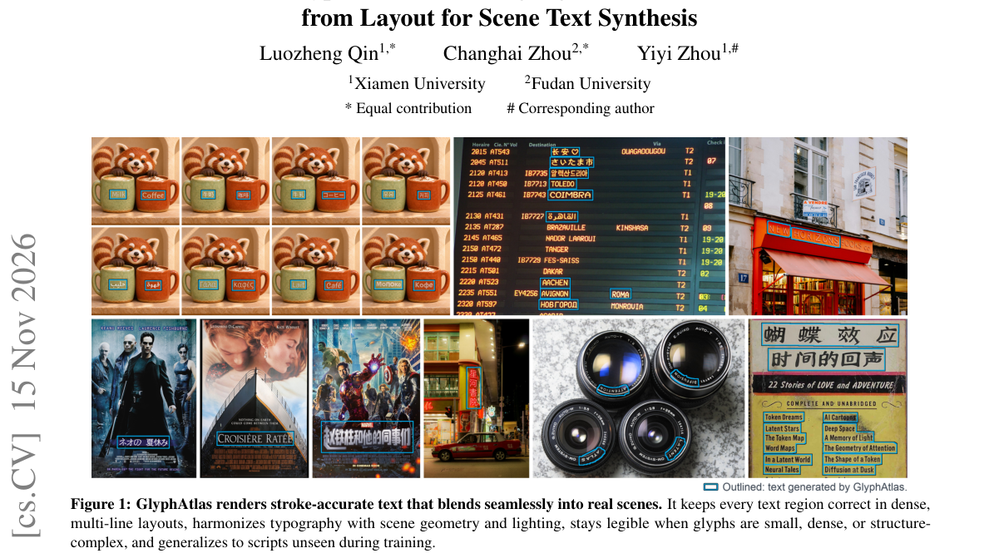

*Result - Overview of GlyphAtlas. GlyphAtlas conditions a DiT on two complementary glyph references: (1) the glyph image, which is spatially aligned with the scene and anchors the layout and coarse gl*

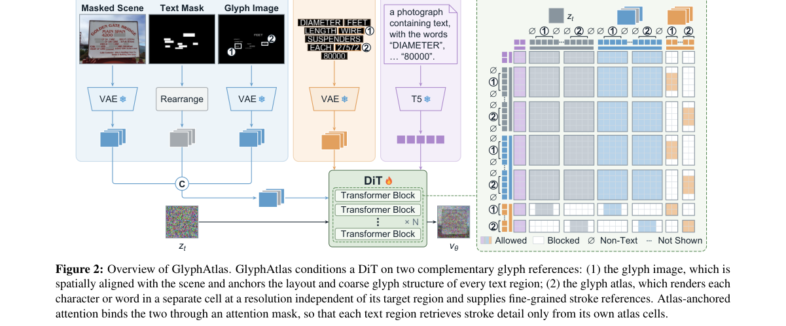

**Why this ranks #8**: 场景文字合成的老问题是把目标文字预渲染成 glyph image，让它同时承担「定布局」和「给笔画」两个职责，区域一小笔画就糊掉；本文保留 glyph image 只做空间锚点，另建独立 glyph atlas 每格渲染字符提供与区域大小无关的笔画参考，再用 atlas-anchored attention 只让重叠区域取自己那几格：AnyText 基准英文句子准确率 88.68%、中文 77.92%（最强基线 FLUX-Text 为 84.19/71.32），TextOCR 编辑准确率 33.15%，STIPLAR 上零样本跨语言领先非专项微调基线 19.7–33.1 个点。

---

### 9. MovieRoll: A Systematic Framework for Rolling Out Long-Form Videos

**arXiv**: [2611.21339](https://arxiv.org/abs/2611.21339) | **Score**: 8.4 (relevance 9 x 0.7 + quality 7 x 0.3) | **Direction**: `aigc_generation` | **Tags**: AIGC-visual, streaming-video, kv-cache-compression, distillation, long-rollout, guidance-annealing, Peking University | **Categories**: cs.CV | **Pages**: 46

**Authors**: Yunyang Ge; Weijie Kong; Ryan Xu; Yue Wu; Qi Tian; Jiangfeng Xiong; Bin Lin; Mingzhe Zheng; Shenghai Yuan; Zheyuan Liu; Jianwei Zhang; Li Yuan

**Affiliation**: Peking University; Tencent Hunyuan; The Hong Kong University of Science and Technology

**Abstract**

> Streaming video generation must sustain quality beyond the training horizon while handling self-generated history and growing cache costs. To address these challenges, we present MovieRoll, a base-to-distilled framework that connects streaming fine-tuning, long-rollout distillation, and long-horizon inference. We first establish a robust multi-step base through Window-wise Teacher Forcing (WinTF), which jointly denoises chunks at progressive noise levels with bidirectional attention within each window and causal access to preceding history. To retain historical context efficiently, hierarchical KV-cache compression (HieraKV) exploits layer-wise attention patterns, retaining full history in shallow layers and sink--recent history in deeper layers. This reduces cache memory by up to 78% while improving generation quality. Building on this base, cumulative long tuning with distribution matching distillation (CuLT-DMD) holds parameters fixed throughout each long self-rollout and averages local gradients before updating. Each update therefore combines supervision across temporal positions while retaining only one local computation graph, enabling efficient long-rollout training of a few-step generator. To extend generation beyond the training horizon, KV recomputation bounds context for both models, while guidance annealing (AnnealCFG) reduces guidance toward the clean endpoint to stabilize MovieRoll-Base. Complementing these modeling advances, FBCA attention and PS-VAE decoding support efficient training and streaming output. On HeliosBench, MovieRoll-Base remains competitive at 30s after training on videos of up to 15s, and MovieRoll-Distilled achieves the highest total scores among the compared methods across single- and multi-event evaluations up to 60s, combining sustained naturalness with active motion.

**Key findings**

- **Finding**: HieraKV 相对全层全历史缓存把 KV 缓存显存最多减少 78% 并同时提升生成质量；HeliosBench 上 MovieRoll-Base 只用最长 15 s 的视频训练，30 s 仍具竞争力，MovieRoll-Distilled 在 10/30/60 s 单事件与 30/60 s 多事件评测中取得对比方法最高总分。
- **Inference**: 训练时把窗口内双向注意力与跨窗口因果访问组合起来，可以并行监督多个窗口又不破坏历史因果性，从而让少步生成器在长 rollout 上也能稳定训练。
- **Recommendation**: 自建流式视频系统时可直接照搬「WinTF 训基座 + HieraKV 分层压缩 + CuLT-DMD 蒸馏 + AnnealCFG 退火」这套组合，并用阈值触发的 KV 重计算突破训练时序上限。

**Key figures**

*Framework - MovieRoll generates a minute-long video with continuous subject identity across six events. The sequence shows the same woman performing successive actions in one studio setting, with a new p*

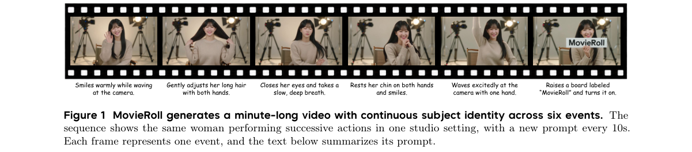

*Result - Overview of MovieRoll. Window-wise Teacher Forcing (WinTF) trains MovieRoll-Base through parallel window supervision conditioned on clean history and event prompts. After ODE initialization,*

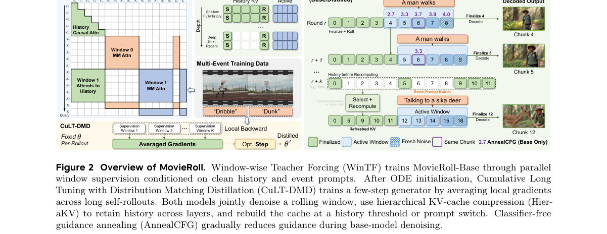

**Why this ranks #9**: 把流式长视频生成做成「基座到蒸馏」的完整框架：WinTF 用窗口内双向注意力加窗口间因果访问并行监督多个窗口来训基座，HieraKV 按层分层保留历史（浅层留全历史、深层只留 sink 与近期），KV 缓存显存最多降 78% 且质量反而提升，CuLT-DMD 在长自 rollout 上固定参数、平均局部梯度后再更新，从而高效训出少步生成器；HeliosBench 上 MovieRoll-Base 用最长 15 s 的视频训练后在 30 s 仍具竞争力，MovieRoll-Distilled 在 10/30/60 s 单事件与 30/60 s 多事件评测中拿到对比方法最高总分。

---

## AIGC 编辑（指令编辑 / 修补 / 个性化） · `aigc_editing` (3 papers)

### 10. VIVID: A Visual Harness for Agentic Video Editing

**arXiv**: [2611.20688](https://arxiv.org/abs/2611.20688) | **Score**: 8.7 (relevance 9 x 0.7 + quality 8 x 0.3) | **Direction**: `aigc_editing` | **Tags**: AIGC-visual, coding-agent, video-editing, tool-use, evidence-memory, benchmark, Beihang University | **Categories**: cs.AI, cs.CV, cs.MM | **Pages**: 15

**Authors**: Wenhan Yu; Zhaoxi Zhang; Zhilong Tan; Weikang Li; Lei Sha

**Affiliation**: Beihang University; Peking University

**Abstract**

> Video editing requires agents to make editing decisions grounded in audiovisual observations and precise temporal localization, and to evaluate their effects in rendered outputs. General-purpose coding agents possess strong comprehension, reasoning, and code execution capabilities, while media interaction and evidence management mechanisms tailored to video tasks can further unlock their editing potential. We introduce VIVID, a visual harness that supports multiple native coding agents in video post-production without additional model training. VIVID provides tools for on-demand video inspection, audio analysis, and transcription, and preserves observations alongside their corresponding media versions and temporal coordinates. Agents can actively retrieve these observations as they reason, perform edits using their native coding and shell tools, and inspect rendered outputs to guide subsequent revisions. On AgenticVBench, comprising 100 tasks across Assembly, Repair, Sequencing, and Repurpose, Codex with VIVID achieves an average score of 58.6%, an improvement of 20.2 percentage points over native Codex. The same harness also integrates with Claude Code and OpenCode, achieving average scores of 55.1% and 37.1%, respectively, both substantially exceeding their native baselines. These results highlight VIVID's potential as a reusable visual harness for extending the capabilities of general-purpose coding agents to video editing.

**Key findings**

- **Finding**: AgenticVBench 100 个任务上 Codex + VIVID 平均 58.6%±3.8、Claude Code 55.1%±3.6、OpenCode 37.1%±3.5，同模型 GPT-5.6-sol 下原生 Codex 仅 38.4%、Crayotter 33.7%；消融中去掉按需视听检查降到 42.6，去掉证据记忆与检索降到 47.8，去掉输出复检降到 44.0。
- **Inference**: 提升主要来自 harness 提供的「证据—媒体版本—时间坐标」绑定与渲染结果复检回路，而不是模型能力本身，所以同一套工具可以跨 Codex、Claude Code、OpenCode 复用。
- **Recommendation**: 想让自家编码 agent 做视频后期，最小可用组合是按需视听检查、带版本与时间码的持久证据库、渲染结果复检，三者缺一都会掉 10 个点以上。

**Key figures**

*Framework - Overview of VIVID, a visual harness for agentic video editing. VIVID augments native harnesses with on-demand audio- visual inspection, persistent evidence memory and retrieval, and output i*

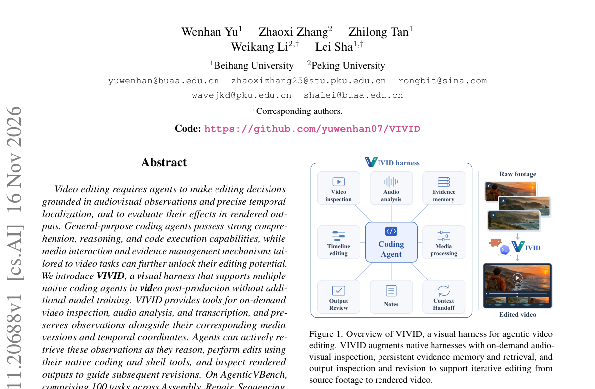

*Result - VIVID’s core components and iterative editing workflow. The agent inspects media on demand, retains version-linked evidence for retrieval, and reviews rendered outputs to guide revisions.*

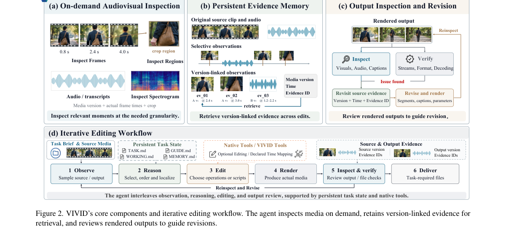

**Why this ranks #10**: 把通用编码 agent 直接改造成视频后期 agent，不训练任何新模型，只加三层 harness 扩展：按需视听检查（帧采样、空间区域检查、音频分析与转写）、与媒体版本和时间坐标绑定的持久证据记忆及检索、以及对渲染结果的复检与返修；AgenticVBench 的 100 个任务（拼接/修复/排序/再利用）上 Codex 平均 58.6%，比原生 Codex 高 20.2 个点，Claude Code 55.1%、OpenCode 37.1%，同模型 GPT-5.6-sol 对比下原生 Codex 只有 38.4%、Crayotter 33.7%。

---

### 11. RAGE: Residual-Adaptive Gating for Flow-Based Image Editing

**arXiv**: [2611.21177](https://arxiv.org/abs/2611.21177) | **Score**: 8.7 (relevance 9 x 0.7 + quality 8 x 0.3) | **Direction**: `aigc_editing` | **Tags**: AIGC-visual, flow-based-editing, residual-gating, source-preservation, training-free, optimal-control, Xi’an Jiaotong University | **Categories**: cs.CV, cs.LG | **Pages**: 17

**Authors**: Ruofeng Mei; Xiangyu Xu

**Affiliation**: Xi’an Jiaotong University

**Abstract**

> Recent inversion-free, flow-based image editing methods evolve the source image toward the target via a differential velocity field. We observe that this velocity field does not explicitly account for which regions should be preserved, leading to unintended drift in non-editing regions. To address this, we formulate source fidelity control as a stochastic optimal control problem in which a selective fidelity term on the editing residual is enforced along the editing trajectory. Solving this problem and approximating its solution yields the Residual Gating Principle: each latent component is pulled back toward the source with a gain that decays exponentially with the local residual magnitude, so that small deviations are suppressed while large, semantically meaningful edits pass through unimpeded. The proposed method, RAGE, requires only one lightweight gated interpolation per sampling step, involves no mask estimation, attention maps, retraining, or architecture-specific modifications, and is applied on top of FlowEdit-based editors. On PIE-Bench, RAGE achieves the best overall rank among 17 methods and substantially improves background preservation on both Stable Diffusion 3 and FLUX backbones while maintaining competitive editing quality.

**Key findings**

- **Finding**: 在 700 张的 PIE-Bench 上 RAGE 在 17 个方法中取得最好整体排名，并在 FLUX 与 Stable Diffusion 3 两个底模上都显著改善背景保真；开销上 SD3 版在 70 张图上从 212.907 s 增到 214.863 s，即每图约 0.03 s（0.92%）。
- **Inference**: 残差幅度本身就是区分「有意编辑」与「无意漂移」的内在信号，因此不需要掩码估计、注意力图或重训练，也不需要改网络结构。
- **Recommendation**: 在 FlowEdit 这类免反转编辑器上可直接套用该门控：设门控强度 α、衰减率 β 与启动阈值 t0（前 4 步热身），并按「小残差压住、大残差放行」的原则调 β。

**Key figures**

*Framework - Without RAGE (top), the base editing velocity Vθ causes unintended drift in non-editing regions that accumulates over timesteps. With RAGE (bottom), the source-aware correction λ∇R selectivel*

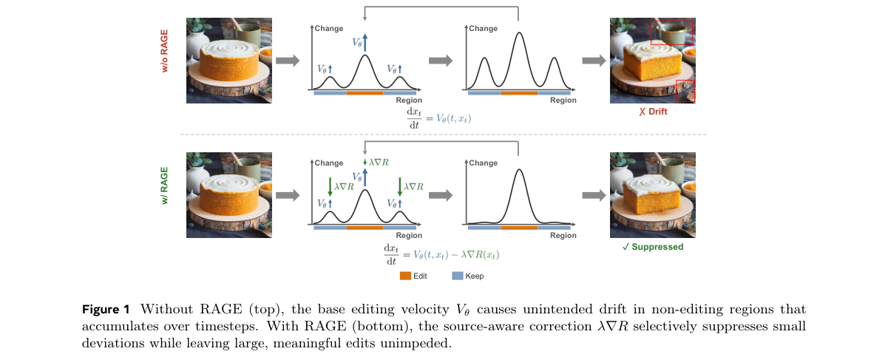

**Why this ranks #11**: 免反转的流式图像编辑里速度场不区分「该改的」和「该保的」，非编辑区会随时间步累积漂移；本文把源保真控制写成随机最优控制问题，解出残差门控原理——每个潜变量分量按局部残差幅度指数衰减的增益拉回源图，小偏差被压住、大幅语义改动原样通过；PIE-Bench 700 张上在 17 个方法中整体排名最好，FLUX 与 SD3 两个底模的背景保真都显著提升，且每步只多一次门控插值，70 张图总耗时 212.907 s 变 214.863 s，每图约多 0.03 s（0.92%）。

---

### 12. SearchChord: Prompt Preselection and Field Recomposition for One-Step Image Editing

**arXiv**: [2611.19076](https://arxiv.org/abs/2611.19076) | **Score**: 8.4 (relevance 9 x 0.7 + quality 7 x 0.3) | **Direction**: `aigc_editing` | **Tags**: AIGC-visual, one-step-editing, best-of-n, test-time-search, candidate-pool, training-free, Michigan State University | **Categories**: cs.CV | **Pages**: 10

**Authors**: Boyang Deng; Yuzhen Lu

**Affiliation**: Michigan State University

**Abstract**

> Finding effective prompts and seeds for one-step image editors requires balancing edit fidelity, source preservation, and computational cost. To address this challenge, we explore a large collection of candidate edits, where each candidate is defined by a unique prompt-seed pair, and generate corresponding images on demand. We present SearchChord, a training-free framework that leverages a large pool of such candidates, combining text-based preselection, image verification, and latent-field recomposition. Our ablation studies across pool sizes up to 200 candidates show that a pool of 100 offers a cost-effective operating point. Compared with feeding all 100 candidates into recomposition, TextSim preselects a subset of 10 candidates. Rather than uniform averaging, we incorporate image-verifier scores to weight each candidate during recomposition. Experiments on PIE-Bench and the proposed CropWeed-EditBench reveal a trade-off: candidate selection improves target-text alignment, while recomposition better preserves unmodified source content. The oracle verifier achieves the best performance in both preservation and target-text alignment. Practical verification partially recovers semantic alignment, but recomposition still compromises edit fidelity, including in agricultural image edits. These results motivate text-first preselection and stronger verification to balance preservation, fidelity, and cost. Code and data will be made publicly available.

**Key findings**

- **Finding**: PIE-Bench 700 张上 ChordEdit 基线为 PSNR 22.44 / CLIP-Edited 22.58，TextSim→EditReward 的 Best-of-10 拿到 CLIP-Edited 23.14 但 PSNR 降到 22.13，加权重组版则是 PSNR 24.13 / CLIP-Edited 21.39，Joint-5 oracle 加权 Top-10 为 PSNR 24.73 / CLIP-Edited 21.17。
- **Inference**: 候选筛选主要改善目标文本对齐、潜变量场重组主要改善源内容保真，二者互相冲突，因此必须先决定这次编辑更看重贴题还是保源，再决定要不要花算力生成上百个候选。
- **Recommendation**: 落地时按「文本先筛、验证兜底」两段式做：TextSim 预筛的 10 候选总耗时约 42.89 s（基线仅 0.49 s），若必须保源就改用 oracle 式加权，并可另建含 3,387 个作物/杂草实例的 CropWeed-EditBench 评测。

**Key figures**

*Framework - Edited examples: three PIE-Bench and three CropWeed examples. Sources are paired with ChordEdit (one field) and SearchChord (TextSim →EditReward; 10 fields from 100 candidates), with common*

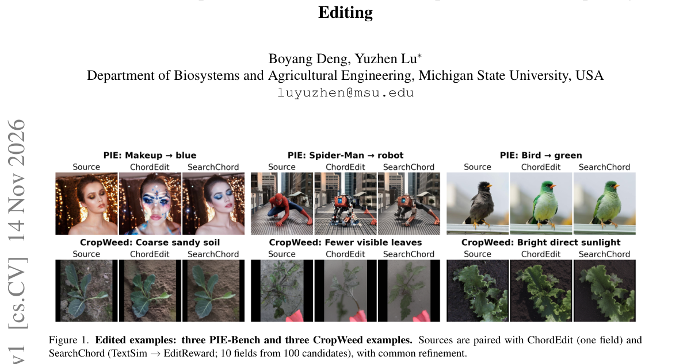

*Result - SearchChord pipeline. The arrows indicate the words changed between the source and target prompts, while bracketed placeholders mark where those words appear within the shared sentence.*

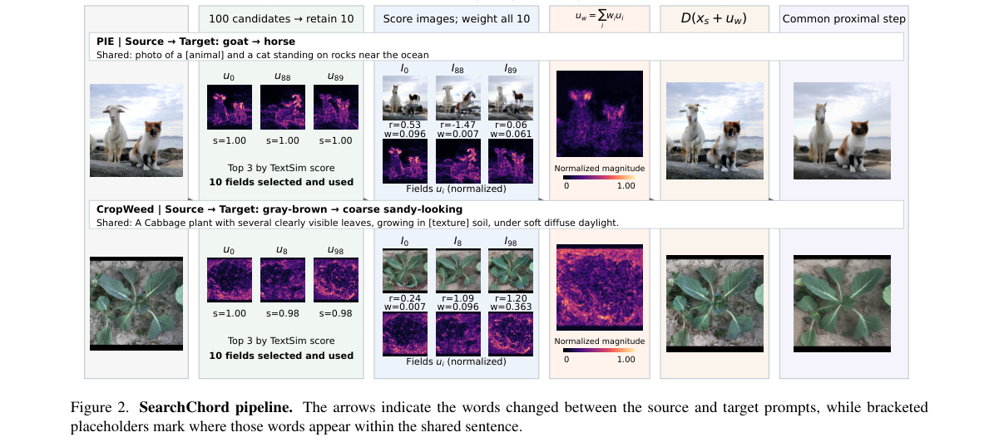

**Why this ranks #12**: 一步图像编辑的 prompt-种子搜索代价高昂，本文不训练任何模型，而是把「大规模候选 + 文本预筛 + 图像验证 + 潜变量场重组」串成一条链：池子扩到 200 候选时 100 是性价比拐点，TextSim 从 100 个候选里预筛出 10 个再按验证分数加权重组；PIE-Bench 上 TextSim→EditReward 的 Best-of-10 把 CLIP-Edited 从基线 22.58 提到 23.14，但加权重组把 PSNR 从 22.44 提到 24.13 的同时 CLIP-Edited 掉到 21.39，说明「保源」与「贴题」之间存在明确此消彼长。

---

## 面向视觉生成的 RL 与奖励模型 · `aigc_rl` (1 papers)

### 13. BlockAlign: Preference Optimization for Trajectory-Distilled Video Generation

**arXiv**: [2611.20351](https://arxiv.org/abs/2611.20351) | **Score**: 8.7 (relevance 9 x 0.7 + quality 8 x 0.3) | **Direction**: `aigc_rl` | **Tags**: AIGC-visual, video-generation, preference-optimization, trajectory-distillation, dpo, block-velocity, Alibaba Group | **Categories**: cs.CV | **Pages**: 33

**Authors**: Jingyuan Zhu; Biaolong Chen; Yangyang Qin; Shengyang Shen; Yaohua Wang; Weiming Bai; Miao Lu; Aixi Zhang

**Affiliation**: Alibaba Group

**Abstract**

> Directly aligning trajectory-distilled video generators slashes rollout costs and optimizes the deployed few-step model without teacher fine-tuning or re-distillation. However, conventional flow-matching preference objectives assume single-head local velocity supervision, mismatching the finite-interval, block-average transition interface of trajectory-distilled generators such as Parallel Decoding Distillation (PDD) and Parametric Trajectory Distillation (PTD). Naively supervising only the primary initial-subinterval velocity sub-head rather than the fused block-average velocity at block starts (DirectAlign) induces a severe training--inference mismatch that degrades quality below the unaligned baseline. We introduce BlockAlign, an interface-consistent preference optimization framework that constructs states at valid block boundaries, queries the fused block-level velocity predictor, and supervises span-normalized transition residuals-seamlessly supporting DPO-, NFT-, and rollout-style objectives while preserving the native few-step sampler. We further build a unified post-training pipeline integrating offline pairs, reward-free semi-online continuations, and online rollouts with hierarchical preference selection and objective-aware block scheduling. Experiments on multi-reference video generation across MiniMax-H3 Ref2VA and an in-house model RefVid-V4 show that BlockAlign consistently outperforms unaligned distilled models and DirectAlign in structural plausibility, reference consistency, and visual quality. Notably, our approach unlocks PDD's 5x few-step rollout speedup for 3x faster end-to-end online training, achieving statistically significant human preference gains over PDD baselines (54.0% vs. 33.3% wins/losses, or 61.8% non-tie win rate on RefVid-V4; 51.3% vs. 34.7%, or 59.7% non-tie win rate on MiniMax-H3) and up to an 82.7% win rate against DirectAlign.

**Key findings**

- **Finding**: 在 150 个测试条件上，RefVid-V4 的五维自动评分均值 BlockAlign 为 3.71，高于 PDD 与 DirectAlign 的 3.67；MiniMax-H3 上为 3.70，高于 3.65 与 3.62；双向成对胜率上 BlockAlign 对 PDD 为 53.8%/53.9%，对 DirectAlign 为 61.0%/63.8%，而 DirectAlign 对 PDD 只有 44.9%/39.7%。
- **Inference**: 少步轨迹蒸馏生成器的可用接口是「块起点的融合块平均速度」，偏好目标必须迁就这个接口去监督跨度归一化的转移残差，否则训练-推理错配会直接抵消蒸馏带来的收益。
- **Recommendation**: 要给少步视频模型做偏好后训练，先确认生成器的合法块边界与融合速度头，再在块边界上构造偏好对；照搬面向单头局部速度的 DirectAlign 反而会让质量低于未对齐基线。

**Key figures**

*Framework - Qualitative comparison on RefVid-V4. All methods use identical inputs, random seeds, inference settings, and matched times- tamps. Red circles highlight representative baseline errors in the*

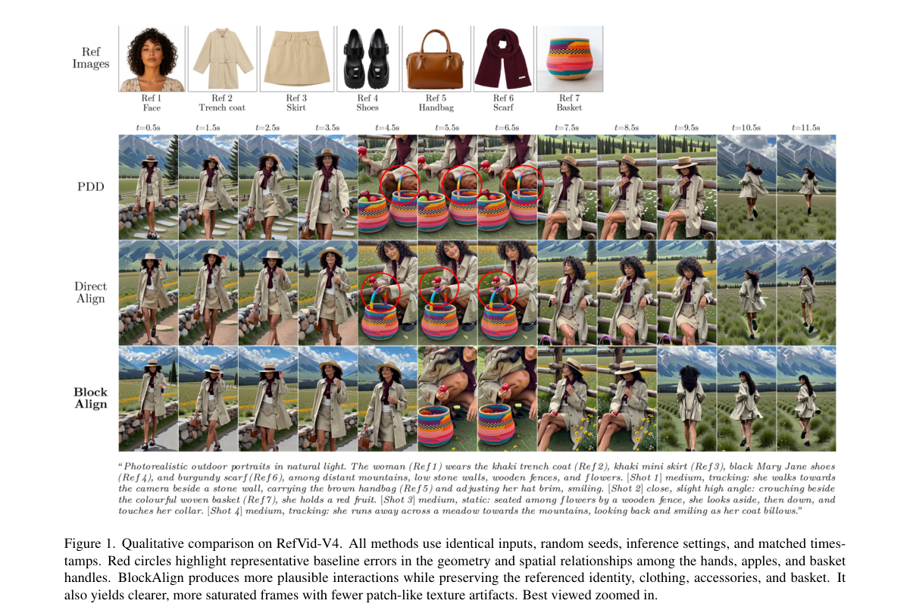

*Result - Qualitative comparison on MiniMax-H3. Red circles highlight representative baseline errors in arm, sleeve, scarf, and garment structure. BlockAlign produces more coherent anatomy and garment*

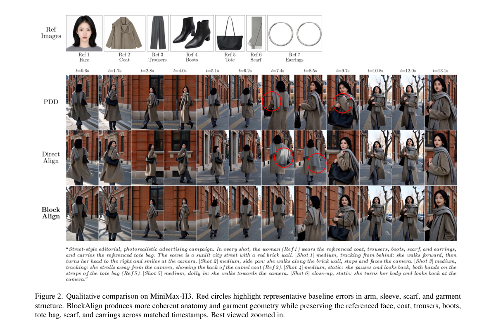

**Why this ranks #13**: 直接对齐「轨迹蒸馏后」的视频生成器存在接口错配：PDD/PTD 的执行严格绑定在有效块起点、输出的是块平均速度，而常规流匹配偏好目标假设单头局部速度监督；只监督首个子区间速度头的 DirectAlign 反而把质量压到未对齐基线之下。本文在合法块边界构造状态、查询融合后的块级速度头并监督跨度归一化的转移残差，同时支持 DPO/NFT/rollout 三类目标；RefVid-V4 上五维自动评分均值 3.71 对 PDD 3.67，MiniMax-H3 上 3.70 对 3.65，人工偏好 54.0% 对 33.3%（非平局胜率 61.8%），并让 PDD 的 5 倍少步加速变成 3 倍端到端在线训练加速。

---

## Footer

- Total papers reviewed across all 4 axes: 60
- aigc_visual axis final count: 13
- Wild-cards in this axis: 0
- Figure assets: 2026-11-18/res/

Generated by `mine-arxiv-daily-digest` skill. Sister file: `2026-11-18_aigc_visual_entry.md`.
