# Mine Arxiv Daily Digest - 2026-11-18 (全双工语音与语音 LM Axis, 9 papers)

**Generated**: 2026-11-18 12:30 CST

**Source**: arXiv cs.CV, cs.SD, eess.AS, cs.CL, cs.AI, cs.RO, cs.LG, cs.IR submissions, listing day 2026-11-13..2026-11-16 (announced 2026-11-16 20:00 ET = 2026-11-17 01:00 UTC)

**Batch window**: 2026-11-12T19:00:00Z .. 2026-11-17T19:00:00Z（arXiv 公告批次横跨两个 UTC 日：从前一日的美东 14:00 截止时刻起算（EDT 为 18:00Z，EST 为 19:00Z），到当日的同一时刻为止）

**Axis**: duplex_speech (9 papers, base 12, cap 20)

**Directions**: duplex_speech_core (8), speech_rl (1)

**Selection**: 9 papers ranked by relevance x quality, with 0 wild-card slots

**Day total**: 60 papers across 4 axes (target 60)

**Scope**: 全双工 / 实时 / 流式语音语言模型、speech-to-speech 语音助手、TTS / 语音克隆 / 语音转换，以及语音大模型的 RL 与奖励模型

**Wild-card**: 0（本 axis 本批次够格供给充足，未启用补位名额）

---

## 全双工语音与语音 LM · `duplex_speech_core` (8 papers)

### 1. Any Channel Count, One Token Stream: Incorporating Spatial Audio Understanding and Reasoning into Large Audio-Language Models

**arXiv**: [2611.18112](https://arxiv.org/abs/2611.18112) | **Score**: 8.7 (relevance 9 x 0.7 + quality 8 x 0.3) | **Direction**: `duplex_speech_core` | **Tags**: duplex-speech, spatial-audio, audio-language-model, smrope, spatial-reasoning, grpo, Alibaba Group | **Categories**: cs.SD | **Pages**: 27

**Authors**: Yuhuan You; Wenxiang Guo; Zhifang Guo; Yuxuan Wang; Jin Xu

**Affiliation**: Alibaba Group; Zhejiang University

**Abstract**

> Audio phase relations encode source locations, yet existing large audio-language models (LALM) reduce audio to single-channel content to stabilise general audio understanding, leaving spatial information for direction, distance, and source-relation questions unused. We present SpheraAudio, which accepts recordings with any channel count -- mono, stereo, First-Order Ambisonics (FOA), or higher -- and maps them into a single token stream. A spatial encoder turns complex multichannel spectra into spatial tokens interleaved with audio tokens at corresponding temporal positions. Spatial Multimodal RoPE (SMRoPE) makes each token's modality identity and temporal slot visible to rotary attention without altering the language model's original RoPE. Training runs in three stages -- spatial-encoder pretraining, projector alignment, and joint supervised-and-reinforcement learning -- progressing from geometric supervision to language-based spatial decisions, with answers trained as explicit spatial chain-of-thought: step-by-step geometric reasoning over the heard scene. Current benchmarks tie questions to a fixed channel-count format and score answers without spatial reasoning evidence. We introduce SpheraQA, which spans mono, stereo, and FOA recordings and organises questions hierarchically from single-attribute perception through cross-source relations to multi-step reasoning, scored programmatically against simulated scene geometry and real-recording annotations with step-by-step solution references. Across SpheraQA and public spatial-audio benchmarks, SpheraAudio sets a new performance standard for spatial audio understanding. It supports high-precision localisation, tracking, and reasoning over static and moving sound sources while preserving strong general-audio capabilities. We will release code, SpheraQA, and evaluation metrics to support reproducibility.

**Key findings**

- **Finding**: SpheraQA 含 20492 道题，SpheraAudio 整体准确率 60.18%，高于 Spatial-Omni-7B 的 41.65%（+18.53 个百分点）与 Gemini 3.1 Pro 的 42.73%；坐标类 35.91% 对 2.07%（+33.84），轨迹类 36.12% 对 0.45%（+35.67），SO-Bench 上 66.94% 对 64.61%，TWNM 上 71.70% 对 46.20%。
- **Inference**: 增益集中在精确方位、完整坐标与轨迹这些几何量上，说明把多通道相位关系显式编码成独立 token 流并用空间 CoT 监督答案，比单纯扩大音频编码器或换更大 LLM 更有效。
- **Recommendation**: 做空间听觉或机器人声源定位可直接复用「空间编码器 + 空间 token 交织 + SMRoPE」三件套，并用 SpheraQA 的 20492 题验证，而不是只看通用音频榜单上的平均分。

**Key figures**

*Framework - SpheraAudio overview. The audio encoder AuT and spatial encoder Spatial AuT extract complementary features from the same recording. Separate projectors produce audio tokens and spatial token*

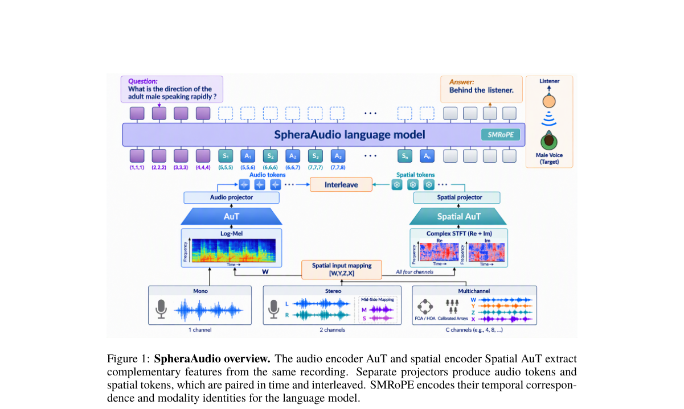

*Result - Schematic training framework. Spatial-encoder pretraining learns temporally resolved geometry. Projector alignment connects spatial features to the pretrained language representation. Joint*

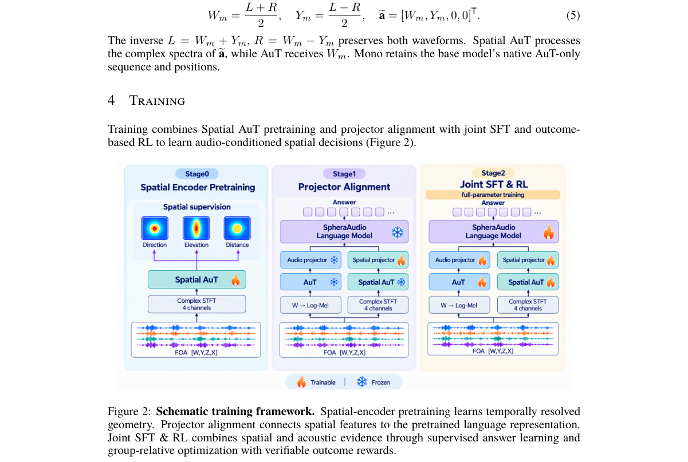

**Why this ranks #1**: 空间编码器把任意通道数的复数谱压成空间 token，与音频 token 按时间位置交织后用 SMRoPE 注入 rotary 注意力；SpheraQA 的 20492 题上整体准确率 60.18%，比 Spatial-Omni-7B 的 41.65% 高 18.53 个百分点，坐标与轨迹两类分别高 33.84 与 35.67 个百分点，公开基准 SO-Bench 上也以 66.94% 对 64.61% 领先，是本批空间音频理解最完整的一篇。

---

### 2. Factorized Self-Supervised Speech Tokenization

**arXiv**: [2611.18898](https://arxiv.org/abs/2611.18898) | **Score**: 8.7 (relevance 9 x 0.7 + quality 8 x 0.3) | **Direction**: `duplex_speech_core` | **Tags**: duplex-speech, speech-tokenizer, factorized-representation, codebook, text-to-speech, voice-conversion, Ubisoft La Forge | **Categories**: cs.LG, eess.AS | **Pages**: 26

**Authors**: Benjamin Van Niekerk; Jean-Philippe Letendre; Nicol Visser; Hugo Seute; Herman Kamper; Mirco Ravanelli

**Affiliation**: Ubisoft La Forge; Concordia University; Mila; Stellenbosch University

**Abstract**

> Speech tokenizers convert audio into discrete units, enabling language models to process and generate speech. The goal is to learn compact, text-like representations while preserving enough detail to reconstruct a speaker's voice and delivery. We propose Facto: a factorized tokenizer that disentangles time-varying information (content and prosody) from static components (speaker identity and recording conditions). We build on a recent linear factorization method for self-supervised features, extending it to handle unseen speakers. Then, we cluster the factorized space and train a lightweight decoder to reconstruct audio from the resulting tokens. By removing the static components before clustering, our tokens are more robust to small noise perturbations. We validate this by testing token stability under various noise conditions. Next, we theoretically analyze Facto's convergence and scaling properties, quantifying how the factorization improves with the number of training speakers. Finally, we evaluate Facto on a range of downstream tasks. We show that greater token stability translates into improved text-to-speech performance and competitive results in voice conversion and spoken language modeling. Code and checkpoints at https://github.com/ubisoft/ubisoft-laforge-facto/ and demo page at https://ubisoft-laforge.github.io/speech/facto/.

**Key findings**

- **Finding**: Facto 在 12.5 Hz 下用 8192 码本重合成 LibriSpeech test-clean 得到 WER 5.6%、SIM 0.93、MOS 4.37，同表 FocalCodec 为 5.9%/0.90/4.35、Kanade 为 3.5%/0.93/4.35；噪声扰动下单位编辑距离比基线低约 50%；Seed-TTS test-en 上 12.5 Hz 的 WER 2.7%、SIM 0.94、MOS 4.36、MUSHRA 参考相似度 78.7±2.3，25 Hz 为 2.0%/0.95/4.34。
- **Inference**: 把说话人与信道这类静态分量从 token 分布里剥掉，等于替下游模型消除了最难预测的那部分方差，剩下的音素与韵律结构更平顺，也更抗小噪声扰动。
- **Recommendation**: 挑语音 tokenizer 时优先看噪声稳定性与下游 WER/SIM 的联动，单看重建 MOS 容易被伪装能力强的 codec 误导；做语音克隆可从 Facto 的单层 8192 码本起步。

**Key figures**

*Result - Analysis of the content space. UMAP plots of the content space colored by (a) sound type, and (b) pitch. The content space is organized globally by phonetic information and locally by prosod*

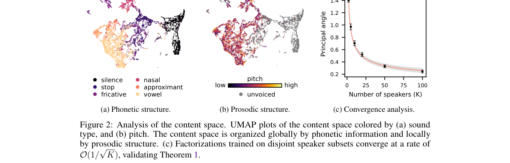

**Why this ranks #2**: 把时变信息（内容与韵律）与静态分量（说话人、录音条件）做线性因子分解后只对时变空间聚类，单层 8192 码本即可承载音素与韵律结构；噪声扰动下单位编辑距离比基线低约 50%，Seed-TTS test-en 上 WER 2.7%、SIM 0.94、MUSHRA 参考相似度 78.7±2.3，25 Hz 下 WER 2.0%、SIM 0.95，是本批 tokenizer 方向最完整的一篇。

---

### 3. Decode Early, Verify Late: Streaming Offline Speech Recognizers Without Accuracy Loss

**arXiv**: [2611.20064](https://arxiv.org/abs/2611.20064) | **Score**: 8.7 (relevance 9 x 0.7 + quality 8 x 0.3) | **Direction**: `duplex_speech_core` | **Tags**: duplex-speech, streaming-asr, training-free, speech-agent, latency, kv-cache, Nari Labs | **Categories**: cs.LG | **Pages**: 8

**Authors**: Doyeob Kim

**Affiliation**: Nari Labs

**Abstract**

> Voice agents need accurate transcripts soon after a user stops speaking. We propose Decode Early, Verify Late (DEVL), a training-free framework for streaming inference with offline ASR models. The server keeps partial transcripts as drafts and verifies the latest against the complete audio in one forward pass at turn end. Under stated input and decoding conditions, the final equals the model's greedy offline output in exact arithmetic. We adapt DEVL to four model families. In our five-recognizer comparison, 95-100% of final transcripts are byte-identical to the offline transcripts, WER stays within 0.13 points of offline, and single-stream time to final falls 1.5-7.3x. Serving Qwen3-ASR-1.7B on one A100, DEVL returns finals a median 22-26 ms after turn end at up to 64 streams, 2.7-3.9x sooner than the official streaming mode. It is the only system we tested that meets a 100 ms p99 target, up to 80 streams on Pipecat-STT and 64 on WildASR.

**Key findings**

- **Finding**: 五个识别器上 DEVL 的终稿有 95–100% 与离线输出逐字节一致，WER 距离线不超过 0.13 个点，单流终稿提前 1.5–7.3 倍；Qwen3-ASR-1.7B 在 Pipecat-STT 上离线 WER 1.78%、官方流式 1.94%、DEVL 1.77%，逐字节一致率 98.0%，终稿时间从 115 ms 降到 24 ms；64 路并发下中位 22–26 ms，比官方流式快 2.7–3.9 倍，只有它满足 100 ms 的 p99 目标（Pipecat-STT 80 路、WildASR 64 路）。
- **Inference**: 把「先出草稿、turn 末尾一次性校验」拆成两段后，流式的延迟收益来自草稿阶段就把音频预填进 KV cache，而准确率收益来自最后一次完整前向，两者不再互相牺牲。
- **Recommendation**: 语音 agent 线上若还在用厂商官方流式模式，可先试这类草稿加定稿的推理框架；注意 64 路并发时至少 98% 的终稿能被草稿校验，128 路时这个比例会掉到 21–29%。

**Key figures**

*Framework - One stream in DEVL. Audio is encoded and prefilled into the KV cache as it arrives. Checkpoints decode the audio so far and keep each result as a draft 𝑑(𝑘). At the commit, the server prefil*

*Result - Qwen3-ASR TTFS under load, one A100. Median TTFS with 95% intervals against concurrent streams, log scale (lower is better). SGLang-Omni and vLLM transcribe the complete utterance at the com*

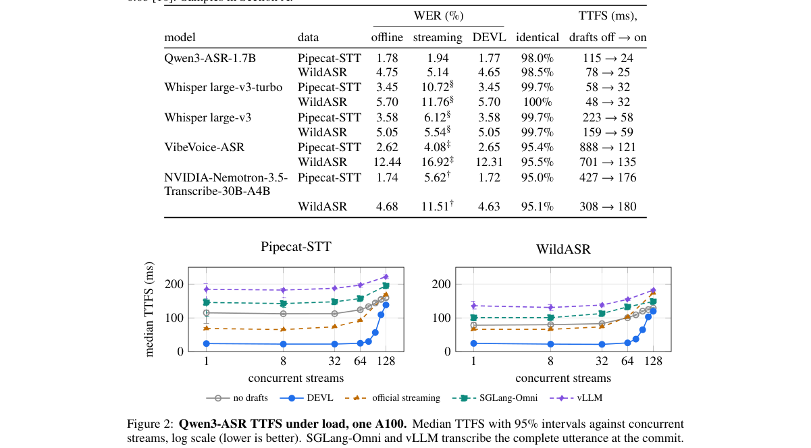

**Why this ranks #3**: 训练无关地把离线 ASR 包装成流式服务：服务端保留逐段草稿，turn 末尾用一次前向把最新草稿与完整音频比对定稿，五个识别器上 95–100% 的终稿与离线贪心输出逐字节一致，WER 只差 0.13 个点，单流终稿提前 1.5–7.3 倍到达，是本批唯一解决流式延迟与离线精度不可兼得的工程方案。

---

### 4. VoxMel TTS Technical Report

**arXiv**: [2611.20254](https://arxiv.org/abs/2611.20254) | **Score**: 8.7 (relevance 9 x 0.7 + quality 8 x 0.3) | **Direction**: `duplex_speech_core` | **Tags**: duplex-speech, tokenizer-free, autoregressive-tts, haar-transform, grpo, flow-matching, Shanghai Innovation Institute | **Categories**: eess.AS | **Pages**: 17

**Authors**: Wenhao Guan; Jiaxin Ye; Haitao Li; Yifan Duan; Junxi Liu; Wangjin Zhou; Lin Li; Qingyang Hong; Xie Chen

**Affiliation**: Shanghai Innovation Institute; Xiamen University; Shanghai Jiao Tong University; Fudan University

**Abstract**

> Continuous autoregressive TTS relies on an acoustic target that enables stable next-latent modeling while preserving fine-grained acoustic details. While existing approaches employ learned compressed representations (e.g., continuous VAE latents) to render prediction tractable, they rely on complex neural encoders that often cap generation fidelity. Conversely, training-free targets like mel-spectrograms eliminate encoder overhead, yet their potential for autoregressive generation remains largely underexplored. In this work, we propose VoxMel, a tokenizer-free framework for autoregressive TTS that makes stable mel modeling tractable through a fixed, exactly invertible two-axis Haar transform. The transform first decomposes each mel spectrogram along frequency into local averages and a frequency residual, then splits the averaged component along time into Coarse-Mel and a temporal residual. A language-model backbone with a flow-matching head autoregressively generates Coarse-Mel. Non-autoregressive residual tiers then predict the temporal residual from Coarse-Mel, followed by the frequency residual conditioned on the reconstructed Frequency-Averaged Mel. Neither residual is fed back into the autoregressive history. Trained on 100K hours of Emilia, the supervised 0.6B model obtains 1.51\% WER and 0.738 speaker similarity (SIM) on test-en, and 1.29\% CER and 0.755 SIM on test-zh. GRPO improves these results to 1.15\% WER / 0.753 SIM and 1.17\% CER / 0.776 SIM, respectively. We also distill the guided flow head into two- and four-step students, requiring 2 or 4 head evaluations per coarse frame. The four-step student retains competitive SIM and nearly matches the supervised model in WER/CER.

**Key findings**

- **Finding**: 0.6B 模型在 100K 小时 Emilia 上训练，Seed-TTS test-en 取得 1.51% WER 与 0.738 SIM、test-zh 取得 1.29% CER 与 0.755 SIM，同表 DiTAR 为 1.69%/0.735、ZipVoice 为 1.70%/0.697；冻结 flow 头、每组采样 8 条的 GRPO 把四项指标改进到 1.15%/0.753 与 1.17%/0.776，LibriSpeech test-clean 上 WER 1.98% 降到 1.95%、SIM 0.721 升到 0.736。
- **Inference**: 把高频细节移出自回归历史、只让语言模型建模粗 mel，等于缩短了自回归目标的有效长度；flow 头冻结后 RL 只改策略不动声学解码器，因此 WER 与说话人相似度能同时改善。
- **Recommendation**: 想要自回归 TTS 但不想训神经 codec，可照 VoxMel 的两轴 Haar 分解把残差交给非自回归层；上 GRPO 时务必冻结 flow 头、两级残差层与声码器，只更新主干。

**Key figures**

*Framework - Overview of VoxMel. Top left: Dashed arrows show the two-axis Haar decomposition. The mel spectrogram is first split along frequency into Frequency-Averaged Mel and a frequency residual; Fre*

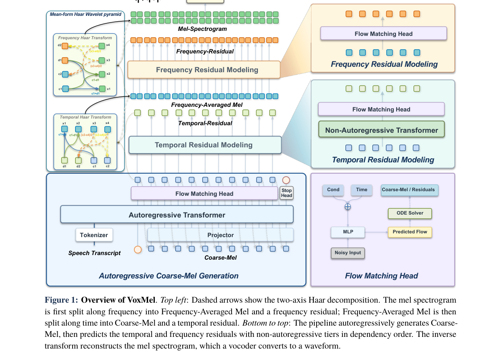

**Why this ranks #4**: 用固定且严格可逆的双轴 Haar 变换把 mel 谱拆成粗 mel 与两级残差，语言模型只自回归建模易预测的粗 mel；100K 小时 Emilia 训出的 0.6B 模型在 Seed-TTS test-en 上 WER 1.51%、SIM 0.738，冻结 flow 头的 GRPO 后降到 1.15%、SIM 升到 0.753，并可蒸馏成 2 步与 4 步学生，是本批唯一同时给出无 tokenizer 训练与 RL 后训练全链路的 TTS 报告。

---

### 5. DuoFlow: Towards Synchronized Speech and Motion Generation with Fine-Grained Control

**arXiv**: [2611.21530](https://arxiv.org/abs/2611.21530) | **Score**: 8.7 (relevance 9 x 0.7 + quality 8 x 0.3) | **Direction**: `duplex_speech_core` | **Tags**: duplex-speech, speech-motion, flow-transformer, cross-modal-attention, controllable-generation, synchronized-generation, Tsinghua University | **Categories**: cs.CV | **Pages**: 11

**Authors**: Jun Dong; Ronghui Li; Zhongyuan Hu; Yunqi Zhao; Lijie Guo; Ruizhang Xu; Di Kang; Linchao Bao; Xiu Li

**Affiliation**: Tsinghua University; Tencent

**Abstract**

> An embodied speaker's expressiveness depends not only on what is said, but also on how the voice sounds and how the body moves. However, existing joint speech-motion generation models are largely driven implicitly by transcript semantics or intermediate speech representations, offering little explicit control over motion hierarchy, body parts, or vocal style. To bridge this gap, we construct MotionSpeech, a structured benchmark for controllable joint speech-motion generation that includes transcripts, voice-style descriptions, and motion conditions at two hierarchical levels. Building on this benchmark, we propose DuoFlow, a dual-stream latent flow transformer that jointly denoises speech and motion under a shared noise level and a unified second-based temporal coordinate. Modality-specific residual connectors inject structured conditions into the corresponding streams, layer-wise bidirectional cross-modal attention coordinates their generation, and a monotonic phoneme pathway combines normalized progress anchors with CTC supervision to strengthen speech temporal modeling. DuoFlow provides a unified interface for fine-grained motion and vocal-style control and demonstrates the ability to synthesize high-quality, synchronized, and instruction-consistent speech-motion sequences.

**Key findings**

- **Finding**: MotionSpeech 含 34950 段 12.9 秒样本（约 125.2 小时，含 17907 段 BEAT2 与 17043 段 Seamless Interaction）；DuoFlow 在其上 WER 4.71%、说话人相似度 0.94、L1/L2 指令遵循 87.43%/90.40%，CosyVoice2+MambaTalk 为 6.12%/0.80/53.42%/53.63%，Match-TTSG 为 36.35%/0.75/56.38%/60.38%，Motion-Omni 为 74.98%/0.56/61.37%/62.68%；30 步采样生成一段 12.9 秒语音-动作用时 1.33 秒，RTF 0.10。
- **Inference**: 共享噪声级加统一秒级时间坐标让两路生成天然对齐，而显式的语音风格描述与两级动作描述条件才是它指令遵循率远高于基线的原因，级联的先 TTS 再动作拿不到这种一致性。
- **Recommendation**: 做具身说话人可直接照搬共享时间轴、双向跨模态注意力与单调音素通路的耦合结构；评测务必同时看 WER 与指令遵循率，单看语音质量会让 Motion-Omni 这类系统显得更强。

**Key figures**

*Framework - Our MotionSpeech dataset provides approximately 125 hours of synchronized speech and full-body motion, annotated with coarse- and fine-grained motion descriptions, transcripts, and comprehen*

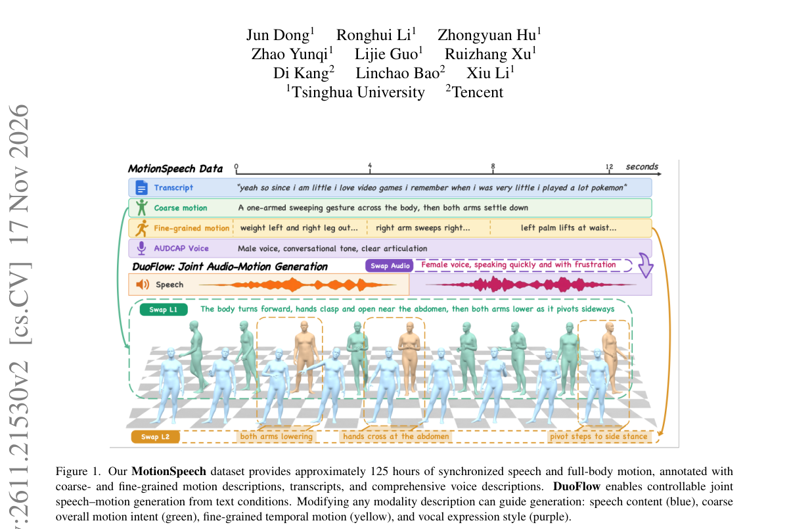

*Result - MotionSpeech data and annotation construction. Each source segment pairs an SMPL-X motion sequence with its speech waveform and transcript. The annotation pipeline adds hi- erarchical motion*

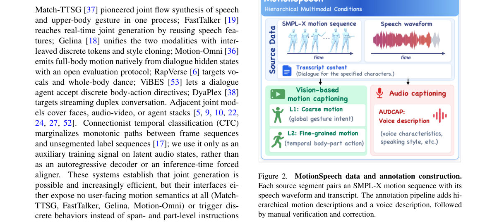

**Why this ranks #5**: 双流潜空间 flow transformer 在共享噪声级与统一秒级时间轴上联合去噪语音与全身动作，配套 MotionSpeech 基准含 34950 段、约 125.2 小时；WER 4.71%、说话人相似度 0.94，L1 与 L2 两级动作指令遵循率 87.43% 与 90.40%，而级联方案只有 53.42%/53.63%，是本批唯一把语音风格控制与全身动作控制做成同一接口的工作。

---

### 6. ProSing: Zero-Shot Fine-Grained Singing Technique Conversion

**arXiv**: [2611.19223](https://arxiv.org/abs/2611.19223) | **Score**: 8.4 (relevance 9 x 0.7 + quality 7 x 0.3) | **Direction**: `duplex_speech_core` | **Tags**: duplex-speech, singing-voice-conversion, technique-control, flow-matching, zero-shot, pitch-trajectory, Southern University of Science and | **Categories**: cs.SD | **Pages**: 5

**Authors**: Xinhao Guan; Jingyue Huang; Kangrui Chen; Julian McAuley; Zhong-Qiu Wang

**Affiliation**: Southern University of Science and Technology; University of California San Diego

**Abstract**

> We study zero-shot fine-grained singing technique conversion (STC), which applies specified techniques to selected regions of an existing singing recording while preserving lyrics, melody, timing, and singer identity. Existing singing conversion and synthesis methods offer complementary strengths in source preservation and explicit technique control, but combining both in an audio-to-audio setting remains underexplored, especially with limited technique-annotated data. We propose ProSing, a zero-shot fine-grained STC framework that adapts a pretrained flow-matching acoustic model with frame-level technique conditioning. To mitigate conditioning shortcuts during adaptation, we introduce a paired training strategy to learn generalizable technique representations. We further incorporate continuous pitch trajectories for explicit and expressive control of pitch-related techniques. Subjective and objective evaluations on unseen singers and source recordings show that ProSing achieves accurate technique control while preserving singing naturalness and singer similarity.

**Key findings**

- **Finding**: 在 36 个中文单技巧与 24 个音色-技巧样本上 ProSing 取得 N-MOS 3.36±0.22、S-MOS 3.13±0.22、CER 27.6%、F0-RMSE 166.7 cents，而 TCSinger 为 1.48±0.14/1.64±0.15/64.1%/413.4，Vevo1.5 为 2.41±0.28/2.68±0.25/39.5%/332.8，源录音自身 CER 为 23.5%；消融中只做标签微调的单/多技巧 F1 仅 0.143/0.117，加配对训练升到 0.265/0.194，再加音素引导对齐到 0.389/0.228，连续音高轨迹把音高技巧 F1 从 0.097 提到 0.162。
- **Inference**: 标签微调时模型会走捷径去认说话人而不是认技巧，配对训练用同一段演唱的控制版对照技巧版把技巧表征从音色里剥出来，帧级条件因此才能真正落到指定片段。
- **Recommendation**: 做歌声风格或技巧转换时不要直接标签微调，先构造配对数据并做音素级对齐；评估除 MOS 外必须报技巧 F1 与 F0-RMSE，否则源保真度的退化会被掩盖。

**Key figures**

*Framework - Overview of ProSing: paired training with phoneme-guided alignment (top) and fine-grained technique conditioning (bottom).*

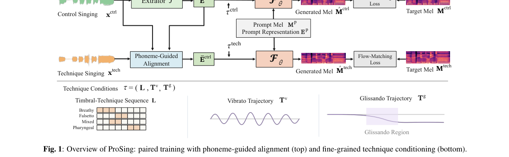

**Why this ranks #6**: 在预训练 flow-matching 声学模型上加帧级技巧条件，并用同一段演唱的配对版本消除条件捷径，实现零样本细粒度歌声技巧转换；N-MOS 3.36 对 TCSinger 1.48 与 Vevo1.5 2.41，CER 27.6% 对 64.1% 与 39.5%，F0-RMSE 降到 166.7 cents，是本批唯一给出可复现消融的歌声技巧转换工作。

---

### 7. ProTTS: End-to-End Prominence-aware Natural and Controllable Text-to-Speech via Automatic Word Stress Discovery

**arXiv**: [2611.19832](https://arxiv.org/abs/2611.19832) | **Score**: 8.4 (relevance 9 x 0.7 + quality 7 x 0.3) | **Direction**: `duplex_speech_core` | **Tags**: duplex-speech, word-stress, text-to-speech, prosody-control, unsupervised-clustering, fastspeech2, IIIT Hyderabad | **Categories**: cs.LG, eess.AS | **Pages**: 19

**Authors**: Sai Harshitha Aluru; Chiranjeevi Yarra

**Affiliation**: IIIT Hyderabad

**Abstract**

> Natural speech conveys meaning not only through words, but also through the prominence on a few words. Yet most text-to-speech (TTS) systems remain prominence-unaware, existing prominence-aware TTS require external stress annotations, while unsupervised stress detectors operate in isolation, disconnected from synthesis. This creates a fundamental gap no existing system can automatically discover where stress should be placed, realize it as natural-sounding prosody, and offer user control over emphasis placement, all within a single model. To circumvent this, we propose ProTTS, a unified framework where stress detection emerges from the TTS model itself and, in turn, guides it to synthesize more natural and controllable speech. We incorporate a clustering head into the variance adaptor of FastSpeech_2 that discovers word stress directly from aggregated prosodic features. The discovered stress then drives emphasis variance predictors that modify pitch, energy, and duration for stressed words. The framework is trained end-to-end: TTS reconstruction and clustering losses jointly shape a stress-discriminative feature space without requiring stress labels at any stage. At inference, the same architecture also supports user-controllable emphasis by accepting a custom stress mask. We evaluate ProTTS on ISLE (non-native), LibriTTS, VCTK (native training), and three evaluation benchmarks (Tatoeba, TinyStress-15k, EmphAssess). Listeners prefer ProTTS over the baseline with a MOS of 3.96 vs. 3.12 and 83.5% preference rate. For stress detection, ProTTS achieves 0.839/0.861 F1 on ISLE (German/Italian L2), outperforming unsupervised (0.70) and supervised (0.82) baselines, and 0.933 F1 in zero-shot transfer to Tatoeba.

**Key findings**

- **Finding**: ProTTS 在 ISLE 上德语与意大利语 L2 的重音 F1 为 0.839/0.861，高于无监督 K-Means 的 0.76/0.71 与有监督 DNN 的 0.83/0.74；Tatoeba 零样本 F1 0.933，对照 K-Means 0.71 与有监督 DNN 0.891，TinyStress-15k 与 EmphAssess 为 0.911 与 0.923；主观 MOS 3.96±0.11 对 FastSpeech2 的 3.12±0.14，偏好率 83.5%，重音偏好 78.3%，ABX 相似度 71.8% 对基线 12.5%，词级特征为 521 维。
- **Inference**: 方差适配器里的音高、能量、时长预测本来就承载重音信息，聚类损失与 TTS 重建损失联合训练把重音与非重音逼成可分簇的维度，于是无标注也能拿到高于有监督分类器的 F1。
- **Recommendation**: 需要强调可控的 TTS 可把聚类头接进方差适配器并复用推理时的 stress mask；评测除 MOS 外要看重音 F1 与 ABX，否则把重音夸张化也能骗过自然度评分。

**Key figures**

*Framework - Architecture of ProTTS. (a) Overall FastSpeech 2 model with our modified variance adaptor. (b) Inside the modified variance adaptor: base prosody predictions are aggregated into 521-dim word*

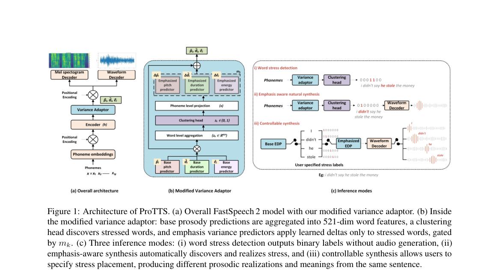

*Result - PCA of word-level EDP embeddings on ISLE, colored by ground-truth stress. Left: base prosody em- beddings (ˆpi, ˆei, ˆdi). Right: stress-adapted prosody embeddings (˜pi, ˜ei, ˜di).*

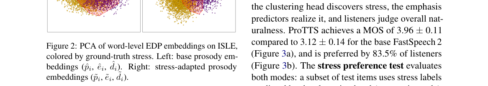

**Why this ranks #7**: 在 FastSpeech2 的方差适配器里加聚类头，让重音检测从 TTS 自身的长短音高能量特征里自己长出来并反过来驱动重音词的音高、能量与时长；MOS 3.96 对基线 3.12、偏好率 83.5%，ISLE 德语与意大利语 L2 上 F1 0.839/0.861 反超有监督基线，Tatoeba 零样本 0.933，是本批唯一把重音发现与合成合到同一个模型的工作。

---

### 8. Sada-ASR: A Production Multidialectal Arabic Speech Recognition System

**arXiv**: [2611.19512](https://arxiv.org/abs/2611.19512) | **Score**: 8.0 (relevance 8 x 0.7 + quality 8 x 0.3) | **Direction**: `duplex_speech_core` | **Tags**: duplex-speech, arabic-asr, multidialectal, weakly-labelled-data, production-system, asr-benchmark, EchoNova AI | **Categories**: cs.CL, cs.SD, eess.AS | **Pages**: 10

**Authors**: Mahmoud Khaled; Mohammed Abd-Elnaser; Mahmoud Mohsen; Hazem Ahmed; Abdelrahman Hafez

**Affiliation**: EchoNova AI

**Abstract**

> Callers to Arabic customer-service lines speak their own dialect, while speech recognizers are built and evaluated mainly on Modern Standard Arabic (MSA). A recognizer that mishears the dialect breaks the call before anything else can help. We present Sada-ASR, the speech recognizer of EchoNova's production Arabic voice agent. On a 120-hour test set of MSA and eight dialects, it has the lowest word and character error rates of twelve systems, against eleven from Microsoft, ElevenLabs, Google, OpenAI, Speechmatics, IFM, Cohere, NVIDIA and Audar: 11.69% word error rate against 13.51% for the strongest, Microsoft's MAI-Transcribe-2 (a lead of 0.74 points on clips unaffected by that system's fixed number and script conventions), and 15.52% against 16.96% averaged over varieties. Its largest margins are on Omani (4.30 points), Egyptian (3.78) and Saudi (2.19) speech; it is level on Syrian and loses on Lebanese (24.96% against 23.05%), mostly because it writes Lebanese words in MSA forms and is less verbatim. On six public test sets its average word error rate under the leaderboard's current scoring is 17.17%, below every published figure we found, among them Falcon-ASR (20.92%), Jais-ASR (22.85%) and Audar-ASR-V1-Turbo (23.17%), though none of these states that it used that scoring, so the comparison is indicative. We describe the data pipeline and methodology behind Sada-ASR and release a 20-hour subset of the test set with our scoring code.

**Key findings**

- **Finding**: 120 小时、53597 条的私有测试集（MSA 加八个方言）上 Sada-ASR 的 WER 11.69%、CER 4.76% 为 12 个系统最低；对 MAI-Transcribe-2 的 13.51% 相对降低 13.5%（1.83 点，95% CI 1.72–1.93），去掉数字与拉丁转写后仍有 0.74 点优势；分方言看阿曼语领先 4.30 点、埃及 3.78 点、沙特 2.19 点，黎巴嫩语落后 1.91 点；六个公开测试集上平均 WER 17.17%，低于 Falcon-ASR 20.92%、Jais-ASR 22.85% 与 Audar 23.17%。
- **Inference**: 方言的真正瓶颈是标注稀缺而不是模型容量，靠 100 多名方言标注员加网页弱标注补量才换来九个变体里七个领先的 WER；黎巴嫩语的失利则说明正字法约定会主导分数。
- **Recommendation**: 做方言 ASR 评测必须同时公布正字法与数字书写约定，并给出受控片段子集，否则跨系统 0.74 点的差距会被书写习惯而非识别能力解释；该文已开源 20 小时测试子集与打分代码可直接复现。

**Key figures**

*Result - The two data streams behind Sada-ASR: audio transcribed on our annotation platform, and weakly labelled web audio, merged into one training set.*

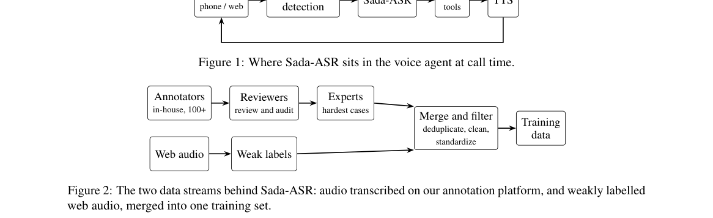

**Why this ranks #8**: 面向 MSA 加八个方言的生产级阿拉伯语识别器，用自有标注平台加网页弱标注双路数据训练；120 小时、53597 条私有测试集上 WER 11.69%、CER 4.76% 低于 11 个外部系统，最强对手 MAI-Transcribe-2 为 13.51%，阿曼语领先 4.30 个点，六个公开测试集平均 WER 17.17%，是本批唯一给出可复现方言评测基线的工作。

---

## 语音 LM 的 RL 与偏好优化 · `speech_rl` (1 papers)

### 9. Rethinking Post-Training for Expressive Zero-Shot Text-to-Speech

**arXiv**: [2611.19787](https://arxiv.org/abs/2611.19787) | **Score**: 8.7 (relevance 9 x 0.7 + quality 8 x 0.3) | **Direction**: `speech_rl` | **Tags**: duplex-speech, dpo, grpo, self-distillation, zero-shot-tts, prosody-control, Alibaba Group | **Categories**: eess.AS | **Pages**: 5

**Authors**: Jingbin Hu; Xinfa Zhu; Hao Wang; Wenjie Tian; Kangxiang Xia; Hangrui Hu; Kexin Huang; Jin Xu; Liumeng Xue; Lei Xie

**Affiliation**: Alibaba Group; Nanjing University

**Abstract**

> Zero-shot voice cloning typically emphasizes preserving the timbre and prosodic characteristics of a reference speaker. However, in real-world use, speech should adapt its delivery to the target text rather than remain tied to a fixed speaking style. In this work, we formulate this problem as text-adaptive prosody synthesis for zero-shot voice cloning and study how post-training can endow a cloning model with this capability. We develop a three-stage framework. First, Direct Preference Optimization (DPO) provides a cold start by aligning the model with text-appropriate expressive speech. Second, Group Sequence Policy Optimization (GSPO) jointly optimizes prosodic expressiveness, acoustic quality, intelligibility, and speaker similarity. Finally, context-conditioned On-Policy Self-Distillation (OPSD) enables self-improvement by transferring expressive behavior from strong-reference to weak-reference conditions. On Qwen3-TTS, our framework improves Emotion from 18.5 to 81.2 and Paralinguistics from 38.4 to 73.9. Extensive ablations validate the role of each stage.

**Key findings**

- **Finding**: 三阶段后训练把 Qwen3-TTS 在 Emergent TTS-Eval 上的整体情感分从 18.5 提到 81.2、副语言分从 38.4 提到 73.9；其中 SFT 只到 59.5/53.9，150k 音频 30 说话人的 DPO 反而降到 30.6/43.3，改用 2 万对 500 说话人的 DPO 达 66.8/57.6，GSPO 再到 69.6/66.3（英文 UTMOS 3.09 升到 3.32），OPSD 最后到 81.2/73.9；3360 对 ABX 中 OPSD 在低表现力参考下以 67.4% 对 25.7% 胜出，但英文说话人相似度从 0.72 降到 0.59。
- **Inference**: 偏好对齐的收益主要来自说话人覆盖而不是数据量或优化目标，150k 音频 30 说话人的 DPO 不如 2 万对 500 说话人的 DPO，说明零样本克隆场景下多样性瓶颈压过了样本量。
- **Recommendation**: 做零样本 TTS 后训练先把说话人数量扩到数百再谈算法，GSPO 的奖励要显式包含韵律、音质、可懂度与说话人相似度四项并加权，同时预留身份保持的回归评测，因为 SIM 从 0.72 掉到 0.59 是这套流程最明显的代价。

**Key figures**

*Framework - Automated construction of preference data for text-adaptive prosody synthesis.*

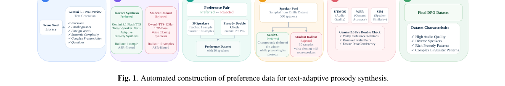

*Result - Human ABX preference results for reference-prosody de- pendence and OPSD robustness, evaluated on 3360 ABX pairs by 20 listeners. (a) High- vs. low-expressiveness references. (b) OPSD vs. base*

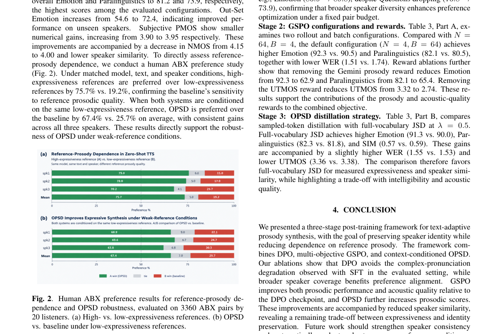

**Why this ranks #9**: 把零样本语音克隆重述为文本自适应韵律合成，用 DPO 冷启动、GSPO 多目标强化、OPSD 自蒸馏三段式后训练 Qwen3-TTS；整体情感分 18.5 提到 81.2、副语言分 38.4 提到 73.9，3360 对人类 ABX 中 OPSD 在弱参考下以 67.4% 对 25.7% 胜出，是本批唯一把 DPO、序列级策略优化与自蒸馏串成完整语音后训练链路的论文。

---

## Footer

- Total papers reviewed across all 4 axes: 60
- duplex_speech axis final count: 9
- Wild-cards in this axis: 0
- Figure assets: 2026-11-18/res/

Generated by `mine-arxiv-daily-digest` skill. Sister file: `2026-11-18_duplex_speech_entry.md`.
