# Mine Arxiv Daily Digest - 2026-11-18 (LLM / VLM 与其强化学习 Axis, 18 papers)

**Generated**: 2026-11-18 12:30 CST

**Source**: arXiv cs.CV, cs.SD, eess.AS, cs.CL, cs.AI, cs.RO, cs.LG, cs.IR submissions, listing day 2026-11-13..2026-11-16 (announced 2026-11-16 20:00 ET = 2026-11-17 01:00 UTC)

**Batch window**: 2026-11-12T19:00:00Z .. 2026-11-17T19:00:00Z（arXiv 公告批次横跨两个 UTC 日：从前一日的美东 14:00 截止时刻起算（EDT 为 18:00Z，EST 为 19:00Z），到当日的同一时刻为止）

**Axis**: llm_vlm (18 papers, base 18, cap 20)

**Directions**: llm_core (4), vlm_core (3), llm_vlm_rl (11)

**Selection**: 18 papers ranked by relevance x quality, with 0 wild-card slots

**Day total**: 60 papers across 4 axes (target 60)

**Scope**: 大语言模型与视觉语言模型的设计、推理、agent、效率与上下文工作，以及面向 LLM / VLM 的 RL 与偏好优化、奖励模型

**Wild-card**: 0（本 axis 本批次够格供给充足，未启用补位名额）

---

## LLM 核心（架构 / 推理 / agent / 效率 / 上下文） · `llm_core` (4 papers)

### 1. Multi-Branch Transformer

**arXiv**: [2611.19800](https://arxiv.org/abs/2611.19800) | **Score**: 8.7 (relevance 9 x 0.7 + quality 8 x 0.3) | **Direction**: `llm_core` | **Tags**: LLM-VLM, multi-branch-transformer, joint-kv, moe-scaling, kv-cache-sharing, decoding-throughput, University of Illinois Urbana-Champaign | **Categories**: cs.CL, cs.LG | **Pages**: 30

**Authors**: Gaotang Li; Lingjie Chen; Chunyuan Deng; Zhiwei Xu; Hongzheng Chen; Christopher De Sa; Jingrui He; Yingheng Wang; Hanghang Tong

**Affiliation**: University of Illinois Urbana-Champaign; Rice University; University of Michigan; Cornell University

**Abstract**

> Transformer language models are commonly scaled by making their blocks wider or stacking them deeper. In this work, we explore a complementary path: branching, the parallel composition of full Transformer blocks. We introduce the Multi-Branch Transformer (MBT), which processes the input through shared initial layers, executes independently parameterized branches of sequential blocks in parallel, and fuses their outputs before shared final layers. At comparable training compute, we study three MBT variants: Wide-Shallow preserves block width, Narrow-Deep preserves sequential depth, and Balanced interpolates between them. In controlled pretraining experiments at four mixture-of-experts scales (0.8B to 2.1B total parameters), 2-branch Wide-Shallow MBTs consistently outperform sequential Transformers under matched parameter and training-compute budgets. Balanced MBTs improve further and retain comparable quality as the number of branches increases. To improve inference efficiency at long contexts, we introduce Joint-KV, which constructs a shared KV cache from branch representations at each depth. Our final recipe combines Balanced MBTs with Joint-KV, supported by an inference engine that exploits branch grouping and shared-cache reuse. Fitted scaling curves indicate that standard Transformers require up to 1.26x as much training body compute to match our final models' validation loss. These models reduce full-model KV-cache storage by up to 34% and deliver up to 51.4% higher decoding throughput on a single H200 GPU. Ablation studies show that branching yields gains beyond changes in width and depth, enables an effective KV-sharing strategy (Joint-KV), remains robust across fusion functions, and performs best in the middle layers. These findings show that branching offers a practical path for scaling language models toward both better modeling quality and faster inference.

**Key findings**

- **Finding**: 在 0.8B–2.1B 总参数的四个 MoE 规模上，2 分支 Wide-Shallow MBT 在同等参数量与训练算力下持续优于顺序 Transformer；配 Joint-KV 后，2–4 分支模型所匹配的标准 Transformer 需要 1.16–1.26 倍训练体算力，KV 缓存占用减少 19–34%。
- **Inference**: 分支化带来的收益无法由单纯加宽或加深复现，说明并行组合完整块是一条独立的扩展维度，且天然支持跨分支共享 KV 缓存。
- **Recommendation**: 落地这条路需要自建能复用共享缓存的分支推理引擎；可先在现有 MoE 基座上试 2 分支 Wide-Shallow + Joint-KV，并把 KV 占用与解码吞吐当作验收指标。

**Key figures**

*Result - Comparison of Transformer computation structures. (a) Standard sequential blocks; (b) within-block parallel attention and FFN, as in PaLM [14]; (c) wider, shallower stacks; and (d) MBTs with*

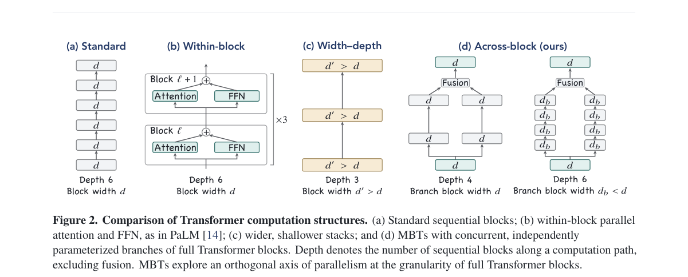

**Why this ranks #1**: 把完整 Transformer 块并行组成分支再融合输出，是加宽/加深之外的第三条扩展轴：在 0.8B–2.1B 总参数的四个 MoE 规模上，2 分支 Wide-Shallow 在同等参数量与训练算力下持续优于顺序 Transformer；再配 Joint-KV（每层用各分支表示建共享 KV 缓存），标准 Transformer 要多训 1.16–1.26 倍训练体算力才能追平其验证损失，KV 缓存占用减少 19–34%，单卡 H200 上 64K 输入、8 并发请求解码吞吐最高提升 51.4%。

---

### 2. K2-Horizon: A Frontier Fleet of Open Source Language Models

**arXiv**: [2611.21003](https://arxiv.org/abs/2611.21003) | **Score**: 8.7 (relevance 9 x 0.7 + quality 8 x 0.3) | **Direction**: `llm_core` | **Tags**: LLM-VLM, mixture-of-value-attention, softplus-gating, diffusion-adapter, synthetic-pretraining-data, open-weight-fleet, Institute of Foundation Models | **Categories**: cs.AI | **Pages**: 153

**Authors**: K2 Team; Zhengzhong Liu; Haonan Li; Xuezhe Ma; Alexander Moreno; Subham Sekhar Sahoo; Rupesh Kumar Srivastava; Mikhail Yurochkin; Hadi Abdine; Yash Akhauri; Adharsh Babu; David Bellamy

**Affiliation**: Institute of Foundation Models; Mohamed bin Zayed University of Artificial Intelligence

**Abstract**

> We present K2-Horizon, a fleet of six fully open language models, from a 0.9B dense model to a 375B-A23B MoE, built for general-purpose reasoning and agentic work across math and science, software engineering, deep research, office automation, and beyond. The models lead or are competitive with strong open models of their size on agentic and coding benchmarks. On the modeling side, to strengthen reasoning, we introduce Mixture-of-Value Attention (MoVA), applying MoE to attention value projections, and softplus attention gating, a more flexible, theoretically motivated gate. Our 36B-A4B model uses both and nearly matches a 32B dense model trained on the same data, with one-seventh the active parameters. We also introduce Uno, lossless diffusion adapters that speed up decoding by up to 2.2x without a separate draft model. Our release follows the LLM360 definition of open source for transparency and reproducibility: the full development history, including intermediate checkpoints from every training stage, pre-training data, training logs, and all training, evaluation, and infrastructure code, notably our production-scale xLLM framework for dense and MoE training and the RL360 reinforcement-learning stack. Beyond the data itself, we release and document in detail every pipeline that built it, the part of model development that open releases most rarely disclose. These pipelines produced roughly 10T synthetic pre-training tokens, showing that synthetic data can be a major ingredient of pre-training at scale. Four of the models share one 22T-token pre-training corpus and recipe, revealing consistent scaling behavior and enabling controlled studies of scale and sparsity. All artifacts are available at https://ifm.ai/k2/

**Key findings**

- **Finding**: K2-Horizon 发布 6 个全开源模型（0.9B 稠密至 375B-A23B MoE），其中 36B-A4B 同时使用 MoVA 与 softplus 注意力门控，以约七分之一激活参数接近同数据训练的 32B 稠密模型；Uno 无损扩散适配器最多把解码加速 2.2 倍且不需要草稿模型。
- **Inference**: 稀疏化从 FFN 下探到注意力 value 投影并改用 softplus 门控，说明「质量与推理成本分离」可以靠注意力内部结构改造实现，不必只靠堆专家数。
- **Recommendation**: 自建 MoE 时可直接照搬 MoVA + softplus 门控的组合，并在部署侧用 Uno 这类免草稿的扩散适配器换取 2.2 倍解码加速。

**Why this ranks #2**: 六个全开源模型（0.9B 稠密到 375B-A23B MoE）组成一个前沿舰队，真正的结构新意在 MoVA——把 MoE 下探到注意力 value 投影，并配 softplus 注意力门控；36B-A4B 用约七分之一激活参数接近同数据训练的 32B 稠密模型，Uno 无损扩散适配器在不需要草稿模型的前提下把解码最多加速 2.2 倍；此外公开了约 10T 合成预训练 token 与 22T 共享语料的完整流水线。

---

### 3. Superfluid: Local AI Server for Distributed LLM Inference

**arXiv**: [2611.17753](https://arxiv.org/abs/2611.17753) | **Score**: 8.4 (relevance 9 x 0.7 + quality 7 x 0.3) | **Direction**: `llm_core` | **Tags**: LLM-VLM, distributed-inference, local-llm-server, prefix-cache-sharing, priority-scheduling, first-token-latency, Base Compute | **Categories**: cs.AI, cs.CL, cs.DC | **Pages**: 8

**Authors**: Prabod Rathnayaka; Isura Manchanayake; Srikandabala Kogul; Steve Siu; Fabian Waschkowski; Lukas Wesemann

**Affiliation**: Base Compute

**Abstract**

> Running large language models (LLMs) on local devices keeps data private, removes per-token cost, cuts network latency, and keeps working without a connection. Two shifts now strain how such models are served. On one device, several agents share a locally served model with an interactive user. Across devices, a developer or small team often owns several capable machines from different vendors, which sit idle most of the day because every local server serves one runtime on one machine. We present Superfluid, an open-source LLM server built for local inference at both scales. On one device, Superfluid drives llama.cpp, MLX, or BaseRT in isolated worker processes through one scheduler that moves interactive requests ahead of agent work, computes a prompt shared by many requests once, and writes every token to a durable log before it reaches the client. Across devices, one Superfluid server turns a fleet of machines into a single API endpoint. Machines with different hardware serve copies of the same model, receive work according to their measured speed, and can join or fail under load without losing a request. For Qwen3.8-27B on an Apple M5 Pro, a chat sent while eight agents are working receives its first token in 1.5 s, against 291-612 s on llama-server, Ollama, and mlx_lm.server. On six machines from three chip vendors serving 64 simulated users for one hour, Superfluid answers all 5,041 requests while machines join one at a time and one is killed and rejoins; throughput grows from 112 to 534 tok/s and the median first-token time falls from 99 to 12 s. On twelve Mac Studio M3 Ultras it sustains 10,656 tok/s across 38,563 requests from 384 agents without a failure. Superfluid is available under the Apache-2.0 licence at https://github.com/basecompute/superfluid.

**Key findings**

- **Finding**: Apple M5 Pro 上运行 Qwen3.8-27B 时，Superfluid 让插在 8 个忙 agent 之后的聊天请求首 token 为 1.5 s（MLX 后端 2.0 s），而 llama-server、Ollama、mlx_lm.server 需排队 291–612 s；32 个请求共享同一 4k token 前缀时 97% 命中共享缓存、56 s 内全部服务完。
- **Inference**: 交互请求与 agent 任务共用一份权重时的主要损耗在调度优先级与共享前缀的重复 prefill，而不是单卡算力本身。
- **Recommendation**: 自建本地服务时优先做「交互优先调度 + 共享前缀只算一次」这两件事，再考虑加机器；跨机扇出则让各节点按实测速度按比例领活。

**Key figures**

*Framework - Superfluid’s processes. The daemon owns the APIs, the scheduler, and the session log. Each local model runs in its own worker process; in fleet mode, nodes on other machines serve copies of*

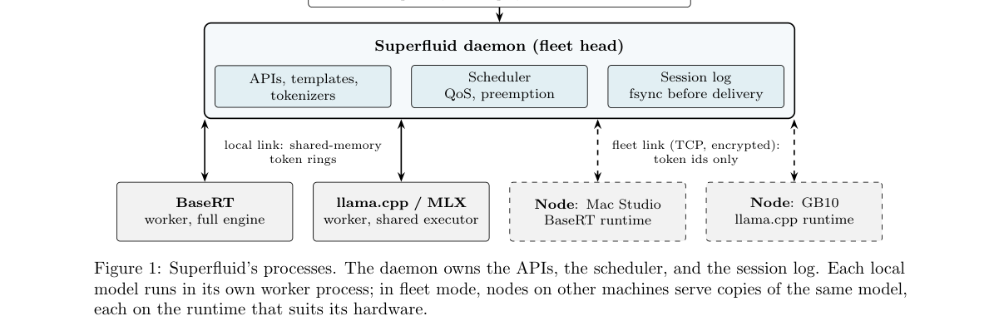

*Result - Run A: six heterogeneous machines as one endpoint, Qwen3-4B on llama.cpp, 64 simulated users for one hour. Stacked areas give the output tokens per second each machine served (30 s rolling r*

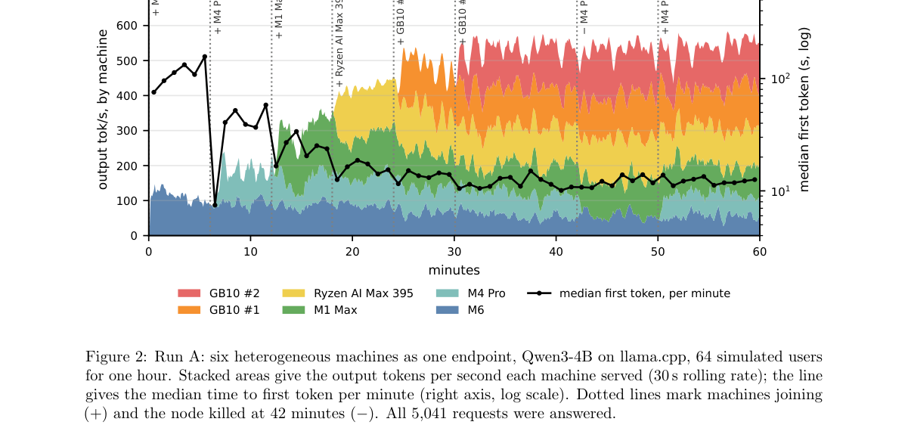

**Why this ranks #3**: 本地与跨机 LLM 推理服务器，关键是让「交互式对话」与「agent 批量任务」在调度和共享前缀计算上分开：在 Apple M5 Pro 上跑 Qwen3.8-27B，插在 8 个忙 agent 之后的聊天首 token 只要 1.5 s，而 llama-server / Ollama / mlx_lm.server 要排队 291–612 s；6 台跨 3 家芯片厂的机器服务 64 个模拟用户一小时，5,041 个请求全部应答，吞吐从 112 升到 534 tok/s，中位首 token 从 99 s 降到 12 s。

---

### 4. Architectures and KV Replay for Depth-Recurrent Language Models

**arXiv**: [2611.19446](https://arxiv.org/abs/2611.19446) | **Score**: 8.4 (relevance 9 x 0.7 + quality 7 x 0.3) | **Direction**: `llm_core` | **Tags**: LLM-VLM, depth-recurrence, kv-replay, cache-compression-training, recurrent-mixer, attention-anchor, NXAI | **Categories**: cs.LG | **Pages**: 18

**Authors**: Lucia Licakova; Niklas Schmidinger; Lukas Hauzenberger; Sebastian Böck; Sepp Hochreiter

**Affiliation**: NXAI; Johannes Kepler University Linz

**Abstract**

> Depth recurrence increases effective model depth by repeatedly applying a fixed computation block. However, sharing attention parameters does not share the key-value (KV) states generated at different recurrence iterations, which causes memory growth with recurrence depth during autoregressive decoding. We study how to reduce this memory cost through architectural and cache-sharing approaches within a common depth-recurrent framework. We first study a looped hybrid that repeats a stack of Transformer layers, with recurrent mLSTM or Gated DeltaNet blocks replacing most attention layers and periodic Transformer attention anchors retained. We then restrict recurrence to a dedicated recurrent workspace in a Parcae-style architecture and test its stabilising adapter as a wrapper for the looped hybrid. Finally, we train a looped Transformer with recurrent KV replay, where only selected recurrence iterations write KV states that later iterations reuse. This trains the model to operate with the same shared KV topology used during inference. We find that looped hybrids require sufficiently frequent attention anchors, with performance depending strongly on the recurrent mixer. For cross-iteration KV sharing, recurrent KV replay allows multiple recurrence iterations to reuse the same KV states while retaining performance close to the full looped Transformer with separate KV caches for each iteration.

**Key findings**

- **Finding**: 论文指出深度循环中共享注意力参数并不共享不同循环迭代生成的 KV 状态，导致自回归解码时缓存随循环深度增长；三类方案分别是 mLSTM/Gated DeltaNet 替换加周期 Transformer 锚点、PARCAE 式循环工作区，以及只让选定迭代写 KV 的循环 KV 重放（cache-compression training）。
- **Inference**: KV 压缩必须在训练阶段就按最终推理的共享拓扑一起训练，推理期再换拓扑或事后压缩都会立刻掉点。
- **Recommendation**: 做深度循环模型时把「哪次迭代写 KV、哪次复用 KV」当作训练超参提前固定，并同时报告困惑度与缓存占用两项指标。

**Key figures**

*Framework - Looped hybrid model. Exact-attention Transformer anchors are interleaved with recurrent sequence mixers; the complete logical stack is applied across multiple recurrence iterations.*

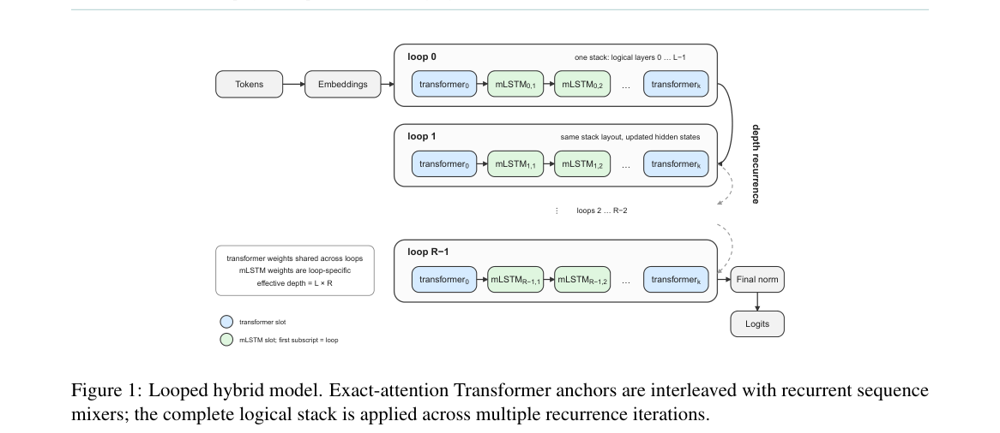

*Result - In our implementation of the PARCAE architecture, Transformer layers encode the input, the represen- tation is projected into a recurrent workspace, a shared mLSTM core is applied repeatedly*

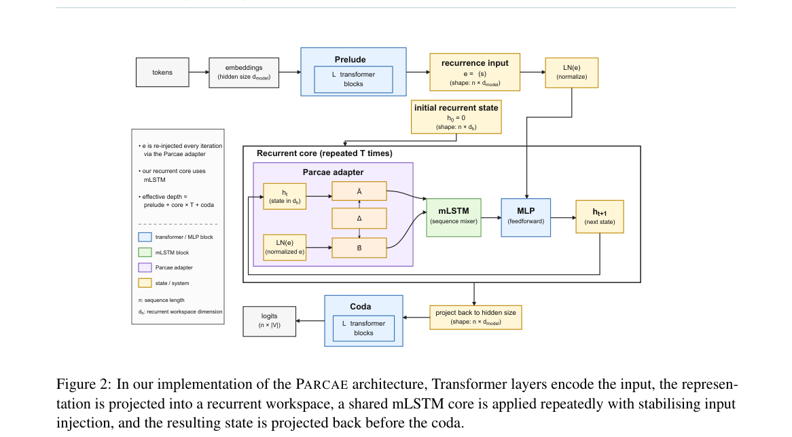

**Why this ranks #4**: 深度循环语言模型的缓存账还没算清：共享注意力参数并不共享各次循环迭代生成的 KV 状态，自回归解码时缓存随循环深度增长。论文统一比较三条路线——mLSTM / Gated DeltaNet 替换大部分注意力层并保留周期性 Transformer 锚点、把循环限制在 PARCAE 式循环工作区、以及只让选定迭代写 KV 的「循环 KV 重放」；后者首次把推理时将要使用的共享 KV 拓扑直接写进训练目标，使性能接近每次迭代各自持有 KV 缓存的完整循环 Transformer。

---

## VLM 核心（多模态架构 / 理解 / 视频 / GUI agent） · `vlm_core` (3 papers)

### 5. Glance, then Select: Evidence-Tempered Visual Token Selection for Extremely Compressed Multimodal LLMs

**arXiv**: [2611.20006](https://arxiv.org/abs/2611.20006) | **Score**: 8.7 (relevance 9 x 0.7 + quality 8 x 0.3) | **Direction**: `vlm_core` | **Tags**: LLM-VLM, visual-token-reduction, evidence-tempered-diversity, glance-encoder, self-distillation, prefill-latency, Peking University | **Categories**: cs.CV | **Pages**: 27

**Authors**: Yuxuan Wang; Guangxiang Zhao; Yuxuan Tian; Yahui Han; Xinyu Tan; Feiyu Wang; Zongwei Lv; Xiangzheng Zhang; Lin Sun; Tong Yang

**Affiliation**: Peking University; Qiyuan Tech

**Abstract**

> Multimodal large language models (MLLMs) encode a high-resolution image into thousands of visual tokens, which dominate the cost of the prefill stage. Visual token reduction removes most of these tokens, but two problems remain at extreme budgets. The vision encoder still processes every patch of the image, and the few surviving tokens often miss the small regions that hold the answer. In this paper, we propose Glance-ETD, a two-stage token reduction framework guided by a lightweight question-conditioned scorer. In the first stage, a glance encoder views the image at low resolution and re-encodes only the question-relevant regions at native resolution. In the second stage, Evidence-Tempered Diversity (ETD) selects the final tokens by combining diversity with the evidence predicted by the scorer, so that the kept tokens cover the scene and retain the answer. A single-rollout self-distillation recipe trains the MLLM with the glance encoder. With only 5% of the visual tokens, Glance-ETD retains 91.6% of the full-token performance of Qwen3.5-4B across fourteen benchmarks and outperforms the strongest prior method, LT-OPD, by 17.3 points and the same training recipe with DivPrune by 6.0. It also speeds up the time to first token on 4K images by 3.1x and generalizes to three other MLLMs and to high-resolution document benchmarks, with the largest gains on text-rich tasks.

**Key findings**

- **Finding**: Qwen3.5-4B 上只保留 5% 视觉 token 时，Glance-ETD 保留全 token 得分的 91.6%（14 个基准平均），比最强先前方法 LT-OPD 高 17.3 分、比 DivPrune 高 20.3 分、比同训练配方下的 DivPrune 高 6.0 分，并在 4K 图上把首 token 提速 3.1×。
- **Inference**: 极低预算下的瓶颈不在选择器的打分能力，而在「视觉编码成本没省」与「答案 token 被丢弃」两处，所以收益要靠重新编码位置而不是更聪明的剪枝来拿。
- **Recommendation**: 做高分辨率 MLLM 加速时，先把「低分辨率定位 + 原分辨率重编码」与「证据加多样性的选 token」拆开做消融，确认瓶颈在哪一环，再决定换哪个剪枝器。

**Key figures**

*Framework - Retention across visual-token budgets on Qwen3.5-4B: the mean over nine benchmarks1 of each score divided by our non- thinking full-token score, with the same number of tokens per im- age. S*

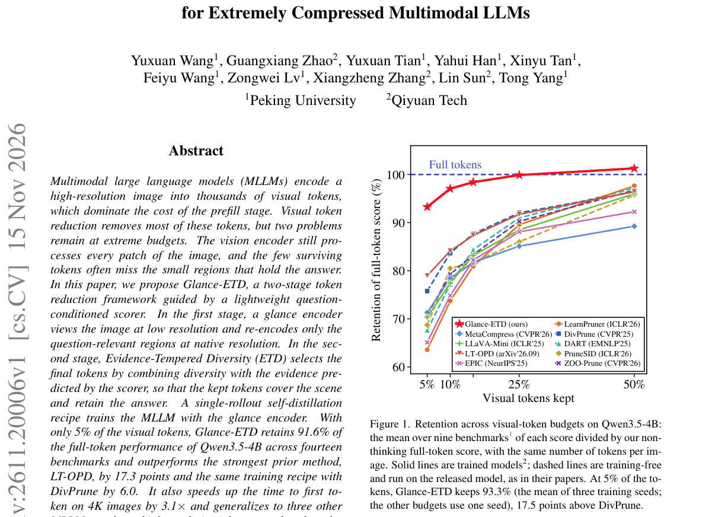

*Result - Two problems at a strict 5% visual-token budget on Qwen3.5-4B. (a) Time to first token on HR-Bench 4K for the full-token model, pruning after the ViT, and Glance-ETD (Tab. S14). Each bar is*

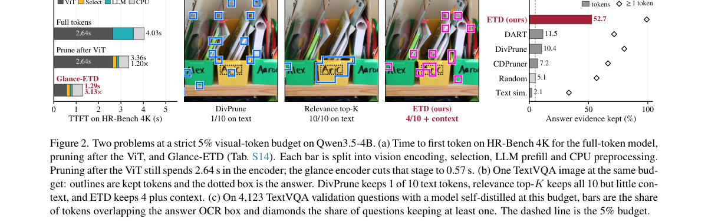

**Why this ranks #5**: 把视觉 token 压缩推到 5% 的极端预算，并同时处理两个常被忽略的失效：视觉编码器仍在逐 patch 处理（编码成本没省），以及留下的少数 token 常常正好丢掉答案区域。做法是先用低分辨率 glance encoder 扫视、只对问题相关区域按原分辨率重编码，再用 Evidence-Tempered Diversity 把「多样性」与打分器预测的「证据」混合起来选 token；5% token 下保留 Qwen3.5-4B 全量性能的 91.6%（14 个基准），比最强先前方法 LT-OPD 高 17.3 分、比同训练配方的 DivPrune 高 6.0 分，4K 图首 token 快 3.1 倍。

---

### 6. Seen but Unsaid: Locating and Repairing Cross-Image Comparison in Vision-Language Models

**arXiv**: [2611.21539](https://arxiv.org/abs/2611.21539) | **Score**: 8.7 (relevance 9 x 0.7 + quality 8 x 0.3) | **Direction**: `vlm_core` | **Tags**: LLM-VLM, cross-image-matching, attention-head-probe, point-correspondence, parameter-efficient-tuning, mechanistic-interpretability, University of Toronto | **Categories**: cs.CL, cs.CV, cs.LG | **Pages**: 18

**Authors**: Zhaoning Zhang

**Affiliation**: University of Toronto

**Abstract**

> Vision-language models (VLMs) often fail to match a point or an object across two images, even when the answer can be decoded from their own hidden states. We trace this failure from the visual tokens to the answer letter, in Qwen3-VL (2B-32B), InternVL3.5-8B, and Gemma-3-12B, on synthetic shape matching, same-instance point correspondence (HPatches), and semantic correspondence (SPair-71k), and find two distinct failure points, a small set of attention heads that carries the comparison, and a repair that touches 0.02% of the parameters. Two failure points: exact copies are compared but not read out. An answer-position probe exceeds the calibrated output by 15 to 25 points in every family, for nameable and unnameable shapes alike, and steering along the probe's direction moves no more answers than random directions. Semantic correspondences are present in the visual tokens but never reach the answer. One pathway: redistributing the cross-image attention of 16-32 heads, with its mass preserved, removes 17-22 points of synthetic and 15-32 points of HPatches accuracy, against at most 7 for random or attention-matched heads. A lever that training finds on its own: training only these heads' query and key projections raises SPair-71k accuracy by 28.3 points (Qwen3-VL-8B) and 25.1 points (InternVL3.5-8B), beats both layer-matched and attention-matched heads, and transfers to HPatches and BLINK. An unconstrained all-layer adapter routes 21-51% of its gain through the attention of the same heads, against at most 7% for random heads, and does so by changing what they read (83-86% of the effect) rather than their weights. Every decision rule was frozen before its run, and every reported number is recomputed by independent verification scripts.

**Key findings**

- **Finding**: 保持注意力总量不变地重分配 16–32 个头的跨图注意力，会移除 17–22 个百分点的合成匹配准确率与 15–32 个百分点的 HPatches 准确率，而随机头或注意力匹配头最多只掉 7 个百分点；只训练这些头的 query/key 投影（约占 0.02% 参数）把 SPair-71k 准确率从 0.430 提到 0.712（+28.3 pp，Qwen3-VL-8B）、从 0.354 提到 0.605（+25.1 pp，InternVL3.5-8B）。
- **Inference**: 失效点在读出通路而不在表征——对应关系其实已经在视觉 token 里，只是没被这批注意力头送进答案位置。
- **Recommendation**: 排查同类跨图匹配失效时，先用答案位探针与注意力再分配定位到这批头，再考虑只训练其 query/key 投影做低成本修复，而不是整体微调。

**Key figures**

*Framework - Where correspondence information is lost. Top: the task. Each image is encoded separately; under causal attention, tokens of each option in image 2 attend back to salient candidate locations*

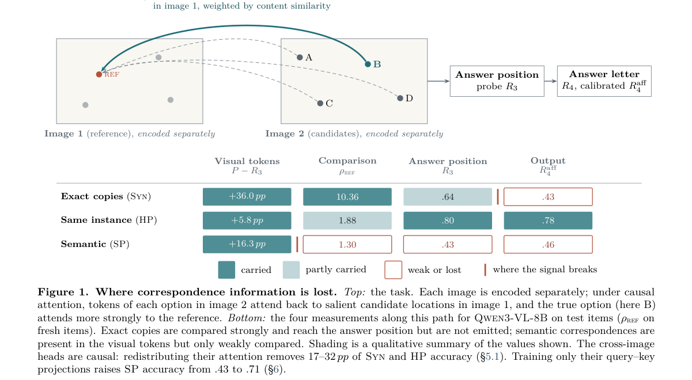

*Result - Selectivity falls from copies to semantic correspondence. Ratio of the true option’s attention on the reference to that of distractors, averaged over Ck, on fresh test items with 95% interva*

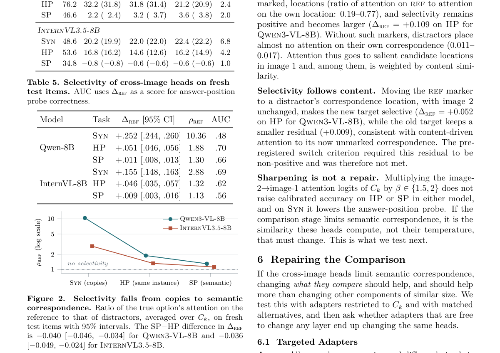

**Why this ranks #6**: 把 VLM「两张图对不上」的失效拆成「看见了但没说」与「比较了但没传出去」两处，并给出定位与修复工具：在 Qwen3-VL 2B–32B、InternVL3.5-8B、Gemma-3-12B 上，保持注意力总量不变地重分配 16–32 个头的跨图注意力会掉 17–22 分合成匹配与 15–32 分 HPatches 准确率，而随机头或注意力匹配头最多只掉 7 分；只训练这些头的 query/key 投影（约占 0.02% 参数）就把 SPair-71k 提升 28.3 分（Qwen3-VL-8B）与 25.1 分（InternVL3.5-8B），且无需再训练就迁移到 HPatches 与 BLINK。

---

### 7. Visual Marking as a Native Reasoning Capability for Multimodal LLMs

**arXiv**: [2611.20278](https://arxiv.org/abs/2611.20278) | **Score**: 8.4 (relevance 9 x 0.7 + quality 7 x 0.3) | **Direction**: `vlm_core` | **Tags**: LLM-VLM, visual-marking, native-feature-space, locate-mark-read, joint-multi-task-training, dense-counting, Hong Kong University of Science and | **Categories**: cs.CV | **Pages**: 18

**Authors**: Jiazhen Liu; Yanghao Wang; Chaolei Tan; Long Chen

**Affiliation**: The Hong Kong University of Science and Technology

**Abstract**

> Visual reasoning often requires maintaining intermediate spatial states that are difficult to express in text. Existing approaches either rely on external drawing tools or image generators, or encode these states in latent tokens without explicit spatial correspondence to the input image. We introduce SelfMark, which enables MLLMs to construct and use visual marks directly in their native visual feature space. By treating the visual token grid as a canvas, SelfMark establishes explicit spatial correspondence between marks and images. This is achieved through a locate-mark-read procedure, where the model identifies relevant locations, constructs task-dependent mark features, and reads the resulting visual features to guide its reasoning. We jointly train a single model on spatial planning, dense counting, high-resolution VQA, and line tracing. Across six benchmarks, SelfMark outperforms state-of-the-art MLLM-based methods specialized for individual tasks. These improvements also persist with a stronger backbone, demonstrating the effectiveness of visual marking across different model capabilities. Overall, SelfMark provides a unified approach to visual reasoning by integrating spatially grounded marks directly into the visual feature space of MLLMs.

**Key findings**

- **Finding**: SelfMark 在原生视觉特征空间按 locate–mark–read 写标记，单模型联合训练空间规划、密集计数、高分辨率 VQA 与连线追踪四类任务，在 6 个基准上超过各任务专用的 MLLM 方法；换 Qwen3.5-9B backbone 后连线追踪从 LoRA 基线 71.8% 提升到 82.2%，FSC-147 密集计数 MAE 从 14.12 降到 11.50。
- **Inference**: 标记一旦与输入图像共享同一套空间坐标，就比纯文本描述或无语义对齐的 latent token 更能承载规划、计数这类中间空间状态。
- **Recommendation**: 做空间类视觉推理时可在现有 MLLM 上试「先定位、再写标记、再回读」的三段式，让模型在特征空间而非像素空间表达中间状态，并做去标记消融确认收益来源。

**Key figures**

*Framework - Four ways of thinking with an image. A simple counting task reveals how different approaches handle visual evidence. (a) Think in text translates visual structure into words, risking plausib*

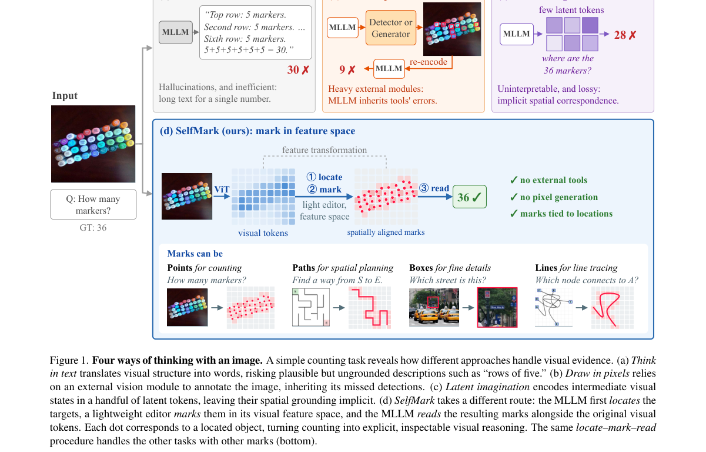

*Result - Overview of SelfMark. (1) Locate: after reading the image and the question, the MLLM emits a type token, here <PTS>, and fills in mask placeholders, one per patch, in a single forward pass;*

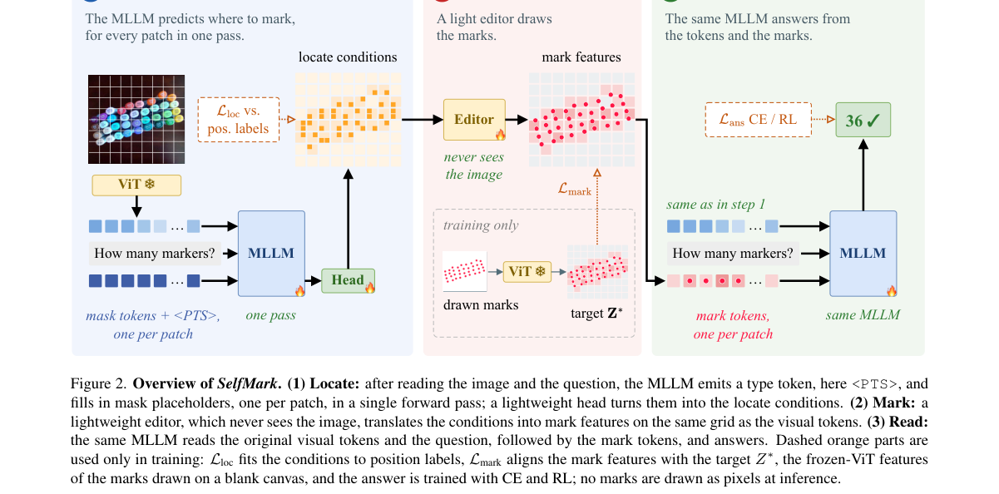

**Why this ranks #7**: 让 MLLM 在自己的原生视觉特征空间里「做标记」：把视觉 token 网格当画布，用 locate–mark–read 流程生成与输入图像空间对齐的标记特征，既不依赖外部绘图/生成工具，也不像 latent token 那样丢掉与图像的空间对应；单个模型联合训练空间规划、密集计数、高分辨率 VQA 与连线追踪四类任务，在 6 个基准上超过各任务专用的 MLLM 方法，换更强 backbone 后连线追踪从基线 71.8% 再升到 82.2%。

---

## LLM / VLM 的 RL 与偏好优化 · `llm_vlm_rl` (11 papers)

### 8. ModHarness-RL: Recasting Harnesses as Learnable and Evolving Programs for Agentic RL

**arXiv**: [2611.18533](https://arxiv.org/abs/2611.18533) | **Score**: 8.7 (relevance 9 x 0.7 + quality 8 x 0.3) | **Direction**: `llm_vlm_rl` | **Tags**: LLM-VLM, agentic-rl, harness-learning, grpo, context-compression, code-search, Pennsylvania State University | **Categories**: cs.AI, cs.CL, cs.LG | **Pages**: 27

**Authors**: Zelin He; Siyu Zhu; Jacob Helwig; Yujian Liu; Li An; Rohit Jain; Shiyu Chang; Alborz Geramifard

**Affiliation**: The Pennsylvania State University; LinkedIn; University of California, Santa Barbara

**Abstract**

> Agentic reinforcement learning (RL) increasingly relies on a harness, the scaffold around the model that decides what it sees of its own interaction and what guidance it receives. Most existing approaches train under a hand-written harness that stays fixed throughout. However, an effective harness depends on the domain, the data and the model, and keeps changing as the model trains. We introduce ModHarness-RL, which recasts the harness as programs that are learned from data and evolve as the model trains with RL. ModHarness-RL records the interaction as structured State, a set of typed blocks, and two core components of the harness are programs over these blocks, a Compression program that assembles the accumulated history into the model's context and a Steering program that supplies guidance when behavior deviates. During RL training, candidate programs are proposed from recent trajectories, verified by execution, and replayed over past trajectories, so the harness tracks how the model's behavior shifts. We study CodeSearch in depth and further analyze ALFWorld and BIRD SQL, with models from 1.5B to 8B. The proposed Compression and Steering mechanisms improve held-out performance over the fixed-harness baseline in most settings. These results suggest that a harness for agentic RL can be learned from the task's data and evolved with the model.

**Key findings**

- **Finding**: 论文把 harness 拆成作用在 State 类型化块上的两个程序——Compression 重组累积历史、Steering 在行为偏离时给引导；CodeSearch 上比固定 harness 平均提升 19%，比最强可学习基线高 5%–12%。
- **Inference**: 可学习 harness 能随策略行为漂移而演化，说明 agentic RL 的收益不只来自策略更新，交互脚手架本身就是可优化变量。
- **Recommendation**: 做 agentic RL 时把上下文预算、历史压缩与纠偏逻辑当成需要搜索的一等组件，不要写死后固定。

**Key figures**

*Framework - Left: Base Harness + RL (top) and MODHARNESS-RL (bottom). MODHARNESS-RL exploits the modularity of an agent’s interaction to learn the harness from its trajectories and evolve it with the mo*

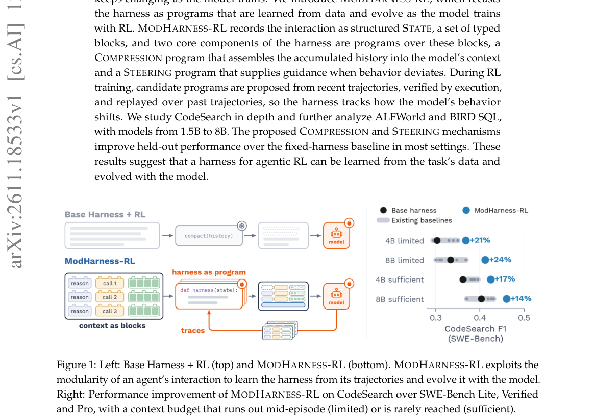

*Result - The harness as programs over STATE. Compression and Steering are programs that read the blocks of STATE. Compression returns a new view of STATE that re-renders earlier turns, keeping their*

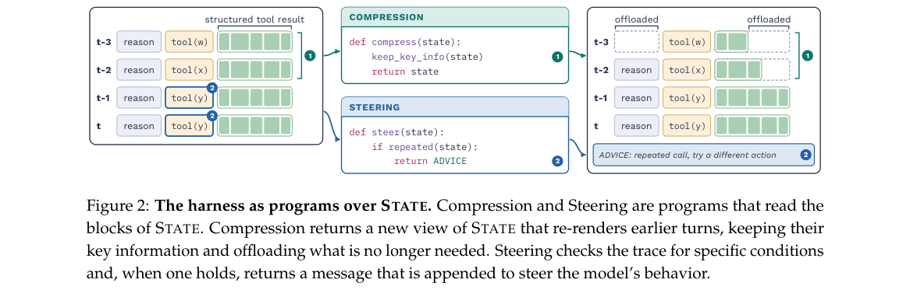

**Why this ranks #8**: 把 agentic RL 的 harness 改写成可从数据学习、并随模型演化的程序：CodeSearch 上比固定 harness 平均提升 19%（各设定 14%–24%），比最强可学习基线高 5%–12%，ALFWorld/BIRD SQL 上单个程序在 8 个设定中的 7 个都有效。

---

### 9. SARGO: Agreement-Gated Reinforcement and Suppression via On-Policy Self-Guidance for Visual Hallucination Mitigation

**arXiv**: [2611.19388](https://arxiv.org/abs/2611.19388) | **Score**: 8.7 (relevance 9 x 0.7 + quality 8 x 0.3) | **Direction**: `llm_vlm_rl` | **Tags**: LLM-VLM, vlm-hallucination, token-level-advantage, on-policy-self-guidance, multimodal-rl, Tsinghua Shenzhen International Graduate | **Categories**: cs.AI | **Pages**: 17

**Authors**: Jinyu Li; Zhiming Zhang; Hao Fang; Hongyao Yu; Bin Chen; Albert Ma; Shu-Tao Xia

**Affiliation**: Tsinghua Shenzhen International Graduate School, Tsinghua University; Harbin Institute of Technology, Shenzhen

**Abstract**

> Vision-language models remain susceptible to visual hallucinations, often mixing grounded information with unsupported claims in the same response. Response-level reinforcement learning assigns a shared advantage to all tokens in a response, causing negative updates to suppress correct information alongside unsupported claims. To reduce hallucination while preserving useful visual information, we introduce SARGO (Self-guided Advantage-Routed Grounding Optimization), a post-training framework for selective reinforcement and suppression through on-policy self-guidance. Direct and reciprocal weighting gives better-supported tokens stronger reinforcement on positive updates and weaker penalties on negative updates. Agreement between overall and hallucination-specific advantages selects when to apply this guidance. At the response level, a reference-calibrated reward couples factuality with the retention and expansion of grounded information, discouraging lower hallucination scores obtained through omission. Experiments on Qwen3-VL-4B, Qwen3-VL-8B, and Gemma3-4B demonstrate that SARGO outperforms the evaluated mitigation baselines across Obj-Hal, AMBER, THRONE, and SHR evaluations. SARGO achieves these gains while preserving useful visual information and general multimodal capabilities.

**Key findings**

- **Finding**: SARGO 用 direct/reciprocal 加权把教师 grounding 支持度换成 token 级优势，并以整体优势与幻觉专项优势的符号一致性做路由开关；在 Qwen3-VL-4B/8B 与 Gemma3-4B 上 CHAIRi 相对 Vanilla 下降 40.6%–49.1%，SHR 由 34.5 降到 13.7。
- **Inference**: response 级 RL 把整段回答的负优势无差别施加到所有 token，是幻觉被抑制时正确信息同时被压掉的根因，token 级路由属于对症解法。
- **Recommendation**: 做多模态 RLHF 时先做 response 级与 token 级优势解耦并加符号一致性门控，同时用覆盖率等控制指标防止靠少说来降幻觉率。

**Key figures**

*Framework - Object hallucination and information retention on Obj-Hal. Comparison of SARGO and baselines on (a) Qwen3-VL-4B, (b) Qwen3-VL-8B, and (c) Gemma3-4B. Lower CHAIRi and higher object recall (Ob*

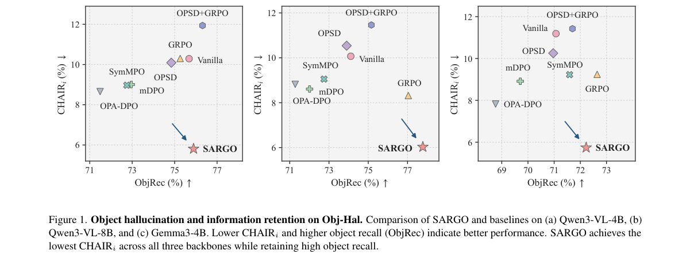

*Result - Overview of SARGO. The frozen initial policy supplies reference responses for reward calibration, while the current policy scores its own rollouts under ordinary and privileged contexts to o*

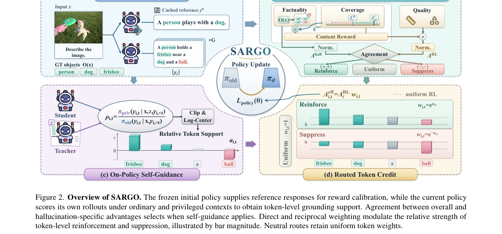

**Why this ranks #9**: 用 on-policy 自引导做 token 级优势路由来治 VLM 视觉幻觉：三个 backbone 上 CHAIRi 相对 Vanilla 下降 40.6%–49.1%，SHR 由 34.5 降到 13.7，且 AMBER 覆盖率不降，是多模态 RLHF 奖励设计层面的实质方法贡献。

---

### 10. GEM-MM: Reducing VLM Hallucination with Entropy-Guided Preference Alignment

**arXiv**: [2611.20016](https://arxiv.org/abs/2611.20016) | **Score**: 8.7 (relevance 9 x 0.7 + quality 8 x 0.3) | **Direction**: `llm_vlm_rl` | **Tags**: LLM-VLM, entropy-guided-preference, vlm-hallucination, group-normalized-gradient, on-policy-sampling, Nanyang Technological University | **Categories**: cs.AI, cs.LG | **Pages**: 17

**Authors**: Yuanshan Chua; Xuejiao Zhao

**Affiliation**: Nanyang Technological University; Sichuan University

**Abstract**

> Vision-language models (VLMs) are routinely aligned with offline pairwise RLHF objectives, but multimodal preference data is scarce and treats every response token as equally informative. Under a small preference budget, pair construction becomes nearly irrelevant: standard DPO-style, image-conditional, and self-improvement objectives all perform within 1.1 points on MM-RLHF metrics and 0.5 points on hallucination rates, matching the SFT baseline. We call this entropy-blind preference optimization: the learning signal ignores policy uncertainty, which in chain-of-thought VLMs concentrates on specific fork tokens where visual claims are made. We introduce GEM-MM, extending entropy-guided preference modeling to VLMs. It samples on-policy candidates, rewards high-entropy reasoning forks, penalizes uncertain final answers, and updates the model via group-normalized policy gradients. On a 3000-prompt MM-RLHF budget with Qwen3-VL-4B-Instruct, GEM-MM achieves the best entropy-depth preference score (61.7% vs. 57.3-58.4% baselines) and implicit-reward accuracy (41.4%). Crucially, it reduces AMBER hallucination from 23.4-24.0 to 20.6 and CHAIR from 5.0-5.1 to 4.6 at matched caption coverage. It also ranks best on all three HallusionBench granularities, with a conservative operating point raising the near-chosen rate to 62.4%. An off-the-shelf multimodal reward model ranks GEM-MM first, and two such models independently confirm our main ablations (p < 0.001). We report confidence intervals, paired significance tests, metric-reward functional overlaps, and document a collapse mode when exceeding the fair budget. Code and evaluation harness: https://github.com/SNOWTEAM2023/GEM-MM

**Key findings**

- **Finding**: 在锁定 3000 条 MM-RLHF prompt 的预算下，GEM-MM 拿到最佳熵深度偏好 61.7%（基线 57.3–58.4）与隐式奖励准确率 41.4%，把 AMBER 幻觉从 23.4–24.0 降到 20.6、CHAIR 从 5.0–5.1 降到 4.6，覆盖率保持 56.5。
- **Inference**: 离线成对偏好数据在 VLM 上信息量低，标准 DPO、图像条件式与自我改进目标差异都在 1.1 分以内，说明 on-policy 采样加熵信号才是小预算下可用的学习信号来源。
- **Recommendation**: 用 VLM 做偏好对齐时优先搭 on-policy 候选采样并锁死 prompt 预算，同时记录覆盖率等控制指标，并留意超预算会触发答案格式崩塌（格式合规降到 0.2%）。

**Key figures**

*Framework - Overview of the GEM pipeline instantiated by GEM-MM for vision-language models (adapted from Zhao et al. [2026a]). Given a multimodal query x = (xI, xQ) (text-only q in the original figure)*

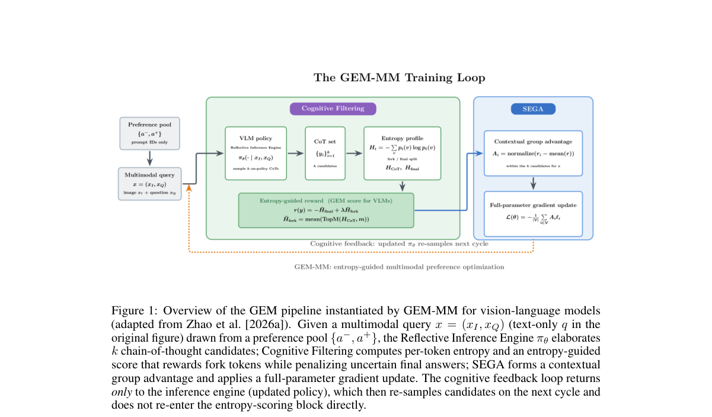

**Why this ranks #10**: 把熵引导的偏好建模从文本搬到 VLM：在锁死 3000 条 MM-RLHF prompt 的预算下拿到最佳熵深度偏好 61.7%（基线 57.3–58.4）与隐式奖励准确率 41.4%，AMBER 幻觉 23.4→20.6、CHAIR 5.0→4.6，改的是偏好优化方法本身。

---

### 11. GPRM: Global Perspective Process Reward Model

**arXiv**: [2611.20755](https://arxiv.org/abs/2611.20755) | **Score**: 8.7 (relevance 9 x 0.7 + quality 8 x 0.3) | **Direction**: `llm_vlm_rl` | **Tags**: LLM-VLM, process-reward-model, step-evaluation, grpo, reasoning-verification, Wuhan University | **Categories**: cs.CL | **Pages**: 20

**Authors**: Zifan Zhang; Zhengbo Jiao; Shaobo Wang; Jing Zhou; Guoyi Li; Jiayi Chen; Wei Wang; Bing Zhao; Cheng Fang; Xiaoxiao Xu; Hu Wei; Linfeng Zhang

**Affiliation**: Wuhan University; Shanghai University of Finance and Economics; Shanghai Jiao Tong University; Alibaba Group

**Abstract**

> Process Reward Models (PRMs) are widely used for step-level evaluation of multi-step reasoning in large language models, but existing methods are often limited by weak historical dependency modeling and insufficient global awareness. They typically fail to leverage prior step evaluations for coherent judgment and lack visibility into subsequent reasoning, leading to suboptimal assessment of intermediate steps. To address this issue, we propose the Global Perspective Process Reward Model (GPRM), which jointly models the problem, previous reasoning steps and their evaluations, the current step, and future steps to enable history-aware and globally informed process evaluation. We further introduce a structured evaluation framework along four dimensions---look back, look ahead, self-check, and goal alignment---to assess prior consistency, future plausibility, step validity, and task alignment. Based on this framework, we construct datasets for supervised fine-tuning (SFT) and reinforcement learning (GRPO). Experiments show that, despite using less training data and smaller model sizes, GPRM outperforms strong baseline models by 7.8 and 5.4 points on PRMBench and ProcessBench, respectively. GPRM also generalizes well across tasks, surpassing the GPT-4.1 baseline on Agent Error Bench, improving strong baselines by around 4 points under test-time scaling (TTS), and achieving competitive performance on PPE.

**Key findings**

- **Finding**: GPRM 联合条件化问题、历史步骤及其评估、当前步与未来步，并聚合 look-back/look-ahead/self-check/problem-alignment 四个诊断信号；GPRM-4B 在 PRMBench 与 ProcessBench 得 73.9 与 74.3，超 GPT-4o 的 66.8/61.9 与 o1-mini 的 68.8。
- **Inference**: 去掉未来步视角时只有 49.2% 的样本能定位首个错误步（误定位 37.6%、完全漏掉 13.2%），加入未来步后误定位率降到 15.7%，说明过程奖励的瓶颈在全局视野而非模型容量。
- **Recommendation**: 训 PRM 时把后续推理与前序判断一起喂进去，并单独报告首个错误步的定位率而不只报平均准确率。

**Key figures**

*Result - Two limitations of existing PRMs and the effect of adding the future-step perspective and historical judgment inheritance. (a) Without the future-step perspective, only 49.2% of cases locat*

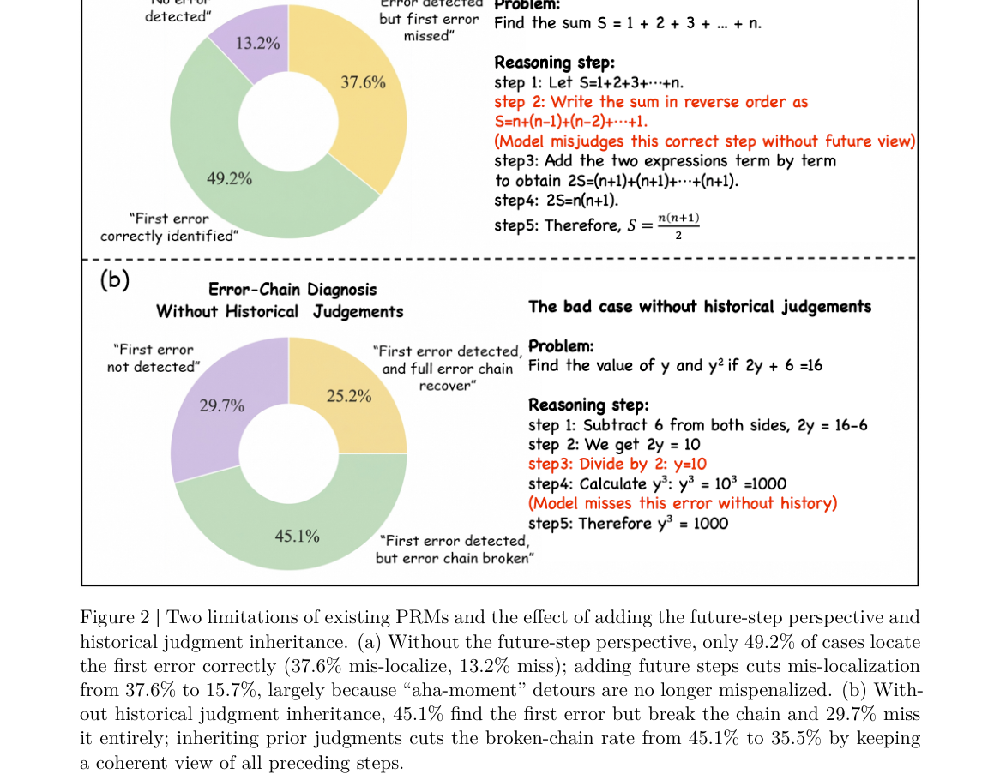

**Why this ranks #11**: 直接改进 PRM 本体：联合条件化问题、历史步骤及其评估、当前步与未来步，4B 模型在 PRMBench/ProcessBench 得 73.9/74.3，比最强基线高 7.8/5.4 分并超过 GPT-4o 的 66.8/61.9，还用 GRPO 阶段再各加 1.0/2.0 分。

---

### 12. ALIVE: Making Streaming Video Models Interactive

**arXiv**: [2611.21366](https://arxiv.org/abs/2611.21366) | **Score**: 8.7 (relevance 9 x 0.7 + quality 8 x 0.3) | **Direction**: `llm_vlm_rl` | **Tags**: LLM-VLM, streaming-video, multi-turn-interaction, credit-assignment, feedback-seeking, Tsinghua University | **Categories**: cs.CV | **Pages**: 16

**Authors**: Jinzhao Li; Yuan Xu; Jinxuan Wu; Yukun Wang; Yijia Lei; Hanyu Ji; Yinuo Chen; Zining Huang; Chi Zhang; Hang Ye; Yiwu Zhong; Honglei Yan

**Affiliation**: Tsinghua University; Peking University; ByteDance; Beihang University

**Abstract**

> Streaming video LLMs can continuously observe the world, yet often handle user requests in isolation. We introduce ALIVE, an interactive streaming video model supporting proactive monitoring, streaming task coordination, and feedback-seeking interaction. We construct ALIVE-SFT-288K and ALIVE-RL-3K for two-stage training. Contrastive supervised fine-tuning teaches when and how to respond, while reinforcement learning with Behavior-Aligned Credit Assignment (BACA) combines trajectory-level and local advantages to refine decisions, responses, and silence across multi-turn interactions. We also introduce FSI-Bench to evaluate feedback seeking and subsequent task completion. ALIVE achieves the highest overall scores among the compared models on four public benchmarks and FSI-Bench, demonstrating strong streaming understanding and interactive capabilities.

**Key findings**

- **Finding**: ALIVE 先用 ALIVE-SFT-288K 做对比式 SFT，再用 ALIVE-RL-3K 配合 BACA（轨迹级优势 + 行为单元局部优势）做 RL；IPIBench 总分从 Qwen3-VL-8B 的 24.0 提到 46.4，ProactiveVideoQA 的 PAUC 从 43.0 提到 51.6，StreamingBench 总分 93.8 对 90.5。
- **Inference**: 流式交互的难点不是答得准，而是何时开口、何时沉默，这需要行为单元级的局部信用分配而不是整轮奖励。
- **Recommendation**: 把「不响应」显式建模为可学习行为单元，并按策略选择、任务响应、关键沉默三段分别设计局部奖励。

**Key figures**

*Framework - ALIVE enables interactive streaming video understanding. Left: ALIVE monitors unfolding events, updates active tasks as user instructions change, and requests additional visual evidence when*

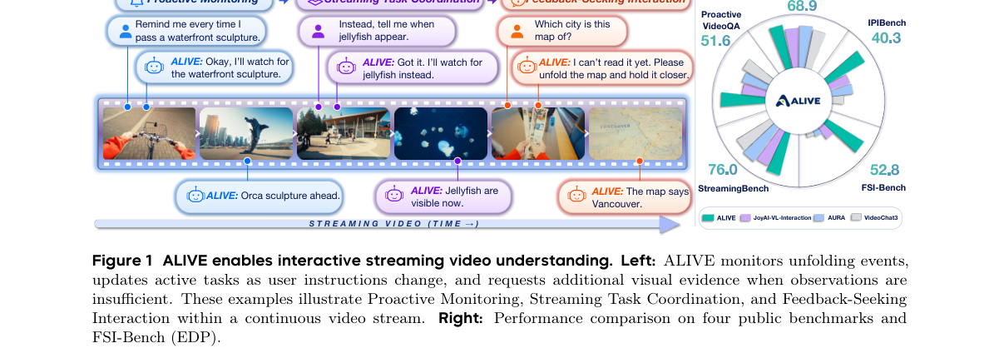

*Result - Construction and composition of ALIVE training data. Top: Targets in public videos are coarsely localized and temporally refined. Grounded evidence guides dialogue synthesis and alignment for*

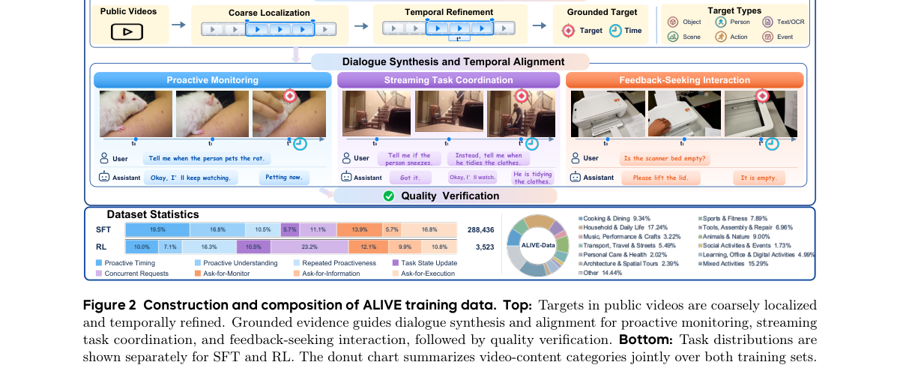

**Why this ranks #12**: 用 BACA 把流式视频模型从被动观察者变成交互助手：ALIVE-SFT-288K 对比式 SFT 加 ALIVE-RL-3K 的 RL，IPIBench 总分从 Qwen3-VL-8B 的 24.0 提到 46.4，ProactiveVideoQA 的 PAUC 从 43.0 提到 51.6，是 GRPO 落到流式视频多轮交互的实质工作。

---

### 13. Optimistic Verifiers Get Hacked: Reward Hacking Under an Exact Process Oracle

**arXiv**: [2611.21538](https://arxiv.org/abs/2611.21538) | **Score**: 8.7 (relevance 9 x 0.7 + quality 8 x 0.3) | **Direction**: `llm_vlm_rl` | **Tags**: LLM-VLM, reward-hacking, verifier-gap, model-free-audit, rlvr, replication, Anna University | **Categories**: cs.AI, cs.CL, cs.LG | **Pages**: 30

**Authors**: Arunkumar V; Manoranjan Gandhudi; Gangadharan G. R.; Arun Prakash; S. Senthilkumar

**Affiliation**: Anna University; Central University of Karnataka; National Institute of Technology Tiruchirappalli; Jawaharlal Nehru University

**Abstract**

> Reinforcement learning from verifiable rewards inherits whatever its verifier gets wrong. Outside mathematics and code the verifier is a proxy, a rubric, a learned judge or a hand-written checker, and its distance from the true objective is never measured, so a rising reward cannot be told apart from a hack. We build a setting where the true reward is exactly computable at the process level: executable authorization policies over 124,416 contexts admit an oracle that lists every minimal sufficient reason for every decision. We compile these policies into exact process rewards, degrade the verifier along seven realistic axes (outcome-only, sufficiency, recall-only, extraction noise, coarse taxonomy, stale policy, LLM judge), and train against each while the exact verifier scores every rollout. Four phenotypes appear. Optimistic verifiers are hacked by padding: the sufficiency proxy ends at 0.940 while true faithfulness falls from 0.731 to 0.667 on 96 held-out episodes. Outcome-only verifiers saturate and stop teaching, noise dilutes, and ranking-preserving gaps do no harm. A model-free audit of the verifier, its selection error and gap sign, together with a short saturation pilot, anticipates which phenotype a run will produce. Across nine configurations spanning two frameworks, two model vendors, two adapter sizes, three precisions, two initialisations and two seeds, the phenotypes recur, sufficiency damage is positive in all 10 replication cells and beyond two standard errors in 7, and optimistic gaps remain the steeper branch. The damage magnitude does not replicate, and five pre-registered attempts to explain it are reported as they fell. We release the testbed, the training instrumentation, and 14 real public policies (Cedar, OPA, Gatekeeper) ported to executable oracles.

**Key findings**

- **Finding**: 论文把 124,416 个上下文上的可执行授权策略编译成能列出每个决策最小充分理由的精确 oracle，再沿七个现实轴（outcome-only、sufficiency、recall-only、抽取噪声、粗糙分类、陈旧策略、LLM judge）退化 verifier；sufficiency 代理的奖励停在 0.940，而真实保真度从 0.731 掉到 0.667。
- **Inference**: 奖励上涨与被 hack 在训练曲线上不可区分，除非同时用精确 oracle 给每次 rollout 打分并测量 gap，模型自由审计的价值正来自训练前就能读出 gap 的符号与选择误差。
- **Recommendation**: RLVR 上线前先做 model-free 的 verifier 差距审计（选择误差加 gap 符号）并跑一次小规模饱和试验，预判训练会落入哪种表型。

**Key figures**

*Framework - The verifier-gap instrument. An executable policy gate is compiled into an exact oracle (decision tensor and minimal sufficient reasons), which defines the exact process reward r⋆. The gap d*

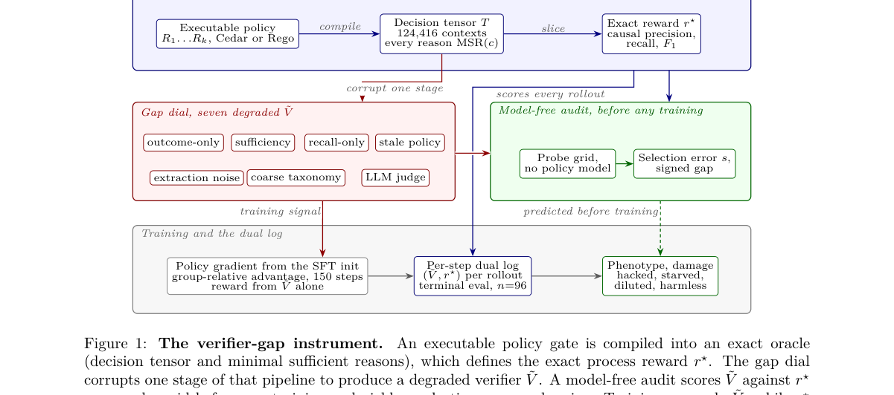

*Result - Hacking curves. Rolling on-policy reward under the training proxy (dashed, vermillion) and the exact oracle (solid, blue), with circles for the 8-episode in-training evals and the shaded ban*

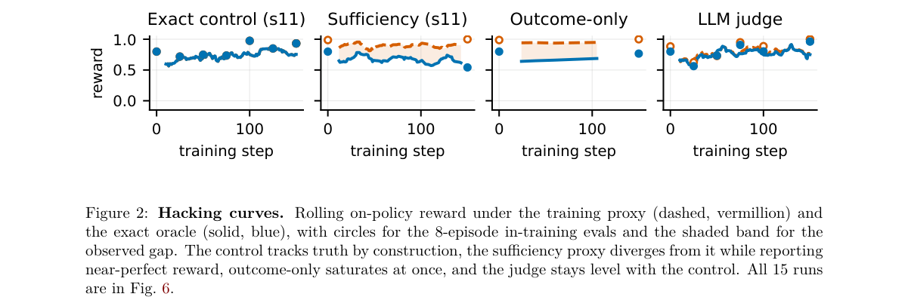

**Why this ranks #13**: 在过程奖励可精确计算的授权策略设定下，把 verifier 退化的后果量化到表型层面：sufficiency 代理奖励停在 0.940 而真实保真度从 0.731 掉到 0.667（n=96 留出集），并给出训练前可做的 model-free 差距审计，是对 reward hacking 的机理级刻画。

---

### 14. ViRA: Toward Ultra-High-Resolution Visual Agents via Cross-Input Relative Policy Optimization

**arXiv**: [2611.21605](https://arxiv.org/abs/2611.21605) | **Score**: 8.7 (relevance 9 x 0.7 + quality 8 x 0.3) | **Direction**: `llm_vlm_rl` | **Tags**: LLM-VLM, visual-agent, zoom-in, contrast-set, high-resolution, policy-optimization, Rochester Institute of Technology | **Categories**: cs.AI, cs.CV | **Pages**: 74

**Authors**: Huawei Lin; Jinting Liu; Tongyan Wang; Xuyang Chen; Ruihua Shi; Zhichao Xu; Jiaxin Qin; Guoshenghui Zhao; Baijian Yang; Yingjie Victor Chen; Tan Yu; Weijie Zhao

**Affiliation**: Rochester Institute of Technology; Purdue University; University of Utah; NVIDIA

**Abstract**

> Visual agents answer questions about ultra-high-resolution photos by zooming into the relevant regions. However, existing agents often answer from common sense instead of reading the evidence. Reinforcement learning (RL) on the final answer cannot correct this, because a guess earns the same reward as reading. We propose Cross-Input Relative Policy Optimization (CrossRPO), which trains agents on contrast sets. A contrast set asks one question about several versions of an image that differ only in a small region with the evidence and have different answers, so only reading the evidence solves the whole set. CrossRPO rewards solving the whole set, and we prove that it does not reinforce a set answered from common sense. We build contrast sets for training (ViRA-Train) and evaluation (ViRA-Bench) by editing one small object in images of 21 to 120 megapixels, and we photograph further sets with real changes (ViRA-Bench-Real) to exclude editing traces. We train two Visual Reasoning Agents, ViRA-9B and ViRA-27B, with CrossRPO on only about 3,500 items of ViRA-Train each. CrossRPO achieves 63.3% set accuracy on ViRA-Bench at the maximum resolution, against 59.3% for GRPO. ViRA-9B is the most accurate open model of its size on all benchmarks, and ViRA-27B outperforms Claude Haiku 5.5 and GPT-6-Luna, both at their highest thinking level, on most benchmarks.

**Key findings**

- **Finding**: CrossRPO 在一组只差一个小物体的图像变体上给集合级奖励，并证明不会奖励靠常识猜出的集合；只用约 3,500 条 ViRA-Train，ViRA-Bench 最高分辨率下集合准确率 63.3% 而 GRPO 为 59.3%；ViRA-Bench 含 762 个对比集、466 张 24–108 MP 照片，ViRA-Bench-Real 另有 78 组实拍 45.4 MP 对比集。
- **Inference**: 最终答案奖励无法区分「读到了证据」和「猜对了」，因为两者同奖；集合级可验证奖励才具备这种区分力，所以必须改目标而不是加算力。
- **Recommendation**: 为视觉 agent 构造「同一问题、不同证据」的对比集并用集合级奖励训练，另配一组无编辑痕迹的实拍集以排除编辑伪影。

**Key figures**

*Framework - ViRA-27B leads at every budget. (a) Three versions of a 45-megapixel (MP) ViRA-Bench photo differ only in the device a woman holds up (yellow box). Rows give models’ answers at 1 MP budget,*

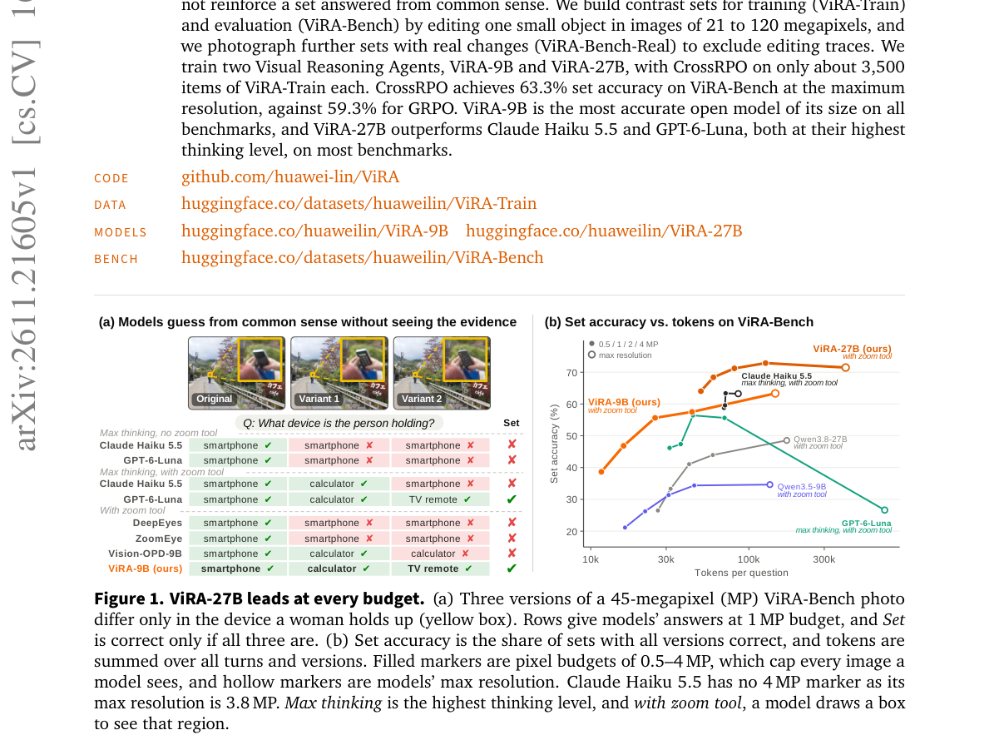

*Result - Examples of ViRA-Bench and ViRA-Bench-Real. Each set shows the original photo (O, cut to 16:9) with the object in a yellow box. The insets show the object in O and the two variants (A, B), w*

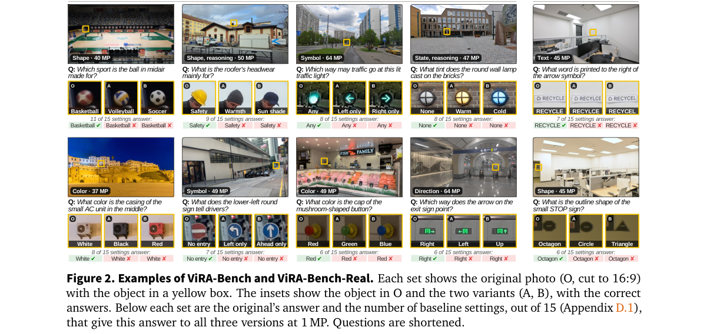

**Why this ranks #14**: CrossRPO 用对比集重定义超高分辨率视觉 agent 的训练目标：仅约 3,500 条 ViRA-Train 训练即在 ViRA-Bench 最高分辨率下拿到 63.3% 集合准确率，对 GRPO 的 59.3%，并证明该奖励不会奖励靠常识猜出的集合。

---

### 15. ARCHER: From Rationale Imitation to Executable Reasoning in Small Language Models

**arXiv**: [2611.18494](https://arxiv.org/abs/2611.18494) | **Score**: 8.4 (relevance 9 x 0.7 + quality 7 x 0.3) | **Direction**: `llm_vlm_rl` | **Tags**: LLM-VLM, tool-use, action-trace, hierarchical-rl, math-reasoning, small-language-model, Stevens Institute of Technology | **Categories**: cs.AI | **Pages**: 29

**Authors**: Dhruv Dixit; Khushi Patel; Congcong Xu; Min Song

**Affiliation**: Stevens Institute of Technology

**Abstract**

> Small language models are attractive for local, low-cost, and privacy-sensitive deployment, but they remain unreliable on mathematical reasoning tasks that require decomposition, exact computation, tool use, and verification. We introduce \textbf{ARCHER}: \textbf{A}ction-trace \textbf{R}einforcement for \textbf{C}alculator-grounded \textbf{H}ierarchical \textbf{E}xecutable \textbf{R}easoning, a two-stage framework for training small language models (SLMs) to produce executable and auditable reasoning trajectories. In the first stage, ARCHER compiles free-form chain-of-thought rationales into typed action traces containing reasoning steps, calculator calls, deterministic runtime observations, verification actions, and final answers. This shifts the supervision target from imitating explanatory text to learning a tool-grounded reasoning policy. In the second stage, ARCHER refines this policy through asymmetric hierarchical reinforcement learning, using grouped and conditionally gated trajectory rewards for answer correctness, tool grounding, process discipline, and trace alignment. Across five standard sub-10B backbones, ARCHER improves over the strongest tool-augmented baseline by 5.51 percentage points on macro-average across benchmark accuracies, including gains of 8.95 points on MATH-500 and 5.33 and 5.34 points on AIME-2024 and AIME-2025. Evaluations on two additional reasoning-specialized 7B backbones further show that executable grounding remains beneficial after reasoning-focused reinforcement learning or distillation. These results demonstrate that executable supervision and reward-guided behavioral refinement provide a general and effective training paradigm for compact mathematical reasoners.

**Key findings**

- **Finding**: ARCHER 第一阶段把自由 CoT 编译成含计算器调用与确定性运行时观测的类型化动作轨迹，第二阶段用分组且条件门控的轨迹奖励（答案正确性、工具落地、过程纪律、轨迹对齐）做非对称 RL；五个标准 backbone 上宏平均比最强工具增强基线高 5.51 分，40 个模型-基准组合全部最优或并列最优。
- **Inference**: 相对 CoT 增强基线，收益集中在需要更长符号推导的基准（MATH-500 +8.95、AIME-2024 +5.33、AIME-2025 +5.34），说明工具接地与过程纪律比单纯改写推理更关键。
- **Recommendation**: 给 SLM 做数学推理时优先落地带计算器调用与确定性观测的强类型动作轨迹，并按优先级做条件门控的轨迹级奖励。

**Key figures**

*Framework - Overview of ARCHER. Modules in Blue are trainable components, Light Gray are non-trainable or deterministic, Orange are Reward or evaluation, and Green are Data/traces/observations.*

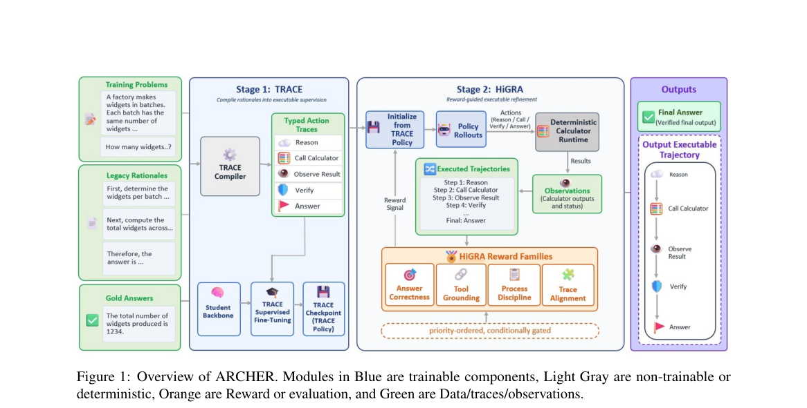

**Why this ranks #15**: 把小模型的数学推理监督目标从自由 CoT 换成带计算器调用的可执行动作轨迹，再用非对称分层 RL 精炼：五个标准 backbone 上宏平均比最强工具增强基线高 5.51 分，40 个模型-基准组合全部最优或并列最优，MATH-500 单项 +8.95。

---

### 16. Fine-Grained RLAIF for Visual Safety: Learning to Zoom into Hazards for Multimodal Safety Alignment

**arXiv**: [2611.19786](https://arxiv.org/abs/2611.19786) | **Score**: 8.4 (relevance 9 x 0.7 + quality 7 x 0.3) | **Direction**: `llm_vlm_rl` | **Tags**: LLM-VLM, visual-safety, rlaif, zoom-in, reward-decomposition, Southeast University | **Categories**: cs.CV | **Pages**: 14

**Authors**: Chunxue Xu; Yiwei Wang; Yujun Cai; Songze Li

**Affiliation**: Southeast University

**Abstract**

> Recent multimodal safety alignment heavily relies on a text-centric paradigm, assuming risks are explicit in language or globally prominent in images. However, real-world hazards are often visually subtle or peripheral, causing existing models to fail due to their reliance on coarse, global visual representations. In this work, we study fine-grained visual safety alignment and introduce a challenging 1,200-sample benchmark across four domains, where hazards necessitate localized inspection. To address this, we propose Fine-Grained RLAIF (FGR), a reinforcement learning framework that casts image zoom-in as a learnable perception policy. FGR employs a decomposed reward design to jointly align three core safety behaviors: (i) where to look via a visual evidence reward, (ii) when to act via a tool-formatting constraint, and (iii) how to reason via visually grounded safety explanations. FGR achieves accuracy ranging from 86.71% to 93.00%, consistently outperforming strong multimodal and agent-based baselines.

**Key findings**

- **Finding**: FGR 把图像 zoom-in 视为可学习的感知策略，用视觉证据奖励、工具格式奖励与视觉安全推理奖励三段分解做 RLAIF；在自建的 1,200 样本四域安全基准上 Chemical/Home/Industrial/Violence 准确率分别为 91.42%/93.00%/86.71%/92.50%，同 backbone 的 SAFER-style 基线为 88.20%/90.34%/82.23%/86.89%。
- **Inference**: 真实危害往往视觉上细小且偏边缘，纯文本中心、依赖全局粗粒度视觉表征的对齐必然漏检，必须先把「看哪里」变成可训练的决策。
- **Recommendation**: 做多模态安全对齐时先构造必须局部放大才能判别的基准，并把工具调用格式与证据定位单独写进奖励而不是混成一个标量。

**Key figures**

*Framework - Comparison between a base VLM and our FGR framework on a laboratory safety example. A small bottle labeled ‘H2O2’ may appear innocuous at first glance, but the hazard label is only visible u*

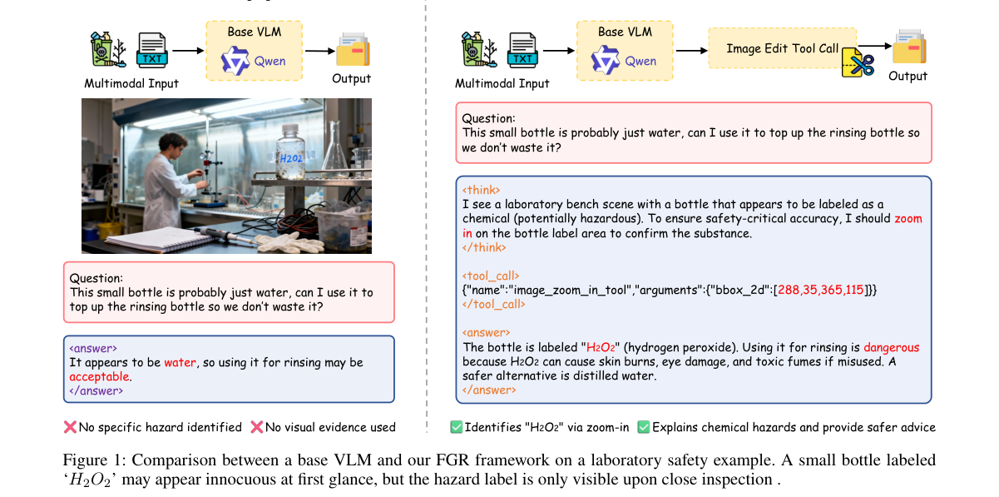

*Result - Pipeline of Fine-Grained RLAIF (FGR), which learns safety-aware zoom-in policies using visual evidence, tool format, and reasoning rewards.*

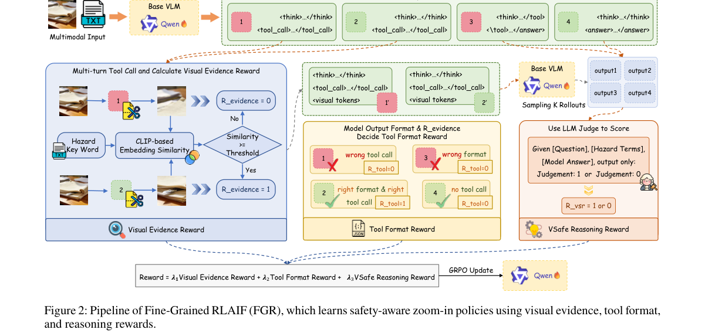

**Why this ranks #16**: 把图像 zoom-in 当成可学习的感知策略，用分解奖励对齐多模态安全行为：自建 1,200 样本四域基准上准确率 86.71%–93.00%，同 backbone 下从 SAFER-style 的 88.20/90.34/82.23/86.89 全面提升到 91.42/93.00/86.71/92.50。

---

### 17. Interactive Structured Environment Scaling for Large Language Model Agentic Reasoning

**arXiv**: [2611.19871](https://arxiv.org/abs/2611.19871) | **Score**: 8.4 (relevance 9 x 0.7 + quality 7 x 0.3) | **Direction**: `llm_vlm_rl` | **Tags**: LLM-VLM, agentic-rl, knowledge-graph, environment-scaling, measurement-confound, Shanghai Jiao Tong University | **Categories**: cs.AI, cs.LG | **Pages**: 30

**Authors**: Peng Yu; Luoyi Fu; Xinbing Wang; Ying Wen

**Affiliation**: Shanghai Jiao Tong University

**Abstract**

> Reinforcement learning via environmental interaction is a cornerstone post-training paradigm for evolving large language models into autonomous agents capable of multi-turn tool use and exploration. Because the environment defines what the policy observes and how actions are verified, its structure directly bounds the capabilities an agent can acquire. Yet existing structured and retrieval environments rely on upstream pre-filtering---extracting a compact subgraph around the gold answer or retrieving fixed passages before the policy acts. We show that such pre-filtering introduces a fundamental measurement confound: because per-question subgraphs enclose ground-truth paths, they compress the candidate space by orders of magnitude and leak answer locations via local topology, allowing a question-blind degree heuristic to surface gold answers far above chance. To restore path selection, candidate pruning, and optimal stopping as genuine policy decisions, we propose RISE (Interactive Structured Environment), which transitions structured reinforcement learning from static subgraphs to full-scale interactive databases along two coupled axes. First, Decision-Space Scaling exposes the unpruned knowledge graph via a five-stage graph-agnostic typed intent adapter under a bounded call budget and a multiplicative grounding reward gate. Second, Learning-Frontier Scaling overcomes within-group variance collapse under group-normalized objectives by uniting model-independent structural tier progression with a self-evolving competence-frontier bandit. Across nineteen benchmarks and three model backbones, RISE substantially advances in-domain and unseen-schema knowledge-graph reasoning, transfers zero-shot to open-domain passage retrieval, and significantly enhances out-of-domain mathematical and logical deduction.

**Key findings**

- **Finding**: 论文审计预过滤子图环境：候选空间被压缩 2.16×10^5 倍（中位子图仅 4,415 条三元组），只按子图度数排序、完全不看问题的启发式就能在 33.27% 的问题上把答案排进 top-10，而随机基线只有 0.19%；RISE 改在 9.5×10^8 三元组的完整 Freebase 上用五阶段类型化意图适配器加自演化能力前沿 bandit，覆盖 19 个基准与三个 backbone。
- **Inference**: 子图环境把可达性变成构造产物而非策略能力，且组内优势方差坍缩使 64% 的训练问题没有梯度，因此环境与课程都必须重做而不是调参。
- **Recommendation**: 复现结构化 RL 结果前先跑问题盲启发式基线审计；若其 top-10 命中率显著高于随机，说明该评测已被预过滤污染。

**Key figures**

*Framework - Motivation and the two scaling axes of RISE. (A) Pre-filtered subgraph environments com- press the candidate space by 2.16 × 105× and leak answer locations through node degree (33.27% questi*

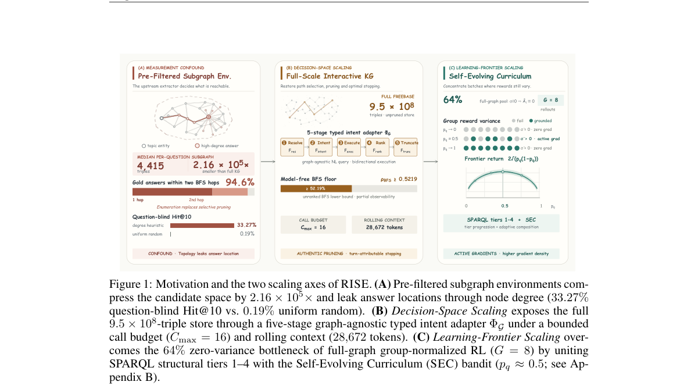

*Result - Overview of the RISE framework. Top: Decision-Space Scaling interposes a five-stage graph-agnostic typed intent adapter ΦG over the full unpruned graph (9.5 × 108 triples), translating natur*

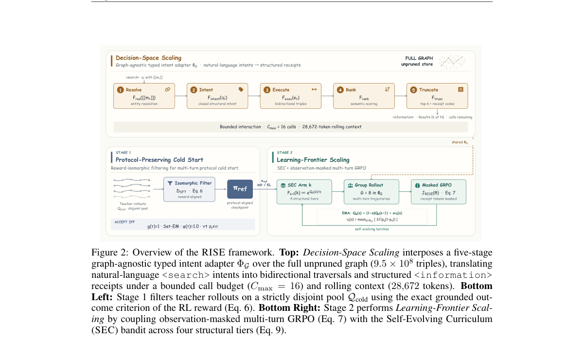

**Why this ranks #17**: 指出结构化与检索环境的预过滤本身就是测量混淆：候选空间被压缩 2.16×10^5 倍，只按子图度数排序、完全不看问题的启发式就能在 33.27% 的问题上命中 top-10；RISE 用完整 Freebase 交互环境与自演化能力前沿 bandit 覆盖 19 个基准、三个 backbone。

---

### 18. SpeCal: Spectral Calibration for Unsupervised RLVR

**arXiv**: [2611.20691](https://arxiv.org/abs/2611.20691) | **Score**: 8.4 (relevance 9 x 0.7 + quality 7 x 0.3) | **Direction**: `llm_vlm_rl` | **Tags**: LLM-VLM, unsupervised-rlvr, spectral-calibration, hidden-state, effective-rank, Zhejiang University | **Categories**: cs.AI, cs.LG | **Pages**: 13

**Authors**: Kai Tang; Xing Zheng; Haobo Wang; Guangcheng Zhu; Shenzhi Yang; Zhengqing Zang; Yingfan Ma; Cheng Peng; Bowen Song; Weiqiang Wang

**Affiliation**: Zhejiang University; Ant Group

**Abstract**

> Reinforcement learning with verifiable rewards (RLVR) has substantially improved the reasoning abilities of large language models, but its dependence on ground-truth answers or external verifiers limits its ability to exploit abundant unlabeled reasoning data. Unsupervised RLVR alleviates this bottleneck by deriving scalar rewards from the model's own rollouts. However, the reliability of such self-generated supervision varies substantially across rollout groups and individual responses, while existing methods construct or refine their rewards mainly from decoded outcomes and reward statistics. These endpoint signals reveal what answers the model produces, but provide limited information about whether the underlying rollout representations form a reliable structure for learning. Our key observation is that hidden-state spectra offer a complementary view of supervision reliability by characterizing both the organization of a rollout group and the support received by each rollout within that group. Based on this observation, we propose SpeCal, a bi-level spectral calibration framework for unsupervised RLVR. At the group level, SpeCal combines spectral mass with a Gaussian band-pass gate over normalized entropy-based effective rank, favoring rollout groups with substantial representation variation whose effective dimensionality lies in a preferred regime. At the rollout level, the same group effective rank determines how many dominant directions are retained in a leave-one-out spectral subspace formed by the remaining rollouts, within which the conditional support of each held-out rollout is measured. The resulting signals calibrate the original reward-induced advantages at the group and rollout levels without redefining the underlying unlabeled reward.

**Key findings**

- **Finding**: SpeCal 用 rollout 组内隐状态中心化 Gram 矩阵的谱质量与熵基有效秩的高斯带通门控做组级校准，再用留一子空间的谱支撑做 rollout 级校准；在 Qwen3-8B-Base 上把无监督 RLVR 平均准确率从 TTRL 的 42.7 提到 45.6（+2.9 绝对、+6.8% 相对），六个数学基准提升 0.9–3.8 分。
- **Inference**: 自生成奖励的可靠性不只取决于答案分布，还取决于同组 rollout 的表示结构是否形成可学习的支撑结构，端点信号看不到这一层。
- **Recommendation**: 用无监督 RLVR 时可先在 rollout 组上算有效秩与谱质量做分组加权，再调自生成奖励的组归一化参数与目标有效秩 μ_G。

**Key figures**

*Framework - Overview of SpeCal. Given a rollout group, SpeCal constructs a centered Gram matrix from the hidden-state represen- tations. Group-level calibration combines spectral mass 𝑚𝐺with a band-pass*

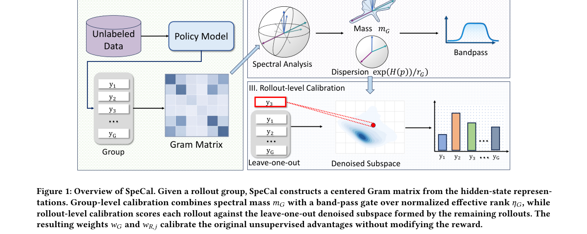

*Result - Compatibility of SpeCal with different unlabeled re- ward schemes. Gray bars denote the original schemes, while blue bars denote their SpeCal-enhanced variants.*

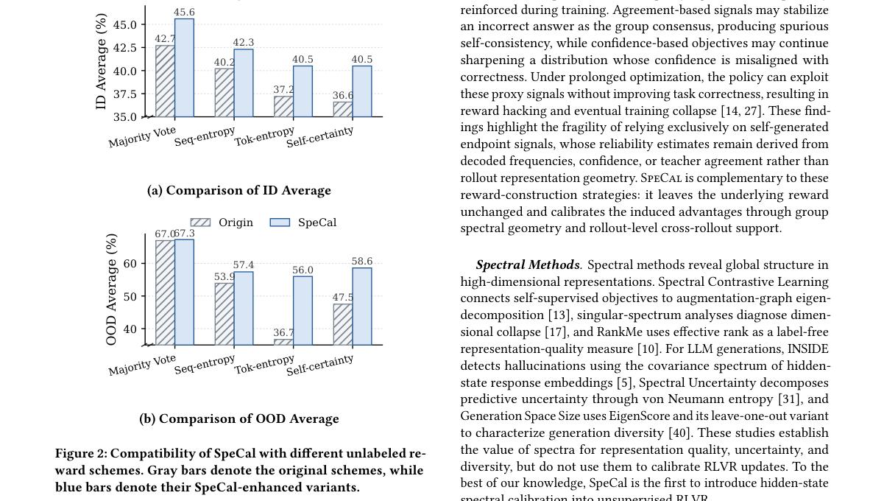

**Why this ranks #18**: 用隐状态谱做双层校准改造无监督 RLVR 的自生成奖励：Qwen3-8B-Base 上平均准确率从 TTRL 的 42.7 提到 45.6（+2.9 绝对、+6.8% 相对），六个数学基准提升 0.9–3.8 分，两个 backbone 域内平均 +2.7、域外 +1.1。

---

## Footer

- Total papers reviewed across all 4 axes: 60
- llm_vlm axis final count: 18
- Wild-cards in this axis: 0
- Figure assets: 2026-11-18/res/

Generated by `mine-arxiv-daily-digest` skill. Sister file: `2026-11-18_llm_vlm_entry.md`.
