# Mine Arxiv Daily Digest - 2026-11-18 (具身智能与世界模型 Axis, 20 papers)

**Generated**: 2026-11-18 12:30 CST

**Source**: arXiv cs.CV, cs.SD, eess.AS, cs.CL, cs.AI, cs.RO, cs.LG, cs.IR submissions, listing day 2026-11-13..2026-11-16 (announced 2026-11-16 20:00 ET = 2026-11-17 01:00 UTC)

**Batch window**: 2026-11-12T19:00:00Z .. 2026-11-17T19:00:00Z（arXiv 公告批次横跨两个 UTC 日：从前一日的美东 14:00 截止时刻起算（EDT 为 18:00Z，EST 为 19:00Z），到当日的同一时刻为止）

**Axis**: world_embodied (20 papers, base 15, cap 20)

**Directions**: world_model (7), embodied_ai (13)

**Selection**: 20 papers ranked by relevance x quality, with 0 wild-card slots

**Day total**: 60 papers across 4 axes (target 60)

**Scope**: 世界模型、学习型模拟器与具身智能，含移动操作、人形控制、触觉反射、VLA 策略与面向具身任务的强化学习

**Wild-card**: 0（本 axis 本批次够格供给充足，未启用补位名额）

---

## 世界模型与学习型模拟器 · `world_model` (7 papers)

### 1. ResWAM: Learning What Changes, Not What Stays, for World-Action Models

**arXiv**: [2611.19559](https://arxiv.org/abs/2611.19559) | **Score**: 8.7 (relevance 9 x 0.7 + quality 8 x 0.3) | **Direction**: `world_model` | **Tags**: embodied, world-action-model, visual-residual, dinov3, flow-matching, latent-dynamics, Michigan State University | **Categories**: cs.RO | **Pages**: 16

**Authors**: Chongyu Fan; Gaowen Liu; Ramana Rao Kompella; Jason Corso; Sijia Liu

**Affiliation**: Michigan State University; Cisco; University of Michigan; IBM Research

**Abstract**

> World-action models (WAMs) augment vision-language-action policies (VLAs) with future prediction so that the policy can anticipate how its actions will affect the physical world. Existing WAMs supervise complete future observations. However, observations typically change little over an action chunk, so the future loss is dominated by copying static background content rather than learning task-relevant robot and object motion, limiting policy learning. Moreover, existing WAMs rely on large video generation models or separate world models, incurring heavy training and inference compute that hinders closed-loop deployment. To improve policy performance, we propose visual residual learning, supervising only the feature change from the current frame to the future frame in a frozen DINOv3 space. Compared with complete future features, this residual learning target yields a higher feature rank with richer and more diverse representations of scene changes, and spatially concentrates on the robot arm and manipulated objects rather than the background. To further improve computational efficiency, we present ResWAM, a residual world-action model with 2.3B parameters in total, including a lightweight 0.5B dual-branch DiT that jointly trains an action branch and a residual branch via conditional flow matching. Without robot pretraining (i.e., pretraining on external robot action trajectories beyond the benchmark demonstrations), ResWAM achieves top average success rates on LIBERO-Plus (81.1%), RoboTwin 2.0 (93.8%), and RoboDojo (9.40% success, 13.41 score) at the lowest training (2.7-4.0 TFLOPs) and inference compute (1.0-1.4 TFLOPs), and leads real-robot Open, Put, and Stack (80.0% average, +10.0% over $π_{0.5}$) at 92.7 ms latency.

**Key findings**

- **Finding**: ResWAM 只监督冻结 DINOv3 空间里当前帧到未来帧的特征残差；LIBERO 上当前与未来视觉特征平均余弦相似度 0.96，残差目标的 effective rank 从 15.22 升到 22.06（LIBERO）、18.79 升到 22.28（RoboTwin 2.0），stable rank 从 3.08 升到 5.48；同算力下残差监督比直接预测未来特征平均成功率高 2.9 个百分点。
- **Inference**: 未来损失被静态背景 token 大量满足，残差监督把梯度与容量集中到机械臂和被操作物体的相对变化上，因此同等算力下策略更强且算力更低。
- **Recommendation**: 给 WAM 加预测分支时先测当前与未来特征的余弦相似度，高于 0.9 就改用残差目标；并优先用冻结 DINOv3 特征而不是视频生成模型，否则训练与推理算力会被 3D 视频 VAE 拖垮。

**Key figures**

*Framework - Schematic overview of ResWAM across (a) predictions, (b) architectures, (c) benefits of residuals, and (d) performance highlights. (a) Predictions of VLAs, WAMs, and ResWAM. (b) Architecture*

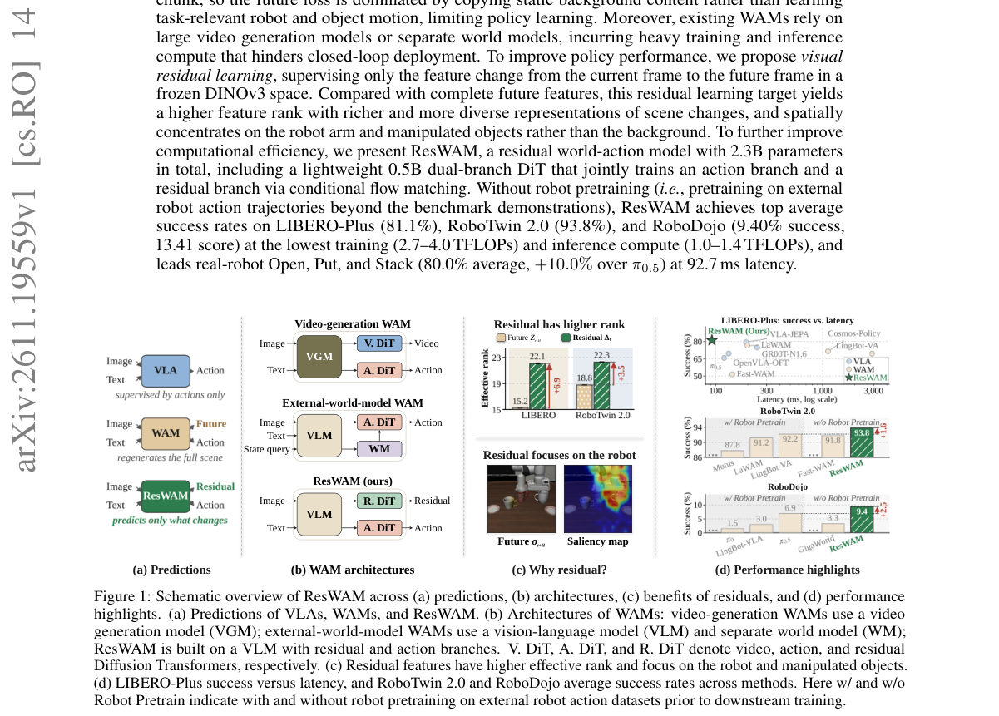

*Result - Effective rank (left) and stable rank (right) of the future DINOv3 tokens Zt+H and the residual ∆t, averaged over all windows of LIBERO and RoboTwin 2.0.*

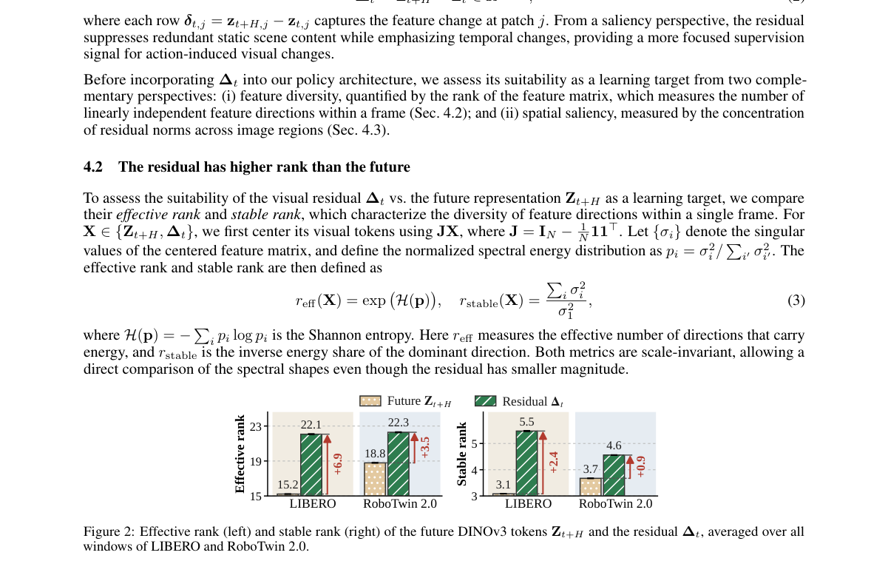

**Why this ranks #1**: 把 WAM 的监督目标从「预测完整未来帧」换成冻结 DINOv3 空间里当前帧到未来帧的特征残差；LIBERO 上当前与未来视觉特征平均余弦相似度高达 0.96，说明完整未来损失多半在复制静态背景。残差目标的 effective rank 从 15.22 升到 22.06（LIBERO）、18.79 升到 22.28（RoboTwin 2.0），同算力下 RoboTwin 2.0 平均成功率提高 2.9 个百分点，而总参数只有 2.3B（0.5B 双分支 DiT）。

---

### 2. The Sense Paradigm for World Models

**arXiv**: [2611.19796](https://arxiv.org/abs/2611.19796) | **Score**: 8.7 (relevance 9 x 0.7 + quality 8 x 0.3) | **Direction**: `world_model` | **Tags**: embodied, latent-world-model, directed-distance, irreversibility, model-based-planning, representation-collapse, University of Jinan | **Categories**: cs.LG | **Pages**: 10

**Authors**: Haidong Hu

**Affiliation**: University of Jinan

**Abstract**

> Latent world models predict the future in an embedding space rather than in pixels. An encoder trained only to predict collapses and maps every observation to the same point, so existing models add a mechanism against collapse, such as a target network, a variance penalty or a distribution penalty. These mechanisms keep the embedding from collapsing, but they leave its distances without meaning, and the model cannot tell a reversible transition from an irreversible one. We propose Sense, a single cross-entropy loss over the directed distance $d(x\to y)=\sum_i \mathrm{ReLU}(y_i-x_i)$ that replaces these mechanisms. The loss avoids collapse on its own, and since the encoder no longer needs the predictor, the predictor is fitted afterwards to fixed embeddings by plain regression. On four pixel environments, the return distance learned by Sense detects irreversible transitions with an AUC between 0.95 and 1.00, where LeWorldModel stays between 0.39 and 0.59. On TwoRoom, the navigation benchmark of LeWorldModel, planning with Sense reaches the goal in 100% of episodes against 91% for LeWorldModel. As the goal moves farther away, the planning failure rate of every baseline grows, while that of Sense stays near zero in Cup, Cliff and Sokoban and is the lowest of all methods in Pendulum.

**Key findings**

- **Finding**: Sense 用单一交叉熵损失训练编码器，预测器事后用普通回归拟合固定嵌入；四个像素环境下不可逆转移识别的 danger AUC 为 0.95–1.00（LeWorldModel 为 0.39–0.59），TwoRoom 导航 100% 到达目标而 LeWorldModel 为 91%；目标拉到 40 步时基线在 Cup/Cliff/Sokoban/Pendulum 的失败率为 38–52%/41–76%/29–68%/49–65%，Sense 为 0%/1%/4%/33%。
- **Inference**: 有向距离把「可逆」与「不可逆」写进了嵌入的度量里，单一交叉熵便顶掉了需要各自调权重与调度表的三种防塌缩机制，因此既不塌缩也能判别不可逆性。
- **Recommendation**: 做潜空间世界模型时先拿有向距离替换对称距离做对照实验，并单独报告 danger AUC 与远距离规划失败率，不要只看嵌入有效秩——LeWorldModel 在 Pendulum 上有效秩塌到 1.6、danger AUC 只有 0.05。

**Key figures**

*Framework - Planning failure rate in Cup. Steps is the number of*

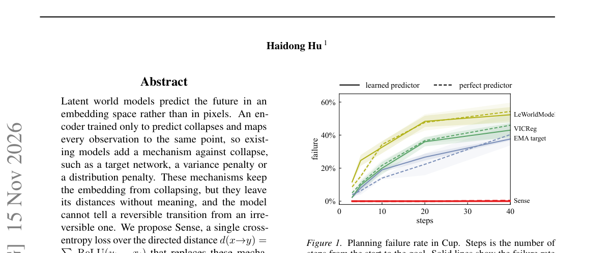

*Result - Same encoder, same predictor, same data. Only the representation objective changes. Two-dimensional PCA projections of*

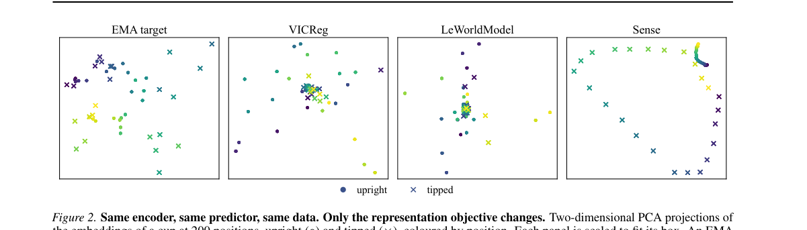

**Why this ranks #2**: 用有向距离 d(x→y)=Σ ReLU(y−x) 上的单一交叉熵损失替代 target network、方差惩罚与高斯惩罚，靠一个损失同时解决塌缩与距离无意义两个问题；四个像素环境上识别不可逆转移的 AUC 在 0.95–1.00，LeWorldModel 只有 0.39–0.59，TwoRoom 导航 100% 到达目标（LeWorldModel 91%），目标拉远到 40 步时基线失败率升到 38–76%，Sense 只有 0–33%。

---

### 3. PanDWM: Panoramic 4D Driving World Models

**arXiv**: [2611.19857](https://arxiv.org/abs/2611.19857) | **Score**: 8.7 (relevance 9 x 0.7 + quality 8 x 0.3) | **Direction**: `world_model` | **Tags**: embodied, driving-world-model, panoramic-video, causal-distillation, gaussian-lifting, 4d-scene, Shenzhen University | **Categories**: cs.CV | **Pages**: 29

**Authors**: Jiajun Sun; Zeyu Zhang; Zeyu Ren; Guangfeng Jiang; Yang Zhao; Hao Tang

**Affiliation**: Shenzhen University; Peking University; The University of Melbourne; La Trobe University

**Abstract**

> Driving world models usually generate videos from six pinhole cameras with separate optical centres and small overlaps, and must learn to keep these views consistent. We present PanDWM, which stitches them into one $360^\circ$ panoramic band. Camera boundaries then fall inside one image, so keeping the views consistent means keeping the image continuous, and each pixel still records its camera ray. Conditioned on layouts, a causal student generates the band window by window in four steps; it is distilled from a causal teacher and trained on its own rollouts. A feed-forward decoder lifts each frame along these rays into 3D Gaussians, and static Gaussians from neighbouring frames complete them into 4D scenes. On nuScenes, scored in one stitched $360^\circ$ view, PanDWM has lower FID and FVD than the multi-camera baselines at $8$-$46\times$ their speed, and keeps its 50-step teacher's FID while lowering FVD by 22-25%.

**Key findings**

- **Finding**: PanDWM 把六路针孔相机拼成 360°×33.3° 全景带并切成两半 2304×256 重叠块编码，因果学生用 4 步生成 16 帧；nuScenes Val-150 上 FID/FVD-1/FVD-2 全面低于多相机基线，速度快 8–46 倍（1.96 秒/帧）；相对 50 步教师保持 FID（+0.16，区间 [−0.3, 0.6]）同时 FVD-1 降 10.4、FVD-2 降 20.4，Test-L 第 3–5/6–8/9–11 窗口 FVD 为 86.6/113.4/126.6 而教师为 116.7/136.9/157.9。
- **Inference**: 把多相机一致性约束转成单张全景图的连续性约束后，模型不必再学跨视角对齐；因果蒸馏又用 25 倍更少的去噪评估撑起了 19.5 秒的长时序滚动。
- **Recommendation**: 做环视驾驶生成时先试「拼成一条全景带 + 因果蒸馏学生」的路线，并同时在全景拼接视角与单相机视角上评测，两者 FID 的差距能直接反映跨视角一致性是否真的被解决。

**Key figures**

*Framework - PanDWM generates driving video as one 360◦panorama and lifts it into Gaussians for novel-view rendering.Given panoramic history, 3D layouts and text, it predicts future panoramas; the ring s*

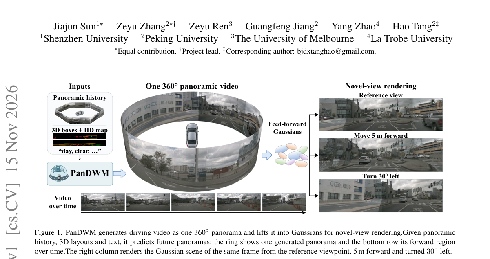

*Result - PanDWM overview. (a) Panoramic history is split into overlapping halves and encoded by a VAE. Conditioned on layouts, text and ray maps, a causal diffusion transformer predicts 16 frames fro*

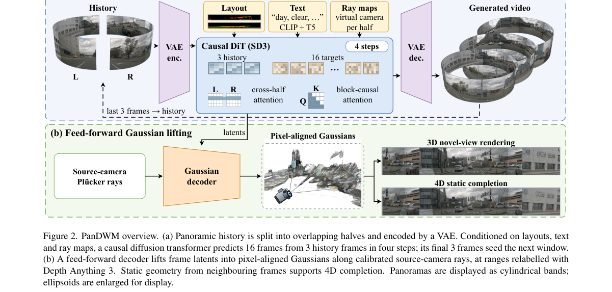

**Why this ranks #3**: 把六个针孔相机拼成单张 360°×33.3° 全景带，相机边界落在同一张图内，跨视角一致性就变成图像连续性；因果学生每窗口 4 步生成 16 帧（教师 50 步要 100 次去噪评估），在 nuScenes 上 FID/FVD 均低于多相机基线，速度快 8–46 倍（1.96 秒/帧），并把教师的 FVD 再降 22–25%。

---

### 4. DiffWAM: Learning World Action Model from Consecutive Visual Difference

**arXiv**: [2611.19904](https://arxiv.org/abs/2611.19904) | **Score**: 8.7 (relevance 9 x 0.7 + quality 8 x 0.3) | **Direction**: `world_model` | **Tags**: embodied, world-action-model, mixture-of-experts, visual-difference, flow-matching, real-robot, Zhejiang University | **Categories**: cs.RO | **Pages**: 21

**Authors**: Xinheng Zhang; Haoyu Xiong; Chao Jing; Xiaohan Zhang; Linshan Li; Hongbang Fan; Xingyu Chen

**Affiliation**: Zhejiang University; Zhongguancun Academy; Zhongguancun Institute of Artificial Intelligence; Institute of Automation, Chinese Academy of Sciences

**Abstract**

> World Action Models (WAMs) have emerged as an important paradigm in robot learning, jointly predicting future scene states and robot actions from current observations and instructions. However, future states entangle task-related changes with large amounts of task-irrelevant content, such as static backgrounds, which weakens the model's ability to capture changes relevant to task execution. To address this, we propose Difference World Action Model (DiffWAM), a Mixture-of-Experts (MoE) framework that enhances world representations by jointly learning future-state prediction and consecutive visual difference prediction. We define consecutive visual differences as differences between the latent representations of consecutive observations, providing an explicit learning signal for temporal variation. The framework comprises a World Expert for future frame prediction, an Action Expert for action generation, and a Diff Expert for predicting these latent differences along the trajectory. A structured unidirectional attention mask conditions the Diff, World, and Action Experts solely on the current-frame representation while blocking attention between experts. This design allows both the World and Diff Experts to be removed during inference, introducing no additional inference overhead. DiffWAM achieves state-of-the-art performance on the LIBERO and RoboTwin 2.0 benchmarks and substantially improves over FastWAM on real-world manipulation tasks. Specifically, it attains average success rates of 98.8%, 92.65%, and 88.3%, outperforming the state-of-the-art baseline (i.e., FastWAM) by 1.75, 1.55, and 15.0 percentage points, respectively.

**Key findings**

- **Finding**: DiffWAM 的 World/Diff/Action 三个专家共享 Observation Encoder，用结构化单向注意力掩码只让专家看当前帧、彼此不可见，推理时可移除 World 与 Diff 专家；LIBERO 平均成功率 98.8%、RoboTwin 2.0 为 92.65%（干净 93.28%、随机化 92.02%），真实三任务 88.3%，分别比 FastWAM 高 1.75、1.55 与 15.0 个百分点；只在干净数据上训练再直接测随机化场景时成功率 5.27%，FastWAM 为 1.50%。
- **Inference**: 把「相邻帧潜变量的差」单列成一个专家，等于给世界表征加了一条显式的时序变化梯度；而专家间的注意力阻断让这条辅助监督在部署期不产生任何代价。
- **Recommendation**: 在 WAM 里加辅助预测分支时，优先预测潜变量差而不是完整未来，并保证辅助分支只读当前帧、能在部署时整支摘除，否则推理延迟会吃掉策略本身的收益。

**Key figures**

*Result - Framework of DiffWAM. The Observation Encoder provides current-observation representations to the World, Diff, and Action Experts. The World and Diff Experts receive the same noised future-f*

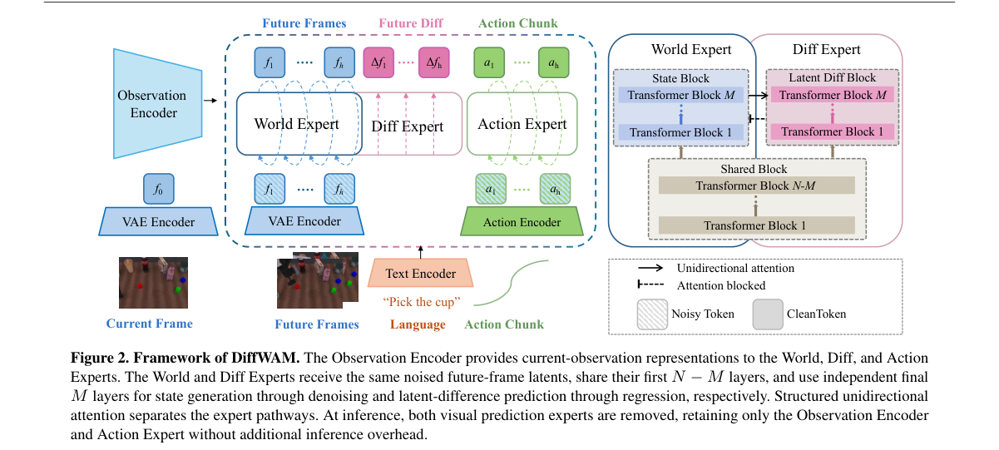

**Why this ranks #4**: 用 World、Action、Diff 三个专家的混合专家架构联合学习未来状态、动作与相邻观测的潜变量差；结构化单向注意力让三个专家只看当前帧表征、彼此不可见，推理时可整支摘掉 World 与 Diff 专家而无额外开销。LIBERO、RoboTwin 2.0 与真实操作平均成功率 98.8%、92.65%、88.3%，分别超过 FastWAM 1.75、1.55 与 15.0 个百分点。

---

### 5. SAFER: Navigating the Exploration-Exploitation Dilemma in World-Model-Based Planning for Autonomous Driving

**arXiv**: [2611.20107](https://arxiv.org/abs/2611.20107) | **Score**: 8.7 (relevance 9 x 0.7 + quality 8 x 0.3) | **Direction**: `world_model` | **Tags**: embodied, autonomous-driving, exploration-exploitation, chunked-latent-world-model, risk-aware-planning, model-based-rl, Purdue University | **Categories**: cs.AI, cs.RO | **Pages**: 39

**Authors**: Yansong Qu; Zilin Huang; Zihao Sheng; Sikai Chen; Samuel Labi

**Affiliation**: Purdue University; University of Wisconsin–Madison

**Abstract**

> An autonomous vehicle must foresee the consequences of its actions, especially in the rare, time-critical situations where crashes happen. A world model offers this foresight, but only within the coverage of its training data, which poses an exploration-exploitation dilemma. Within this coverage a planner can hardly improve on the data, and beyond it the model's errors mislead it. Logs of competent driving rarely contain the failures that would widen the coverage, and agents that learn from interaction gain them only by failing themselves, without being shown what to do instead. We propose SAFER, a framework that learns offline from failures that others make, judged by an expert, and keeps learning online from its own driving. Offline, partially trained agents and scripted, recoverable perturbations Stage failures in simulation, and an expert Annotates every visited state with its action and value, so that much of what the planner explores is covered before it drives. In planning, a chunked latent world model Foresees the consequences fast enough for real-time use, and a risk-aware sampling-based planner Evaluates candidate maneuvers by their return minus a bounded collision penalty. Online, a loop continuously Refines the model wherever this driving leaves the coverage of the offline data. In closed-loop evaluation against the compared methods, SAFER reaches the highest route completion and reward per step on the CARLA Leaderboard routes, 0.95 and 0.77 from a privileged bird's-eye view, and the highest episode reward in MetaDrive, 53.4 in regular and 49.0 in safety-critical traffic. Project page: https://ys-qu.github.io/safer-website.

**Key findings**

- **Finding**: SAFER 的分块潜空间世界模型一次想象 C=H=16 步（1.6 秒）而非逐步推进，规划器每 0.1 秒对 135 条候选动作块打分，按「回报减去有界碰撞惩罚」选动作；CARLA 特权鸟瞰视角下路线完成率 0.95、每步回报 0.77，MetaDrive 回合回报 53.4（常规）与 49.0（安全攸关交通）；BEV 覆盖 38.4 m×38.4 m、5 像素/米，共 15 个通道。
- **Inference**: 用专家标注别人犯的错来扩张模型覆盖，比让学习者自己靠失败攒数据省得多样本；把碰撞概率做成有界惩罚写进采样目标，则让探索与安全之间的折中变得可控。
- **Recommendation**: 做世界模型闭环规划时，先用脚本化扰动加专家标注扩大覆盖，再在规划目标里显式加入有界的碰撞风险惩罚；同时把分块想象长度当作实时性的第一旋钮，因为它一次就要算完整个 chunk。

**Why this ranks #5**: 把「世界模型只在自己训练数据的覆盖范围内可靠」这个探索-利用困境拆成离线学别人的失败与在线自我更新两段：离线用脚本化可恢复扰动制造失败并由专家逐状态标注动作与价值，在线持续精化模型。CARLA Leaderboard 上路线完成率 0.95、每步回报 0.77，MetaDrive 回合回报 53.4（常规）与 49.0（安全攸关交通）。

---

### 6. ThinkWAM: Rethinking Latent Futures for Action Refinement

**arXiv**: [2611.21258](https://arxiv.org/abs/2611.21258) | **Score**: 8.7 (relevance 9 x 0.7 + quality 8 x 0.3) | **Direction**: `world_model` | **Tags**: embodied, world-action-model, latent-future, action-refinement, jepa, affordance-memory, Xi’an Jiaotong University | **Categories**: cs.RO | **Pages**: 21

**Authors**: Haoyun Tang; Baqiao Deng; Enjin Zhou; Songwen Tian; Keyao Xu; Bowen Jing; Kun Wang; Ke Ma; Zhandong Mei; Huibin Li

**Affiliation**: Xi’an Jiaotong University; Nankai University; The University of Manchester; Phantrix Research

**Abstract**

> World-action models (WAMs) couple action generation with predictions of future states. An initial action chunk may be flawed. A future prediction that is not conditioned on the chunk may fail to reflect the changes that the proposed actions would induce in visual representations, limiting its usefulness for refinement before execution. We introduce ThinkWAM, a latent WAM that establishes bidirectional feedback before execution through a proposal-rethink-refine loop: the policy first proposes a complete action chunk, the proposal corrects multi-horizon future latents through a learned residual, and the corrected latents are injected into a second pass of the same action head, which generates the executable chunk. An affordance-guided observation-action memory and a near-fine, far-coarse multi-horizon prediction scheme, both motivated by predictive coding, support this loop, and all prediction stays in latent space. ThinkWAM achieves 98.70% success on LIBERO, 84.76% on LIBERO-Plus without OOD fine-tuning, 85.75%/65.85% on RoboTwin 2.0 Clean/Random, and 65.17% on RoboCasa24. ThinkWAM achieves 64.4% mean success across three real-world OOD conditions. The mean two-pass inference latency per action chunk is 153.48 ms on LIBERO, 164.61 ms on RoboTwin, and 101.2 ms on the Galaxea A1Z. Ablations show complementary gains from rethinking and affordance guidance. Diagnostics indicate that proposal-conditioned corrections change both predicted futures and action trajectories, showing that the corrected future representations improve the final action.

**Key findings**

- **Finding**: ThinkWAM 的 propose–rethink–refine 回路用提议动作的残差修正近/中/远未来潜变量后再走同一动作头第二遍；LIBERO 成功率 98.70%，LIBERO-Plus 无 OOD 微调 84.76%，RoboTwin 2.0 Clean/Random 为 85.75%/65.85%，RoboCasa24 65.17%，真实三种 OOD 条件平均 64.4%（π0.5 为 56.7%、FastWAM 为 37.8%）；两遍推理延迟在 LIBERO 上 153.48 ms/动作块，成对样例中修正后的动作 MSE 比提案低 15.25% 与 44.60%。
- **Inference**: 未来潜变量若不以动作块为条件，预测的就是与自身动作无关的未来，无法用于纠错；用提案修正潜变量后，回灌的信号才真正约束执行动作。
- **Recommendation**: 复核 WAM 效果时要区分「未来预测本身变准」和「未来能反过来纠正动作」；在动作头前加一遍条件于动作提案的未来修正，通常比单纯加深预测头更划算，代价是约两倍的推理延迟。

**Key figures**

*Framework - Overview of ThinkWAM. The policy first proposes a complete action chunk A(0), then rethinks by correcting its predicted near, mid, and far future latents with this proposal, and finally re-p*

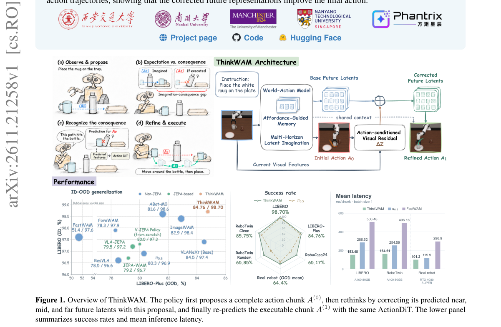

*Result - Architecture of ThinkWAM. The temporal JEPA predicts base future latents from the visual prefix and memory, and the affordance decoder adds a memory residual. The proposal A(0)*

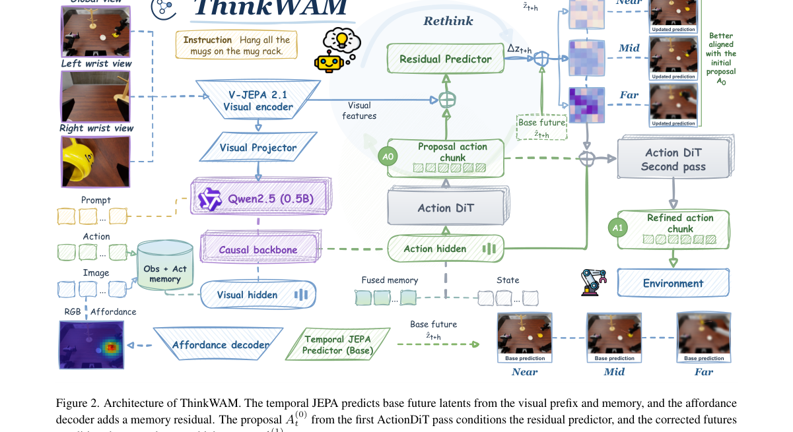

**Why this ranks #6**: 把 WAM 的未来预测变成可被动作反向修正的回路：策略先给出完整动作块提案，再用提案经学习到的残差修正近、中、远三个尺度的未来潜变量，修正后的潜变量回灌同一动作头做第二遍生成。LIBERO 98.70%、LIBERO-Plus 无 OOD 微调 84.76%、RoboTwin 2.0 Clean/Random 85.75%/65.85%、RoboCasa24 65.17%，真实三种 OOD 条件平均 64.4%。

---

### 7. Lazy-MOSAIC: Accelerating Skill-Centric Manipulation Planning with Learned Skill-Effect World Models

**arXiv**: [2611.21517](https://arxiv.org/abs/2611.21517) | **Score**: 8.7 (relevance 9 x 0.7 + quality 8 x 0.3) | **Direction**: `world_model` | **Tags**: embodied, skill-centric-planning, learned-simulator, lazy-search, manipulation-planning, uncertainty, Carnegie Mellon University | **Categories**: cs.AI, cs.RO | **Pages**: 9

**Authors**: Itamar Mishani; Mukund Krishnakumar; Oren Salzman; Maxim Likhachev

**Affiliation**: Carnegie Mellon University; Technion

**Abstract**

> Long-horizon manipulation tasks require a robot to perform a sequence of physical interactions with its environment, typically combining several different skills. Planning such behaviors efficiently is challenging: given a library of parameterized skills, solutions lie in a vast hybrid space of skill sequences and their parameters, and evaluating each candidate skill's feasibility and effect with a high-fidelity world model such as a physics simulator is computationally expensive. MOSAIC, a recent skill-centric approach, lets the skills guide a non-sequential search toward the regions of this space where they are likely to succeed; however, it pays the full cost of simulation for every parameterized skill it considers. In this work, we introduce Lazy-MOSAIC, a lazy planning framework that instead searches over hypothesized skill outcomes. A cheap learned skill-effect world model predicts, in a fraction of a millisecond, a skill's feasibility and the world state it produces. Lazy-MOSAIC then uses these predictions to focus expensive simulation on promising candidate skills and, when a hypothesis is invalidated, repairs only the affected part of the search, while ensuring that every skill in a returned plan is validated in simulation. We evaluate Lazy-MOSAIC on cluttered-shelf retrieval tasks of increasing difficulty and demonstrate it on a physical robot, showing that it plans substantially faster than baselines with fewer simulator queries, while matching or exceeding their success rate in every setting. Visit skill-mosaic.github.io.

**Key findings**

- **Finding**: Lazy-MOSAIC 用独立初始化的网络集成预测技能可行性与结果状态，K=128 条提案的打分耗时约 0.7 毫秒，成功性预测头 PR-AUC 0.809、Brier 0.094，对象位置误差均值 1.32 厘米、90 分位 1.97 厘米；160 次试验解出 104 次（MOSAIC 81 次、Roadmap 13 次、CEM 9 次），仿真查询由 46.4/67.9/134.5 降到 16.9/21.7/41.3，去掉不确定性项后成功率从 104/160 降到 90/160 且查询升到 19.0/25.9/50.7。
- **Inference**: 把「这条技能能不能成、会把世界变成什么样」交给便宜的学习模型先验算一遍，等于在昂贵仿真之前插入一道高召回的过滤器，规划时间因此主要花在少数真正需要验证的分支上。
- **Recommendation**: 做技能式长程规划时，先训练一个带集成的技能-效果模型做前置筛选，并保留物理仿真做最终认证；评估务必同时报仿真查询次数与成功次数，否则容易被慢但准的方法掩盖。

**Key figures**

*Framework - Left: LAZY-MOSAIC performs lazy search for a sequence of parameterized skills leading from the start state to the goal (both pink), over a combined graph of certified skills and hypothesized s*

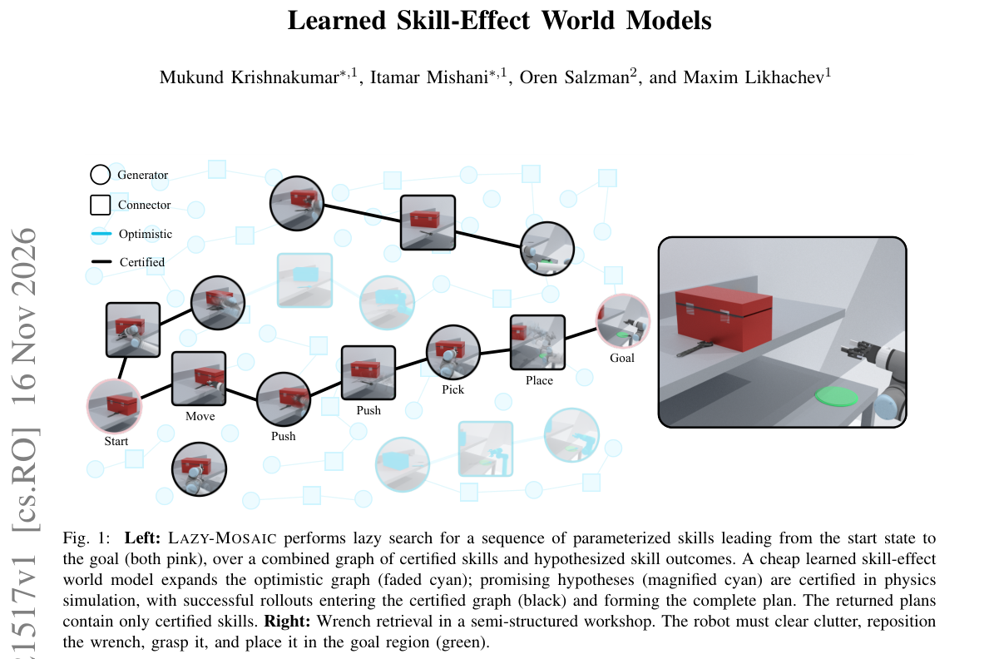

*Result - Generators and connectors as in MOSAIC. Push (Gen- erator) finds a push to move the toolbox. Pull (Generator) finds a trajectory that pulls the bin forward, but starts from a world state where*

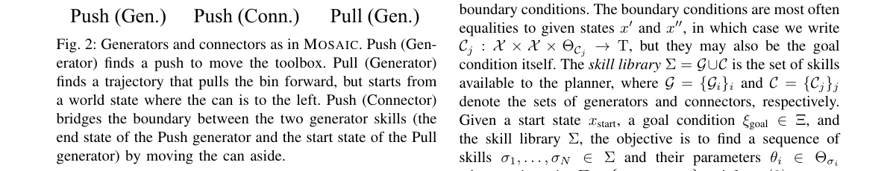

**Why this ranks #7**: 用毫秒级学会的技能-效果世界模型替代高保真物理仿真来筛选候选技能：K=128 条技能提案在 GPU 上约 0.7 毫秒打完分，只对有希望的提案跑昂贵仿真，假设被推翻时只修复受影响的搜索分支。160 次试验解出 104 次（MOSAIC 81 次），仿真查询由 46.4/67.9/134.5 降到 16.9/21.7/41.3，成功跑上快 2.1–6.6 倍。

---

## 具身智能与机器人学习 · `embodied_ai` (13 papers)

### 8. ESI: An Embodied Self-Improvement Flywheel for LLM-VLA Agents

**arXiv**: [2611.18176](https://arxiv.org/abs/2611.18176) | **Score**: 8.7 (relevance 9 x 0.7 + quality 8 x 0.3) | **Direction**: `embodied_ai` | **Tags**: embodied, embodied-agent, llm-vla, self-improvement, skill-interface, robo-dojo, University of Science and Technology of | **Categories**: cs.RO | **Pages**: 25

**Authors**: Yundi Cai; Zihan Wang; Chenxi Han; Yi Cheng; Houde Liu; Zilei Wang

**Affiliation**: University of Science and Technology of China; ZERITH Robotics; Tsinghua Shenzhen International Graduate School

**Abstract**

> Independently pretrained language models and vision-language-action (VLA) policies provide complementary building blocks for embodied agents, but connecting them does not automatically produce coordinated behavior. The VLA may generate actions that diverge from the LLM's intended subtask and, upon regaining control after a correction, undo the promising state restored by the LLM. We introduce ESI (Embodied Self-Improvement), an automated flywheel that uses environmental interaction to align reasoning and action. ESI treats the modular agent as the unit of post-training, repeatedly refining the prompts that guide the LLM, the shared skill interface that expresses its intent, and the VLA parameters that realize that intent, then redeploying these components together. Our key insight is that collaboration itself can supply supervision for improving this interface. The LLM's subtask decisions provide semantic supervision for what the policy should execute, while its effective corrections and subsequent student continuations provide action-level supervision for recovery and handoff. The student also learns from its own effective execution, allowing locally useful experience to contribute even when the overall episode fails. On ten selected RoboDojo tasks, ESI achieves a mean Score of 62.03 and a mean success rate of 49.41% using an LLM-VLA agent without generating task-specific control code. On both metrics, it outperforms the published reference results of all hybrid embodied agents, including the Agent+WAM system GO-3 Nano Preview (47.27 Score and 36.60% success), as well as all compared code-based methods.

**Key findings**

- **Finding**: ESI 在 RoboDojo 选定的十个任务上取得平均 Score 62.03 与平均成功率 49.41%，其中「把物品装进箱子」完成 10/20，而公开结果中 GPT-6-Astra 为 0%、π0.5 为 2.67%；对照的混合具身 agent GO-3 Nano Preview 为 47.27 Score 与 36.60% 成功率；学生用 π0.5 的 OpenPI/JAX 实现与原生 flow-matching 目标，经验重放取 α=0.6（当轮 60%、历史 40%）。
- **Inference**: 把协作过程本身当成监督信号——LLM 的子任务决定提供语义监督，教师的有效纠正与后续学生续写提供动作级监督——比等待任务级标签更省数据，也让失败 episode 中的好片段不至于被整体丢弃。
- **Recommendation**: 搭 LLM+VLA 系统时把「提示与技能接口」也纳入可迭代更新的对象，并显式保留失败 episode 中成功的子片段，否则一轮轮后策略容易被整体失败样本拖住。

**Key figures**

*Framework - The ESI collect–learn flywheel. Within each episode, the LLM plans and reviews, the VLA proposes actions, and teacher corrections create states from which the VLA continues. The shared exper*

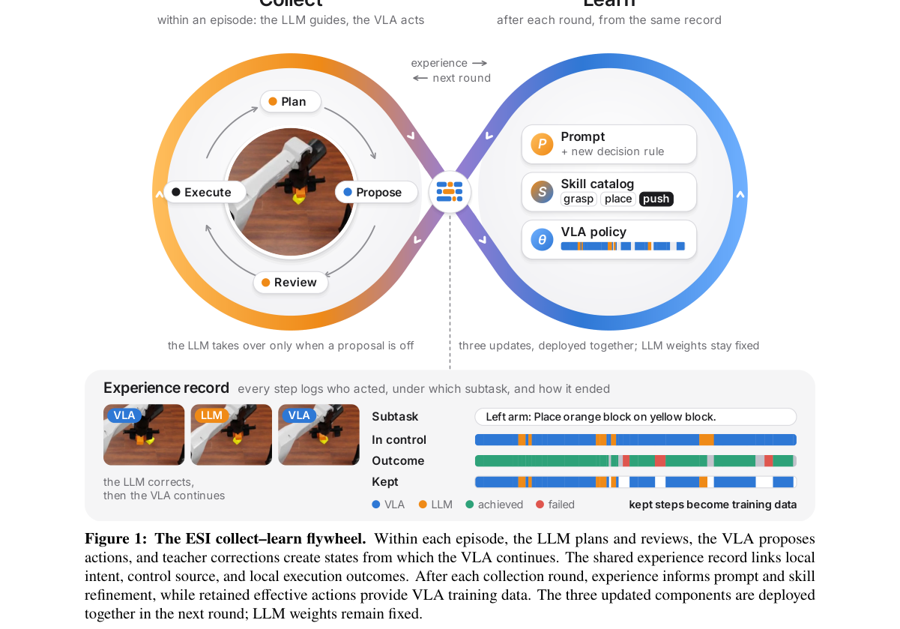

*Result - ESI architecture and round-level updates. The agent combines a fixed LLM with decision guidance 𝑃𝑟, a shared skill catalog 𝑆𝑟, and a VLA policy 𝜃𝑟. Interaction across tasks produces records*

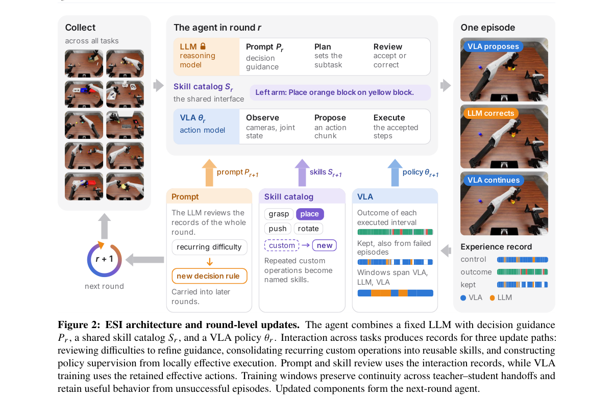

**Why this ranks #8**: 把「LLM 与 VLA 各自预训练、拼起来不协调」当成系统级后训练问题：每轮用环境交互同时更新 LLM 的决策提示、共享技能接口与 VLA 参数，再整体重新部署。RoboDojo 十个任务上平均 Score 62.03、成功率 49.41%，超过所有对照的混合具身 agent，包括 Agent+WAM 的 GO-3 Nano Preview（47.27 Score、36.60% 成功率）。

---

### 9. Leaning Over to Reach Far-Away Objects

**arXiv**: [2611.19100](https://arxiv.org/abs/2611.19100) | **Score**: 8.7 (relevance 9 x 0.7 + quality 8 x 0.3) | **Direction**: `embodied_ai` | **Tags**: embodied, humanoid, model-predictive-control, contact-rich, sim-to-real, fiducial-localization, University of Colorado Boulder | **Categories**: cs.RO | **Pages**: 8

**Authors**: Allen Devaraj; William Xie; Nikolaus Correll

**Affiliation**: University of Colorado Boulder; University of Notre Dame

**Abstract**

> We study supported reaching to extend a humanoid robot's workspace by bracing against the environment for stabilization using a straightforward yet capable whole-body model predictive control (MPC) approach, exclusively with local sensing and fiducial markers. While typical solutions for whole body humanoid control aim at avoiding or accommodating contact, contact is explicitly required to reach objects placed on surfaces far out of normal reach. We employ sampling-based MPC for whole-body leaning, bracing, reaching, and recovery on a Unitree H1-2 humanoid. The controller runs in real-time at 34 Hz on a laptop, transfers sim-to-real, extends reach by about 50 cm beyond the unbraced standing workspace, and sustains the loaded posture for over four minutes, before pose estimation drifts. The controller reaches the commanded target in 89% of trials and completes the full reach-and-recovery cycle in 81%, across 54 trials spanning six targets and three table heights. We further characterize why such a small real-time sampling budget is sufficient, finding that temporal persistence of sampled actions and exploration scale strongly govern success, while CEM provides the widest operating region over planning rate and model mismatch. These results establish a real-world baseline for online, contact-rich humanoid manipulation. Code, videos, and full hardware details are available at https://h12leaner.github.io/

**Key findings**

- **Finding**: H1-2 上用 20 次 rollout、1 秒规划视界的采样式 MPC，在 AMD Ryzen AI 9 HX 370 笔记本上中位 34 Hz；硬件 54 次试验中 48 次（89%）到达指令目标、44 次（81%）完成完整回收循环，末端 3D 误差 2.7±0.9 厘米；最大伸展时指尖达 130±10 厘米，比不倚靠站姿的约 80 厘米多约 50 厘米，支撑负载中位 121±47 牛顿；CEM 在 108 次条件试验中完成 80 次，iCEM 62 次、MPPI 42 次。
- **Inference**: 接触不是需要回避的干扰，而是扩展可达工作空间的必要条件；只要支撑点与姿态能被稳定估计，34 Hz 这样的小采样预算就足以驱动接触丰富的全身动作。
- **Recommendation**: 人形机器人做远端取物时优先考虑「倚靠支撑 + 采样式 MPC」而不是加长机械臂；同时必须为支撑状态估计准备独立视觉标记，因为纯内部里程计在该姿态下漂移约 267 毫米/分钟。

**Key figures**

*Framework - Three stages of leaning and reaching Unitree H1-2 in real (top) and simulation (MuJoCo, bottom). With sampling-based model predictive control, the robot can hold the 1.3m reaching stage (frame*

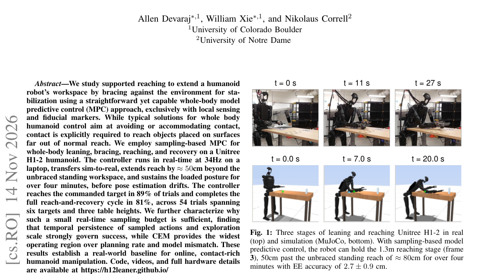

*Result - Estimator drift during an active stand. While the robot actively holds a stand, Z-axis drift is 0.3mm/min, X-axis drift of the Internal + AprilTag Fiducial estimator is 4mm oscillation.*

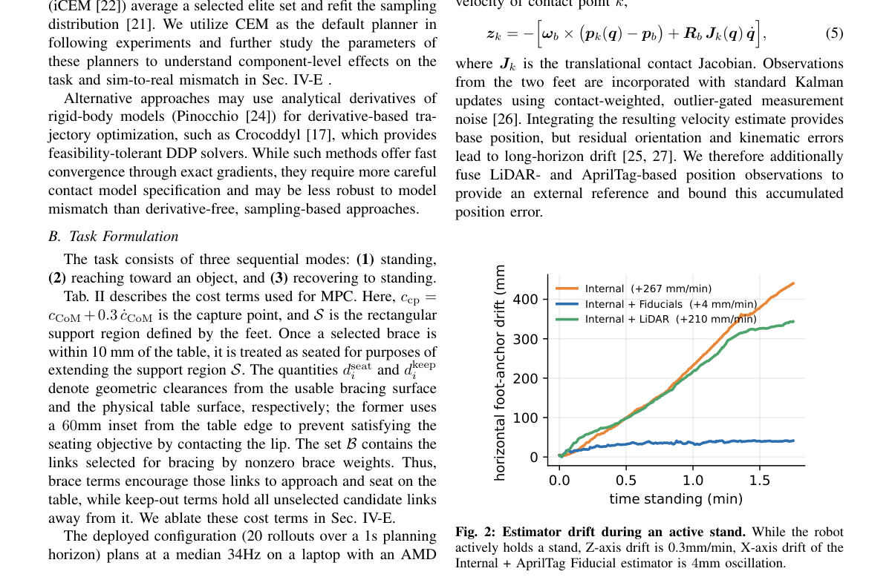

**Why this ranks #9**: 在 Unitree H1-2 上用纯本地感知的采样式全身 MPC 做倚靠-支撑-伸手-回收，把工作空间向外扩展约 50 厘米（从约 80 厘米到硬件最大伸展 130 厘米）；笔记本上实时 34 Hz，54 次试验中 89% 到达指令目标、81% 完成完整回收循环，支撑姿态可维持四分钟以上。

---

### 10. Ego2Sim2Humanoid: Agentic Real-to-Sim for Learning Loco-Manipulation VLAs without Robot Demonstrations

**arXiv**: [2611.19196](https://arxiv.org/abs/2611.19196) | **Score**: 8.7 (relevance 9 x 0.7 + quality 8 x 0.3) | **Direction**: `embodied_ai` | **Tags**: embodied, egocentric-video, real-to-sim, loco-manipulation, vla, grasp-planning, University of Notre Dame | **Categories**: cs.RO | **Pages**: 13

**Authors**: Chen Liu; Nikolaus Correll

**Affiliation**: University of Notre Dame

**Abstract**

> Imitation learning for visuomotor policies typically relies on teleoperated robot demonstrations, which are costly because every episode requires a trained operator controlling a physical robot in real time through teleoperation interfaces and wearable body-tracking hardware. Egocentric glasses capture human demonstrations without a robot or handheld grippers, yet they track only the head and in-view human hands, and directly copying human motion to a robot with different stature, arm reach and hand morphology fails to produce feasible contacts. \method{} converts egocentric glasses recordings into physically verified robot training trajectories. An agentic real-to-sim stage reconstructs collision and textured visual assets from the recorded RGB-D and head streams, completes unseen surfaces when needed, and predicts target contact bands on the manipulated objects. During motion adaptation, a grasp planner turns each contact band into a feasible robot wrist pose and finger closure, bilevel stance optimization plans collision-free standing postures that keep hand targets reachable, and a whole-body motion generator synthesizes lower-body locomotion and out-of-view arm motion. Two-stage motion correction then blends visibility transitions kinematically and trains a reinforcement-learning tracking policy in physics simulation under agent-designed semantic rewards, completing manipulation phases even when the object leaves the camera view. Rendering the reconstructed scene through the robot's onboard camera along the optimized rollout yields synchronized robot-view images, proprioception and verified action labels. Fine-tuned exclusively on this converted dataset, without real-robot demonstrations, GR00T N1.7 performed loco-manipulation tasks autonomously on a Unitree G1. Project page: https://robonana.github.io/ego2sim2humanoid/

**Key findings**

- **Finding**: Ego2Sim2Humanoid 从 Aria Gen 2 眼镜的 219 段抬瓶与 154 段戴帽录像中分别保留 189 与 59 段进入训练集；抓取规划器在 71 段戴帽录像中有 65 段给出可行抓取，把复制人类掌位基线的中位穿透从 1.8 厘米降到 0.8 厘米，但手内位移由 3.7 升到 6.6 厘米、旋转由 22.9° 升到 33.0°；纯用转换数据微调的 GR00T N1.7（3B）在 G1 上抬瓶成功 9/20（45%）、戴帽 5/20（25%）。
- **Inference**: 人类演示与机器人之间差的不只是手型，还有身高、臂展与场景接触，因此必须先把场景重建出来并把接触带转成可行的腕位与手指闭合，直接搬运人类动作只会得到不可行的接触。
- **Recommendation**: 用第一视角视频造机器人数据时，务必加一层「接触带 + 双层站姿优化 + 物理回放复核」，只做运动重定向会得到大量指尖穿透或抓空。

**Key figures**

*Framework - Overview of E2S2H. Egocentric glasses supply the head trajectory, in-view hand poses and RGB-D streams in one metric frame. Agentic real-to-sim reconstructs each recording without a separate p*

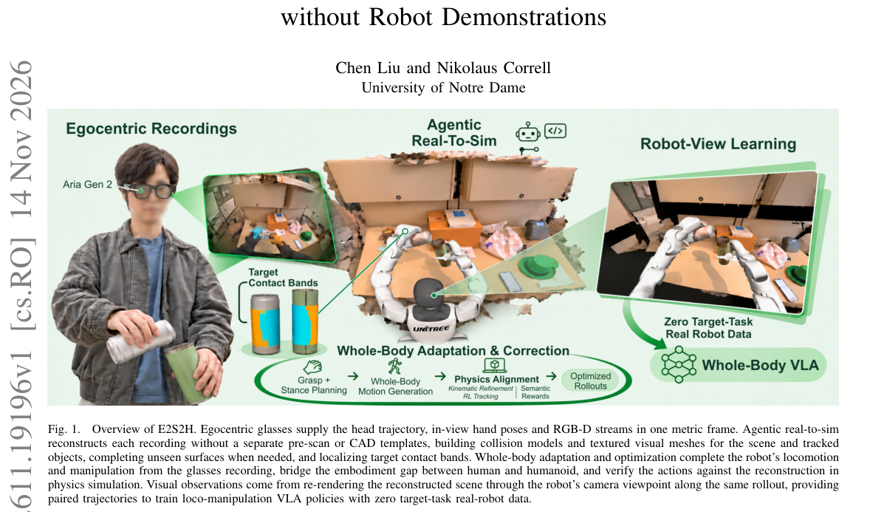

**Why this ranks #10**: 把第一视角眼镜录像转成物理可验证的机器人训练轨迹，绕开昂贵的遥操作采集：219 段抬瓶与 154 段戴帽录像中分别有 189 与 59 段通过复核进入训练集；仅用转换数据微调的 GR00T N1.7（3B）在 Unitree G1 上自主完成 loco-manipulation，抬瓶 9/20、戴帽 5/20。

---

### 11. MARS: Dynamic Routing of Reinforcement-Learned Atomic Skills for Multi-Stage Robotic Manipulation

**arXiv**: [2611.19324](https://arxiv.org/abs/2611.19324) | **Score**: 8.7 (relevance 9 x 0.7 + quality 8 x 0.3) | **Direction**: `embodied_ai` | **Tags**: embodied, skill-routing, reinforcement-learning, vla, mamba, multi-stage-manipulation, Chongqing University | **Categories**: cs.RO | **Pages**: 11

**Authors**: Zequan Zeng; Junqin Yang; Kai Wang

**Affiliation**: Chongqing University

**Abstract**

> Vision-Language-Action (VLA) models have demonstrated strong capabilities in multi-task robotic manipulation. However, they still face limitations in control precision and execution stability during critical manipulation stages, such as object grasping, alignment and insertion. To combine general-purpose manipulation capabilities with task-specific fine-grained control, while enabling effective coordination between generalist and specialized policies throughout multi-stage manipulation tasks, this paper proposes MARS (Modular Atomic-skill Routing System), a dynamic routing framework for reinforcement learning-based atomic skills. MARS integrates a frozen generalist VLA policy with multiple independently trained atomic skill policies. Using a shared RL Token state representation and the reference action of VLA, specialized control policies are optimized through reinforcement learning for different cr`itical manipulation stages. For high-level policy selection, we develop a dynamic router that integrates temporal context and skill semantics. The router employs Mamba-based recurrent encoding and a historical feature window to capture state evolution during manipulation. Skill descriptions of candidate policies are encoded into semantic queries, and attention mechanisms are used to establish correspondences between skill semantics and temporal state features. Experimental results show that MARS achieves an average Macro-F1 score of 90.47% across four LIBERO task suites under fixed-trajectory evaluation, outperforming an MLP-based router by 7.08 percentage points. In the simulated Tube Transport task, the full-task success rate increases from 20.04% to 85.67%. These results demonstrate that stage-specific reinforcement learning and temporal state-aware dynamic policy routing can improve multi-policy coordination and overall task execution performance in multi-stage robotic manipulation.

**Key findings**

- **Finding**: MARS 用共享 RL Token 状态表征加 Mamba 时序编码与历史特征窗，注意力把候选技能描述与时序状态特征对齐后动态路由；四个 LIBERO 套件固定轨迹评测下 Macro-F1 平均 90.47%（LIBERO-Long 89.85%），比 MLP 路由器高 7.08 个百分点，平均成功率 89.25%，比冻结 VLA 高 25.11、比单体 RLT 高 10.52 个百分点；仿真 Tube Transport 任务成功率由 20.04% 升到 85.67%、SCR 91.11%；去掉语义查询与历史窗后 Macro-F1 分别降到 84.97% 与 86.38%。
- **Inference**: 把「该选哪个专家」从一次性分类改成带历史的状态机后，路由器能在同一子任务被反复尝试时识别阶段切换，这是单体策略拿不到的时间上下文。
- **Recommendation**: 多阶段操作建议把通用策略与阶段专用策略并存，再补一个带历史窗口的动态路由器；评测要同时报路由 Macro-F1 与任务成功率，否则路由抖动会被端到端分数掩盖。

**Key figures**

*Framework - Overview of the MARS framework. MARS consists of three main components: shared state feature extraction, atomic skill policy learning, and dynamic skill routing. A shared RL Token adapter extr*

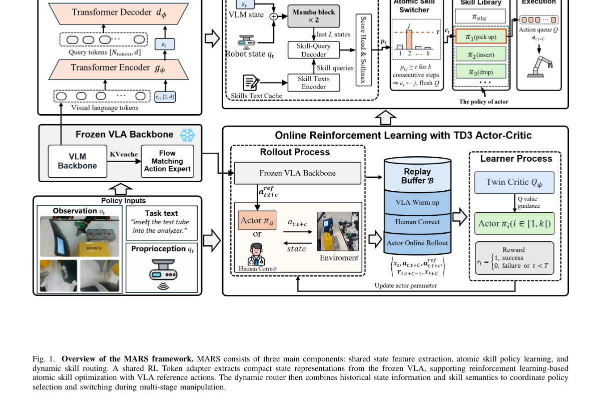

*Result - Architecture of the dynamic skill router. The dynamic skill router combines Mamba-based temporal encoding with a historical feature window to capture temporal context. Candidate skill descript*

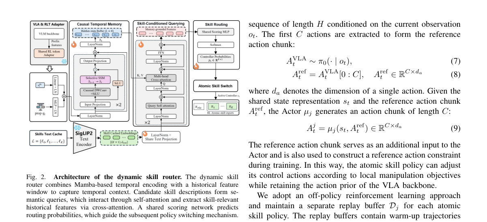

**Why this ranks #11**: 把通用 VLA 与逐阶段强化学习训练的原子技能并联，用 Mamba 时序编码加技能语义注意力做动态路由；四个 LIBERO 套件上 Macro-F1 平均 90.47%，比 MLP 路由器高 7.08 个百分点，平均成功率 89.25%，比冻结 VLA 与单体 RLT 高 25.11 与 10.52 个百分点，仿真 Tube Transport 任务成功率由 20.04% 提到 85.67%。

---

### 12. MoViC: Real-Time Humanoid Whole-Body Control from Monocular Video Streams

**arXiv**: [2611.19998](https://arxiv.org/abs/2611.19998) | **Score**: 8.7 (relevance 9 x 0.7 + quality 8 x 0.3) | **Direction**: `embodied_ai` | **Tags**: embodied, humanoid, monocular-video, real-time-control, motion-retargeting, behavior-foundation-model, University of Hong Kong | **Categories**: cs.RO | **Pages**: 16

**Authors**: Yimin Han; Jiahui Zhang; Wanyue Li; Zeren Luo; Yeke Chen; Liu Zhao; Peizhuo Li; Xiaoyu Ji; Shihao Dong; Xuechao Chen; Zhangguo Yu; Annan Tang

**Affiliation**: The University of Hong Kong; National University of Singapore; Beijing Institute of Technology; EngineAI

**Abstract**

> Real-time whole-body imitation from monocular video requires both a robust universal tracker and high-quality real-time reconstruction. We present MoViC, a framework that uses live RGB video as a control signal for humanoid robots without wearable tracking devices. The framework combines monocular human motion reconstruction, robot retargeting, and a transformer-based behavior foundation model. The policy receives proprioceptive history, a single explicit next-step reference, and a compact frequency-domain motion representation that supplies temporal context without explicitly stacking future reference frames, which reduces the input dimension and network size. During deployment, our extrapolation method bridges the 10-Hz visual estimation with 50-Hz controller, enabling asynchronous visual processing and policy execution. Hardware experiments further demonstrate highly dynamic motion tracking and device-free teleoperation of bimanual and single-arm manipulation tasks from live monocular RGB input. Project page: https://movicproject.github.io/ .

**Key findings**

- **Finding**: MoViC 的策略输入为 810 维本体历史（H=31 帧窗口）、52 维显式下一步参考与 320 维频域参考表示，合计 1182 维；视觉侧用 SAM 3D Body（DINOv3 骨干）在 512×512 人体裁剪上约 10 Hz 输出网格与根平移，再经 GMR 重定向与外推产生 50 Hz 参考；参考编码器的片段级分类准确率在 2 维 PCA 上 0.72、2 维 UMAP 上 0.90、2 维 t-SNE 上 0.93、50 维 PCA 上 0.94。
- **Inference**: 把多步未来参考压成一段频域相位编码，既保住了时序上下文又免去堆叠未来帧带来的输入维度膨胀，因而这套全身控制器能在 50 Hz 的回路里跑得动。
- **Recommendation**: 单目视频驱动全身控制建议照「重建 → 重定向 → 外推」三段式接，先量清重建频率与控制频率的差距再定外推窗口；参考表示用频域相位而不是堆帧，可显著压低网络规模。

**Key figures**

*Framework - Overview. Bottom: monocular RGB video is reconstructed, retargeted and extrapolated, producing 50-Hz control references. Top: imitation examples (left), the transformer tracker with frequency-*

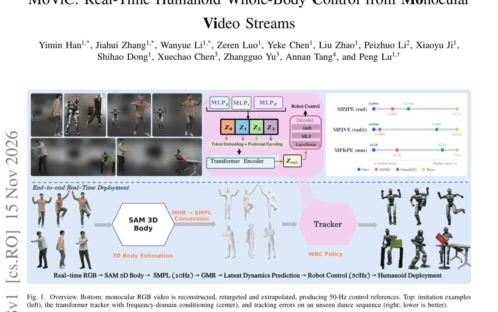

**Why this ranks #12**: 用单目 RGB 直播流直接驱动人形机器人全身，不穿任何动捕设备：SAM 3D Body 约 10 Hz 重建后重定向到 24 自由度 EngineAI PM01，再用外推法补到 50 Hz 控制参考；策略只吃 810 维本体历史、52 维下一步参考与 320 维频域参考表示共 1182 维输入，靠频域相位而不是堆未来帧提供时序上下文。

---

### 13. DAPPT: Domain-Aware Policies from Procedural Trajectories for Sim-to-Real Dexterous Tool Use

**arXiv**: [2611.20202](https://arxiv.org/abs/2611.20202) | **Score**: 8.7 (relevance 9 x 0.7 + quality 8 x 0.3) | **Direction**: `embodied_ai` | **Tags**: embodied, dexterous-manipulation, deformable-materials, domain-parameters, sim-to-real, policy-distillation, Princeton University | **Categories**: cs.RO | **Pages**: 9

**Authors**: Beining Han; Jia Deng

**Affiliation**: Princeton University

**Abstract**

> Sim-to-real RL has achieved impressive results in dexterous manipulation but remains limited to tasks with accurate rigid-body simulation. However, these methods cannot be applied to skills that involve deformable and particles, with which the simulation speed will become too slow for large-scale RL learning. We present DAPPT, a sim-to-real framework for end-to-end dexterous tool-use manipulation skills, e.g., sand scooping, play-dough rod-rolling, without simulating non-rigid materials. Our method learns a domain-aware RL policy by tracking procedural trajectories parameterized by domain parameters, and distills it into an end-to-end domain-aware sensorimotor policy. Furthermore, explicit domain represen-tation enables fast selection of domain parameters that can maximize downstream task performance. We evaluate DAPPT end-to-end on six dexterous manipulation tasks, including sand scooping, play-dough rod-rolling, sand scraping, mouse-wheel scrolling, dispenser pressing, and spray triggering. Our method achieves 1.5-3.8x in task metrics through the best domain parameter and transfers zero-shot to the real world.

**Key findings**

- **Finding**: DAPPT 不仿真非刚体材料，只对工具做刚体仿真并训练策略跟踪由域参数（插入角、铲距、铲速等）参数化的程序轨迹，再蒸馏为端到端域感知传感动作策略；在 19 自由度手-臂系统上覆盖铲沙、搓橡皮泥棒、刮沙、滚鼠标轮、按压分配器与喷枪触发六个任务，最佳域参数下任务指标提升 1.5–3.8 倍（对手 SimToolReal 提升 50% 以上）；真实机器人 20 次试验中铲沙 20/20 动作成功、14/20 任务成功（判定阈值 4 克），平均 7.7 克，而固定域参数策略在三项任务上性能下降 48.6%、57.5%、97.7%。
- **Inference**: 不确定材料的最优行为本来就要在真实世界选，仿真里只能给参数而不能给答案；把域参数显式暴露成策略条件，就等于把「试哪一组参数」这件事从仿真里搬到真机上做搜索。
- **Recommendation**: 涉及颗粒或形变材料时不要硬上高精度仿真，改用程序轨迹加显式域参数训练；评测时把「参数选择」也算进流程，并分别报告固定参数策略与域感知策略的差距。

**Key figures**

*Framework - DAPPT learns dexterous skills on the 19-dof hand-arm system in rigid-body simulation and zero-shot transfer to the real-world. We evaluate on 6 dexterous manipulation tasks. The left 3 skills*

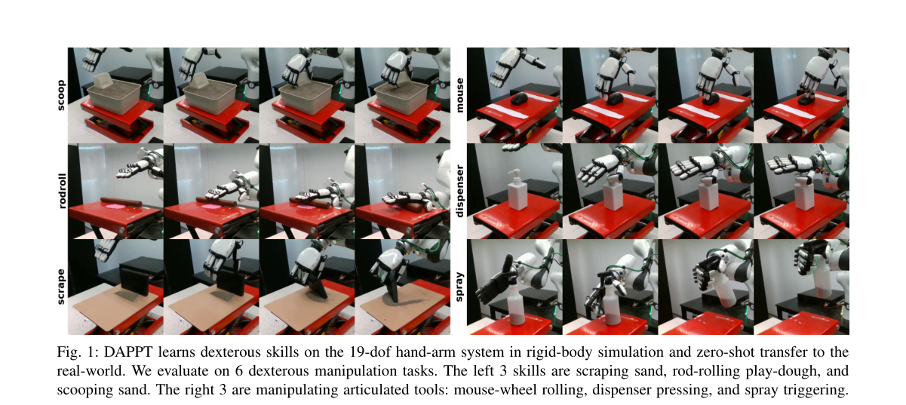

*Result - Illustration of domain-aware policy π(p; o; c) and an example of the domain parameters c = {α, d, vi, vl} of the sand scooping task. We visualize the geometric meanings to the procedural traje*

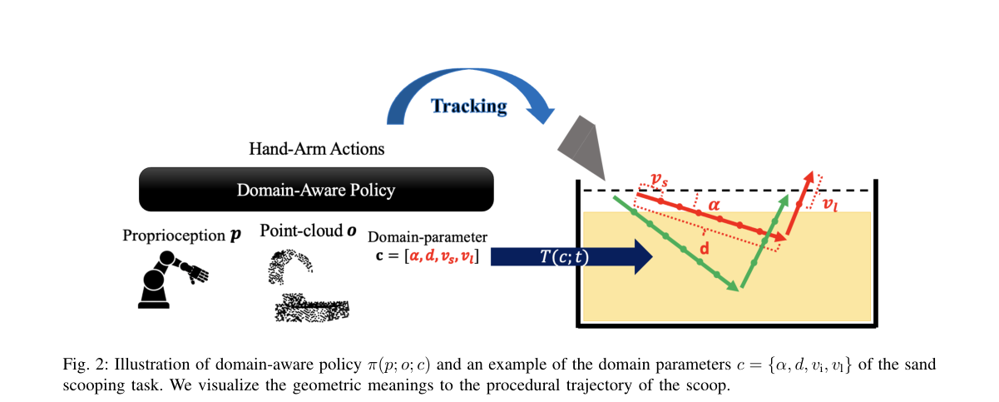

**Why this ranks #13**: 绕开对非刚体材料的高成本仿真，用参数化程序轨迹（域参数化）训练域感知 RL 策略，再蒸馏成端到端传感动作策略；覆盖铲沙、搓橡皮泥棒等六个灵巧工具任务，在最佳域参数下任务指标提升 1.5–3.8 倍并零样本迁移到真实机器人，真实铲沙平均 7.7 克对四参数取均值的 2.9 克。

---

### 14. DexFormer 2.0: Towards a Cross-Embodiment Foundation Policy for Dexterous Grasping

**arXiv**: [2611.20273](https://arxiv.org/abs/2611.20273) | **Score**: 8.7 (relevance 9 x 0.7 + quality 8 x 0.3) | **Direction**: `embodied_ai` | **Tags**: embodied, dexterous-grasping, cross-embodiment, kinematic-tree, transformer-xl, rl-policy, HKUST(GZ) | **Categories**: cs.RO | **Pages**: 10

**Authors**: Lixin Xu; Ke Zhang; Xinyu Liu; Jie Tan; Senming Tan; Jiaju Yin; Yating Feng; Xiaoyi Lin; Xiyue Dong; Renjing Xu

**Affiliation**: HKUST(GZ); BrainCo; Chongqing University; Wuhan University

**Abstract**

> Dexterous grasping policies are usually trained for one arm paired with one hand. Every new pairing then needs its own policy, and the number of policies grows with every arm and hand added. We ask whether a single policy can control many arm-hand combinations and transfer to pairings and hands it has never seen. This is hard because robots differ in the number, layout, and dynamics of their joints, so their observations and actions share no common interface. We present DexFormer 2.0, a single reinforcement learning policy for cross-embodiment dexterous grasping. It maps every robot to a canonical joint interface with validity masks, encodes each joint's morphology with attention biased by the kinematic tree, and uses a Transformer-XL memory to infer embodiment-dependent dynamics from recent interaction. Trained on 18 combinations of four arms and six hands, it reaches 89% stable success on seen combinations and 51% on six held-out arm-hand pairs, outperforming GRU and DexFormer 1.0 baselines. Without fine-tuning, it also grasps with four new hand types and, through retargeting, with parallel grippers. Ablations show that memory, the kinematic-tree bias, and broader pairing coverage each matter for transfer. On a physical Flexiv arm, distilled students transfer zero-shot from simulation with two hands, including a held-out pair. Project website: https://davidlxu.github.io/dexformer2-web/.

**Key findings**

- **Finding**: DexFormer 2.0 把机器人映射到 7 个臂关节加最多 22 个手关节的规范槽位（每关节 16 维形态描述），用运动学树偏置注意力加 16 步 Transformer-XL 记忆，输出 29 维掩码高斯动作；4 臂 × 6 手共 24 个组合中训练 18 个，已见组合稳定成功率 89.01%、留出组合 51.18%（GRU 为 64.82%/31.28%，DexFormer 1.0 为 66.02%/14.15%），训练覆盖从 6→12→18 组时留出集成功率从 0.07%→5.65%→51.18%，去掉记忆或树偏置大致减半；实物 Flexiv 臂上 Revo3 25 次成功 17 次、LEAP 23 次。
- **Inference**: 把跨本体差异显式编码成关节槽位上的形态描述与有效掩码，再靠树偏置注意力传播运动学约束，就能在不增加输出头数量的前提下让一个共享策略容纳不同关节数与布局。
- **Recommendation**: 做跨本体灵巧抓取时优先保证训练组合覆盖度——同一交互预算下 18 组比 12 组在留出对上高 45.53 个百分点；并务必保留运动学树偏置，去掉它留出成功率会掉 27.03 个点。

**Key figures**

*Framework - DexFormer 2.0. One policy grasps with diverse arm–hand embodiments. Top: the 18 training pairs on training primitives. Middle: held-out arm–hand pairs (left) and new hands and grippers (righ*

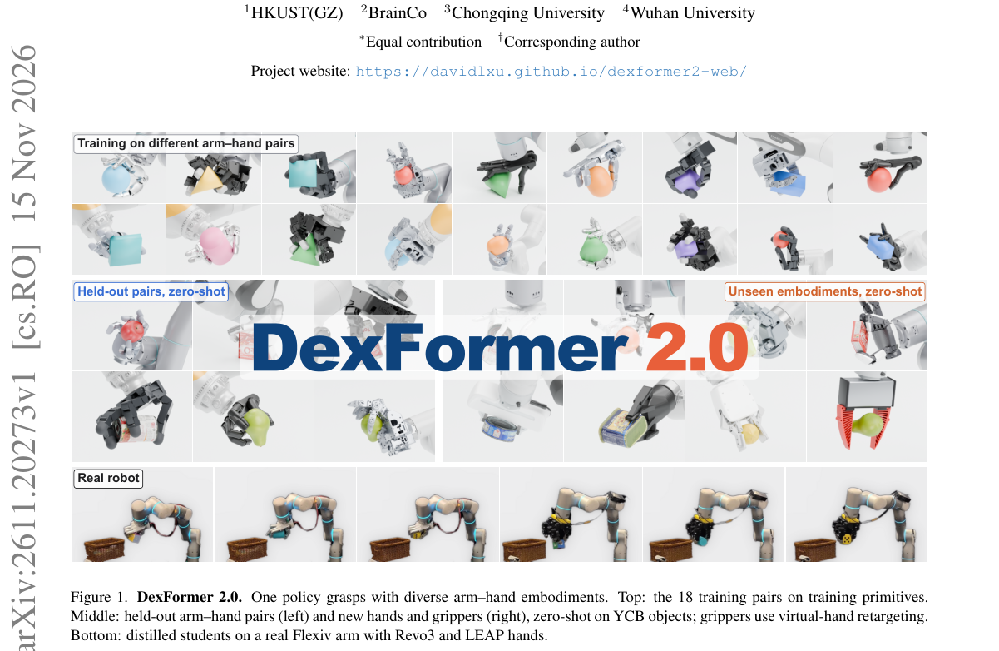

*Result - DexFormer 2.0 architecture. Top: one shared policy controls all 24 arm–hand combinations (18 for training, 6 held out). MorphNode encodes the canonical joint state, Transformer-XL adds a 16-*

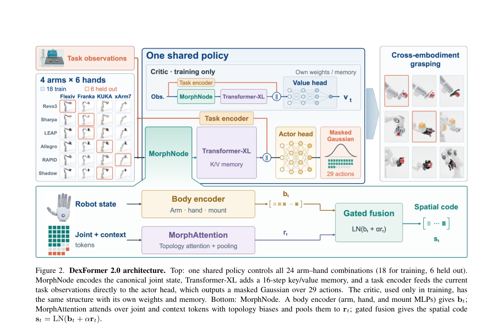

**Why this ranks #14**: 把每台机器人映射到统一的 29 个关节槽位并用有效掩码屏蔽不存在的关节，再用运动学树偏置注意力加 Transformer-XL 记忆推断与本体相关的动力学；单一 RL 策略在 4 臂 × 6 手的 18 个组合上训练，已见组合稳定成功率 89.01%，六个留出臂手对 51.18%，并在实物 Flexiv 臂上零样本迁移到两只新手。

---

### 15. Stochastic Self-Distillation for Flow-Based Vision-Language-Action Models

**arXiv**: [2611.20460](https://arxiv.org/abs/2611.20460) | **Score**: 8.7 (relevance 9 x 0.7 + quality 8 x 0.3) | **Direction**: `embodied_ai` | **Tags**: embodied, vla, self-distillation, flow-matching, grpo, one-step-policy, Imperial College London | **Categories**: cs.RO | **Pages**: 19

**Authors**: Jingru Guo; Alessandra Russo; Joey Bose; Christos Ziakas

**Affiliation**: Imperial College London

**Abstract**

> Flow-based vision-language-action (VLA) models achieve strong performance in robotics through imitation learning, yet fine-tuning them with on-policy reinforcement learning (RL) is limited. In group-based RL methods like Group Relative Policy Optimization (GRPO), every rollout step requires multi-step ODE integration, and the sampler's limited stochasticity leads to rollout groups with low variance. We propose VLA-SSD, which addresses both high inference latency and limited stochasticity. In particular, our method self-distills a pretrained flow-matching action head into a stochastic one-step policy by conditioning a single-jump generator on a Brownian path. We derive a conditional action density via our stochastic one-step policy, enabling efficient post-training via likelihood-ratio RL algorithms. We show that distilling VLA-SSD from the $π_0$ VLA reduces the action head's forward-pass time by a factor of 7.7, at the cost of a 5.5% relative decrease in the success rate on the LIBERO benchmark. However, by leveraging the increased sample diversity of VLA-SSD during group generation, post-training a $π_{0.5}$ VLA using GRPO yields a 20.6% relative improvement.

**Key findings**

- **Finding**: VLA-SSD 从 π0.5 的 3.3B 模型蒸馏出带 300M 动作头的随机一步策略，动作头每块前向快 7.7 倍、成功率只降 0.3 个点，GRPO 组内零方差比例由 62.5%（原采样器）降到 35.4%（各向同性输出噪声 47.9%、四步 Flow-SDE 45.8%）；GRPO 后在 LIBERO 四套件均值达 93.0%，比 SFT 检查点高 15.9 个点、与四步 πRL 的 91.5% 持平，训练 rollout 快 3.2 倍；MetaWorld MT50 上 72.0%，四步 PPO 为 70.7%。
- **Inference**: 一步随机策略保住了流匹配动作的连续性质量，同时把采样方差从可预测的确定性映射转成可控随机性，于是 GRPO 的组内优势不再大面积退化。
- **Recommendation**: 给 flow-based VLA 做 GRPO 前先量组内零方差比例，超过五成就应先做随机化蒸馏而不是直接加 RL；蒸馏时用布朗路径条件的一步生成器，能同时拿到速度与探索多样性。

**Key figures**

*Framework - Left: an ODE sampler and Flow-SDE spend K action-expert evaluations per chunk; VLA-SSD spends one and keeps the spread of the SDE. Right: for a fixed s and a0, the Itô flow map conditions on*

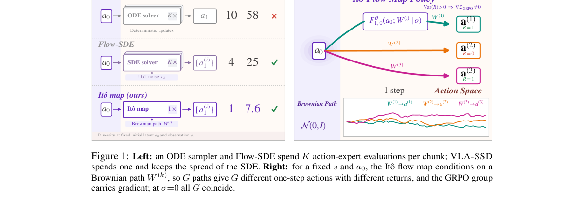

*Result - End-effector trajectories with (a) independent and (b) shared initial latents a0. Fixing a0 collapses the deterministic sam- ples, while the stochastic samplers retain di- versity. The disti*

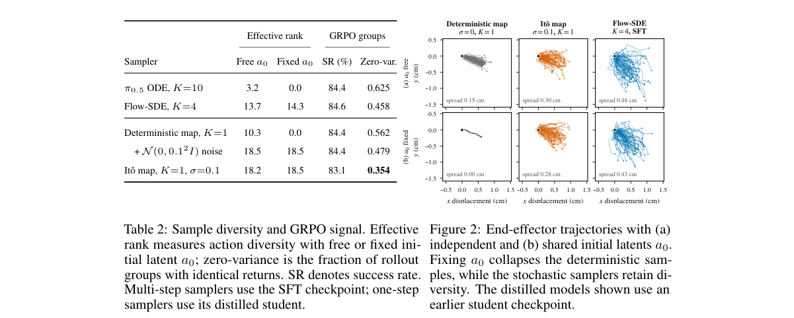

**Why this ranks #15**: 把 flow-matching 动作头自蒸馏成以布朗路径为条件的一步随机策略，一举解决 GRPO 的两个痛点：rollout 需要多步 ODE 积分、采样随机性不足导致组内零方差；蒸馏后动作头前向快 7.7 倍，零方差组从 63% 降到 35%，再上 GRPO 在 LIBERO 上达 93.0%，比 SFT 检查点高 15.9 个点。

---

### 16. Lift, See, Act: Hierarchical Robot Policy Pretraining with 3D Foundation Models

**arXiv**: [2611.20481](https://arxiv.org/abs/2611.20481) | **Score**: 8.7 (relevance 9 x 0.7 + quality 8 x 0.3) | **Direction**: `embodied_ai` | **Tags**: embodied, robot-policy-pretraining, human-video, 3d-foundation-model, depth-reconstruction, hand-hotspot, South China University of Technology | **Categories**: cs.RO | **Pages**: 36

**Authors**: Yiyuan Ge; Changxing Ding; Ziyu Hao; Zijie Zheng; Xiangmin Xu

**Affiliation**: South China University of Technology

**Abstract**

> Robot policy pretraining based on human videos is crucial for improving the policy's generalization ability. One main challenge for this task is the lack of explicit action-relevant representations in such unlabeled data. Recent works tend to estimate 3D hand motion trajectories from videos using 3D foundation models (3D FMs). However, they keep solely the sparse trajectories as supervision, ignoring the rich, fine-grained information produced during the trajectory extraction process. To address this issue, we propose LSA, a hierarchical robot policy pretraining framework that includes three phases: Lift, See, and Act. Specifically, the Lift phase elevates 2D video observations into dense 3D representations by adaptively aligning features in the policy's shallow layers with the intermediate representations extracted from multiple 3D FMs. Building upon these lifted representations, the See phase equips the policy with explicit geometric and interactive awareness through dual guidance. It introduces depth-map reconstruction to help the model comprehend 3D spatial layouts and utilizes hand region cues to explicitly supervise the encoder's attention toward task-relevant interaction hotspots. Empowered by the dense 3D representation learning and precise spatial guidance, our policy achieves robust and accurate robotic manipulation in the Act phase. Extensive experiments on diverse simulation and real-world tasks demonstrate that LSA significantly outperforms current state-of-the-art approaches. The project page is available at: https://yiyuan00.github.io/Lift-See-Act.

**Key findings**

- **Finding**: LSA 分 Lift/See/Act 三阶段：用 VGGT 估计相机内参、Depth Pro 预测度量深度，把策略浅层特征与多个 3D 基础的中间表征对齐，再用深度重建与手部区域热点监督引导注意力；仿真上成功率 92.2%，比无预训练基线 73.3% 高 18.9 个点，仅用 2D 手部运动为 77.3%、加 3D 运动规划目标 81.0%、再叠结构引导 89.0%；真实任务上 Pick Trash 70.0%（次优 40.0%）、Place Toy 80.0%（60.0%）、Wipe PC 80.0%（50.0%），最强基线 HRP 平均 41.7%；亮度降低 40% 时 LSA 只降 7.5% 而 HRP 降 68.6%。
- **Inference**: 3D 基础模型在抽取轨迹的过程中已经算出了大量中间几何量，把它们当作对齐目标比只用最终轨迹监督能提供更密的动作相关信号，也更抗光照扰动。
- **Recommendation**: 用人类视频预训练机器人策略时别只保留轨迹标签，把 3D 基础的深度图与中间特征一起用上（深度重建加手部热点引导），收益明显大于加轨迹标签本身。

**Key figures**

*Framework - Comparisons between methods that extract explicit action-relevant representations from human videos. (a) Existing methods adopt solely the estimated hand motion trajectories as supervision [*

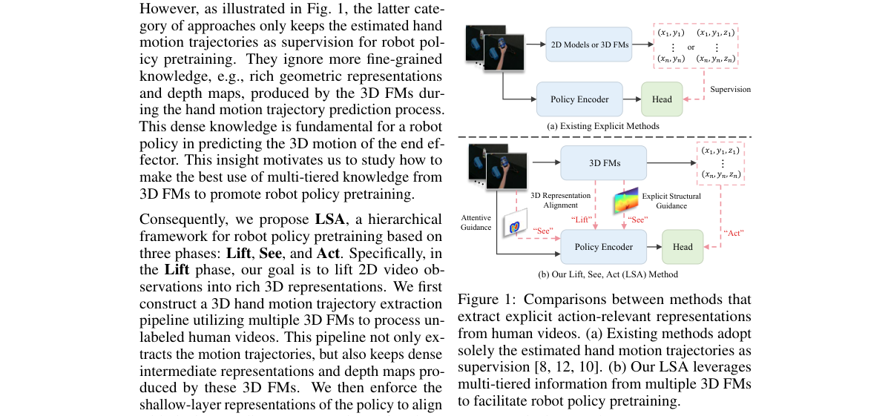

*Result - Architecture overview of LSA. (a) In the data engine phase, we utilize two 3D FMs to extract depth maps and camera intrinsics, respectively. Combined with the extracted 2D wrist coordinates,*

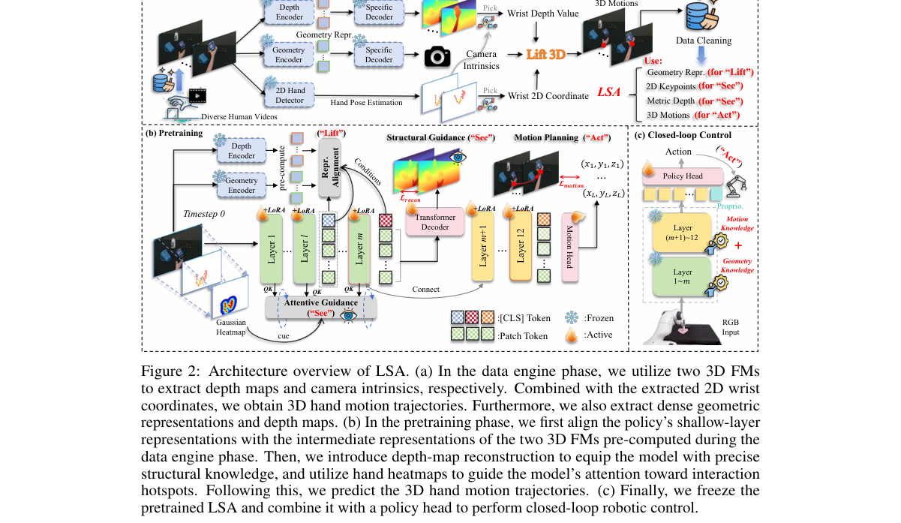

**Why this ranks #16**: 不只用人视频里稀疏的 3D 手部轨迹做监督，而是把策略浅层特征与多个 3D 基础模型的中间表征对齐以抬升稠密 3D 表征，再加深度图重建与手部热点引导；仿真上成功率 92.2%，比无预训练基线的 73.3% 高 18.9 个百分点，真实任务平均 68.3%，比最强基线 HRP 的 41.7% 高 26.6 个点。

---

### 17. AsymEEF: Bimanual Manipulation with Asymmetric End Effectors

**arXiv**: [2611.20557](https://arxiv.org/abs/2611.20557) | **Score**: 8.7 (relevance 9 x 0.7 + quality 8 x 0.3) | **Direction**: `embodied_ai` | **Tags**: embodied, bimanual-manipulation, cross-end-effector, demonstration-transfer, morphology-agnostic-latent, kinematic-teacher, Georgia Institute of Technology | **Categories**: cs.AI, cs.CV, cs.LG, cs.RO | **Pages**: 14

**Authors**: Xiaokang Sun; Ningyue Wang; Kunqi Xu; Guangqi Jiang; Jianglong Ye; Yong Wu; Xueyan Zou

**Affiliation**: Georgia Institute of Technology; Tsinghua University; University of California San Diego

**Abstract**

> Teleoperated demonstrations are costly to collect and rarely reusable across end-effectors with different kinematics and action spaces. This burden grows in bimanual manipulation, where each end-effector pair may require new data. We present AsymEEF, a framework for executable cross-end-effector demonstration generation and unified bimanual policy learning. Given a small source dataset, AsymEEF transfers demonstrations to heterogeneous combinations of two-, three-, and five-fingered end-effectors without additional teleoperation. Kinematic teacher anchors provide geometric supervision, while sparse real-world X-Calib anchors correct discrepancies in grasp execution. A shared encoder maps wrist poses and actuator states to a morphology-agnostic latent space, and a morphology-conditioned decoder reconstructs target commands. Generated trajectories undergo replay filtering for task-level executability. The representation also supports a unified bimanual visuomotor policy trained across multiple pairs. Across four simulated and six real-world tasks, AsymEEF improves replay success over adapted transfer baselines, achieves a mean replay-valid expansion gain of 16.6 times in simulation, and is evaluated through downstream policy training on real robots. Project website: https://asymeef.vercel.app/.

**Key findings**

- **Finding**: AsymEEF 用拓扑偏置 Transformer 把腕部位姿与执行器状态编到 24 维形态无关潜空间（128 维 token、3 层 Transformer、4 个注意力头、最多 12 个独立执行器），再用形态条件解码器还原目标指令；跨末端执行器演示生成在模拟上取得平均 16.6 倍的 replay-valid 扩展增益，四个仿真与六个真实任务上均优于改造后的迁移基线；真实任务包含 Toy Sorting、Handover、Motherboard、CPU Installation、Screwdriver Bit 与 Laptop & Mouse。
- **Inference**: 把「同一个动作在不同执行器上意味着什么」压进一个共享潜空间后，演示迁移就不再受执行器关节数与行程限制，稀缺的人工遥操作数据才可能被真正复用。
- **Recommendation**: 异构执行器场景先建一个形态无关的潜接口再谈数据复用，并保留少量真实标定锚点——纯几何教师覆盖不了真实抓取的执行偏差与接触误差。

**Key figures**

*Framework - Overview. AsymEEF converts a small set of teleoperated demonstrations from homogeneous end-effector pairs into trajectories for bimanual robots with heterogeneous end-effectors, including g*

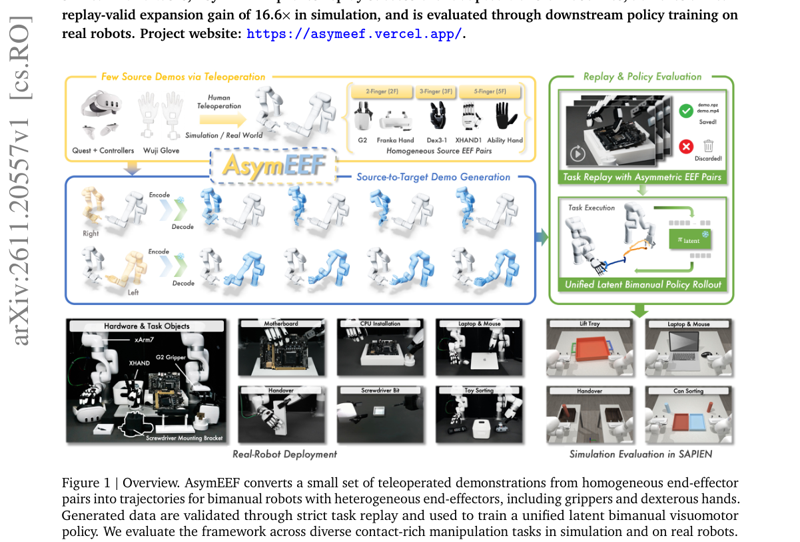

*Result - Geometry-guided teacher anchoring and X-Calib anchoring from a small set of real-world calibration frames.*

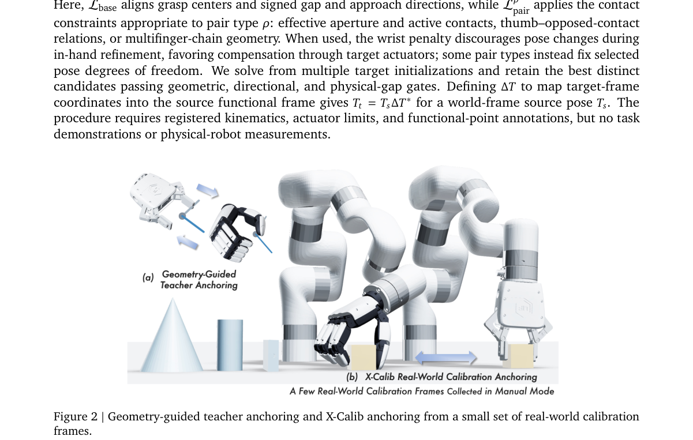

**Why this ranks #17**: 从少量同构末端执行器的遥操作演示出发，把轨迹迁移到二指、三指、五指等异构组合：运动学教师提供几何监督，稀疏真实 X-Calib 锚点修正抓取执行误差，共享编码器把腕部位姿与执行器状态映到形态无关潜空间；模拟中 replay-valid 扩展增益平均 16.6 倍，并在四个仿真与六个真实任务上统一训练双臂策略。

---

### 18. ARMFUL: Learning Whole-Arm Grasp Configurations for Single-Arm Pickup of Large Objects

**arXiv**: [2611.20692](https://arxiv.org/abs/2611.20692) | **Score**: 8.7 (relevance 9 x 0.7 + quality 8 x 0.3) | **Direction**: `embodied_ai` | **Tags**: embodied, whole-arm-grasping, large-object-pickup, diffusion-policy, grasping-dataset, motion-planning, University of Southern California | **Categories**: cs.RO | **Pages**: 8

**Authors**: Xinyi Yu; Yunshuang Li; Daniel Seita; Gaurav S. Sukhatme

**Affiliation**: University of Southern California

**Abstract**

> Many everyday objects, such as storage boxes, baskets, and chairs, are too large or heavy for a gripper to grasp, yet a single arm can still pick them up by wrapping around and supporting them. Such grasps are hard to learn: wrapping motions are difficult to teleoperate, and existing datasets contain little whole-arm pickup data. We introduce WAG (Whole-Arm Grasp Dataset), the first large-scale dataset for single-arm pickup of large objects, with 1.7~million joint configurations across 793 objects. We sample configurations directly in joint space, execute each through squeeze and lift primitives in simulation, and stress-test survivors under active shaking and external forces. To demonstrate the utility of WAG and accomplish the whole-arm pickup task, we develop ARMFUL, a whole-arm pickup pipeline that pairs a diffusion model trained on WAG, generating whole-arm grasps from the object's point cloud, with a motion planner that reaches them collision-free before the same squeeze-and-lift execution. In simulation, ARMFUL reaches 85.4\% lift success on training and 69.9\% on held-out objects, and it lifts the object in 70 of 100 trials on a physical Franka arm across 10 IKEA objects.

**Key findings**

- **Finding**: WAG 数据集含 793 个物体的约 170 万条经压力测试的整臂抓取配置（每个物体约 2.2k 条），生成时对基座关节施加 ±0.3 弧度、1.1 Hz 的五次抖动并施加 30 牛顿持续 0.5 秒的外力；ARMFUL 用 3D Diffusion Policy 的点云编码器加 DDPM 从点云生成整臂抓取、RRT-Connect 做无碰撞接近，训练物体与留出物体抬升成功率 85.40±0.85% 与 69.86±1.60%；真实 Franka 臂在 10 个 IKEA 物体上 100 次试验抬起 70 次，单物体成功率 3/10 到 10/10。
- **Inference**: 整臂抓取真正稀缺的是数据而不是方法——把「这条配置到底能不能成」交给 GPU 并行仿真加外力压力测试去筛，就能得到规模足够且鲁棒的监督。
- **Recommendation**: 要做整臂或非末端抓取，先造带外力压力测试的仿真数据集再训模型；同时必须分别报告训练集与留出物体的成功率，只看训练集会高估泛化能力。

**Key figures**

*Framework - Whole-arm grasps from WAG. A gallery of whole-arm grasp configurations in simulation, each shown at the hold after the pickup execution.*

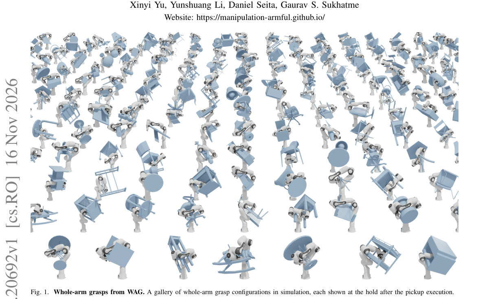

*Result - Construction of WAG. We sample candidate whole-arm grasp configurations, discard penetrating candidates, and test the rest directly in a GPU-parallelized simulator. The arm is teleported to th*

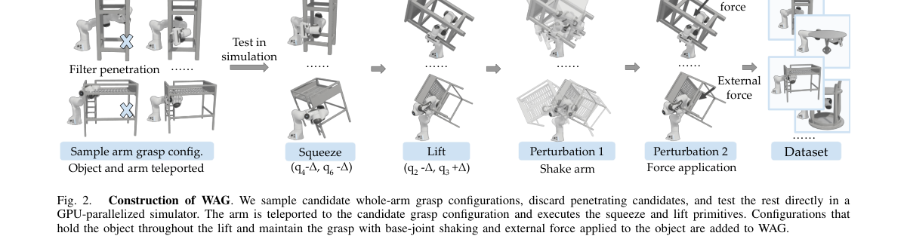

**Why this ranks #18**: 发布首个单臂搬运大件物体的整臂抓取数据集 WAG：793 个物体、约 170 万条关节配置，经挤压抬升原语并在主动摇晃与 30 牛外力下压力测试；基于它的扩散模型在训练物体上 85.4%、留出物体上 69.9% 的抬升成功率，真实 Franka 臂在 10 个 IKEA 物体上 100 次试验抬起 70 次。

---

### 19. TaF-Foundation: Wrench-Grounded Cross-Sensor Tactile Representations

**arXiv**: [2611.20718](https://arxiv.org/abs/2611.20718) | **Score**: 8.7 (relevance 9 x 0.7 + quality 8 x 0.3) | **Direction**: `embodied_ai` | **Tags**: embodied, tactile-representation, wrench-supervision, cross-sensor-transfer, few-shot-adaptation, contact-rich-manipulation, ShanghaiTech University | **Categories**: cs.RO | **Pages**: 17

**Authors**: Jiaming Jiang; Yuzhe Huang; Baokun Yang; Hao Liang; Li Gao; Haoran Guo; Pei Lin; Shengcheng Luo; Chenxi Xiao; Wanlin Li; Ziyuan Jiao

**Affiliation**: ShanghaiTech University; Beihang University; Beijing Institute for General Artificial Intelligence; AMAP, Alibaba

**Abstract**

> Tactile sensing is essential for contact-rich manipulation, yet heterogeneous sensing mechanisms and observation formats hinder cross-hardware transfer. Since physical contact is governed by Newtonian mechanics, we ground tactile representations in six-dimensional wrenches, establishing a common physical reference across sensing mechanisms. Specifically, we pair tactile observations from all sensors with wrench measurements, enabling shared physical supervision without requiring direct tactile-to-tactile pairing between sensors. To support learning at scale, we develop a dedicated acquisition platform and collect over 100 million paired tactile observations and wrench measurements from 24 sensors spanning four families of sensing principles. Building on this dataset, our framework combines sensor-specific input adaptation with a shared tactile encoder. By learning to reconstruct wrenches, the encoder maps observations from different sensors into a shared, continuous feature space grounded in contact physics. To leverage these representations for manipulation, we introduce TaF-Policy, which integrates tactile features with visual observations and robot states to generate action chunks. We evaluate the learned representations through wrench estimation, cross-sensor retrieval, few-shot adaptation to unseen sensors, and robotic manipulation. On the core benchmark, our method reduces single-frame force RMSE by 17.1% and improves cross-sensor retrieval R@1 by 13.11 percentage points over the strongest baseline. In manipulation experiments, TaF-Policy achieves average success rates of 51.33% across three simulated tasks and 46.25% across four real-world tasks, compared with 47.33% and 23.75%, respectively, for the strongest baselines evaluated on the same task sets. Project page: https://mrjiangjm.github.io/TaF-Foundation/.

**Key findings**

- **Finding**: TaF-Foundation 从 24 个传感器、四大类感测原理采集超过 1 亿条触觉观测与六维力矩配对，用传感器专属输入适配加共享触觉编码器学习重建力矩；单帧力 RMSE 由 2.799 N 降至 2.321 N（相对 −17.1%）、力矩误差降 15.2%，跨传感器检索 R@1 由 21.27% 升至 34.38%（+13.11 个点）、R@5 达 81.41%（+16.93 个点）；三个 UniVTAC 仿真任务平均成功率 51.33%（最强基线 47.33%），四个真机任务 46.25%（23.75%），在三个未见传感器上小样本适配后 40.0%（18.3%）。
- **Inference**: 牛顿力学给所有触觉传感器提供了共同的物理参考系，绕开传感器之间的直接配对后，数据规模不再受配对采集成本的限制。
- **Recommendation**: 做跨传感器触觉迁移时先把观测锚到力矩这类物理量再学表征；评估要看跨传感器检索 R@1 与未见传感器的小样本适配，而不是单传感器上的重建误差。

**Key figures**

*Framework - Overview of TaF-Foundation. Using over 100 million tactile–wrench pairs from 24 sensors across four sensing families, we learn shared, physically grounded representations without direct tact*

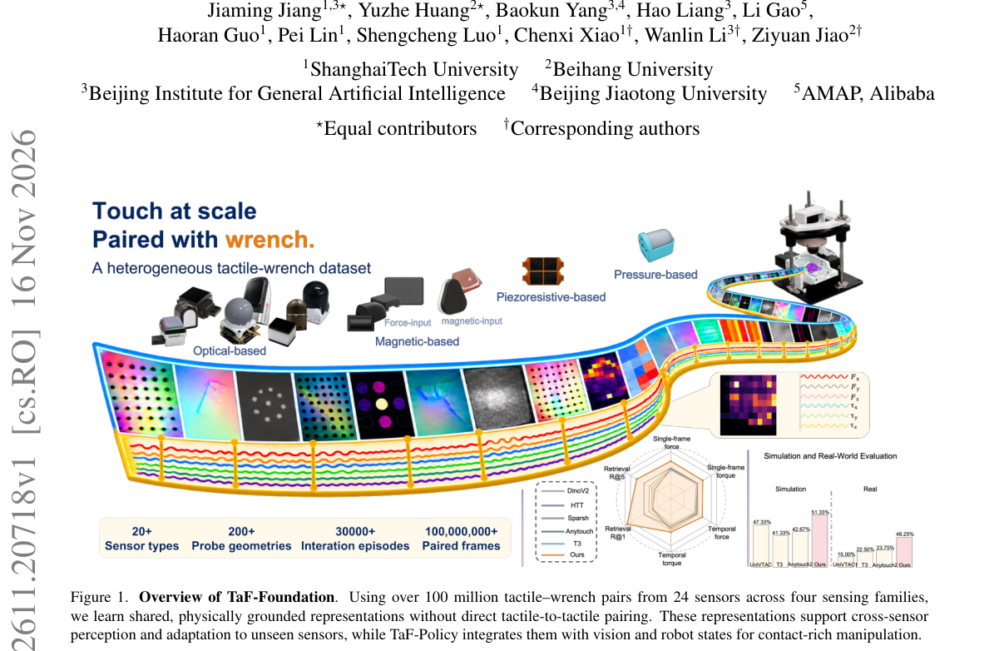

*Result - Dataset coverage across heterogeneous tactile sensors. Left: a hierarchy of tactile learning tasks, adapted from AnyTouch 2 [7]. Center: the distribution of paired observations across 24 sen*

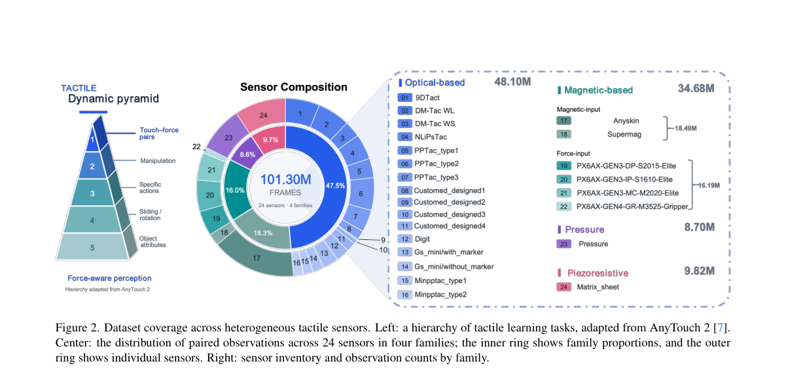

**Why this ranks #19**: 把触觉表征锚在六维力矩这一物理量上，从而无需传感器两两配对就能跨硬件对齐：自建采集平台从 24 个传感器、四大类感测原理采到超过 1 亿条触觉-力矩配对；单帧力估计 RMSE 从 2.799 降到 2.321 牛顿（相对 −17.1%），跨传感器检索 R@1 从 21.27% 升到 34.38%，真机操作成功率 46.25% 对最强基线 23.75%。

---

### 20. ForceHarness: Turning Force into Action and Physics for Frozen Frontier Models

**arXiv**: [2611.21099](https://arxiv.org/abs/2611.21099) | **Score**: 8.7 (relevance 9 x 0.7 + quality 8 x 0.3) | **Direction**: `embodied_ai` | **Tags**: embodied, force-feedback, frozen-frontier-model, tool-use, zero-shot-robot-policy, physics-translation, National University of Singapore | **Categories**: cs.RO | **Pages**: 31

**Authors**: Ke Sun; Kevin Yuchen Ma; Yike Zhang; Yanzhe Chen; Mike Zheng Shou

**Affiliation**: National University of Singapore

**Abstract**

> Frontier multimodal models can now control robots zero-shot from images, yet many manipulation tasks depend on contact forces that images cannot show. Bringing force to an API-only frozen model raises two challenges. First, contact evolves much faster than an API model can decide, so the system must close the loop on force beneath the model. Second, a frozen model cannot interpret raw force streams, so force must be returned in a form the model can reason about. Therefore, we present ForceHarness, a harness that lets frozen models use force without demonstrations or finetuning. After calibrating hand force from a wrist sensor or joint torques alone, ForceHarness addresses the first challenge with self-terminating force primitives that regulate force on their own and return at a contact event. To address the second challenge, a physics translation layer turns each force trace into physical quantities with uncertainty as the tool result. To evaluate ForceHarness against expert force controllers and learned policies under identical conditions, we also build HiddenPhys, a seven-task MuJoCo benchmark with hidden physical variables. On a real arm without a wrist force sensor, ForceHarness raises the zero-shot success rate of GPT-6 Astra from 3.3% to 90.0%. In simulation, it adds 17.5 percentage points on the public ForceBench suite and 34.3 percentage points on HiddenPhys, surpassing force-aware policies trained on demonstrations on both benchmarks and matching hand-written expert controllers on HiddenPhys. Ablations further show that smaller models make significantly better decisions when given physical quantities rather than raw force values.

**Key findings**

- **Finding**: ForceHarness 为冻结模型提供 20 到 21 个工具（含 locate、move_to、grasp），自终止力原语在模型决策之下自行调节力并在接触时返回，物理翻译层把力曲线转成带不确定性的物理量；真机六个接触丰富任务上 GPT-6 Astra 成功率由 3.3% 升到 90.0%（60 次中 54 次），GPT-6.1 Sol 为 47/60；ForceBench 上由 70.0% 升到 87.5%（最强训练策略为 35.31%），自建七任务 HiddenPhys 上由 62.1% 升到 96.4%，Astra 得分由 87/140 提到 135/140，追平手写专家的 136/140 且无手柄损坏，每回合成本降 45%。
- **Inference**: 把力翻译成模型能推理的物理量而不是原始读数，收益远大于把力直接塞进上下文——小模型的决策准确率从原始数值的 0.57 升到物理量的 0.85，成功率由 0.18 升到 0.70。
- **Recommendation**: 要让 API 冻结模型做接触任务，先在模型之下做自终止力闭环并把结果翻译成物理量再返回；不要把原始力矩序列直接喂给模型，小模型尤其容易误判且会多花 16% 到 19% 的回合。

**Key figures**

*Framework - ForceHarness lets a frozen frontier model use wrist force. Left: the model only issues tool calls; the harness calibrates hand force, runs self-terminating force primitives beneath the model*

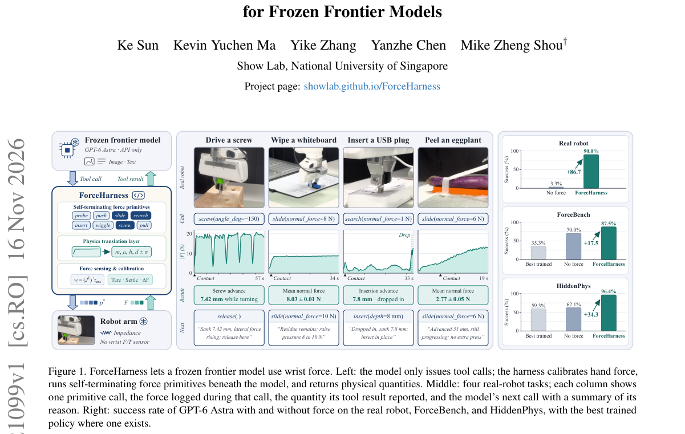

**Why this ranks #20**: 让只能发工具调用的冻结前沿模型也能用上力：用腕部传感器或关节力矩标定手部力，自终止力原语在模型决策之下闭环调力并返回接触事件，物理量翻译层把力曲线转成带不确定性的物理量作为工具结果；真机上 GPT-6 Astra 的零样本成功率从 3.3% 提到 90.0%，ForceBench 与自建 HiddenPhys 分别 +17.5 与 +34.3 个点。

---

## Footer

- Total papers reviewed across all 4 axes: 60
- world_embodied axis final count: 20
- Wild-cards in this axis: 0
- Figure assets: 2026-11-18/res/

Generated by `mine-arxiv-daily-digest` skill. Sister file: `2026-11-18_world_embodied_entry.md`.
