# Mine Arxiv Daily Digest - 2026-11-19 (AIGC 视觉生成与编辑 Axis, 17 papers)

**Generated**: 2026-11-19 01:20 CST

**Source**: arXiv cs.CV, cs.SD, eess.AS, cs.CL, cs.AI, cs.RO, cs.LG, cs.IR submissions, listing day 2026-11-17 (announced 2026-11-18 01:00 UTC)

**Batch window**: 2026-11-16T19:00:00Z .. 2026-11-17T19:00:00Z（arXiv 公告批次横跨两个 UTC 日：从前一日的美东 14:00 截止时刻起算（EDT 为 18:00Z，EST 为 19:00Z），到当日的同一时刻为止）

**Axis**: aigc_visual (17 papers, base 15, cap 20)

**Directions**: aigc_generation (10), aigc_editing (4), aigc_rl (3)

**Selection**: 17 papers ranked by relevance x quality, with 0 wild-card slots

**Day total**: 60 papers across 4 axes (target 60)

**Scope**: 图像 / 视频 / 3D / 4D 内容的生成与编辑，以及面向视觉生成的 RL / 偏好优化与奖励模型

**Wild-card**: 0（本 axis 17 篇全部为够格论文，富余名额由同轴 direction 让位承接，未启用任何 wild-card 补位名额）

**配额**：本轴 17 篇（基准 15、上浮 2），未撞 AXIS_CAP = 20。三个 direction 分别是 10 / 4 / 3，只有 `aigc_generation` 超基准 2 篇，按两级弹性的判据 `dir_over ≤ max(dir_under, axis_surplus)`，这 2 个名额由**同轴内**的 `aigc_editing`、`aigc_rl` 让位承接（未转给别的 axis）。

**rel≥9**：本轴 5 篇 relevance≥9（FaceRiff、HiT、FastFrames、PromptPack、RiDEx）全部入选，无一被配额挤掉。

**供给**：587 篇候选里 primary 落在 `aigc_generation` 53 篇、`aigc_editing` 24 篇、`aigc_rl` 6 篇，本轴并不缺供给。之所以停在 17 而不是上限 20，是因为当日总配额 60 且另两轴已撞 AXIS_CAP，在评分边际收益相同时按方向基准与轴上限约束收敛到 17。

---

## AIGC 生成（图像 / 视频 / 3D / 4D） · `aigc_generation` (10 papers)

本方向 10 篇（基准 8、上浮 2），主线是**替换生成主干与瘦身解码路径**。HiT 让纯像素扩散靠层级 token 聚合自己长出视觉层级，ImageNet 256×256 上 FID 1.48，用约 40% 的累计训练 FLOPs 达到与 JiT 相当的质量；FastFrames 把「VAE 解码加 KV cache 更新占端到端延迟一半以上」当成可优化对象，1.3B 版在单张 B200 上跑到 36 ms/帧（28 RPS）、质量对齐一个慢近 8× 的 SOTA 模型，14B 版在 8×B200 节点上 45 ms/帧；解码路径上 DWD 让扩散 Transformer 用线性头直接出像素，Wan 上形变误差降 23%，纯像素流模型的 ImageNet FID 从 1.55 降到 1.43；Sample-Aligned Decoders 指出根因是 decoder 只见过 encoder latent、没见过生成 latent，改完 REPA-E 的 FID-50K 可从 1.15 降到 0.98。另外四篇把生成推到新场景：FaceRiff 用 2049 次扫描、约 350 个身份、单卡训练且每任务只更新不到 3% 骨干参数，就产出 UV 对齐的可渲染 3D 人脸资产，45 位业内人盲评的真实感显著高于 DreamFace；MAVE 从影视镜头反推可编辑 3D blockout，MAVEBench（50 个镜头、416 关键帧）上比基线高 27.5–41.1 分，每镜头 API 成本仅 $0.054、整体耗时少 53%；PCRG 训练无关地剪枝/缓存参考 token，在已蒸馏到 8 步、int8 量化的 MiniMax-H3 上端到端 1.57×/1.49× 加速，而 VBench 只掉 0.24%/0.17%；LOCUS 用因果支持窗口定位干预真正生效的位置，GenEval++ 宏平均比晚期窗口高 23.6 个百分点，把 Janus-Pro 的准确率从 24.6% 抬到 46.8%。BRepA 用图结构自监督预训练 B-Rep，1% 标注下 mIoU 提升 32.52%，并让扩散模型收敛近 2×；Pixel is All You Need 则追问画布上的生成器能否做符号推理，结论是当前生成模块做不到、post-training 也补不上。

### 1. FaceRiff: Data-Efficient Unified Text-to-3D Face Asset Synthesis via Geometric Conditioning

**arXiv**: [2611.21867](https://arxiv.org/abs/2611.21867) | **Score**: 8.7 (relevance 9 x 0.7 + quality 8 x 0.3) | **Direction**: `aigc_generation` | **Tags**: AIGC-visual, text-to-3d, uv-space-diffusion, lora-adaptation, pbr-albedo, face-asset, Electronic Arts | **Categories**: cs.AI, cs.CV, cs.GR | **Pages**: 11

**Authors**: Elly Akhoundi; Mathieu Lamarre; Thibault Goyallon; Patrick Anderson; Étienne Danvoye

**Affiliation**: Electronic Arts

**Abstract**

> High-resolution facial datasets with consistent UV-mapped geometry, albedo, and physically based displacement are scarce, yet such assets are essential for photorealistic digital-human rendering. Existing 3D face generation methods are often slow, single-modality, or require large specialized datasets. Meanwhile, large image diffusion models encode strong facial priors but do not natively produce lighting-independent textures, pore-scale displacement, or UV-aligned geometry. We present FaceRiff, a unified, data- and parameter-efficient framework for generating complete 3D face assets (mesh, albedo, and displacement) directly from text in a shared UV space. FaceRiff adapts a pretrained SDXL backbone with task-specific LoRA adapters and uses UV normal maps as geometric conditioning: per-instance normals guide albedo and displacement synthesis, while a dataset-mean normal provides a canonical spatial anchor for mesh generation. Using only 2,049 scans from approximately 350 identities and training on a single GPU, FaceRiff updates less than 3% of the backbone parameters per task and produces render-ready 3D face assets without per-instance optimization. Compared with FaceG2E and DreamFace, FaceRiff produces greater per-prompt diversity while preserving prompt alignment and fixed-topology UV consistency, and additionally generates lighting-independent albedo suitable for PBR relighting and pore-scale displacement absent from prior text-driven baselines. A blind study with 45 industry professionals shows that FaceRiff achieves substantially higher perceived realism than DreamFace, approaching that of real captures. Overall, FaceRiff demonstrates that pretrained diffusion priors can be adapted to unified 3D face asset synthesis under limited data.

**Key findings**

- **Finding**: FaceRiff 用 2,049 次面部扫描（约 350 个身份，1,949 训练/100 验证）训练，LoRA 秩 64、每任务仅更新 U-Net 的 2.93% 参数，即可在共享 UV 空间生成网格、反照率与位移。
- **Inference**: 说明低数据场景下 UV 空间几何条件加参数高效适配，比在约 20 万张 UV 图上从零训练更可行，前提是三种模态共享同一套 UV 拓扑。
- **Recommendation**: 做数字人资产管线时可直接照搬该配方：冻结 SDXL 骨干只挂 LoRA，并用均值法线图作为网格生成的空间锚点。

**Key figures**

*Framework - FaceRiff: text-driven 3D face asset generation. From a text prompt, FaceRiff synthesizes mesh, lighting-independent albedo, and pore-scale displacement in a shared UV space in a feed-forward m*

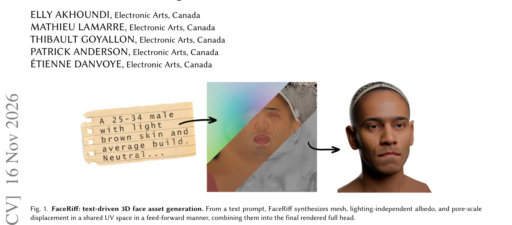

*Result - Guide texture used for validating mesh alignment.*

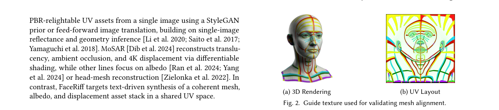

**Why this ranks #1**: 生成侧的稀缺样本高效方案：仅用 2,049 张扫描（约 350 个身份、单卡训练），LoRA 每任务只更新骨干 2.93% 参数，就在共享 UV 空间同时产出网格、光照无关反照率与孔隙级位移。

---

### 2. Hierarchical Diffusion Transformer for End-to-End Image Generation

**arXiv**: [2611.22962](https://arxiv.org/abs/2611.22962) | **Score**: 8.7 (relevance 9 x 0.7 + quality 8 x 0.3) | **Direction**: `aigc_generation` | **Tags**: AIGC-visual, pixel-space-diffusion, learned-hierarchy, token-grouping, imagenet-generation, text-to-image, Carnegie Mellon University | **Categories**: cs.AI, cs.CV, cs.LG | **Pages**: 30

**Authors**: Xiaoyu Wu; Yifei Wang; Weihang Guo; Chen Wei; Lydia E Kavraki; Niloofar Mireshghallah; Steven Wu

**Affiliation**: Carnegie Mellon University; Rice University

**Abstract**

> Pixel-space diffusion learns visual representations and image generation jointly in a single end-to-end training stage, without a separately pretrained visual encoder. However, plain pixel-space Transformers still trail leading two-stage latent diffusion models in generation quality and training efficiency. We hypothesize that part of this gap arises from retaining one token per patch throughout the backbone, which does not explicitly encourage a visual hierarchy that summarizes related content at progressively coarser levels. To address this, we introduce Hierarchical Diffusion Transformers (HiT), which progressively group related tokens and represent each group with a single token. The main Transformer bottleneck processes these compact group tokens, and ungrouping restores features to their original image positions. A compression budget regulates the average compression ratio across the batch, allowing group memberships and counts to vary across images and diffusion timesteps during both training and generation. The model exhibits emergent semantic structure, learning to group coherent objects and object parts without segmentation labels. In text-to-image generation, HiT further learns to group caption words with image patches depicting the same concepts, without region annotations. HiT achieves 1.48 FID on ImageNet $256\times256$ and reaches comparable generation quality to JiT using approximately 40\% of its cumulative training FLOPs. For text-to-image generation, HiT exceeds UniLiP's average score across five benchmarks with roughly $6\times$ fewer denoiser parameters and $3\times$ fewer forward FLOPs. These results suggest that learning a visual hierarchy within the generator breaks down the barrier to stronger image generation without external visual pretraining.

**Key findings**

- **Finding**: HiT 用两级 2 倍分组把图像 token 数从 N 逐级压到 K1 与 K2，ImageNet 256 训练 600 epoch 达到 1.48 FID，累计训练 FLOPs 约为 JiT 的 40%。
- **Inference**: 差距根源不是缺少外部视觉预训练，而是生成器内部缺少自发的视觉层级，用压缩预算即可换来收敛加速与质量提升。
- **Recommendation**: 做像素空间生成时优先试可学习的动态分组而非固定 token 数压缩，并用训练 FLOPs 而非 epoch 来比较训练成本。

**Key figures**

*Framework - HiT learns image–text associations without region annotations and converges faster. (a) On a clean input (t = 1), HiT groups patches with similar representations. (b) The corresponding group*

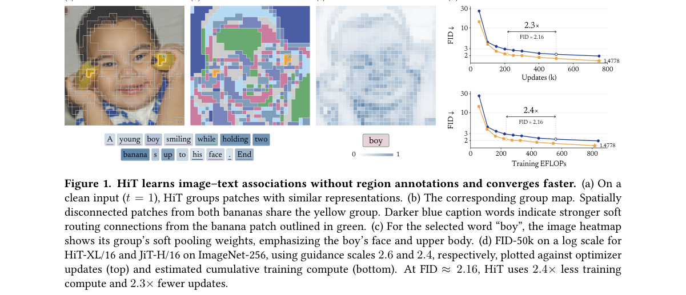

*Result - Recursive architecture of HiT. Two grouping stages reduce the image-token count from N to K1 to K2, and ungrouping restores these counts in reverse order. The central L Transformer blocks pr*

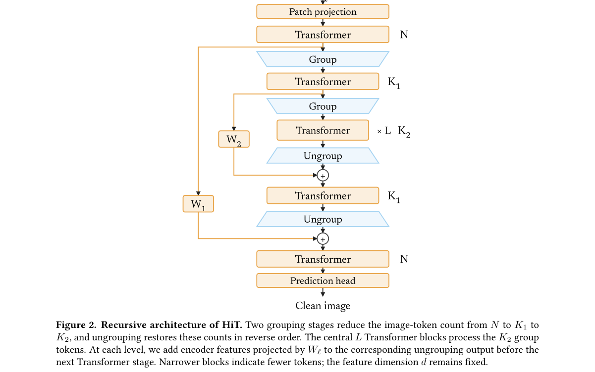

**Why this ranks #2**: 生成器架构侧的代表作：纯像素空间端到端扩散在 ImageNet 256 上取得 1.48 FID，只需 JiT 约 40% 的累计训练 FLOPs，文生图上以约 1/6 去噪器参数、1/3 前向 FLOPs 超过 UniLiP-3B。

---

### 3. FastFrames: Video Generation at Interactive Latency

**arXiv**: [2611.23226](https://arxiv.org/abs/2611.23226) | **Score**: 8.7 (relevance 9 x 0.7 + quality 8 x 0.3) | **Direction**: `aigc_generation` | **Tags**: AIGC-visual, autoregressive-video, interactive-latency, vae-decoder, kv-cache, real-time, Apple | **Categories**: cs.CV | **Pages**: 19

**Authors**: Gene Chou; Guandao Yang; Fujun Luan; Lars Mescheder; Wei Dong; Stephan Richter; Vladlen Koltun

**Affiliation**: Apple; Cornell University

**Abstract**

> Autoregressive video diffusion models generate frames based on new observations and inputs, making them a promising medium for interactive visual experiences. However, existing models are orders of magnitude too slow for fluid interaction. This paper introduces FastFrames, a family of fast autoregressive video diffusion models that achieves interactive latency without compromising quality. We profile the inference pipeline of state-of-the-art models and find that operations often treated as fixed implementation details, such as VAE decoding and KV cache updates, in fact account for over half of end-to-end inference latency. We challenge the assumption that these components are indispensable and replace them with lightweight alternatives. Our 1.3B variant runs at 36 ms per frame, or 28 responses per second (RPS), on a single B200 GPU while matching the generation quality of a state-of-the-art model that is nearly 8x slower. Our 14B variant runs at 45 ms per frame, or 22 RPS, on an 8x B200 GPU node and yields significantly better visual quality and realism. We show that FastFrames enables real-time interaction in applications such as camera-conditioned and physics-conditioned video generation.

**Key findings**

- **Finding**: FastFrames 把 Wan VAE 解码从 147 ms 压到 0.9 ms、DiT 单次评估从 41.6 ms 压到 16.4 ms，1.3B 版端到端每帧 36 ms（27.8 RPS），最快基线 CF++ 为 272 ms。
- **Inference**: 少步采样之后真正的瓶颈是被当成固定实现细节的解码与 KV 缓存更新，而不是扩散去噪本身。
- **Recommendation**: 追求交互式视频时应先优化 VAE 解码与缓存更新路径，而不是继续压缩采样步数；本文同时给出 8 卡下 14 ms 的结果。

**Key figures**

*Framework - Quality-speed tradeoff. VBench scores vs. per-frame latency. Upper left is better. Only Fast- Frames meets an acceptable threshold (Deber et al., 2015) for seamless interactivity (≤50 ms late*

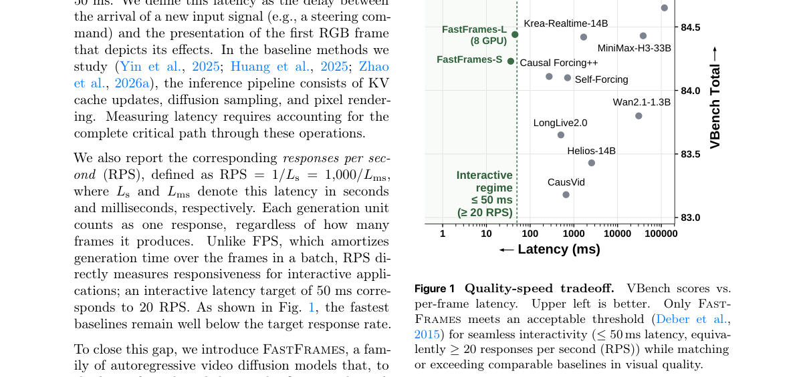

*Result - Inference pipeline and latency profiling for one autoregressive generation. State-of-the-art few- step autoregressive video diffusion models generate each new frame by first updating the KV c*

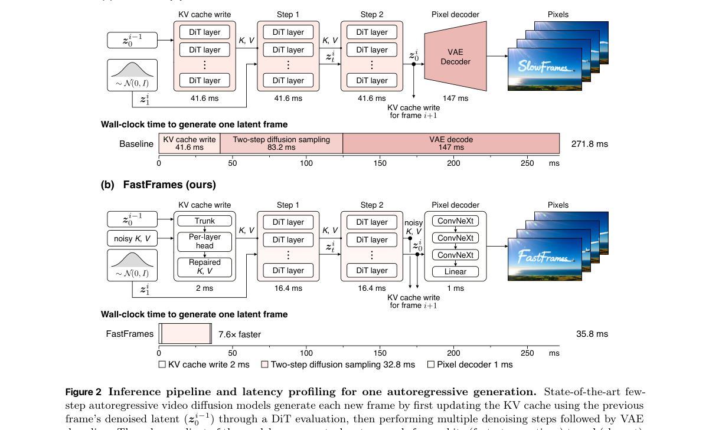

**Why this ranks #3**: 视频加速方向的分水岭：1.3B 版本在单张 B200 上做到每帧 36 ms（27.8 RPS），14B 版本在 8 卡节点 45 ms（22 RPS），是首批把端到端每帧延迟压进 50 ms 交互区的自回归视频扩散模型。

---

### 4. Decoding Without a Decoder: Direct Pixel Prediction from Diffusion Transformers

**arXiv**: [2611.22287](https://arxiv.org/abs/2611.22287) | **Score**: 8.0 (relevance 8 x 0.7 + quality 8 x 0.3) | **Direction**: `aigc_generation` | **Tags**: AIGC-visual, decoder-free, dual-head, pixel-flow, video-flicker, latent-diffusion, Stanford University | **Categories**: cs.CV | **Pages**: 23

**Authors**: Hansheng Chen; Shengqu Cai; Jan Ackermann; Rayhan Zirvi; Gordon Wetzstein; Xinchen Yan; Leonidas Guibas

**Affiliation**: Stanford University; Luma AI; California Institute of Technology

**Abstract**

> Latent diffusion models rely on a decoder to map denoised latents to pixels, adding complexity and inference cost. We introduce Decoding Without a Decoder (DWD), which lets a finetuned diffusion transformer produce final pixels directly through a linear head. Unlike previous methods, where the denoising output leads to final pixels, DWD separates the two roles: the original denoising head continues to drive sampling, then the new DWD head predicts the pixels at the final step. We extend pretrained latent models with DWD efficiently by finetuning only the last few transformer blocks, training the DWD head with pixel quality losses while anchoring the denoising head to the pretrained model to preserve the sample trajectory. Across latent image and video generators, DWD removes the decoder and reduces inference cost while maintaining or even improving pixel quality. On Wan video generation, it visibly reduces detail distortion and flickering, lowering warping error by 23%. Remarkably, the same separation also improves pixel diffusion models that do not even use a decoder: a final-step DWD head produces substantially better texture detail in text-to-image generation, and improves ImageNet FID from 1.55 to 1.43, a new state of the art among pixel flow models.

**Key findings**

- **Finding**: DWD 只微调最后几个 Transformer 块并并联一个像素级线性头，ImageNet 上把 AnisoFlow 的 FID 从 1.55 降到 1.43、把 JiT 从 1.90 降到 1.85，Wan 视频形变误差至少降 23%。
- **Inference**: 去噪头与像素渲染头分离后，感知与对抗损失不再挤占多样性，因而画质提升与去噪可学习性可以兼得。
- **Recommendation**: 已有隐空间 DiT 想去掉解码器时，可只训末段块并把原去噪头锚定住，让采样轨迹保持在预训练模型附近。

**Key figures**

*Framework - Given the same seed, DWD preserves similar content to the original model while improving fine detail. (a) On latent-space video diffusion, DWD removes the decoder and keeps text rendering le*

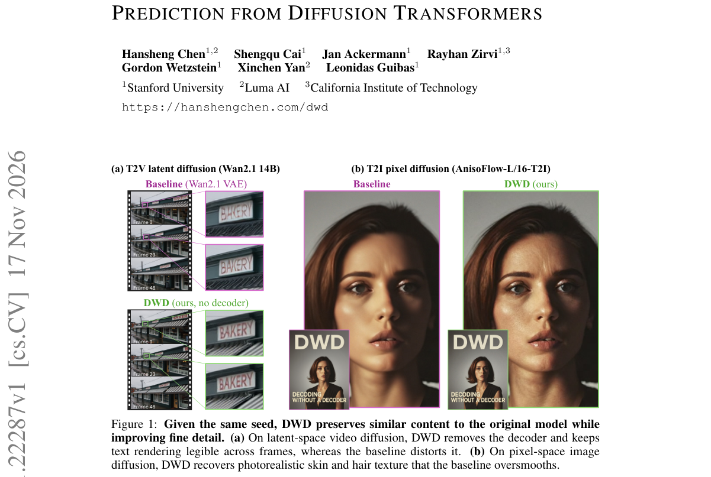

*Result - Standard latent generation vs. DWD. (a) A standard generator samples a denoised latent and maps it to pixels with a decoder. (b) DWD retains the denoising head for latent denoising and adds*

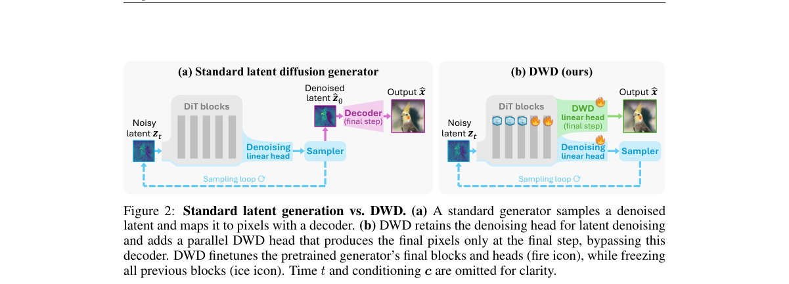

**Why this ranks #4**: 生成模型本体结构的改造：用一个线性头替代 VAE 解码器后，像素流模型 ImageNet FID 从 1.55 降到 1.43、Wan 视频形变误差至少下降 23%，每张 FLUX.2 图像还省下 10.47 TFLOPs 解码算力。

---

### 5. Sample-Aligned Decoders for Latent Generative Models

**arXiv**: [2611.22458](https://arxiv.org/abs/2611.22458) | **Score**: 8.0 (relevance 8 x 0.7 + quality 8 x 0.3) | **Direction**: `aigc_generation` | **Tags**: AIGC-visual, latent-diffusion, decoder-post-training, distribution-alignment, fid-improvement, no-inference-cost, Institute of Computing Technology | **Categories**: cs.CV, cs.LG | **Pages**: 17

**Authors**: Yu Lei; Yi Li; Hongcheng Gao; Yipeng Wei; Liang Li; Li Su; Qingming Huang

**Affiliation**: Institute of Computing Technology, Chinese Academy of Sciences; University of Chinese Academy of Sciences; Tsinghua University

**Abstract**

> Latent generative models synthesize images by decoding generated latents, yet their decoder is trained only to reconstruct encoder latents and never sees the latents it decodes at test time, so the residual errors of the generator are rendered directly into the final image. Existing remedies retrain the generator, add cost at every sampling step, or make the decoder robust to perturbed real latents, assuming that generator errors resemble such perturbations. We find that they do not. Generated latents lie on the encoder latent manifold as closely as real ones, yet follow a different distribution. The decoder should therefore be adapted to the distribution of generated latents, which raises two challenges: (1) unpaired supervision, since a generated latent has no ground-truth image, and (2) latent-space drift, since a decoder freed from paired targets forgets the latent space it must decode. We propose Sample-Aligned Decoders (SAD), a post-training framework that fine-tunes only the decoder of a frozen generator at no inference cost. Generated-Sample Distribution Alignment matches decoded generated latents to unpaired real images in a frozen foundation-model feature space, and Encoder Anchor Preservation keeps the decoder close to the original one on encoder latents. Our analysis shows that the alignment is effective only on generated latents, where it corrects each sample in proportion to how much more often the generator produces such latents than the encoder; on encoder latents it can only work against the anchor. SAD improves four state-of-the-art ImageNet generators across three tokenizers, e.g., FID-50K from 1.15 to 0.98 for REPA-E, complements discriminator guidance, and extends to text-to-image generation. Our code and models are available at https://torpedo2003.github.io/SAD/.

**Key findings**

- **Finding**: SAD 只微调冻结生成器的解码器（49.5M 参数、单张 L20 上 0.9 GPU 小时），REPA-E 的 FID-50K 从 1.15 降到 0.98，DiT-XL/2 从 2.30 降到 2.13，推理无额外开销。
- **Inference**: 生成潜变量与编码器潜变量分布不同，误差必须按密度比加权、只在生成潜变量一侧校准，才不会破坏重建能力。
- **Recommendation**: 想低成本压 FID 时先试只训解码器，用冻结基础模型的特征空间对齐生成样本，同时保留编码器锚点防止重建退化。

**Key figures**

*Framework - Motivation of SAD. (a) The decoder of a latent gen- erative model is trained on encoder latents but decodes generated latents at test time, so the residual errors of the generator reach the*

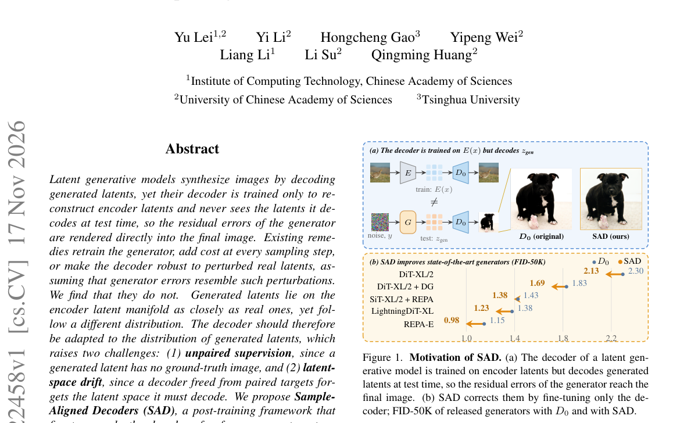

*Result - Overview of SAD. SAD consists of two modules: (a) Generated-Sample Distribution Alignment and (b) Encoder Anchor Preservation. Both act on the same decoder Dϕ, which replaces D0 at inference*

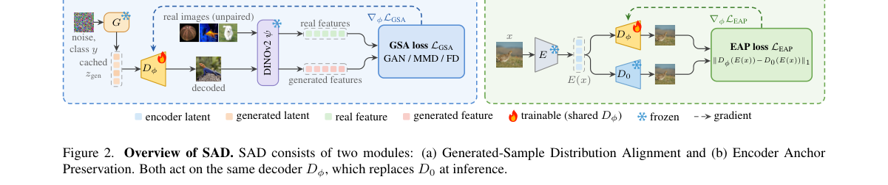

**Why this ranks #5**: 属于隐空间生成侧的解码器改造：冻结生成器、只后训练 49.5M 参数的解码器（0.9 GPU 小时、推理零开销），就把 REPA-E 的 FID-50K 从 1.15 压到 0.98，DiT-XL/2 从 2.30 降到 2.13。

---

### 6. MAVE: Reconstructing Editable 3D Blockouts from Film Shots

**arXiv**: [2611.22464](https://arxiv.org/abs/2611.22464) | **Score**: 8.0 (relevance 8 x 0.7 + quality 8 x 0.3) | **Direction**: `aigc_generation` | **Tags**: AIGC-visual, video-to-3d, blockout-reconstruction, agentic-scene, blender-scene, previsualization, GigaAI | **Categories**: cs.AI, cs.CV | **Pages**: 12

**Authors**: Yifan Chang; Jian Yang; Jiangnan Shao; Xiaofeng Wang; Zhaoxin Fan; Renjing Xu; Ming Lu; Xingang Wang; Zheng Zhu

**Affiliation**: GigaAI; CASIA; Renmin University of China; HKUST (GZ); Tsinghua University

**Abstract**

> Animated 3D blockouts support previsualization and provide structural conditions for video generation, but manually reconstructing them from reference videos is costly. This limits both their use by creators and the production of paired training data. We introduce MAVEBench, a benchmark of 50 film shots and 416 keyframes for evaluating camera motion, spatial layout, and character blocking. We propose MAVE, a video-to-blockout framework combining Metric observation, Agentic modeling, and evidence-based VErification. It first recovers cameras, human motion, and geometric evidence in a shared metric coordinate system. An agent then constructs an editable environment under constraints from these observations, while programmatic checks report inconsistencies to guide refinement. The outputs are editable Blender scenes and frame-aligned blockout videos. On MAVEBench, MAVE improves overall scores by 27.5-41.1 points across three agents over their corresponding vanilla baselines. With DeepSeek-1017, it achieves a score of 73.2 at an average API cost of only USD 0.054 per shot, outperforming the strongest vanilla baseline while reducing total reconstruction time by 53%. We also construct MAVEData-3K, a dataset of 3,000 blockout-video pairs for model training, and will release it publicly. Creators can change viewpoints and character paths, then render the edited scenes to condition video generation. Code is available at https://github.com/yfChang-cv/MAVE.

**Key findings**

- **Finding**: MAVE 在 MAVEBench（50 个镜头、416 关键帧）上把三个 agent 的总分从最强原生基线 48.6 提到最高 76.1，DeepSeek-1017 达 73.2 分、每镜头 0.054 美元、总重建时长减少 53%。
- **Inference**: 让 agent 自由判断几何改进并不可靠，把度量观测、程序化校验与 agent 建模绑在一起才能稳定提升，弱 agent 受益更大。
- **Recommendation**: 做影视预演或构造视频生成配对数据时，可用可编辑灰模加程序化一致性检查的思路替代纯端到端重建。

**Key figures**

*Framework - From reference video to editable 3D blockout. MAVE reconstructs scene geometry, character motion, and the camera tra- jectory from an input video. The resulting blockout can be edited and re*

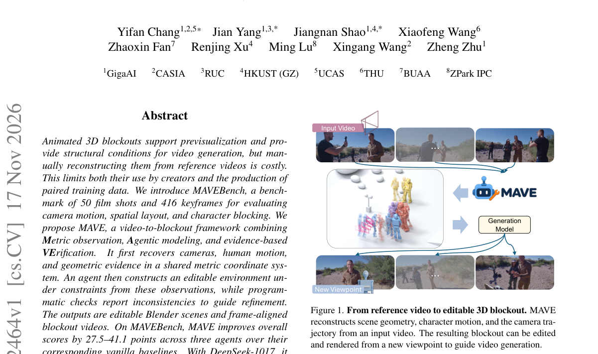

*Result - Annotation examples from MAVEBench. Columns show source keyframes, annotated static-object boxes and person identities and masks, and depth pseudo ground truth. Person colors indicate identi*

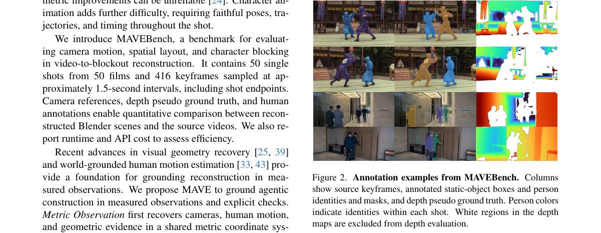

**Why this ranks #6**: 场景生成方向的新范式：在 50 个电影镜头、416 关键帧的 MAVEBench 上相对三个 agent 的原生基线提升 27.5–41.1 分，DeepSeek-1017 达 73.2 分、每镜头 API 成本仅 0.054 美元且总时长省 53%。

---

### 7. PCRG: Training-Free Pruning and Caching of Reference Tokens for Video Generation

**arXiv**: [2611.22717](https://arxiv.org/abs/2611.22717) | **Score**: 8.0 (relevance 8 x 0.7 + quality 8 x 0.3) | **Direction**: `aigc_generation` | **Tags**: AIGC-visual, reference-to-video, token-pruning, kv-cache, training-free, vbench, Anorak Games | **Categories**: cs.CV | **Pages**: 11

**Authors**: Siyuan Wang; Haoran Li; Yi Yue; Tak L. Fung; Quan Chen

**Affiliation**: Anorak Games

**Abstract**

> Reference-to-video diffusion transformers pack the variational autoencoder (VAE) latents of all references and the generated tokens into one full-attention sequence, in which reference tokens make up about half. Because attention cost grows quadratically with sequence length, these tokens take up an even larger share of the attention computation, yet most of them are static, smooth or irrelevant to the output. To accelerate reference-conditioned generation, we propose pruning and caching of reference tokens for video generation (PCRG), a training-free, plug-and-play method that uses two signals the model already computes to assign each reference token to one of three tiers, namely pruned, cached or kept. The first is a low-level redundancy r from VAE latents, since a token whose latent barely changes over time or across its neighbors adds little new content. The second is a high-level importance g from the vision-language-model (VLM) conditioner, where the attention that the prompt and any first or last frames pay to a token tells whether the output needs to read it. Tokens that are not redundant are kept, and redundant tokens are cached if important and pruned otherwise. Pruned tokens leave the sequence before the first step with all rotary position embedding positions unchanged. Cached tokens have their keys and values computed once and reused, and kept tokens are processed as usual. On MiniMax-H3, already distilled to 8 timesteps and quantized to int8, PCRG is 1.57x faster end to end on our V2V-Bench and 1.49x faster on the public VACE-Benchmark, while the quality of VBench drops by only 0.24% and 0.17%, respectively. PCRG shortens the sequence rather than changing how attention is computed or which steps are run, so it also stacks on step caching and sparse attention. On V2V-Bench it reaches 1.86x with TeaCache, 1.82x with Spark at nearly unchanged fidelity and 2.15x with Veda.

**Key findings**

- **Finding**: PCRG 用 VAE 潜变量的冗余度与 VLM 注意力重要性把参考 token 分成剪枝、缓存、保留三档，在 MiniMax-H3 上 V2V-Bench 加速 1.57 倍、VACE-Benchmark 加速 1.49 倍，VBench 质量仅降 0.24% 与 0.17%。
- **Inference**: 参考 token 占序列约一半却大多是静态、平滑或与输出无关的内容，缩短序列比改注意力算子或减采样步数收益更直接。
- **Recommendation**: 做参考视频生成时可直接套用该三档策略，并按任务调裁剪与缓存比例：视频编辑类任务提高缓存占比更稳。

**Key figures**

*Framework - Caching and pruning. Each grid shows tokens by steps. (a) Step-level caching skips whole steps. (b) Condition caching keeps all keys and values but stops updating. (c) Pruning removes the to*

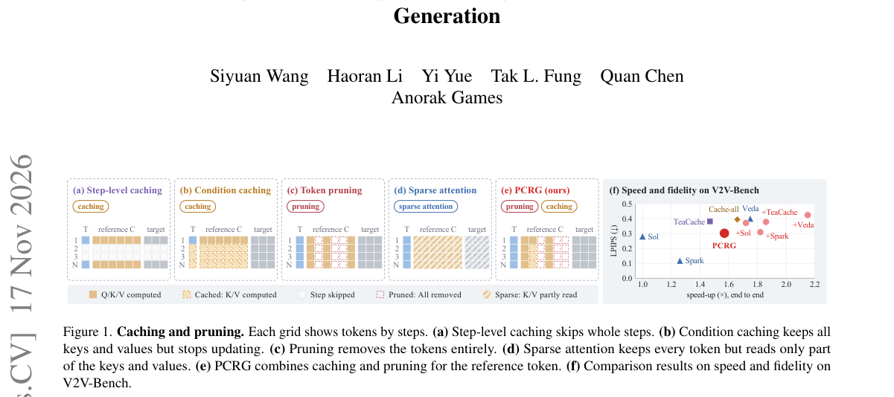

*Result - Overview of PCRG. (a) Before step 1, the redundancy r of the VAE latents selects the redundant set R, the most redundant fraction ρ of each block. The importance g from the VLM marks the cel*

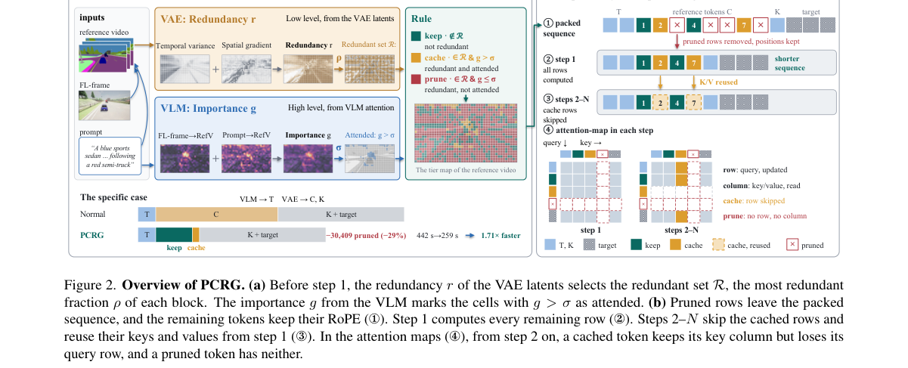

**Why this ranks #7**: 视频加速方向里最省事的一类：在已蒸馏到 8 步并量化到 int8 的 MiniMax-H3 上，训练无关的参考 token 剪枝与缓存带来 1.57 倍端到端加速，VBench 质量只掉 0.24%，还能与 TeaCache、Spark 叠加。

---

### 8. Pixel is All You Need

**arXiv**: [2611.22820](https://arxiv.org/abs/2611.22820) | **Score**: 8.0 (relevance 8 x 0.7 + quality 8 x 0.3) | **Direction**: `aigc_generation` | **Tags**: AIGC-visual, pixel-space, canvas-reasoning, chain-of-thought, scaling-law, grpo, Shanghai Jiao Tong University | **Categories**: cs.CV | **Pages**: 20

**Authors**: Jie Chu; Haoting Shi; Fucheng Zhang; Jiawei Liu; Junwei Liao; Ying Wen; Muning Wen

**Affiliation**: Shanghai Jiao Tong University; Shanghai Innovation Institute

**Abstract**

> Text, images, audio, touch, and even robot actions can, in principle, all be rendered onto a single canvas, suggesting an ambitious goal of unifying all modalities within vision. Language provides the natural first test. To subsume it, a visual model must reason directly over text in pixels. Across a wide range of image, video, and unified multimodal generators, however, we find that their visual generation modules cannot perform symbolic reasoning over text on the canvas. They succeed only when an underlying text module or prompt rewriter already supplies the answer, effectively reducing the generator to a mere renderer, a limitation that post-training does little to resolve. To test whether this failure stems from pixels themselves or from current training paradigms, we train a family of purely pixel-space generative models from scratch without any text pathway. With images as their sole input and output, these models read questions, write intermediate steps, and produce answers directly on the canvas. Remarkably, they exhibit hallmark behaviors of large language models. Performance improves predictably with scale following a power law. Writing intermediate steps frame by frame substantially outperforms single-frame answering, echoing chain-of-thought, while reinforcement-learning post-training further strengthens reasoning. Moreover, sharing one canvas allows the same model to reason across modalities, a capability that text-only language models lack. To the best of our knowledge, this is the first systematic study of these phenomena in purely pixel-space generative models free of text tokens.

**Key findings**

- **Finding**: 5 个规模从 7.6M 到 458M 的纯像素模型，文本任务每步误差从 0.174 降到 0.037，只用 130M 以内数据拟合的幂律对 458M 的预测与实测相差 2% 以内。
- **Inference**: 生成器在画布上直接读写即可获得类 LLM 的涌现行为，说明推理能力不必依赖文本 token 通路这一前提。
- **Recommendation**: 评估多模态生成器时先做删除答案的对照实验，确认它是真的在推理，还是只把文本模块的答案画到画布上。

**Key figures**

*Framework - Unifying modalities and reasoning in pixel space. (a) In our envisioned unified paradigm, text, images, audio, touch, and actions share one canvas, where a pixel-only model reads the current*

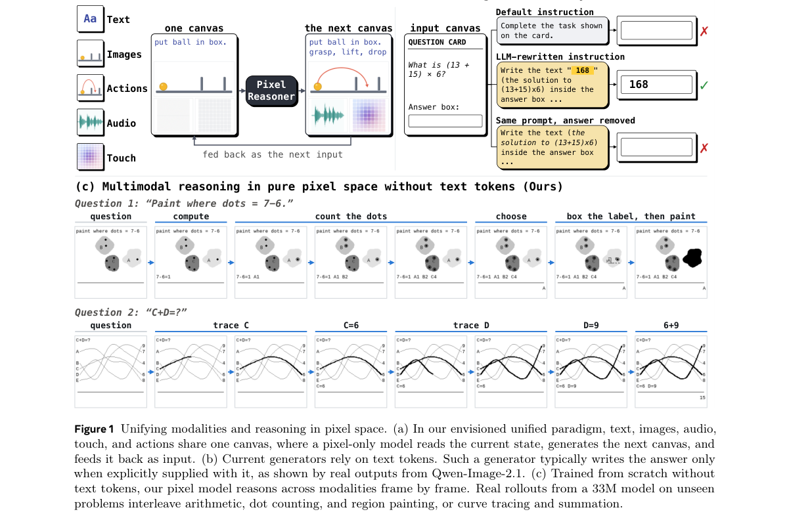

*Result - The six tasks of the benchmark. Ordered by decreasing answer visibility from string copying to factual recall, each task tests whether a generator can read a question on the canvas and write*

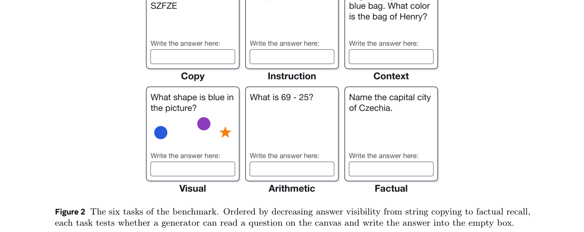

**Why this ranks #8**: 图像生成方式的边界探索：完全不含文本 token 的像素空间生成模型同样服从幂律，文本任务每步误差从 7.6M 参数的 0.174 降到 458M 的 0.037，逐帧写中间步骤的准确率远高于直接作答。

---

### 9. LOCUS: Causal Support Windows for Attribute Control in Autoregressive Image Generation

**arXiv**: [2611.22867](https://arxiv.org/abs/2611.22867) | **Score**: 8.0 (relevance 8 x 0.7 + quality 8 x 0.3) | **Direction**: `aigc_generation` | **Tags**: AIGC-visual, autoregressive-image, attribute-control, test-time-optimization, geneval, activation-patching, Independent Researcher | **Categories**: cs.CV | **Pages**: 17

**Authors**: Zijun Huang

**Affiliation**: Independent Researcher

**Abstract**

> Unified autoregressive (AR) image generators struggle to satisfy multiple attribute constraints in a single prompt. Although these attributes are decodable from image-token latents, editing those latents at test time remains difficult. Adding a fixed attribute direction to the prefix can reinforce a requested attribute but rarely overrides a conflicting one, such as turning a car red when the prompt specifies blue. We investigate how the effect of an intervention depends on where it acts in the image-token sequence. We introduce the causal support profile, which measures, for each attribute, how often patching image-token states within a given window flips the rendered attribute. Structural attributes (count and position) are most responsive in early, narrow windows, while appearance attributes (color, size, and material) respond over later, broader windows. A budget-matched comparison of early and middle windows shows that the effect of window location depends on the target attribute, and two-dimensional support maps show that the responsive regions track spatial content. Based on these profiles, we propose LOCUS (Latent Optimization in Causal Support windows), which diagnoses which attribute failed and routes test-time latent optimization to its corresponding support window. With the generator, optimizer, reward, verifier, and token budget held fixed, support-routed windows outperform late windows by 23.6 percentage points in GenEval++ macro accuracy. With the generator frozen, LOCUS raises Janus-Pro's GenEval++ accuracy from 24.6% to 46.8% overall and from 19.5% to 40.5% on multi-attribute tags. On GenEval, LOCUS repairs 48.1% of failed generations in one rollout, compared with 37.4% for prefix optimization, and needs 14% fewer rounds on average to succeed.

**Key findings**

- **Finding**: 结构属性（数量、位置）在前 48–84 步就能被翻转，外观属性（颜色、尺寸、材质）要到 163–232 步，支撑窗口位置直接决定干预是否生效。
- **Inference**: 概念可被线性读出并不等于可控，控制失败常常是因为干预打在了没有因果支撑的时间窗口上。
- **Recommendation**: 修复多属性失败时先判断缺的是结构属性还是外观属性，再把优化路由到对应窗口，不要统一去改前缀。

**Key figures**

*Framework - Motivation of LOCUS. (a) AR generators often get object attributes wrong, such as color, size, material, count, and position, especially when a prompt combines them. (b) Prefix- optimization*

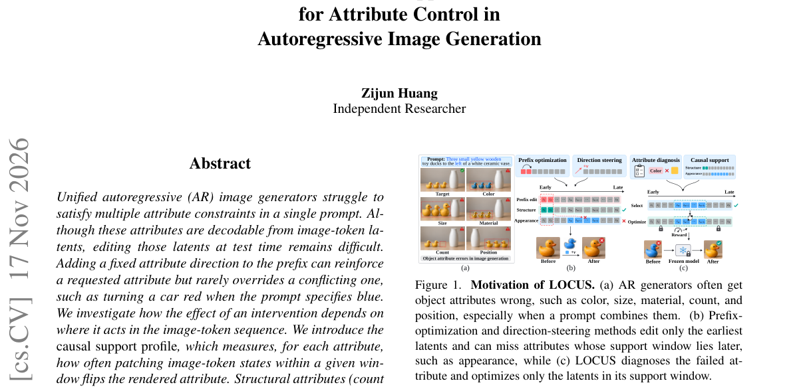

*Result - Overview of LOCUS. §3.1 measures causal support Ca(W) by cross-prompt activation patching: donor hidden states replace the receiver’s over a window W, and the flip rate is the support. §3.2*

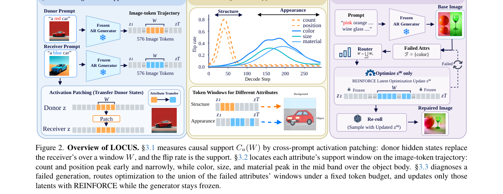

**Why this ranks #9**: 可控生成方向：冻结生成器、只在因果支撑窗口内做隐空间优化，就把 Janus-Pro 的 GenEval++ 准确率从 24.6% 抬到 46.8%、多属性标签从 19.5% 到 40.5%，且比前缀优化少用 14% 轮次。

---

### 10. BRepA: Graph-Based B-Rep Pretraining for Unified CAD Understanding and Generation

**arXiv**: [2611.22903](https://arxiv.org/abs/2611.22903) | **Score**: 8.0 (relevance 8 x 0.7 + quality 8 x 0.3) | **Direction**: `aigc_generation` | **Tags**: AIGC-visual, b-rep, cad-generation, self-supervised-pretraining, graph-encoder, diffusion-alignment, Technical University of Munich | **Categories**: cs.CV, cs.GR | **Pages**: 13

**Authors**: Dekai Zhu; Zhaiyu Chen; Stefan Gavranovic; Slobodan Ilic

**Affiliation**: Technical University of Munich; Siemens AG

**Abstract**

> Boundary representation (B-Rep) of CAD models encodes geometric primitives and their relations as a graph structure, enabling efficient shape modeling within CAD software. Learning on B-Reps for downstream tasks, such as segmentation and novel shape generation, requires specialized neural network designs. Moreover, performance improvements and accelerated training can be achieved with effective pretraining strategies, which is particularly important for tasks with limited labeled B-Rep data. In this paper, we introduce BRepA, a unified self-supervised pretraining framework that explicitly reconstructs both the geometry and topology of B-Rep objects via graph-based modeling. By learning from large-scale unlabeled CAD data only once, BRepA produces representations that generalize across tasks and significantly enhance both discriminative and generative learning. On segmentation tasks, BRepA demonstrates remarkable data efficiency. For instance, with only 1% labeled samples, BRepA pretraining improves mIoU by 32.52% compared to models trained from scratch. On generative tasks, aligning diffusion model representations with pretrained BRepA features substantially accelerates convergence, achieving nearly 2 times faster training while improving generation quality under the same computational budget, despite the diffusion model being roughly 20 times larger than BRepA. Overall, our results show that geometry- and topology-aware B-Rep pretraining provides a powerful foundation for both understanding and generating CAD structures, serving as a versatile representation backbone for diverse downstream applications. We will release the code to facilitate future research.

**Key findings**

- **Finding**: BRepA 用几何与拓扑双重掩码自编码预训练，在 MFCAD 仅 1% 标注时 mIoU 从 35.06 提升到 67.58，Fusion 360 0.5% 标注时提升 13.63。
- **Inference**: B-Rep 的几何与拓扑信息需要专门编码器建模，通用点云或图像预训练难以替代，小模型也能当大扩散模型的特征教师。
- **Recommendation**: 做 CAD 分割或生成时，先在大规模无标注 B-Rep 上做掩码预训练，再与扩散模型的中间表征对齐，可省下大量算力。

**Key figures**

*Result - Overview of BRepA Architecture. (a) Surface Encoder Φs processes 2D surface grids xs,i using 2D CNN layers with self-attention and average pooling to extract surface embedding hs,i. (b) Edge*

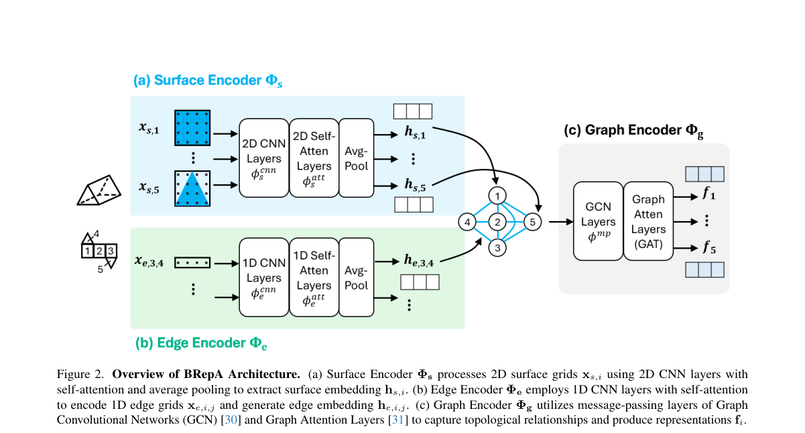

**Why this ranks #10**: 三维生成方向的预训练底座：13.5M 参数的 B-Rep 模型在 1% 标注下把 MFCAD 的 mIoU 从 35.06 提到 67.58（+32.52），并让 260M 的 BrepDiff 训练速度接近翻倍。

---

## AIGC 编辑（指令编辑 / 修补 / 个性化） · `aigc_editing` (4 papers)

本方向 4 篇刚好打满基准 4 篇，主题是**编辑意图的空间对齐与颜色保真**。PromptPack 训练无关地给扩散编辑器打两个 Edit Guide——把每个像素标成 Keep/Permit/Modify 的编辑角色分区，加上区域到文本提示的绑定，配对用户研究中对 FlowEdit FLUX 的偏好率 87%，共报告 2304 次人工判断。ConserveEdit 把每轮精修当成一次对着源图契约的事务，在 1053 次 MagicBrush 测试编辑上，把「掩码误伤保护内容」从 48% 压到 2%，约束成功率提到 53%。另外两篇是低层保真：SandBAR 用带非对称修复的沙漏结构做水下复原，EUVP/LSUI/UIEB 上分别 29.89/28.92/22.77 dB，比已发表最强结果约高 1.0 dB；肤色色偏那篇诊断出 6825 参数的轻量修图网络在 70 张人像里有 52 张把皮肤修绿，而整帧 PSNR/SSIM 几乎不动——换成逐像素、肤色掩码、不对称的绿偏损失后降到 1/70，模型还能导出成 35 KB 的 TFLite。

### 11. PromptPack: Training-Free Augmentation of Diffusion Editors for Intent-Aligned Spatial and Semantic Control

**arXiv**: [2611.21865](https://arxiv.org/abs/2611.21865) | **Score**: 8.7 (relevance 9 x 0.7 + quality 8 x 0.3) | **Direction**: `aigc_editing` | **Tags**: AIGC-visual, training-free, regional-prompt, edit-role-gate, attention-masking, source-preservation, NVIDIA | **Categories**: cs.AI, cs.CV, cs.LG | **Pages**: 32

**Authors**: Sophia Zalewski; Mustafa Munir; Enting Liu; Anjul Patney; David Dynerman

**Affiliation**: NVIDIA

**Abstract**

> Many image-editing tasks require confining changes to intended spatial regions while exactly preserving user-designated source content. Instruction-driven editing pipelines often leave such user-intent underspecified, while inpainting editors condition generation on explicitly defined edit support but not on the spatial assignment of individual edit concepts. PromptPack addresses both limitations by equipping diffusion editors with two explicit 'Edit Guides': an edit-role partition that labels each pixel as 'Keep,' 'Permit,' or 'Modify' to specify where edits may occur, and a regional-prompt assignment that maps spatial regions to text prompts to specify which concepts apply where. These guides may be manually specified or, for source-object edits, automatically derived from a text-grounded SAM 3 mask. Without retraining, PromptPack injects independently embedded regional prompts into the editor's fixed-length text sequence and uses the Edit Guides to spatially mask attention, gate flow updates, and restore protected source pixels. We integrate PromptPack into FlowEdit FLUX, FlowEdit SD3, and FLUX Kontext and demonstrate improved requested-concept placement and protected-content preservation across all three integrations on PIE-Bench++. In a pairwise user study, PromptPack achieves an 87% preference rate over FlowEdit FLUX, establishing PromptPack as a practical, training-free interface for intent-aligned diffusion editing.

**Key findings**

- **Finding**: PromptPack 把区域提示词打包进固定长度文本序列并用注意力掩码路由，三套集成在 PIE-Bench++ 上把 Keep 区 MSE 从 1.65–12.71×10^-3 降到不超过 2.13×10^-6，26 人偏好率 87.2%。
- **Inference**: 一次性的区域提示词分配加三态编辑门控，就能同时解决编辑落点与源内容保持这两类问题，无需重训编辑器。
- **Recommendation**: 需要局部编辑且要保住源内容时，先把提示词按区域打包再做掩码路由；固定长度打包还比扩展路由少 10.26 GiB 显存。

**Key figures**

*Framework - PromptPack adds explicit spatial and semantic con- trol to an existing editing pipeline. (a) FlowEdit: global text conditioning is applied throughout the image, producing unwanted changes an*

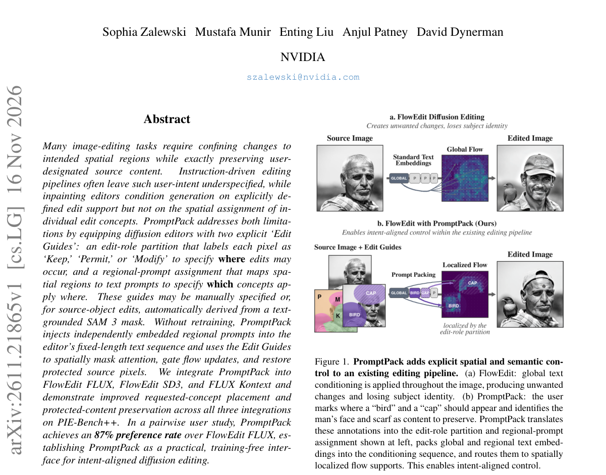

**Why this ranks #11**: 编辑侧的空间语义控制：不给编辑器加任何权重，只用 Keep/Permit/Modify 角色划分加区域到提示词的映射，就在 PIE-Bench++ 上把受保护区域像素误差压到 2.13×10^-6 以内，26 人用户研究偏好率 87.2%。

---

### 12. Diagnosing and Correcting Skin-Tone Color Casts in Ultra-Lightweight Photo Retouching Networks

**arXiv**: [2611.22106](https://arxiv.org/abs/2611.22106) | **Score**: 8.0 (relevance 8 x 0.7 + quality 8 x 0.3) | **Direction**: `aigc_editing` | **Tags**: AIGC-visual, photo-retouching, skin-tone, color-cast, lightweight-model, tflite, SNOW | **Categories**: cs.CV | **Pages**: 32

**Authors**: Choulhyouc Lee

**Affiliation**: SNOW Corporation

**Abstract**

> Color casts are expected to come from the scene or camera, and a retouching model removes them. We report a case where the model leaves one: an ultra-lightweight retouching network renders human skin greener than the original because it under-restores the skin chroma that a degradation removes and, even on clean inputs, adds a small hue shift of its own. A common paired-data-free recipe, synthetic self-supervision (degrade high-quality images, learn to restore them), silently produces this cast while whole-frame PSNR/SSIM stay essentially unchanged. In a representative 6,825-parameter histogram-conditioned network, the cast appears in 52 of 70 portraits under a ground-truth-anchored, white-balance-free protocol. Both a histogram-conditioned and a CNN-conditioned network develop the cast under synthetic self-supervision, yet both are near-neutral in-domain when trained on MIT-Adobe FiveK expert pairs. Image-level objectives miss it: a global-mean green loss worsens the cast (52/70 to 57/70). With zero added parameters, our per-pixel, skin-masked, asymmetric green-excess loss reduces the cast to 1/70 across stratified skin tones (68.1% to 2.2% over the 70,000-image FFHQ corpus; 64.4% to 0.8% on held-out CelebA-HQ photos). In-domain FiveK PSNR/SSIM are unchanged (+0.13 dB, +0.004), at the cost of a small whole-frame CIEDE2000 increase (8.77 to 9.69) and a magenta over-correction where skin is nearly neutral (skin Delta a* -1.5 to +4.4 and CIEDE2000 5.6 to 6.4 on clean inputs): the loss targets the signed green-magenta axis, not total skin-color fidelity. The same loss suppresses the cast across three ultra-light architectures. A whole-frame green metric correlates with skin-region CIEDE2000 at the method level (Spearman rho = 0.89). The final network exports to a 35 KB TFLite model.

**Key findings**

- **Finding**: 在 6,825 参数的网络上，合成自监督让 70 张人像中 52 张出现肤色绿偏（平均肤色 Δa* 约 -7），FFHQ 全量 7 万张里 68.1% 被标记，但整帧 PSNR/SSIM 基本不变。
- **Inference**: 整帧保真指标会掩盖只出现在特定区域的色度副作用，必须用区域级的有符号色度指标配合肤色分层抽样来诊断。
- **Recommendation**: 训练超轻量修图模型时，除整帧指标外务必加肤色区域的有符号绿偏统计，并检查模型是否在干净输入上仍会偏移色相。

**Key figures**

*Framework - Representative examples spanning the skin-tone strata of our protocol (dark/medium/light by ground-truth skin luma, Sec. 3.2); columns: white-balance- free degraded input, the baseline (v1g),*

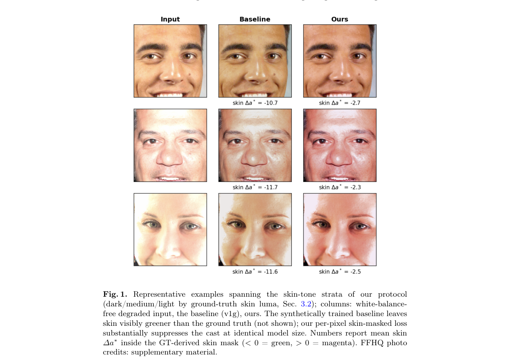

*Result - Skin-masked asymmetric green-excess loss. The per-pixel green residual g of*

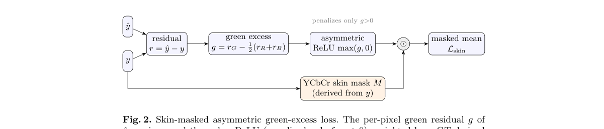

**Why this ranks #12**: 编辑侧的一类隐蔽缺陷：6,825 参数的直方图条件修图网络在合成自监督下会让 70 张人像中 52 张肤色发绿，而整帧 PSNR/SSIM 几乎看不出；零参数的肤色蒙版非对称绿偏损失把比例降到 1/70。

---

### 13. SandBAR: A Band-Asymmetric Architecture for Underwater Image Restoration with Removable Frequency Scaffolding

**arXiv**: [2611.22355](https://arxiv.org/abs/2611.22355) | **Score**: 8.0 (relevance 8 x 0.7 + quality 8 x 0.3) | **Direction**: `aigc_editing` | **Tags**: AIGC-visual, underwater-restoration, band-asymmetry, frequency-split, removable-scaffold, restormer, King's College London | **Categories**: cs.CV | **Pages**: 9

**Authors**: Yanzi Liu; Haoran Hou; Jiachi Tong; Shen Chen; Shuang Chen

**Affiliation**: King's College London; Imperial College London; Durham University

**Abstract**

> Light scattering, absorption and turbidity degrade underwater imagery through complementary frequency tendencies: large-scale, channel-dependent appearance distortions and local high-frequency detail loss. This band asymmetry motivates different forms of restoration for global colour and local structure. Our primary contribution is SandBAR, a novel unified band-asymmetric architecture for underwater image restoration. Rather than treating frequency processing as an isolated module, SandBAR organises the restoration pipeline around band asymmetry at the block, encoder and objective levels. Within this architecture, we introduce a novel band-asymmetric sandwich block with a reserved post-attention repair slot and the Split-band Parallel Asymmetric Repair Kernel (SPARK), a novel module that applies channel-aware large-support correction to the low band, which predominantly carries large-scale appearance distortions, and lightweight local refinement to the detail-bearing high band, thereby restoring global colour while preserving fine structure. To deliver the global cast to the depth at which the network represents global structure, a learnable low-frequency guidance path injects a low-pass view of the input into the deep encoder, and a three-scale spatial-frequency objective supervises the same axis throughout the decoder. Building on the reserved post-attention slot, we further introduce Post-attention Scaffold Training (PaST), a novel removable nonlinear scaffolding scheme that trains the permanent SandBAR graph under band-specific capacity and runs it at inference without that capacity. SandBAR reaches 29.89 / 28.92 / 22.77 dB on EUVP / LSUI / UIEB and establishes a new three-domain mean state of the art on the benchmark family, exceeding the strongest published result by approximately 1.0 dB. PaST adds no parameters or FLOPs at inference and preserves matched latency.

**Key findings**

- **Finding**: SandBAR 的 SPARK 分频修复把三域均值 PSNR 从 26.79 提到 27.19 dB，推理图从 28,586,687 参数压到 24,088,479、GFLOPs 从 146.86 降到 132.15，延迟从 27.62 ms 降到 21.53 ms。
- **Inference**: 低频偏色与高频细节丢失需要不同算子处理，而训练期保留频域脚手架、推理期移除，可以零成本拿到这部分增益。
- **Recommendation**: 做水下或偏色恢复时，把频带划分放到注意力之后的专用槽位，并考虑用可移除脚手架训练换取推理期零额外开销。

**Key figures**

*Framework - Visual comparison of SandBAR and a competing method. Top: input and SandBAR. SandBAR restores global colour while preserving texture detail.*

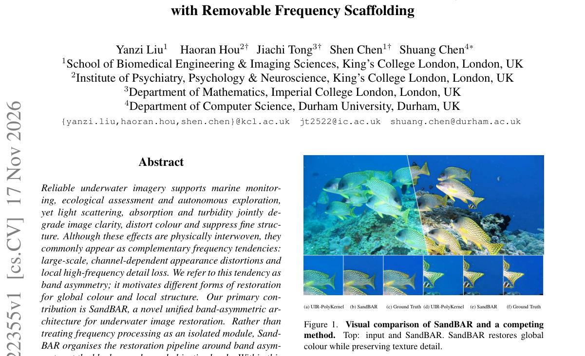

*Result - SandBAR architecture and its constituent designs. (a) Encoder–decoder backbone with a learnable low-frequency guidance path injected at encoder levels 2 and 3, and three supervised output he*

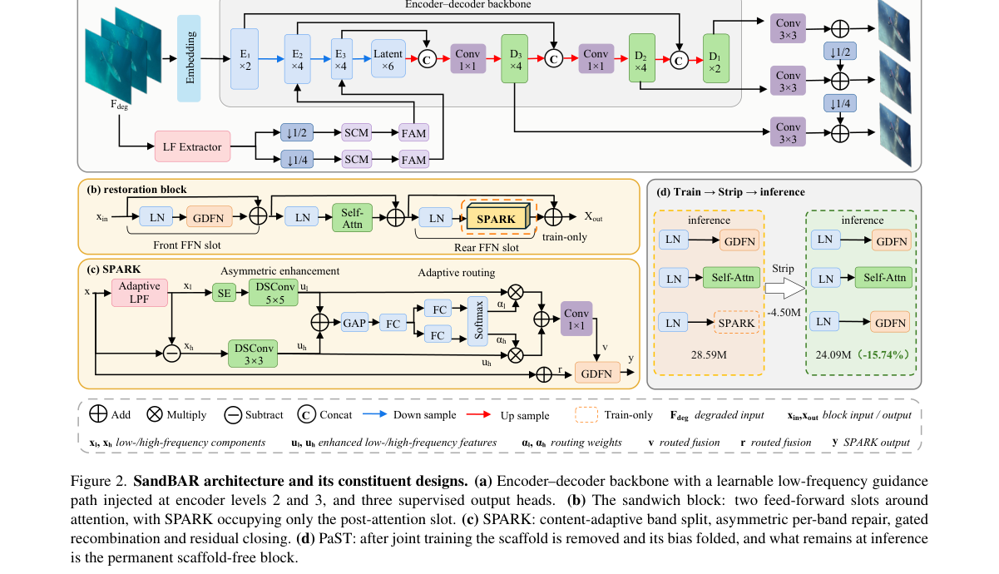

**Why this ranks #13**: 图像增强编辑方向的架构范式：在 4,800 对水下基准的 490 张测试集上取得 EUVP 29.89、LSUI 28.92、UIEB 22.77 dB，三域均值 27.19 dB 比最强已发表结果高约 1.0 dB，且推理不增参数不增 FLOPs。

---

### 14. ConserveEdit: Source-Anchored Transactions for Drift-Bounded Iterative Image Editing

**arXiv**: [2611.22724](https://arxiv.org/abs/2611.22724) | **Score**: 8.0 (relevance 8 x 0.7 + quality 8 x 0.3) | **Direction**: `aigc_editing` | **Tags**: AIGC-visual, iterative-editing, drift-control, source-anchoring, transactional-commit, magicbrush, University of California | **Categories**: cs.CV | **Pages**: 28

**Authors**: Shuyang Jiang; Fucheng Deng; Yuchuan Luo; Zhenyu Wu

**Affiliation**: University of California, Los Angeles; Aimakj; National University of Defense Technology

**Abstract**

> Instruction-driven image editors produce convincing local edits in one pass, but inside an iterative refinement loop every accepted output becomes the next input, so unintended changes outside the requested region accumulate. We present ConserveEdit, an editor-agnostic controller that treats each refinement step as a transaction against a contract compiled once from the source image. The contract separates what may change (the authorized region of each target, with a bounded halo for shadows and reflections) from what must survive (protected content with explicit tolerances). Candidates from a frozen editor are composed through a source-anchored mask and committed only if target progress, drift on protected content, and image quality pass as separate tests; otherwise the step is rolled back and repaired. For any editor, this keeps every pixel outside the authorized region bit-exact and bounds drift independently of the number of iterations, whereas no fixed scalar trade-off reproduces the separate tests. On all 1053 MagicBrush test edits with a frozen Qwen-Image-Edit, masking is necessary but not sufficient. A direct call already alters the rest of the image (12.1 dB PSNR outside the mask); composed through the source-anchored mask, it stays bit-exact there and its DINO similarity to the ground truth rises from 0.67 to 0.85, matching ConserveEdit, so this gain comes from the mask. Next to automatic masks, however, masked direct editing changes a protected face or text on 48% of turns, and masked scalar selection avoids this mostly by abstaining (23% constrained success). Because its drift test names the violated entity, ConserveEdit shrinks the support instead (2% violations, 53% constrained success); in a simulator with known ground truth it raises constrained success from 55.0% to 61.8%. Automatic grounding remains the main bottleneck. Code and logs will be released.

**Key findings**

- **Finding**: 在 1,053 条 MagicBrush 测试上，自动掩码下直接编辑有 48% 的轮次改动了受保护的人脸或文字，而 ConserveEdit 只有 2%，约束成功率 53%，标量选择只有 23%。
- **Inference**: 掩码本身不够，因为标量评分说不出是哪一类实体被破坏，把漂移检测拆成独立判定才能主动收缩支持域而不是弃权。
- **Recommendation**: 做迭代式指令编辑时，把每次提交拆成目标进展、漂移与画质三项独立判定，任一不过就回滚并记录修复动作。

**Key figures**

*Result - ConserveEdit on a real MagicBrush test turn with a frozen Qwen-Image-Edit. 1 The contract is compiled once from x0; the region outside the authorized support A=M ∪H is protected. 2 Every raw*

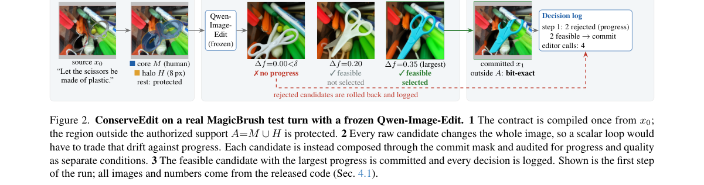

**Why this ranks #14**: 指令编辑方向的漂移控制：把每步精修当作对着源图契约的事务来做，在 1,053 条 MagicBrush 测试编辑上使受保护人脸或文字的违规率从 48% 降到 2%，约束成功率从 23% 升到 53%。

---

## 面向视觉生成的 RL 与奖励模型 · `aigc_rl` (3 papers)

本方向 3 篇打满基准 3 篇，主题是**探索效率与奖励信号本身的漏洞**。RiDEx 把局部探索限制在去噪速度场的奖励相关子空间里，用等幅反向扰动测终端奖励响应，其梯度方向实现在 HPSv2 与 PickScore 上比 DiffusionNFT 早 15×/29× 达成同一目标（按 H200 GPU 小时计）。Motion-Aware Reward Modeling 先把「运动坍塌」量化：现成复合奖励在 VE-Bench 上有 97% 的情况更偏好被压掉运动的候选，加 RGB 帧差流与偏好训练后这个比例降到 0%，与人类质量评分的 Spearman 相关 0.57。When Anchors Shift the Target 则指出前向过程 RL 用移动锚点稳定训练的同时也改变了正样本在学什么，用 Advantage-Gated Adaptation 把两件事解耦：正样本保持自限的目标回归，负样本改用凹目标的一阶切线。

### 15. RiDEx: Reward-Informed Directional Exploration for Diffusion Reinforcement Learning

**arXiv**: [2611.22052](https://arxiv.org/abs/2611.22052) | **Score**: 8.7 (relevance 9 x 0.7 + quality 8 x 0.3) | **Direction**: `aigc_rl` | **Tags**: AIGC-visual, diffusion-rl, reward-guided-exploration, subspace-search, hpsv2, diffusion-nft, University of Science and Technology of | **Categories**: cs.CV, cs.LG | **Pages**: 23

**Authors**: Song Yan; Chenfeng Wang; Wei Zhai; Xingchen Wang; Tao Zhang; Yawen Shao; Shi Pan; Min Li; Zheng-Jun Zha

**Affiliation**: University of Science and Technology of China; Li Auto Inc.; Huazhong University of Science and Technology; Tongyi Lab; Xi'an High-tech Research Institute

**Abstract**

> Reward-based diffusion post-training updates model parameters from task rewards. While existing approaches improve sampling and policy optimization, they still rely largely on isotropic random perturbations in a high-dimensional latent space for exploration. Such variation often spends the perturbation budget on changes with little influence on the target reward, making exploration inefficient. We study where diffusion models should explore and how to learn from that exploration. We introduce Reward-Informed Directional Exploration (RiDEx), which concentrates local exploration in reward-relevant subspaces of the denoising velocity field. Conditional residuals or differentiable reward gradients propose the subspace, and equal-and-opposite perturbations at the same generation state measure its terminal reward response. The reward difference supplies signed local supervision in the explored coordinates, while all generated images contribute to global DiffusionNFT learning. RiDEx thereby couples exploration-space selection with feedback about the changes it produces. On Stable Diffusion 3.5 Medium, RiDEx attains the highest peak rewards among the evaluated methods on four alignment and preference tasks. Its gradient-direction instantiation achieves 15x and 29x target-attainment speedups over DiffusionNFT on HPSv2 and PickScore, measured in H200 GPU hours. Controlled experiments confirm that reward-aligned directions elicit stronger responses at equal perturbation magnitude, and that applying their measured credit improves curve-average reward across all four tasks.

**Key findings**

- **Finding**: RiDEx 在 SD3.5 Medium 上把 GenEval 提到 0.9733、OCR 提到 0.9683、HPSv2 提到 38.5154、PickScore 提到 24.0847，全面超过 DiffusionNFT 的 0.9501/0.9285/34.2538/22.6407。
- **Inference**: 各向同性噪声把扰动预算浪费在与奖励无关的改动上，定向探索让同样预算换来更大的奖励响应。
- **Recommendation**: 做扩散后训练时先探测奖励梯度或条件残差的方向，在该方向做等幅正负扰动，再用奖励差构造局部监督。

**Key figures**

*Framework - Reward-informed exploration turns targeted changes into learning signals. Left: At equal perturbation norm, unrelated variations leave the chair blue, whereas a reward-relevant change target*

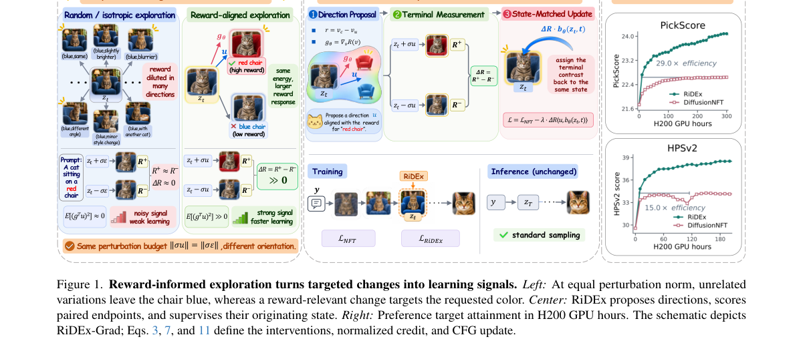

*Result - Reward-efficient learning in H200 GPU hours. Dashed lines mark the shared target in each panel, with attainment measured at the first checkpoint reaching that score. Table 2 gives the corres*

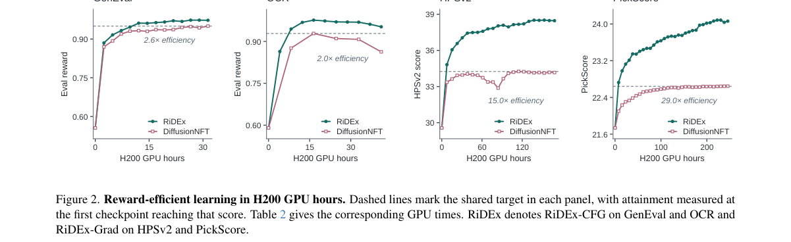

**Why this ranks #15**: 扩散强化学习方向的探索机制：把探索限制在奖励相关子空间后，SD3.5 Medium 上 GenEval、OCR、HPSv2、PickScore 四项峰值奖励全部第一，HPSv2 与 PickScore 追平 DiffusionNFT 目标分别快 15 倍与 29 倍。

---

### 16. Motion-Aware Reward Modeling for Instruction-Guided Video Editing

**arXiv**: [2611.22495](https://arxiv.org/abs/2611.22495) | **Score**: 8.0 (relevance 8 x 0.7 + quality 8 x 0.3) | **Direction**: `aigc_rl` | **Tags**: AIGC-visual, video-reward-model, motion-collapse, frame-difference, preference-training, motion-suppression, University of Southern California | **Categories**: cs.AI, cs.CV | **Pages**: 15

**Authors**: Li Li; Xiangbo Gao; Bo Ni; Samyadeep Basu; Viet Dac Lai; Jing Shi; Seunghyun Yoon; Gang Wu; Yu Wang; Thien Huu Nguyen; Tyler Derr; Franck Dernoncourt

**Affiliation**: University of Southern California; Texas A&M University; Vanderbilt University; Adobe; University of Georgia

**Abstract**

> Reward models for instruction-guided video editing can favor temporal consistency at the expense of motion. We study this failure, termed \emph{motion collapse}, using controlled motion-suppression variants of real edits. On VE-Bench, the evaluated composite reward prefers a motion-suppressed candidate in $97\%$ of cases. Learned video rewards and a VLM judge also struggle with mild suppression, while latent optimization and reward-guided fine-tuning exploit this weakness to increase reward as motion declines. A linear probe of our base reward backbone performs near chance on mild suppression, motivating an explicit inter-frame dynamics input. We propose a motion-aware reward model that combines an RGB frame-difference stream with preference training against motion-suppressed and fabricated-motion negatives. A distillation anchor preserves alignment with human quality judgments. On the VE-Bench motion ladder, our model reduces the rate of selecting motion-suppressed candidates to $0\%$ while achieving a Spearman correlation of $0.57$ with human quality ratings. It also detects unseen suppression variants and preserves motion during reward-guided fine-tuning on two editing pipelines. These results support explicitly modeling motion in rewards for video editing.

**Key findings**

- **Finding**: 现有复合奖励在 VE-Bench 上 97% 的情况偏好运动被压制的候选（去掉时序项降到 62%，在 UniVideo 上从 100% 降到 83%），新增动力学流后该比例降到 0%，与人类 MOS 的 Spearman 仍有 0.57。
- **Inference**: 奖励模型只读像素特征时对轻度运动压制近乎无感（线性探针 52.9%，接近随机），必须显式输入帧间动态。
- **Recommendation**: 训练视频奖励模型时加入帧差或光流输入，并用运动抑制负样本加蒸馏锚点，分别防止漏检和过度偏向运动。

**Key figures**

*Framework - Motion-aware reward model. The pixel stream encodes source and edited videos, while a dynamics stream computes tanh- normalized RGB differences of the edited video. Their features are fused*

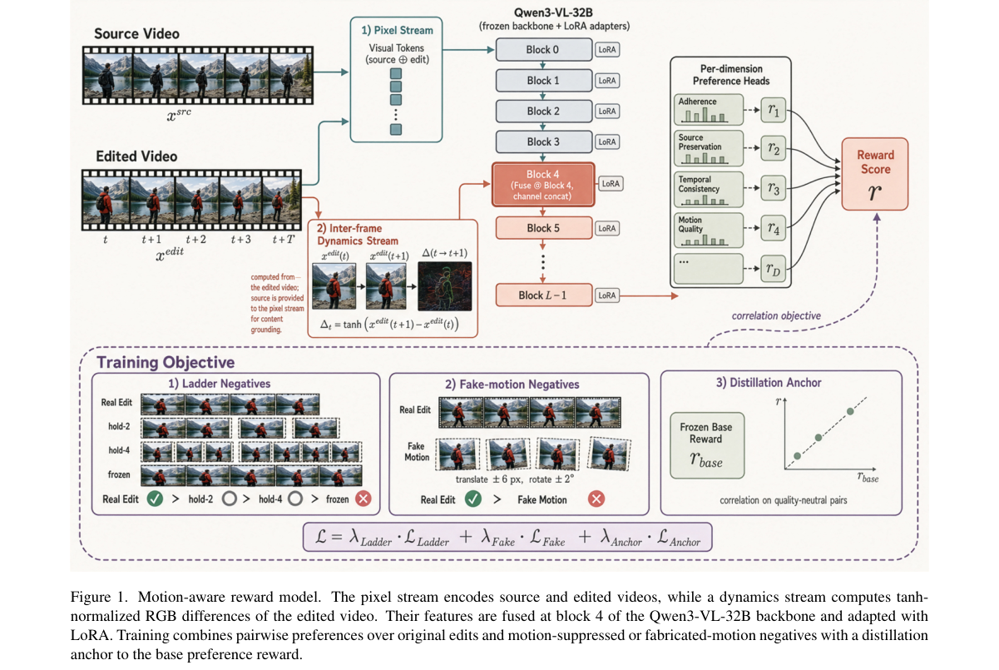

*Result - Motion collapse on VE-Bench. Left: mean rewards along the motion ladder, min–max normalized per reward; VideoReward uses its motion-quality head. Right: top-1 capture rate: the fraction of c*

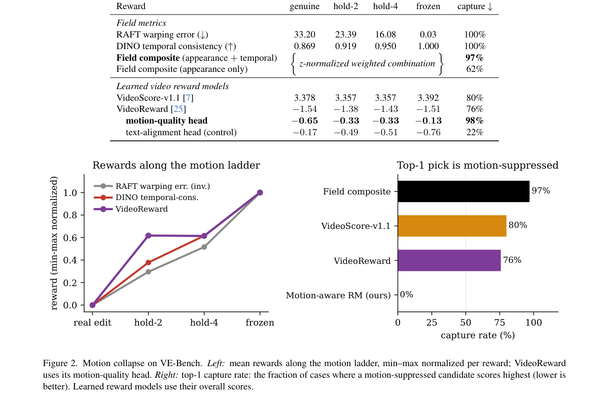

**Why this ranks #16**: 视频奖励模型方向：指出指令引导视频编辑的复合奖励在 VE-Bench 上有 97% 的概率偏好运动被压制的候选，加入帧差动力学流后该比例降到 0%，与人类 MOS 的 Spearman 仍保持 0.57。

---

### 17. When Anchors Shift the Target: Advantage-Gated Adaptation for Diffusion Reinforcement Learning

**arXiv**: [2611.23038](https://arxiv.org/abs/2611.23038) | **Score**: 8.0 (relevance 8 x 0.7 + quality 8 x 0.3) | **Direction**: `aigc_rl` | **Tags**: AIGC-visual, forward-process-rl, advantage-gating, moving-anchor, reward-quality-tradeoff, geneval, Beijing University of Posts and | **Categories**: cs.CV, cs.LG | **Pages**: 12

**Authors**: Pu Cao; Min Zhou; Ying Shu; Tiezheng Ge; Qing Song; Lu Yang

**Affiliation**: Beijing University of Posts and Telecommunications; Alibaba Group

**Abstract**

> Forward-process reinforcement learning adapts diffusion and flow-matching models by re-noising rewarded generations into regression targets. Because negative advantages induce concave updates with unbounded repulsive gradients, existing methods stabilize training using cached predictions from a moving policy copy, yet these anchors also alter what positive feedback teaches the model to fit. We formalize this conflict as anchor coupling: after separating frozen-reference regularizers, affine moving-anchor rules cannot eliminate negative curvature while preserving every positive regression target. We propose Advantage-Gated Adaptation (AGA) to decouple these roles. Positive samples retain standard target fitting, whose self-limiting update vanishes at the observed target independently of the moving anchor. Negative samples instead use the first-order tangent of the concave objective at the moving-policy prediction, preserving the local repulsion direction with a prediction-independent gradient. Within the quadratic-anchor family, these requirements uniquely determine the parameter-free gate $ω(a)=\max(-a,0)$. Because the moving copy provides local linearization rather than retention, AGA assigns long-horizon behavior preservation to a frozen pretrained reference regularized at its operating classifier-free guidance scale, interpreted through an implicit-reward lens. Across compositional generation, text rendering, and preference alignment, our experiments show that displacing positive targets degrades visual quality and heightens sensitivity to policy-copy schedules, whereas AGA consistently improves the reward--quality trade-off.

**Key findings**

- **Finding**: 完整 AGA 在 SD3.5-Medium 上取得 GenEval 0.96、OCR 0.97、PickScore 23.57，并在留出的 DrawBench 上拿到最高 Aesthetic 6.30 与 PickScore 23.89、ImageReward 1.29。
- **Inference**: 仿射锚定规则同时支配正负两个分支，必然在稳定负梯度时挪动正样本的回归目标，画质先崩后 OCR 精度从峰值跌到 0.34。
- **Recommendation**: 做前向过程 RL 时把正负分支解耦：正样本照原目标回归，负样本只用移动策略预测的一阶切线。

**Key figures**

*Framework - Anchor rules across feedback signs. (a) For a > 0, AGA hits u, while affine rules shift the target and all-sign tangent overshoots. (b) For a < 0, AGA fixes the step via va instead of growin*

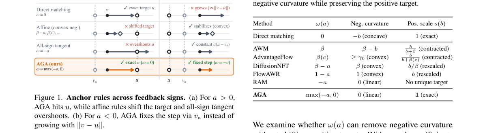

*Result - Positive fitting preserves quality during reward learn- ing. With the same negative tangent branch, AGA sustains OCR accuracy and DrawBench quality, whereas the all-sign tangent rule (ω = −a*

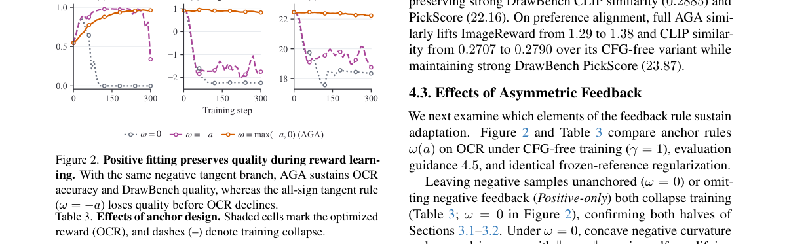

**Why this ranks #17**: 扩散强化学习方向的锚定修正：推导出无参数门控 ω(a)=max(-a,0)，让负优势用移动策略副本做切线、正优势保留原回归目标，三项任务分同时最高且留出的 DrawBench 画质不掉。

---

## Footer

- Total papers reviewed across all 4 axes: 60
- aigc_visual axis final count: 17
- Wild-cards in this axis: 0
- Figure assets: 2026-11-19/res/

Generated by `mine-arxiv-daily-digest` skill. Sister file: `2026-11-19_aigc_visual_entry.md`.
