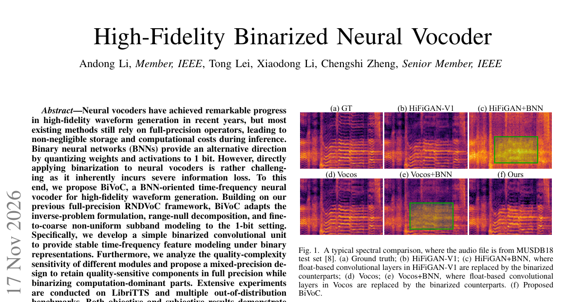
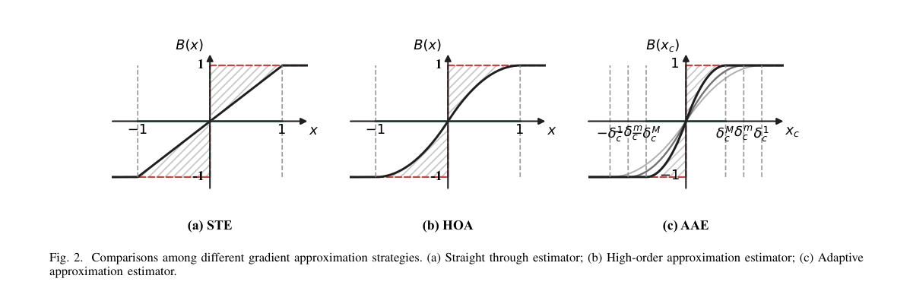
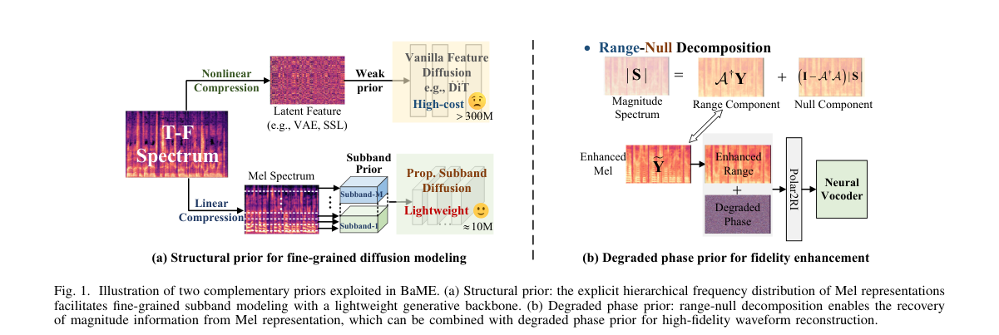
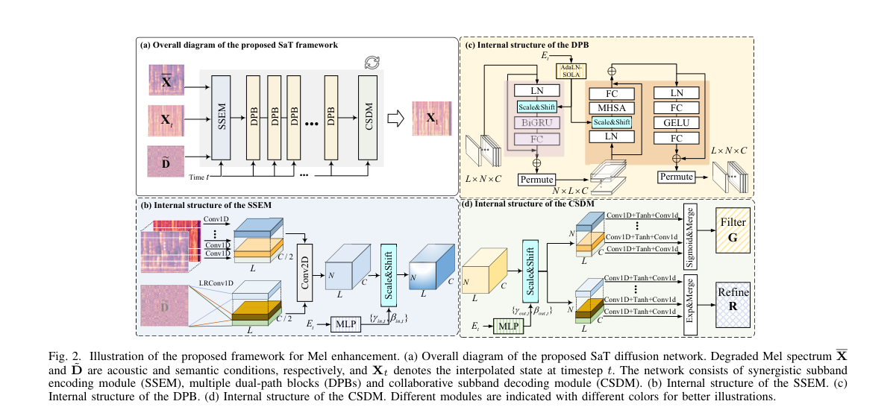
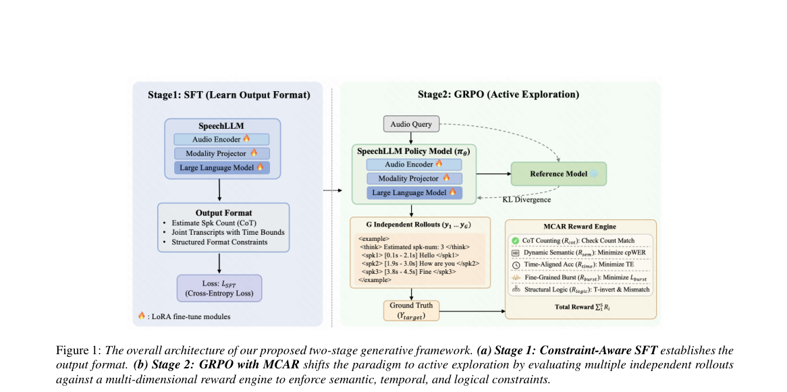

# Mine Arxiv Daily Digest - 2026-11-19 (全双工语音与语音 LM Axis, 3 papers)

**Generated**: 2026-11-19 01:20 CST

**Source**: arXiv cs.CV, cs.SD, eess.AS, cs.CL, cs.AI, cs.RO, cs.LG, cs.IR submissions, listing day 2026-11-17 (announced 2026-11-18 01:00 UTC)

**Batch window**: 2026-11-16T19:00:00Z .. 2026-11-17T19:00:00Z（arXiv 公告批次横跨两个 UTC 日：从前一日的美东 14:00 截止时刻起算（EDT 为 18:00Z，EST 为 19:00Z），到当日的同一时刻为止）

**Axis**: duplex_speech (3 papers, base 12, cap 20)

**Directions**: duplex_speech_core (2), speech_rl (1)

**Selection**: 3 papers ranked by relevance x quality, with 0 wild-card slots

**Day total**: 60 papers across 4 axes (target 60)

**Scope**: 全双工 / 实时 / 流式语音语言模型、speech-to-speech 语音助手、TTS / 语音克隆 / 语音转换，以及语音大模型的 RL 与奖励模型

**Wild-card**: 0（本 axis 供给断供，未启用任何 wild-card 补位名额）

`duplex_speech_core` 让出 6 篇、`speech_rl` 让出 3 篇，合计 9 个名额按富余量重分配到 `aigc_visual`(+2)、`llm_vlm`(+2)、`world_embodied`(+5)。wild-card 的启用条件是「比够格论文更该进」——本轴的空缺来自候选供给不足而非配额竞争，用 wild-card 填位会掩盖真实的断供，所以不启用。

⚠️ **供给断供**：本轴仅 3 篇（基准 12，缺口 9 篇），是当日四个轴里唯一明显供给不足的轴。

**证据**：587 篇候选里 primary 落在 `duplex_speech_core` 的只有 9 篇、`speech_rl` 的只有 1 篇（含跨 direction 命中合计 12 篇）；按 relevance≥5 下限过滤后只剩 6 篇与 1 篇，rel≥8 的只剩 2 篇与 1 篇，rel≥9 的**只有** `speech_rl` 的 2611.22627 一篇。而这唯一的一篇正是必须进（rel≥9 必进），所以本轴 3 篇里有 1 篇是硬约束入选、2 篇是常规入选。

**让位去向**：按「薄 direction 让出名额而不是被填充」的口径，`duplex_speech_core` 给出 6 篇、`speech_rl` 给出 3 篇，合计 9 个名额按富余量重分配到候选最充裕的轴——`aigc_visual` +2、`llm_vlm` +2、`world_embodied` +5，后两轴因此撞上 AXIS_CAP = 20。

**缺口方向明确**：本轴 3 篇里没有一篇是全双工 / 实时语音对话本体——2 篇 `duplex_speech_core` 都落在语音增强与声码器侧（二值化神经声码器、Mel 谱生成式增强），1 篇 `speech_rl` 是多说话人 ASR 加联合分离的 GRPO。这不是筛选过严，而是该 listing 窗口内语音方向的供给本来就薄。

---

## 全双工语音与语音 LM · `duplex_speech_core` (2 papers)

本方向只有 2 篇（基准 8），是全批最薄的 direction 之一，按口径让出名额而不是被填充。两篇都出自中科院声学所与腾讯混元：BiVoC 把神经声码器整体二值化（权重与激活压到 1 bit），针对二值化固有的信息损失重新设计了逆问题形式化、range-null 分解与细到粗的非均匀子带建模；BAME 则反过来回到 Mel 谱，用带子带感知的 Transformer（SaT）做流匹配式生成语音增强，只用 2.9% 的参数就超过 331M 的 DiT 骨干，并配相位感知神经声码器处理不可靠相位。本方向没有全双工/实时语音对话本体的论文入选。

### 1. High-Fidelity Binarized Neural Vocoder

**arXiv**: [2611.22593](https://arxiv.org/abs/2611.22593) | **Score**: 8.0 (relevance 8 x 0.7 + quality 8 x 0.3) | **Direction**: `duplex_speech_core` | **Tags**: duplex-speech, binary-neural-network, neural-vocoder, mel-spectrogram, subband-modeling, range-null-decomposition, Institute of Acoustics | **Categories**: cs.SD | **Pages**: 15

**Authors**: Andong Li; Tong Lei; Xiaodong Li; Chengshi Zheng

**Affiliation**: Institute of Acoustics, Chinese Academy of Sciences; University of Chinese Academy of Sciences; Tencent

**Abstract**

> Neural vocoders have achieved remarkable progress in high-fidelity waveform generation in recent years, but most existing methods still rely on full-precision operators, leading to non-negligible storage and computational costs during inference. Binary neural networks (BNNs) provide an alternative direction by quantizing weights and activations to 1 bit. However, directly applying binarization to neural vocoders is rather challenging as it inherently incurs severe information loss. To this end, we propose BiVoC, a BNN-oriented time-frequency neural vocoder for high-fidelity waveform generation. Building on our previous full-precision RNDVoC framework, BiVoC adapts the inverse-problem formulation, range-null decomposition, and fineto-coarse non-uniform subband modeling to the 1-bit setting. Specifically, we develop a simple binarized convolutional unit to provide stable time-frequency feature modeling under binary representations. Furthermore, we analyze the quality-complexity sensitivity of different modules and propose a mixed-precision design to retain quality-sensitive components in full precision while binarizing computation-dominant parts. Extensive experiments are conducted on LibriTTS and multiple out-of-distribution benchmarks. Both objective and subjective results demonstrate that BiVoC substantially outperforms BNN variants obtained by directly binarizing existing vocoders, while achieving competitive performance against several mainstream full-precision vocoder baselines under much lower theoretical computational cost. These results demonstrate the promising potential of BNNs in the audio generation field. Codes and pre-trained weights are available at https://github.com/Andong-Li-speech/BiVoC.

**Key findings**

- **Finding**: 论文把二值卷积的权重与激活压到 1 bit，参数按 1/32、OPs 按 1/64 计入，等价于二值算子相对浮点卷积有 32× 显存压缩与最高 64× 算力下降；消融表中 AAE 代理梯度在 LibriTTS 上给出 PESQ 3.055、M-STFT 1.024、VISQOL 4.705，优于 STE 的 3.009。
- **Inference**: 声码器的推理瓶颈主要来自全精度算子而非模型规模，所以把 range-null 分解（可解析恢复的 range-space 分量交给线性变换）配合混合精度设计，比直接把 HiFiGAN / Vocos 二值化更能守住高保真重建。
- **Recommendation**: 要在边缘设备上跑实时 TTS 或语音助手，先照本文骨架用 range-null 分解替代直接二值化基线，再按 head/body/tail 的精度敏感度分析保留质量敏感模块的全精度，并把优化重点放在层级子带建模与 AAE 代理梯度上。

**Key figures**

*Framework - A typical spectral comparison, where the audio file is from MUSDB18 test set [8]. (a) Ground truth; (b) HiFiGAN-V1; (c) HiFiGAN+BNN, where float-based convolutional layers in HiFiGAN-V1 are re*

*Result - Comparisons among different gradient approximation strategies. (a) Straight through estimator; (b) High-order approximation estimator; (c) Adaptive approximation estimator.*

**Why this ranks #1**: 首个把 1-bit 权重与激活二值化用到高保真神经声码器的工作：二值算子理论上可带来 32× 显存压缩与最高 64× 算力下降，并在 LibriTTS 上用 AAE 代理梯度把 PESQ 做到 3.055，直接服务于 TTS / 语音助手端的低功耗波形合成链路。

---

### 2. Back to Mel: Learning to Bridge Fidelity and Perception in Generative Speech Enhancement

**arXiv**: [2611.22628](https://arxiv.org/abs/2611.22628) | **Score**: 8.0 (relevance 8 x 0.7 + quality 8 x 0.3) | **Direction**: `duplex_speech_core` | **Tags**: duplex-speech, flow-matching, speech-enhancement, mel-spectrum, subband-transformer, neural-vocoder, Institute of Acoustics | **Categories**: cs.SD | **Pages**: 18

**Authors**: Andong Li; Kun Zhou; Xiaodong Li; Chengshi Zheng

**Affiliation**: Institute of Acoustics, Chinese Academy of Sciences; University of Chinese Academy of Sciences; Telecom Paris

**Abstract**

> Recent generative techniques have facilitated the rapid proliferation of speech enhancement approaches built upon learnable compact latent representations and large generative backbones. Nevertheless, it remains inherently challenging to balance between acoustic fidelity, perceptual quality, and processing efficiency. In this paper, we revisit the Mel spectrum as a structured acoustic representation and propose BAME, a flow-matching-based framework that exploits the complementary priors for generative speech enhancement task. First, leveraging the explicit hierarchical frequency distribution of Mel spectrum, we elaborately devise a subband-aware Transformer (SaT) for efficient generative modeling. Using only 2.9% of the parameters, the proposed SaT achieves superior enhancement performance compared with a 331 M DiT backbone. Second, motivated by range-null decomposition theory of Mel filtering in the magnitude-spectral domain, we introduce a phase-aware neural vocoder that incorporates degraded-phase prior, together with a quality-guided dual-phase strategy to adaptively mitigate the effects of unreliable phase information. Third, we devise a simple yet effective one-step fidelity-perception alignment strategy that fine-tunes the flow model with complementary constraints from fidelity and perception domains. Extensive experiments are conducted on DNS-Challenge, EARS, GSR, and URGENT benchmarks, and both objective and subjective results demonstrate promising performance on various intrusive and non-intrusive evaluation metrics. These results further advocate the potential of exploiting structured acoustic representations for reliable and efficient generative speech enhancement. Audio samples and codes are available at https://github.com/AndongLi-speech/BAME.

**Key findings**

- **Finding**: 表 IV 显示 SaT 骨干仅用 DiT-331M 的 2.9% 参数与 66.6% 计算量，接上 DeWavLM 语义抽取器后整套模型 332.38 M 参数、73.43 Giga/s，在 DNS-Challenge 2020 上 PESQ 2.630、eSTOI 0.838、WER 4.269%；去掉语义抽取器则降至 15.45 M 参数、PESQ 2.487、WER 9.242%。
- **Inference**: 生成式增强的瓶颈不在骨干容量而在表示结构，Mel 频带的层级结构允许 25 个子带、11.2 M 参数的小模型承担细粒度建模，从而把算力从骨干转到表征先验上。
- **Recommendation**: 搭生成式降噪链路时优先复用其子带 Transformer + 相感知神经声码器（24 子带、12 个 LKCAB）的组合，并用一步保真-感知对齐做单步推理，以同时守住参考一致性与感知质量。

**Key figures**

*Framework - Illustration of two complementary priors exploited in BaME. (a) Structural prior: the explicit hierarchical frequency distribution of Mel representations facilitates fine-grained subband model*

*Result - Illustration of the proposed framework for Mel enhancement. (a) Overall diagram of the proposed SaT diffusion network. Degraded Mel spectrum X and ˜D are acoustic and semantic conditions, resp*

**Why this ranks #2**: 把生成式语音增强的表示重新拉回结构化的 Mel 频谱：SaT 骨干只用 DiT-331M 的 2.9% 参数和 66.6% 计算量，在 DNS-Challenge 2020 上仍拿到 PESQ 2.487、WER 9.242%，并用一步 OS-FPA 把采样压到单步，落在 duplex_speech_core 的语音增强与波形重建链路上。

---

## 语音 LM 的 RL 与偏好优化 · `speech_rl` (1 papers)

本方向只有 1 篇（基准 4），按口径让出名额。Beyond Mimicry 用两阶段生成式框架做说话人数未知的多说话人 ASR 加联合分离：先 CoT 增强 SFT 推断全局说话人数，再 GRPO 在多维约束感知奖励（计数、时序、结构三重约束）下做受约束探索，Libri3Mix 与 Dynamic-Mix(2+3) 上 cpWER 14.52%/9.24%、WDER 1.95%/1.12%，相对 SFT+CoT 的 cpWER 相对下降 35%/54%。

### 3. Beyond Mimicry: Constrained Exploration with GRPO for Joint Multi-Talker ASR and Diarization under Unknown Speaker Counts

**arXiv**: [2611.22627](https://arxiv.org/abs/2611.22627) | **Score**: 8.7 (relevance 9 x 0.7 + quality 8 x 0.3) | **Direction**: `speech_rl` | **Tags**: duplex-speech, grpo, multi-talker-asr, speaker-diarization, chain-of-thought, speech-llm, Chinese University of Hong Kong | **Categories**: cs.SD | **Pages**: 5

**Authors**: Yunrui Cai; Dingdong Wang; Lingwei Meng; Xixin Wu; Zhiyong Wu; Helen Meng

**Affiliation**: The Chinese University of Hong Kong; Tsinghua University

**Abstract**

> Joint multi-talker ASR with speaker attribution and timestamps is particularly challenging when the speaker count is unknown and the output must follow a strict structure. We observe that Supervised Fine-Tuning (SFT)-only alignment of SpeechLLMs is brittle under dense overlaps, often leading to burst hallucinations and malformed speaker/timestamp tags. We propose a unified two-stage generative framework: (i) CoT-augmented SFT that infers the global speaker count before transcription, and (ii) GRPO-based constrained exploration guided by a Multi-dimensional Constraint-Aware Reward (MCAR) that directly optimizes permutation-invariant accuracy while enforcing counting, temporal, and structural constraints. On Libri3Mix and a Dynamic-Mix (2+3) set (speaker count unknown at test time), our model achieves 14.52%/9.24% cpWER and 1.95%/1.12% WDER, respectively, with GRPO yielding a 35%/54% relative cpWER reduction over SFT+CoT.

**Key findings**

- **Finding**: 表 1 显示 Qwen2.5-Omni-7B 零样本在 Dynamic-Mix 上 cpWER 69.3%、CoT-Acc 仅 32.25%，加 SFT 降到 24.78%，加 CoT 提示降到 20.17%，再经 GRPO 收尾把 cpWER 压到 9.24%、WDER 降到 1.12%、CoT-Acc 提到 99.72%。
- **Inference**: 纯 SFT 的教师强制从不在模型自己的畸形输出上训练，而人数计数与时间戳这类约束是序列级、不可微的，只有 on-policy 的多维奖励才能真正纠正说话归属与时间边界。
- **Recommendation**: 若要把 SpeechLLM 用到重叠语音，先补显式估计全局人数的 CoT 前缀，再用 PI-WER 加计数、时间、结构与爆发惩罚做 GRPO；消融显示去掉计数奖励会让 cpWER 从 9.24% 反弹到 18.02%。

**Key figures**

*Framework - The overall architecture of our proposed two-stage generative framework. (a) Stage 1: Constraint-Aware SFT establishes the output format. (b) Stage 2: GRPO with MCAR shifts the paradigm to a*

**Why this ranks #3**: 首次把 GRPO 成功用在说话人数未知的多说话人 ASR + 说话人日志联合任务上：Dynamic-Mix (2+3) 上 cpWER 9.24%、WDER 1.12%、CoT-Acc 99.72%，相对 SFT+CoT 的 cpWER 再降 35%/54%，正落在 speech_rl 的语音 RL 跟踪线上。

---

## Footer

- Total papers reviewed across all 4 axes: 60
- duplex_speech axis final count: 3
- Wild-cards in this axis: 0
- Figure assets: 2026-11-19/res/

Generated by `mine-arxiv-daily-digest` skill. Sister file: `2026-11-19_duplex_speech_entry.md`.
