# Mine Arxiv Daily Digest - 2026-11-19 (LLM / VLM 与其强化学习 Axis, 20 papers)

**Generated**: 2026-11-19 01:20 CST

**Source**: arXiv cs.CV, cs.SD, eess.AS, cs.CL, cs.AI, cs.RO, cs.LG, cs.IR submissions, listing day 2026-11-17 (announced 2026-11-18 01:00 UTC)

**Batch window**: 2026-11-16T19:00:00Z .. 2026-11-17T19:00:00Z（arXiv 公告批次横跨两个 UTC 日：从前一日的美东 14:00 截止时刻起算（EDT 为 18:00Z，EST 为 19:00Z），到当日的同一时刻为止）

**Axis**: llm_vlm (20 papers, base 18, cap 20)

**Directions**: llm_core (8), vlm_core (5), llm_vlm_rl (7)

**Selection**: 20 papers ranked by relevance x quality, with 0 wild-card slots

**Day total**: 60 papers across 4 axes (target 60)

**Scope**: 大语言模型与视觉语言模型的设计、推理、agent、效率与上下文工作，以及面向 LLM / VLM 的 RL 与偏好优化、奖励模型

**Wild-card**: 0（本 axis 已撞 AXIS_CAP = 20，20 篇全部为够格论文，未启用任何 wild-card 补位名额）

**配额**：本轴 20 篇（基准 18、上浮 2），**正好撞上 AXIS_CAP = 20**。三个 direction 是 8 / 5 / 7，`llm_vlm_rl` 超基准 2 篇，由同轴 `llm_core` 与 `vlm_core` 让位承接（未跨轴转出）。

**rel≥9**：本轴 6 篇 relevance≥9（CPTC、Kernel Reality Check、M3OPD-Reasoner、Regularized Score Centering、Nemotron 3.5 Super、Gaze-RL）全部入选。`llm_vlm_rl` 是全批 rel≥9 最密的 direction：32 篇候选里有 4 篇 rel≥9。

**供给**：587 篇候选里 primary 落在 `llm_core` 245 篇、`vlm_core` 103 篇、`llm_vlm_rl` 26 篇，本轴候选量最大，但 `llm_vlm_rl` 的基准只有 5 篇，超出部分按两级弹性上限规则停在 AXIS_CAP=20，不再向上溢出。

---

## LLM 核心（架构 / 推理 / agent / 效率 / 上下文） · `llm_core` (8 papers)

本方向 8 篇打满基准 8 篇（其中 2 篇 relevance≥9），主线是**把 LLM 的成本压下来、把它的自我改进放开**。量化侧有两篇实证：CPTC 用两次乘法加一个 64 字节查表支撑 1–6 bit 解码，4 bit 时距信息论下界只差 0.07 bit，在 Llama 3.1 8B/70B Instruct 上对未量化模型的 KL 散度全位宽最低（最多低 27%）；Beyond Bitwidth 则在 B200 上用 vLLM 压 Qwen3-8B，逐个验证 144 个融合线性模块的原生打包执行，最终配置（16-bit 激活、98 个 NVFP4 权重模块、46 个 INT8 模块、INT8 输出头）在 FINAL-81 上权重加载 5.917 GiB（限 5.98）、韩语教师一致率 0.904（门槛 0.90）、TPOT 比 BF16 为 0.939。效率侧 Kernel Reality Check 给了个不太舒服的结论：核化注意力在训练与 ViT 上比不过 FlashAttention，统一蒸馏协议下质量差距有 2–10 分，LARA++ 能追回最多 99% 的 softmax 精度。推理侧 VisHead-Spec 让 40 个 KV 头里的 8 个读图，batch 64 时吞吐增益从 DSpark 的 9.5% 升到 16.0%。另一半是「模型改自己」：27B 模型不靠梯度改自己的权重，在 490 道未见过的题上自改后准了 6.6 分；Conserved Verdicts 把「越想越错」拆开，在 379 个已答对的状态点上继续推理平均掉 3.6 分，oracle 停止规则最多也只赚 +1.8/+2.5 分；DiscoveryAgent 让科学家在轮次之间改假设，审计代理找错的 F1 达 96.5%，人类配审计代理发现的错误多 14 倍。

### 1. Computed Permutation Trellis Coding: Near-Optimal Quantization from Two Multiplications and a 64-Byte Table

**arXiv**: [2611.22019](https://arxiv.org/abs/2611.22019) | **Score**: 9.0 (relevance 9 x 0.7 + quality 9 x 0.3) | **Direction**: `llm_core` | **Tags**: LLM-VLM, trellis-coding, low-bit-quantization, llm-weight-quantization, trainium-4, Amazon Annapurna Labs | **Categories**: cs.AI, cs.AR, cs.IT, cs.LG | **Pages**: 38

**Authors**: Muhammed Fatih Balın

**Affiliation**: Amazon Annapurna Labs

**Abstract**

> We propose Computed Permutation Trellis Coding (CPTC), a low-bit quantization format for tensors written once and read many times. Formats that round each value on its own, such as INT4 and FP4, waste a large part of their bits against the information-theoretic ideal. Trellis codes recover this loss by encoding values jointly, but prior decoders either need a large lookup table for their best quality or compute values with a hash that restricts what they can decode. CPTC's decoder multiplies its state by two coefficients and adds the top bits of the products to index a 64-byte table. Because that sum is not uniformly distributed, the rarely used ends of a small table can hold values far out in the tails. One decoder serves every bit width from 1 to 6, reproduces the standard integer and floating-point formats exactly, and comes within 0.07 bits of the ideal at 4 bits. It matches a random-permutation trellis code whose table is thousands of times larger, and exceeds every QTIP codebook. In LLM weight quantization without fine-tuning, CPTC has the lowest KL divergence to the unquantized model at every tested bit width on Llama 3.1 8B and 70B Instruct against QTIP's codebooks (by up to 27%). The decoder has been built into the AWS Trainium 4 AI accelerator, where it runs at the throughput of the native FP4 and FP8 formats for a negligible fraction of the systolic array's area. Fused encoding kernels quantize an 8B model's linear layers in under two minutes on one GPU and, in cycle-level simulation, on one Trainium 4 chip.

**Key findings**

- **Finding**: CPTC 解码器只用两次乘法把状态乘上两个系数，再把乘积高位相加去索引一张 64 字节表，一个解码器覆盖 1 到 6 bit，4 bit 时距理想值仅差 0.07 bit。
- **Inference**: trellis 的联合编码收益主要来自小表加非均匀索引，而非大查表，这类低比特格式可在无微调下替代常规 INT4/FP4 码本。
- **Recommendation**: 做权重压缩时把 CPTC 当作 INT4/FP4 的替选候选，并用 KL 散度而非困惑度在自家模型上对比 QTIP 码本。

**Key figures**

*Result - The CPTC decoder for one value (Q=6, Algorithm 1): the state shifts right to take the next K stream bits, the top six bits of its two products are added, and the sum indexes the 64-byte tabl*

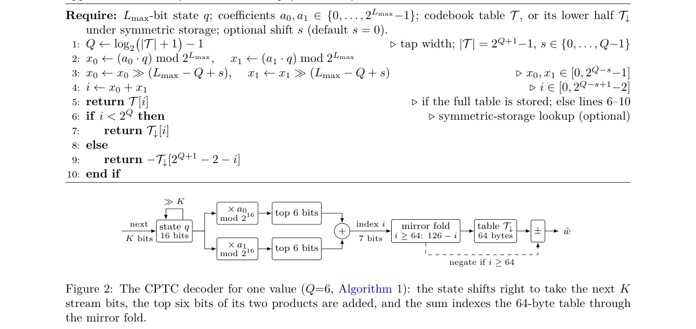

**Why this ranks #1**: CPTC 用两次乘法和一张 64 字节查表完成 1 到 6 bit 的解码，4 bit 时距信息论理想仅差 0.07 bit；在 Llama 3.1 8B 与 70B Instruct 的权重量化上，对 QTIP 码本的 KL 散度最多低 27%，故归入 llm_core 的量化方向。

---

### 2. The Kernel Reality Check: Benchmarking and Distilling Efficient Attention at Scale

**arXiv**: [2611.22947](https://arxiv.org/abs/2611.22947) | **Score**: 9.0 (relevance 9 x 0.7 + quality 9 x 0.3) | **Direction**: `llm_core` | **Tags**: LLM-VLM, kernelized-attention, attention-benchmark, distillation, linear-attention, softmax-approximation, Concordia University | **Categories**: cs.LG | **Pages**: 20

**Authors**: Fırat Öncel; Cem Subakan; Mirco Ravanelli; Çağatay Yıldız

**Affiliation**: Concordia University; Mila - Quebec AI Institute; Laval University

**Abstract**

> Kernelized attention methods, which aim to replace the $O(N^2)$ complexity of softmax attention with $O(N)$ alternatives, have been the focus of intense research in the last five years. Despite growing interest, systematic evaluations and fair comparisons across approaches and scales are still missing. We analyze kernelized attention in two halves and highlight prominent limitations on each. On efficiency, FlashAttention achieves lower memory consumption and faster wall-clock time than SOTA kernelized methods during training and in vision transformers across most sequence lengths (with inference-time memory in causal language models the only clear exception), contradicting the core assumption for pure kernelized attention used as a drop-in replacement for softmax. We also discover that reported efficiency gains often fail to reproduce against modern baselines. On quality, current kernelized methods leave gaps of 2-10 points relative to softmax under a unified distillation protocol, and model scala alone does not close these gaps. We show this gap is not intrinsic to kernelization: LARA++, a principled extension of LARA that approximates softmax via importance sampling with adaptive proposal distributions, recovers up to 99% of softmax accuracy. We establish that the gap is closable; however, the computational overhead remains substantial, leaving the efficiency wall intact. Code is available at https://github.com/firatoncel/KernelRealityCheckNeurIPS2026

**Key findings**

- **Finding**: 在统一蒸馏协议下，现有 kernelized attention 方法相对 softmax 落后 2 到 10 分，单纯放大模型规模并不能弥合该差距。
- **Inference**: 差距不是 kernelization 本身的固有缺陷，而是此前具体设计取舍带来的结果。
- **Recommendation**: 选线性注意力前先在同一蒸馏协议下与 FlashAttention 对比，不要直接引用论文自报的速度增益。

**Key figures**

*Framework - Memory and computational efficiency across sequence lengths (ViT-S, A100 GPU).*

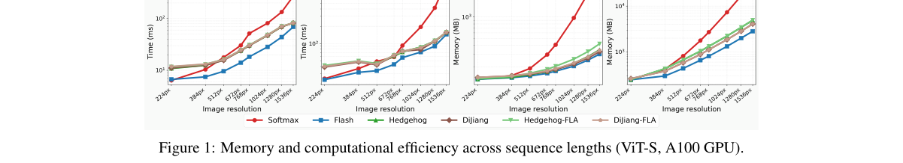

*Result - Memory and computational efficiency across sequence lengths (GPT2-S, A100 GPU). Markers and solid lines are measured; dashed lines are log-domain extrapolations beyond 16K tokens or past out*

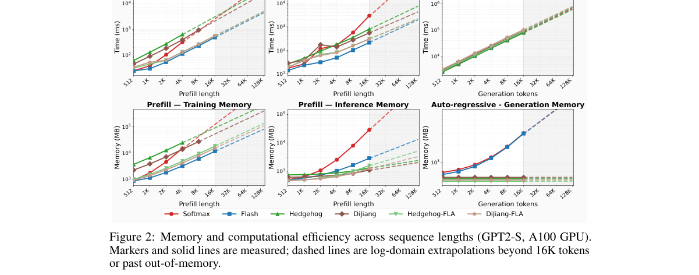

**Why this ranks #2**: 论文对 kernelized attention 做统一基准：训练与 ViT 上 FlashAttention 的内存与墙钟时间反而优于现有线性注意力方法；统一蒸馏协议下现方法落后 softmax 2 到 10 分，LARA++ 最多追回 99%，属于 llm_core 的注意力效率与质量评测核心。

---

### 3. Language Models Can Rewrite Their Own Weights

**arXiv**: [2611.21885](https://arxiv.org/abs/2611.21885) | **Score**: 8.3 (relevance 8 x 0.7 + quality 9 x 0.3) | **Direction**: `llm_core` | **Tags**: LLM-VLM, self-rewriting, model-editing, self-improvement, no-gradients, weight-update, UIUC | **Categories**: cs.AI | **Pages**: 62

**Authors**: Jiajun Fan; Neil He; Changyi Yang; Andy Mao; Xi Zhu; Chaoran Cheng; Kaiqu Liang; Shuaike Shen; Zetian Li; Ruihan Guo; Ge Liu

**Affiliation**: UIUC; Carnegie Mellon University; Rutgers University; Princeton University; Stanford University

**Abstract**

> Language models are trained once, frozen and deployed: improving one again takes another training run, and a prompt, a scaffold or extra computation at inference is gone once the task ends. A frontier model has been shown to edit the weights of a much smaller one. We ask whether a model can rewrite its own weights to make itself better, and find that it can, by its own reasoning, with no gradients and no training; we call this self-rewriting. Given its weights, graded answers and the ability to run itself, a 27B model diagnoses its failure and edits the weights behind it. It surpasses itself: its own edit makes it 6.6 points more accurate on 490 problems it never saw, in a test fixed in advance, and another session's edit also makes it significantly better. It keeps getting better: it submits an edit only when its own tests support it, each edit replacing the last, and over its first eight such sessions its accuracy only rises. Unlike test-time scaling, the gain persists in its weights and adds no cost per answer; unlike training, it needs no pre- or post-training infrastructure, only an open model and hours on one GPU. It repairs a damaged copy of itself: it locates the corrupted matrix and rewrites it with values of its own, never reading the undamaged weights; found on text math problems alone, the repair lifts the copy on six image benchmarks it never saw from 7% to 70% accuracy, 83% of the undamaged model's. And the ability emerges with scale: across four sizes of one family, the 2B model makes no edit and the 4B and 9B models break themselves; only the 27B model works on itself as a human would, comparing its hidden states on answers that finish and on answers that run out of tokens, weakening the direction that separates them. Like a human, a model need not separate training from inference; improving a language model may come to take a conversation rather than a training run.

**Key findings**

- **Finding**: 27B 模型靠自身推理改写权重，在 490 道预先固定的未见题上准确率提高 6.6 分，且前八次会话的准确率只升不降。
- **Inference**: 自我改写把推理时算力的一次性收益固化进权重，不增加每次回答的成本，与测试时扩展的收益会随会话结束而消失不同。
- **Recommendation**: 复现请用开放权重模型加单机数小时算力，先固定评测集再看是否值得让模型自行编辑权重。

**Key figures**

*Framework - A 27B language model rewrites its own weights, with no training, and becomes significantly better on problems it never saw. (a) Accuracy, on 490 held-out problems with eight answers each, of*

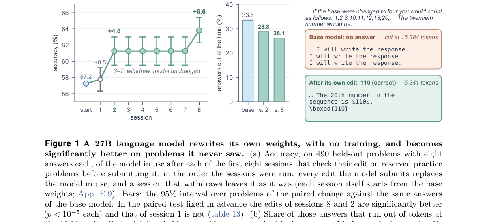

**Why this ranks #3**: 27B 模型无需梯度即可改写自身权重，在预先固定的 490 道未见题上准确率提升 6.6 分；自损坏副本仅凭文本数学题定位并重写被破坏矩阵，六个图像基准从 7% 回升到 70%（未损坏模型的 83%），是 llm_core 中少见的权重自编辑实证。

---

### 4. Conserved Verdicts, Drifting Commitments: Identifying Harmful Overthinking

**arXiv**: [2611.21946](https://arxiv.org/abs/2611.21946) | **Score**: 8.3 (relevance 8 x 0.7 + quality 9 x 0.3) | **Direction**: `llm_core` | **Tags**: LLM-VLM, overthinking, stopping-rule, reasoning-models, math-500, inference-budget, [unverified] | **Categories**: cs.AI, cs.CL, cs.LG | **Pages**: 40

**Authors**: Jianghong Zhou; Hao Rong; Chen Lin

**Affiliation**: [unverified]

**Abstract**

> A reasoning model that has reached a correct answer can lose it by continuing to think. Deciding whether to stop means comparing two probabilities at the same point of a chain: that the answer the model would give if stopped now is correct (its commitment), and that the answer it will finish with is correct (its verdict). We show that the verdict alone, which is what final-correctness probes estimate, cannot make this comparison. As a forecast of a fixed outcome it has no predictable drift, whether continuing helps or hurts. The commitment-verdict gap equals the expected remaining change in answer quality and the accuracy gained by stopping. A second identity splits any accuracy-versus-budget curve into answer change within chains and change in which chains are still running. We measure both on MATH-500. At all 379 points where DeepSeek-R1-Distill-Qwen-1.5B holds a correct answer, selected without regard to how its chain ends, continuing loses 3.6 points on average (95% CI [2.2, 5.2]), and the loss concentrates in a few problems. In six reasoning models from three families, on MATH-500 and OlympiadBench and with budgets up to 16,384 tokens, declining accuracy curves come from which chains remain, while the chains still reasoning keep or improve their answers. An oracle stopping rule gains at most +1.8 and +2.5 points at 1.5B and 7B. The framework says what to measure before building a stopping rule.

**Key findings**

- **Finding**: 在 MATH-500 上 1.5B 模型共有 379 个已持有正确答案的检查点，继续思考平均损失 3.6 分，95% 置信区间为 [2.2, 5.2]，且损失集中在少数题目上。
- **Inference**: 准确率随预算下降主要来自哪些链还在跑，而不是链内答案变差，判决概率本身无法预测这种漂移。
- **Recommendation**: 造停止规则前先分别测承诺概率与判决概率，并按题目聚合看损失集中度，不要只看最终正确率探针。

**Key figures**

*Framework - Two comparisons determine what further reasoning buys. Illustrative numbers (C: correct; W: wrong). Left: two chains have the same 50% chance of ending correct, yet the answer available now*

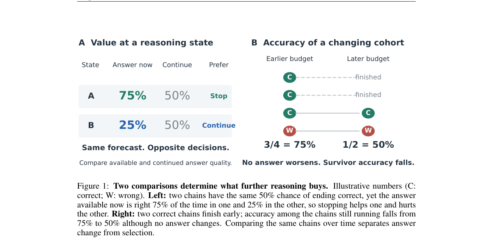

*Result - Continuing rarely loses a correct answer, and the losses concentrate. Left: at each of the 379 points where the 1.5B model holds a correct answer, how many of four fresh continuations keep i*

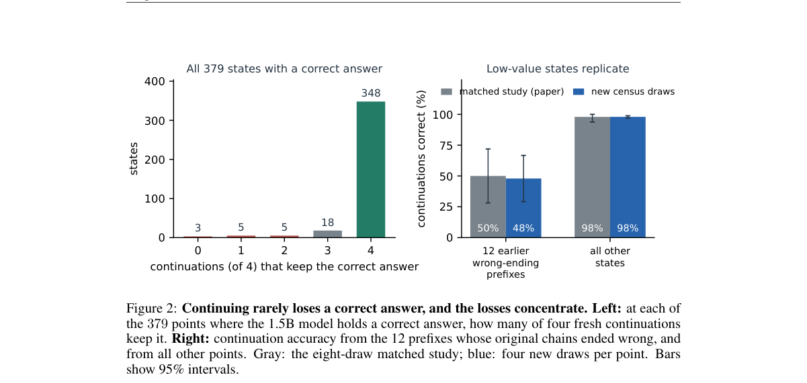

**Why this ranks #4**: 在 MATH-500 的 379 个「当前已答对」检查点上，DeepSeek-R1-Distill-Qwen-1.5B 继续推理平均再掉 3.6 分（95% CI [2.2, 5.2]）；oracle 停止规则在 1.5B 与 7B 上最多只赚 +1.8 与 +2.5 分，直接指向推理预算该不该加码。

---

### 5. VisHead-Spec: Head-Routed Visual Attention for Multimodal Speculative Decoding

**arXiv**: [2611.21839](https://arxiv.org/abs/2611.21839) | **Score**: 8.0 (relevance 8 x 0.7 + quality 8 x 0.3) | **Direction**: `llm_core` | **Tags**: LLM-VLM, speculative-decoding, vlm-inference, kv-head-routing, high-concurrency, block-diffusion, Meta | **Categories**: cs.CV, cs.LG | **Pages**: 24

**Authors**: Xin Guo; Arushi Rai; Xiang Zhou; Qiang Zhang; Siyu Lin; Xiangjun Fan; Lizhu Zhang

**Affiliation**: Meta

**Abstract**

> Speculative decoding accelerates vision-language models(VLMs) while preserving the target model's outputs, but its speedup diminishes under high concurrency serving as the system becomes more compute bounded as the batch size increases. This problem is pronounced for multimodal speculative decoding as the long range of the image tokens in the prompt can significantly increase the computational cost during draft token prediction. The block-diffusion drafters (e.g. DFlash, DSpark) can effectively speed up the draft model efficiency by predicting multiple draft tokens in one forward pass, but their speedup for VLMs under high concurrency is still modest (<9%). In order to understand this gap, we examine the information flow between different modalities from target model to draft model and identify the sparsity pattern of visual attention between the target and draft models: only small set of key-value heads in the draft model need direct visual feature attention in the context and only visual features from top level layers in the target model need to be attended in the context. We therefore propose VisHead-Spec, which selects a small, fixed set of key-value (KV) heads to attend to all image features from top level layers in the target model and restricts the remaining heads to text features. On Qwen3-VL-8B and MMSpec, VisHead-Spec-8 lets 8 of the drafter's 40 KV heads read the image while keeping accepted length within 0.3% of the block-diffusion draft model baseline (i.e. DSpark). At batch size 64, its throughput gain over autoregressive decoding increases to 16.0%, compared with 9.5% for DSpark; at batch size 1, its speedup remains comparable to DSpark.

**Key findings**

- **Finding**: VisHead-Spec-8 在 Qwen3-VL-8B 上仅让 40 个 KV 头中的 8 个读取图像特征，接受长度与块扩散草稿模型 DSpark 的差距不超过 0.3%。
- **Inference**: 说明草稿模型对视觉信息的依赖是稀疏的，少数头即可承接视觉语义，无需全部头参与图像注意力。
- **Recommendation**: 做多模态投机解码时先测 head 级的视觉注意力稀疏度，再决定路由哪些 KV 头，不要默认全头读图。

**Key figures**

*Framework - Context construction and KV-head routing. Both panels show hidden states cached at layers in the target model S = {1, 9, 17, 25, 33} during normal target computation. I and T denote image- an*

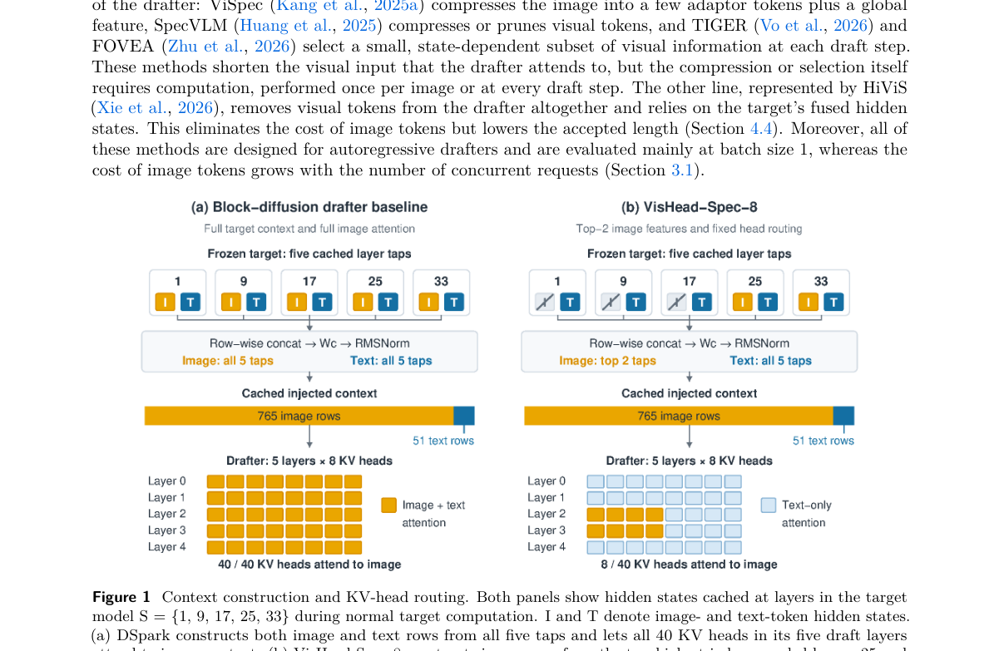

*Result - Target next-token image-contribution retention on six MMSpec tasks, using Eq. (A1). Text positions cannot attend to image positions at or above layer index cutoff ℓ. Dashed lines mark cutoffs*

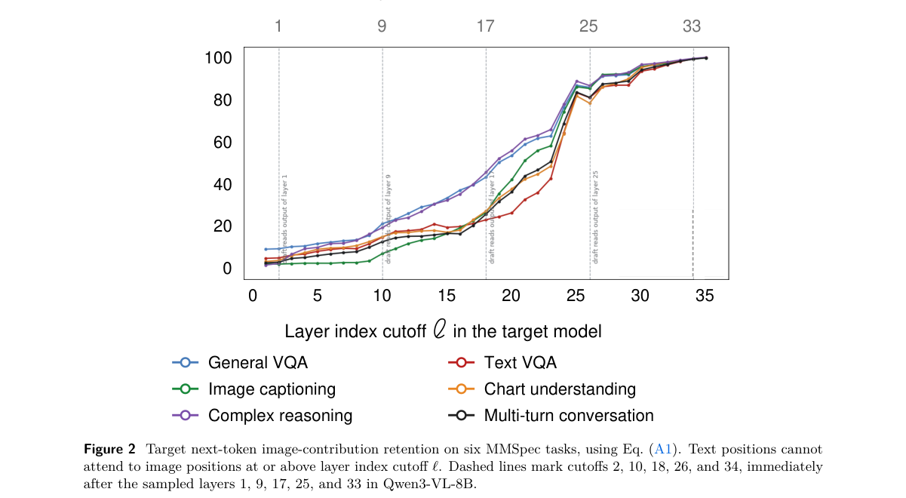

**Why this ranks #5**: 在 Qwen3-VL-8B 与 MMSpec 上，VisHead-Spec 只让 draft 模型 40 个 KV 头中的 8 个读图，接受长度与 DSpark 基线的差距保持在 0.3% 以内；batch size 64 时相对自回归的吞吐增益升到 16.0%（DSpark 仅 9.5%），是 llm_core 的多模态投机解码代表作。

---

### 6. DNeo: Your Parallel Draft Model Needs Better Target Feature Encoding

**arXiv**: [2611.21925](https://arxiv.org/abs/2611.21925) | **Score**: 8.0 (relevance 8 x 0.7 + quality 8 x 0.3) | **Direction**: `llm_core` | **Tags**: LLM-VLM, speculative-decoding, parallel-drafter, feature-encoding, residual-mixing, llm-inference, University of Virginia | **Categories**: cs.AI, cs.CL | **Pages**: 23

**Authors**: Jameson Sandler; Shane Bergsma; Mostafa Elhoushi; Bin Claire Zhang; Gavia Gray; Joel Hestness; Nolan Dey; Ferdinando Fioretto

**Affiliation**: University of Virginia; Cerebras Systems

**Abstract**

> Speculative-diffusion decoding uses a small parallel drafter model to generate b draft tokens in one forward pass, which then undergo parallel verification via a larger target model. Faster inference can be achieved when multiple draft tokens pass verification simultaneously. Recent parallel draft architectures (DFlash, DSpark) improve draft quality by conditioning on rich features computed by the target, through a mechanism known as feature encoding. However, standard feature encoding mechanisms have three limitations: (1) they are lossy, applying encoding projections that are destructive to the underlying target feature-space via a discovered effect known as residual mixing, (2) they are memory-less, with no record of previously processed proposals, and (3) they utilize features sampled uniformly from across the target layers, omitting important hidden states. To address these issues, we propose Mixture-of-Features Attention (MoFA), a lightweight feature-encoding approach equipped with a working memory that encodes previously rejected proposals. Leveraging MoFA, rejection memory, and a set of further enhancements, including 2-tap causal convolutions, prefix-only cross-attention, and non-uniform target layer selection, the final architecture, DNeo, achieves 1.3x faster generation speed than SoTA (DFlash-2) without impacting drafter footprint or generation quality. DNeo marks a new state of the art in high quality, fast LLM inference.

**Key findings**

- **Finding**: DNeo 在 H100 上以 Qwen3-4B（b=15）跑六个基准，生成速度达到当时最优 DFlash-2 的 1.3 倍，同时草稿模型足迹与生成质量没有下降。
- **Inference**: 说明常规特征编码里的 residual mixing 是并行草稿模型可优化的瓶颈，改结构比加大草稿模型更划算。
- **Recommendation**: 复现并行草稿时优先改特征编码路径（如 MoFA 加拒绝记忆），不要只靠加宽草稿模型。

**Key figures**

*Framework - H100 Inference speeds, with Qwen3-4B (b = 15) across six benchmarks (see Section 5.1), and batch-sizes B. DNeo dominates the speed Pareto frontier relative to autoregressive (EAGLE-3) algori*

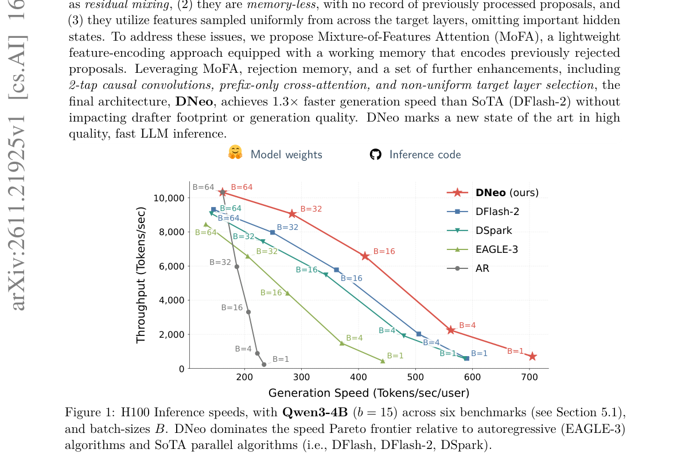

*Result - Draft quality comparison. Tokens per forward (τ) over the test-set (Section 5.1), using official SGLang inference implementations. DNeo dominates existing methods in draft quality.*

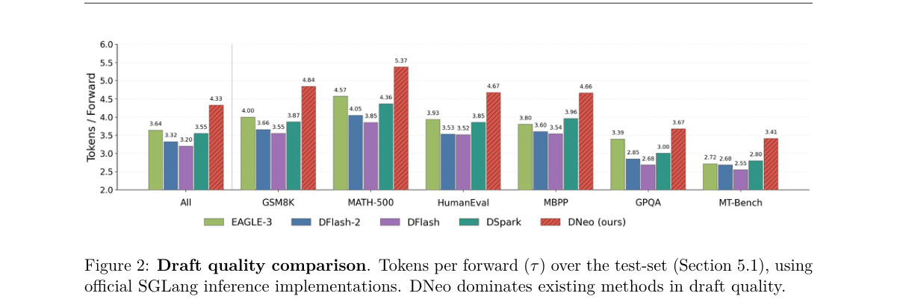

**Why this ranks #6**: DNeo 用 MoFA 特征编码替代传统投影，避免 residual mixing 破坏目标特征空间，在 H100 上以 Qwen3-4B（b=15）对比 DFlash-2 取得 1.3 倍生成加速，且草稿模型足迹与生成质量不变，属于 llm_core 的投机解码结构改进。

---

### 7. DiscoveryAgent: A Framework for Scientist-centric Agentic AI

**arXiv**: [2611.21950](https://arxiv.org/abs/2611.21950) | **Score**: 8.0 (relevance 8 x 0.7 + quality 8 x 0.3) | **Direction**: `llm_core` | **Tags**: LLM-VLM, agentic-ai, scientist-in-the-loop, audit-agent, checkpointing, scientific-discovery, Stanford University | **Categories**: cs.AI | **Pages**: 40

**Authors**: Owen Queen; Ioana Ciuca; Emma Dann; Jean Somalwar; Carine You; Steven Dillmann; Viraj Manwadkar; Evan Gorrell; Harrison G Zhang; Jonathan K Pritchard; Risa H Wechsler; James Zou

**Affiliation**: Stanford University; Kavli Institute for Particle Astrophysics and Cosmology (KIPAC); Gladstone-UCSF Institute of Genomic Immunology; University of California, Berkeley; University of Tennessee, Knoxville

**Abstract**

> AI agents can assist scientific research, but balancing autonomous investigation with scientists' ability to inspect and redirect ongoing work remains a central design challenge. We present DiscoveryAgent, a domain-agnostic, scientist-centric system that combines autonomous investigation with scientist-directed hypothesis steering. Scientists select, refine, or replace hypotheses between research rounds, while audit agents interrogate checkpointed records to trace claims, reproduce analyses, and inform subsequent decisions. Across two predictive modeling tasks, DiscoveryAgent produced the best variable-star classifier among evaluated baselines and, with scientist steering, a protein variant-effect predictor surpassed by only one of 106 ProteinGym baselines. We develop a rigorous checkpointing system that enables highly capable audit agents, a scalable form of oversight for agentic research. Audit agents autonomously identify errors at higher rates than previous AI scientist agents, and scientists collaborating with audit agents identify 14x more valid errors versus scientists performing manual review. In three case studies led by domain experts across physical science, social science, and life science, we developed a multimodal photometric-redshift estimator that resolves complementary failures of images and photometry, achieving 0.971 AUROC for low-redshift classification; documented an 83% rise in Florida homeowners-insurance premiums from 2013 to 2023, with a growing, regressive burden; and identified CD4+ T-cell relay genes, which both receive and exert broad transcriptional regulation, enriched for autoimmune disease associations. Together, these results show how autonomous research can expand scientists' empirical reach while centering their authority over research direction and their ability to understand and challenge the evidence.

**Key findings**

- **Finding**: 与审计代理协作的科学家发现的有效错误数量是纯人工复核的 14 倍；在 106 个 ProteinGym 基线中，蛋白变体效应预测器只被其中一个超过。
- **Inference**: 说明自主调查加人类掌舵加可审计检查点的组合，比全自动或纯人工两种极端都更有效率。
- **Recommendation**: 搭 agentic 科研系统时先把检查点与审计代理做扎实，再谈自动化程度，并保留人类改写假设的接口。

**Key figures**

*Framework - DISCOVERYAGENT supports scientist-steered, auditable discovery across domains. a) Starting from raw data, DIS-*

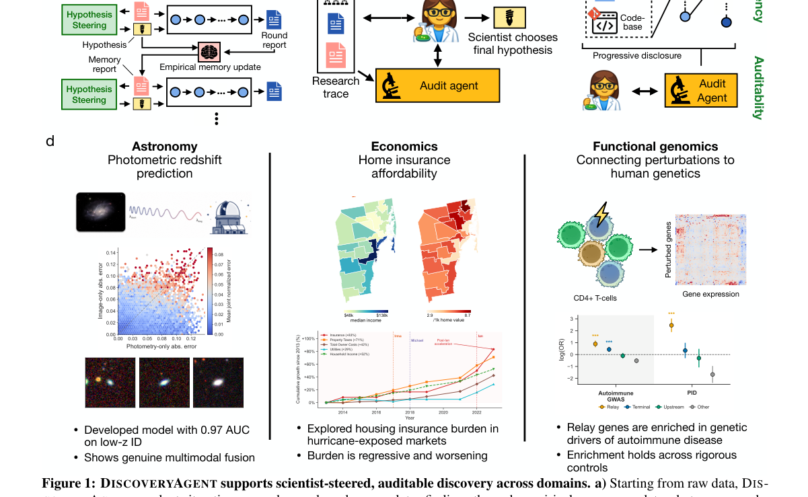

**Why this ranks #7**: DiscoveryAgent 把假设选择权留给科学家、用审计代理复核检查点：与审计代理协作的科学家发现的有效错误是纯人工复核的 14 倍；蛋白变体效应预测器在 106 个 ProteinGym 基线中只被一个超过，属于 llm_core 的 agent 编排方向。

---

### 8. Beyond Bitwidth: Deployment-Constrained Mixed-Precision Quantization for Multilingual LLM Inference on NVIDIA Blackwell

**arXiv**: [2611.21974](https://arxiv.org/abs/2611.21974) | **Score**: 8.0 (relevance 8 x 0.7 + quality 8 x 0.3) | **Direction**: `llm_core` | **Tags**: LLM-VLM, mixed-precision, nvfp4, deployment-constraint, b200, preregistered-eval, ThakiCloud | **Categories**: cs.CL, cs.IR, cs.LG | **Pages**: 18

**Authors**: Hyojung Han

**Affiliation**: ThakiCloud

**Abstract**

> Low-bit LLM quantization is useful only if a model preserves service-relevant accuracy, executes through supported GPU kernels, and meets measured memory and latency limits. We study Qwen3-8B on NVIDIA B200 with vLLM, including INT2/INT3, GPTQ, NVFP4, and mixed-precision configurations. We verify native packed execution and precision on all 144 fused linear modules and evaluate Korean, English, numerical, and reasoning quality under preregistered gates. Packed INT2 and INT3 execute, but all seven tested INT2 grids degenerate on generation. Isolated module-restoration effects are strongly non-additive; Korean and reasoning sensitivity rankings disagree, and a promising INT4/INT8 development candidate fails independent final evaluation. A configuration with 16-bit activations, 98 NVFP4 weight-only modules, 46 INT8 modules, and an INT8 output head passes all gates on the untouched FINAL-81 set (5,168 items): 5.917 GiB of weight-loading memory (limit 5.98), Korean teacher-correct retention 0.904 (gate 0.90), and TPOT ratio 0.939 relative to BF16. It improves paired accuracy over NVFP4 W4A4 by +1.4 percentage points (Bonferroni-adjusted interval [+0.2, +2.6]), compared with +3.4 points on the selection set. This comparison changes both activation precision and INT8 protection; exploratory analyses suggest that the activation change contributes substantially, but the isolated allocation effect is not established. Final checkpoints were not retained, and bitwise rebuild reproducibility remains unverified.

**Key findings**

- **Finding**: 混合精度配置（16 位激活、98 个 NVFP4 权重模块、46 个 INT8 模块、INT8 输出头）在 FINAL-81 的 5168 条样本上通过全部门槛：权重加载 5.917 GiB（上限 5.98）、韩语教师正确保留率 0.904（门槛 0.90）、TPOT 比 0.939。
- **Inference**: 说明在 Blackwell 上把激活留在 16 位、只对少数模块降精度比全面压到 INT2/INT3 更稳，七套 INT2 配置在生成时全部退化。
- **Recommendation**: 上 Blackwell 做低比特部署时按预注册门槛验收，同时核对打包内核是否真原生执行、模块级收益是否可加。

**Why this ranks #8**: 在 B200 与 vLLM 上验证 Qwen3-8B 的 144 个融合线性模块，最终方案（16 位激活、98 个 NVFP4 权重模块、46 个 INT8 模块、INT8 输出头）在 5168 条 FINAL-81 上权重加载 5.917 GiB（限 5.98）、韩语保留率 0.904、TPOT 比 0.939，是 llm_core 的部署约束量化。

---

## VLM 核心（多模态架构 / 理解 / 视频 / GUI agent） · `vlm_core` (5 papers)

本方向 5 篇打满基准 5 篇（1 篇 relevance≥9），四个不同切面。CueClash 用「2D 线索恰好对一半」的渲染场景把 VLM 的三维判断拆开，Claude Opus 5.5、GPT-5.5、Gemini 3.6 Flash 的捷径差距是 +18 到 +37 个百分点，而给了地面坐标后它们能答对 99–100%——问题出在从画面到布局那一步。ContraSense 用 4698 条反常识图文问答测「真的看图了吗」，最强闭源模型只有约 60%，人类 96.04%，比常规任务平均退化约 37%。Sketch, Don't Paint 研究测试时算力该花在视觉思维的哪一步：8 步草图几乎追平 50 步渲染，14 个模型-基准对里直接作答赢 9 对，从 10 个标注样本里挑渲染层可把平均准确率从 60.7% 提到 65.1%。Scaling Laws for Vision-Language Fusion 把早融合与晚融合的学习动态统一成一条尺度律；SARVIA 反过来指出 MLLM 的视觉编码器本来就比专门的 SAR 基础模型更适合当下游初始化，600 步、2 GPU 小时的自适应后训练就在六个 SAR 检测分割基准上全面超过被比较的基础模型。

### 9. CueClash: Frontier Vision-Language Models Judge 3-D Relations Close to the Picture Plane

**arXiv**: [2611.22180](https://arxiv.org/abs/2611.22180) | **Score**: 8.7 (relevance 9 x 0.7 + quality 8 x 0.3) | **Direction**: `vlm_core` | **Tags**: LLM-VLM, spatial-reasoning, 2d-cue-shortcut, vlm-eval, 3d-relation, benchmark, Scale AI | **Categories**: cs.AI, cs.CV, cs.RO | **Pages**: 51

**Authors**: Soham Dan

**Affiliation**: Scale AI

**Abstract**

> A vision-language model (VLM) can judge 3-D relations from the picture or from the ground layout. In photographs the two usually agree. We separate them with CueClash, rendered scenes in which the 2-D cue for each of five relations is right on exactly half the statements. The shortcut gap is accuracy when the cue is right minus accuracy when it is wrong. For Claude Opus 5.5, GPT-5.5 and Gemini 3.6 Flash at low reasoning effort it is +18 to +37 percentage points. It is +7 to +29 without two relations whose cue-wrong items are confounded with borderline cases or occlusion. Given ground coordinates and each relation's definition, they answer 99 to 100% correctly. Pixel measurements with camera depths remove most of the gap for objects fitting through openings. The failure lies in the step from the picture to the layout. The maps that the models draw of the scene from above mostly keep the depth order but, like the picture, shorten depth. GPT-5.5's maps stay close to a copy of the picture. Opus 5.5's and Gemini's maps undo about 0.6 of this shortening. Gemini's then shrink all depths by a further uniform factor. Opus 5.5 follows the picture mainly on fits, and its maps correct depth about as much as human observers of real scenes do. The three models also lose accuracy on CV-Bench photographs where a reliable 2-D cue misleads. In two open models the layout information reaches the language model, but their maps lose much of it.

**Key findings**

- **Finding**: 在 CueClash 的五个三维关系上，Claude Opus 5.5、GPT-5.5 与 Gemini 3.6 Flash（低推理档）的捷径差距为 +18 到 +37 个百分点，去掉两个关系后降到 +7 到 +29。
- **Inference**: 说明模型判断三维关系主要依赖画面上的二维线索，二维线索一旦失效就大幅失准，属于表征而非知识层面的问题。
- **Recommendation**: 评测 VLM 三维能力时必须构造二维线索与真实布局冲突的样本，否则准确率会被常识与透视捷径抬高。

**Key figures**

*Framework - The same fits item read in the picture plane and on the ground plane. (a) In the image the gap spans 60 px and the nearer cube 132 px. (b) On the ground plane the gap is 1.85 units and the c*

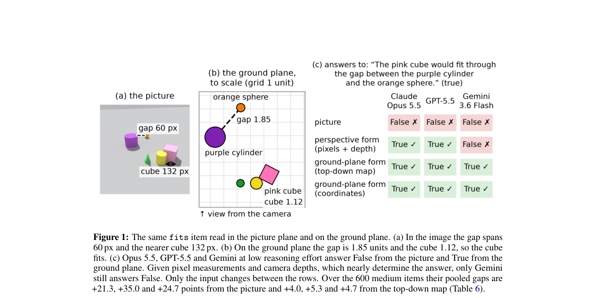

*Result - One cue-right (top) and one cue-wrong (bottom) true item per relation from the medium tier. In the bottom row the named 2-D cue gives the wrong answer, which is what the shortcut gap tests.*

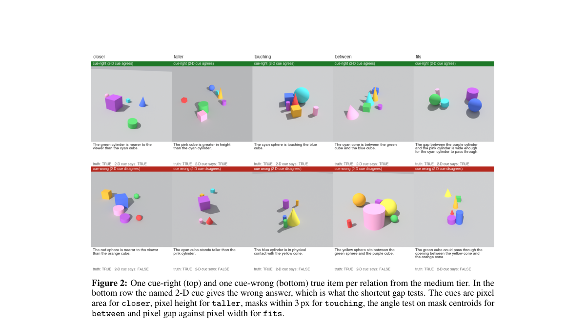

**Why this ranks #9**: CueClash 用渲染场景把五种三维关系的二维线索正确率压到恰好 50%，Claude Opus 5.5、GPT-5.5 与 Gemini 3.6 Flash（低推理档）的捷径差距达 +18 到 +37 个百分点，给定地面坐标却能答对 99% 到 100%，属 vlm_core 的空间推理评测。

---

### 10. Sketch, Don't Paint: Allocating Test-Time Compute in Generative Visual Reasoning

**arXiv**: [2611.21812](https://arxiv.org/abs/2611.21812) | **Score**: 8.0 (relevance 8 x 0.7 + quality 8 x 0.3) | **Direction**: `vlm_core` | **Tags**: LLM-VLM, test-time-compute, visual-thinking, diffusion-steps, interleaved-reasoning, sketch-vote, State Key Laboratory for Novel Software | **Categories**: cs.CV | **Pages**: 11

**Authors**: Sheng Lu; Guangpin Tao; Tong Lu; Ying Tai

**Affiliation**: State Key Laboratory for Novel Software Technology, Nanjing University

**Abstract**

> Multimodal models increasingly reason by synthesizing pixels, sketching maze paths within interleaved chains of thought or rolling out video solutions frame by frame. Each visual thought runs the full diffusion schedule inherited from photorealistic synthesis, so iterative denoising dominates inference cost. We study how to allocate test-time compute along two axes: when to render visual thoughts rather than thinking in text or answering directly, and how many denoising steps each thought requires. Controlled interventions that vary only how the thought is rendered uncover three regimes. Causal thoughts carry the plan and become legible early: an 8-step sketch nearly matches a 50-step render in accuracy, commits to the same plan as often as two independent full renders agree, and in video models mostly fails by stalling short of the goal, so the rollout abstains. Decorative thoughts can be omitted without loss, whereas harmful thoughts lower accuracy. Because the regime depends on both model and task, always drawing is suboptimal. Across 14 model-benchmark pairs of three interleaved reasoners, answering directly, without any thinking, wins 9 pairs, and choosing among direct, text-only, and visual tiers from ten labeled examples per pair raises mean accuracy from 60.7% (always drawing) to 65.1%. Where drawing pays, we propose sketch-and-vote, which samples 8-step sketches (a step count chosen without labels) from independent noises until one answer reaches three votes. With this one setting, sketch-and-vote beats full rendering with fewer denoising steps on an image reasoner and two video reasoners, by 8.6 points on VSP spatial planning and by 9.6 and 22.1 points on mazes.

**Key findings**

- **Finding**: 跨三个交错推理器的 14 组模型-基准配对中，完全不画图直接回答就赢下 9 组；每组用 10 条标注样本选择作答档位，可把平均准确率从 60.7% 提升到 65.1%。
- **Inference**: 说明视觉思维是否划算取决于模型与任务，盲目总是渲染既浪费算力又会拉低准确率。
- **Recommendation**: 上线视觉推理时先按任务挑直答、纯文本或视觉档位，再用 8 步草图投票而不是跑满扩散步数。

**Key figures**

*Framework - Visual thoughts become legible long before they look photorealistic. Top: intermediate thought images drawn by ThinkMorph on a VSP puzzle from the same initial noise across 1 to 49 denoising*

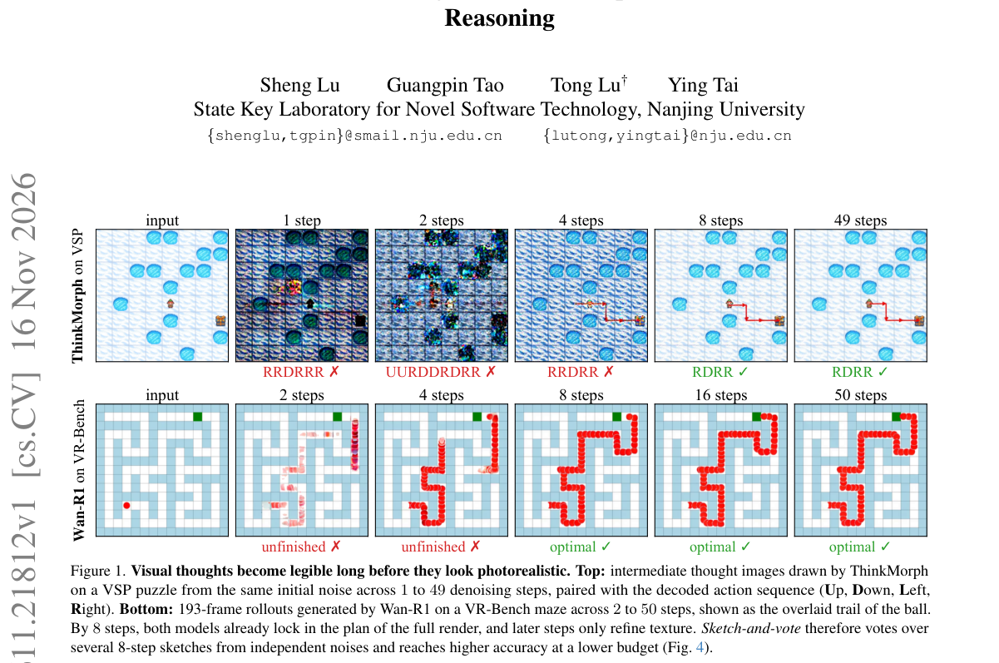

*Result - Probing protocol and two-stage compute allocation. (a) Holding x and t fixed, rendering interventions separate causal, decorative, and harmful thoughts, motivating a 10-shot router across Di*

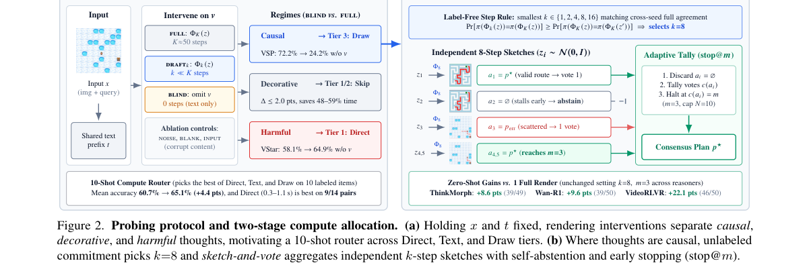

**Why this ranks #10**: 14 组「模型-基准」配对里不画图直接作答就赢下 9 组；每组用 10 条标注样本选档把平均准确率从 60.7%（总是画图）提到 65.1%，sketch-and-vote 用 8 步草图即在 VSP 上赢 8.6 分、迷阵上赢 9.6 与 22.1 分，属 vlm_core 的多模态推理算力分配。

---

### 11. SARVIA: Fast-Adapting the Strong SAR Foundation Models That Are Already in Your MLLMs

**arXiv**: [2611.22273](https://arxiv.org/abs/2611.22273) | **Score**: 8.0 (relevance 8 x 0.7 + quality 8 x 0.3) | **Direction**: `vlm_core` | **Tags**: LLM-VLM, sar-remote-sensing, mllm-adaptation, self-supervised, low-rank-adapter, foundation-model, Singapore Management University | **Categories**: cs.CV | **Pages**: 15

**Authors**: Yuxuan Li; Zichen Tian; Qianru Sun

**Affiliation**: Singapore Management University

**Abstract**

> Synthetic aperture radar (SAR) foundation models provide transferable representations for diverse perception tasks in all-weather Earth observation. However, their development often relies on costly large-scale SAR pretraining, raising the question of whether such extensive domain-specific pretraining is necessary. We find that modern multimodal large language models (MLLMs) already provide visual encoders that can outperform dedicated SAR foundation models as downstream initializations. This motivates a new paradigm: reuse general visual capabilities and devote domain training to brief specialization. We therefore introduce SARVIA, an adaptive post-pretraining method that specializes modern MLLMs using self-supervised visual questions with computable answers. These questions are constructed from unlabeled observations through general image tasks that capture spatial relations and SAR-specific tasks that exploit native measurements and SAR--optical correspondence. A shared answer-prediction objective jointly trains low-rank adapters across visual and language components, with loss-driven task sampling. We then export the adapted visual encoder as a standalone backbone. With 600 adaptation steps and 2 GPU-hours, SARVIA outperforms the compared foundation models on all six SAR detection and segmentation benchmarks. Compared with dedicated SAR pretraining, SARVIA reduces domain-training costs by orders of magnitude while improving visual transfer across architectures and scales. This new paradigm shifts the emphasis from repeated, costly pretraining to a reusable specialization process that can benefit from advances in open MLLMs. Dataset and code: https://github.com/zcablii/SARVIA.

**Key findings**

- **Finding**: SARVIA 只需 600 步适配、约 2 个 RTX PRO 6000 GPU 小时，导出的 ViT-L backbone 在 RSAR、SARDet-100K、M4-SAR、OpenEarthMap-SAR、AIR-PolSAR-Seg-2.0 与 WHU-OPT-SAR 六个基准上均领先对比方法。
- **Inference**: 说明通用 MLLM 视觉编码器本身已含强 SAR 表征，专用大规模 SAR 预训练的边际收益有限。
- **Recommendation**: 进新领域不要先做大规模预训练，先用带可计算答案的自监督任务做数百步低秩适配再评估。

**Key figures**

*Framework - Paradigm shift from conventional dedicated pre- training to our proposed efficient adaptation. SARVIA im- proves SAR foundation models at lower pretraining cost and of- fers a reusable adapt*

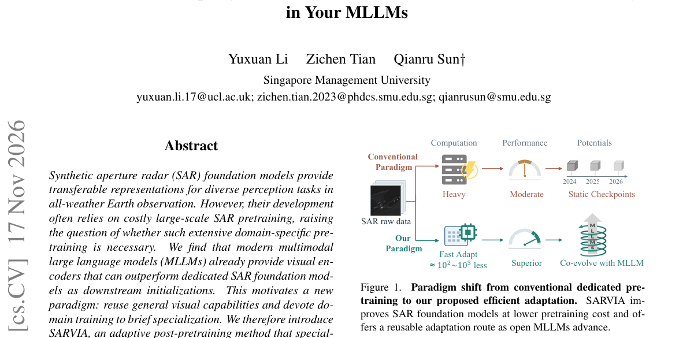

*Result - ViT-L downstream performance across six SAR benchmarks. SARVIA achieves the best score on every bench- mark.*

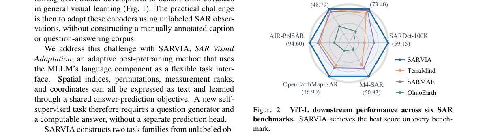

**Why this ranks #11**: SARVIA 用答案可算的自监督视觉问答，只花 600 步、约 2 个 RTX PRO 6000 GPU 小时就把 MLLM 视觉编码器适配成 SAR backbone，在 RSAR、SARDet-100K 等六个 SAR 检测分割基准上全面领先，领域训练成本比专用预训练低约 10 的 2 到 3 次方量级，归入 vlm_core 的 MLLM 路线。

---

### 12. Scaling Laws for Vision-Language Fusion

**arXiv**: [2611.22351](https://arxiv.org/abs/2611.22351) | **Score**: 8.0 (relevance 8 x 0.7 + quality 8 x 0.3) | **Direction**: `vlm_core` | **Tags**: LLM-VLM, scaling-law, early-fusion, late-fusion, pretraining-dynamics, loss-prediction, Noetra | **Categories**: cs.CV, cs.LG | **Pages**: 24

**Authors**: Seng Pei Liew; Teppei Suzuki; Seiya Tokui

**Affiliation**: Noetra Corp.

**Abstract**

> Vision-language models (VLMs) have emerged as central foundation models combining multimodal perception with text comprehension. While VLMs are traditionally built via late fusion by continued pre-training an off-the-shelf language model on multimodal (image-text) data, mixing modalities from the start of pre-training (early fusion) has recently gained traction. However, the fundamental trade-offs between these paradigms remain poorly understood, resulting in expensive and heuristic-driven training recipes. In this paper, we systematically analyze the learning dynamics of these multimodal pre-training processes, showing that validation losses during vision-language fusion can be modeled by separating the base learning trajectory, where different data types contribute at distinct rates, from a distribution shift driven by the competition between modalities. We derive a scaling law that unifiedly describes these dynamics, enabling accurate loss predictions across mixture ratios, training steps, and model sizes. Crucially, our law characterizes the trade-off between early and late fusion: under a fixed data budget, early fusion preserves text performance while late fusion favors vision performance, yielding a trade-off that increasingly tilts toward early fusion as model size scales. Extensive experiments confirm that our scaling law reliably captures multimodal learning dynamics and governs fusion decisions.

**Key findings**

- **Finding**: 在 189M 到 3.5B 的 Gemma-3 风格骨干上，融合损失的拟合 RMSE 为 0.0022 到 0.0099、留出 RMSE 为 0.0015 到 0.0084；晚融合的文本惩罚 gamma_txt 约 0.02 且几乎不随模型规模变化。
- **Inference**: 晚融合换来的视觉优势按 N 的 -0.5 次方衰减而文本代价恒定，所以模型越大越应偏向早期融合。
- **Recommendation**: 定多模态预训练配方时先看融合点与混合比例，规模化后优先改用早期融合而非继续延长单模态预训练。

**Key figures**

*Result - Base decomposition and cross-modal exchange rates. (a,b) Text and interleaved validation loss curves for interleaved fusion, respectively, across various fusion points Dpt, showing the trans*

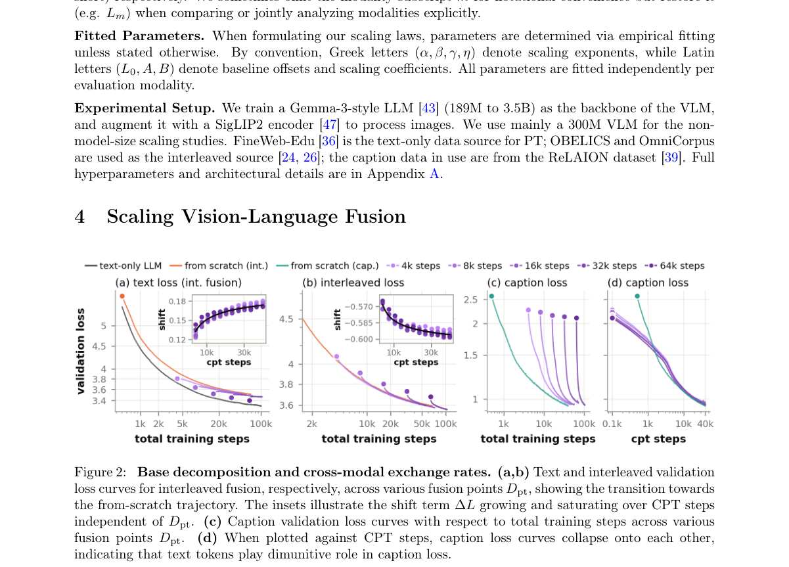

**Why this ranks #12**: 论文把视觉语言融合的验证损失拆成基线学习轨迹与模态竞争导致的分布偏移，拟合 RMSE 0.0022 到 0.0099、留出 RMSE 0.0015 到 0.0084；晚融合的文本惩罚 gamma 约 0.02 与模型规模无关，视觉优势按 N 的 -0.5 次方缩小，属 vlm_core 的融合架构规律。

---

### 13. Can Vision-Language Models Truly Understand Images? A Benchmark Beyond Commonsense Bias

**arXiv**: [2611.22360](https://arxiv.org/abs/2611.22360) | **Score**: 8.0 (relevance 8 x 0.7 + quality 8 x 0.3) | **Direction**: `vlm_core` | **Tags**: LLM-VLM, counterintuitive-benchmark, commonsense-bias, multimodal-eval, faithful-understanding, vqa, [unverified] | **Categories**: cs.CV | **Pages**: 14

**Authors**: Ling Lin; Heng Su; Xiangzeng Liu; Yang Bai; Congcong Zhu; Jingrun Chen

**Affiliation**: [unverified]

**Abstract**

> Multimodal large language models (MLLMs) have achieved impressive performance on a wide range of vision-language tasks. However, it remains unclear whether their predictions are grounded in the visual content itself or are largely driven by statistical co-occurrence patterns and commonsense correlations learned from large-scale image-text corpora. Existing vision-language benchmarks predominantly consist of samples that conform to human commonsense, allowing models to achieve strong performance by exploiting dataset priors rather than genuinely understanding image content. To address this limitation, we present ContraSense, a systematically constructed benchmark for evaluating faithful vision-language understanding. ContraSense consists of carefully curated counter-intuitive image-text pairs that deliberately violate common expectations, substantially reducing the effectiveness of statistical biases and requiring models to rely on visual evidence for reasoning. We conduct comprehensive evaluations on a diverse set of representative open- and closed-source MLLMs. The results reveal a substantial performance gap between current MLLMs and humans: even the strongest closed-source model achieves only about 60\% accuracy, compared with 96.04\% for human participants. These findings demonstrate that current MLLMs still struggle with faithful visual understanding and highlight the need for more robust multimodal reasoning grounded in image content. The ContraSense benchmark is publicly available at https://huggingface.co/datasets/LingLin00/ContraSense.

**Key findings**

- **Finding**: 基准含 4698 个 1024×1024 像素的手工校准图文对，覆盖情境违背、属性异常、尺寸比例异常、物理不可能与功能状态反常五类；最强闭源模型仅约 60%（GPT-4o 为 60.03%），人类参与者 96.04%。
- **Inference**: 说明 MLLM 在符合常识的常规基准上的高分大部分可由图文共现统计解释，未必来自真实视觉证据。
- **Recommendation**: 评估多模态模型是否真懂图时务必加入刻意违反常识的对照样本，比较共现先验被削弱后的准确率。

**Key figures**

*Framework - We propose a new benchmark called ContraSense, which is both creative and imaginative. The benchmark consists of 4,698 carefully crafted and manually calibrated high-resolution (1024 × 1024 pi*

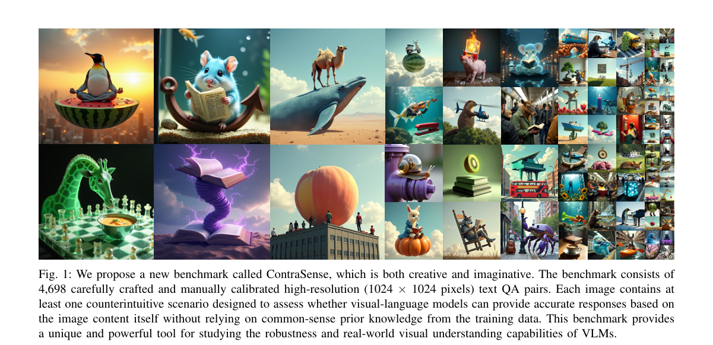

*Result - Pipeline of counterintutive data collection.*

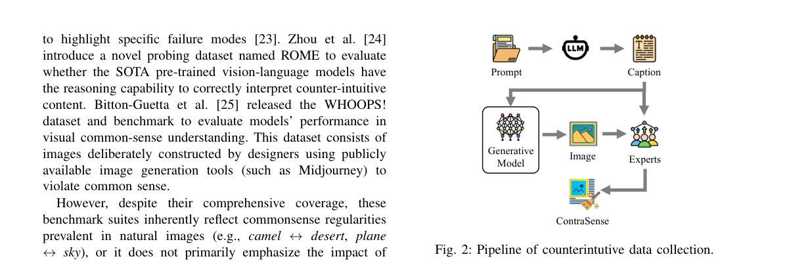

**Why this ranks #13**: ContraSense 用 4698 张 1024×1024 手工校准的反常识图问对、覆盖五类反常识场景，最强闭源模型仅约 60% 而人类为 96.04%，专门检验 vlm_core 的多模态评测能否绕开图文共现先验。

---

## LLM / VLM 的 RL 与偏好优化 · `llm_vlm_rl` (7 papers)

本方向 7 篇（基准 5、上浮 2），4 篇 relevance≥9 全部入选——这是全批 587 篇候选里 RL 信号最密的一个方向，quota 一个都没挤掉。路线也统一：全是「怎么把奖励与偏好信号搬到正确的位置」。Gaze-RL 追问轨迹级奖励能不能从模型自己的跨模态几何里推出来落点，用隐式奖励落地域重分配完胜优势；M3OPD-Reasoner 把多教师 on-policy 蒸馏做成公开配方，用 M3OPD-SFT-1.35M 与 M3OPD-RL-193K 在 21 个基准上评测；Regularized Score Centering 在异步 RL 里给 score centering 加反向 KL 正则，解决 learner 跑离行为策略时的失效，AppWorld 提升 14.3%、BabyAI 达到最强基线的 9.9×；Nemotron 3.5 Super 用 CISPO 在五个专家数据集上逐个训 rank-32 LoRA，十二个基准的增益从 IFBench +4.5 到 GDP.pdf +13.8（10.4%→24.2%），SWE-bench Pro V2 从 86.9% 到 92.1%、Terminal-Bench 2.1 从 63.9% 到 70.3%。另外三篇是理论与工程：Margin Dynamics 给出 DPO margin 无界增长 O(log t)、IPO 收敛到 1/(2τ) 的闭式解；MPG-DPO 用用户历史比较构造多维偏好锥来提在线偏好对齐的样本效率；IfcGym 用四个可验证 checker 当训练信号，把 IFC 建筑模型编辑的成功率从 SFT 后的 79.15% 推到 86.78%，27B 版本到 91.76%。

### 14. M3OPD-Reasoner: An Open Recipe for Post-Training Multimodal Reasoning with Multi-Teacher On-Policy Distillation

**arXiv**: [2611.23034](https://arxiv.org/abs/2611.23034) | **Score**: 9.0 (relevance 9 x 0.7 + quality 9 x 0.3) | **Direction**: `llm_vlm_rl` | **Tags**: LLM-VLM, multi-teacher-distillation, on-policy-distillation, gspo, multimodal-reasoning, verifiable-reward, A*STAR | **Categories**: cs.CV | **Pages**: 24

**Authors**: Nguyen Quang Trung; Hoang Phan; Shuo Sun; Longyin Zhang; AiTi Aw

**Affiliation**: A*STAR; VinUniversity

**Abstract**

> Multi-Teacher On-Policy Distillation (MOPD) enables a single student to absorb the skills of several domain teachers by learning from its own generated responses. We present Multimodal Model Multi-Teacher On-Policy Distillation Reasoner (M3OPD-Reasoner), a fully open recipe for post-training vision-language models (VLMs) over three reasoning domains: image STEM, image perception, and video. We curate two datasets, M3OPD-SFT-1.35M for supervised fine-tuning (SFT) and M3OPD-RL-193K for reinforcement learning (RL) with verifiable rewards. On these data, we compare post-training recipes that start from Qwen3.5-9B: training one model on the mixed data of all domains (MixSFT and MixRL), and training one teacher per domain with Group Sequence Policy Optimization (GSPO), directly or after an SFT warm-up, and distilling the teachers into one student with MOPD. We evaluate on 21 image STEM, image perception, and video reasoning benchmarks after we decontaminate the training data against them. The comparison establishes MOPD of teachers trained with GSPO directly from Qwen3.5-9B as the best recipe: the student closely matches each teacher on its own domain and is on average above the mixed-training baselines on the same prompts. Since MOPD already merges the domain capabilities that MixRL would otherwise have to learn, its student is a stronger starting point for RL, and we ask whether the same data can carry the model further from there: we add MixRL on top of the MOPD student, on the same prompts and with the same settings, which, to our knowledge, no prior VLM recipe has studied. The same prompts still improve the MOPD student, with no collapse, and give our main model, M3OPD-Reasoner-9B. MOPD and MixRL can therefore work as consecutive stages that get more out of the same data. We release all data, the training code, and the checkpoints of every stage.

**Key findings**

- **Finding**: 在已对训练数据做 13-gram 与 pHash 去污染的 21 个 benchmark 上，Qwen3.5-9B 基线 avg@8 总体 69.4%；无 SFT 预热的 GSPO 领域教师合成学生为 75.2%，其上再跑一轮 MixRL 得到 M3OPD-Reasoner-9B 的 75.9%，其中 image STEM 70.0→77.1、image perception 78.9→81.9、video 53.4→64.1。
- **Inference**: 多教师 on-policy 蒸馏能一次合并三个领域互相冲突的梯度，再叠加同一批 prompt 的奖励阶段可以复用数据继续抬升，说明「先蒸馏合并能力、再用奖励超越教师」在 VLM 上是可叠加的两段式配方。
- **Recommendation**: 复现多领域 VLM 后训练时按本文骨架走三步——同一批 193K 带域标签 prompt 训三个 GSPO 领域教师、MOPD 蒸馏、复用同批 prompt 再做一轮 RL；实现上注意每 token 反向 KL 项截断在 c=10、rollout 长度上限 16384 token、奖励为 0.9×准确率 + 0.1×格式。

**Key figures**

*Framework - Multimodal Model Multi-Teacher On-Policy Distillation Reasoner (M3OPD-Reasoner) as a story. (1) Three masters train with GSPO, one per domain, with or without an SFT warm-up. (2) The student*

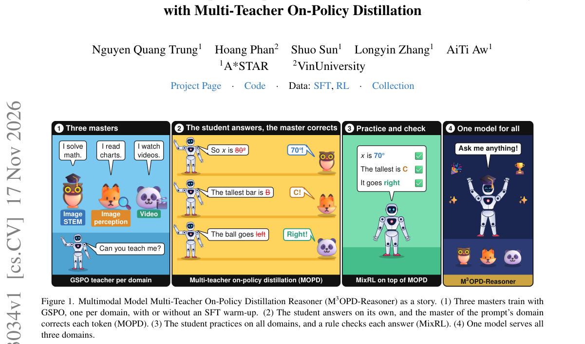

*Result - Overview of the recipe. (1) GSPO on the prompts of one domain turns Qwen3.5-9B into the teacher of that domain, directly or after an SFT warm-up on the traces of the domain. (2) MOPD distill*

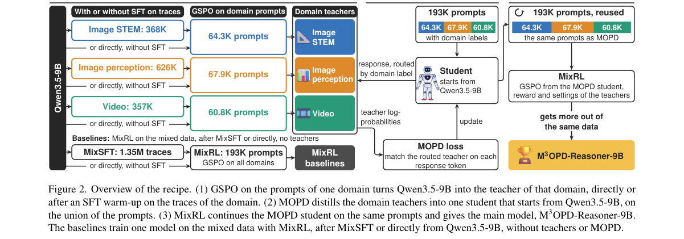

**Why this ranks #14**: 目前最完整的多领域 VLM 后训练管线：image STEM / image perception / video 各用一个 GSPO 领域教师（RL prompt 分别 64,307 / 67,915 / 60,805 条，合计 193,027 条），MOPD 蒸馏成单学生后再叠一轮 MixRL，21 个 benchmark 上 avg@8 总体从 69.4 升到 75.9，image STEM 从 70.0 升到 77.1。

---

### 15. Regularized Score Centering

**arXiv**: [2611.21791](https://arxiv.org/abs/2611.21791) | **Score**: 8.7 (relevance 9 x 0.7 + quality 8 x 0.3) | **Direction**: `llm_vlm_rl` | **Tags**: LLM-VLM, score-centering, reverse-kl, off-policy-rl, importance-sampling, asynchronous-rl, UIUC | **Categories**: cs.LG | **Pages**: 55

**Authors**: Hao Bai; Chenlu Ye; Xuanchang Zhang; Aviral Kumar; Tong Zhang

**Affiliation**: UIUC; Carnegie Mellon University

**Abstract**

> Asynchronous reinforcement learning increases training throughput, but data from stale policies and numerical mismatch between training and inference can destabilize learning. To stabilize off-policy learning, score centering (SC) removes the effect of reward baselines on the expected update. Our gradient diagnostics show less extreme gradients with SC than with importance sampling (IS), but SC can still fail when the learner moves far from the behavior policy that generated the data. To limit this policy mismatch, we introduce Regularized Score Centering (RSC), which adds a reverse Kullback-Leibler (KL) penalty to encourage the learner's next-token distribution to stay close to the behavior policy's next-token distribution. RSC works with or without truncated importance sampling (TIS), which caps token importance weights. Our theoretical analysis supports this approach, showing that KL regularization improves convergence guarantees. We evaluate dense and mixture-of-experts models on mathematical reasoning and agentic tasks, including online shopping, tool use, games, and fully asynchronous software engineering. RSC with TIS substantially improves sample efficiency across all agentic benchmarks, attaining higher training rewards with the same number of sampled responses. In final evaluations, it achieves top performance across all six agentic tasks, improving by 14.3% on AppWorld and reaching 9.9 times the strongest baseline's score on BabyAI.

**Key findings**

- **Finding**: 梯度诊断显示行为概率 µ<0.01 的 token 上，原始 IS 的 logit 梯度 99 分位为 25.928，SC+TIS 降到 3.784、RSC(TIS) 3.627、SC(无 IS) 2.424、RSC(无 IS) 2.415；最终评测中 RSC+TIS 在 AppWorld 上比 SC 与 SC+TIS 提升 14.3%，在 BabyAI 上达到最强基线 IS-PPOClip 的 9.9 倍。
- **Inference**: off-policy 失效的根因不只是奖励基线那部分贡献，还包括 learner 已偏离 behavior 策略的续写分布，所以除了基线校正，还必须用反向 KL 限制 learner 的漂移量。
- **Recommendation**: 异步训练里不要只做 TIS 或 PPO 式截断，可直接用 RSC = SC + KL（可再叠 TIS）并以 behavior policy 作为 KL 参考；反之若 learner 与 behavior 差距不大，纯 SC 已能把极端梯度压到 2.424 的量级。

**Key figures**

*Framework - Regularization strengthens score centering. (a) RSC adds reverse KL to SC or SC+TIS, comparing distributions over next actions under the learner πθ and behavior policy µ at the same history.*

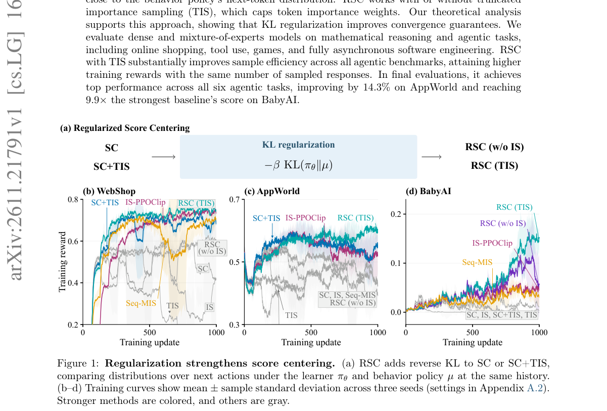

*Result - Weighting and KL shape logit gradients. Curves show the derivative coefficient after factoring out 1 −πθ(a | h), with A = 1, c = 2 and β = 0.05 for RSC. The expressions on the right give ∇za*

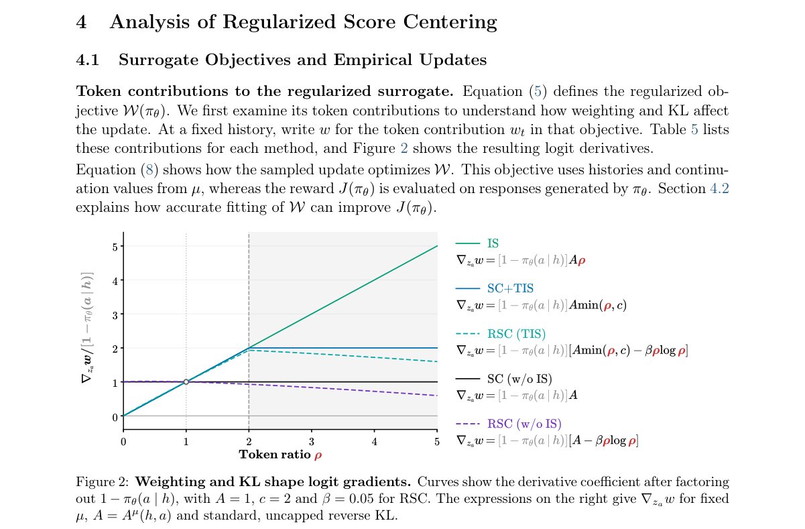

**Why this ranks #15**: 给异步 RL 里的 score centering 加反向 KL 正则，把 learner 拉回 behavior policy 附近：原始 IS 在低概率 token 上的 logit 梯度 99 分位高达 25.928，加正则后降到 2.415，六个 agentic 任务全部最优，AppWorld 比 SC/SC+TIS 提升 14.3%，BabyAI 达到最强基线的 9.9 倍。

---

### 16. What RL on Expert-Built Tasks Teaches Nemotron 3.5 Super

**arXiv**: [2611.22161](https://arxiv.org/abs/2611.22161) | **Score**: 8.7 (relevance 9 x 0.7 + quality 8 x 0.3) | **Direction**: `llm_vlm_rl` | **Tags**: LLM-VLM, rubric-reward, model-judge, cispo, lora-adapter, nemotron, Surge AI | **Categories**: cs.AI, cs.CL, cs.LG, cs.SE | **Pages**: 18

**Authors**: Sushant Mehta; Edwin Chen

**Affiliation**: Surge AI

**Abstract**

> We post-train NVIDIA's Nemotron 3.5 Super (120B total, 12B active parameters) with reinforcement learning (RL) on five expert-built task datasets, one at a time: real-world software engineering, complex constraints, long-horizon tool use, professional chart understanding and enterprise document reasoning. Each run trains a fresh rank-32 LoRA adapter with CISPO on Tinker, with no supervised stage, and each adapter is compared with the base model on the same tasks, harness and settings. On twelve headline benchmarks, eight built by other groups and four by Surge AI, the gains range from +4.5 points on IFBench to +13.8 on GDP_pdf, which rises from 10.4% to 24.2%; SWE-bench Pro V2 rises from 86.9% to 92.1%, Terminal-Bench 2.1 from 63.9% to 70.3%, MultiChallenge from 58.3% to 66.6%, AutomationBench from 14.8% to 27.5% and Chartography from 39.4% to 50.6%. The document adapter, trained without API tools, also gains +8.0 points on AutomationBench. In attempts read side by side with the base model's on tasks each adapter newly solves, the base model's failures recur in a few modes, and each adapter does more often what the base model missed: the tool-use adapter finds the data and the rules before acting, the coding adapter writes its own test or scratch files on SWE-bench Pro V2, the constraints adapter carries earlier turns into its answers, the chart adapter measures the marks in code, and the document adapter reads AutomationBench's spreadsheets.

**Key findings**

- **Finding**: 五个 adapter 在同一 harness 下配对评测：SWE-bench Pro V2 86.9%→92.1%、Terminal-Bench 2.1 63.9%→70.3%、MultiChallenge 58.3%→66.6%、AutomationBench 14.8%→27.5%、Chartography 39.4%→50.6%、GDP.pdf 10.4%→24.2%（+13.8），最小增益是 IFBench 的 +4.5。
- **Inference**: 在没有监督阶段、也没有 KL 惩罚的前提下，用 GPT-6.1 Sol 之类模型按二元 rubric 打分（约束与文档两个数据集的奖励为 (c+0.5a)/1.5）就能把强开源 MoE 底座推过多个榜单，说明瓶颈在专家任务数据的质量而非算法复杂度。
- **Recommendation**: 做垂直能力后训练时先按「一个能力一个数据集、一个 adapter」拆开跑，再在同一 harness 做配对评测并读行为指标；可复用的行为量是「从不打开收件箱的任务占比」从 74.3% 降到 41.2%。

**Key figures**

*Framework - Base and trained scores on the twelve headline benchmarks, grouped by the adapter’s training dataset. Bold numbers are gains in percentage points. Metrics as in Table 3.*

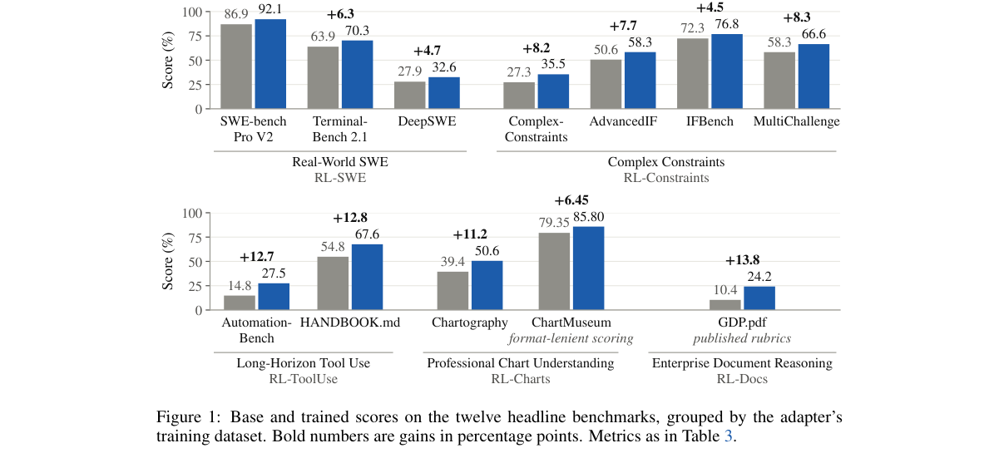

*Result - The rates of Table 5 over all attempts: base (gray) and the trained adapter (blue), with each paired change in points and its 95% task-bootstrap interval. Behavior rates are counted by rules*

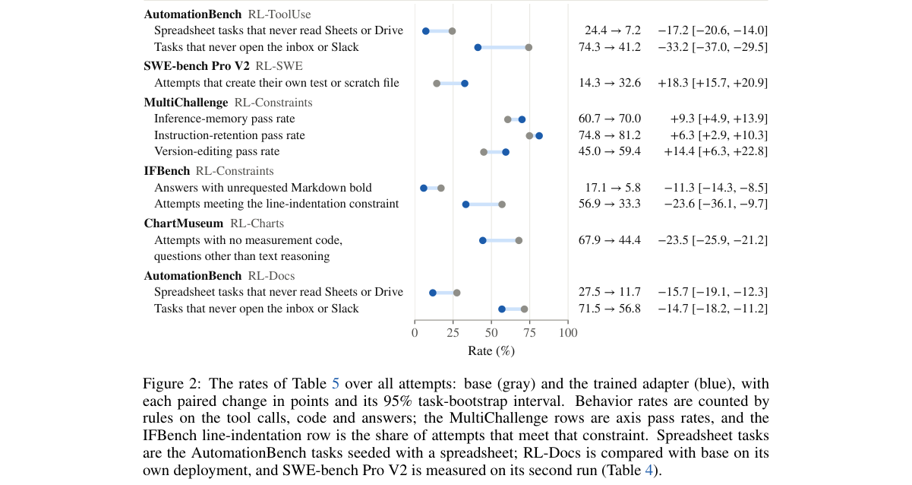

**Why this ranks #16**: 用模型评判式 rubric 奖励在 120B 总参/12B 激活的 Nemotron 3.5 Super 上做纯 RL（rank-32 LoRA、CISPO、无 SFT 阶段、无 KL 惩罚）：12 个 benchmark 上增益从 IFBench 的 +4.5 到 GDP.pdf 的 +13.8（10.4%→24.2%），SWE-bench Pro V2 从 86.9% 升到 92.1%。

---

### 17. Eyes in the Update? Learning Where Rewards Land in Multimodal Reasoning

**arXiv**: [2611.22438](https://arxiv.org/abs/2611.22438) | **Score**: 8.7 (relevance 9 x 0.7 + quality 8 x 0.3) | **Direction**: `llm_vlm_rl` | **Tags**: LLM-VLM, reward-landing, token-level-credit, multimodal-rl, grpo, visual-grounding, University of Hong Kong | **Categories**: cs.AI, cs.LG | **Pages**: 30

**Authors**: Lixuan He; Tianzhe Chu; Shulin Tian; Shikang Zheng; Feng Chen; Yi Ma

**Affiliation**: The University of Hong Kong; Nanyang Technological University

**Abstract**

> Multimodal post-training has moved from broad instruction tuning toward reinforcement learning for image and video reasoning, where outcome rewards can improve final-answer accuracy. Yet these rewards are assigned to complete generated trajectories, while visual evidence is used only at sparse and uneven positions inside the response. Recent work has begun to make multimodal RL more token-sensitive through grounding signals or external token-level weighting. We ask a more specific question: can the allocation of the same trajectory-level reward be inferred from the model's own multimodal computation, rather than from an auxiliary annotator, perception module, or process label? We propose Gaze-RL, a representation-driven policy optimization method that redistributes completion-level advantage through a latent reward landing field. The field is computed from internal cross-modal geometry and local predictive uncertainty, assigning larger update weight to positions that are both visually anchored and decision-bearing while remaining mean-one, so the total credit of each rollout is preserved and only its positionwise allocation changes. Gaze-RL requires no process supervision, auxiliary perception module, or architectural modification, and improves both Qwen2.5-VL and InternVL3.5 across a broad range of image and video benchmarks.

**Key findings**

- **Finding**: Qwen2.5-VL-7B 上 Gaze-RL 把 MME 从 2309.5 提到 2344.1、MMVP 从 76.3 提到 78.7、MathVista 从 67.2 提到 70.4、Geometry3K 从 36.8 提到 47.9；InternVL3.5-8B 的 LogicVista 从 57.3 到 63.0、NExT-QA 从 74.8 到 78.9，而 Qwen 系骨干上所有 RL 方法在 NExT-QA 都低于基线。
- **Inference**: 同一份轨迹级奖励的总量不变、只在 token 间重新分配（落点场均值为一，任意两个权重之比 e^{2η} 只在 1.22~1.82 之间），说明「奖励落点」是一个可以脱离外部监督单独优化的一维变量。
- **Recommendation**: 多模态 RL 不必再外挂过程标注或感知模块，可先用内部 hidden state 的跨模态相似度乘局部熵构造落点场做轻量消融；同时注意它在 Qwen 系 NExT-QA 上仍会掉分，长视频 QA 需单独做回归测试。

**Key figures**

*Framework - Overview of Gaze-RL for multimodal policy training. Visual anchoring 𝛼𝑡enters through the support coefficient of supported branching 𝑏𝑡(high predictive entropy with visual support), and 𝑏𝑡is*

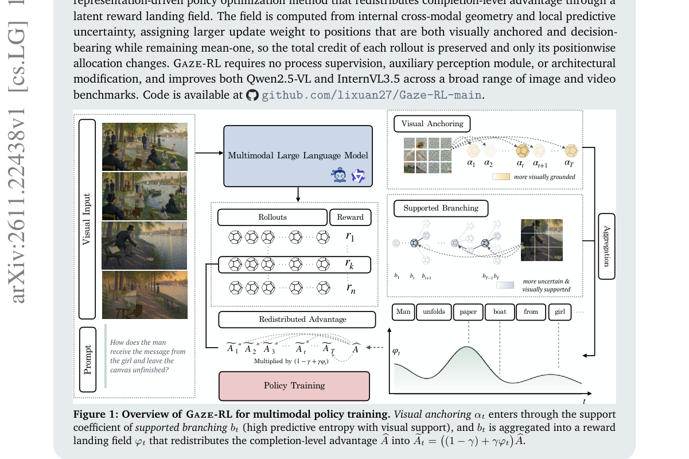

*Result - Average response length.*

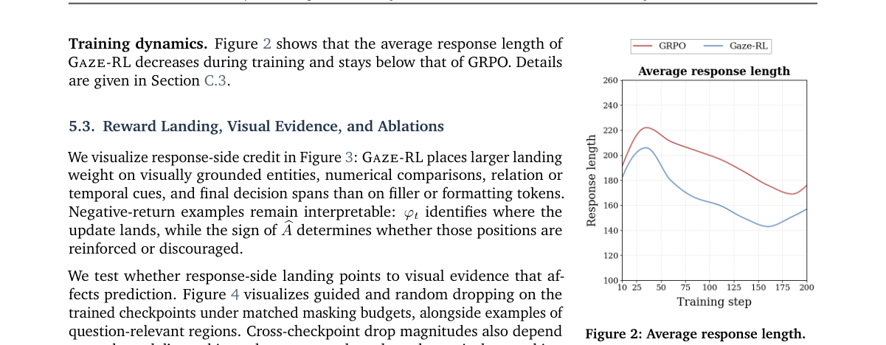

**Why this ranks #17**: 追问多模态 RL 里奖励该落在哪些 token 上：Gaze-RL 从模型自身的跨模态几何与局部预测熵构造均值为一的奖励落点场，不需要任何过程标注或外部感知模块，在 Qwen2.5-VL-7B 上把 MathVista 从 67.2 提到 70.4、Geometry3K 从 36.8 提到 47.9，InternVL3.5-8B 的 LogicVista 从 57.3 提到 63.0。

---

### 18. Margin Dynamics for Large Language Model Alignment

**arXiv**: [2611.21766](https://arxiv.org/abs/2611.21766) | **Score**: 8.0 (relevance 8 x 0.7 + quality 8 x 0.3) | **Direction**: `llm_vlm_rl` | **Tags**: LLM-VLM, margin-dynamics, preference-alignment, dpo, simpo, label-smoothing, Amazon | **Categories**: cs.AI, cs.LG | **Pages**: 31

**Authors**: Xingzi Xu; Mehmet Saygin Seyfioglu; Karim Bouyarmane

**Affiliation**: Amazon

**Abstract**

> Practitioners choose among LLM alignment methods largely by trial and error. We provide a theoretical foundation: each pairwise method defines a vector field on the probability simplex that governs how the model redistributes mass between preferred and dispreferred completions. Projecting onto a single preferred/dispreferred pair reduces this to a one-dimensional margin ODE with a closed-form solution. These solutions reveal that DPO margins grow without bound (logarithmically as $O(\log t)$ in the gradient-flow limit) while IPO margins converge to a finite $1/(2τ)$; that label noise induces a qualitative phase transition in DPO (unbounded $\to$ bounded) but affects IPO only quantitatively; and that gradient concentration under asymmetric weighting governs trainability at scale. We confirm all three predictions across five model families spanning four benchmarks. The closed-form solutions also enable principled method design: we prove that adding any label smoothing $\varepsilon > 0$ to SimPO creates a finite margin attractor at $Δ^* = β^{-1}\log((1-\varepsilon)/\varepsilon)$, while $\varepsilon = 0$ (standard SimPO) has no attractor. We test this across three models (8B-9B) and confirm the prediction: the theory-derived configuration (TPO-S, $\varepsilon = 0.05$) is competitive with the strongest baselines, attaining the highest mean IFEval score among the compared methods on all three, validating that the predicted finite attractor is a usable operating point rather than proposing a new state-of-the-art loss.

**Key findings**

- **Finding**: 在 500 条样本上 DPO 的 margin 到第 2000 步涨到 1540，IPO 则在预测不动点 1/(2τ)=5 附近振荡，且 DPO 的梯度范数是 SFT 的 10 倍；注入标签噪声后 DPO 的最终 margin 在 ε∈{0, 0.05, 0.1, 0.2} 时依次为 1041、114、97、64，而 IPO 的收敛速率保持不变。
- **Inference**: 各种成对对齐损失的差别本质上只在权重函数 w(Δ) 的形状，因此可以先指定动力学性质（有限吸引子、有界梯度等）再反推损失，而不必靠网格搜索调参。
- **Recommendation**: 选对齐方法时先问三件事：权重是不是 sigmoid（无界增长）、参考模型是否冻结（梯度衰减）、非对称系数 γ 是否过大（梯度集中坍塌，γ=0 时 MATH 停在 66%、γ=0.5 到 97%、γ=0.75 反而掉到 87%）；按本文结论 ε=0.01/0.05/0.1 对应 Δ*≈46/29/22，可直接当起点。

**Key figures**

*Framework - Three axes of the margin dynamics framework. (a) SFT only attracts toward yw (F +), with pressure vanishing as π(yl) →0. DPO adds targeted repulsion F −, sustaining Ω(π) pres- sure. (b) Sigm*

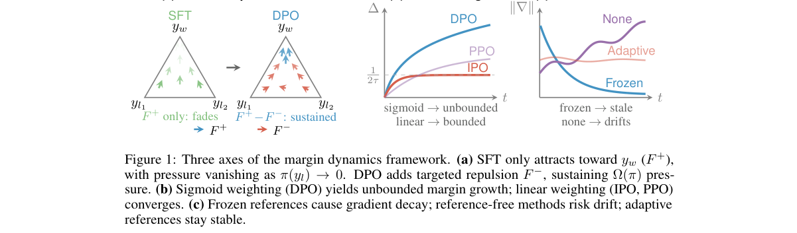

*Result - Effective potential V (∆) (schematic). SimPO (dashed) has no minimum: margins diverge. TPO-H and TPO-S have finite attractors at ∆∗.*

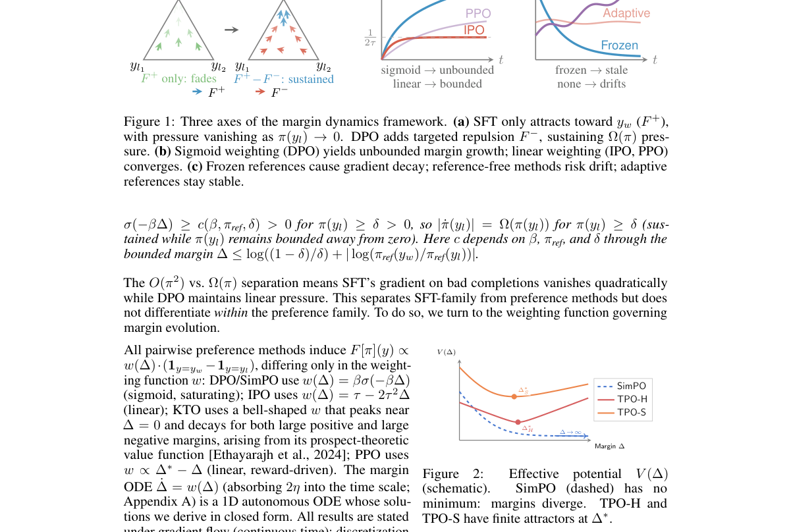

**Why this ranks #18**: 为 DPO/IPO/SimPO/KTO 这类成对对齐方法给出可解的 margin ODE：DPO 的 margin 无界增长（2000 步到 1540）而 IPO 收敛到 1/(2τ)=5，标签噪声让 DPO 从无界变有界（ε=0.05/0.1/0.2 时 1041→114→97→64），据此推出带标签平滑的 TPO-S（ε=0.05，Δ*≈29），在三个 8B–9B 模型上 IFEval 均值最高。

---

### 19. Sample-efficient Personalization of Large Language Model Alignment with Multidimensional User Preference Data

**arXiv**: [2611.22210](https://arxiv.org/abs/2611.22210) | **Score**: 8.0 (relevance 8 x 0.7 + quality 8 x 0.3) | **Direction**: `llm_vlm_rl` | **Tags**: LLM-VLM, online-dpo, preference-cone, sample-efficiency, multidimensional-preference, active-selection, Universite de Montreal | **Categories**: cs.LG | **Pages**: 18

**Authors**: Zhen-Yu Zhang; Jerry Huang; Gang Niu; Takashi Ishida; Masashi Sugiyama

**Affiliation**: Universite de Montreal; Mila - Quebec AI Institute

**Abstract**

> Preference alignment has become a central tool to align large language models (LLMs) with human values and desired behavior, and its online variant can further advance their capabilities beyond what static data alone offer by repeatedly generating and labeling new responses with human feedback. But costly, time-consuming annotations limit its scalability, making sample efficiency essential, and existing methods typically seek to improve it by expanding coverage of the response space or selecting pairs with the highest uncertainty for comparison. Although they are effective, these methods quantify uncertainty from the perspective of the LLM, which may differ from the uncertainty perceived by the user: a pair can appear highly uncertain to the LLM even when past comparisons from the user already imply a clear ordering. In this paper, we propose multidimensional preference-guided online direct preference optimization (MPG-DPO), which leverages low-cost multidimensional evaluations from automated verifiers on the user historical comparisons to construct a personalized preference cone guiding response selection for online preference alignment. Specifically, it first discards responses that are confidently dominated under the estimated user preference, then selects two responses that are competitive under the retained preference cone yet exhibit the strongest unresolved disagreement. Theoretical analysis shows that, with high probability, the fraction of queries spent on cone-dominated responses vanishes as learning progresses. Experiments across multiple LLM families show that MPG-DPO outperforms strong contenders under matched query budgets.

**Key findings**

- **Finding**: 三个 7B 家族、三个随机种子、同等偏好查询预算下 MPG-DPO 全面领先：Qwen2.5-7B 的 IMDB 平均奖励 81.6→83.2、TL;DR 胜率 63.38→65.31、ALPACAEVAL2 长度控制胜率 59.03→60.71、ARENA-HARD 胜率 54.68→56.04（基线为 Online DPO）。
- **Inference**: 在线偏好优化的浪费主要来自「模型视角的模糊」而非「用户视角的模糊」——用低成本多维打分重建用户偏好锥，可以在不增加查询预算的前提下把查询只花在真正未决的权衡上。
- **Recommendation**: 做个性化在线对齐时先按正确性、完整性、清晰度、简洁性、推理质量这 5 个维度建偏好锥（FLASK 量表，prometheus-7b-v2.0 打 1–5 分），每轮只采 8 个候选，先过滤锥内被支配者再按 max-min 分歧挑对。

**Key figures**

*Framework - Summary of the proposed MPG-DPO approach. Given an input prompt, candidate responses are sampled and filtered using the preference cone, after which a pair is selected to maximize the weaker*

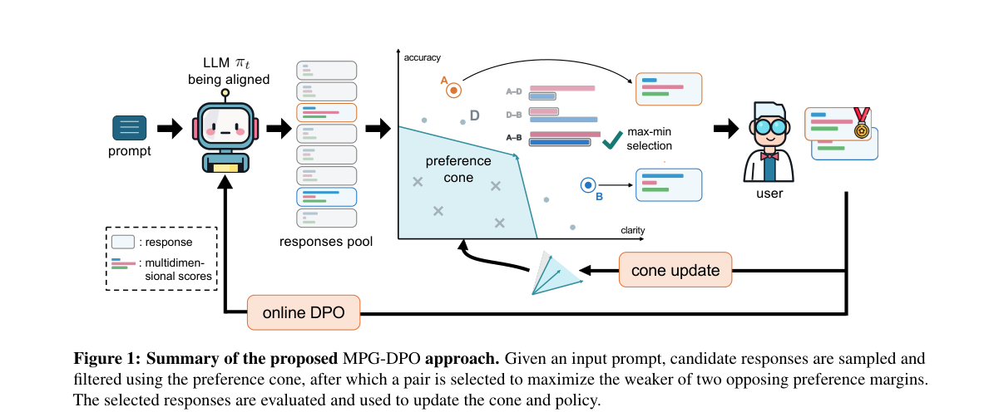

**Why this ranks #19**: 针对在线 DPO 的查询浪费：MPG-DPO 用自动验证器在用户历史比较上估出个性化偏好锥，先剔除被锥支配的响应再挑分歧最强的两个，理论上 T 轮里至少 T−O(log²T) 次比较落在两个 Pareto 最优响应之间；Qwen2.5-7B 上 ARENA-HARD 从 54.68 升到 56.04、TL;DR 从 63.38 升到 65.31。

---

### 20. Learning to Edit IFC Building Models: Verifiable Checkers as the Training Signal for Dependency-Aware Editing Agents

**arXiv**: [2611.22307](https://arxiv.org/abs/2611.22307) | **Score**: 8.0 (relevance 8 x 0.7 + quality 8 x 0.3) | **Direction**: `llm_vlm_rl` | **Tags**: LLM-VLM, ifc-bim, codeact-agent, verifiable-checker, grpo, dependency-aware-editing, Nanchang University | **Categories**: cs.AI | **Pages**: 35

**Authors**: Jiaxin Zhang; Yao Luo; Yuze Dan; Yunqin Li; Bowen Wang

**Affiliation**: Nanchang University; Chongqing University; The University of Osaka

**Abstract**

> Editing a building information model in the Industry Foundation Classes (IFC) schema requires propagating changes to dependent elements while preserving unrelated entities. Existing language-model agents for IFC editing use prompted models without learning from edit outcomes. Target-file comparisons do not specify which alternative edits are allowed or which unrelated entities must remain unchanged. We present IfcGym, a CodeAct environment in which a language model edits IFC through executable code and four checkers verify validity relative to the input model, intent, dependency and preservation against a task specification. Their conjunction is strict success. IfcEdit distils verified teacher episodes into a Qwen3.5-9B student through supervised fine-tuning (SFT), then applies Group Relative Policy Optimization (GRPO) with strict success as the reward. On IfcEditBench, 1,990 editing tasks on 13 held-out real projects, the final student reaches 86.78% strict success, from 79.15% after SFT. The paired confidence interval for the difference from its teacher includes zero; the same recipe on a 27B model reaches 91.76% and exceeds the teacher. On the public benchmarks BIM-Edit and BIBIMBAP the final student scores 55.19 and 54.50. On IfcEditBench, the students outperform all prompted models except the teacher under matched tool access; both evaluated frameworks also score lower. Rewarding all four checkers yields 4.83 points more strict success than rewarding intent and validity alone.

**Key findings**

- **Finding**: IfcGym 用 3,059 栋合成建筑生成 19,141 条已验证 SFT 轨迹，在 13 个留出真实项目的 1,990 个测试任务上，Qwen3.5-9B 从提示式 16.08% 提升到 SFT 79.15%、GRPO 86.78%（教师 88.04%，最强非教师提示模型 67.99%），27B 版到 91.76%；公开榜单 BIM-Edit 55.19、BIBIMBAP 54.50。
- **Inference**: 依赖感知编辑的失败点在「该改的没一起改」和「不该改的被改了」，单看目标文件无法区分这两种错误，所以奖励必须同时检查依赖传播与无关实体保持。
- **Recommendation**: 把领域任务变成 RL 训练信号时，优先用多个确定性检查器的合取作严格奖励（本文四门奖励比只判意图与合法性高 4.83 分），并按 64 prompt × 8 rollout 的混合结果组做 GRPO。

**Key figures**

*Framework - Data construction and learning in IfcGym. (a) Synthetic buildings supply verified teacher demonstrations; real IFC projects supply IfcEditBench tasks. (b) Bar heights encode square-root SFT*

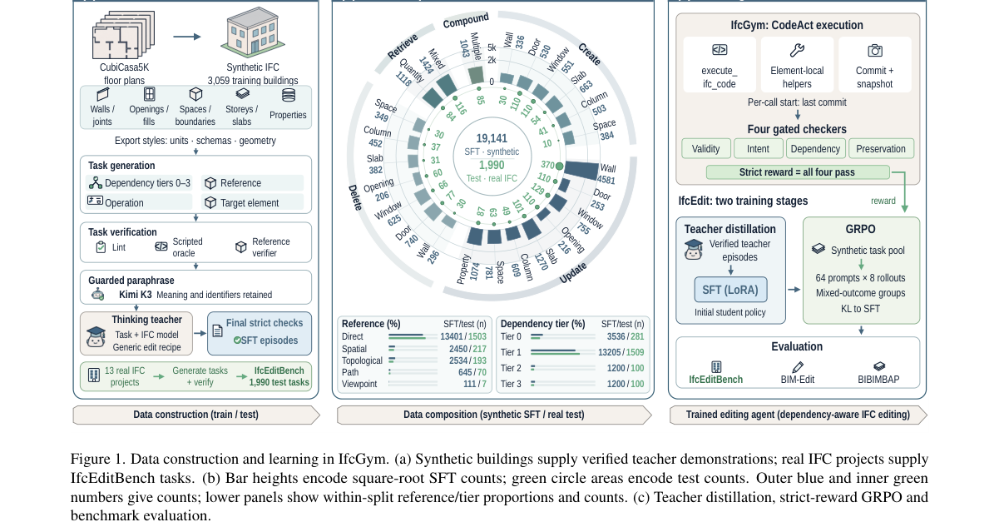

*Result - Paired strict-success differences and 95% cluster- bootstrap intervals for student size, GRPO on each student and the remaining size gap, overall and by target element. Identifier retrieval*

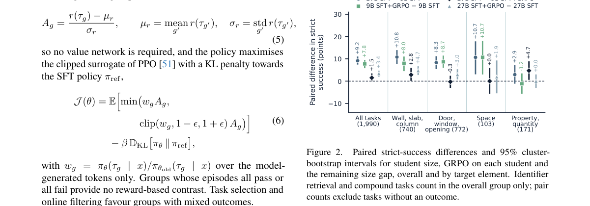

**Why this ranks #20**: 把「编辑是否合法」写成四个可执行检查器（合法性、意图、依赖、保持）并以此作 RL 奖励：Qwen3.5-9B 在 IfcEditBench 的 1,990 个任务上从提示式 16.08% 经 SFT 79.15% 到 GRPO 86.78%，27B 版达 91.76%，四门奖励比只奖励意图+合法性高 4.83 分。

---

## Footer

- Total papers reviewed across all 4 axes: 60
- llm_vlm axis final count: 20
- Wild-cards in this axis: 0
- Figure assets: 2026-11-19/res/

Generated by `mine-arxiv-daily-digest` skill. Sister file: `2026-11-19_llm_vlm_entry.md`.
