# Mine Arxiv Daily Digest - 2026-11-19 (具身智能与世界模型 Axis, 20 papers)

**Generated**: 2026-11-19 01:20 CST

**Source**: arXiv cs.CV, cs.SD, eess.AS, cs.CL, cs.AI, cs.RO, cs.LG, cs.IR submissions, listing day 2026-11-17 (announced 2026-11-18 01:00 UTC)

**Batch window**: 2026-11-16T19:00:00Z .. 2026-11-17T19:00:00Z（arXiv 公告批次横跨两个 UTC 日：从前一日的美东 14:00 截止时刻起算（EDT 为 18:00Z，EST 为 19:00Z），到当日的同一时刻为止）

**Axis**: world_embodied (20 papers, base 15, cap 20)

**Directions**: world_model (7), embodied_ai (13)

**Selection**: 20 papers ranked by relevance x quality, with 0 wild-card slots

**Day total**: 60 papers across 4 axes (target 60)

**Scope**: 世界模型、学习型模拟器与具身智能，含移动操作、人形控制、触觉反射、VLA 策略与面向具身任务的强化学习

**Wild-card**: 0（本 axis 已撞 AXIS_CAP = 20，20 篇全部为够格论文，未启用任何 wild-card 补位名额）

**配额**：本轴 20 篇（基准 15、上浮 5），**撞上 AXIS_CAP = 20**。两个 direction 是 7 / 13，`embodied_ai` 超基准 5 篇。按判据 `dir_over ≤ max(dir_under, axis_surplus)`，此处 axis_surplus = 20 − 15 = 5，`embodied_ai` 的超出量 5 恰好等于轴富余，故放行；名额来自同轴 `world_model` 之外的轴内富余与`duplex_speech` 让出的 5 个名额。

**rel≥9**：本轴 6 篇 relevance≥9（JointGV、Every Camera Grows Up、EKR、CURE、闭环交互式驾驶世界模型、ReLAP）全部入选。`world_model` 41 篇候选里有 6 篇 rel≥9，是全批 rel≥9 密度最高的 direction。

**供给**：587 篇候选里 primary 落在 `embodied_ai` 87 篇、`world_model` 33 篇。本轴拿到的富余量最大（5 个名额），因为它是 `duplex_speech` 让出名额后的最大受益方。

---

## 世界模型与学习型模拟器 · `world_model` (7 papers)

本方向 7 篇打满基准 7 篇，其中 5 篇 relevance≥9——41 篇候选里有 6 篇 rel≥9，是全批 rel≥9 密度最高的 direction。这一档几乎全部在问同一个问题：世界模型「看起来对」和「决策对」之间差在哪。Plaausible Videos Can Lead to Poor Decisions 提出 CURE（Certify, Upweight, Rollout, Explore），用证书判断世界模型能不能拿来规划：它信的那些决策 regret 是 0.06、不信的是 0.38，相对最优悲观决策规则低 10–25%、相对世界-动作模型与搜索/策略学习低 41–64%。JointGV 让场景图与视觉世界模型并行推演，32 步 rollout 的联合位置误差降 11–28%，真机倒立摆杆角误差从 12.56° 降到 6.69°，仿真里用校正过的 rollout 训出的 actor 完成 46/50 回合（原始 rollout 是 0 回合）。另外两篇各自点出一个具体失效：Every Camera Grows Up 发现六个开源交互式世界模型在 180° 转身行走中全部发生「相机高度回归」（从 0.15 m 起步只有 0–20% 的片段仍在 1.3× 初始高度内）；Escaping Latent Traps 用训练无关的 EKR 在两个 JEPA 世界模型、四个基准上把平均成功率从 31.8% 提到 46.7%（LeWM）、从 54.7% 提到 64.0%（H-JEPA），换到 DINO-WM 不调参也有 +6.7/+19.3 分。剩下两篇是工程侧：AR-WAM 用因果骨干做流式世界-动作建模，单前视相机在 NAVSIM-v1 上 91.5 PDMS、RL 后 94.0；WM-Quant 是第一个为 JEPA 式世界模型做训练后量化的框架，W4A4 下 PushT 成功率 81.3%（基线 20%）。

### 1. JointGV: Structure-Aware Correction of Visual World Models with Parallel Graph Dynamics for Long-Horizon Modeling

**arXiv**: [2611.22543](https://arxiv.org/abs/2611.22543) | **Score**: 9.0 (relevance 9 x 0.7 + quality 9 x 0.3) | **Direction**: `world_model` | **Tags**: embodied, scene-graph, world-model, long-horizon-drift, robot-planning, dino-wm, University of Oxford | **Categories**: cs.AI, cs.CV, cs.RO | **Pages**: 21

**Authors**: Tian Lyu; Yichen Jiang; Ziyuan Cheng; Yunda Yan; Xiangyu Pan; Junjie Jiang; Jialin Yu; Boyu Ning; Pietro Liò; Fan Mo

**Affiliation**: University of Oxford; Monash University; University College London; KTH Royal Institute of Technology

**Abstract**

> Visual world models predict future visual states conditioned on actions, but recursive errors in entity poses and spatial relations limit their long-horizon prediction for robot planning and control. We ask whether a separately predicted relational state can correct this drift without restructuring the visual model. This is challenging because graph nodes and visual states share neither elements nor a feature space. We propose Joint Graph--Visual Dynamics Correction (JointGV), a plug-in based on a cross-granularity dynamics hypothesis: despite their different representations, graph-node and visual-state changes describe the same physical transition. JointGV rolls out a task-conditioned scene graph alongside the visual world model, couples their predicted changes, and combines the resulting graph-motion context with graph-predicted node positions to compute a bounded residual. Graph-learning and correction gradients do not propagate into the original visual dynamics. We attach JointGV to DINO-WM (spatial tokens) and DreamerV3 (a global latent state), evaluating both on DMC Cheetah Run and Walker Walk across three seeds and extending the evaluation to contact-rich manipulation with DMC Finger Turn Hard. Across 32-step rollouts, JointGV improves structural and visual-prediction accuracy, reducing joint-position error by 11--28\%. For spatial tokens, learned graph--visual change coupling gives lower error than broadcasting the same mean graph-motion context to every token, particularly when non-adjacent parts appear close together in the image. On real-robot inverted-pendulum sequences, JointGV reduces DINO-WM's 32-step pole-angle error from $12.56^\circ$ to $6.69^\circ$ and improves DreamerV3 and LeWorldModel as well. In simulated inverted-pendulum control, an actor trained with JointGV-corrected rollouts completes 46 of 50 episodes, compared with none using the original rollouts.

**Key findings**

- **Finding**: JointGV 以即插即用方式挂在 DINO-WM（空间 token）与 DreamerV3（全局潜状态）上，32 步 rollout 的关节位置误差下降 11-28%。
- **Inference**: 图节点与视觉状态的变化描述同一次物理转移，因此用图运动上下文算出有界残差即可在不改动视觉动力学的前提下抑制长期漂移。
- **Recommendation**: 评测长时序世界模型时把 32 步后的几何误差单列一项，并尝试用任务条件场景图做外接校正，而不是重训视觉主干。

**Key figures**

*Framework - Motivation. (a) DINO-WM open-loop predictions ini- tialized from real-robot inverted-pendulum observations increas- ingly deviate from the observed pole. (b) Pole-angle error rises with roll*

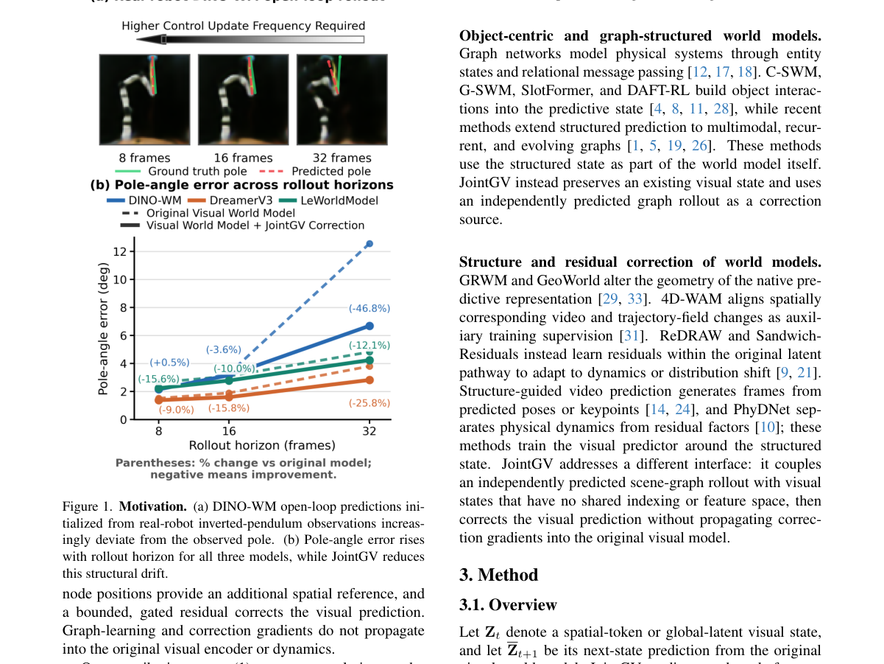

*Result - Overview of JointGV. Given the current RGB observation and action, the original visual world model (yellow) predicts the uncorrected next visual state Zt+1 and its change ∆Zt. In parallel, J*

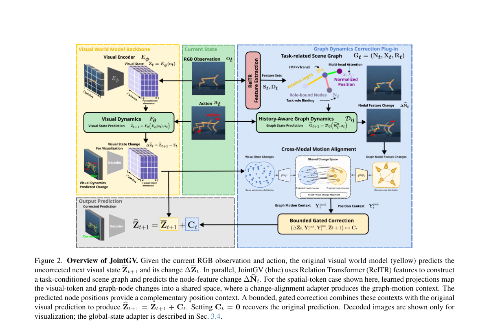

**Why this ranks #1**: 它把可独立预测的任务条件场景图当成视觉世界模型的外部校正量，在 DMC Cheetah Run/Walker Walk 与 Finger Turn Hard 上把 32 步 rollout 的关节位置误差压低 11-28%，并把 DINO-WM 真实倒立摆的 32 步杆角误差从 12.56 度降到 6.69 度，是当天最硬的结构性修补。

---

### 2. Every Camera Grows Up: Camera-Height Regression in Interactive Video World Models

**arXiv**: [2611.21782](https://arxiv.org/abs/2611.21782) | **Score**: 8.7 (relevance 9 x 0.7 + quality 8 x 0.3) | **Direction**: `world_model` | **Tags**: embodied, camera-height-regression, video-world-model, benchmark, human-prior, State Key Laboratory for Novel Software | **Categories**: cs.CV | **Pages**: 11

**Authors**: Sheng Lu; Guangpin Tao; Tong Lu; Ying Tai

**Affiliation**: State Key Laboratory for Novel Software Technology, Nanjing University

**Abstract**

> Interactive video world models serve as simulators for embodied agents: from a starting image and an action trajectory, they generate the views the agent would see. The starting image fixes how high the camera is, for example 0.15 m for a floor robot or 2.2 m for an overhead camera, and a faithful simulator must keep this height as the camera moves. We show that six recent open-weight models fail to do so: as motion replaces the starting view with generated content, they move the camera toward human eye level, a failure we call camera-height regression. Our benchmark, EyeHeight, pairs six rendered elevations (0.15 m to 2.2 m) and four calibrated real-world rig heights with scale-free multi-view height estimation. All six models lose their initial height during a $180^\circ$ turn-and-walk rollout: initialized at 0.15 m, only 0-20% of clips end within $1.3\times$ of the starting height as inferred viewpoints converge to human heights of 1.1 m to 1.5 m, whereas ground-truth renders remain within a few percent. In Matrix-Game models, homography-tracked floor motion stays consistent with constant elevation during rotation even as newly outpainted room geometry yields a higher reconstructed viewpoint. Regression grows with rotation angle, begins while the start frame remains in context, and largely reverses in SANA-WM when a $360^\circ$ turn restores the initial view. We trace this pull to human-centric video priors in which floor-level views are nearly absent: in SANA-WM, textual height cues and dense floor-disparity maps do not prevent it, whereas classifier-free text guidance during the first half of denoising strengthens it. Combining unguided sampling with height-balanced fine-tuning recovers more retention but costs 5 MUSIQ points, a loss fixed during those same early steps. Viewpoint drift alone shifts the paths predicted by visual navigation policies.

**Key findings**

- **Finding**: 六个近期开源模型在 180 度转弯行走 rollout 中全部发生 camera-height regression，0.15 米起点的片段只有 0-20% 保持在 1.3 倍高度内，推断视角收敛到 1.1-1.5 米的人眼高度。
- **Inference**: 漂移源于训练语料里几乎没有地面视角的以人为本视频先验，所以文本高度线索与稠密视差图都拦不住它，分类器自由引导反而会放大。
- **Recommendation**: 把交互式视频世界模型当导航仿真器用之前先跑一遍高度保持检查，并把无引导采样加高度均衡微调作为对照基线。

**Key figures**

*Result - Mechanisms of camera-height regression in SANA-WM, on the castle start of Fig. 1. Left: Supplying metric height via the prompt or a fine-tuned floor-disparity map (dashed) leaves inferred he*

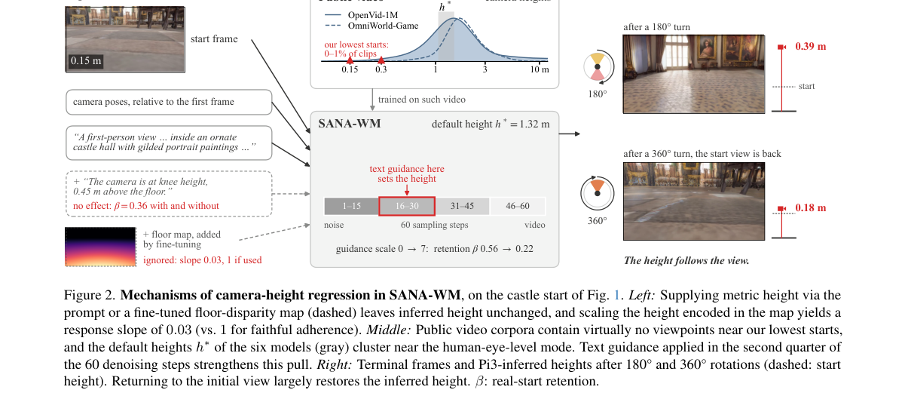

**Why this ranks #2**: 它证明交互式视频世界模型并不保相机高度：六个开源权重模型在 180 度转弯行走中全部丢失初始机位，0.15 米起步的片段只有 0-20% 仍停在 1.3 倍高度内，视角收敛到 1.1-1.5 米的人眼高度。

---

### 3. Escaping Latent Traps by Remembering: Training-Free Episodic Kernel Repulsion for World-Model Planning

**arXiv**: [2611.22470](https://arxiv.org/abs/2611.22470) | **Score**: 8.7 (relevance 9 x 0.7 + quality 8 x 0.3) | **Direction**: `world_model` | **Tags**: embodied, latent-trap, training-free, jepa, top-k-kernel, world-model-planning, Zhejiang University | **Categories**: cs.LG | **Pages**: 17

**Authors**: Yican Zhao; Bolin Yang; Ruizhe Wang; Haiyang Guo; Fuji Yang; Bingo Wing-Kuen Ling; Zelin Zang

**Affiliation**: Zhejiang University; Qiantang Institute for Advanced Study; Guangdong University of Technology

**Abstract**

> Latent world models plan towards a goal image by minimising the distance between predicted and goal latents. This distance is not geodesic: it has local minima, latent traps, behind walls, at corners and in dead ends, and memoryless receding-horizon replanning keeps the agent in them, revisiting states far from the goal. We propose Episodic Kernel Repulsion (EKR), a training-free cost term that penalises candidate plans by a top-$k$ Gaussian kernel to a novelty-gated memory of the latents the agent has actually visited, rescaled by the current base cost so that its strength is comparable across models. Across two JEPA world models and four benchmarks, EKR raises average success from 31.8% to 46.7% (LeWM) and from 54.7% to 64.0% (H-JEPA) with the same model, planner and budget. Same-memory counterfactuals show that, in most settings, EKR pushes plans away from visited states, in navigation, often at a higher base cost; stuck episodes and revisits drop accordingly. In seven of eight settings it matches or exceeds $4\times$ samples at $0.8$--$1.5\times$ compute. Without tuning, it transfers to DINO-WM with CEM: $+6.7$ and $+19.3$ points on official and longer-goal Wall tasks, and from 44.7% to 100.0% and from 21.0% to 32.0% on long-horizon PointMaze and Push-T.

**Key findings**

- **Finding**: 免训练的 EKR 用 top-k 高斯核惩罚与已访问潜状态记忆过近的候选计划并按当前基础代价重标定，LeWM 平均成功率 31.8% 升到 46.7%，H-JEPA 从 54.7% 升到 64.0%。
- **Inference**: 潜空间规划的距离并非测地距离，墙后与死角的局部极小值靠无记忆的滚动重规划逃不掉，显式记忆才是逃逸方向的来源。
- **Recommendation**: 用潜空间世界模型做规划时优先试加这类免训练记忆代价项，并核对 4 倍采样预算对应 0.8-1.5 倍计算开销是否划算。

**Key figures**

*Framework - A latent trap on AntMaze (LeWM, seed 42, task 13). (a) Top-down trajectories. The baseline (grey) walks into a side pocket and stays there (purple: steps labelled as trapped); EKR (orange) g*

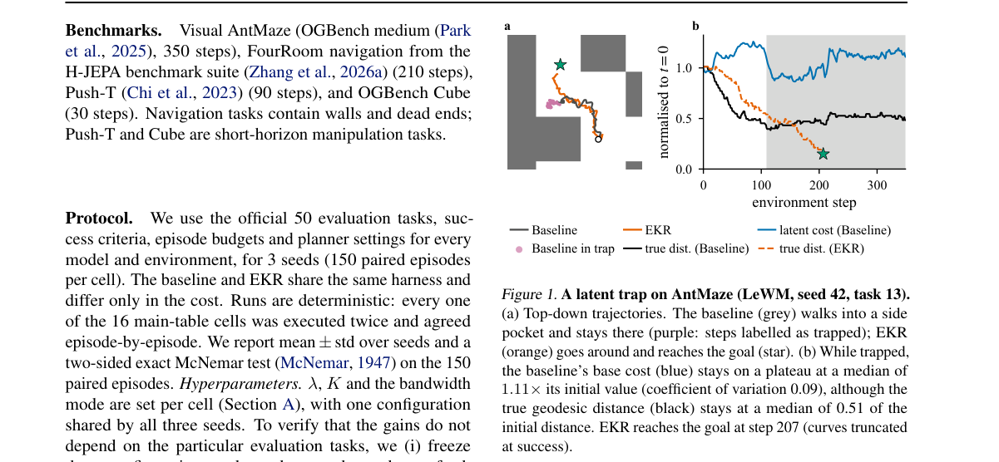

*Result - Success vs. planning compute (log scale, relative to the 1× baseline; definition in Section B). Grey line: baseline with 1–8× samples (shaded: 95% bootstrap CI); square: 2× iterations; star*

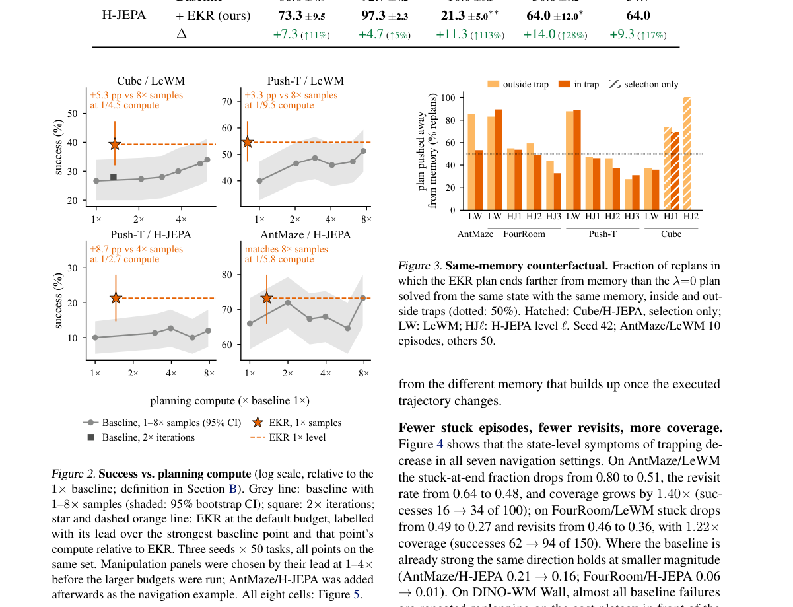

**Why this ranks #3**: 在两个 JEPA 世界模型、四个基准上，只加一个免训练的 top-k 高斯核代价项就把平均成功率从 31.8% 提到 46.7%（LeWM）、从 54.7% 提到 64.0%（H-JEPA），长程 PointMaze 从 44.7% 直接到 100.0%。

---

### 4. Plausible Videos Can Lead to Poor Decisions: Diagnosing and CURE-ing World Models for Planning

**arXiv**: [2611.22561](https://arxiv.org/abs/2611.22561) | **Score**: 8.7 (relevance 9 x 0.7 + quality 8 x 0.3) | **Direction**: `world_model` | **Tags**: embodied, world-model-certificate, planning-regret, support-estimation, model-based-rl, Cornell University | **Categories**: cs.CV | **Pages**: 11

**Authors**: Raphael C. Kim; Michele Santacatterina; Jingsen Zhu; Ramin Zabih

**Affiliation**: Cornell University; NYU Grossman School of Medicine

**Abstract**

> Action-conditioned world models are increasingly used as world models for planning, yet a world model that makes plausible, realistic-looking videos that are consistent with the training data can produce poor decisions. We address two key questions: (1) when can we trust a world model for planning, and (2) what should we do when we cannot? We introduce CURE (Certify, Upweight, Rollout, Explore), a certificate-guided technique that assesses whether a world model can be trusted for planning and determines what to do next: whether to upweight the training data to debias the model; roll out more samples at test time; or explore by collecting new data where support (how well the training data cover the planner's decisions) is missing. We deploy CURE across multiple domains, spanning simulated physics based on PhyWorld, MuJoCo arm control, and Language-Table pushing in simulation and on real videos. The decisions our certificate trusts have lower regret than those it does not (e.g., 0.06 vs. 0.38 on Language-Table sim and 0.07 vs. 0.38 on MuJoCo contact), whereas video perceptual quality does not identify good decisions. By focusing on decision quality rather than perceptual quality, CURE lowers regret over the best pessimistic decision rule by 10-25% across support levels, and over world-action models, search and policy learning by 41-64%, given the same data.

**Key findings**

- **Finding**: 证书信任的决策后悔值明显更低，Language-Table 仿真 0.06 对 0.38、MuJoCo 接触 0.07 对 0.38，而视频感知质量完全无法区分好坏决策。
- **Inference**: 世界模型的隐患在于训练数据对规划器决策的支撑缺失，所以应按支撑度决定是重加权数据、多采样 rollout 还是去支撑缺失处主动探索。
- **Recommendation**: 把世界模型接进规划前先算支撑与证书指标，不要用 FVD 这类感知指标代替决策质量的判据。

**Key figures**

*Framework - Convincing video does not mean a better action. World models make decisions by generating videos as imagined rollouts, predicting the regret from the videos, and picking the ac- tion with th*

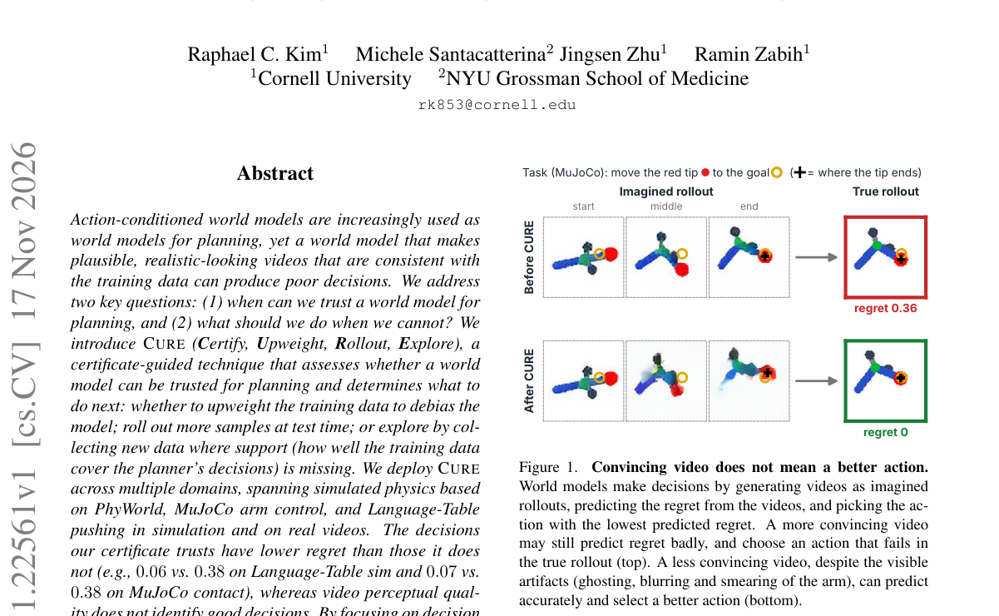

*Result - CURE. We estimate the behavior policy ˆπb and the weights ˆα on the training data, and the model error ˆε on a valida- tion set. We then train the candidate models (standard, debiased, retar*

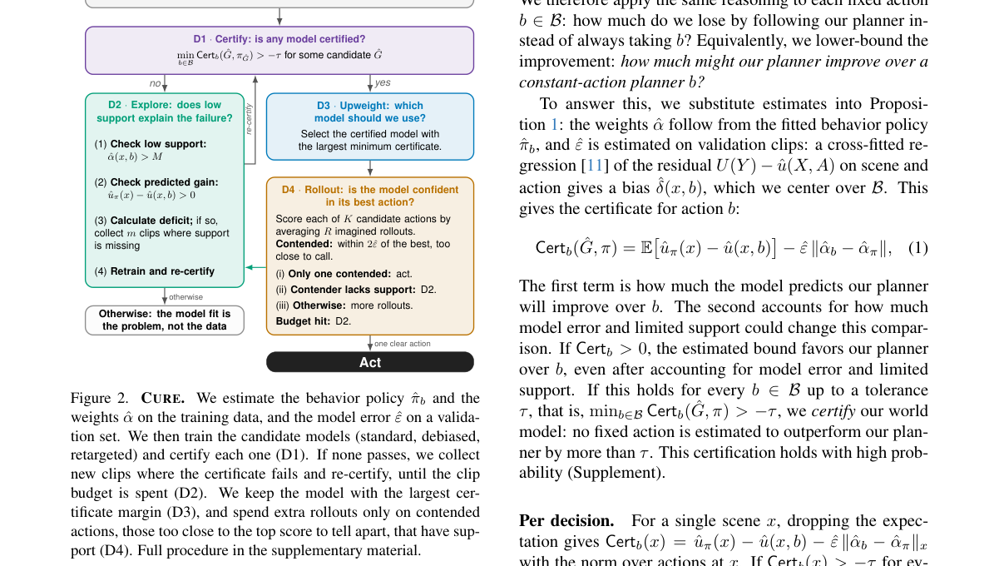

**Why this ranks #4**: 它指出「视频看着合理」不等于「决策可靠」：被证书信任的决策后悔值是 0.06 对 0.38（Language-Table 仿真）、0.07 对 0.38（MuJoCo 接触），并把后悔比最悲观决策规则再降 10-25%、比世界动作模型与策略学习低 41-64%。

---

### 5. Making the World React Realistically: A Closed-Loop Interactive World Model for Autonomous Driving

**arXiv**: [2611.22691](https://arxiv.org/abs/2611.22691) | **Score**: 8.7 (relevance 9 x 0.7 + quality 8 x 0.3) | **Direction**: `world_model` | **Tags**: embodied, autonomous-driving, closed-loop, 3d-gaussian, traffic-simulation, signal-light, Tongji University | **Categories**: cs.AI, cs.RO | **Pages**: 11

**Authors**: Jia Hu; Yang Chang; Panqu Wang; Zhijun Fu; Chang Liu; Changjian Yu; Jintao Lai

**Affiliation**: Tongji University; Zhengzhou University of Light Industry; Budapest University of Technology and Economics

**Abstract**

> World models (WMs) generate driving scenarios beyond recorded logs, enabling the training and evaluation of autonomous driving systems in unseen interactions. However, existing WMs struggle to ensure both behavioral realism and visual fidelity, since they overlook the relationship between vehicle interactions and the ego visual observations. We propose a closed-loop interactive WM that couples behavior modeling and visual rendering. First, imitation-learned background-vehicle (BV) policies are fine-tuned with multi-agent reinforcement learning in the closed loop against an end-to-end ego planner that reacts to the rendered images, so that their interaction behaviors match those in real logs. Second, the viewpoints exposed by these interactions guide a per-Gaussian diagnosis of each 3D Gaussian vehicle asset, which attenuates view-dependent colors on under-observed Gaussians and fills never-observed surfaces with generated Gaussians, while preserving the observed appearance. Third, signal lights are rendered according to the driving intentions of the vehicles, by an editor that learns the light states unobserved for a vehicle through counterfactual fine-tuning with a light-state classifier. On long-tail closed-loop scenarios, our method reduces the divergence from real-world interaction behaviors by 85% and improves novel-view vehicle PSNR by 2.0dB over the state-of-the-art WM. The significance of BV light signaling in WMs is shown, as the rendered signal lights conveying BV driving intentions indirectly impact ego driving behaviors in a quarter of the scenarios.

**Key findings**

- **Finding**: 长尾闭环场景中该方法把与真实交互行为的偏差降低 85%，新视角车辆 PSNR 比当时最优世界模型高出 2.0 dB。
- **Inference**: 行为建模与视觉渲染必须闭环耦合，因为渲染出的视角会反过来改变自车策略，分离训练会同时丢掉行为真实性与视觉保真度。
- **Recommendation**: 评估驾驶世界模型时同时看交互行为偏差与新视角 PSNR，并单独检查信号灯这类隐含意图通道是否被正确渲染。

**Key figures**

*Framework - Overview of our world model. Offline: driving logs support 3DGS reconstruction, interaction-guided asset enhancement, and style-conditioned IL. Online: the BV policy is fine-tuned with the e*

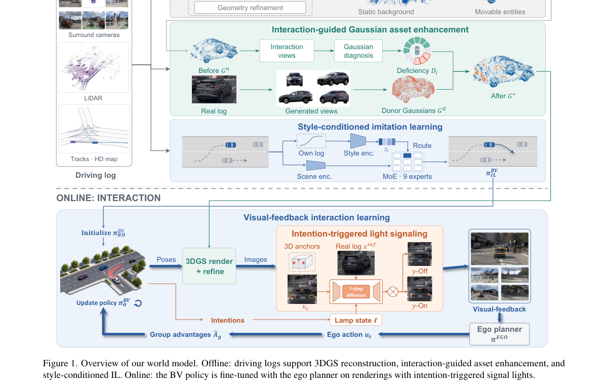

*Result - Architecture of the BV behavior model. The style latent zi routes to one expert e∗in its style cluster, which maps the scene feature f to displacements ∆p. After IL, the policy (blue) is fro*

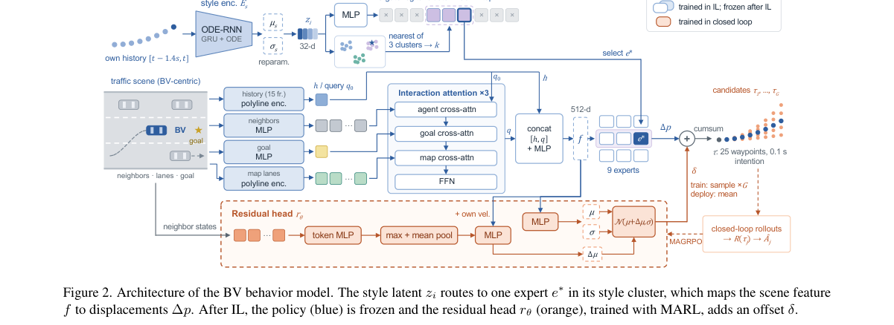

**Why this ranks #5**: 面向自动驾驶长尾场景的闭环交互式世界模型，把背景车策略放进与渲染视角下的自车规划器对抗的多智能体 RL 闭环，使交互行为与真实日志的偏差下降 85%、新视角车辆 PSNR 提升 2.0 dB。

---

### 6. AR-WAM: efficient streaming world-action modeling for autonomous driving

**arXiv**: [2611.21851](https://arxiv.org/abs/2611.21851) | **Score**: 8.0 (relevance 8 x 0.7 + quality 8 x 0.3) | **Direction**: `world_model` | **Tags**: embodied, world-action-model, streaming, causal-backbone, navsim, autonomous-driving, Toyota Motor North America R&D - InfoTech | **Categories**: cs.AI, cs.CV, cs.RO | **Pages**: 18

**Authors**: Baiting Luo; Shatadal Mishra; Ahmadreza Moradipari; Nejib Ammar

**Affiliation**: Toyota Motor North America R&D - InfoTech Labs

**Abstract**

> Autonomous driving requires anticipating how traffic will evolve while responding quickly to new observations. Video foundation models offer the first ability, but repeated history encoding and iterative video generation make them costly to use for driving. We present AR-WAM, an efficient streaming world-action model that combines autoregressive temporal modeling with single-pass future conditioning. Because its video backbone is causal, AR-WAM updates its visual context incrementally, reusing past computation and conditioning future prediction on observed motion. We further hypothesize that future features computed from recent observations can improve generalization in dynamic traffic without iterative video generation. AR-WAM therefore obtains these features in one forward pass and uses them to condition trajectory generation, and reinforcement learning then improves the policy through direct optimization of driving rewards. With a single front camera, AR-WAM achieves 91.5 PDMS after supervised training and 94.0 after reinforcement learning on NAVSIM-v1, outperforming the compared strong end-to-end world-action models. In a dynamic setting of continuous driving, supervised AR-WAM keeps its visual history across decisions and outperforms strong world-action baselines.

**Key findings**

- **Finding**: AR-WAM 只用单个前置相机，在 NAVSIM-v1 上监督训练得到 91.5 PDMS、强化学习后 94.0，优于所比较的强端到端世界动作模型。
- **Inference**: 因果骨干使历史视觉上下文可增量更新并在多次决策之间复用，配合单次前向的未来特征即可避开迭代视频生成的成本。
- **Recommendation**: 需要时序一致又付不起扩散迭代成本的驾驶世界动作模型，优先试自回归缓存加单次未来条件这两件套。

**Key figures**

*Framework - AR-WAM plans from cached visual history and a single predictive pass. (a) Predicted futures and NAVHARD EPDMS against latency. One video pass scores above the variant without future conditio*

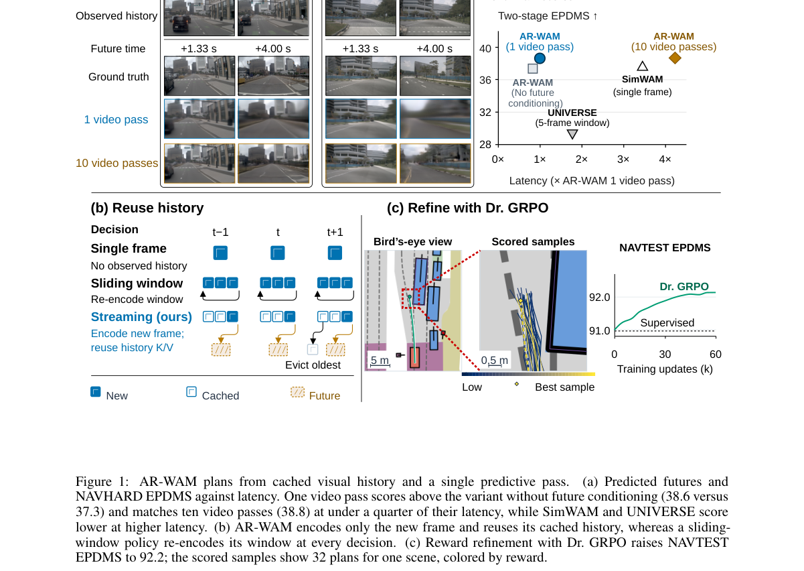

*Result - AR-WAM architecture. (a) Each decision runs one pass of the backbone, a causal video DiT, over the current frame and noised future slots, attending to the cached K/V of earlier frames; the e*

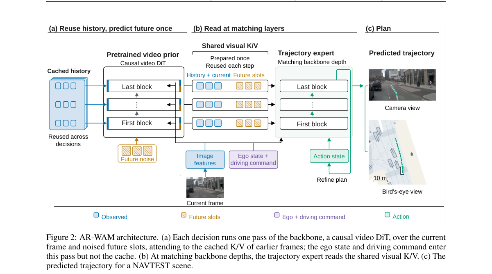

**Why this ranks #6**: 因果视频骨干加单次前向的未来条件，让流式世界动作模型增量复用历史视觉上下文而非反复迭代生成，单前置相机就在 NAVSIM-v1 拿到 91.5 PDMS、强化学习后 94.0。

---

### 7. WM-Quant: Rollout-Aware Post-Training Quantization for JEPA-Style World Models

**arXiv**: [2611.21882](https://arxiv.org/abs/2611.21882) | **Score**: 8.0 (relevance 8 x 0.7 + quality 8 x 0.3) | **Direction**: `world_model` | **Tags**: embodied, post-training-quantization, jepa, w4a4, mpc-rollout, error-compounding, University of South Carolina | **Categories**: cs.LG | **Pages**: 10

**Authors**: William Hammer; Andrew Heuer; Nikhil Krishna; Matthew Grenier; Ramtin Zand

**Affiliation**: University of South Carolina

**Abstract**

> We present WM-Quant, to our knowledge, the first post-training quantization (PTQ) framework designed specifically for JEPA-style world models. Although world models typically feature relatively few parameters, action planning algorithms often require thousands of inferences, which can quickly become computationally expensive. PTQ is a natural way to reduce this cost. However, we show that in world models using autoregressive model predictive control (MPC) rollouts, quantization error can compound with each predictor step, resulting in action rankings from the quantized model becoming near-random. WM-Quant addresses this with three components that build on existing PTQ methods: early-encoder precision, control-path preservation, and rollout-aware scaling. Early-encoder precision protects accurate latent state and goal information to mitigate long-term error propagation. Control-path preservation allows the world model predictor to distinguish between fine-grained actions, significantly improving action rankings and execution. Rollout-aware scaling jointly calibrates encoder and per-step predictor activation ranges with respect to an entire rollout rather than a single prediction, reducing the cumulative rollout error. Across multiple world models, environments, and PTQ methods, WM-Quant substantially improves planning success at low bit-widths, approaching full-precision performance at W4A4.

**Key findings**

- **Finding**: LeWM PushT 上 WM-Quant 在 W3A3 达 58%、W4A4 达 81.3% 成功率，基线方法分别只有 10% 与 20%；把控制路径保留为浮点只影响 DINO-WM 约 1.5%、LeWM 约 7.5% 的参数。
- **Inference**: MPC 需要成百上千次前向，量化误差在 rollout 中逐步复利，因此被破坏的是候选动作排序而不仅是单步预测精度。
- **Recommendation**: 量化 JEPA 世界模型时按整段 rollout 而非单步标定激活范围，并把候选动作排序与全精度的一致性作为首要验收指标。

**Key figures**

*Framework - Planning latency vs. planning success on LeWM (W4A4), averaged over 3 seeds. WM-Quant approaches floating point results on both TwoRoom and PushT datasets with little im- pact on latency.*

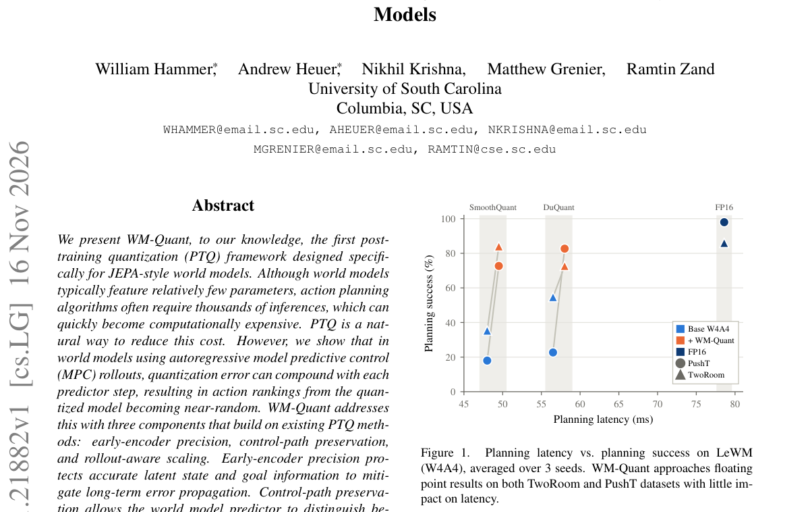

*Result - Overview of our proposed world model quantization framework. We preserve action information to improve candidate action ranking and the first three encoder blocks to limit early encoder erro*

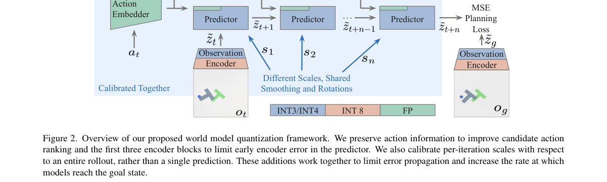

**Why this ranks #7**: 首个面向 JEPA 式世界模型的后训练量化框架，揭示自回归 MPC rollout 中量化误差逐步累积会让动作排序接近随机；用早编码器精度、控制路径保浮点与 rollout 感知缩放，把 LeWM PushT 成功率从基线 10%/20% 提到 W3A3 的 58%、W4A4 的 81.3%。

---

## 具身智能与机器人学习 · `embodied_ai` (13 papers)

本方向 13 篇（基准 8、上浮 5），是全批条目最多的 direction，承接了 `duplex_speech` 让出的名额之一。13 篇覆盖从数据到评测的整条链路。数据侧：Hidden Variables Behind Real-Robot Data Quality 用 25 台双臂机器人的运动学研究加受控遥操作加微调 π0.5 策略的真机评测，说明并行身体部位控制能把任务完成时间压掉 43–53%、主动搜索式演示把机械臂选择准确率从 50% 拉到 100%，而推理期标定失配会让 30 次试验全灭。表征侧：ReLAP 在冻结 JEPA 空间里做递归多步预测来学潜在动作，只需 1100 万预训练样本和 10.6 亿可训练参数就在 LIBERO 拿到 97.9%、零样本 LIBERO-Plus 扰动下 70.0%；Similar Is Not Useful 则证明按视觉相似度挑演示是无效的——效用最高的 5 条演示成功率 66.4%，最相似的 55.7%，随机 55.5%。策略侧：CoBoVLA 用 2.5 亿参数的离散码把语言理解与动作执行解耦，LIBERO-Para 上 81.1%（SmolVLA LoRA 是 36.5%）、每控制步 17 ms；Task Convergent Flow Matching 用并行物理 rollout 做推理期精修，PushT 成功率从 31.3% 提到 88.5%；InteractVLA 把 VLA 变成几何可干预的工具，LIBERO-Plus 99.4%、RoboDojo 48.62%、RoboCasa365 89.4%。其余分头处理能耗与运动：From Temperature-Limited to Battery-Limited 用 13 节点集总 RC 热网络（12 个电机温度 RMSE 低于 1 °C）让 Unitree Go2 从 19 分钟热保护跳到 174 分钟耗尽电池、留 14 °C 余量；FlowRRT 用条件流匹配蒸馏 MPPI 转向，斜坡地形 1 秒内 80% 成功（RL-RRT 24 s、SST 77 s）；RoboTeam 给出 4–16 条机械臂的实时多智能体基准，gpt-6.1-sol 与 opus-5.5 完成 28/27 个任务、其余四个模型最多 3 个；Heave-Ho 的 HH-BENCH 含 12 个 2–10 人形协作任务；FIRE-Drive 在 NAVSIM v1 上 PDMS 91.5、Bench2Drive 220 条路线上 Driving Score 71.43；RecPo 在扩展 Franka Kitchen 上达成 91.9% 有序完成、每回合推理 1.0 ms；惯性反馈那篇把 MoCap RMSE 降 17.3%/28.0%，但也指出 FK 重建与实测末端轨迹之间平均差 12.61±2.15 mm。

### 8. ReLAP: Latent Action Pretraining through Recurrent Video Prediction in JEPA Space

**arXiv**: [2611.22077](https://arxiv.org/abs/2611.22077) | **Score**: 8.7 (relevance 9 x 0.7 + quality 8 x 0.3) | **Direction**: `embodied_ai` | **Tags**: embodied, latent-action, jepa, video-pretraining, action-free, flow-matching, Bagel Labs | **Categories**: cs.RO | **Pages**: 8

**Authors**: R. Gnana Praveen; Ali Rouzbayani; Zhiying Jiang; Bidhan Roy

**Affiliation**: Bagel Labs

**Abstract**

> Videos provide a rich source of physical interaction for learning robot behavior without action annotations, yet effective latent actions must capture not only local transitions but also how those transitions evolve over time. We introduce ReLAP, a latent-action pretraining framework that couples local transition learning with recurrent multi-step prediction in a frozen JEPA representation space. A shared inverse dynamics model infers compact continuous latent actions from adjacent observations, while a latent world model recurrently predicts the future JEPA features. Because each predicted feature becomes the context for the next transition, errors at later steps backpropagate through the rollout to earlier latent actions, encouraging temporally coherent dynamics beyond pairwise reconstruction. We transfer this representation to a vision-language model using two complementary objectives: latent distillation from the frozen inverse teacher and recurrent future-feature prediction through the frozen latent world model. The resulting policy is then adapted to robot demonstrations with action flow matching. At deployment, the explicit latent-action and world-model branches are removed, and the fine-tuned VLM predicts physical actions directly, reducing inference complexity. With only 11M pretraining samples and 1.06B trainable parameters, ReLAP achieves 97.9% on standard LIBERO and 70.0% over zero-shot LIBERO-Plus perturbations. On the LARY latent-action benchmark, ReLAP ranks second in both mean regression error and mean classification accuracy among the compared methods. These results demonstrate that recurrent action-free latent action pretraining can learn compact, temporally structured, and transferable representations for downstream robot control.

**Key findings**

- **Finding**: ReLAP 仅用 11M 条预训练样本和 1.06B 可训练参数，在标准 LIBERO 达 97.9%、零样本 LIBERO-Plus 扰动下 70.0%，LARY 潜动作基准上平均回归误差与分类准确率均排第二。
- **Inference**: 让每个预测特征成为下一步的上下文，会把后期误差回传到更早的潜动作，从而学到时间一致而非成对重建的动态表征。
- **Recommendation**: 缺动作标注但有视频时，先在冻结 JEPA 空间里做潜动作预训练，再用动作流匹配微调到具体机器人。

**Key figures**

*Framework - (a) Conventional latent action models infer a latent action from an observed transition and reconstruct its immediate consequence. (b) ReLAP infers a sequence of continuous latent actions and recurrently rolls them out in JEPA feature space*

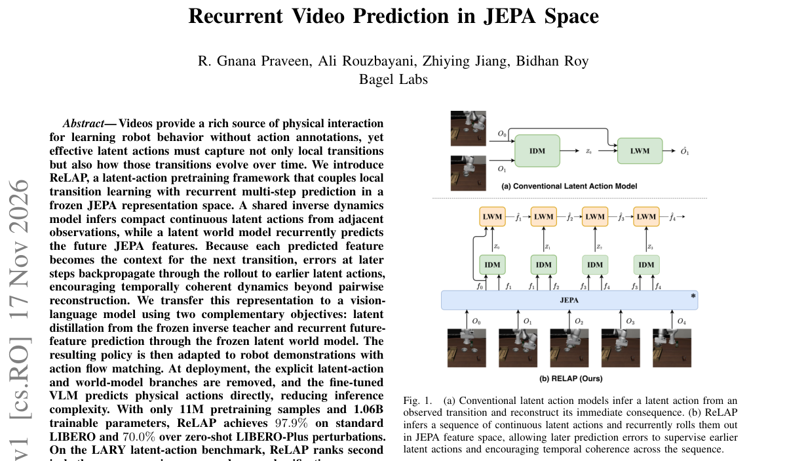

*Result - Overview of ReLAP. Stage 1 learns temporally coherent latent actions from unlabeled human and robot video through local and recurrent prediction in frozen JEPA features. Stage 2 trains a visio*

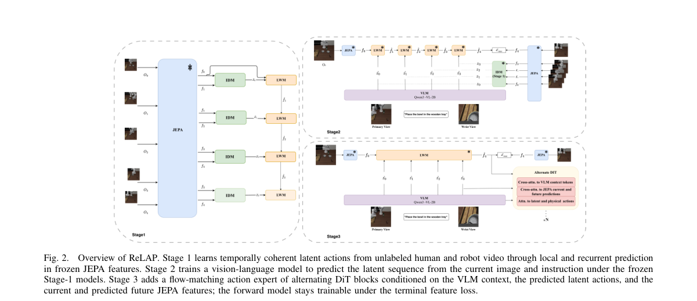

**Why this ranks #8**: 在冻结的 JEPA 表征空间里用共享逆动力学模型学连续潜动作、并让潜世界模型循环预测未来特征把后期误差回传到早期动作，只用 11M 段预训练样本和 1.06B 可训练参数就在 LIBERO 拿到 97.9%、扰动版 70.0%。

---

### 9. From Temperature-Limited to Battery-Limited Legged Locomotion

**arXiv**: [2611.22231](https://arxiv.org/abs/2611.22231) | **Score**: 8.3 (relevance 8 x 0.7 + quality 9 x 0.3) | **Direction**: `embodied_ai` | **Tags**: embodied, legged-locomotion, thermal-model, reinforcement-learning, unitree-go2, energy-efficiency, Woven by Toyota | **Categories**: cs.LG, cs.RO, eess.SY | **Pages**: 9

**Authors**: Raphaël Ségas; Balázs Opra; Léo Ghafari; Thomas Stewart

**Affiliation**: Woven by Toyota

**Abstract**

> On legged robots, sustained locomotion often ends in thermal shutdown rather than battery depletion: the heat of walking concentrates in a few joint motors, which overheat long before the battery is empty. We train thermally aware locomotion policies by reinforcement learning without ever observing temperature, and demonstrate this on a Unitree Go2 quadruped. We first identify a coupled 13-node lumped RC thermal network, fitted on two runs of a single robot and calibrated against the measured electrical power, that predicts all twelve motor temperatures with a mean RMSE below 1 $^\circ$C across different robot instances, gaits, payloads, and speeds. Under a sustained gait, the temperatures the motors will settle at follow directly from the gait-averaged squared torques and joint speeds. Our core contribution is a reward that drives down the hottest predicted asymptotes: thermal time constants exceed the credit-assignment horizon of reinforcement learning by orders of magnitude, but predicted asymptotes respond to torque and joint speed within a single gait cycle, so the policy learns to lower and spread heat with no temperature input. On the robot, the policy turns sustained locomotion from temperature-limited to battery-limited: with a 5 kg payload at 1 m/s, a learned baseline reaches thermal shutdown after 19 minutes (1.1 km), whereas our policy runs the battery down after 174 minutes (10.0 km) with its hottest motor 14 $^\circ$C below the shutdown threshold in a 26 $^\circ$C room; on an unloaded factory circuit with stairs and ramps, the baseline overheats after 25 laps (6.2 km), while our policy completes 47 (11.2 km) on one battery with 22 $^\circ$C of margin.

**Key findings**

- **Finding**: 13 节点集总 RC 热网络在跨机型、步态、载荷与速度下预测 12 路电机温度的平均 RMSE 低于 1 度；策略不用温度输入，只靠奖励压低预测的最热稳态温度。
- **Inference**: 热时间常数比强化学习的信用分配时长远大，但稳态温度在单个步态周期内就随力矩与关节速度响应，因此奖励信号依然可用。
- **Recommendation**: 做长时程腿式续航时，把最热电机的预测稳态温度直接写进奖励，并留出相对关机阈值的余量。

**Key figures**

*Framework - Sustained 1 m/s walking with a 5 kg payload. The baseline reaches thermal shutdown after 19 min (top); our thermal policy drains the battery after 174 min with 14 °C of headroom (middle). Grey*

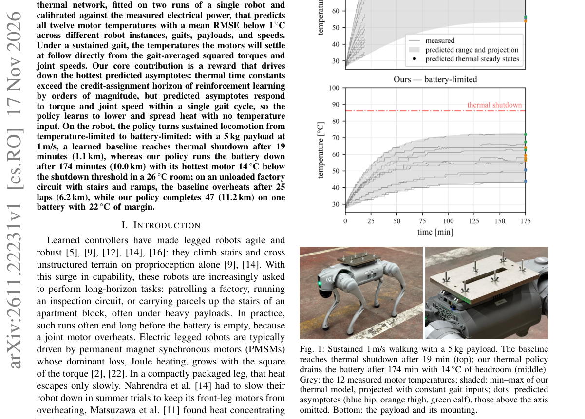

*Result - The two training runs, following protocols A and B. The twelve temperatures (light-grey solid lines) are recorded every two seconds. Segments are designed and arranged to produce a large range*

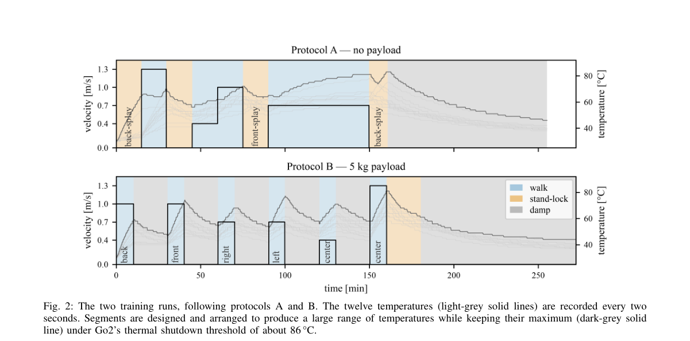

**Why this ranks #9**: 策略全程不看温度也能学会散热：13 节点集总 RC 热网络（22 参数）跨机型、步态与载荷预测 12 路电机温度平均 RMSE 低于 1 度，Unitree Go2 带 5 kg 载荷 1 m/s 时从 19 分钟热保护关机延到 174 分钟跑完 10.0 km。

---

### 10. Agile Monoped Hopping on Complex and Discrete Terrain via Kinodynamic Planning with Distilled MPPI Steering

**arXiv**: [2611.21905](https://arxiv.org/abs/2611.21905) | **Score**: 8.0 (relevance 8 x 0.7 + quality 8 x 0.3) | **Direction**: `embodied_ai` | **Tags**: embodied, kinodynamic-planning, flow-matching, set-valued-steering, monoped-hopping, rrt, University of Michigan | **Categories**: cs.RO | **Pages**: 8

**Authors**: Yue Qin; Denglin Cheng; Jingyu Liu; Yanran Ding

**Affiliation**: University of Michigan

**Abstract**

> This paper presents FlowRRT, a kinodynamic planner for agile monoped hopping on discrete terrain. Steering for kinodynamic RRT on complex dynamical systems currently relies on motion primitives or closed-loop policies, limiting the diversity of motions or the planning speed. Distilling a trajectory optimizer avoids both, but existing methods regress a single solution per query, which fails on monoped hopping, where the feasible action set is narrow and disconnected. Our key insight is to treat steering as set-valued and predict the distribution of feasible actions instead. A multi-start MPPI expert collects the entire feasible set of each query offline, and conditional flow matching distills it into a generative sampler. With this sampler, FlowRRT coordinates successive jumps over long horizons and finds non-greedy maneuvers that are hard for reactive policies to discover. Benchmarks across different terrains show higher success rates and substantially shorter planning times than sampling-based baselines. On terrains with inclined platforms, FlowRRT reaches $80\%$ success within $1$~s, versus $24$~s for RL-RRT and $77$~s for SST. Sim-to-sim tracking in MuJoCo confirms accurate execution under full-order dynamics.

**Key findings**

- **Finding**: FlowRRT 在 1 秒内解出 93% 的规划问题，SST 只有 26%、RL-RRT 一个都解不出；在倾斜坡面地形上 1 秒达 80% 成功率，而 RL-RRT 需 24 秒、SST 需 77 秒。
- **Inference**: 单足跳跃的可行域又窄又断开，回归单一最优解必然失败，必须把整套可行动作的分布学出来交给 RRT 采样。
- **Recommendation**: 在窄可行域的腿式规划里，先离线用 MPPI 专家枚举可行集，再用条件流匹配蒸馏成分布式采样器，而不是训练单解回归器。

**Key figures**

*Framework - Overview of the distilled MPPI steering. Left, the multi-start MPPI- CEM expert solves one steering query offline and collects every feasible ac- tion it encounters, which form several distinc*

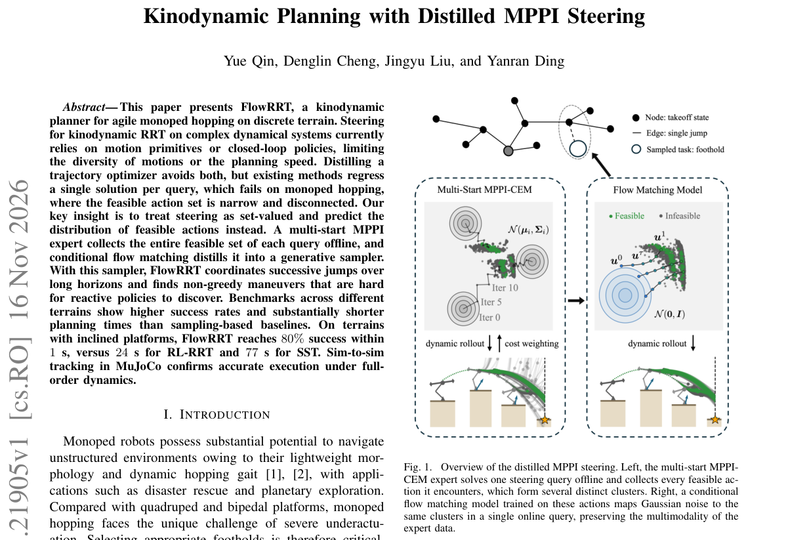

*Result - Architecture of the conditional velocity field vτ*

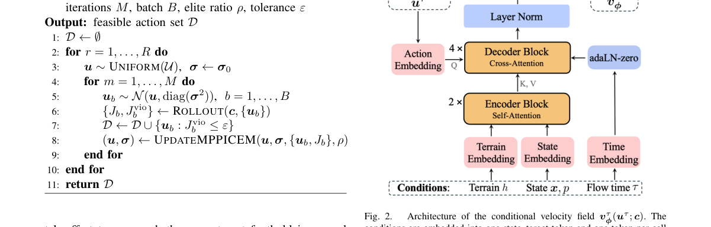

**Why this ranks #10**: 把转向函数视为集合值问题，用多起点 MPPI 专家离线收集整份可行动作集、再由条件流匹配蒸馏成生成式采样器，1 秒内解出 93% 的规划问题（SST 26%、RL-RRT 为零），MuJoCo 全阶动力学下跟踪误差 1.37 cm。

---

### 11. RoboTeam: Benchmarking Vision-Based Multi-Agent Control of Many Robot Arms in Real Time

**arXiv**: [2611.22138](https://arxiv.org/abs/2611.22138) | **Score**: 8.0 (relevance 8 x 0.7 + quality 8 x 0.3) | **Direction**: `embodied_ai` | **Tags**: embodied, multi-agent, benchmark, vlm-agent, real-time-control, robot-arms, Hong Kong University of Science and | **Categories**: cs.AI, cs.RO | **Pages**: 17

**Authors**: Changxuan Fan; Zhongwei Xie; Boyi Zhang; Shaoli Hu; Chang Xu; Xiyu Ren; Yufei Li; Qiao Xiao; Huihao Jing; Kawai Chung; Wenbin Hu; Hongyu Luo

**Affiliation**: The Hong Kong University of Science and Technology; Microsoft

**Abstract**

> Multimodal agents can now control robot arms by calling tools and writing code. Existing benchmarks fall short in three ways: most test one or two arms on short tasks, many pause the world while the agent thinks, and many give it ground-truth object positions. We present RoboTeam, a simulated benchmark where agents control 4 to 16 robot arms in real time from camera images alone. Its 36 tasks are long jobs that the arms must do together, such as passing timbers or building a picture from hundreds of cubes. We start from the most flexible agent system, the adaptive system, where one agent decides when to fork delegates. With it, gpt-6.1-sol and opus-5.5 complete 28 and 27 tasks, and four other models at most 3. But at a high price: a typical task takes gpt-6.1-sol 3.5 hours and 218 million input tokens, and a third of its steps fail at least once and must be retried. We then compare it with three fixed systems: single-agent, hierarchical, and decentralized. All four complete a similar number of tasks but differ in time and tokens. The hierarchical and decentralized systems are faster but use up to 1.9 times the tokens, and the single agent uses fewer tokens but takes 1.6 times as long, so the adaptive system lies between them. Even so, no model or system is yet fast, cheap, and reliable at once. RoboTeam measures these limits where earlier benchmarks cannot: long multi-arm jobs, camera images only, and a world that never pauses.

**Key findings**

- **Finding**: 在 36 个必须多臂协作的长任务上，gpt-6.1-sol 完成 28 个、opus-5.5 完成 27 个，另外四个模型最多 3 个；典型任务耗时 3.5 小时、218 million 输入 token，三分之一步骤至少失败一次需重试。
- **Inference**: 世界不会暂停让并行、分层与去中心化三种固定组织方式各自在时间与 token 之间取舍，目前还没有既快又省又可靠的组合。
- **Recommendation**: 评测多臂智能体时把 token 消耗与重试次数一并报告，并坚持只给相机图像、世界不暂停的真实设定。

**Key figures**

*Framework - RoboTeam at a glance. Top: the four task types and one step of each. Bottom: the four agent systems (dots are agents, squares are arms), the two tool modes with real calls, and 20 minutes of*

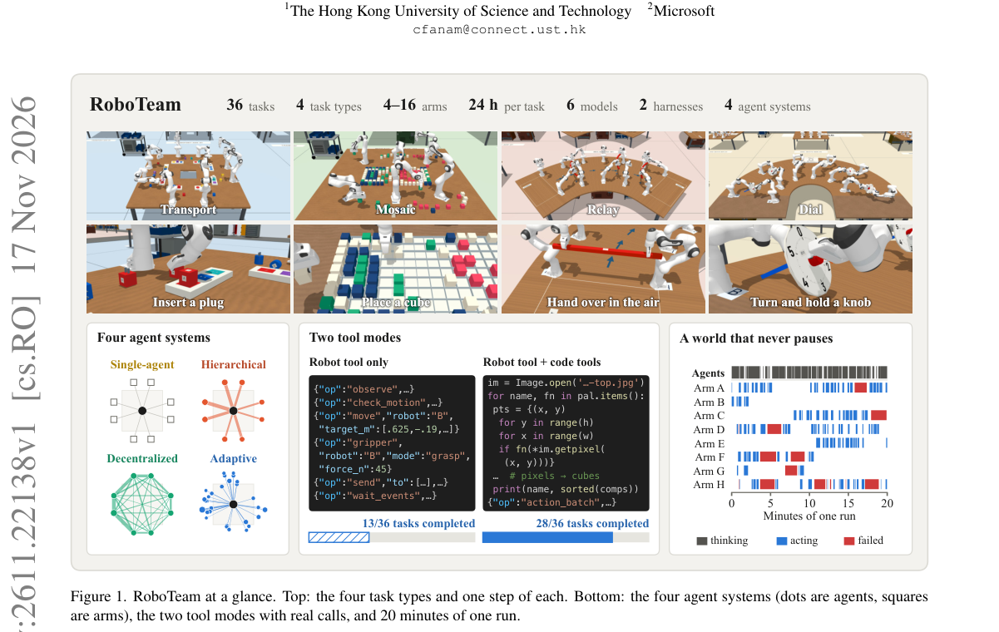

*Result - How many of the 36 tasks each condition completes. Darker means completed sooner. The blue line marks the adaptive system of gpt-6.1-sol in Codex.*

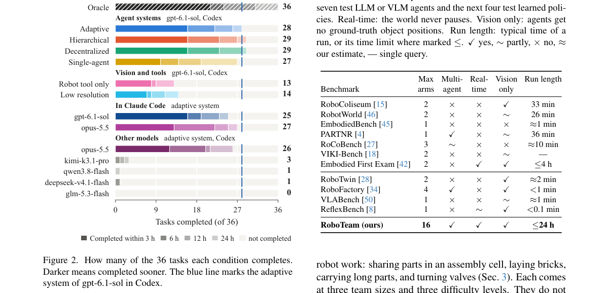

**Why this ranks #11**: 它专门暴露「多臂长任务加实时加只给相机图像」这一组合下的真实上限：4-16 条臂、36 个协作长任务里 gpt-6.1-sol 完成 28 个却要 3.5 小时与 218 million 输入 token，三分之一步骤至少失败一次，其他四个模型最多 3 个。

---

### 12. Reconfiguring Procedural Knowledge for Compositional Robot Skill Adaptation

**arXiv**: [2611.22174](https://arxiv.org/abs/2611.22174) | **Score**: 8.0 (relevance 8 x 0.7 + quality 8 x 0.3) | **Direction**: `embodied_ai` | **Tags**: embodied, procedural-knowledge, skill-composition, reconfigurability, franka-kitchen, Sungkyunkwan University | **Categories**: cs.AI | **Pages**: 40

**Authors**: Daehee Lee; Dongsu Lee; Sanghyun Ahn; Minjong Yoo; Honguk Woo

**Affiliation**: Sungkyunkwan University; University of Texas at Austin; Samsung Electronics

**Abstract**

> General-purpose behavior models increasingly internalize broad procedural knowledge during training, making their adaptation to new goals and skill interfaces less a problem of learning entirely new behaviors than of reconfiguring existing competence. We study this capability as reconfigurability, the ability to realize new behaviors by cost-efficiently restructuring existing components and relations under sparse governing information, where task specifications provide high-level goals and procedure specifications expose a limited set of reusable factors, leaving the concrete bindings and compositions required for execution underdetermined. We propose RecPo, a framework that represents skills task-agnostically through multiple procedure views and materializes executable skill sequences by composing stored transitions to realize task-specific changes. RecPo maintains a procedure knowledge base of skill-induced transitions, with each view exposing a reusable factor and preserving local skill connectivity. At deployment, it interprets task specifications through the same views and resolves the resulting compositional queries over the stored relations to bind skills for execution. On long-horizon tasks in an extended Franka Kitchen benchmark, RecPo achieves 91.9% ordered completion with 1.0 ms of task inference per episode across varying procedure support and task-record sparsity. Real-robot studies further demonstrate adaptation through local memory edits without task-specific retraining.

**Key findings**

- **Finding**: RecPo 在扩展 Franka Kitchen 长程任务上取得 91.9% 有序完成率，每回合任务推理耗时 1.0 ms，并在不同程序支撑度与任务记录稀疏度下保持稳定。
- **Inference**: 任务规范只给目标、程序规范只暴露有限可复用因子时，具体绑定与组合是欠定的，所以技能必须存成多视角关系结构而不是单一序列。
- **Recommendation**: 需要给同一套技能换目标或换接口时，优先做知识库的结构化重组与局部记忆编辑，而不是做任务级再训练。

**Key figures**

*Framework - Conceptual overview of reconfigurable skill policy under sparse governing information. (left) Sparse task evidence specifies desired changes, while procedure-side evidence provides task-*

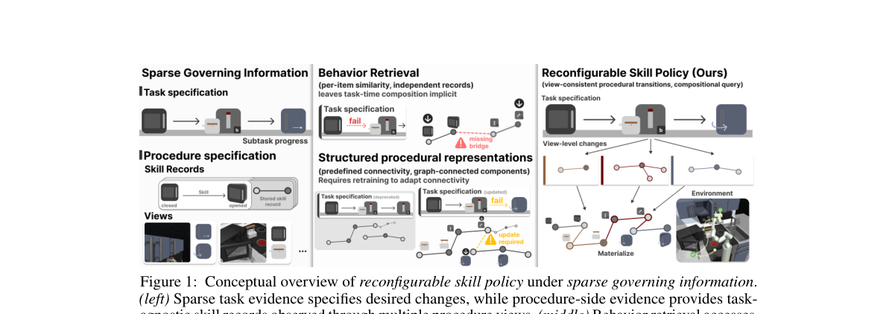

*Result - RecPo realizes update-and-compose through two memory interfaces. (left) The Procedure Knowledge Base turns procedure records and view interfaces into a persistent procedure substrate of skil*

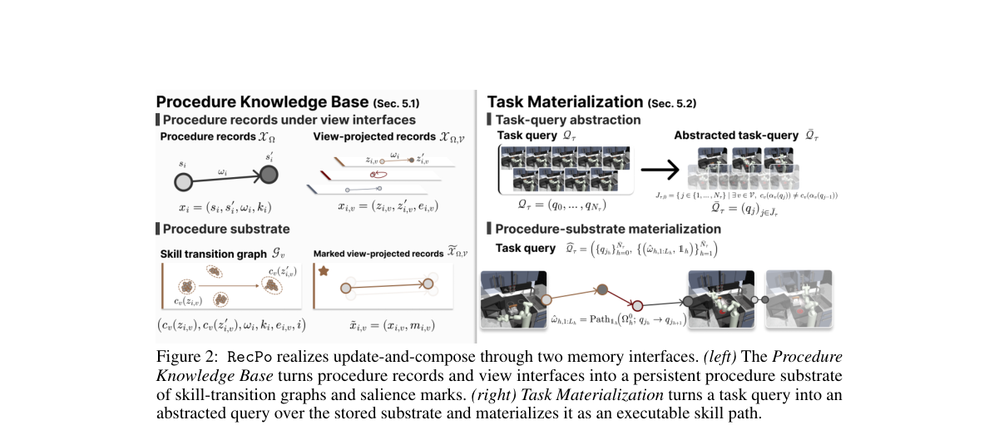

**Why this ranks #12**: 它把「适配新目标」从重新学习行为改写为重组既有程序知识：多视角程序知识库在扩展 Franka Kitchen 长程任务上取得 91.9% 有序完成率、每回合任务推理仅 1.0 ms，真实机器人上靠局部记忆编辑即可免重训适配。

---

### 13. Heave-Ho: Decentralized Long-Horizon Multi-Humanoid Collaboration

**arXiv**: [2611.22275](https://arxiv.org/abs/2611.22275) | **Score**: 8.0 (relevance 8 x 0.7 + quality 8 x 0.3) | **Direction**: `embodied_ai` | **Tags**: embodied, multi-humanoid, loco-manipulation, decentralized, speech-coordination, vision-language-planner, University of Southern California | **Categories**: cs.CV, cs.LG, cs.RO | **Pages**: 18

**Authors**: Ting-Hsuan Chen; Siheng Zhao; Han Jiang; Qi Pan; Louison Lu; Jiaheng Luo; Henghui Bao; Yiyu Chen; Quan Nguyen; Yue Wang

**Affiliation**: University of Southern California; VinMotion

**Abstract**

> Collaboration promises to extend humanoid capabilities beyond what individual robots can achieve. However, realizing this potential requires coordinated whole-body interactions, coherent long-horizon planning, and precise synchronization across robots. We introduce Heave-Ho, a decentralized framework for long-horizon collaborative multi-humanoid loco-manipulation. At the low level, we develop a multi-agent post-training framework that adapts a humanoid foundation tracking model to physically coupled interactions between humanoids, enabling coordinated decentralized control from local observations alone. At the high level, we train a vision-language planner and design a speech-based leader-follower coordination mechanism to synchronize decentralized execution without network communication. Trained with two identical humanoids, our system scales to teams of up to ten robots and generalizes to heterogeneous teams without retraining. To benchmark these capabilities, we introduce HH-Bench, comprising 12 tasks involving teams of 2 to 10 humanoids, including heterogeneous teams. Systematic evaluations show that Heave-Ho consistently outperforms baseline methods, while real-world experiments demonstrate robust decentralized collaboration across challenging tasks.

**Key findings**

- **Finding**: Heave-Ho 用两个同构人形训练后扩展到最多 10 台机器人，且无需重训即可泛化到异构队伍；配套 HH-Bench 覆盖 12 个任务、2 到 10 台人形。
- **Inference**: 物理耦合的交互必须靠后训练才能让去中心化控制器仅凭局部观测协同，而通信被切断后高层只能靠语音做 leader-follower 同步。
- **Recommendation**: 评估多机器人协作时同时测同构扩展与异构泛化，并确认高层协调机制在完全无网络通信下仍然可用。

**Key figures**

*Framework - HEAVE-HO enables decentralized humanoid teams to complete long-horizon collaborative tasks. Each robot acts on its own observations, the leader’s planner chooses the next team skill and spea*

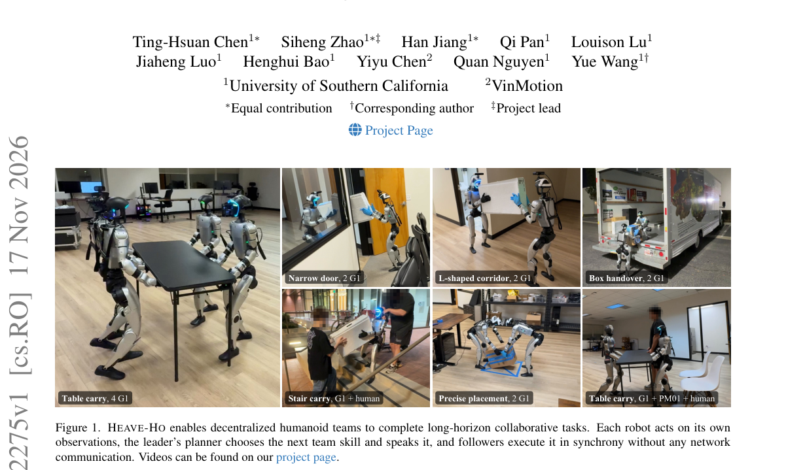

*Result - Overview of HEAVE-HO. At the high level, the leader’s vision-language planner selects the next team skill from its camera and speaks it; every follower recognizes the command on board, and a*

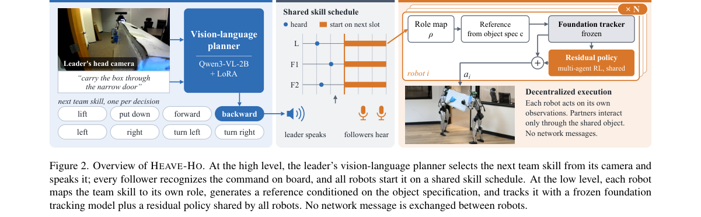

**Why this ranks #13**: 面向长程多人形协作的去中心化框架：底层用多智能体后训练把人形基础跟踪模型适配到物理耦合交互，上层用视觉语言规划器加语音 leader-follower 同步，无需网络通信即可从 2 台扩展到 10 台并泛化到异构队伍。

---

### 14. Similar Is Not Useful: Selecting In-Context Demonstrations by Closed-Loop Utility

**arXiv**: [2611.22295](https://arxiv.org/abs/2611.22295) | **Score**: 8.0 (relevance 8 x 0.7 + quality 8 x 0.3) | **Direction**: `embodied_ai` | **Tags**: embodied, retrieval-augmented-vla, in-context-demonstrations, closed-loop-utility, libero, Georgia Institute of Technology | **Categories**: cs.LG | **Pages**: 14

**Authors**: Jiachen Li; Zhigen Zhao; Shihao Li; Dongmei Chen; Long Chen; Zhuo Xu

**Affiliation**: Georgia Institute of Technology; General Intelligent Machines, Inc

**Abstract**

> Retrieval-augmented vision-language-action (VLA) policies fill their context with the demonstrations whose frames look most like the current observation under frozen DINOv2 embeddings. We ask whether visual similarity selects the demonstrations that make the policy succeed. For a frozen retrieval-augmented VLA (RICL on $π_0$-FAST, LIBERO), we make the demonstration pool swappable at run time and score each demonstration's utility by regressing the closed-loop success of 60 fixed-size pools on their membership. On initial states disjoint from those used for scoring, pools of the five highest-utility demonstrations succeed on 66.4% of 760 paired episodes across 19 tasks, pools of the five most similar on 55.7%, and random pools on 55.5%. Utility beats similarity by 10.8 points ($p=3.2\times10^{-6}$; positive on 15 of 18 untied tasks), including on 12 tasks the policy was never primed on, and similarity-selected pools do no better than random ($+0.1$ points). Within a task, a pool's visual similarity to the test scenes tracks its success at Spearman 0.10; across tasks, similarity separates tasks whose scenes differ and falls to chance when two tasks share a scene. The gain comes from on-task closed-loop evidence: best-of-ten direct search over pools recovers two-thirds of it with 100 rollouts. Against the shipped 20-demonstration pool, utility-curated pools of five lead by 7.0 points over 560 paired episodes from two evaluation runs ($p=0.006$), and utility-ordered retrieval inside the full pool leads by 4.5 points ($p=0.055$).

**Key findings**

- **Finding**: 效用最高的 5 条演示池在 19 个任务、760 次配对回合中成功率 66.4%，最相似池 55.7%、随机池 55.5%；效用比相似度高 10.8 点，且 18 个未平局任务里 15 个为正。
- **Inference**: 视觉相似度只能分开场景差异明显的任务，任务内部相似度与成功率的 Spearman 相关只有 0.10，真正有用的是任务上的闭环证据。
- **Recommendation**: 为 VLA 挑选上下文演示时按闭环成功效用排序而不是按嵌入相似度，预算充足时先用 100 次 rollout 的直接搜索量出效用差。

**Key figures**

*Framework - The retriever’s favourite demonstration is not the useful one. Filmstrips of demonstrations from the policy’s own pools on two tasks. Rose (top): the demonstration the similarity rule (dino,*

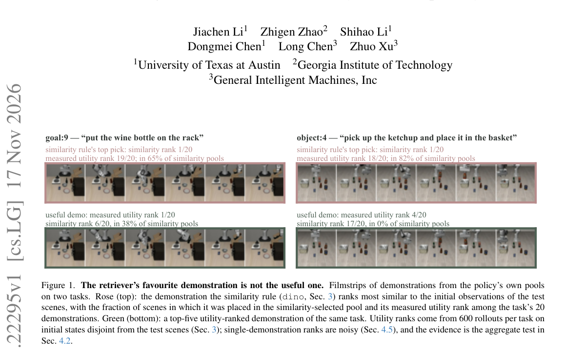

*Result - Protocol. Top: the frozen policy’s inference loop. The demonstration pool feeding the FAISS index is set per episode, while per-step frame retrieval inside the pool is unchanged. Bot- tom: u*

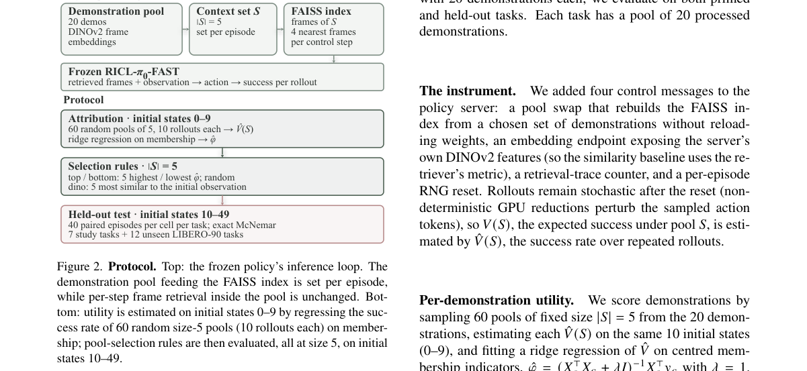

**Why this ranks #14**: 它直接量化了「相似即有用」这个默认前提：在冻结的 RICL（pi0-FAST/LIBERO）上，闭效用最高的两组五条演示池成功 66.4%，最相似组只有 55.7%、随机 55.5%，相似度与成功的 Spearman 相关仅 0.10。

---

### 15. FIRE-Drive: Feasibility-Informed Risk Evaluation for End-to-End Diffusion Planning

**arXiv**: [2611.22297](https://arxiv.org/abs/2611.22297) | **Score**: 8.0 (relevance 8 x 0.7 + quality 8 x 0.3) | **Direction**: `embodied_ai` | **Tags**: embodied, autonomous-driving, diffusion-planning, risk-evaluation, birdseye-view, navsim, Xidian University | **Categories**: cs.AI, cs.RO | **Pages**: 12

**Authors**: Qifeng Xie; Kai-Yuan Feng; Wenkang Wan; Yue Wu; Maoguo Gong; Kai Sheng

**Affiliation**: Xidian University; Inner Mongolia Normal University

**Abstract**

> Diffusion-based end-to-end autonomous driving models have shown strong potential in generating multimodal planning trajectories. However, their performance still depends heavily on trajectory initialization, mode evaluation, and supervision quality. Weakly constrained noisy initialization may introduce infeasible proposals and increase the burden of denoising. Moreover, selecting the optimal mode remains challenging when candidate trajectories are geometrically similar but differ in safety, interaction risk, and progress. To address these issues, we propose FIRE-Drive, a feasibility-informed risk evaluation framework for end-to-end autonomous driving. FIRE-Drive improves diffusion-based planning through dynamic feasible anchor initialization, candidate-specific bird's-eye-view risk evidence, and compact high-quality candidate supervision with lightweight refinement. This design aligns the initial support, risk-aware scoring, and multimodal supervision of trajectory modes under a unified planning objective. It enables the diffusion decoder to focus on refining plausible trajectories while the scorer distinguishes modes using local risk evidence. Experiments on NAVSIM v1 show that FIRE-Drive achieves a Predictive Driver Model Score of 91.5 with a ResNet34 backbone. Additional closed-loop evaluation on 220 Bench2Drive routes yields a Driving Score of 71.43 and a Success Rate of 42.73%. Component ablations and a scorer comparison under matched candidate inputs support the contributions of feasible initialization, auxiliary supervision, and risk-informed selection. Our code is available at https://github.com/Latte00/FIRE-drive.

**Key findings**

- **Finding**: FIRE-Drive 在 NAVSIM v1 上以 ResNet34 骨干取得 91.5 PDMS；220 条 Bench2Drive 闭环路线的驾驶分 71.43、成功率 42.73%。
- **Inference**: 弱约束的噪声初始化会引入不可行提案并加重去噪负担，因此初始支撑、风险打分与多模态监督必须对齐到同一个规划目标。
- **Recommendation**: 复现扩散式驾驶规划时先把初始化换成动态可行锚点，再单独验证风险打分器能否在几何相近的候选之间真的区分开。

**Key figures**

*Framework - Comparison of representative E2E planning paradigms. Dense vocabulary methods first construct a large candidate table and then select a trajectory by rules or scoring; conventional diffusion p*

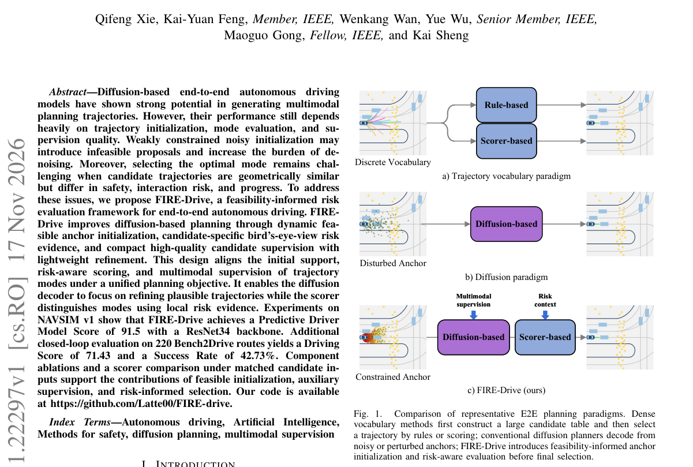

*Result - Overall framework of the proposed method. FIRE-Drive intervenes in diffusion planning through feasibility-informed anchor initialization, mode- conditioned risk evaluation, and compact candida*

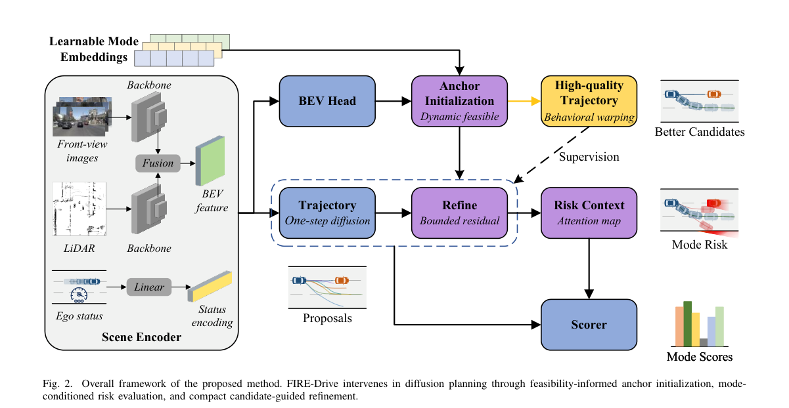

**Why this ranks #15**: 给端到端扩散规划补上可行性先验与风险判别：动态可行锚点初始化、候选专属 BEV 风险证据与紧凑高质量监督，使 NAVSIM v1 上用 ResNet34 骨干拿到 91.5 PDMS，220 条 Bench2Drive 闭环路线得到 71.43 驾驶分与 42.73% 成功率。

---

### 16. Hidden Variables Behind Real-Robot Data Quality: Lessons from Hundreds of Thousands of Hours

**arXiv**: [2611.22388](https://arxiv.org/abs/2611.22388) | **Score**: 8.0 (relevance 8 x 0.7 + quality 8 x 0.3) | **Direction**: `embodied_ai` | **Tags**: embodied, teleoperation, data-quality, real-robot, workspace-analysis, pi05-policy, AgiBot | **Categories**: cs.RO | **Pages**: 26

**Authors**: Maniformer Real-World Manipulation Team; Che Tsang Calvin; Xingyu Chen; Bowen Jiang; Naixiang Gao; Xiongfeng Cai; Enlin Gu; Ruiying Li; Peize Li; Mianrui Zhu; Haomiao Zhang; Xin He

**Affiliation**: AgiBot; Maniformer Real-World Manipulation Team

**Abstract**

> As real-robot data collection scales, collection-system design shapes both operator efficiency and the behaviors learned by robot policies. Workspace limitations, control-interface friction, and latency can introduce pauses, detours, and corrective motions into otherwise successful demonstrations. We investigate these effects across embodiment, teleoperation control, and data consistency, combining a kinematic study of 25 dual-arm robots, controlled teleoperation experiments, and real-robot evaluation of fine-tuned $π_{0.5}$ policies. The embodiment study shows that positional reachability overstates orientation-aware task coverage and that modest shoulder motion can substantially expand the effective workspace. Teleoperation experiments show that parallelizing body-part control reduces task completion time by 43-53%, while compliant control improves success and reduces peak contact forces on constrained and contact-rich tasks. Policy-learning experiments show that demonstrations must capture the visual information underlying action choices: active-search demonstrations improve arm-selection accuracy from chance (50%) to 100%. Calibration experiments reveal that mixed-calibration training data remain usable in our tested configurations when an inference-aligned subset is retained, whereas inference-time miscalibration causes all 30 trials to fail. Policies also retain approximately 90% of the extra path length in detour-contaminated demonstrations, showing how inefficient operator motions persist in learned behavior. Together, these findings connect collection-system design to demonstration quality and downstream policy execution. They motivate evaluating effective workspace, control efficiency, observation completeness, calibration alignment, and motion quality before scaling collection, and addressing system-induced compensations at their source.

**Key findings**

- **Finding**: 25 台双臂的运动学对比显示位置可达性高估了朝向相关的任务覆盖；并行控制身体部位使任务完成时间下降 43-53%，主动搜索式演示把选臂准确率从随机 50% 提到 100%。
- **Inference**: 采集系统引入的停顿、绕行与修正动作会被策略完整继承——策略保留了被污染演示中约 90% 的额外路径长度。
- **Recommendation**: 扩大采集规模前先评估有效工作空间、控制效率、观测完整性与标定对齐，并从源头消除系统引入的补偿动作。

**Key figures**

*Framework - Overview. Operators collect demonstrations through a range of human interfaces (left); the resulting data (center; 200K+ collection hours across 20K+ tasks) train policies across robot embod*

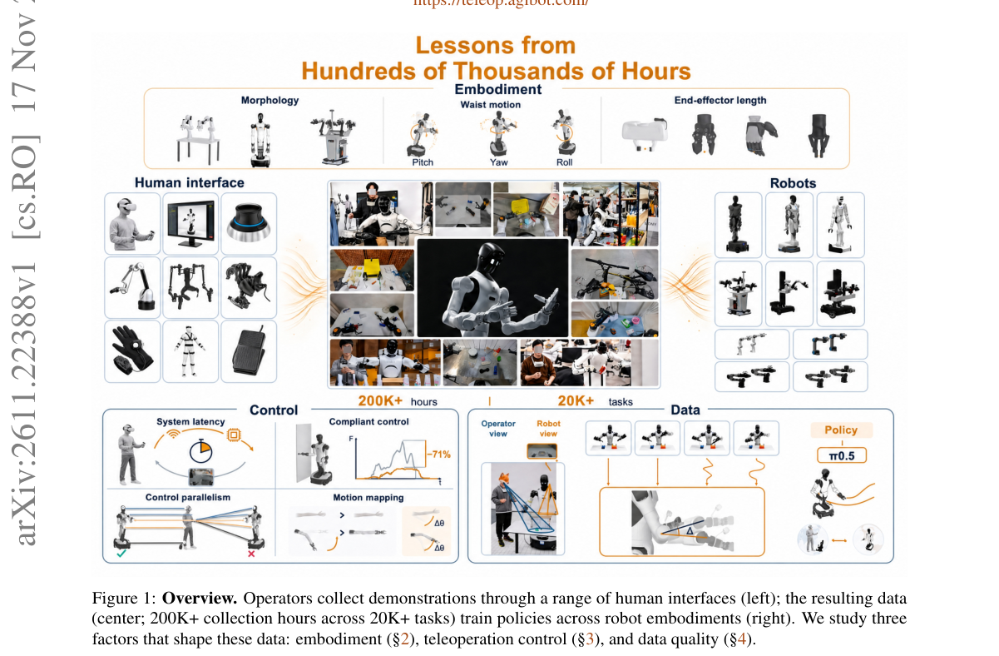

*Result - Orientation coverage of three morphologies. Top row: right-arm reachability and coverage in a vertical slice through the right shoulder; each position is tested against 64 discretized tool-a*

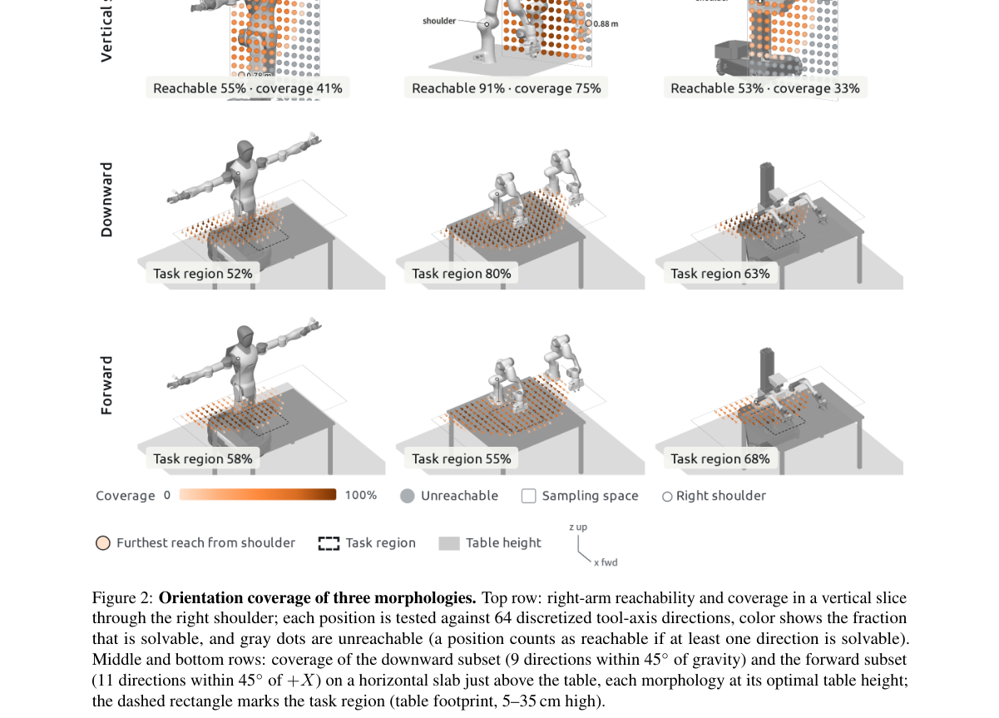

**Why this ranks #16**: 它把「真实机器人数据质量」拆成可测的隐变量：25 台双臂的运动学研究、受控遥操作实验与 pi0.5 微调评测三线合起来，指出并行控制身体部位能把任务完成时间压掉 43-53%，而推理期标定失配会让 30 次试验全部失败。

---

### 17. CoBoVLA: Decoupling Language from Action with Discrete Codes for Robust and Interpretable Robot Manipulation

**arXiv**: [2611.22395](https://arxiv.org/abs/2611.22395) | **Score**: 8.0 (relevance 8 x 0.7 + quality 8 x 0.3) | **Direction**: `embodied_ai` | **Tags**: embodied, vla-architecture, discrete-codebook, paraphrase-robustness, interpretability, libero, Carnegie Mellon University | **Categories**: cs.CV, cs.RO | **Pages**: 16

**Authors**: Mehul Arora; Dhruv Agarwal; Ambuj Agrawal

**Affiliation**: Carnegie Mellon University

**Abstract**

> Vision-Language-Action (VLA) models achieve high success rates on the LIBERO benchmark but remain sensitive to paraphrasing. Existing VLAs ranging from 0.6B to 7.5B parameters experience a 22-52 point performance drop on LIBERO-Para while SmolVLA exhibits an even larger decline, from 83\% to 8\%. Because most VLAs jointly learn language understanding and action generation, it is difficult to determine whether a failure originates from misunderstanding an instruction or executing it incorrectly. To address these challenges, we introduce CoBoVLA, or CodeBookVLA, a 250M-parameter VLA that decouples language understanding, planning, and control through learned discrete interpretable codes. A text encoder maps the instructions to shared step codes, which a visual planner then converts into action code sequences executed by a language-independent actor. This design improves robustness to instruction paraphrasing while allowing failures to be traced to individual stages. It also enables efficient real-time control on resource-constrained hardware by encoding instructions only once and using compact discrete representations to keep each component lightweight. CoBoVLA achieves 91.4\% success on LIBERO-Goal, compared with 82.8\% for SmolVLA, under a matched protocol, with 17 ms per control step latency. On LIBERO-Para, it achieves 81.1\% across 4,092 unseen paraphrases and 78.5\% on matched episodes, compared with 36.5\% for SmolVLA LoRA fine-tuned on paraphrases. Without two-step demonstrations, CoBoVLA completes 48.8\% of 160 free-form two-step tasks. Finally, success reaches 91\% when instructions are correctly encoded but falls to 27.2\% otherwise, identifying language understanding as the main source of remaining failures. Together, these results demonstrate that decoupling language understanding and control can improve instruction robustness while making VLA failures easier to diagnose.

**Key findings**

- **Finding**: 现有 0.6B 到 7.5B 的 VLA 在 LIBERO-Para 上掉 22 到 52 点、SmolVLA 从 83% 掉到 8%；CoBoVLA（250M）在 LIBERO-Goal 达 91.4%、LIBERO-Para 81.1%，单步延迟 17 ms。
- **Inference**: 联合学习语言理解与动作生成会让失败无法区分是没听懂还是做错了，而离散码中间层正好提供了可诊断的切分点。
- **Recommendation**: 需要指令鲁棒性与可诊断性时，先查指令编码是否正确（91% 对 27.2%），再考虑扩大动作模型规模。

**Key figures**

*Framework - The same paraphrase and initial state, end-to-end versus through discrete codes. Top: an end-to-end VLA maps the words directly to actions; it fails, and nothing in the model shows why (fram*

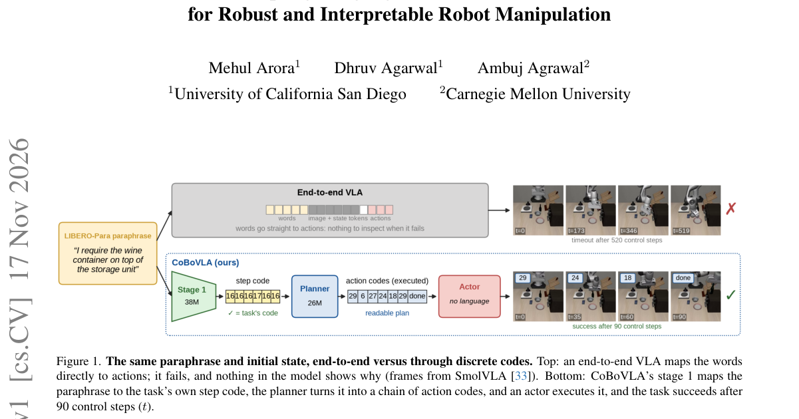

*Result - CoBoVLA separates understanding from acting through two discrete codes. (a) At test time, stage 1 maps the instruction to a learned step code; the canonical instruction and two paraphrases r*

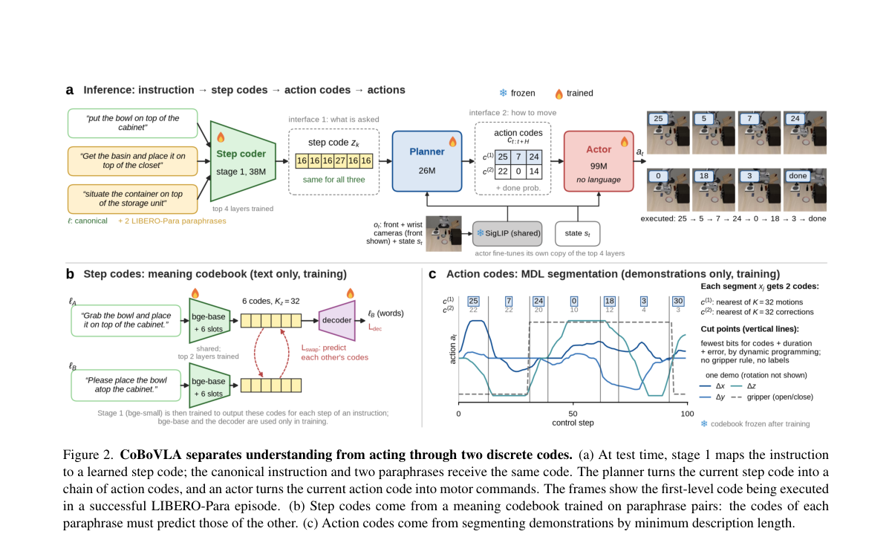

**Why this ranks #17**: 用离散可解释码把语言理解、规划与控制解耦的 250M 参数 VLA：LIBERO-Goal 达 91.4% 对 SmolVLA 的 82.8%，LIBERO-Para 81.1% 对 36.5%，单步延迟 17 ms，并指出指令编码正确时成功率 91%、否则掉到 27.2%。

---

### 18. InteractVLA: Turning VLAs into Interactive Tools for Agentic Robotic Manipulation

**arXiv**: [2611.22584](https://arxiv.org/abs/2611.22584) | **Score**: 8.0 (relevance 8 x 0.7 + quality 8 x 0.3) | **Direction**: `embodied_ai` | **Tags**: embodied, vla-steering, geometric-guidance, agentic-manipulation, flow-policy, self-improvement, Renmin University of China | **Categories**: cs.RO | **Pages**: 10

**Authors**: Chen Zhao; Zipeng Ye; Shifeng Bao; Yihan Lin; Haitao Shen; Yining Luo; Yuchen Xie; Jing Zhang

**Affiliation**: Renmin University of China; Meituan

**Abstract**

> Existing agentic manipulation systems treat pretrained vision-language-action (VLA) policies as opaque, language-only primitives: when a policy call fails under unfamiliar instructions or scene perturbations, the agent cannot steer its behavior and is forced into futile retries or costly manual takeover. We present InteractVLA, a framework that turns pretrained flow-based VLAs into geometrically steerable and inspectable tools through a bidirectional geometric interface with vision-language agents. In the forward direction, test-time geometric guidance translates an agent-specified end-effector target into input gradients through the action expert via a differentiable command-to-pose mapping, while soft-time target alignment treats arrival time as a latent execution index to match the target pose without distorting the policy's approach motion. In the reverse direction, action-informed agentic refinement exposes generated action chunks and calibrated camera reprojections back to the agent, allowing it to diagnose spatial discrepancies, revise targets for subsequent VLA calls, or locally adjust motion segments on top of the guided trajectory. Making the VLA controllable not only boosts online agentic tool use, but also unlocks effective recursive self-improvement (RSI), achieving state-of-the-art performance of 99.4\% on LIBERO-Plus, 48.62\% on RoboDojo, and 89.4\% on RoboCasa365. Project page: https://lingwupro.github.io/InteractVLA/.

**Key findings**

- **Finding**: InteractVLA 在 LIBERO-Plus 达 99.4%、RoboDojo 48.62%、RoboCasa365 89.4%，并借助动作感知的智能体式精修实现递归自我改进。
- **Inference**: 既然动作块可生成且相机可重投影，智能体就能自查空间偏差并改写下一次调用的目标，把盲目重试变成可诊断的修正。
- **Recommendation**: 接管预训练 VLA 时优先补几何接口，正向给末端目标、反向回传动作块与重投影，而不是直接人工介入。

**Key figures**

*Framework - Geometric guidance enables task-target generaliza- tion. Changing the language instruction to specify a new target sharply reduces VLA success. Incorporating the target pose into action gene*

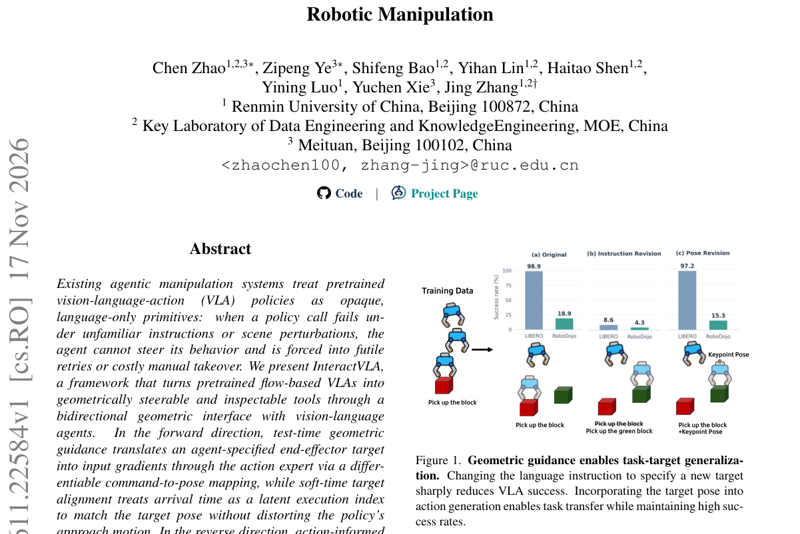

*Result - InteractVLA turns VLAs into interactive tools for agents. (a) Matching a sparse target too early disrupts the approach motion, causing premature gripper closure and rotation; timely alignmen*

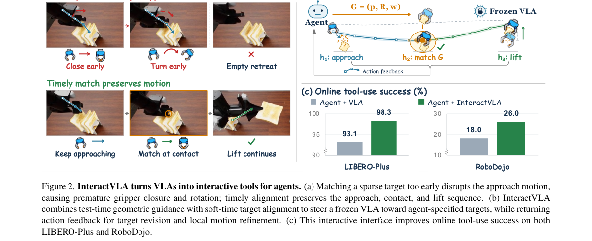

**Why this ranks #18**: 把预训练流式 VLA 变成可几何操纵、可检查的工具：正向用可微命令到位姿映射把末端目标翻译成动作专家的输入梯度，反向把动作块与标定重投影交回智能体，在 LIBERO-Plus 达 99.4%、RoboCasa365 89.4%、RoboDojo 48.62%。

---

### 19. Task Convergent Flow Matching for Generative Robotics

**arXiv**: [2611.22609](https://arxiv.org/abs/2611.22609) | **Score**: 8.0 (relevance 8 x 0.7 + quality 8 x 0.3) | **Direction**: `embodied_ai` | **Tags**: embodied, flow-matching, inference-time-refinement, task-convergence, cma-es, funnel-control, Istituto Italiano di Tecnologia | **Categories**: cs.LG, cs.RO | **Pages**: 57

**Authors**: Lorenzo Paiola; Maximilian Stölzle; Giorgio Grioli; Daniela Rus; Cosimo Della Santina

**Affiliation**: Istituto Italiano di Tecnologia; Massachusetts Institute of Technology; University of Pisa; Delft University of Technology

**Abstract**

> Successful manipulation requires the manipulated objects to progress toward a desired task outcome. Generative policies can produce plausible robot motions without ensuring this progress, allowing successive action chunks to stall or undo earlier changes to the scene. We introduce a task-centric inference-time refinement framework for flow matching policies that evaluates candidate action chunks through parallel physics-based rollouts and searches for motions satisfying sufficient conditions for task convergence. Task-level performance funnels bound temporary regressions while requiring net progress over each chunk. We establish sufficient conditions under which repeated funnel satisfaction yields convergence throughout execution, and use interval-wise Lipschitz bounds to verify continuous-time funnel satisfaction from sampled rollouts. To accommodate contact-rich hybrid dynamics, we refine the flow's source seeds using derivative-free Covariance Matrix Adaptation Evolution Strategy (CMA-ES), constrained to radial quantile bands of the source distribution to help retain the learned motion prior. This formulation supports both Euclidean and pose-valued Riemannian Flow Matching (RMFM) policies. On PushT and three-cube stacking, refinement raises success from 31.3% to 88.5% and from 77.0% to 86.0%. On PushT, whose coverage score responds continuously to the motion of the block, a learned funnel lowers the average maximum loss of achieved progress by 19% relative to constraining the endpoint of each chunk alone, at a similar success rate. With the radial band, 11.3% of the executed motion windows are out of distribution, a rate within the range of held-out demonstrations, compared with 34.1% for an unconstrained search.

**Key findings**

- **Finding**: 推理期精修把 PushT 成功率从 31.3% 提到 88.5%、三块堆叠从 77.0% 提到 86.0%；学到的漏斗相对只约束动作块端点使最大进展损失均值下降 19%。
- **Inference**: 生成式策略会产出看似合理却不推进任务的运动，所以需要任务级判据把短暂回退与净进展区分开。
- **Recommendation**: 用流匹配策略做操作时，把动作块搜索约束在源分布的径向分位带内——无约束搜索有 34.1% 的执行窗口出分布，带约束后降到 11.3%。

**Key figures**

*Framework - Generative policy candidates are evaluated through their predicted task evolution, refined*

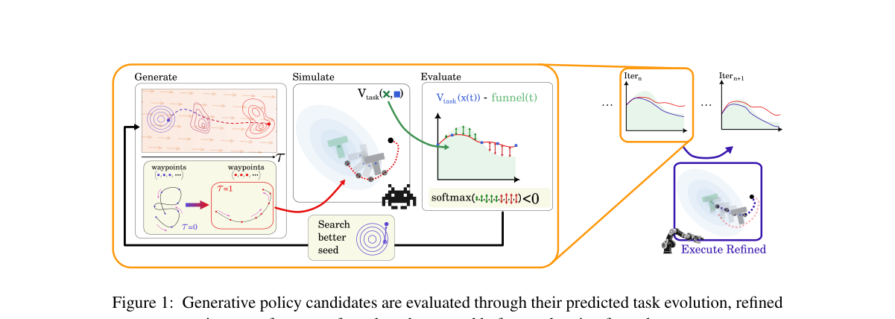

*Result - Whole-horizon task residual , Flow prior ,*

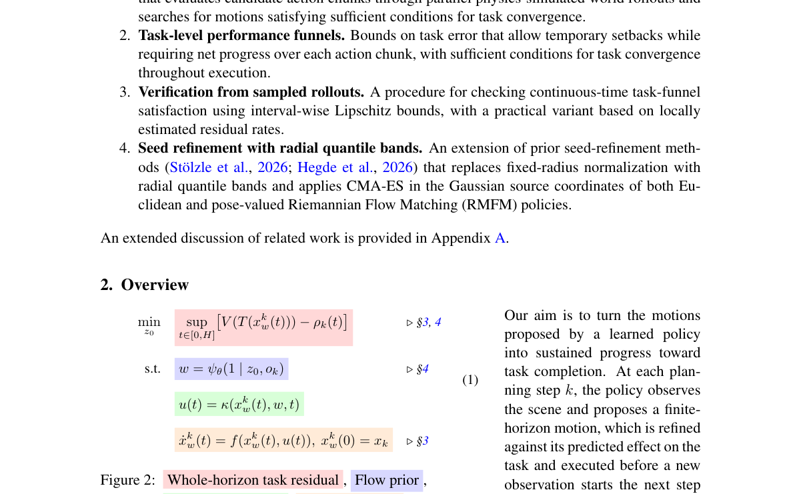

**Why this ranks #19**: 这是推理期而非训练期的修正方案：用并行物理 rollout 评估候选动作块、以任务级性能漏斗要求每个动作块净进展，PushT 成功率从 31.3% 提到 88.5%、三块堆叠从 77.0% 到 86.0%，学到的漏斗还把最大进展损失均值压低 19%。

---

### 20. Learning Accurate End-Effector Trajectory Tracking with Inertial Feedback for a Quadruped Manipulator

**arXiv**: [2611.22695](https://arxiv.org/abs/2611.22695) | **Score**: 8.0 (relevance 8 x 0.7 + quality 8 x 0.3) | **Direction**: `embodied_ai` | **Tags**: embodied, quadruped-manipulator, inertial-feedback, trajectory-tracking, reinforcement-learning, kinematic-error, Jeonbuk National University | **Categories**: cs.RO | **Pages**: 12

**Authors**: Dohyeon Kim; Seungyong Han; Yeongtae Jung

**Affiliation**: Jeonbuk National University

**Abstract**

> Accurate end-effector trajectory tracking on quadruped manipulators is challenging because uncertainties in actuators, foot-ground contact, and geometric errors are propagated through the leg-arm kinematic chain. Detecting such errors requires sensing beyond joint encoders that can capture the effects of these uncertainties on the robot's motion, since joint encoders only provide measurements at the actuated joints and cannot fully observe mechanical errors such as backlash, dimensional inaccuracies, or structural deformation. This work addresses these challenges using a reinforcement learning framework with end-effector (EE) inertial feedback, targeting local high-accuracy manipulation while maintaining a nominal body pose and support configuration without intentional body motion or foot repositioning. The learned policy uses EE inertial measurements to compensate for tracking errors induced by uncertainties throughout the leg-arm system that cannot be fully inferred from proprioception alone. Simulation and real-world experiments on continuous EE trajectory tracking show overall improvements relative to nominal and proprioception-only baselines. In real-world experiments, the proposed policy reduces the MoCap-based RMSE by 17.3% and 28.0% relative to the nominal baseline under the two in-distribution (ID) command conditions, respectively, and by an additional 12.6% and 15.9% relative to the proprioception-only baseline. Furthermore, the trajectory-wise RMSE between FK-reconstructed and motion-capture-measured end-effector positions averaged 12.61+-2.15mm (mean+-standard deviation) across 24 controller-trajectory combinations, revealing a substantial discrepancy between nominal kinematic reconstruction and measured end-effector motion.

**Key findings**

- **Finding**: 真机上该策略相对名义基线把 MoCap RMSE 降低 17.3% 与 28.0%（两种同分布指令），相对仅用本体感觉的基线再降 12.6% 与 15.9%，且 FK 重建与实测末端位置平均差 12.61 毫米。
- **Inference**: 关节编码器只看得到驱动关节，观测不到背隙、尺寸误差与结构变形这类机械误差，末端惯性测量正好补上这段不可观测量。
- **Recommendation**: 追求毫米级末端跟踪时先量化名义运动学重建与实测之间的偏差量级，再决定要不要引入末端惯性反馈。

**Key figures**

*Framework - Overview of the proposed control framework. Nominal leg and arm controllers generate baseline commands, while an arm-agent residual RL policy uses proprioceptive and end-effector inertial feed*

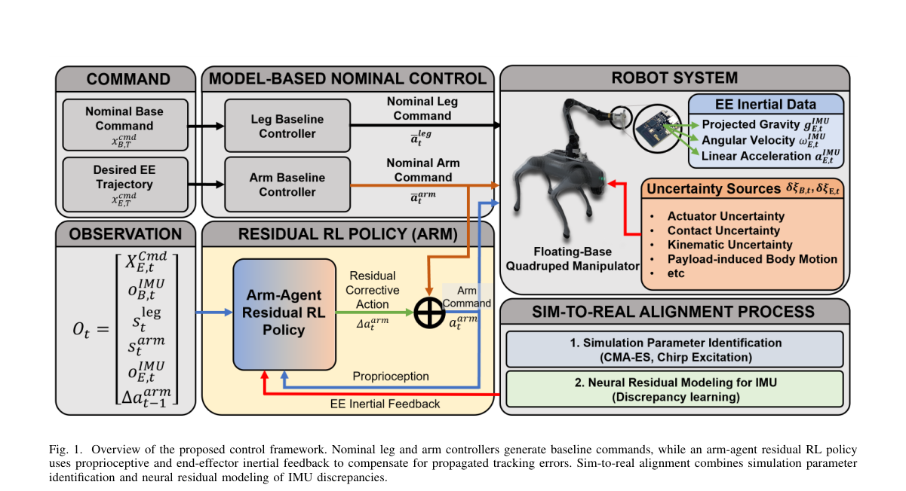

*Result - Sim-to-real alignment results for the closed-loop arm dynamics and end-effector IMU measurements. (a) Joint-space trajectory matching after simulation parameter identification using chirp exci*

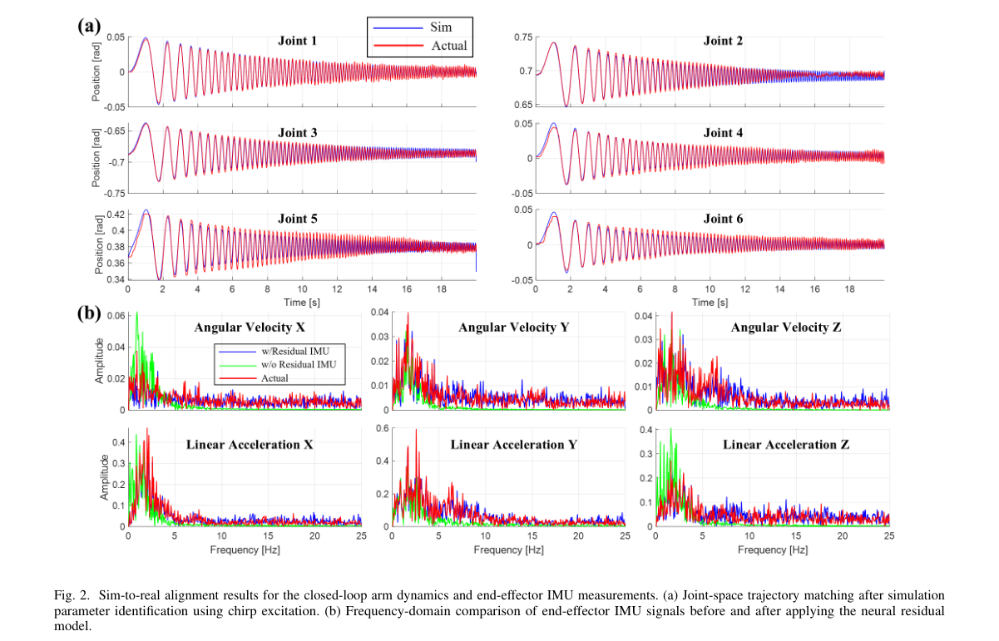

**Why this ranks #20**: 把末端惯性测量当作关节编码器之外的观测源来补偿腿-臂运动链误差，真实实验中相对名义基线把 MoCap RMSE 降低 17.3% 与 28.0%，并量出 FK 重建与实测末端位置平均相差 12.61 毫米（24 组控制器-轨迹组合）。

---

## Footer

- Total papers reviewed across all 4 axes: 60
- world_embodied axis final count: 20
- Wild-cards in this axis: 0
- Figure assets: 2026-11-19/res/

Generated by `mine-arxiv-daily-digest` skill. Sister file: `2026-11-19_world_embodied_entry.md`.
