# Mine Arxiv Daily Digest - 2026-11-20 (AIGC 视觉生成与编辑 Axis, 15 papers)

**Generated**: 2026-11-20 01:41 CST

**Source**: arXiv cs.CV, cs.SD, eess.AS, cs.CL, cs.AI, cs.RO, cs.LG, cs.IR submissions, listing day 2026-11-17,2026-11-18 (announced 2026-11-17 01:00 UTC / 2026-11-19 01:00 UTC)

**Batch window**: 2026-11-16T19:00:00Z .. 2026-11-18T19:00:00Z（arXiv 公告批次横跨两个 UTC 日：从前一日的美东 14:00 截止时刻起算（EDT 为 18:00Z，EST 为 19:00Z），到当日的同一时刻为止）

**Axis**: aigc_visual (15 papers, base 15, cap 20)

**Directions**: aigc_generation (9), aigc_editing (5), aigc_rl (1)

**Selection**: 15 papers ranked by relevance x quality, with 0 wild-card slots

**Day total**: 60 papers across 4 axes (target 60)

**Scope**: 图像 / 视频 / 3D / 4D 内容的生成与编辑，以及面向视觉生成的 RL / 偏好优化与奖励模型

**Wild-card**: 0 篇 —— 本 axis 的 15 个名额全部由够格论文填满，没有需要用邻接选题补位的空位；`aigc_rl` 的名额缺口靠同轴让位解决，不是靠 wild-card 补位。

> **本 axis 的配额结构**：`aigc_visual` 15 篇，正好是 axis 基准 15（`aigc_generation` 9 / `aigc_editing` 5 / `aigc_rl` 1，方向基准 8 / 4 / 3）。

> 两个方向各超基准 1 个名额（`aigc_generation` +1、`aigc_editing` +1），由 `aigc_rl` 让出的 2 个名额承接 —— 判据 `dir_over ≤ max(dir_under, axis_surplus)` 中 `dir_over = 2`、`dir_under = 2`、`axis_surplus = 0`，放行。

> `aigc_rl` 是全批最薄的方向：1139 篇候选里 primary 落在该方向的只有 2 篇（rel≥5 下限后），按「薄 direction 让出名额而不是被填充」的口径，它把 3 个基准名额中的 2 个让出，只留 1 篇。

> 另需说明：本 axis 的 axis 级计数被 `dir_over` 约束卡在 15 —— 因为 `aigc_rl` 的候选供给只有 2 篇，`aigc_generation` / `aigc_editing` 的超基准量找不到对应的 `dir_under` 承接，因此本 axis 无法推进到 AXIS_CAP = 20。

---

## AIGC 生成（图像 / 视频 / 3D / 4D） · `aigc_generation` (9 papers)

生成侧今天有两条并行主线。**一条是把扩散/流模型的采样成本压下去**：CueSplat 用轻量 router 在离线标定的预算内挑选需要精确形变的高斯点，并按漂移信号调度三帧全量形变，在 Jetson AGX Orin 与 Orin NX 上分别提速 6.74× 与 8.15×、PSNR 最多只掉 0.16 dB；ProxySearch（NeurIPS 2026）发现蒸馏代理与教师之间的图像统计秩相关可达 ρ=0.80、而学习语义评分器只有 ρ≤0.12，据此用 1 步代理筛选 + 教师择优在 FLUX-1024 上把统计目标收紧 21–23%；Isthmus 则指出一步流映射的训练样本只落在时间三角的对角线上，只要把 5% 训练对铺到连接对角线与一步对的整条边，一步采样的不确定性与稳定性就恢复（脑 MRI 上校准回到 0.96、与多步样本相关 0.93）。**另一条是 4D / 结构化生成**：TRoPE 用图拉普拉斯谱特征 + 多尺度扩散特征距离构造拓扑相对位置编码，新基准 MeshSticking-4D 上最差顶点误差降 39.4%、分离失败率 49.35%→34.90%；FreeForward4D 把相机/深度/轨迹先验对齐进统一度量系，免数据集标注做 4D 驾驶场景重建，Waymo 上 27.66 dB PSNR / 0.836 SSIM 并超过 STORM、UFO、DGGT。剩下几篇各占一个前沿：ARG-Avatar 用 FACRoPE + ITR 引导头像 token 关注对应 patch，68M 参数达 SOTA（比 LHM++ 少约 9 倍参数、快 6 倍）；PhysResponse 从场景反演有效重力/摩擦/初速，并用 72000 条受控仿真视频度量 10 个 I2V 模型的物理参数响应；Jeveration 复用冻结 VLM 的视觉语义做单次前向并行生成，512×512 图像 78ms、最快比同类统一模型快 122 倍；DM-VAE 用高维重建分支 + 低维拓扑骨架双流替代 DINOv2 等外部正则，ImageNet-1K 上 rFID 0.12、FID50K 1.28（无 CFG）。

### 1. CueSplat: Learning to Schedule Sparse Deformation for Dynamic Gaussian Splatting on Edge Devices

**arXiv**: [2611.22095](https://arxiv.org/abs/2611.22095) | **Score**: 8.7 (relevance 9 x 0.7 + quality 8 x 0.3) | **Direction**: `aigc_generation` | **Tags**: AIGC-visual, dynamic-gaussian-splatting, sparse-update-routing, edge-acceleration, temporal-prediction, post-training, Shanghai Jiaotong University | **Categories**: cs.CV | **Pages**: 10

**Authors**: Qingyuan Tang; He Zhu; Shixuan Sun; Anbang Wu; Jingwen Leng; Minyi Guo; Yu Feng

**Affiliation**: Shanghai Jiaotong University

**Abstract**

> Deformation-based 4D Gaussian splatting (4DGS) enables dynamic scene rendering. However, evaluating deformation networks for all Gaussians at every frame is compute-intensive on edge devices. We find that Gaussian trajectories are often locally predictable, yet prediction reliability varies across Gaussians and time. Thus, we propose CueSplat, a post-training framework that exploits local temporal regularity while keeping the pretrained backbone frozen and retaining its Gaussian set. Specifically, CueSplat predicts Gaussian attributes from recent history and uses a lightweight learned router to select exact deformation updates within a scene-specific budget calibrated offline. Selection accounts for prediction reliability and rendering contribution. Selected indices are reused across nearby frames to reduce routing overhead, while selected Gaussians still receive exact updates each frame. To control accumulated prediction error, we use drift signals to schedule three consecutive full-deformation frames that rebuild the prediction history. Evaluated across four mainstream 4DGS algorithms, CueSplat achieves up to $6.74\times$ and $8.15\times$ speedups on Jetson AGX Orin and Orin NX, respectively, with a negligible quality drop (at most $0.16$ dB in dataset-average PSNR).

**Key findings**

- **Finding**: CueSplat 在 Jetson AGX Orin 上取得 1.75–6.74× 加速、Orin NX 上 1.81–8.15×、A6000 上最高 5.04×，每帧 GPU warp 指令数从 8206.42 降到 760.01 百万，而 12 组骨干–数据集配对的数据集平均 PSNR 下降最多 0.16 dB。
- **Inference**: 变形网络占 E-D3DGS 在 N3DV 上约 85% 的 GPU 流水线时间，因此只对预测可靠且渲染贡献大的高斯做精确变形更新、其余走时序预测，是把该开销压到可忽略的可行路径。
- **Recommendation**: 在 Jetson 上跑 4DGS 时优先做后训练稀疏化而不是重训：保留预训练高斯集，只训练约 2.0k–2.6k 参数的路由器，并用 N=5 帧的索引复用摊薄路由开销。

**Key figures**

*Framework - CUESPLAT accelerates four deformation-based Gaussian backbones: E-D3DGS [1], 4DGaussians [43], GaGS [28], and SpeeDe3DGS [39]. (a) Renderings and scene-average PSNR/FPS on cut roasted beef.*

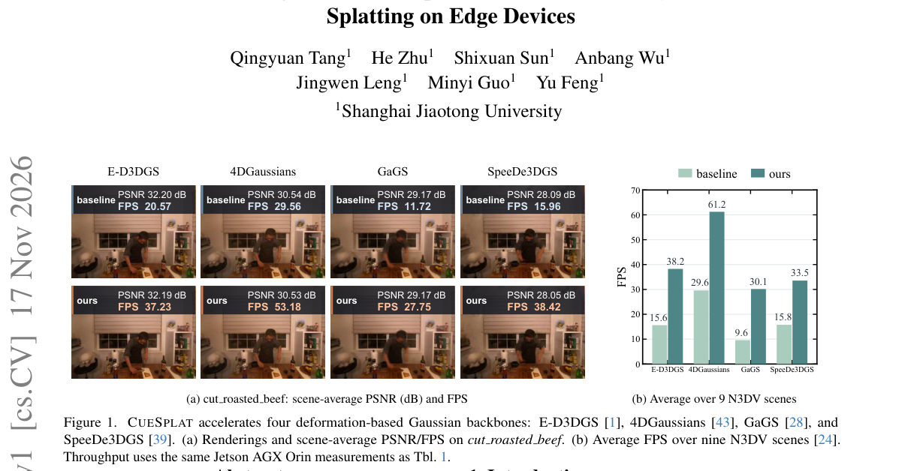

*Result - Five-frame positional regularity of E-D3DGS on N3DV and Technicolor. Bars partition Gaussian–window pairs into mu- tually exclusive static, additional linear, additional quadratic, and outsi*

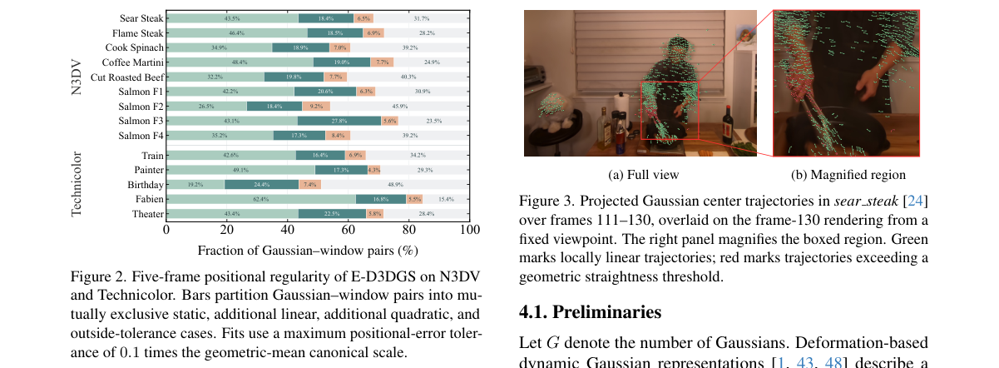

**Why this ranks #1**: 在 Jetson AGX Orin 上把 4DGS 变形网络的推理开销（E-D3DGS 在 N3DV 上约占 GPU 流水线时间 85%）用稀疏更新路由压掉，最高取得 6.74×（Orin NX 8.15×）加速，而 12 组骨干–数据集配对的数据集平均 PSNR 最多只掉 0.16 dB，是生成侧不重训即可落地的效率优化。

---

### 2. ARG-Avatar: Animation-Rendering Guidance for Efficient Feedforward Avatar Reconstruction

**arXiv**: [2611.22207](https://arxiv.org/abs/2611.22207) | **Score**: 8.7 (relevance 9 x 0.7 + quality 8 x 0.3) | **Direction**: `aigc_generation` | **Tags**: AIGC-visual, feed-forward-avatar, gaussian-splatting, rope-attention, uv-canonicalization, efficiency, Carnegie Mellon University | **Categories**: cs.CV, cs.GR | **Pages**: 22

**Authors**: Jianjin Xu; Soham Dasgupta; Fernando De la Torre

**Affiliation**: Carnegie Mellon University, Robotics Institute

**Abstract**

> Reconstructing animatable 3D human avatars from images is important for applications such as gaming and augmented reality. Feedforward methods make avatar reconstruction accessible by reducing inference time to a few seconds, but recent approaches rely heavily on scaling model capacity, training data, and computation. We ask whether such scaling is necessary. To this end, we introduce ARG-Avatar, an efficient feedforward framework with only 68M trainable parameters that achieves SOTA reconstruction quality. Our key insight is that 3D animation and rendering already provide strong geometric correspondences that existing methods largely attempt to learn from data. In light of this, we design the Foreground Avatar Coordinate RoPE attention (FACRoPE) and Intermediate Token Rendering (ITR) pipeline to guide avatar tokens to attend to their corresponding patches. Experiments across multiple datasets show that ARG-Avatar consistently outperforms prior methods when using two or more input images. Compared with LHM++, ARG-Avatar uses approximately 9$\times$ fewer trainable parameters, 4.8$\times$ fewer training sequences, and 14$\times$ less training compute, while running 6$\times$ faster and achieving a 2.7 dB PSNR improvement on the out-of-distribution NeuMan benchmark.

**Key findings**

- **Finding**: ARG-Avatar 仅用 68M 可训练参数、64K 训练序列、约 125 H100 等效 GPU 小时，在 NeuMan 上达到 30.82 dB PSNR；相比 LHM++（609M 参数、300K 私有视频）参数少约 9×、训练序列少 4.8×、算力少 14×，推理快约 6×（2.3 s 对 14.2 s）且 PSNR 高 2.7 dB。
- **Inference**: 3D 动画与渲染本身已经提供了强几何对应关系，用 FACRoPE 与中间 token 渲染把这些对应显式注入注意力后，模型不必再靠扩数据与扩容量硬学对应关系，小模型因此能超过放大规模的基线。
- **Recommendation**: 做前馈式人体 avatar 重建时先换掉朴素注意力再谈扩规模；实测两视图 27.97 dB、四视图 28.03 dB，视图数从 1 增到 6 可再涨 3.8 dB，而 LHM++ 只涨 0.4 dB。

**Key figures**

*Framework - Overview of ARG-Avatar. Given casual photographs or frames from a monocular video, ARG-Avatar reconstructs a canonical avatar and produces avatars with pose-dependent deformations for arbitr*

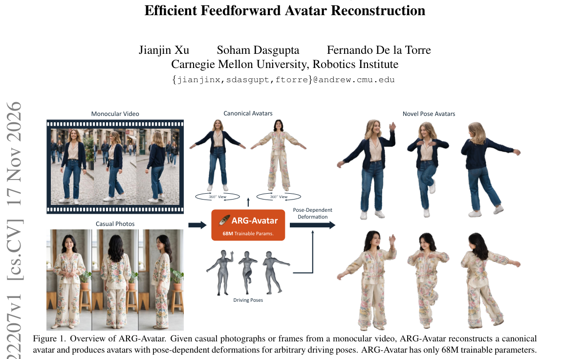

*Result - Out-of-distribution NeuMan PSNR vs. training com- pute. Circle area is proportional to trainable parameters.*

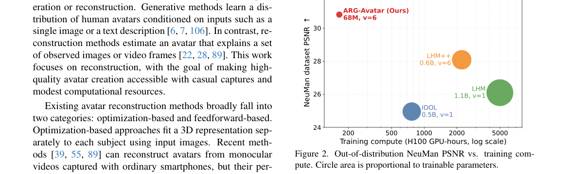

**Why this ranks #2**: 以 68M 可训练参数、64K 训练序列在 NeuMan 上取得 30.82 dB，比 LHM++ 少约 9× 参数、4.8× 训练序列、14× 训练算力，同时快约 6× 且 PSNR 高 2.7 dB，是生成侧少见的「缩规模反而更准」的正面结果，因此排在 aigc_generation 首位梯队。

---

### 3. ProxySearch: Decoupled Inference-Time Scaling for Diffusion Models via Asymmetric Noise-Rank Transfer

**arXiv**: [2611.23929](https://arxiv.org/abs/2611.23929) | **Score**: 8.7 (relevance 9 x 0.7 + quality 8 x 0.3) | **Direction**: `aigc_generation` | **Tags**: AIGC-visual, test-time-scaling, noise-search, distilled-proxy, spearman-rank, text-to-image, GenGenAI | **Categories**: cs.CV | **Pages**: 26

**Authors**: Seungwook Kim; Jongmin Lee

**Affiliation**: GenGenAI; Chung-Ang University

**Abstract**

> Noise search at inference time improves text-to-image diffusion but requires many multi-step teacher rollouts per query. Distilled few-step models are now routinely released, yet their potential as proxies inside noise search is uncharacterized. We measure proxy-teacher rank agreement across three distillation regimes and three backbones (DiT, MMDiT, UNet) and find a sharp asymmetry. On our main pool, closed-form image statistics transfer from the proxy to the teacher (Spearman $ρ$ up to 0.80), while learned semantic scorers do not ($ρ\le$ 0.12). Paired null controls trace this rank to the first denoising step for coarse statistics and to distillation for finer ones. We use the asymmetry for noise search under a joint constraint: a semantic reward specifies content, and a numeric target specifies image statistics. In PROXYSEARCH, the proxy filters candidates by statistical match in 1 step, and the teacher returns the survivor with the highest semantic reward. No weight trades one objective against the other. On FLUX-1024, PROXYSEARCH tightens the statistical target by 21-23% at the same number of teacher trajectories, with no detected loss on the optimized reward.

**Key findings**

- **Finding**: 在 FLUX-1024 的完整 GenEval 上，ProxySearch 用与教师 argmax 相同的 8 条教师轨迹，把亮度/对比度统计目标的成对 ℓ1 收紧 21–23%（配对 t = −19.3，Wilcoxon z = −18.5），同时所优化的语义奖励无可测损失。
- **Inference**: 代理与教师的排序一致性在闭式图像统计上最高 Spearman ρ = 0.80，而在 CLIP、ImageReward、aesthetic 三种语义打分上只有 ρ ≤ 0.12，因此代理只能筛统计、不能判语义。
- **Recommendation**: 做噪声或候选搜索时不要用少步蒸馏模型替代教师的语义判别，而应让它承担统计量初筛，把昂贵的教师轨迹留给最终语义择优；把教师候选池翻倍并不能改善统计 ℓ1。

**Why this ranks #3**: 把噪声搜索里的候选筛选交给蒸馏少步代理、把语义择优留给教师模型，在 FLUX-1024 上以同等教师轨迹把统计目标的成对 ℓ1 收紧 21–23%，是生成侧推理时算力重新分配的直接证据，也解释了为什么少步模型不能整体替代教师。

---

### 4. TRoPE: Topology-aware Relative Positional Encoding for 4D Generation

**arXiv**: [2611.23933](https://arxiv.org/abs/2611.23933) | **Score**: 8.7 (relevance 9 x 0.7 + quality 8 x 0.3) | **Direction**: `aigc_generation` | **Tags**: AIGC-visual, video-to-4d, topology-aware, relative-positional-encoding, sticking-artifact, tail-risk, Zhejiang University | **Categories**: cs.CV | **Pages**: 26

**Authors**: Chengzhuo Gui; Zhenglin Zhou; Fan Ma; Zongxin Yang; Yi Yang

**Affiliation**: Zhejiang University

**Abstract**

> Video-to-4D mesh generation has made substantial progress in recovering dynamic 3D geometry and motion from monocular videos. However, commonly used feed-forward approaches remain prone to sticking artifacts, where geodesically distant vertices move together incorrectly when they become spatially close. We attribute this failure to cross-part motion leakage: spatially nearby yet structurally distant vertices may retrieve similar motion information when motion decoding fails to distinguish spatial proximity from mesh connectivity. To address this issue, we introduce TRoPE, a topology-aware relative positional encoding that makes mesh connectivity explicit in the interaction between vertex queries and mesh-supported motion sources. TRoPE derives spectral features from the graph Laplacian and constructs pairwise topological relations from distances between multi-scale diffusion features, using these relations to modulate vertex--anchor attention through rotary phases. We further introduce a vertex-wise tail-risk objective that emphasizes persistently high-error vertices to explicitly suppress sticking artifacts. To better characterize and quantify these failures, we introduce MeshSticking-4D, a dedicated benchmark for this failure mode. Experiments on MeshSticking-4D show that TRoPE suppresses sticking artifacts while improving overall motion accuracy. Compared with the baseline, it reduces the worst-vertex error by 39.4% and lowers the separation failure rate from 49.35% to 34.90%. Additional evaluations on Motion-80 and Motion324-Subset show lower tail errors on diverse objects, while transfer to Mesh4D demonstrates applicability across backbones.

**Key findings**

- **Finding**: 在 MeshSticking-4D 的 256 个测试样本上，TRoPE 相对 Motion 3-to-4 把 WVE 降低 39.4%、FMVE 降低 36.2%，EETE25 从 137.872 降到 98.191，分离失败率 SFR 从 49.349% 降到 34.898%，MSD 从 35.849 降到 29.431。
- **Inference**: 粘连源于运动解码把「空间邻近」误当作「网格连通」，把图拉普拉斯谱特征与多尺度扩散特征距离构造为拓扑关系、并以旋转相位调制顶点—锚点注意力，就能切断跨部件的运动泄漏。
- **Recommendation**: 评估 video-to-4D 时不要只报平均误差，尾部指标 EETE25 与 SFR 才是暴露粘连的主战场；TRoPE 在 Motion-80 上 CD 12.238、HD95 34.845，并可迁移到 Mesh4D 骨干。

**Key figures**

*Framework - TRoPE reduces sticking artifacts in 4D generation. Given a reference mesh and a monocular video (left panel), the upper and lower platforms present the Motion 3-to-4 baseline and TRoPE, resp*

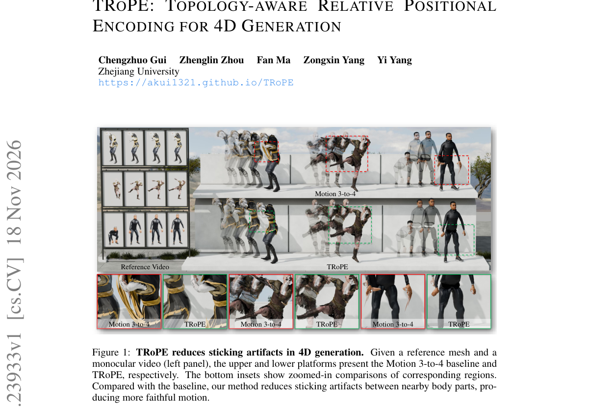

*Result - Overview of TRoPE for Topology-Aware Video-to-4D Mesh Generation. Given a driving video and a reference mesh, a video-to-4D backbone extracts motion tokens, which TRoPE associates with mesh-*

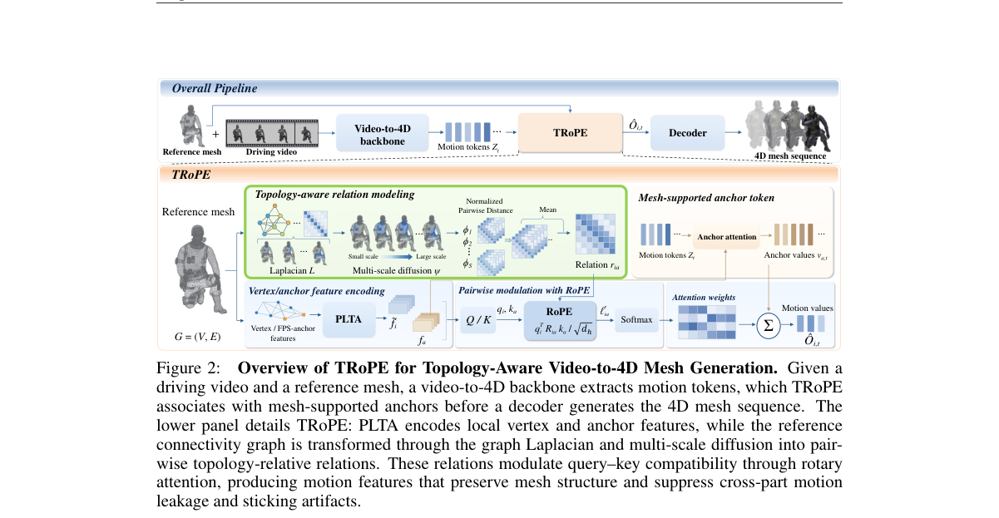

**Why this ranks #4**: 针对前馈式 video-to-4D 的「粘连伪影」建立专用基准 MeshSticking-4D（10080 训练样本 / 256 测试样本），TRoPE 把最差顶点误差降低 39.4%、分离失败率从 49.35% 降到 34.90%，是生成侧少见的针对具体失败模式给出定量改进的工作。

---

### 5. Dual-Manifold Variational Autoencoders

**arXiv**: [2611.23964](https://arxiv.org/abs/2611.23964) | **Score**: 8.7 (relevance 9 x 0.7 + quality 8 x 0.3) | **Direction**: `aigc_generation` | **Tags**: AIGC-visual, variational-autoencoder, latent-manifold, foundation-model-free, off-manifold, image-generation, Hong Kong University of Science and | **Categories**: cs.AI, cs.CV | **Pages**: 16

**Authors**: Hongxu Chen; Chun Wang; Yanghao Wang; Hongxiang Li; Zhen Wang; Zhixiang Zhang; Long Chen

**Affiliation**: The Hong Kong University of Science and Technology; LONG Group

**Abstract**

> In latent diffusion models, expanding the latent dimension of variational autoencoders (VAEs) is essential to push the upper bound of reconstruction quality. However, without explicit structural constraints, such unregularized expansion easily yields a rugged and ill-conditioned latent manifold, causing generated latents to drift off the manifold during generation (i.e., off-manifold problem). Recent works smooth this manifold by using external foundation models (e.g., DINOv2) as a topological regularizer. However, we argue that tying the latent space to frozen external priors inherently restricts generalization: bound by their pre-training distributions and semantic biases, they may fail to capture faithful visual details on out-of-distribution domains. Observing that low-dimensional latents naturally form a smoother, generation-friendly manifold, we propose dual-manifold VAE (DM-VAE) to leverage internal representations as a topological regularizer. Specifically, DM-VAE pairs a high-dimensional reconstructive branch with a low-dimensional branch that extracts a clean topological skeleton, anchoring the high-dimensional manifold to this smooth subspace. Building upon this framework, we further introduce topological representation alignment (TRA) to supervise intermediate generator features during training, and internal guidance with topological skeleton (IG_TS) to guide structural components while preserving high-frequency details at inference. On ImageNet-1K (256x256), our foundation-model-free DM-VAE achieves a state-of-the-art rFID of 0.12 and a generation FID50K of 1.28 (w/o CFG) and 1.20 (w/CFG), and further reaches 1.11 when orthogonally combined with DINOv2.

**Key findings**

- **Finding**: 不依赖任何外部基础模型的 DM-VAE（f16d64）在 ImageNet-1K 256×256 上把重建 rFID 压到 0.12，配 DiT 生成的 FID50K 达 1.28（无 CFG）与 1.20（有 CFG），与 DINOv2 正交组合进一步到 1.11；f16d32 变体 64 epoch 即达 1.67（CFG），400 epoch 达 1.17。
- **Inference**: 低维潜变量天然形成更光滑的生成友好流形，用它做内部拓扑骨架去锚定高维流形，就能替代冻结外部先验的拓扑正则，同时绕开外部模型预训练分布与语义偏置带来的泛化上限。
- **Recommendation**: 想扩展 VAE 潜维度又担心离流形退化时，先做高维重建加低维骨架的双分支结构再考虑外部监督；OOD 侧 RAE/RAEv2 的 rFID 会崩到 9.85/5.09，而 DM-VAE 仍能守住 1.93。

**Why this ranks #5**: 把高维重建分支与低维拓扑骨架分支配对，用内部表示而非 DINOv2 这类外部先验做拓扑正则，在 ImageNet-1K 256×256 上取得 rFID 0.12、生成 FID50K 1.28（无 CFG）/1.20（有 CFG），与 DINOv2 正交组合还能到 1.11，属生成底层设施级的贡献。

---

### 6. Freeforward4d: Annotation-free feed-forward 4d reconstruction of driving scenes

**arXiv**: [2611.24007](https://arxiv.org/abs/2611.24007) | **Score**: 8.7 (relevance 9 x 0.7 + quality 8 x 0.3) | **Direction**: `aigc_generation` | **Tags**: AIGC-visual, annotation-free, feed-forward-4d, driving-scene, geometric-priors, gaussian-splatting, East China Normal University | **Categories**: cs.CV | **Pages**: 19

**Authors**: Luosong Guo; Xiang Yang; Chaoyang Li; Ao Gao; Jiangming Shi; Yanyun Qu; Zhizhong Zhang; Jingyu Gong; Yuan Xie

**Affiliation**: East China Normal University; Shanghai Innovation Institute; Xiamen University

**Abstract**

> Feed-forward 4D reconstruction enables efficient creation of renderable driving scenes for autonomous driving simulation. However, most existing methods rely heavily on dataset-provided cameras, LiDAR depth, or 3D box annotations, limiting their applicability to unannotated driving videos. Pretrained visual models can predict cameras, depth, and object tracks from RGB alone, but their geometry is mutually inconsistent: multi-view predictions come in short windows with independent scales and frames, while monocular depth is metric only per image. Our key insight is that, once reconciled into a single metric frame, these priors can replace dataset annotations for feed-forward 4D reconstruction. We present \textbf{FreeForward4D}, which calibrates overlapping prediction windows against monocular metric depth and registers them into one frame across time. On this geometry, 2D tracks are associated across cameras in 3D, and objects move through hierarchical motion that combines a shared object velocity with local Gaussian corrections, so that both training and inference use only RGB videos. On Waymo, FreeForward4D achieves 27.66 dB PSNR and 0.836 SSIM while recovering metric-scale cameras and depth without scale alignment. It surpasses STORM, SLARM-F, UFO, DGGT, and StreetForward, which rely on dataset annotations, in full-image PSNR and attains the best RGB fidelity on 8-second windows. RGB-only fine-tuning further adapts the framework to nuScenes and Argoverse 2. Code will be released.

**Key findings**

- **Finding**: FreeForward4D 只用多视角 RGB，在 Waymo 上达到 27.66 dB PSNR / 0.836 SSIM，同时恢复出公制尺度相机与深度且无需尺度对齐，全图 PSNR 超过 STORM、SLARM-F、UFO、DGGT、StreetForward，8 秒窗口下取得最佳 RGB 保真度（27.57 dB / 0.836 SSIM）。
- **Inference**: 现有方法依赖数据集相机、激光雷达与 3D 框，根因是各自预训练先验的尺度与坐标系互不一致；一旦用单目公制深度把重叠预测窗口对齐到同一帧，先验即可替代全部标注。
- **Recommendation**: 无标注驾驶场景重建可直接走 RGB-only 路线，并优先修正跨相机轨迹关联——消融显示共享物体速度的运动建模贡献了动态区域 PSNR 的 1.35 dB；Waymo 上深度 D-RMSE 为 7.06 m。

**Key figures**

*Framework - Annotation-free feed-forward reconstruction of dynamic driving scenes. Given only multi-view RGB videos, FreeForward4D reconciles pretrained geometric priors into a single metric frame and r*

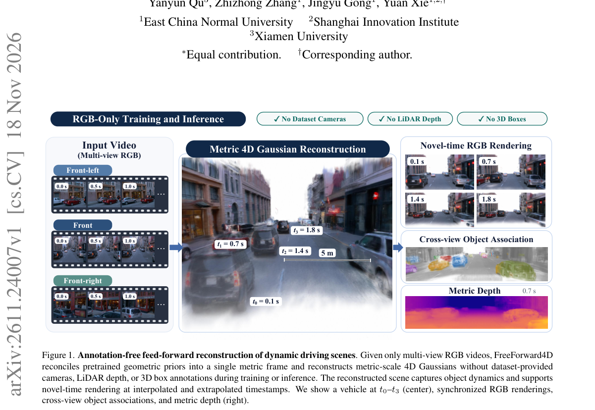

*Result - FreeForward4D pipeline. (a) Frozen visual priors provide windowed cameras, pseudo-depth, and 2D object tracks. (b) Geometric prior integration calibrates the windows against monocular metric*

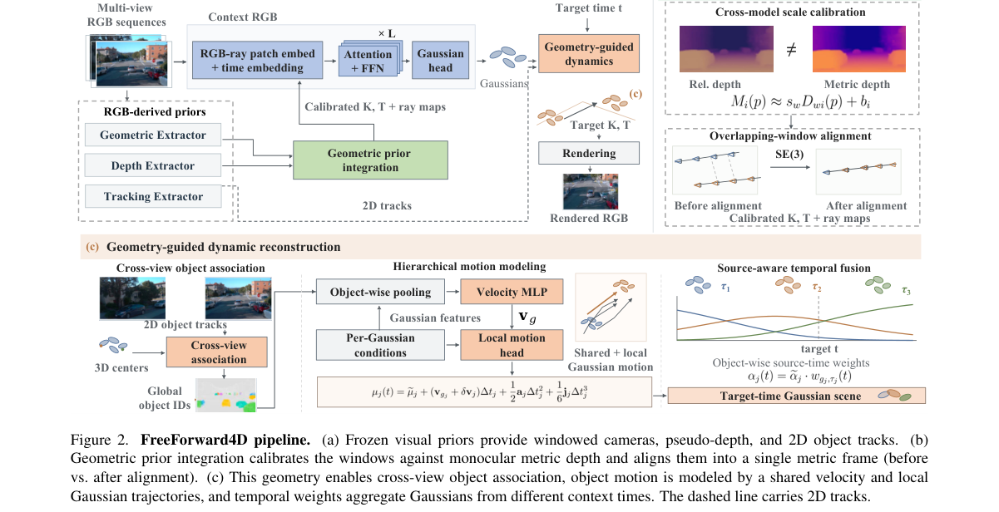

**Why this ranks #6**: 把预训练视觉先验（窗口相机、MoGe-2 单目公制深度、2D 轨迹）统一校准进同一坐标系，在 Waymo 上取得 27.66 dB PSNR / 0.836 SSIM 并恢复公制尺度相机与深度，超过 STORM、SLARM-F、UFO、DGGT、StreetForward 等依赖数据集标注的方法。

---

### 7. PhysResponse: Probing the Physics of Video Generation with Controlled Interventions

**arXiv**: [2611.24419](https://arxiv.org/abs/2611.24419) | **Score**: 8.7 (relevance 9 x 0.7 + quality 8 x 0.3) | **Direction**: `aigc_generation` | **Tags**: AIGC-visual, physics-benchmark, video-generation, parameter-inversion, simulated-data, world-simulator, Sun Yat-sen University | **Categories**: cs.CV | **Pages**: 11

**Authors**: Yuhan Li; Shuran Zhang; Haixin Tian; Baonuo Rao; Weipeng Li; Yujia Hou; Zhenyu Wang; Zijun Wang; Luoyang Lin; Lijing Luo; Jiehui Huang; Kaiyuan Yang

**Affiliation**: Sun Yat-sen University; The Hong Kong University of Science and Technology; Mohamed bin Zayed University of Artificial Intelligence

**Abstract**

> Video generation models are increasingly viewed as world simulators, which requires not only plausible motion but dynamics that respond correctly to specified physical parameters. Existing models, datasets and benchmarks, however, largely target physical plausibility, leaving this physical parameter responsiveness insufficiently explored. We introduce PhysResponse, a benchmark that measures it at two levels: scene-conditioned simulator inversion recovers the effective gravity, friction and initial speed of generated motion, and event evaluation tests outcomes near and across critical transitions. Evaluating ten image-to-video models, we find that even the lowest parameter errors exceed those of physically correct videos by over an order of magnitude, that models rarely reproduce both outcomes of a transition pair, and that the two levels expose complementary failures that visual metrics such as PSNR miss. To supply the missing training signal, we construct 72,000 simulated videos of 20 multi-object interaction types with controlled parameters; fine-tuning on them lowers parameter errors, even on held-out interaction types, and transfers to real videos and an external physics benchmark. Continued training with a numerical encoder further lowers all three errors on held-out types. PhysResponse provides a foundation for world simulators that follow physical conditions, not just appearances.

**Key findings**

- **Finding**: 基准覆盖 20 类多物体交互、72,000 条仿真视频（来自 24,000 次仿真运行，每类 3,600 条，其中 Genesis 2,640 条、Isaac Sim 960 条），评测 10 个图生视频模型；即使最优模型的参数误差也比物理正确视频高出一个数量级以上，最强模型 PairAcc 仍低于 50%。
- **Inference**: 现有视频生成模型学到的是视觉上合理的运动而非参数可控的动力学，所以 PSNR 这类视觉指标无法暴露其在临界转变两侧行为不一致的失败，只有反演物理参数才能量化。
- **Recommendation**: 把视频生成当世界模拟器用之前，先用场景条件反演测重力、摩擦与初速误差；用该基准微调可把留出交互类型上的重力误差从 140.3% 降到 39.8–68.6%、速度误差从 93.1% 降到 13.0–16.4%。

**Key figures**

*Framework - We present PhysResponse, 72,000 simulated videos of 20 multi-object interactions with set physical conditions, and a benchmark that recovers gravity, friction and speed from generated videos*

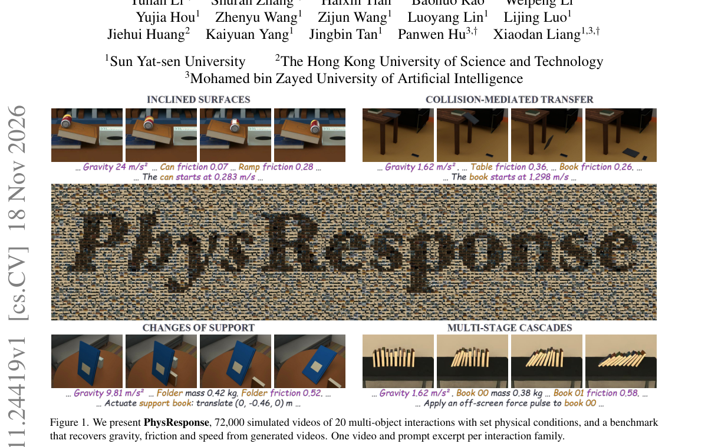

*Result - Speed decides the outcome in simulation but often not in generation. In simulation only the faster book tips the can onto the shelf, but PhysAlign, even told so, leaves it on the table at bo*

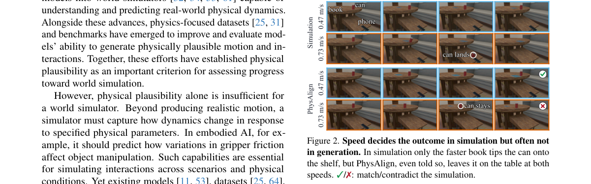

**Why this ranks #7**: 系统评测 10 个图生视频模型对重力、摩擦、初速度等物理参数的响应能力：即便最优模型的参数误差也比物理正确的视频高出一个数量级以上，转折对的双结果几乎无法同时复现，是生成侧「像不像」之外的一把硬尺，且配套 72,000 条仿真视频提供可训练信号。

---

### 8. Jeveration: System One Models Now Generate

**arXiv**: [2611.24738](https://arxiv.org/abs/2611.24738) | **Score**: 8.7 (relevance 9 x 0.7 + quality 8 x 0.3) | **Direction**: `aigc_generation` | **Tags**: AIGC-visual, one-forward-pass, system-one, frozen-vlm, lora, unified-generation, National University of Singapore | **Categories**: cs.CV | **Pages**: 15

**Authors**: Yuhe Liu; Qi Li; Shihua Zhang; Xinchao Wang

**Affiliation**: National University of Singapore

**Abstract**

> System One models such as Jev return decisions through fast, parallel prediction. In this paper, we introduce Jeveration, showing that the same decision paradigm can also generate high-quality images in a single forward pass. Jeveration builds on a frozen vision-language model, repurposing its visual-semantic knowledge for holistic image generation. The key challenge is to maintain global consistency. A single prompt admits many valid images, yet parallel predictions must converge on a coherent whole. We therefore condition all positions on a shared random state to coordinate parallel predictions, so that each draw yields a different but coherent image. Since the model tends to ignore this state under direct image supervision, we first learn a distribution over discrete image codes to guide single-pass generation. Beyond text-to-image generation, we further unify image-to-image generation and dense prediction within the same architecture, so that one checkpoint supports all three tasks, each in one forward pass. Experiments show that Jeveration generates a 512x512 image in 78 ms, up to 122x faster than existing unified models, while maintaining competitive image quality and dense prediction performance.

**Key findings**

- **Finding**: Jeveration 在单张 H200 上端到端 77.8 ms 生成 512×512 图像，比 Janus-Pro-1B 快 98×、比 Janus-Pro-7B 快 122×，GenEval 达 0.74；图生图单次前向 91.7 ms，NYUv2 上 mIoU 与同骨干稠密模型相当（67.8 与 67.3），比 DeepLabV3+ 高 14.2 mIoU 且深度误差低 32%（0.267 对 0.393 m）。
- **Inference**: 让所有位置共享同一随机状态即可协调并行预测、一次拿到整幅图像；但模型在直接图像监督下倾向忽略该状态，所以必须先学一个离散图像码分布来引导单次生成。
- **Recommendation**: 需要极低延迟的文生图时优先试单次前向范式，但共享随机状态不可省——移除后 HPSv2.1 从 28.27 降到 26.63、GenEval 从 0.73 降到 0.70。

**Key figures**

*Framework - System One models now generate. One frozen vision-language model regards text-to-image and image-to-image tasks as typed decisions. Text-to-image samples at 512 px (top) and image-conditione*

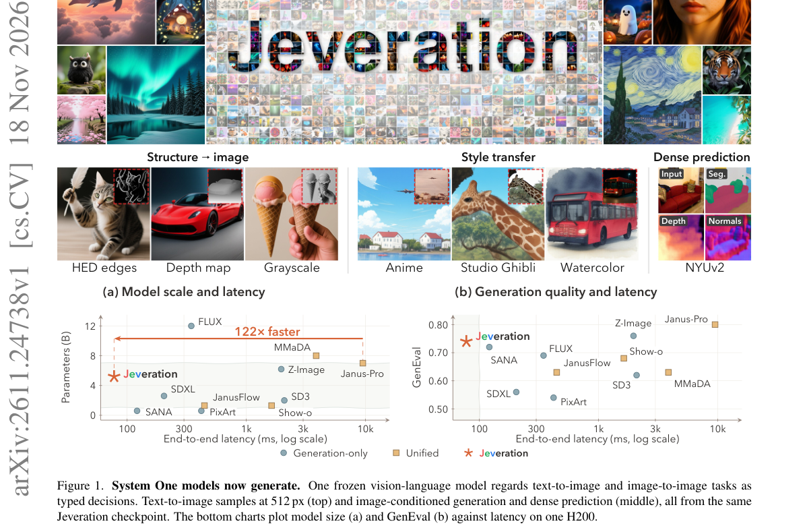

**Why this ranks #8**: 把 System One 的并行决策范式搬到图像生成上，冻结 Qwen3.5-4B 只加 LoRA，512×512 图像单次前向 78 ms、最高比 Janus-Pro-7B 快 122×，同时文生图、图生图、稠密预测三任务共用一个权重，是生成范式层面的新解法。

---

### 9. Isthmus: Bridging Supervision Islands Restores Uncertainty and Stability in One-Step Flows

**arXiv**: [2611.23616](https://arxiv.org/abs/2611.23616) | **Score**: 8.3 (relevance 8 x 0.7 + quality 9 x 0.3) | **Direction**: `aigc_generation` | **Tags**: AIGC-visual, one-step-sampling, flow-matching, calibration, uncertainty, time-pair-sampler, Ohio State University | **Categories**: cs.CV, cs.LG | **Pages**: 11

**Authors**: Luming Yang; Siqing Li; Haoxian Liu; Zhenyu Bu; Jiazheng Zhu; Alper Yilmaz

**Affiliation**: The Ohio State University; Photogrammetric Computer Vision Laboratory (PCVLab)

**Abstract**

> One-step flow maps are increasingly used as posterior samplers, where the point of sampling is the uncertainty that the samples carry. We find that the one-step sampler loses this uncertainty and becomes less stable. Compared with multi-step samples of the same network, its samples lose variance and decorrelate. Supervising the one-step jump directly makes this worse; the samples collapse further toward the conditional mean and break down when training is extended. We trace both failures to the locations where training places its pairs of start and end times. Only pairs on the diagonal of the time triangle receive targets from data, and the pair used for one-step sampling is either left unsupervised or supervised on an island, a set of pairs that the self-consistency identity does not connect to the diagonal, where the objective neither determines the one-step map nor anchors its training. We bridge the island with an isthmus, which places 5% of the training pairs along the whole edge of the triangle that joins the one-step pair to the diagonal. The error of the one-step map is then bounded by the self-consistency residual along this edge. With the network, the loss and the inference code unchanged and at no added cost, the isthmus improves one-step sampling across several flow-map objectives, in MRI reconstruction, face inpainting, and unconditional generation on CIFAR-10 and ImageNet 32x32. On brain MRI, it restores one-step calibration to 0.96 and the correlation with multi-step samples to 0.93; both vary far less across seeds, and the agreement holds when training is extended to three times its length.

**Key findings**

- **Finding**: 标准配方的一步采样器校准只有 0.67（1 为精确）、与 64 步样本相关性 0.58；直接监督一步跳会让样本塌向条件均值（校准 0.26）。加入 5% 落地边训练对后，脑 MRI 上校准回到 0.96、相关性回到 0.93，64 步参照本身为 0.96 与 1。
- **Inference**: 只有对角线上的时间对能从数据获得监督，一步采样所用的 (0,1) 落在自洽恒等式连不到对角线的「孤岛」上，目标既不确定该跳也不锚定其训练，训练再久也不会自行恢复。
- **Recommendation**: 训练一步流模型时改时间采样器而不是改损失——把 2.5%–10% 的训练对放到落地边即可（1% 时校准已达 0.83），零额外成本；该改动在脑 MRI、人脸补全、CIFAR-10 与 ImageNet 32×32 上均成立。

**Key figures**

*Framework - Supervision islands and the isthmus. (a) Each point is a jump from start time r to end time t; one-step sampling is the top-left corner, from source to data. The standard time sampler [15, 1*

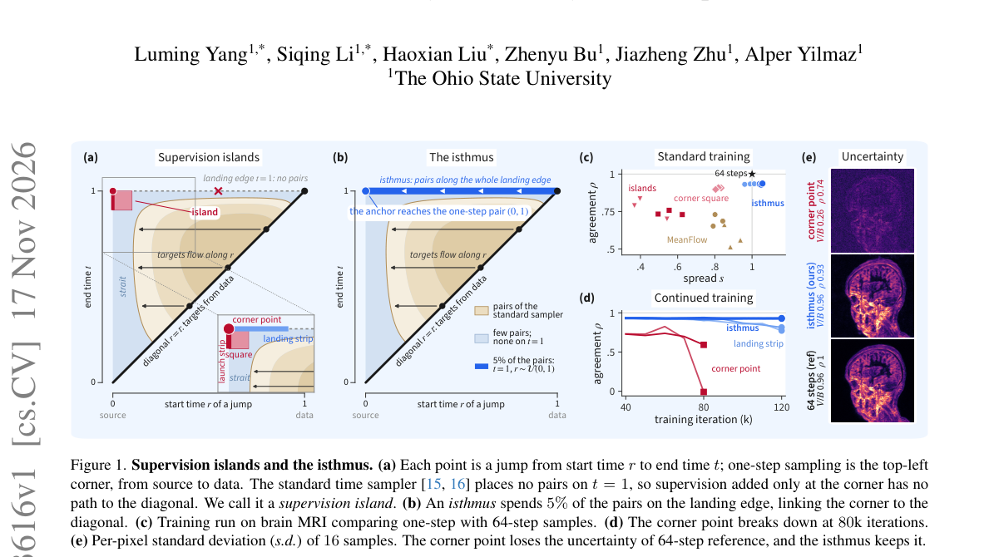

*Result - Theory of supervision islands. Left. Off the diagonal, the true flow Φ followed by any map G has zero residual, even a G that collapses every sample to the mean; only training pairs along th*

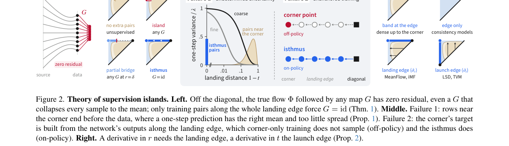

**Why this ranks #9**: 定位到一步流采样器的「监督孤岛」成因——只有时间三角形对角线上的时间对能从数据获得监督，一步采样用的 (0,1) 落在自洽恒等式连不到对角线的孤岛；只把 5% 的训练对移到落地边接上对角线，就让脑 MRI 上一采样校准回到 0.96、与 64 步样本相关性回到 0.93。

---

## AIGC 编辑（指令编辑 / 修补 / 个性化） · `aigc_editing` (5 papers)

编辑侧今天集中在**概念/控制的可控性**与**退化建模**两条线上。Weight-Space Programming 把扩散概念编辑改写成权重空间编程，24 个 TIMED 编辑任务上的预注册比较显示「生成程序」比共享面板基线提升 10.0 点联合成功率，而探针式改写又掉 9.7 点——这是对「到底该怎么编辑扩散模型」的一次正面追问。REVEAL 用文本查询 + 光流引导的掩码传播做扩散式视频 amodal 补全，配套发布 LAVAT 长遮挡基准并在既有基准达 SOTA。低光增强（训练无关的因果流水线，比 ZVRD 快 261 倍，1280×720 上较逐帧八步处理高 0.55 dB PSNR）与 LUTBench（91 个 3D LUT、5000 张 MIT-Adobe FiveK 照片、45.5 万对可复现目标，统一协议下评测 16 种文本驱动调色方法，并区分已见外观复现与未见外观泛化）分别代表「没有训练也能修」和「先把基准做扎实」。PROBE 则补上一个被忽略的维度：用校准坐标头估计各退化的当前状态，再注入双向特征扰动并与强度匹配的单退化参考对比来量化非加性交互，并提出覆盖 4 种退化全部 15 种组合的 SCD-15 基准。

### 10. What Does Weight-Space Programming Add to Diffusion Editing? Program Construction versus Score-Guided Refinement

**arXiv**: [2611.22228](https://arxiv.org/abs/2611.22228) | **Score**: 8.0 (relevance 8 x 0.7 + quality 8 x 0.3) | **Direction**: `aigc_editing` | **Tags**: AIGC-visual, weight-space-programming, concept-editing, program-construction, ablation-study, stable-diffusion, Fudan University | **Categories**: cs.CV, cs.LG | **Pages**: 25

**Authors**: Zitian Gao; Jingyi Xu; Ziqi Han; Chengkai Lei; Ye Liu; Liangliang Shi

**Affiliation**: Fudan University; Shanghai Institute for Mathematics and Interdisciplinary Sciences; Tencent; Northwest University

**Abstract**

> Weight-space programming (WSP) lets a language model construct executable weight updates for another network. We study diffusion concept editing through an interface in which programs define training contexts, preservation constraints and update directions, while a shared numerical fitter selects their coefficients. We compare generated programs with published editors, a shared-panel hand-written baseline and budget-matched search over conventional edits on 24 TIMED test edits for Stable Diffusion 1.4. The preregistered rewrite pipeline shows no advantage over the strong baseline. In an exploratory comparison, one-shot Astra programs improve fresh-scene VLM joint success, which requires subject presence together with whole-image target matching, by +10.0 points over the shared-panel baseline, while CLIP relative match shows no detectable change. These programs organise adjustable directions around protected text-state subspaces. Probing and rewriting the Astra programs then raises CLIP by +6.2 points while joint success changes by -9.7. On a fixed 144-image sample, five additional evaluators give point estimates in the same directions under whole-image target matching; checks of subject-local change give less decisive differences. Together, these results identify useful behaviour in complete generated programs and show that score-guided revision need not preserve it: program construction and revision should be evaluated as distinct stages of a WSP pipeline.

**Key findings**

- **Finding**: 在 24 个 TIMED 测试编辑上，U2-Astra 相对共享面板手写基线 U1b 的新鲜场景 VLM 联合成功率提升 +10.0 分（95% 区间 +4.7~+15.4），而 CLIP 相对匹配无可测差异（−0.6，区间 −7.3~+6.4）；探针后改写使 CLIP 升 +6.2 分但联合成功率变 −9.7 分。
- **Inference**: 程序构造的价值在于把可调方向组织在受保护的文本状态子空间之外（24/24 个程序都满足该结构性质），而分数引导的改写会破坏这种组织，因此构造与改写必须作为两个阶段分别评估。
- **Recommendation**: 用语言模型生成权重空间程序时不要把构造与按分数改写合并成一步，先单独评估构造阶段再决定是否引入改写；最终程序只更新 SD 1.4 的 16 层交叉注意力 K/V 共 32 个矩阵。

**Key figures**

*Framework - Astra’s construction gain is lost after score-guided rewriting, even as CLIP rises. For each concept edit, an LLM writes a*

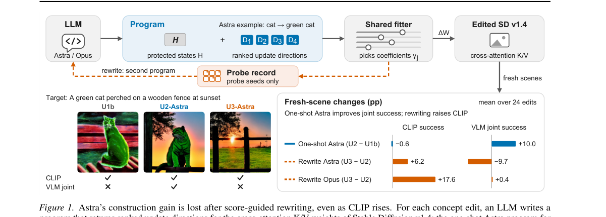

*Result - Program construction, shared selection and evaluation. The blue inset shows the U2-Astra cat program: it builds an orthonormal*

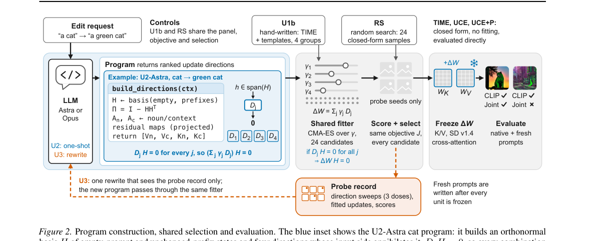

**Why this ranks #10**: 用 24 个 TIMED 测试编辑做预注册对比，区分「程序构造」与「分数引导改写」两个阶段：一次性 Astra 程序把 VLM 联合成功率相对共享面板手写基线抬高 10.0 分（+4.7~+15.4），但改写会让 CLIP 涨 6.2 分、联合成功率反跌 9.7 分，是编辑侧少见的负结果澄清。

---

### 11. Fast Training-Free Low-Light Video Enhancement with a Frozen Image Diffusion Prior

**arXiv**: [2611.22551](https://arxiv.org/abs/2611.22551) | **Score**: 8.0 (relevance 8 x 0.7 + quality 8 x 0.3) | **Direction**: `aigc_editing` | **Tags**: AIGC-visual, training-free, low-light-enhancement, diffusion-prior, temporal-consistency, keyframe, City University of Hong Kong | **Categories**: cs.CV | **Pages**: 15

**Authors**: Hon Ming Yam; Chun Pong Lau

**Affiliation**: City University of Hong Kong

**Abstract**

> Pretrained image diffusion models can enhance low-light video without low-light training data and without retraining for a new camera. ZVRD, the only published training-free method for low-light video, is too slow to use: our implementation needs over a minute per $256 \times 256$ frame. We present a causal, training-free pipeline that adds two temporal components to a frozen MR. Illuminate image prior. Temporal input fusion recursively averages motion-compensated low-light frames before diffusion inversion. Late-start offset propagation runs the full sampling trajectory only on key frames. Each non-key frame inverts the low-noise part of its own trajectory and adds an enhancement offset warped from the latest key frame. At ZVRD's own resolution the pipeline is $261\times$ faster than ZVRD and scores better on all five metrics we report. On 13 held-out SDSD clips at $1280 \times 720$, it improves on framewise eight-step processing by 0.55 dB in PSNR and 0.034 in LPIPS and halves the warping error, in 10% less time. Measurements inside the model show why, and a linear-Gaussian model of inversion explains them. Fusion removes frame-to-frame noise before inversion amplifies it. A flow error perturbs the transported offset ten times less than it perturbs a transported state. The perceptual gain does not transfer to low resolution: at $346 \times 260$, LPIPS is worse by 0.028. At 0.65 frames per second, the pipeline is an offline method.

**Key findings**

- **Finding**: ZVRD 的复现实现在单张 L40 上 256×256 需 90.8 s/帧、1280×720 需约 2,451 s/帧；本方法 256×256 仅 0.35 s/帧（快 261×），在 13 个留出 SDSD 片段上比逐帧 8 步处理高 0.55 dB PSNR（区间 0.27–0.79）与 0.034 LPIPS，warp 误差降 49%、闪烁降 14%，耗时为其 0.90×。
- **Inference**: 反演会放大帧间噪声，所以必须先把运动补偿后的低光帧递归平均再反演；同时偏移量对流误差的敏感度只有被搬运状态的十分之一，因此只搬运偏移比搬运状态更稳。
- **Recommendation**: 用冻结图像扩散先验做视频增强时优先做输入端时序融合与关键帧偏移传播而不是逐帧处理，但低分辨率要慎用——346×260 上 LPIPS 反而差 0.028，且整体约 0.65 fps 仍属离线方法。

**Key figures**

*Framework - Training-free low-light video enhancement at a usable speed. Left: a low-light SDSD frame, shown without brightening, and our enhancement. Right, top: the boxed region from the input, ZVRD (*

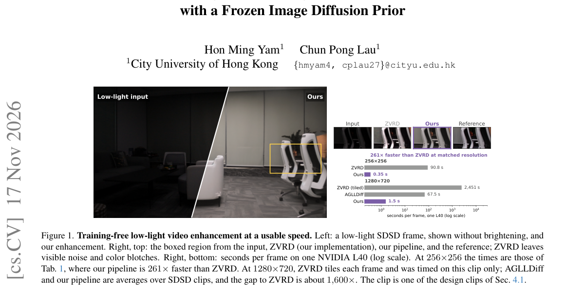

*Result - Pipeline overview on real SDSD frames (low-light images shown with a display gain). (a) Temporal input fusion averages the current frame xi with the flow-warped previous fused input, using a*

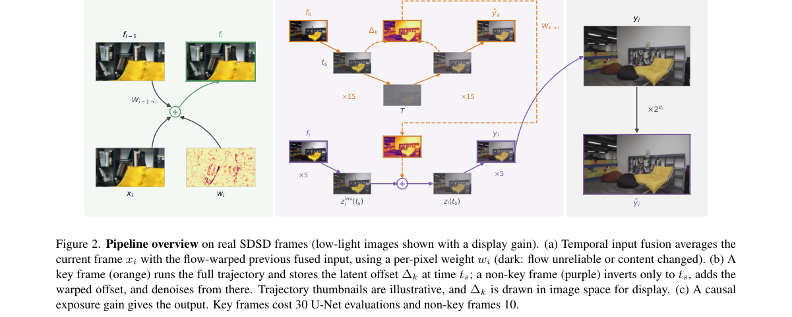

**Why this ranks #11**: 在冻结的图像扩散先验上加时序输入融合与延迟启动的偏移传播，256×256 上比唯一的免训练视频方法 ZVRD 快 261× 且五项指标全面更好，1280×720 上比逐帧 8 步处理还高 0.55 dB PSNR 并省 10% 时间，直接解决了该方向一直缺失的可用速度。

---

### 12. REVEAL: Reconstructing Video Amodal Content via Language and Flow Guidance

**arXiv**: [2611.22645](https://arxiv.org/abs/2611.22645) | **Score**: 8.0 (relevance 8 x 0.7 + quality 8 x 0.3) | **Direction**: `aigc_editing` | **Tags**: AIGC-visual, amodal-completion, video-diffusion, optical-flow-guidance, open-vocabulary, text-guided, University of Arkansas | **Categories**: cs.CV | **Pages**: 20

**Authors**: Minh Tran; Winston Bounsavy; Ngan Le

**Affiliation**: University of Arkansas

**Abstract**

> Amodal perception enables humans to perceive entire objects even when parts are occluded, a remarkable cognitive skill that artificial intelligence struggles to replicate. Recent diffusion-based methods have extended amodal completion from images to videos, yet they lack auxiliary priors to guide the reconstruction of heavily occluded content and to maintain temporal consistency over long sequences. We present REVEAL (REconstructing VidEo Amodal content via Language and flow guidance), a unified diffusion-based framework that integrates complementary motion and semantic priors for video amodal completion. A user-provided text query serves a dual role: it drives open-vocabulary video segmentation to obtain visible masks, and it provides semantic guidance for texture reconstruction. For amodal segmentation, we introduce optical flow guidance: by warping visible masks from previous frames to the current frame, the flow-warped mask propagates visible content into occluded regions and approximates the object's current shape, providing a strong shape prior even under simultaneous deformation and occlusion. For texture completion, text guidance constrains the reconstruction of occluded appearance while providing a stable semantic reference that helps maintain visual coherence throughout the reconstruction. We also contribute LAVAT, a new benchmark featuring long video sequences paired with text descriptions, enabling evaluation of text-guided video amodal completion under heavy occlusion. Extensive experiments demonstrate that REVEAL achieves state-of-the-art performance on existing benchmarks while maintaining high-quality temporal consistency over extended sequences. The project page is available at: https://uark-aicv.github.io/REVEAL/.

**Key findings**

- **Finding**: 在 Kubric 上 REVEAL 取得 PSNR 29.92 / SSIM 0.921 / LPIPS 0.051（最强基线 TACO 为 23.51 PSNR、0.077 LPIPS），分割 mIoU 84.12、FVD 降到 122.66；在自建 LAVAT 合成集上 PSNR 26.88、LPIPS 0.068、mIoU 95.12、CLIP-F 0.988、FVD 213.77。
- **Inference**: 长序列补全缺的不是生成能力而是形状与语义的稳定锚点——用光流把前帧可见掩码 warp 进当前帧可在形变与遮挡同时发生时提供形状，用恒定文本提供跨帧语义参照。
- **Recommendation**: 做视频遮挡补全时优先补齐形状先验而不是只改纹理；新基准 LAVAT 平均序列长度 257 帧（合成）与 151 帧（真实），远超 Kubric 的 24 帧和 TACO 的 29 帧，适合做长时一致性评测。

**Key figures**

*Framework - We tackle the problem of open-vocabulary video amodal segmentation and content completion: given an input video and a text prompt, REVEAL generates amodal (visible + invisible) masks and RGB*

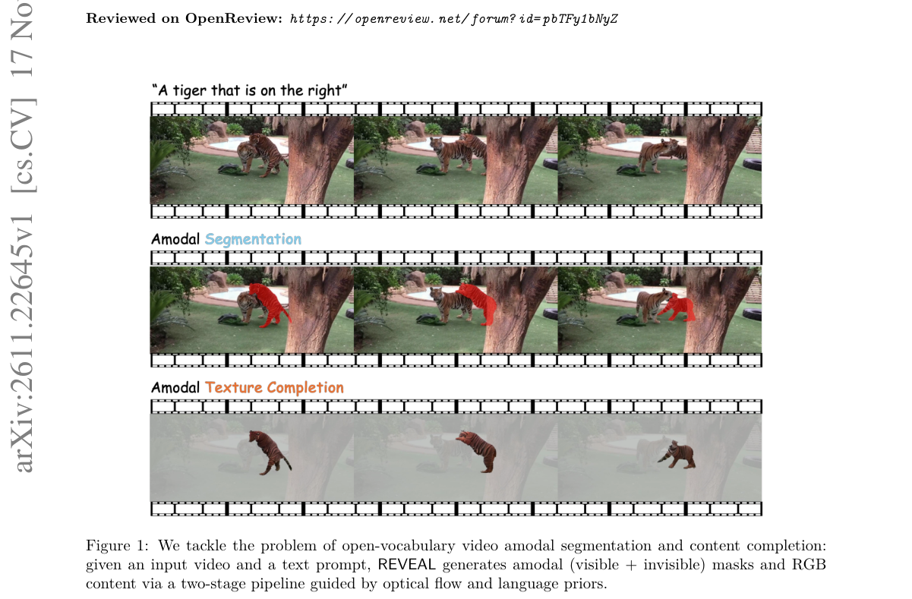

*Result - Video Amodal Mask Segmentation Stage. The model uses optical flow as a motion prior, warping visible masks from previous frames to propagate shape information into occluded regions.*

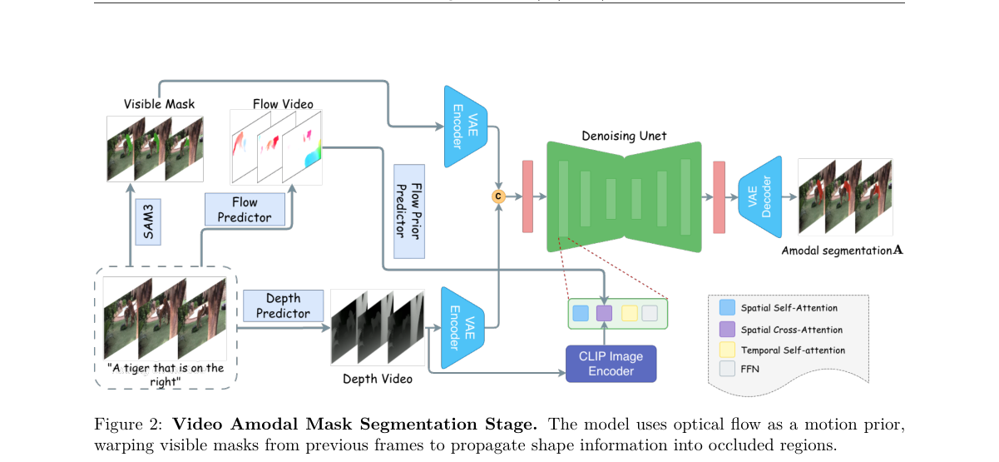

**Why this ranks #12**: 把语言与光流两类互补先验统一进视频扩散框架：光流把可见掩码前向传播进遮挡区当形状先验，文本既驱动开放词表分割又约束纹理补全；配套 LAVAT 基准含 2,658 段合成视频与 684,037 帧、平均遮挡率 40.21%，刷新三项指标 SOTA。

---

### 13. LUTBench: Benchmarking Text-Driven Photographic Look Transfer

**arXiv**: [2611.23113](https://arxiv.org/abs/2611.23113) | **Score**: 8.0 (relevance 8 x 0.7 + quality 8 x 0.3) | **Direction**: `aigc_editing` | **Tags**: AIGC-visual, benchmark, color-grading, 3d-lut, text-driven, generalization, University of Sydney | **Categories**: cs.CV | **Pages**: 28

**Authors**: Chuanzhi Xu; Boyu Wei; Chengkun Yue; Xuanhua Yin; Yiyang Li; Chupeng Liu; Zihan Deng; Weidong Cai

**Affiliation**: The University of Sydney; Indiana University; The University of Hong Kong

**Abstract**

> Photographic color grading shapes the tone and color of a photograph to achieve a desired look. Text-driven photographic look transfer lets users specify these adjustments in natural language, with the goal of reproducing the requested look across photographs while preserving their content. However, prior research on text-driven color grading uses different datasets, text instructions, target definitions, and metrics. These differences make it difficult to compare how faithfully the methods reproduce the same look. To compare methods under a shared protocol, we introduce LUTBench. We collect 91 three-dimensional lookup tables (3D LUTs) and define one photographic look per LUT with a specified input conversion. Applying these looks to 5,000 MIT-Adobe FiveK photographs produces 455,000 input-target image pairs with reproducible target images. For each look, we use templates to turn measured tone and color changes on fixed color samples into candidate clauses. We use training image measurements to verify applicable clauses before composing the text description. The evaluation measures target fidelity, tests sensitivity to predefined input conversions, and separates generalization to unseen looks from reproduction of seen looks on new photographs. Across 16 methods, stronger text alignment does not guarantee target fidelity. However, most supervised variants improve fidelity on both seen and unseen looks.

**Key findings**

- **Finding**: LUTBench 用 91 个 3D LUT 定义 91 种摄影外观，在 5,000 张 MIT-Adobe FiveK 照片上生成 455,000 组可复现的输入-目标对，覆盖 16 种方法的 22 种配置；结果显示更强的文本对齐并不保证更好的目标保真度，多数监督型变体才在已见与未见外观上同时提升保真度。
- **Inference**: 以往研究各用不同数据集、文本指令与目标定义，方法之间根本不可比；只有把目标固定为 3D LUT 渲染出的可复现图像，并把「见过外观配新照片」与「未见外观」拆成两条轨道，才能区分记忆与泛化。
- **Recommendation**: 评测文本驱动调色时优先看 CIEDE2000 目标误差而不是 CLIP 相似度，并同时报 Seen（72 种外观）与 Unseen（10 种测试外观）两条轨；该基准中 Pix2Pix 的交叉验证误差可由 22.20 降到 6.51 ΔE00。

**Key figures**

*Framework - Examples from LUTBench. Each of the five rows shows an input photograph and its canonical target images for seven looks. The text above each target column contains two verbatim clauses from*

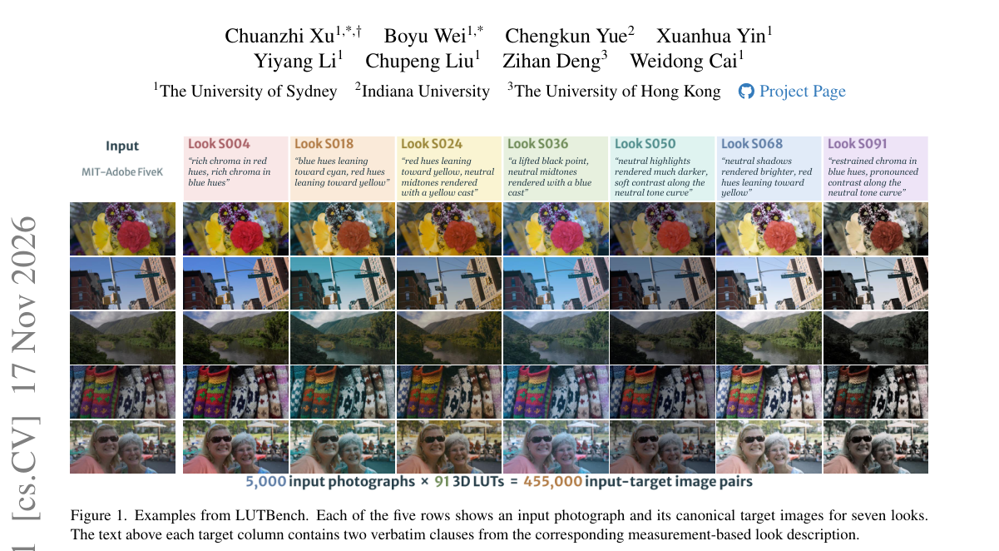

*Result - provides an overview of LUTBench. Let ˆyil de- note the output image for input photograph xi under look l. For a text-driven configuration f with look description dl, the output is ˆyil = f(x*

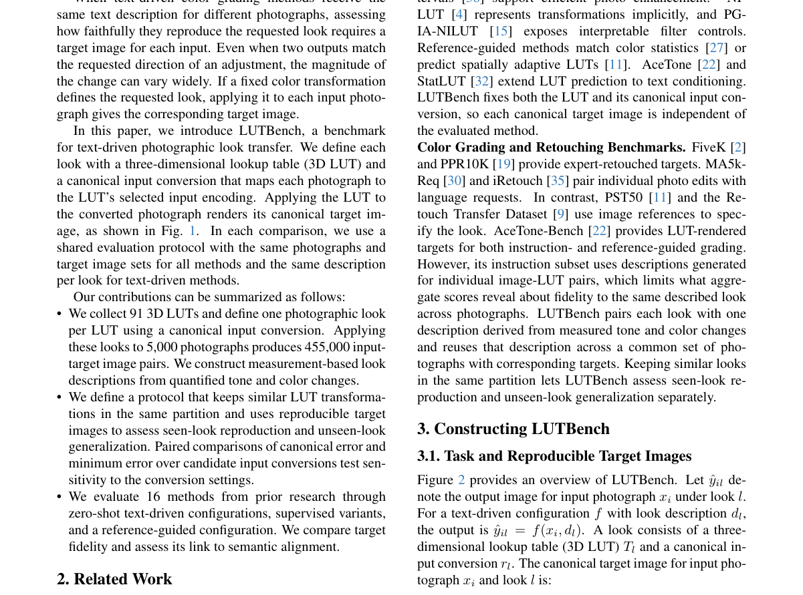

**Why this ranks #13**: 把文本驱动调色统一到可复现协议下：91 个 3D LUT × 5,000 张 FiveK 照片 = 455,000 组输入-目标对，评测 16 种方法的 22 种配置后得出「文本对齐更强并不保证目标保真」这一结论，直接影响该子方向的评测标准。

---

### 14. Beyond Additive Composition: Interventional Modeling of State-Dependent Cross-Degradation Responses for Composite Image Restoration

**arXiv**: [2611.23889](https://arxiv.org/abs/2611.23889) | **Score**: 8.0 (relevance 8 x 0.7 + quality 8 x 0.3) | **Direction**: `aigc_editing` | **Tags**: AIGC-visual, composite-restoration, non-additive, state-dependent, benchmark, interventional, Xidian University | **Categories**: cs.CV | **Pages**: 11

**Authors**: Zongda Tang; Jie Feng; Wenda Zhao; Mingtao Feng; Yuping Liang; Ronghua Shang; Weisheng Dong

**Affiliation**: Xidian University; Dalian University of Technology

**Abstract**

> Composite image restoration aims to recover images corrupted by multiple coexisting degradations. Existing methods predominantly decompose composite corruptions into individual factors, relying on these isolated priors to guide restoration. However, coexisting degradations are inherently interdependent: the manifestation of one degradation dynamically shifts with the states of others, inducing non-additive interactions that factor-wise paradigms fail to capture. To bridge this gap, we formulate state-dependent cross-degradation responses and propose PROBE, an interventional framework that explicitly models how coexisting degradations influence one another. Specifically, we first construct unified degradation axes by aligning visual and textual degraded-clean offsets. Along these axes, a calibrated coordinate head estimates current degradation states, while bidirectional feature perturbations are injected to probe cross-coordinate responses under the current states. Contrasting these responses with corresponding intensity-matched single-degradation references quantifies intrinsic non-additive deviations, allowing the resulting response descriptors and state coordinates to jointly guide restoration. For comprehensive evaluation, we introduce SCD-15, a new benchmark covering all 15 nonempty combinations of four degradation factors at three severity levels. Experiments demonstrate that PROBE achieves state-of-the-art performance on the CDD-11, AWMM-100K, and SCD-15 composite restoration datasets using a compact model with modest GPU memory requirements.

**Key findings**

- **Finding**: 在新基准 SCD-15 上，复合退化相对加性假设的均方根预测误差达观测复合潜变量偏移的 33.0%（雾-雪）与 35.7%（雾-雨）；PROBE 在 CDD-11 上取得 30.77 dB / 0.898 SSIM，比 CART 高 0.82 dB / 0.004 SSIM，比已发表方法均值 29.27 dB / 0.883 更高。
- **Inference**: 共存退化互为条件会改变彼此的表现，线性可加分解在像素与潜空间同时失效，因此必须显式估计当前状态下的跨退化响应，而不是把各退化当独立因子加权。
- **Recommendation**: 做复合退化恢复时先构造成对加性对照来量化非线性；PROBE 以 17.73 M 参数、27 G MACs、128 MiB 显存取得最高 CDD-11 PSNR，消融显示单用坐标分支也能到 30.17 dB（基线 28.63 dB）。

**Key figures**

*Framework - Non-additive residuals in pixel space and VAE latent space on SCD-15. Each row shows the clean image Iclean, the haze-only image I1, the snow-only (top) or rain-only (bottom) image I2, and t*

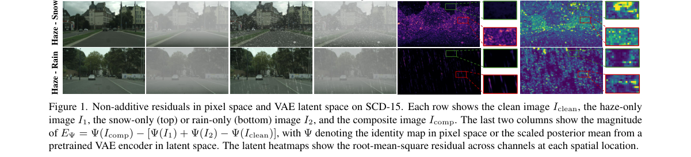

*Result - State-dependent pixel responses in controlled low-light– snow synthesis. The probed factor increases from 0.3 to 0.5; the conditioning factor is fixed within pairs and swept over [0, 0.8] ac*

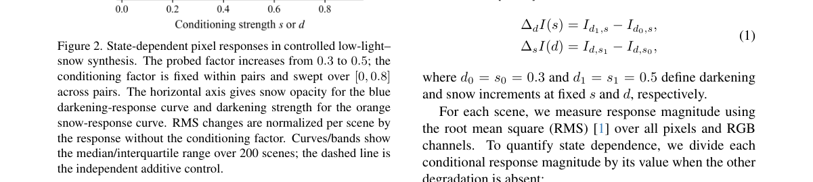

**Why this ranks #14**: 指出复合退化在像素与 VAE 潜空间都违反可加性——非加性残差达观测复合潜变量偏移的 33.0%（雾-雪）与 35.7%（雾-雨），据此提出干预式 PROBE，在 CDD-11 上取得 30.77 dB / 0.898 SSIM，且仅用 17.73 M 参数与 128 MiB 显存。

---

## 面向视觉生成的 RL 与奖励模型 · `aigc_rl` (1 papers)

这是本批最薄的方向：1139 篇候选里 primary 落在 `aigc_rl` 的只有 **2 篇**（rel≥5 下限后），最终只留 1 篇。H3Remover 在无配对数据下用目标移除奖励（奖励与「揭示更远内容」一致的深度变化）、背景几何奖励与外观奖励，通过 DiffusionART 优化 LoRA 来强化 MiniMax-H3 Ref2VA 的视频目标去除；它的问题是摘要没有给出量化数字，quality 只给到 6。按「薄 direction 让出名额而不是被填充」的口径，`aigc_rl` 把 3 个基准名额中的 2 个让出，由 `aigc_generation` 与 `aigc_editing` 承接。

### 15. H3Remover: Reinforcing Video Object Removal without Paired Data

**arXiv**: [2611.24633](https://arxiv.org/abs/2611.24633) | **Score**: 7.4 (relevance 8 x 0.7 + quality 6 x 0.3) | **Direction**: `aigc_rl` | **Tags**: AIGC-visual, video-object-removal, reinforcement-learning, lora-adaptation, depth-reward, no-pair-data, XPENG | **Categories**: cs.AI, cs.CV | **Pages**: 11

**Authors**: Kangjie Chen; Xiangyu Li; Jinhao Deng; Dongbin Zhang; Chaoda Zheng; Shijia Chen; Yuqi Zhang; Choo Sin Wai; Boyi Sun; Puyi Wang; Yu Zhang; Xianming Liu

**Affiliation**: XPENG; Tsinghua University; University of Chinese Academy of Sciences; Chinese University of Hong Kong

**Abstract**

> Pretrained video editors possess rich removal and completion priors, yet may retain targets or alter unrelated content. We present H3Remover, which reinforces MiniMax-H3 Base Ref2VA for video object removal without paired object-free training targets. To discourage superficial edits such as recoloring, a target-removal reward favors calibrated depth changes consistent with revealing farther content. To limit unintended scene changes, a background-geometry reward encourages preservation of relative depth ordering. To preserve background appearance without retaining unwanted shadows or reflections, an appearance reward constrains RGB changes in source-derived protected regions while exempting targets and estimated effects. Frozen HPSv3 complements these constraints with perceptual-quality feedback for synthesized content. Evaluation regions remain fixed across candidates, and DiffusionART optimizes LoRA adapters with the backbone frozen. Experiments show substantial reconstruction gains over original H3, with qualitative comparisons demonstrating more effective object removal and better preservation of surrounding scene content.

**Key findings**

- **Finding**: 相对原始 H3-Base-Ref2VA，H3Remover 的 PSNR 提高 7.151 dB，LPIPS 与 FVD 分别下降 60.3% 与 84.7%，采样帧确认移除数从 40/80 升到 73/80（EffectErase 为 72/80）；全配置把 PSNR 从 22.390 提到 27.869 dB、LPIPS 降 48.8%。
- **Inference**: 预训练视频编辑器本就具备移除与背景补全先验，只是不会在移除指令下稳定表达，因此用目标深度变化、背景几何次序与保护区外观三类源条件奖励直接调 LoRA 即可把能力叫醒，不需要任何配对训练目标。
- **Recommendation**: 用 RL 强化现成视频编辑器时优先改 LoRA 而非主干，奖励配比可用 (1, 1, 5, 0.05)、保护阈值 η = 0.1；训练中总奖励从 −0.069 升到 0.238、保护区 RGB 误差从 0.0286 降到 0.0151。

**Key figures**

*Framework - H3Remover enables high-quality video object removal across diverse real-world scenes. Examples span driving, human activities, animals, and indoor scenes, showcasing target removal and plaus*

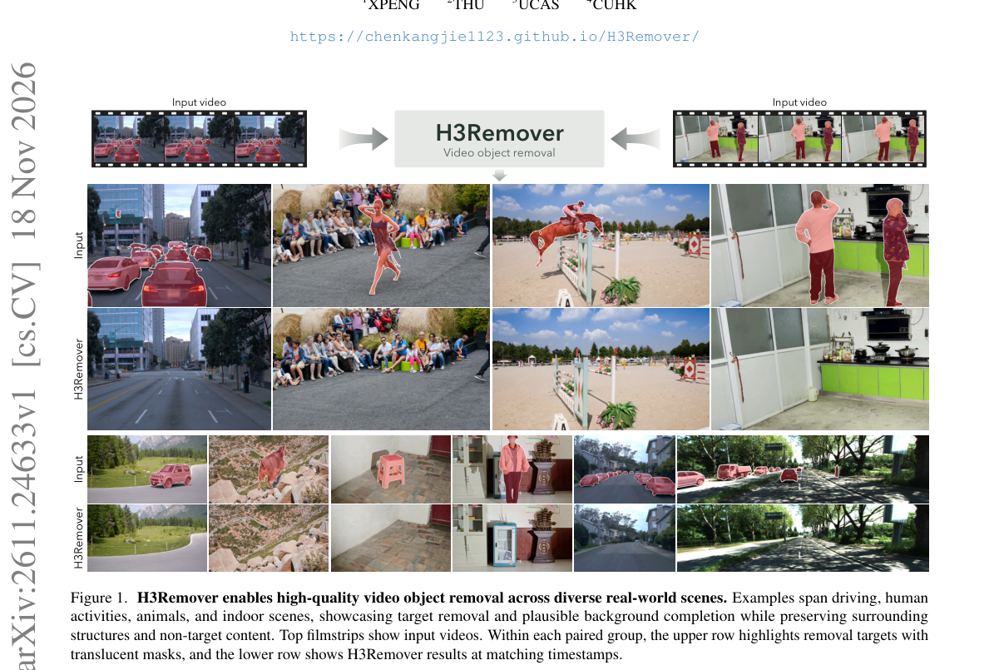

*Result - Motivation: unlocking pretrained removal capabili- ties. H3 can remove objects and associated effects, including cast shadows, but may fail to follow removal instructions or preserve unrelat*

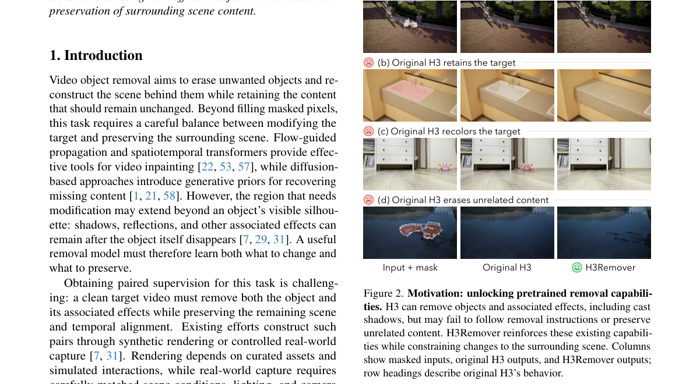

**Why this ranks #15**: aigc_visual 轴里唯一走强化学习的工作：用源条件奖励加冻结 HPSv3 反馈只调 LoRA 强化 MiniMax-H3 的视频移除，相对原始 H3 的 PSNR 提升 7.151 dB、确认移除从 40/80 升到 73/80；但评测主要集中在一个移除基准上、泛化证据偏薄，故在本轴排末位。

---

## Footer

- Total papers reviewed across all 4 axes: 60
- aigc_visual axis final count: 15
- Wild-cards in this axis: 0
- Figure assets: 2026-11-20/res/

Generated by `mine-arxiv-daily-digest` skill. Sister file: `2026-11-20_aigc_visual_entry.md`.
