# Mine Arxiv Daily Digest - 2026-11-20 (全双工语音与语音 LM Axis, 7 papers)

**Generated**: 2026-11-20 01:41 CST

**Source**: arXiv cs.CV, cs.SD, eess.AS, cs.CL, cs.AI, cs.RO, cs.LG, cs.IR submissions, listing day 2026-11-17,2026-11-18 (announced 2026-11-17 01:00 UTC / 2026-11-19 01:00 UTC)

**Batch window**: 2026-11-16T19:00:00Z .. 2026-11-18T19:00:00Z（arXiv 公告批次横跨两个 UTC 日：从前一日的美东 14:00 截止时刻起算（EDT 为 18:00Z，EST 为 19:00Z），到当日的同一时刻为止）

**Axis**: duplex_speech (7 papers, base 12, cap 20)

**Directions**: duplex_speech_core (7), speech_rl (0)

**Selection**: 7 papers ranked by relevance x quality, with 0 wild-card slots

**Day total**: 60 papers across 4 axes (target 60)

**Scope**: 全双工 / 实时 / 流式语音语言模型、speech-to-speech 语音助手、TTS / 语音克隆 / 语音转换，以及语音大模型的 RL 与奖励模型

**Wild-card**: 0 篇 —— 本 axis 供不应求（7 篇 vs 基准 12），但缺口**不**用 wild-card 填：1139 篇候选里连一篇 rel≥9 的语音论文都没有，

能进本方向的最强论文也只有 rel 8；再往下的 rel 6–7 语音论文属于正常够格候选而不是「更该进」的邻接选题，

按「薄 direction 让出名额而不是被填充」的口径，本 axis 主动让出 5 个名额，把位置留给别的轴的 rel≥9 论文。

> **本 axis 是本轮唯一的结构性缺口**：7 篇 vs 基准 12，缺 5 个名额，而且 7 篇里没有一篇是全双工 / 实时语音对话本体。

> 证据链完整：1139 篇候选里 primary 落在 `duplex_speech_core` 的只有 19 篇、`speech_rl` 的 **0 篇**；rel≥9 的语音论文 **一篇都没有**，rel≥8 的只有 2 篇（O-IN-Bench、21Codec）。

> 让出的 5 个名额没有平均分给其他轴，而是按「rel≥9 优先占位」的硬规则流向 `world_embodied`（该轴 32 篇 rel≥9 争 20 个名额），换来 5 篇 rel≥9 进入日报，代价是 5 篇 rel 6–7 的语音论文被挤出。

> `speech_rl` 本批 **0 篇**：1139 篇候选里没有任何一篇的强化学习确实作用在语音/音频模型上，这一格只能空着。

---

## 全双工语音与语音 LM · `duplex_speech_core` (7 papers)

语音方向是本批最薄的一轴，7 篇里**没有一篇是全双工 / 实时语音对话本体**。分布是：语音意图理解（O-IN-Bench 用 1,000 条中英语音意图样本、同请求不同场景的对比配对与可核验 rubric，30 组配置最佳得分 59.6，gemini3.7-Flash 意图判定 74.4% 而内容判定仅 42.6%）、流式 TTS 的说话人控制（21Codec 用对抗说话人分类器与 NANSY 式共振峰偏移增强，把说话人信息从 token 流里剥离并移到解码端，同时保证跨 chunk 身份稳定）、语音 agent 的决策层（把误执行的旁人对话从 41% 降到 7–10%，同时服务 83–85% 有效请求）、低码率语音增强（AMR-NB 4.75 kbps 编码语音上用说话人嵌入条件化做个性化模型选择，ViSQOL 与 WB-PESQ 同时提升）、构音障碍语音的细粒度感知评估（首次把听觉大模型适配到自然度/单调/可懂度/辅音模糊/不当静音五维，但摘要没给量化结果）、课堂录音的教师角色切分（63 位教师 292 段录音上 F1 0.81/0.87，手机端比 pyannote 快 4.8 倍）以及语音 + 手势统一生成（Gaspard 用连续自回归 next-step flow matching 同时生成语音与共语手势，用模态专属预测头和解耦 CFG 缓解连续生成的手势动态塌缩，但同样没给具体分数）。

### 1. Can Omni-modal LLMs Understand Spoken Intentions?

**arXiv**: [2611.24706](https://arxiv.org/abs/2611.24706) | **Score**: 8.0 (relevance 8 x 0.7 + quality 8 x 0.3) | **Direction**: `duplex_speech_core` | **Tags**: duplex-speech, omni-modal-llm, spoken-intent, response-deliberation, video-llm-benchmark, silence-decision, Renmin University of China | **Categories**: cs.CV | **Pages**: 10

**Authors**: Zijie Xin; Tianyi Wang; Daoze Zhang; Jie Yang; Changli Tang; Qijie Wei; Fengyun Rao; Xirong Li

**Affiliation**: Renmin University of China; WeChat Vision, Tencent Inc.

**Abstract**

> Omni-modal large language models (omni-modal LLMs) can respond to spoken requests directly through voice and video calls. Such requests rely on the scene shared by the user and the assistant, so the same utterance may call for different help or for no response. Most audio-visual benchmarks provide questions as separate text input, and interactive benchmarks mostly score a response as a whole. It thus remains unclear whether a model recognizes when the user is asking for help, and whether its reply meets the user's need once the request is recognized. We propose O-IN-Bench to evaluate how well omni-modal LLMs understand spoken intentions. A model watches a complete video with native speech and outputs one text response, or [SILENCE] when no response is needed. O-IN-Bench contains 1,000 Chinese and English samples in five categories and 16 subcategories. Contrastive pairs combine the same request with different scene conditions to test whether the response changes with the context. A sample-specific rubric judges language, intent, and content separately, and O-IN-Engine verifies each rubric against the video. Across 30 omni-modal model configurations, the best overall score is 59.6, achieved by Gemini3.7-Flash. Gemini3.7-Flash passes 74.4% of the intent judgments but only 42.6% of the content judgments. When the speech is a conversation between peers rather than a request to the assistant, even strong models often keep responding. When a reply must satisfy several people, the best score is only 25.9. These results indicate that recognizing a request and meeting its requirements are separate abilities, and O-IN-Bench measures each of them.

**Key findings**

- **Finding**: O-IN-Bench 含 1000 条中英文原生音视频样本、5 大类 16 子类，30 组全模态配置中最佳 Gemini3.7-Flash 总分 59.6，意图判断通过率 74.4% 而内容判断仅 42.6%，多诉求场景最佳分只有 25.9。
- **Inference**: 识别出「该不该回应」与「回应内容是否达标」是两种独立能力——意图判断通过率 74.4% 远高于内容判断的 42.6%，多诉求场景最佳仅 25.9，说明识别对了也未必答得对、答得全。
- **Recommendation**: 评测语音助手时把沉默决策与内容质量分开打分，并把 [SILENCE] 作为一等输出纳入提示词；跨模型比较时需固定输入形式，因为 30 组中有 27 组在补上文字问题后分数会上升。

**Key figures**

*Framework - The same spoken request can require different help or response behavior. Paired examples show how the activity context (left), whether an agreed event occurs (middle), and whether a stated p*

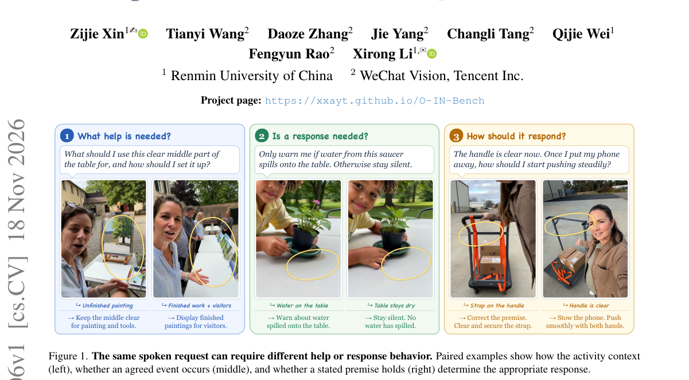

*Result - b shows a Background Information Filtering (BIF) sample. A wet watercolor painting sits on a tilted board, and paint flows down its surface. Off-screen, the instructor says, “Watch how the paint*

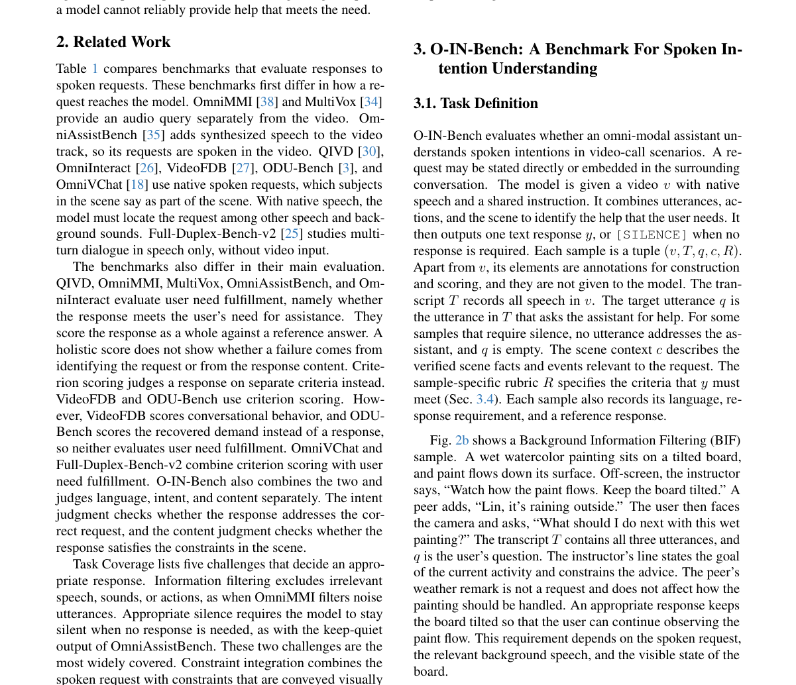

**Why this ranks #1**: 它把「是否听懂口语意图」拆成意图判断与内容判断两项独立能力，并给出可核对数字：1000 条中英样本、30 组全模态配置，最佳 Gemini3.7-Flash 总分 59.6、意图通过率 74.4%、内容仅 42.6%，属于语音助手响应决策的本体级评测。

---

### 2. 21Codec: Decoder-side Speaker Control for Text-to-Speech

**arXiv**: [2611.24094](https://arxiv.org/abs/2611.24094) | **Score**: 7.7 (relevance 8 x 0.7 + quality 7 x 0.3) | **Direction**: `duplex_speech_core` | **Tags**: duplex-speech, neural-audio-codec, streaming-tts, speaker-control, fsq-quantization, voice-privacy, Leiden University | **Categories**: cs.SD, eess.AS | **Pages**: 5

**Authors**: David Lindevelt; Suzan Verberne; Joost Broekens

**Affiliation**: Leiden University

**Abstract**

> We propose 21Codec, a streaming codec model with reduced recoverable speaker information from the token stream and decoder-side speaker control. Existing codec models infer speaker identity from token stream. Making them streamable is not sufficiently robust to speaker drift, because each chunk re-infers the identity from the local chunk context alone. Our adversarial speaker classifier and NANSY-style formant-shift data augmentation pushes the model to rely on the provided speaker embedding while reducing the recoverable speaker information from the token stream. We show that 21Codec can control speaker identity through the conditioning vector, and that the speaker identity is maintained across chunks during streaming. With the ability to control speaker identity even in mid-stream, 21Codec is a promising candidate for streaming TTS systems for better controllability of speaker identity.

**Key findings**

- **Finding**: 21Codec 以 FSQ（8 维 4 级）在 50 Hz 帧率下产出每帧 16 bit、0.80 kbps 的码流，582 小时 LibriTTS 上 65536 个码全部使用、熵达 15.66/16 bit（97.9%），理想熵编码器也只能再省 0.02 kbps。
- **Inference**: 分块解码时的说话人漂移是表示层而非解码层问题——用对抗说话人分类器加 NANSY 共振峰增强把身份从码流剥离后，20 ms 到 1 s 各种分块下说话人相似度与非因果解码相差不超过 0.002。
- **Recommendation**: 做流式 TTS 优先选「码流残留说话人信息少、解码端可控」的 codec，并实测 20 ms 到 1 s 的漂移曲线；注意条件化模型在未见说话人上 WER 从 0.047 升到 0.095，需与音质收益一起权衡。

**Key figures**

*Framework - 21Codec Architecture. The encoder is non-causal, the decoder chunk-causal.*

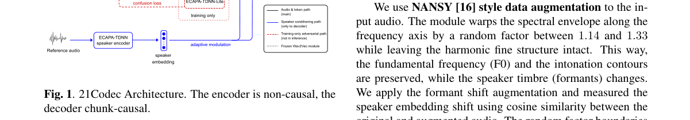

*Result - Speaker drift under un-cached chunked decoding. Markers are means over 2 s windows and files, bars the within-utterance standard deviation. The gray band is natu- ral audio through the same wi*

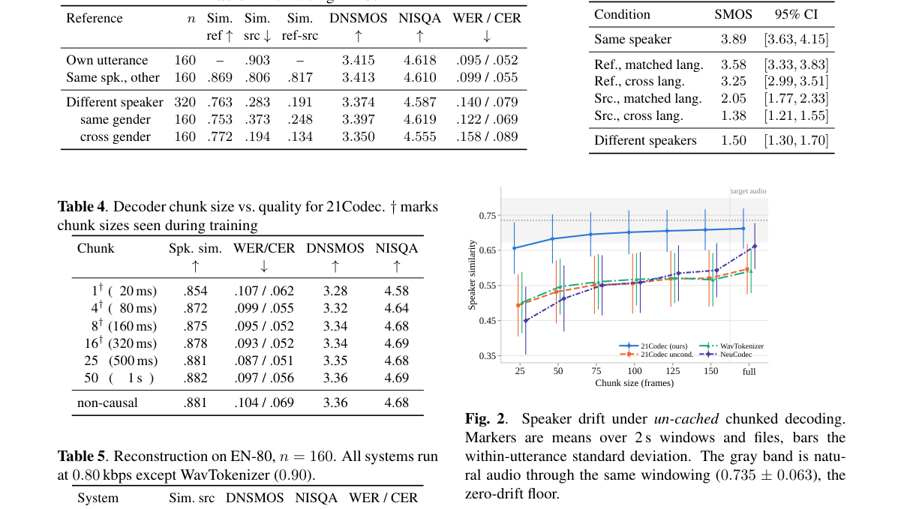

**Why this ranks #2**: 它给出可落地的流式 TTS 编解码方案：0.80 kbps、50 Hz 帧率、每帧 16 bit 的 FSQ 码流在 582 小时数据上用满 65536 个码，说话人探针 top-1 从 7.36% 降到 5.14%，且 500 ms（25 帧）分块解码已与非因果解码无差。

---

### 3. Label-Free Role-Aware Segmentation of Classroom Recordings: Recovering the Teacher from Transferable Structure

**arXiv**: [2611.23609](https://arxiv.org/abs/2611.23609) | **Score**: 7.3 (relevance 7 x 0.7 + quality 8 x 0.3) | **Direction**: `duplex_speech_core` | **Tags**: duplex-speech, speaker-diarization, teacher-role-detection, speaker-embedding, on-device-inference, privacy-preserving, University of Tübingen | **Categories**: cs.LG, cs.SD | **Pages**: 17

**Authors**: Nitin Jain; Tim Fütterer; Babette Bühler; Çağatay Yıldız

**Affiliation**: University of Tübingen; Technical University of Munich; Tübingen AI Center

**Abstract**

> How much the teacher talks and when are among the most informative and costly-to-measure signals of teaching. Yet, classroom audio is among the most sensitive data an AI system can process: recordings capture minors and fall under GDPR, preventing raw audio from leaving the recording device. We present a teacher-student segmentation pipeline designed to meet exactly this constraint: label-free at inference, running on a recording device, and requiring no per-session calibration. The pipeline chains a lightweight voice activity detector, compactly pretrained speaker embeddings, agglomerative clustering, and a small logistic regression that assigns the teacher role based on session-relative structure rather than voice identity. We show that our structural cue transfers across classrooms, languages, and acoustic conditions. In leave-one-teacher-out cross-validation on 292 recordings from 63 teachers across English and German corpora, our pipeline achieves teacher F1 of 0.81 and 0.87, respectively, outperforming both enrollment-based baselines and a 30-second supervised enrollment ceiling. On a commodity smartphone, its performance matches pyannote, a strong neural diarization tool, while running 4.8x faster at comparable peak memory at a real-time factor of ~0.18. We also find that transcribing filtered audio only marginally increases teacher's word error rate from $0.26$ to 0.28. Residual failures concentrate where teacher and student voices are not acoustically separable. However, we show how to flag these sessions label-free at inference so that they can be routed to human review, enabling selective, privacy-preserving deployment.

**Key findings**

- **Finding**: 在 292 段录音、63 位教师的留一教师交叉验证上，该流水线教师 F1 达英文 0.81、德文 0.87，超过伪注册基线（0.53/0.66）与需 30 秒带标注注册的监督基线（0.65/0.77），与 pyannote 的 0.84/0.82 相当。
- **Inference**: 判别教师身份靠的是会话内结构中心性而非声纹身份——仅用中心性这一个特征消融已达 F1 0.85，换成 6 倍大的 ResNet221 增益不足 0.01，跨语言单语训练再测试仍是 0.81/0.87。
- **Recommendation**: 部署时用簇可分性（silhouette）与分类器 margin 做无标签路由，把最低 margin 的 20% 记录转人工；同时注意过滤会让教师 WER 从 0.26 升到 0.28，其中英文从 0.160 升到 0.213。

**Key figures**

*Framework - 35 s segment of a classroom recording, ground truth transcript annotation (who spoke), and the output of the VAD stage of our pipeline, identifying silent moments.*

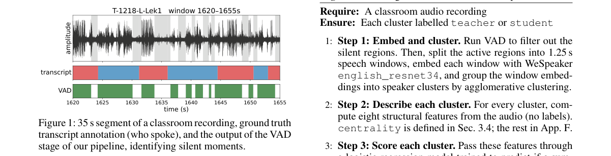

*Result - visualizes cluster centroids coloured by their major- ity ground-truth role. In successful recordings, teacher clus- ters are compact and well separated from student clusters, placing the ses*

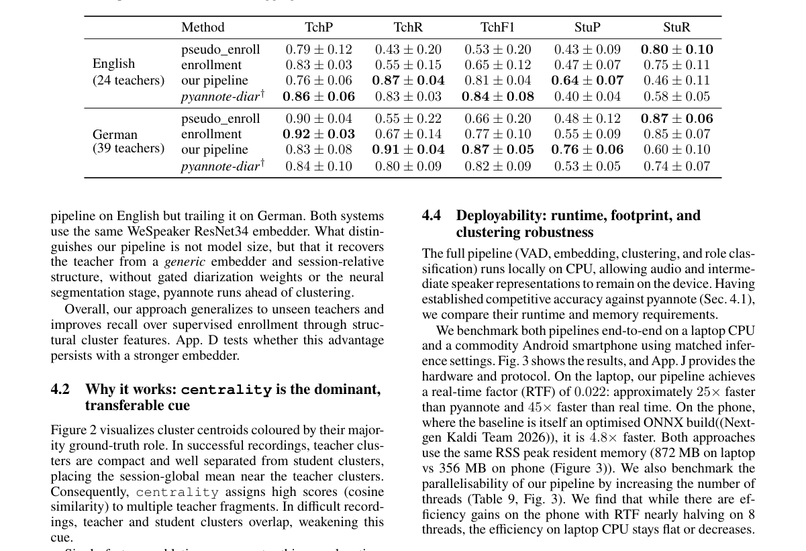

**Why this ranks #3**: 它是端侧可跑、推理端无标注的角色分割：292 段 63 位教师上教师 F1 达英文 0.81、德文 0.87，超过需 30 秒注册音频的监督基线（0.65/0.77），手机端实时因子约 0.18、比 pyannote 快 4.8 倍，符合课堂录音不出设备端的约束。

---

### 4. Personalized Causal Low-Bitrate Coded Speech Restoration with Speaker Embeddings

**arXiv**: [2611.22620](https://arxiv.org/abs/2611.22620) | **Score**: 7.0 (relevance 7 x 0.7 + quality 7 x 0.3) | **Direction**: `duplex_speech_core` | **Tags**: duplex-speech, coded-speech-restoration, bandwidth-extension, speaker-embedding, amr-nb, causal-ubgan, Fraunhofer IDMT | **Categories**: eess.AS, eess.SP | **Pages**: 5

**Authors**: Eray Özgünay; Christian Rollwage; Kishan Gupta; Andreas Brendel; Xavier Domont; Mattes Ohlenbusch; Jan Rennies; Simon Doclo

**Affiliation**: Fraunhofer IDMT; Carl von Ossietzky Universität Oldenburg; CEOTRONICS AG; Fraunhofer IIS

**Abstract**

> Legacy low-bitrate speech codecs such as AMR-NB remain widely used in telephony, where they restrict speech bandwidth and degrade listening quality. Coded speech restoration (CSR) aims to restore the speech bandwidth while improving the overall quality of coded speech, but typically without adapting to different speakers. In this paper, we systematically investigate personalization for restoration of speech coded at low bitrates, using a causal, low-complexity Universal Bandwidth Extension Generative Adversarial Network (UBGAN) model as the basis. We propose two personalization methods based on speaker embeddings, which incur little additional computational cost at inference: (i) conditioning a single CSR model on speaker embeddings, and (ii) cluster-based model selection, where multiple personalized models are trained on clusters of acoustically similar speakers. Experiments are performed on AMR-NB coded speech at 4.75 kbps. Experimental results with disjoint seen- and unseen-speaker test sets show that cluster-based model selection does not consistently outperform the non-personalized UBGAN baseline, whereas embedding conditioning significantly improves ViSQOL and WB-PESQ scores for both seen and unseen speakers.

**Key findings**

- **Finding**: VCTK 上以因果 UBGAN 为基座做个性化，嵌入条件化把 ViSQOL 从 2.80/2.92 提到 2.92/2.97、WB-PESQ 从 2.36/2.28 提到 2.47/2.34（已见 N=89，p<0.001；未见 N=10，p<0.02），但 LSD 差异不显著（p>0.05）。
- **Inference**: 收益来自把音色先验注入单一模型而非训练多个专模——C=4 个声学聚类分别为 16/17/22/34 人，其选择结果混合且在未见说话人上 WB-PESQ 反而降到 2.22，混合方案也不优于纯嵌入条件化。
- **Recommendation**: 低码率语音修复优先选单一模型加嵌入条件化：参数仅从 309 K 增到 318 K、计算只多 0.028 MMACs（约 0.01%），而 0.253 GMACs 比 HiFi-GAN+ 的 30.54 GMACs 少 120 倍以上，满足实时低算力部署。

**Key figures**

*Result - Low-level illustration of embedding conditioning in the UB- GAN CSR generator during training and test. The mel-spectrogram X of the coded input x is processed by the conditioning pathway to o*

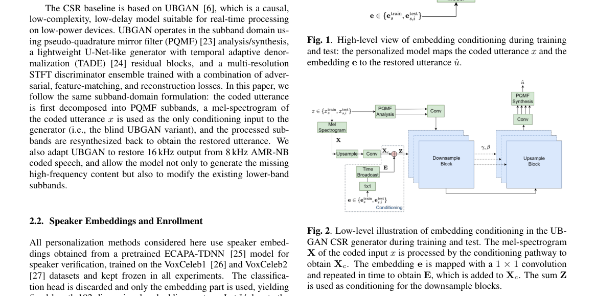

**Why this ranks #4**: 它在 4.75 kbps AMR-NB 编码语音上给出可量化的个性化结论：嵌入条件化把已见/未见说话人的 WB-PESQ 从 2.36/2.28 提到 2.47/2.34（p<0.001 与 p<0.02），额外开销仅 0.028 MMACs，而按声学聚类选模型并不稳定。

---

### 5. Beyond Intelligibility: Fine-Grained Perceptual Assessment of Dysarthric Speech with Auditory Large Language Models

**arXiv**: [2611.23768](https://arxiv.org/abs/2611.23768) | **Score**: 6.7 (relevance 7 x 0.7 + quality 6 x 0.3) | **Direction**: `duplex_speech_core` | **Tags**: duplex-speech, auditory-llm, dysarthria-assessment, perceptual-quality, multi-task-transfer, lora-adaptation, Tsinghua University | **Categories**: cs.SD, eess.AS | **Pages**: 5

**Authors**: Haotian Wei; Can Long; Wen Xian Jim; Guangzhi Sun; Zengrui Jin; Chao Zhang

**Affiliation**: Tsinghua University; University of Cambridge

**Abstract**

> Accurate assessment of dysarthric speech is vital for clinical diagnosis and rehabilitation, yet existing automated methods rely heavily on isolated, single-task models or generic speech quality metrics that fail to disentangle heterogeneous neuromotor deficits. This work presents the first systematic investigation into adapting auditory large language models (ALLMs) for multi-dimensional dysarthric speech assessment under a unified, prompt-conditioned framework. Four representative ALLMs are benchmarked across five clinical perceptual dimensions from the Speech Accessibility Project (SAP): naturalness, monopitch, intelligibility, imprecise consonants, and inappropriate silences. To bridge generic perceptual quality and clinical evaluation, a two-stage training paradigm is explored, leveraging out-of-domain pre-training followed by in-domain clinical adaptation. Experimental results demonstrate that leading ALLMs reliably capture fine-grained pathological variations, exhibiting distinct and complementary strengths across prosodic and articulatory attributes. These findings establish ALLMs as a scalable foundation for clinical speech evaluation and provide practical insights into model selection and multi-task transfer potential.

**Key findings**

- **Finding**: 在 SAP 五个临床感知维度上，Qwen2.5-Omni 的自然度达 ρ=0.828、r=0.836、MAE=0.439，video-SALMONN 2 Plus 的清晰度 ρ=0.635/MAE=0.322、辅音精确度 ρ=0.738/MAE=0.342，两者在韵律与构音上优势互补。
- **Inference**: 通用 MOS 预训练不能替代临床域适配——在 QualiSpeech 上预训练后自然度 ρ 从 0.307 升到 0.444，但清晰度 ρ 反而从 0.328 跌到 0.150，静音维度零样本更是低到 −0.073。
- **Recommendation**: 临床评估应按维度选模型并做域内适配：video-SALMONN 2 Plus 从单任务改多任务后平均 ρ 由 0.587 升到 0.640，而 Qwen2.5-Omni 用 1/5 参数量即达到平均 ρ 0.670，适合资源受限的部署。

**Key figures**

*Framework - Distribution of utterances across severity levels (1–7) in the Speech Accessibility Project (SAP) dataset for the five perceptual dimensions: (a) Naturalness, (b) Monopitch, (c) Intelligibilit*

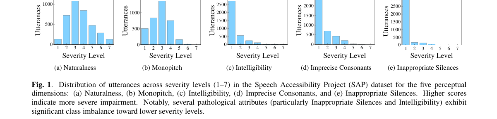

*Result - Scatter plots of model predictions against human ratings on the SAP test set for (a) Naturalness, (b) Monopitch, (c) Intelligibility, (d) Imprecise Consonants, (e) Inappropriate Silences. Thes*

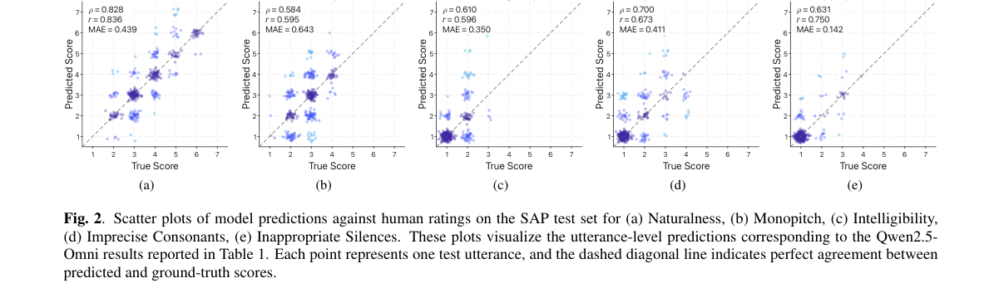

**Why this ranks #5**: 它首次把听觉大模型迁到构音障碍语音的五维临床感知评估：SAP 数据集上 Qwen2.5-Omni 自然度 ρ=0.828，video-SALMONN 2 Plus 清晰度 ρ=0.635、辅音精确度 ρ=0.738，多任务联合训练再把平均 ρ 提升 0.053，属细粒度语音质量建模。

---

### 6. Great Listeners, Poor Decision-Makers: Rethinking Agentic Audio AI

**arXiv**: [2611.23847](https://arxiv.org/abs/2611.23847) | **Score**: 6.7 (relevance 7 x 0.7 + quality 6 x 0.3) | **Direction**: `duplex_speech_core` | **Tags**: duplex-speech, voice-agent, action-gating, fuzzy-inference, risk-aware-decision, side-talk-rejection, [unverified] | **Categories**: cs.SD | **Pages**: 21

**Authors**: Siddique Latif; Moid Sandu; Farrukh Pervez; Raja Jurdak

**Affiliation**: [unverified]

**Abstract**

> Audio artificial intelligence (AI) now recognizes speech, sounds, and music remarkably well, yet voice agents still act when they should not: they execute commands addressed to others, act on misheard content, and commit before the user finishes speaking. This position article argues that the bottleneck in agentic audio AI has shifted from recognition to decision-making. We propose a reference architecture with an explicit decision layer, separate from perception and reasoning, that chooses whether to act, wait, ask, or remain silent from evidence on addressedness, speaker identity, content confidence, tool reliability, utterance completeness, and action risk. We motivate the design through six recurring decision failures and a decision-theoretic argument that transcript confidence alone is insufficient to justify an action. We implement the layer with fuzzy inference, evolutionary optimization, and sequential decision-making, and evaluate it through simulations, ablations, and recorded audio, including egocentric recordings. Addressedness and speaker evidence matter most, risk-aware gating suppresses costly errors, and well-tuned policies perform similarly, with fuzzy gates more robust to overconfident addressedness estimates. On recorded audio, explicit gating cuts executed side talk from 41\% to 7--10\% while serving 83--85\% of valid requests under successful clarification, outperforming prompting-based baselines. These results support explicit action gating as an architectural requirement for reliable voice agents.

**Key findings**

- **Finding**: 在真实录音（含第一视角眼镜录制）上，独立于感知与推理的决策门控把被执行的环境对话从 41% 压到 7–10%，同时在澄清成功的前提下服务了 83–85% 的有效请求，超过基于提示词的基线。
- **Inference**: 决策阈值随动作代价升高——在 G=1、κ=0.3 下 C=1 要求 p≥0.85、C=10 要求 p≥0.97，而 addressedness、说话人、内容置信度各 0.95 也只得到 p≈0.86，说明听得更准替代不了该不该做的显式判断。
- **Recommendation**: 给语音代理加一层显式动作门控，并把 addressedness、说话人匹配、工具一致性、话语完整度与动作风险作为入参；模糊门控单卡耗时不到 0.1 ms，加上说话人验证 12 ms 与定向检测 9 ms 仍能守住 100 ms 响应预算。

**Key figures**

*Framework - Six decision failures of audio agents, each shown as an audio scenario and the wrong action that follows. Table III gives the supporting evidence for each.*

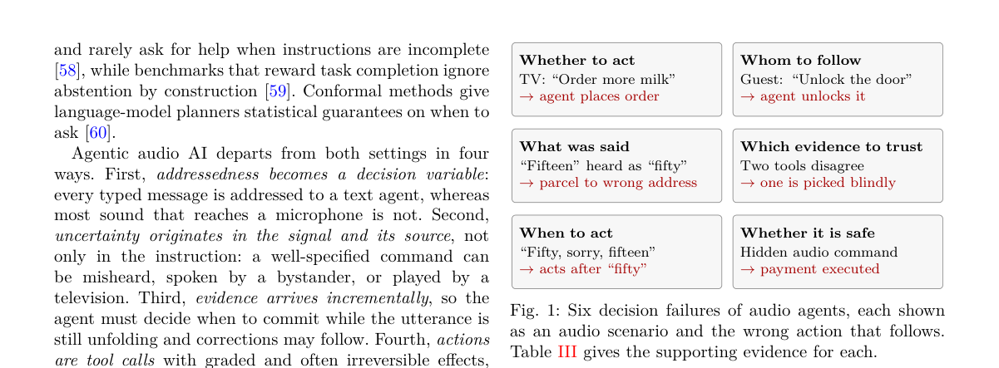

*Result - Action threshold τq(a) versus the cost of a wrong action, for G = 1, κ = 0.3, M = 0, and clarification success probability q. The threshold approaches 1 as ac- tions become costly. The dash-do*

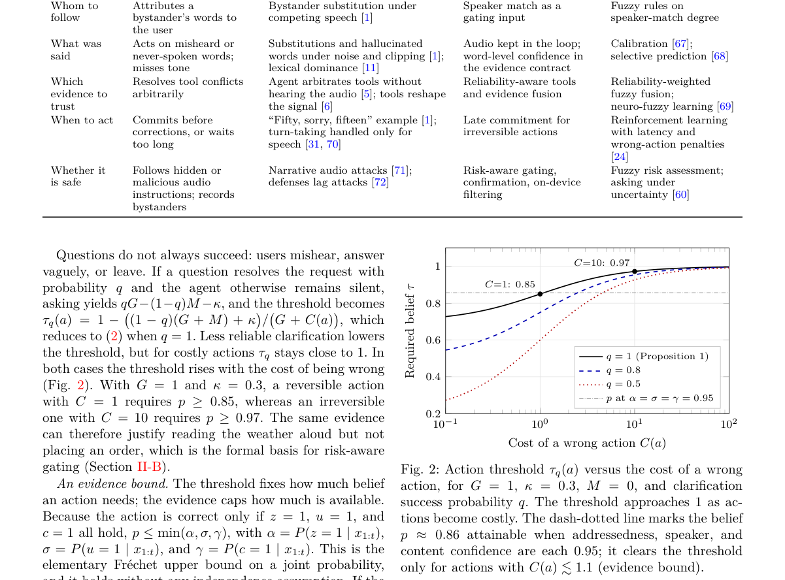

**Why this ranks #6**: 它把语音代理的瓶颈从识别重新定位到决策，并给出硬数字：真实录音上显式门控把被执行的环境对话从 41% 降到 7–10%，仍服务 83–85% 的有效请求；高代价动作需 p≥0.97，而三项证据各 0.95 也只得到 p≈0.86。

---

### 7. Gaspard: Expressive unified speech and gesture synthesis with continuous autoregressive flow-matching and decoupled classifier-free guidance

**arXiv**: [2611.24862](https://arxiv.org/abs/2611.24862) | **Score**: 6.7 (relevance 7 x 0.7 + quality 6 x 0.3) | **Direction**: `duplex_speech_core` | **Tags**: duplex-speech, speech-gesture-synthesis, flow-matching, autoregressive-generation, classifier-free-guidance, multimodal-coherence, Sorbonne University | **Categories**: cs.CV | **Pages**: 19

**Authors**: Téo Guichoux; Théodor Lemerle; Catherine Pelachaud; Nicolas Obin

**Affiliation**: Sorbonne University; ISIR; IRCAM; CNRS

**Abstract**

> Human communication involves highly coordinated multimodal signals such as speech and co-speech gestures. Existing approaches for generating both modalities commonly follow a cascaded pipeline, where speech is generated first and subsequently used to drive gesture generation; speech generation is therefore independent of gestures. We introduce Gaspard, a unified speech--gesture generation model based on continuous autoregressive generation with next-step flow-matching predictions, and trained on Seamless Interaction, a large-scale multimodal dataset. The heterogeneous temporal properties of speech and gesture motivate modality-specific prediction heads and decoupled classifier-free guidance over the two generation streams. This guidance rebalances the influence of speech and gesture at inference time, improving expressivity while mitigating dynamics collapse in continuous autoregressive gesture generation. Objective and perceptual evaluations show that Gaspard is a strong gesture generation model against unimodal baselines and that it produces highly synchronous speech and gestures compared to a matched cascaded system.

**Key findings**

- **Finding**: 在 Seamless Interaction（4008 小时、4284 名参与者）上训练的 Gaspard，Genea-95 手势评测 FGD 6.56±0.16、FGDk 1.35、BC 0.67、多样性 21.65，优于 GestFlow（8.84/1.49/0.91）与 UM-FERI（11.01/1.02/0.74）。
- **Inference**: 连续自回归手势会因自模态历史压过跨模态条件而动态坍塌——把手势历史引导降到 γG_g=0.825、语音历史引导提到 γG_s=6.5 的解耦 CFG 让同步 MOS 达 3.70（人类 3.75），而 γG_g=1 时动作方差塌缩。
- **Recommendation**: 需要语音与手势联动的表达型合成时先试统一自回归加解耦 CFG，并用实时因子（统一 0.84 vs 级联 1.04）与用户研究 MOS 共同验收；同时注意其语音 WER 6.38% 仍高于 PocketTTS 的 4.69%，UTMOS 2.69 也偏低。

**Key figures**

*Framework - Gaspard generates speech and gesture continuous embeddings from text using modality-specific flow-matching heads. Speech and gesture embeddings are fused additively after modality-specific p*

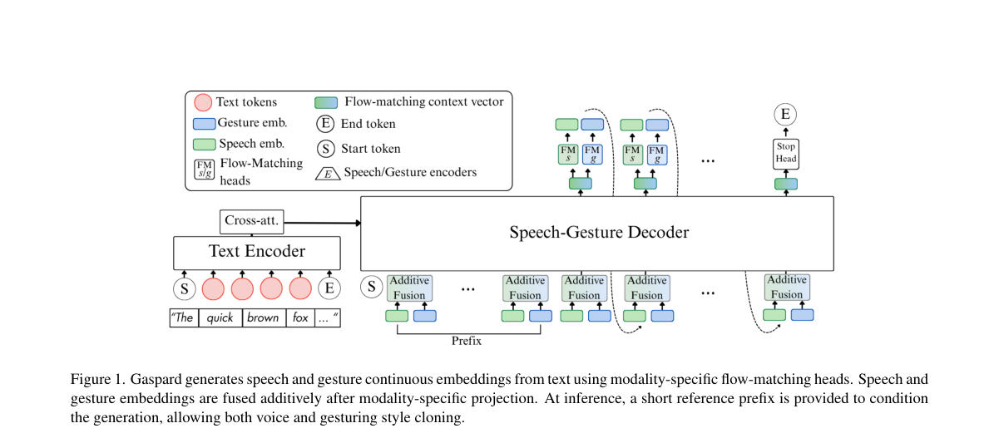

*Result - Top and middle: PCA views of gesture and speech latent sequences at 12.5 Hz. Gesture and speech embedding sequences exhibit different properties. Gesture latent sequences (top) are smooth an*

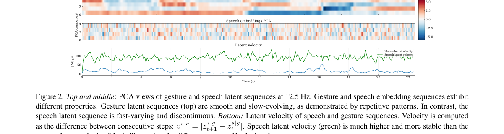

**Why this ranks #7**: 它用连续自回归加逐步流匹配统一生成语音与共语手势：Genea-95 上 FGD 6.56、BC 0.67（人类 0.63），解耦 CFG 让语音-手势同步 MOS 达 3.70（人类 3.75），并把实时因子从级联系统的 1.04 降到 0.84。

---

## Footer

- Total papers reviewed across all 4 axes: 60
- duplex_speech axis final count: 7
- Wild-cards in this axis: 0
- Figure assets: 2026-11-20/res/

Generated by `mine-arxiv-daily-digest` skill. Sister file: `2026-11-20_duplex_speech_entry.md`.
