# Mine Arxiv Daily Digest - 2026-11-20 (LLM / VLM 与其强化学习 Axis, 18 papers)

**Generated**: 2026-11-20 01:41 CST

**Source**: arXiv cs.CV, cs.SD, eess.AS, cs.CL, cs.AI, cs.RO, cs.LG, cs.IR submissions, listing day 2026-11-17,2026-11-18 (announced 2026-11-17 01:00 UTC / 2026-11-19 01:00 UTC)

**Batch window**: 2026-11-16T19:00:00Z .. 2026-11-18T19:00:00Z（arXiv 公告批次横跨两个 UTC 日：从前一日的美东 14:00 截止时刻起算（EDT 为 18:00Z，EST 为 19:00Z），到当日的同一时刻为止）

**Axis**: llm_vlm (18 papers, base 18, cap 20)

**Directions**: llm_core (6), vlm_core (11), llm_vlm_rl (1)

**Selection**: 18 papers ranked by relevance x quality, with 0 wild-card slots

**Day total**: 60 papers across 4 axes (target 60)

**Scope**: 大语言模型与视觉语言模型的设计、推理、agent、效率与上下文工作，以及面向 LLM / VLM 的 RL 与偏好优化、奖励模型

**Wild-card**: 0 篇 —— 本 axis 的 18 个名额全部由够格论文填满；`llm_vlm_rl` 只有 1 篇够格论文，缺口同样靠同轴让位解决，不做 wild-card 补位。

> **本 axis 的配额结构**：`llm_vlm` 18 篇，正好是 axis 基准 18（`llm_core` 6 / `vlm_core` 11 / `llm_vlm_rl` 1，方向基准 8 / 5 / 5）。

> 这是本轮配额冲突最集中的一处：三个方向合计有 **21 篇 relevance≥9**（`llm_core` 9 / `vlm_core` 11 / `llm_vlm_rl` 1），而 axis 只有 18 个名额。

> 按「必进规则让 direction 超基准、同 axis 内候选更充裕的方向让出名额」的口径，`vlm_core` 的 11 篇 rel≥9 全部保留（超自身基准 6 个），由 `llm_core` 让出 3 个、`llm_vlm_rl` 让出 4 个 —— `dir_over = 6`、`dir_under = 2 + 4 = 6`、`axis_surplus = 0`，放行。

> 落选的 3 篇 `llm_core` rel≥9（QDA、ARISE、LoopCache，均 8.7 分）不是质量不够，而是 axis 名额不够；本 axis 也无法推进到 AXIS_CAP = 20 —— 打到 20 时 `dir_over` 会超过 `dir_under` 与 `axis_surplus` 的允许值。

---

## LLM 核心（架构 / 推理 / agent / 效率 / 上下文） · `llm_core` (6 papers)

LLM 本体今天有三条线。**长上下文与稀疏注意力**：XM-Sparse 是首个在 scale-up 内存池上做稀疏注意力卸载的系统，TMA 检索与注意力 tile 级流水融合加上 K-index 的 GPU 发起 DMA 预取，在 DeepSeek-V3.2 与 GLM-5.3 上解码吞吐分别达 PCIe ECHO 的 4.98 倍与 HiSparse 的 4.52 倍；RISA 为块扩散语言模型设计可恢复稀疏注意力与共享读计划，32K 下注意力加速 2.67 倍、128K 达 5.53 倍；Lost in a Few Heads 则诊断出 sparse attention 选择器的 blind heads——MiniCPM4.1-8B@64K 多键检索从 54.1% 提到 97.5%，同时保留 84–89% 的 TTFT 节省。**记忆架构**：Toaster 用两层线性记忆加激活构造非线性记忆、并以目标传播给隐藏记忆赋值，0.2B–1.6B 五个规模上损失低于 KDA 且与注意力基线持平，3:1 混合困惑度最低、32K 上下文比 Titans 快 2.8–5.5 倍；RAG in a Trenchcoat 用链式观察笔记 + BM25/余弦混合检索 + 时序渲染的极简 RAG 记忆，在 LongMemEval-S/BEAM 与既有 SOTA 持平、EverMemBench 高 5.7–6.3 分，并用 5 类对抗探针论证「记忆的价值在于能做什么，而不是检索到了什么」。**采样器**：Long-Context Generation Is a Sampling Problem 在 29 个 1B–122B 开源模型、10 个基准与百万 token 检索上证明长文本退化是采样器问题——temperature 2 时 top-p 解出 0/100，而 top-nsigma 解出 46–62。

### 1. Lost in a Few Heads: Diagnosing and Repairing Block Selection in Sparse Attention

**arXiv**: [2611.21917](https://arxiv.org/abs/2611.21917) | **Score**: 9.0 (relevance 9 x 0.7 + quality 9 x 0.3) | **Direction**: `llm_core` | **Tags**: LLM-VLM, sparse-attention, attention-head-diagnosis, long-context, needle-retrieval, training-free, Yale University | **Categories**: cs.LG | **Pages**: 25

**Authors**: Wenhe Zhang; Boxing Chen

**Affiliation**: Yale University; Huawei Canada

**Abstract**

> Sparse attention models read a few blocks of keys for every query at a fixed budget and can lose much of their long-context retrieval accuracy at that budget. We ask where this loss is made. Using exact attention mass selection at the shipped budget as an oracle, we show that the selector under-ranks the needle rather than running out of budget. We find attention heads that miss the needle by running a calibration probe that teacher-forces the answer and reads two quantities in every head. The first is the needle attention that the selector forfeits, and the second is the share of the answer's log-probability that fixing the head's selection restores, integrated along the path from the shipped selector to full attention. Four checkpoints of the InfLLM-V2 family and NOSA-8B lose multi-key retrieval in the same three blind heads, which attend to the needle while a mean-pooled key summary dilutes its single decisive token. Full attention in those heads or a 4-bit scorer that keeps the shipped budget recovers most of the loss without training. On MiniCPM4.1-8B at 64K, either fix lifts multi-key retrieval accuracy from 54.1 to 97.5%, level with full attention in every head. In production serving engines, full attention in those heads keeps 84 to 89% of the time to first token (TTFT) that sparse attention saves at 32K to 128K context length. Beyond the InfLLM-V2 selector lineage, one unified rule flags attention heads above a threshold swept on each checkpoint until they close most of the gap to full attention on calibration prompts. A similar small set of blind attention heads carry the loss for the SeerAttention-R gates, NSA, and DashAttention, whereas many such heads exist in MoBA. On Qwen3-8B with the SeerAttention-R gates, full attention in 18 of 288 key-value heads lifts multi-key retrieval accuracy from 29.8 to 97.7%.

**Key findings**

- **Finding**: MiniCPM4.1-8B 在 64K 上下文下多键检索准确率由 54.1% 提升到 97.5%，与每个头都跑全注意力持平；Qwen3-8B 配 SeerAttention-R 门控时，只要在 288 个 key-value 头中的 18 个上使用全注意力，准确率即从 29.8% 升到 97.7%。
- **Inference**: 既然长上下文召回损失高度集中在极少数「盲头」上，那么修正选择器或直接对这些头放开全注意力，比重新训练模型、扩大预算要便宜得多。
- **Recommendation**: 自建稀疏注意力服务时先跑 needle 校准探针定位盲头，只对被标记的头切换全注意力或 4-bit 打分器，其余头保持原有 top-k 路径即可拿回大部分检索精度。

**Key figures**

*Framework - Where the selector forfeits the needle. Per key-value head, the needle recall that the shipped selector loses against exact mass, times the attention the head puts on the needle block, on ca*

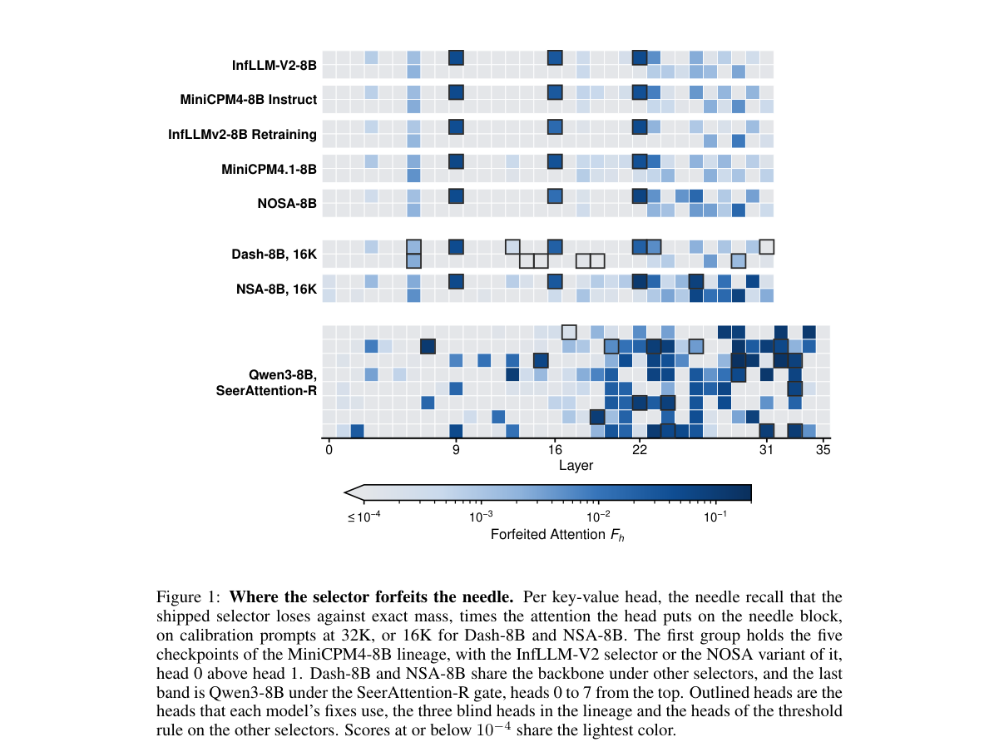

*Result - Inside a blind head. One calibration prompt of InfLLM-V2-8B at 32K, ten teacher- forced answer tokens. Top, the blind head L9.h0. Bottom, L26.h0, whose selector finds the needle. (a) Attenti*

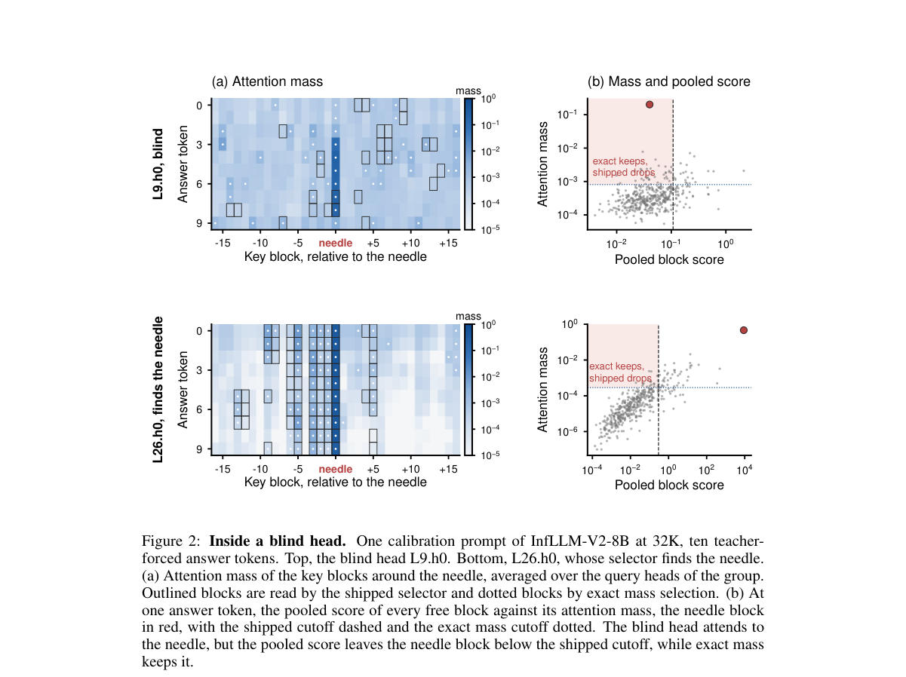

**Why this ranks #1**: 用精确注意力质量作 oracle，证明稀疏注意力的损失来自选择器把 needle 排低而不是预算耗尽；MiniCPM4.1-8B 在 64K 下多键检索从 54.1% 提到 97.5%，Qwen3-8B 上仅放开 288 个 KV 头中的 18 个即可从 29.8% 升到 97.7%，且仍保留稀疏注意力节省的 84%–89% TTFT。

---

### 2. RAG in a Trenchcoat: When Minimal Memory Is Enough for Agentic Systems, and When It Isn't

**arXiv**: [2611.22179](https://arxiv.org/abs/2611.22179) | **Score**: 9.0 (relevance 9 x 0.7 + quality 9 x 0.3) | **Direction**: `llm_core` | **Tags**: LLM-VLM, agent-memory, rag, retrieval, long-context, benchmark-design, University of Chicago | **Categories**: cs.AI | **Pages**: 38

**Authors**: Jingyu Liu; Zongze Li; Zach Xu; Zhanhui Zhou; Tahseen Rabbani; Dawn Song; Ce Zhang

**Affiliation**: University of Chicago; University of California, Berkeley

**Abstract**

> Agentic memory research has accumulated extraction, supersession, reflection, and graph synthesis on top of retrieval-augmented generation. However, we found that almost none of those primitives earn their cost in our tested memory benchmarks: we show this with BRIDGE, a deliberately minimal RAG memory with chained observation notes, hybrid BM25 with cosine retrieval, and chronological rendering, which reaches parity within bootstrap CI with the prior SOTA on LongMemEval-S and BEAM, and beats the best memory baseline on EverMemBench by 5.7-6.3 points at matched reader. It runs at ~5-7K reader-prompt tokens per query, using a single LLM call for each ingestion or query. We argue that this parity is itself the result: standard benchmarks score what memory retrieves, not what memory enables when the agent acts. To test the latter, we introduce five adversarial probes (Rule Application +-, Pattern Induction Style / Procedural, Dynamic Multiturn) judged at generation time by a cross vendor verification chain, where each query can only be solved by applying a remembered rule or pattern it never mentions. Across 5 probes x 20 scenarios, no architecture wins universally: atomic fact extractors (LangMem) win rule application, while BRIDGE's block-summary memory wins pattern induction. This result holds across four domains, three graders, and three reader families. Each design fails where the other wins, for reasons a recall benchmark cannot see: atomic-fact extractors discard the form a demonstrated pattern takes, while block-summary memory retrieves the rule but the reader does not act on it, a gap that presenting the rule more prominently largely closes. What separates memory designs is not what they retrieve but what they enable an agent to do, and that is what agentic memory should be evaluated on.

**Key findings**

- **Finding**: BRIDGE 每次查询只用约 5–7K reader prompt token，比 full-context 基线少 17–154 倍；在 EverMemBench 上比最强记忆基线 MEMOS 高 5.7 分（GPT-4.1-MINI）和 6.3 分（Gemini-3-Flash），而 full-context 本身也只领先它 7.1 分。
- **Inference**: 极简记忆已经能打平复杂记忆系统，说明主流记忆基准衡量的是召回到什么，而不是记住了什么能让 agent 真正做成事，基准口径本身需要重写。
- **Recommendation**: 评估 agent 记忆时补上从不点明所依赖记忆的对抗探针，并优先排查 reader 是否真的按检索到的规则行动——实验中把规则呈现得更突出即可闭合规则应用差距。

**Key figures**

*Framework - BEAM 100K [Tavakoli et al., 2026]. All systems use GPT-4.1-NANO; baselines are from the BEAM paper. Avg is the mean over the ten abilities, with a 95% bootstrap CI for BRIDGE. BRIDGE bars sh*

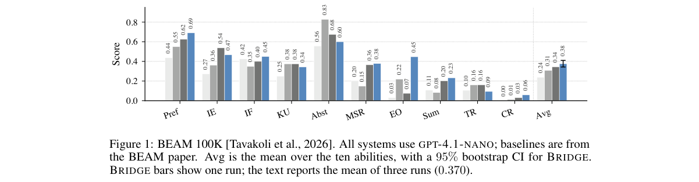

*Result - EverMemBench [Hu et al., 2026a] with two readers (top: GEMINI-3-FLASH; bottom: GPT-4.1-MINI). Baselines are from the benchmark paper: Full-Context gives the reader the whole ∼1M-token histor*

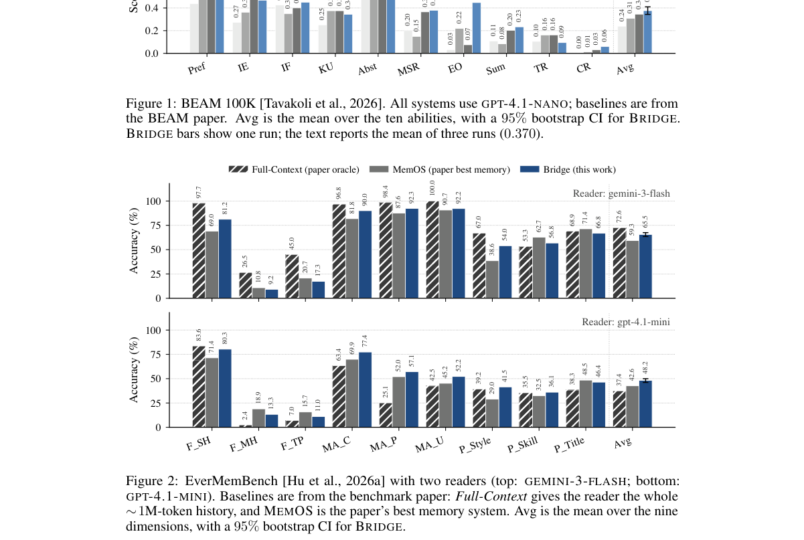

**Why this ranks #2**: BRIDGE 只保留链式观察笔记、BM25 加余弦混合检索与时序渲染，就在 LongMemEval-S 与 BEAM 上以 bootstrap CI 内打平此前 SOTA，并在 EverMemBench 上比最强记忆基线高 5.7–6.3 分；更关键的是 5 个对抗探针（5×20 场景）证明各家记忆设计互不通用。

---

### 3. Toaster: Nonlinear Memory from Cascaded Linear Memories and Target Propagation

**arXiv**: [2611.23648](https://arxiv.org/abs/2611.23648) | **Score**: 9.0 (relevance 9 x 0.7 + quality 9 x 0.3) | **Direction**: `llm_core` | **Tags**: LLM-VLM, recurrent-memory, target-propagation, linear-attention, long-context, language-modeling, Google Research | **Categories**: cs.AI, cs.LG | **Pages**: 37

**Authors**: Zeman Li; Ali Behrouz; Yuan Deng; Praneeth Kacham; Rami Al-Rfou; Meisam Razaviyayn; Vahab Mirrokni

**Affiliation**: Google Research; University of Southern California

**Abstract**

> Recurrent memories let language models process long sequences with a fixed-size state. Linear memories such as DeltaNet and KDA store one matrix and take one delta-rule step per token. The product of a chunk of such steps has an exact WY form, so they train fast. Deep memories such as TTT-MLP and Titans store a small MLP, which can hold maps that no matrix can, but their update has no WY form. Toaster bridges the two by building on a known fact: a gradient step on a linear layer is a delta-rule write. It builds a two-layer nonlinear memory from two linear memories with an activation between them. We use target propagation to give the hidden memory its values by projecting the output error back through the second memory. Given a chunk's cross-layer signals, approximated once per chunk, each layer can then run on an unmodified delta-rule kernel. Our default runs this kernel on the output layer and updates the hidden layer once per chunk. Running it on both layers gives a better model in our ablation. At matched backbones and training-token budgets, Toaster has lower loss than KDA at all five tested sizes (0.2B-1.6B non-embedding parameters) on both C4 and PG19. Its C4 perplexity also matches or slightly improves on the attention baseline at every size. At 1.2B it is also below Titans. In a 3:1 hybrid with global attention, the Toaster hybrid has the lowest perplexity of the four hybrids tested, and it is 0.18 (C4) and 0.44 (PG19) below the attention baseline. At the largest size, Toaster's mean three-shot accuracy on 13 tasks is 51.84%, compared with 50.52% for KDA and 50.04% for Titans. In length extrapolation, Toaster's loss stays below KDA's up to 20K tokens (5x the training length). On the 145M backbone, at a hidden width matched to Titans' memory, Toaster takes at most 1.33x KDA's training-step time and is 2.8-5.5x faster than the tested Titans configurations at 32K context.

**Key findings**

- **Finding**: 在 0.2B–1.6B 五个规模、两个语料共十种设定下 Toaster 的 loss 全部低于 KDA；最大规模 13 项 three-shot 平均 51.84%（KDA 50.52%、Titans 50.04%），长度外推到 20K token（训练长度 5 倍）仍低于 KDA，3:1 混合注意力方案在 C4/PG19 上分别比纯注意力低 0.18 与 0.44 困惑度。
- **Inference**: 深度记忆的表达力优势来自「非线性映射 + 每层仍是线性记忆」这一组合，而不是来自 test-time training 的小批量梯度更新，后者无法形成 WY 形式。
- **Recommendation**: 自建长上下文递归记忆时先在 1.2B 规模对比 Toaster/KDA/Titans 的 loss 与训练步时，Titans 已被实测在 32K 上下文下慢 2.8–5.5 倍。

**Key figures**

*Framework - TOASTER at a glance. (a) A linear memory applies one Householder step per token, so a chunk of updates has an exact WY form. (b) A deep memory is more expressive, but its gradient update thr*

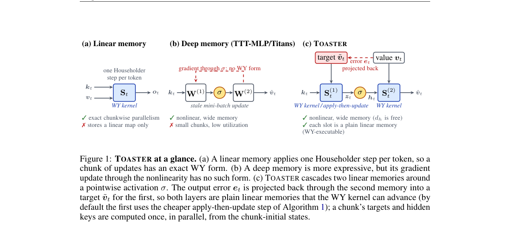

*Result - Language modeling across the scaling ladder. Left: the C4 perplexity of Table 2 against training compute (6ND FLOPs). Right: compute-efficiency gain relative to Attention at matched 6ND comp*

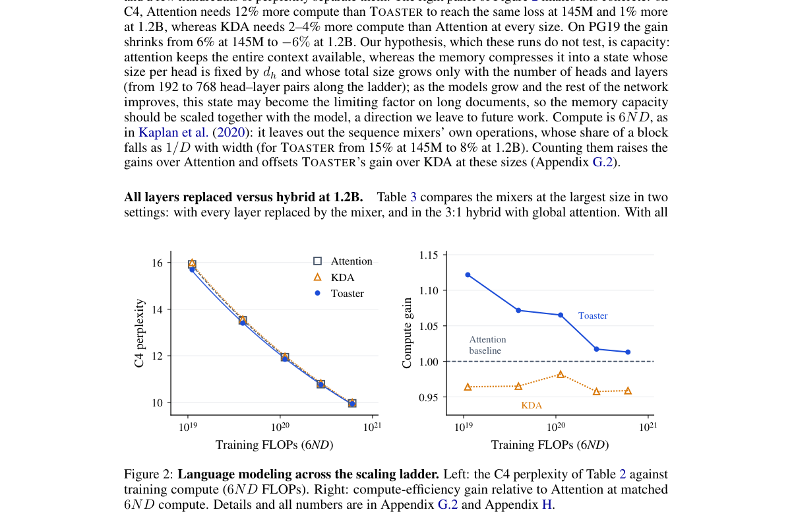

**Why this ranks #3**: 把两层线性记忆用逐点激活串起来，并用 target propagation 把输出误差反投给隐藏层，使每层仍能跑未修改的 delta-rule kernel；0.2B–1.6B 五个规模在 C4 与 PG19 上 loss 全部低于 KDA，最大规模 13 任务 three-shot 均值 51.84% 高于 KDA 的 50.52% 与 Titans 的 50.04%。

---

### 4. Long-Context Generation Is a Sampling Problem (When You Turn Up the Heat)

**arXiv**: [2611.22148](https://arxiv.org/abs/2611.22148) | **Score**: 8.7 (relevance 9 x 0.7 + quality 8 x 0.3) | **Direction**: `llm_core` | **Tags**: LLM-VLM, sampling, decoding-strategy, long-context, code-agent, temperature, Thoughtworks | **Categories**: cs.AI, cs.CL | **Pages**: 31

**Authors**: Allen G. Roush; Minh Nhat Nguyen; Ravid Shwartz-Ziv; Judah Goldfeder; Sanjay Basu

**Affiliation**: Thoughtworks; Apart Research; New York University & Meta; Columbia University; Oracle

**Abstract**

> Open-weight language models are widely observed to get worse the longer they generate. Often, attempts to fix this involve more training. At high temperature, The sampler, i.e. the rule that picks the next token out of the model's probabilities, decides whether long and agentic generation survives and/or thrives. We test 29 open-weight models from 1B to 122B parameters on ten established benchmarks plus needle retrieval out to one million tokens, covering SWE-bench Verified coding agents, long chain-of-thought reasoning, long-form writing, long structured output and long-context reading. Samplers that keep their pool of candidate tokens small and steady as temperature rises don't lose accuracy. Samplers that let in low-probability tokens fall apart. At temperature 2, coding agents running top-p, top-k or Top-H resolve 0 of 100 GitHub issues, while the same agents running top-nsigma resolve 46 to 62 and win every issue the two samplers disagree on, on three Qwen3.5 models. Over all benchmarks top-nsigma keeps a median 100% of its temperature-1 score where top-p keeps 26%. Counting how many tokens each sampler lets through explains why. In one Llama-3.1-8B story, going from temperature 1 to 2 grows top-p's pool from 4 tokens to 51,845 while top-nsigma stays at 3. Across 133 combinations of sampler setting and temperature, the typical pool size predicts judged quality (Spearman correlation of -0.77), and when we pick the pool at temperature 1 and only apply temperature afterwards, Top-H, min-p and p-less stop collapsing. At the default temperature of 1 most samplers perform about the same, We release all code and data to the public.

**Key findings**

- **Finding**: 温度从 1 升到 2 时，top-p 的候选池中位数从 2 个 token 涨到约 90,000 个、Top-H 从 1 涨到 54、P-less 从 1 涨到 21、min-p 从 1 涨到 14，而 top-nσ 恒为 1；单个 Llama-3.1-8B 故事中 top-p 的池从 4 个涨到 51,845 个。
- **Inference**: 长文本退化的主因是截断采样器在高温下放到低概率 token，而不是模型能力不足，所以把定池顺序改成「先在温度 1 定池、再套温度」即可避免崩塌。
- **Recommendation**: 跑长上下文或 agent 任务优先用 top-nσ，或把截断采样放到温度之前；温度 1 时各采样器差异很小，不必在默认温度上反复调参。

**Key figures**

*Result - Each point is a sampler’s score at the high temperature listed on the right, divided by that same sampler’s score at temperature 1 on the same models and items, so 100% (dashed line) means t*

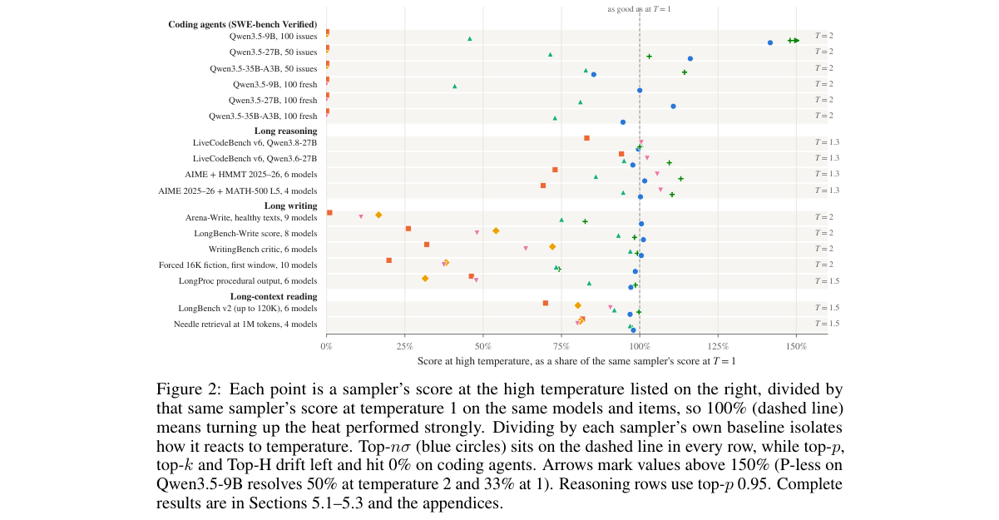

**Why this ranks #4**: 29 个 1B–122B 开源权重模型、10 个基准加最长一百万 token 的 needle 检索表明：温度 2 时 top-p、top-k、Top-H 的 SWE-bench Verified coding agent 解决 0/100，top-nσ 解决 46–62；候选池大小与判分质量的 Spearman 相关为 −0.77，覆盖 133 组设定。

---

### 5. RISA: Recoverable Sparse Attention for Block-Diffusion Language Models

**arXiv**: [2611.22191](https://arxiv.org/abs/2611.22191) | **Score**: 8.7 (relevance 9 x 0.7 + quality 8 x 0.3) | **Direction**: `llm_core` | **Tags**: LLM-VLM, diffusion-language-model, sparse-attention, kv-cache, block-diffusion, inference-efficiency, Rice University | **Categories**: cs.CL, cs.LG | **Pages**: 21

**Authors**: Xinrui Zhong; Fanjiang Ye; Yuke Wang

**Affiliation**: Rice University

**Abstract**

> Block-wise diffusion language models (DLMs) refine multiple tokens in parallel, offering an alternative to token-by-token autoregressive decoding. Their long-context inference, however, remains bottlenecked by memory-bound attention: every denoising step repeatedly reads a growing historical key--value (KV) cache. Directly applying sparse attention does not fully solve this problem, because different queries can select different pages, inflating the block's collective read set, while repeated support construction adds overhead and permanent eviction can discard information needed later. We present RISA, a recoverable sparse-attention method with shared read plans for block-wise DLMs. RISA exploits the fact that historical KV remains fixed within a block while queries evolve across denoising steps. Newly generated history is organized into exact priority and recovery tiers; seed queries then build a protected, bounded read plan whose indices are reused across the block while attention is recomputed with fresh queries and current-block KV. This separates history preservation from repeated reading and amortizes sparse-support construction without changing the backbone or decoder. On DreamReasoner-8B, RISA retains comparable task performance. At 32K, the default configuration speeds up attention by $2.67\times$ and fixed-trajectory requests by $1.36\times$ over dense, and attention speedup reaches $5.53\times$ at 128K. Across eight settings on three models, RISA decodes faster than the tested MAGE, QUEST, and LoSA budgets at matched KL.

**Key findings**

- **Finding**: DreamReasoner-8B 上 RISA 的 GSM8K 86.0、MATH-500 88.8、AIME25 60.4、LiveCodeBench 50.0、HotpotQA 39.9，与 dense 的 85.0/88.2/58.3/50.0/40.2 基本持平；32K 默认配置注意力加速 2.67×、固定轨迹请求加速 1.36×，H200 上 128K 注意力加速 5.53×。
- **Inference**: 块内历史 KV 固定、只有 query 在变，因此一份受保护的有界读计划可以被整个块复用，稀疏收益不会像每步重选那样被互相抵消。
- **Recommendation**: 在 block-diffusion 推理上优先复用读计划而不是每步 top-k 重选，并且保留降级 COLD 页的可寻址性，因为被降级的块在后续块仍会获得注意力。

**Key figures**

*Framework - Dense rereads history; RISA reuses one bounded read plan. (a) Dense attention revisits the historical prefix at every denoising step. (b) Per-step top-k reduces each attention support but re*

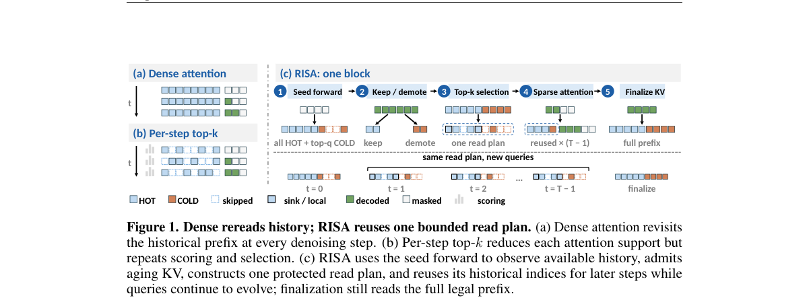

*Result - a shows that demoted cohorts continue to receive attention from later blocks. Moreover, redirecting the same extra read budget to additional HOT pages leaves a larger approximation error than*

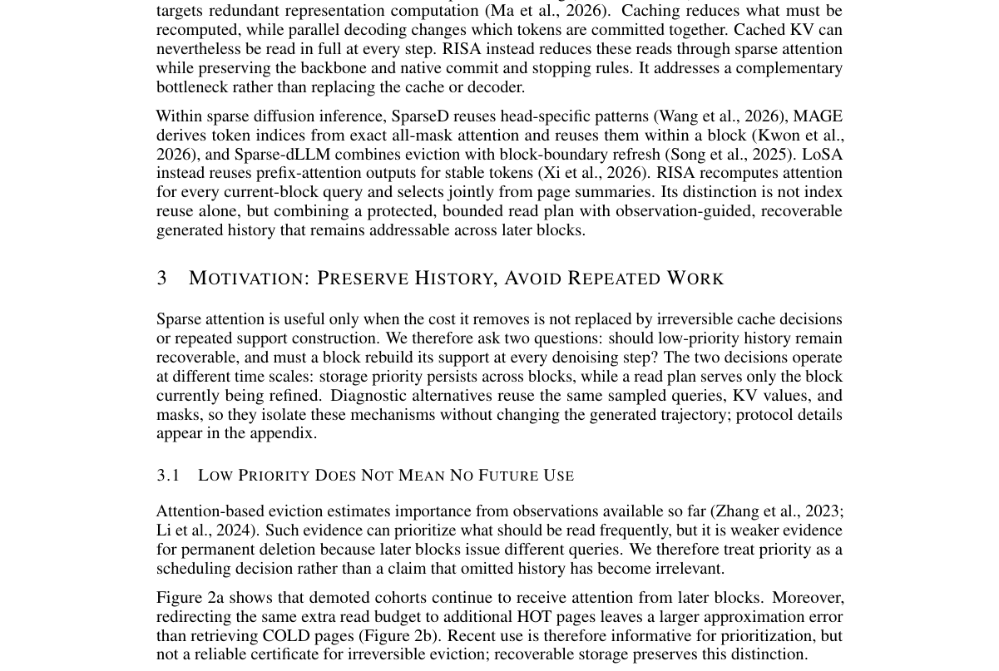

**Why this ranks #5**: 针对 block-wise 扩散语言模型每个去噪步都要重读不断增长的 KV cache，RISA 把「保存历史」与「决定读什么」分离、块内复用一份有界读计划；32K 下注意力加速 2.67×、固定轨迹请求加速 1.36×，H200 上 128K 注意力加速达 5.53×，且 DreamReasoner-8B 任务性能与 dense 相当。

---

### 6. XM-Sparse: High-Throughput Sparse-Attention LLM Serving over Scale-up Memory Pools

**arXiv**: [2611.22280](https://arxiv.org/abs/2611.22280) | **Score**: 8.7 (relevance 9 x 0.7 + quality 8 x 0.3) | **Direction**: `llm_core` | **Tags**: LLM-VLM, kv-cache, sparse-attention, llm-serving, memory-offload, throughput, Netpreme | **Categories**: cs.DC, cs.LG | **Pages**: 13

**Authors**: Yijun Sun; Xudong Liao; Zhuobin Huang; Kai Chen; Nikita Lazarev; Zhizhen Zhong

**Affiliation**: Netpreme; The Hong Kong University of Science and Technology; National University of Singapore

**Abstract**

> Sparse attention has been increasingly adopted by production LLMs for long-context inference, yet serving systems must still retain the full KV history, making GPU HBM capacity a key limit on serving concurrency. Existing systems offload the KV cache to host memory, but suffer from the limited bandwidth of PCIe and the limited capacity of host memory. Emerging scale-up memory pools (e.g., X-Mem) relieve both limits and open new opportunities for sparse-attention offloading. In this paper, we first conduct an in-depth analysis and reveal that, even with scale-up memory pools, decode throughput remains bounded by HBM capacity, as hot KV buffers and the fully resident indexer key (K-index) cache occupy substantial HBM. Moreover, the two caches exhibit distinct access patterns. Based on these insights, we present XM-Sparse, the first sparse-attention offloading system over scale-up memory expansion. The core idea of XM-Sparse is to offload both caches aggressively while matching each with an I/O mechanism tailored to its access pattern. Specifically, for dynamically selected KV entries, XM-Sparse fuses TMA-based retrieval with attention in a tile-level pipeline to hide on-demand retrieval latency. For predictable K-index accesses, it prefetches pages via SM-efficient GPU-initiated DMA and coordinates prefetching with latency-critical operations to avoid interfering with decoding. We have implemented XM-Sparse atop SGLang, and our experiments on DeepSeek-V3.2 and GLM-5.3 with an emulated scale-up memory pool show that XM-Sparse delivers up to 4.98$\times$ and 4.52$\times$ higher decode throughput than PCIe-based ECHO and HiSparse, respectively, and up to 1.34$\times$ over a naive integration on the same platform, across 16K-1M contexts.

**Key findings**

- **Finding**: 把热 KV 缓冲从 2–4 倍 top-k 预算（4K–8K 条目）压到 2K，可省下每请求 50%–75% 的 HBM 占用，缺失率虽从约 4%–10% 升到 25%，但在 128K 上下文、每 GPU batch 64 时解码步延迟只增加 10.0%、吞吐只降 9.1%。
- **Inference**: 既然缺失率对吞吐的敏感度这么低，就应把省下的显存优先用于放大 batch，而不是死守热缓存规模。
- **Recommendation**: 部署长上下文稀疏注意力服务时按访问模式拆分两类缓存：动态选中的 KV 用 TMA 检索与注意力做 tile 级融合，可预测的 K-index 用 SM 高效的 GPU 发起 DMA 预取。

**Key figures**

*Framework - Decode throughput across memory-expansion configura-*

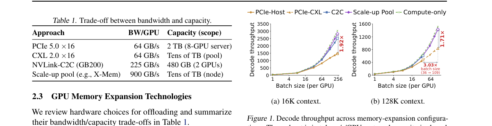

*Result - Illustrative HBM usage breakdown at the maximum*

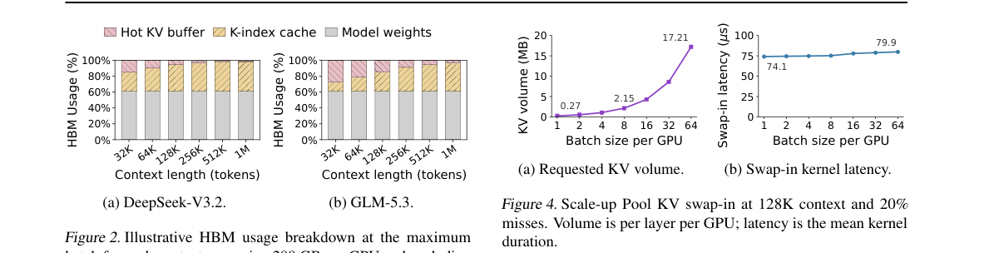

**Why this ranks #6**: 实测发现即使接上 scale-up 内存池，decode 吞吐仍被 HBM 容量卡住——常驻的热 KV 缓冲与全量 K-index 缓存占掉约 40% 显存；XM-Sparse 在 SGLang 上把两类缓存都激进卸载并分别匹配 TMA 检索与 GPU 发起的 DMA 预取，在 DeepSeek-V3.2 与 GLM-5.3、16K–1M 上下文上比 PCIe 的 ECHO 与 HiSparse 最高快 4.98× 与 4.52×。

---

## VLM 核心（多模态架构 / 理解 / 视频 / GUI agent） · `vlm_core` (11 papers)

VLM 本体今天最集中的是「**给视觉证据找一个更省、更好用的通道**」。ActiveForager 用反事实信息增益训练流式视频 agent 在「直接回答 / 放大高分辨率 / 回忆历史 / 等待未来帧」之间选择，并用流解耦注意力隔离历史证据，Qwen3-VL-8B 在 OVO-Bench 上总准确率从 47.6% 提到 65.9%、Video-Holmes 零样本翻倍；SpecLook 训练无关地投机「下一处观测」并让大模型免工具校验，在 V*/HR-Bench/POPE 上准确率 87.2%/86.2%，相对 DeepEyes-7B 与 Thyme-RL 分别加速 7.7 倍与 4.7 倍；SemGeo 用单个 grid token 做粗定位、由几何解码器并行恢复离散框坐标，8 个 grounding benchmark 中 6 个 F1@mIoU 最优，vLLM 下框生成吞吐达基线 2.07 倍。第二组是「**把 VLM 的内部状态打开看**」：Read Together, Answer Apart 在 22 个开源 VLM（1B–35B）上做配对单问与共问，发现早期同图问题会在 prefill 里把视觉信息写进问题 token，其免训练解码掩码在 DCI 上最多 +4.71、WebUI 上最多 +11.4 个点；V-lens 借用统一多模态模型的图像生成器免训练可视化指定 token 的隐状态，使代词指代可视化正确率从 2–11% 升到 86–94%。其余各占一块：几何与空间（SpatialMind 的 GeoFus 门控 + 负熵正则在 VSI-Bench 上取得 72.3 的 SOTA；Ultimate3D 合成 24 万条带精确相机-物体关系标注的 VQA，微调后 MLLM 比商业模型平均高 29.7%）、长视频可验证任务（NexSight 的 SightForge 只接受盲验证器可从原始视频重建的任务，得到 108 段长视频的 310 个可追溯任务，最强模型仅 54.52%、给标注证据可达 79.35%）、医学影像 harness（VERA 让 Qwen3.8-27B 脾脏测量从 63.3% 升到 98.3%、GPT-6.1 Sol 肺结节检出从 10.8% 升到 69.2%）、流式推理（Spool 把 Gated DeltaNet 的仿射循环更新缓存成可组合变换，20 个模型-基准组合 p95 TTFT 全部最低、几何均值比 vLLM 快 6.6 倍）、人类注视先验（GGR 用 7,109 条注视引导 grounding）与交互式加速（Isthmus 属于生成侧，此处不计）。

### 7. Look Closer, Look Back, or Wait for Agentic Streaming Video Understanding

**arXiv**: [2611.24267](https://arxiv.org/abs/2611.24267) | **Score**: 9.0 (relevance 9 x 0.7 + quality 9 x 0.3) | **Direction**: `vlm_core` | **Tags**: LLM-VLM, streaming-video, agentic-vlm, tool-use, multi-hop-reasoning, counterfactual-reward, Xi'an Jiaotong University | **Categories**: cs.CV | **Pages**: 18

**Authors**: Pengyu Li; Zhitao Gao; Lingling Zhang; Wenxuan Huang; YiCheng Xiao; Chen Zheng; Jun Liu

**Affiliation**: Xi'an Jiaotong University; East China Normal University; Institute of Automation, Chinese Academy of Sciences; Open University of China

**Abstract**

> Streaming video models must answer questions about a live video under strict memory and latency limits. Feeding only the latest few frames keeps present perception sharp, whereas adding past frames dilutes attention on the current scene and triggers hallucinations. Recent cascade methods retrieve past frames when uncertain, but they still fail when current frames are blurry or when decisive future clues have not appeared yet. We introduce ActiveForager, a streaming video agent that maintains a clean short working window and gathers extra evidence only on demand. For each query, the agent either answers directly, zooms into high-resolution recent frames, recalls past events from memory, or waits for upcoming frames. When recalling history, a shared-weight sub-agent verifies candidate clips in isolation and returns a compact evidence summary. A stream-decoupled attention mask then keeps historical evidence from interfering with present visual tokens. We train this policy using counterfactual information gain, which rewards a tool call only when the gathered evidence makes the true answer more likely and prevents tool collapse across all actions. Across Qwen2.5-VL-7B and Qwen3-VL-8B on OVO-Bench, ActiveForager improves real-time perception, historical recall, and proactive response at once, lifting overall accuracy on Qwen3-VL-8B from 47.6% to 65.9%. It also doubles zero-shot accuracy on the multi-hop Video-Holmes benchmark while adding minimal visual tokens per query.

**Key findings**

- **Finding**: Qwen3-VL-8B 在 OVO-Bench 的实时感知/回溯追踪/主动响应三项分别从 67.9/51.2/44.4 提到 73.1/66.8/58.4，224² 分辨率下整体 57.9%→62.0%、672² 下 62.0%→71.3%，并比 StreamScout-R 少用 64% 的主上下文视觉 token，Video-Holmes 多跳准确率零样本翻倍。
- **Inference**: 只喂最近几帧会把「当前看不清」和「关键线索还没出现」两种情形混为一谈，让 agent 显式决定取证或等待才能同时保住实时感知与历史召回。
- **Recommendation**: 做流式视频问答时优先给模型四路工具（直接答/放大/回忆/等待）并用反事实信息增益训策略，而不是一味加大历史帧数。

**Key figures**

*Framework - Selective evidence acquisition for streaming video understanding. (a) Recent-only windows lose past context. Retrieving history does not address missing current-scene detail or clues that hav*

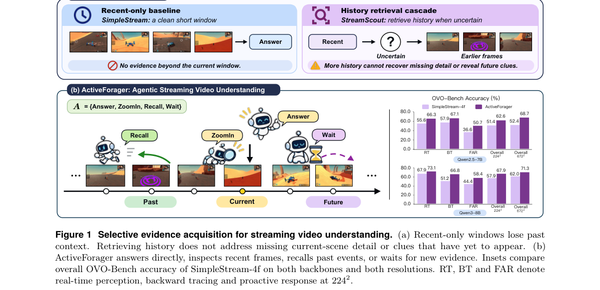

*Result - ActiveForager architecture and TUPO training. (a) A compact GPU window and CPU evidence storage support four-way routing. Answer returns directly. Wait advances the stream before routing resu*

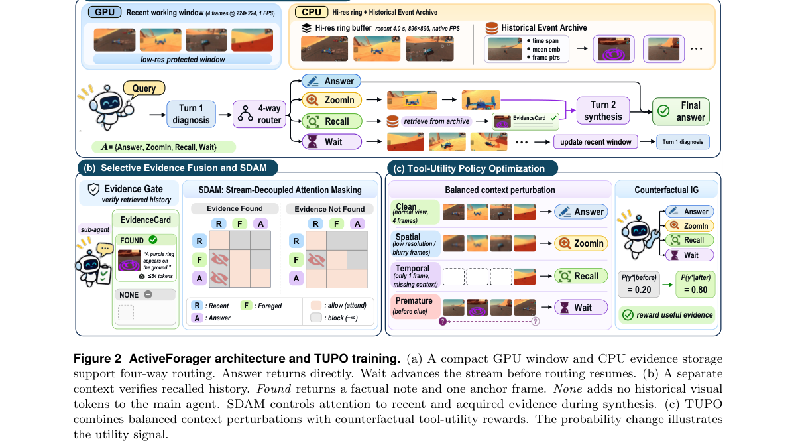

**Why this ranks #7**: 流式视频 agent ActiveForager 只保留 4 帧干净工作窗口（平均 255.5 个视觉 token），按 Answer/ZoomIn/Recall/Wait 四路按需取证，并用反事实信息增益训练策略防止工具坍缩；Qwen3-VL-8B 在 OVO-Bench 上整体从 47.6% 提到 65.9%，672² 分辨率下达 71.3%，主上下文视觉 token 比 StreamScout-R 少 64%。

---

### 8. SpatialMind: Adaptive Multi-Level Geometric Fusion for Spatial Reasoning in Multimodal Large Language Models

**arXiv**: [2611.22415](https://arxiv.org/abs/2611.22415) | **Score**: 8.7 (relevance 9 x 0.7 + quality 8 x 0.3) | **Direction**: `vlm_core` | **Tags**: LLM-VLM, spatial-reasoning, 3d-geometry, gating-network, mllm, vsi-bench, School of Advanced Interdisciplinary | **Categories**: cs.CG, cs.CV | **Pages**: 19

**Authors**: Shibin Zhao; Hao Tan; Fan Yang; Haixin Wang; Feilong Chen; Yidong Ma; Chaoyang Zhao; Ming Tang; Jinqiao Wang

**Affiliation**: School of Advanced Interdisciplinary Sciences, University of Chinese Academy of Sciences; Institute of Automation, Chinese Academy of Sciences; Xiaohongshu

**Abstract**

> Multimodal Large Language Models (MLLMs) demonstrate promising capabilities in 2D visual understanding, yet remain limited in 3D spatial reasoning. Recent studies explore integrating 3D reconstruction models into MLLMs. However, these approaches either use a single geometric granularity across all tasks or adopt a fixed multi-level fusion scheme, regardless of task-specific reasoning requirements. Through systematic experiments on multi-level geometric fusion, we find that spatial tasks at different cognitive levels (e.g., distance estimation vs. route planning) require geometric representations of different granularities, revealing that fixed fusion cannot accommodate diverse spatial reasoning requirements. To bridge this gap, we propose SpatialMind, a task-adaptive framework for dynamically integrating multi-level geometric representations. SpatialMind employs GeoFus, a multi-layer geometric fusion module built around a gating network jointly conditioned on textual instructions, visual semantics, and geometric representations. This network adaptively modulates the contributions of shallow, intermediate, and deep geometric features across the layers of the LLM decoder. Furthermore, we introduce a negative-entropy regularization loss to mitigate gate collapse. Gate visualizations indicate that GeoFus adapts geometric granularity to task requirements. Experiments demonstrate that SpatialMind achieves competitive performance across spatial benchmarks, attaining a state-of-the-art score of 72.3 on VSI-Bench. The source code is publicly available at https://github.com/zhaosb-star/SpatialMind.

**Key findings**

- **Finding**: 在 VSI-Bench 上分别移除浅层（VGGT-11→LLM-0）、中间层（VGGT-17→LLM-1）与深层（VGGT-23→LLM-2）注入，低层/高层任务分别掉 1.43/0.17、1.33/1.58、0.66/2.07 个百分点；SpatialMind 的 5B 与 10B 变体分别拿到 71.5 与 72.3。
- **Inference**: 所需几何粒度与任务的认知层次是对应的，固定融合方案必然让一部分任务吃亏，所以融合权重必须随指令自适应。
- **Recommendation**: 给 MLLM 接入 3D 先验时不要用固定的多层级联，让门控同时看文本指令、视觉语义与几何特征，并加负熵正则防止门控坍缩到单一层。

**Key figures**

*Framework - SpatialMind: Adaptive Multi-Level Geometric Fusion for Spatial Reasoning. Unlike prior methods that rely on fixed geometric fusion despite the varying granularity requirements of different s*

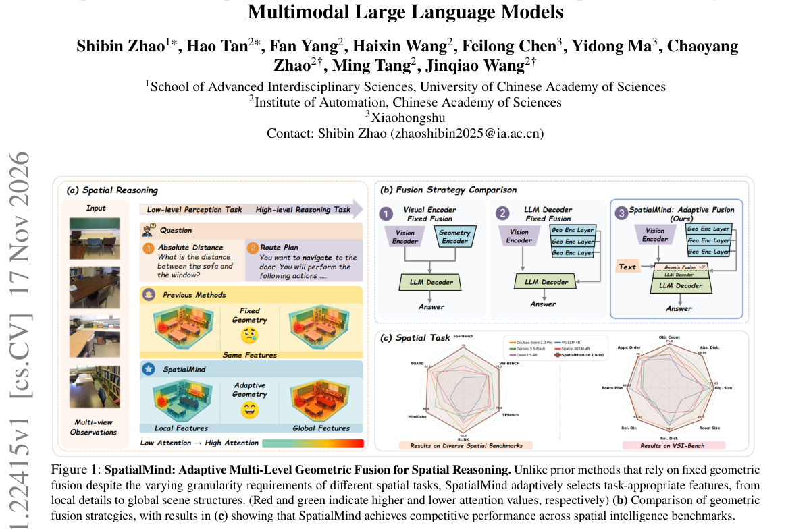

*Result - Visualization of Multi-Level Geometric Attention across 2D Views and 3D Point Clouds. Features at different lev- els capture spatial information at distinct scales, progressing from fine-gra*

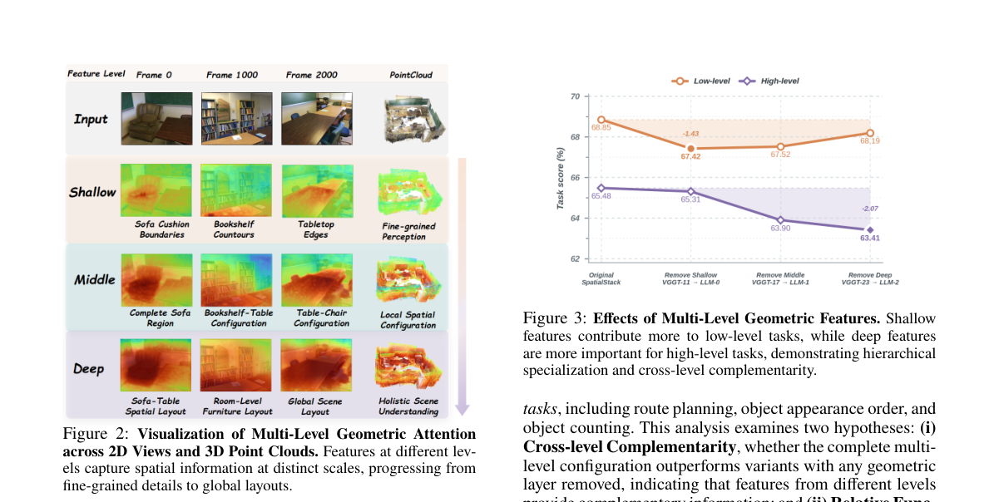

**Why this ranks #8**: 消融显示多层几何特征分工明确：去掉浅层注入让低层任务掉 1.43 分而高层只掉 0.17 分，去掉深层注入让高层任务掉 2.07 分；SpatialMind 用文本、视觉与几何三路条件门控（负熵正则 λ=0.005）自适应融合 VGGT 的第 11/17/23 层几何特征，VSI-Bench 上取得 72.3 的 SOTA。

---

### 9. Semantic-Guided Geometric Decoding for Token-Efficient Visual Grounding

**arXiv**: [2611.22577](https://arxiv.org/abs/2611.22577) | **Score**: 8.7 (relevance 9 x 0.7 + quality 8 x 0.3) | **Direction**: `vlm_core` | **Tags**: LLM-VLM, visual-grounding, token-efficiency, geometric-decoder, grpo, vllm-serving, Huawei Technologies Co. | **Categories**: cs.CV | **Pages**: 10

**Authors**: Zhaojie Chen; Junyan Yang; Le Yang; Qi Dang; Yucheng Huang; Qianyi Che; Zhaoqiang Chen; Xinqi Zhu; Qiang Zhao

**Affiliation**: Huawei Technologies Co., Ltd.

**Abstract**

> Multimodal large language models (MLLMs) provide a unified interface for language-conditioned visual perception. In pixel-to-sequence grounding, autoregressive coordinate generation requires multiple sequential decoding steps per box, increasing inference cost with the number of instances. Pixel-to-embedding methods reduce this overhead but lack explicit spatial encoding when using a shared special token. We introduce SemGeo, a token-efficient visual grounding framework that represents each instance with a single grid token for coarse localization. A geometric decoder reuses visual features and hidden states to recover precise discrete box coordinates in parallel. To train proposal generation and box localization together, we introduce Gaussian soft labels that encode coordinate distances during supervised fine-tuning (SFT). Reinforcement post-training further combines box-set rewards with coordinate supervision on model-generated proposals. This stage trains the language model and geometric decoder on their own predictions to mitigate the mismatch between teacher-forced training and inference. Across eight benchmarks spanning object detection, referring object detection, and document layout grounding, SemGeo achieves the highest F1@mIou among compared MLLMs on six benchmarks. It also delivers $2.07\times$ and $1.25\times$ the mean box-generation throughput of representative grounding baselines under vLLM and Transformers, respectively, while achieving higher accuracy in both comparisons.

**Key findings**

- **Finding**: 在 vLLM 下 SemGeo 相对 Qwen3-VL-2B 基线准确率更高且输出 token 少 87.6%、平均生成时间低 85.4%；在 vLLM 与 Transformers 下平均框生成吞吐分别是代表性基线的 2.07× 与 1.25×，两次配对比较的准确率都同时更高。
- **Inference**: 把「在哪里」与「框多大」拆成不同输出形式后，随实例数线性增长的自回归解码开销被去掉，而 GRPO 的坐标监督正好缓解 teacher forcing 带来的 exposure bias。
- **Recommendation**: 做多实例 grounding 时用「每实例一个网格 token + 几何解码器」替代逐框坐标 token，并用 GRPO 在模型自己生成的 proposal 上做坐标监督。

**Key figures**

*Framework - Comparison of representative grounding interfaces. Top: coordinate-token prediction, sequential [1] or block-parallel [2]. Middle: token-triggered box regression [3], [4]. Bottom: SemGeo uses*

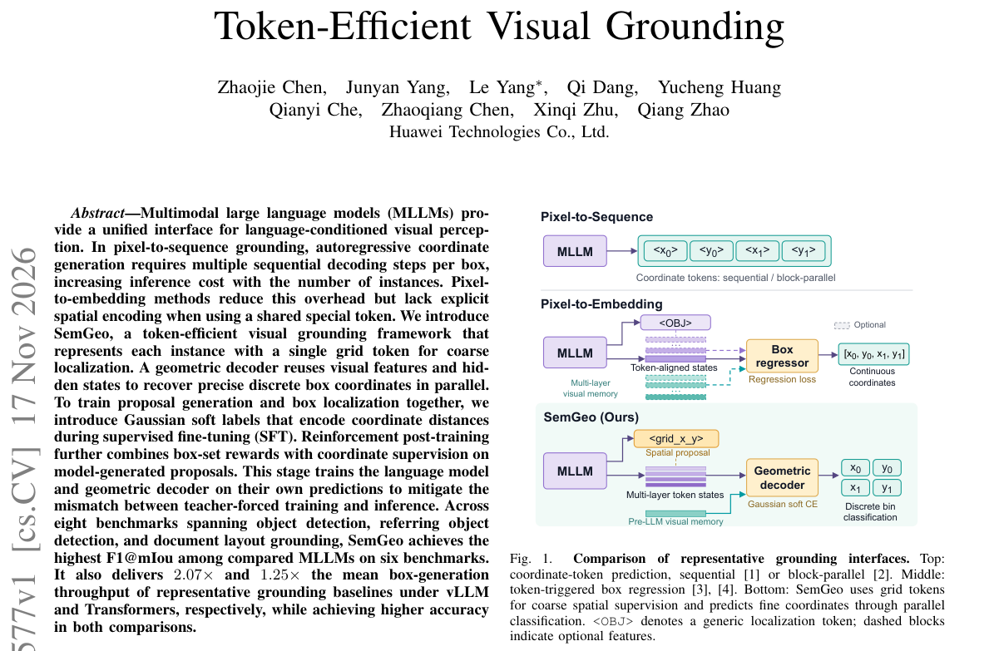

*Result - Overview of SemGeo. Blue and red dashed outlines denote Autoregressive Spatial Proposal Generation and Semantic-Guided Geometric Decoding, respectively. The dog and bike proposals at t1 and t2*

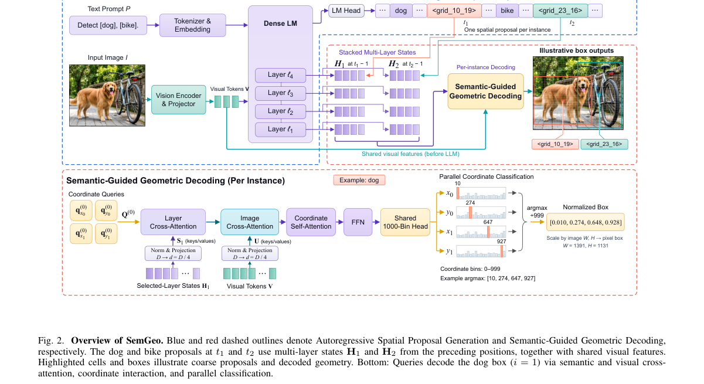

**Why this ranks #9**: 把每个实例压成 1 个网格 token 做粗定位，再由 11.02M 参数的几何解码器并行回归精确框坐标（1000 档离散 bin）；在 8 个基准中 6 个拿到对比 MLLM 最高的 F1@mIoU，比 LocateAnything 高 1.70%–4.70%，同时在 vLLM 与 Transformers 下分别达到代表性基线的 2.07× 与 1.25× 框生成吞吐。

---

### 10. NexSight: Verifiable Tasks for Fine-Grained Agentic Long-Video Understanding

**arXiv**: [2611.22790](https://arxiv.org/abs/2611.22790) | **Score**: 8.7 (relevance 9 x 0.7 + quality 8 x 0.3) | **Direction**: `vlm_core` | **Tags**: LLM-VLM, long-video, agentic-eval, evidence-verification, temporal-search, post-training, Zhejiang University | **Categories**: cs.AI, cs.CV | **Pages**: 25

**Authors**: Tianci Xie; Li Chen; Pinxue Guo; Rui Zheng

**Affiliation**: Zhejiang University; Tongji University; Shanghai Qiji Zhifeng Co., Ltd.

**Abstract**

> Fine-grained questions about long videos ask how many times an action occurs, in what order events unfold, or exactly when a state changes. Answering them can require finding brief moments scattered across hours of footage. Agentic models that decide when and where to look promise to find these moments, yet this ability is hard both to measure and to learn. Sparse supporting evidence may establish that an action occurred without establishing its total count; verifying timeline-wide claims requires checking for missed occurrences and double counting. Answer-only supervision, in turn, does not explicitly supervise the search for evidence. We present NexSight, which builds verifiable tasks to both evaluate and train agentic long-video understanding. Its agentic pipeline, SightForge, accepts a task only if a verifier blind to the draft answer can reconstruct it from evidence densely reacquired from the raw video and counterexample checks fail to refute it. This yields SightLine, 310 evidence-traceable tasks from 108 long videos, evaluated through SightLoop, a shared multiscale harness supporting temporal exploration, local inspection, evidence integration, and revisiting while recording returned observations. On disjoint videos, solver trajectories on verified tasks become step-level supervision for observation decisions. The strongest model reaches only 54.52% on SightLine, yet 79.35% when given the annotated evidence. With under 6K examples, Sight-35B nearly doubles its base model's interactive accuracy (21.29% to 42.26%), outperforms the 397B model of its family, begins using explicit spatial inspection after post-training, which its base model never uses, and gains over 8 points on two external long-video benchmarks.

**Key findings**

- **Finding**: 同等帧预算下 agent 化窗口选择把时间证据召回率从固定窗口的 19.84% 与随机窗口的 19.09% 提到 40.63%，但跨窗口计数与状态变化并未随之提升；用 5,938 条样例后训练的 Sight-35B 把交互准确率从 21.29% 提到 42.26%，其中跨窗口计数 +37.50、状态变化 +35.19。
- **Inference**: 找到对的时间点并不等于用好这些片段，跨窗口的证据整合能力必须靠轨迹级监督单独训练，而评测本身也必须先具备可验证性。
- **Recommendation**: 评测长视频 agent 时把「答案正确」与「是否解码到正确帧」分开统计，否则无法区分检索失败与整合失败；训练时直接复用求解轨迹作为步骤级监督。

**Key figures**

*Framework - NexSight overview. (1) Verifiable task construction (SightForge): dense raw-video evidence, answer-hidden verification, and counterexample checks establish reliable tasks. (2) Multiscale act*

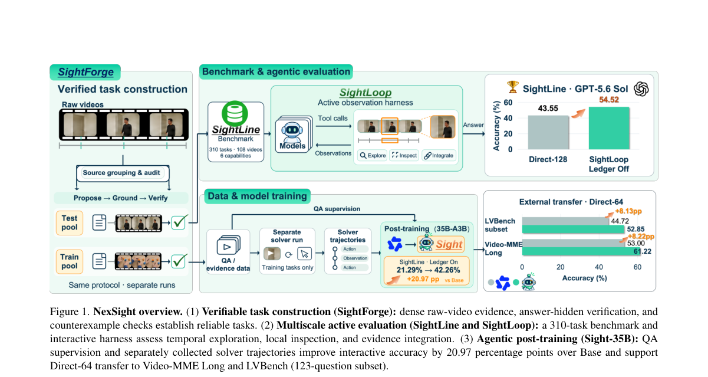

*Result - Six core capabilities and task distribution of Sight- Line. The benchmark covers unlocalized fact retrieval without timestamp cues, ordering of separated events, counting across tem- poral w*

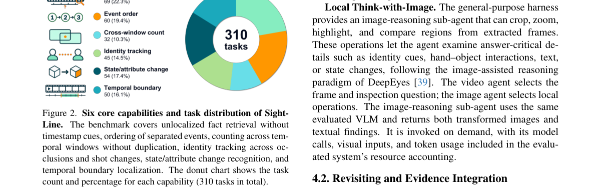

**Why this ranks #10**: NexSight 用「盲于草稿答案的验证器能否从原始视频重建答案 + 反例检查」筛出可信任务，得到 108 段长视频上的 310 个可溯源任务（共 74.12 小时、1080 条证据标注）；最强模型在 SightLine 上仅 54.52%，但给它标注证据就能到 79.35%，说明瓶颈在取证而非推理。

---

### 11. Visual Harness Scales General VLMs to Medical Images

**arXiv**: [2611.22815](https://arxiv.org/abs/2611.22815) | **Score**: 8.7 (relevance 9 x 0.7 + quality 8 x 0.3) | **Direction**: `vlm_core` | **Tags**: LLM-VLM, medical-imaging, visual-harness, agentic-tool-use, ct-mri, vlm, New Jersey Institute of Technology | **Categories**: cs.CV | **Pages**: 11

**Authors**: Shaowen Wan; Hanqi Jiang; Zihao Wu; Junhao Chen; Weihang You; Ruiyu Yan; Bowen Chen; Tianming Liu; Lin Zhao

**Affiliation**: New Jersey Institute of Technology; University of Georgia; New York University

**Abstract**

> We show that an appropriate visual harness can substantially improve the performance of general vision-language models (VLMs) across diverse medical imaging tasks. We introduce VERA, a medical visual harness that equips general VLMs with interactive visual tools and systematic diagnostic evidence management. With VERA, general VLMs interactively explore medical images and progressively acquire diagnostic evidence, which is preserved in a lossless memory for subsequent retrieval and use. After submitting an initial answer, the VLM receives an assessment of potential omissions and the reliability of identified findings. This assessment guides further image inspection and measurement, followed by answer revision in an iterative agentic loop until sufficient evidence is obtained. Across 11 tasks and four imaging modalities, VERA improves performance on all tasks with Qwen3.8-27B, with notable gains in spleen measurement (63.3% to 98.3%), renal search (57.5% to 71.2%), and pulmonary nodule detection (0.0% to 28.2%). High-capability API-based VLMs achieve even higher performance with VERA. For example, GPT-6.1 Sol improves pulmonary nodule detection from 10.8% to 69.2% with VERA, demonstrating the complementary benefits of stronger model capabilities and an effective medical visual harness. Our results highlight the potential of visual harnesses as a new paradigm for scaling general VLMs to medical imaging tasks.

**Key findings**

- **Finding**: VERA 让 Qwen3.8-27B 在全部 11 个任务上优于直接读图，并在 10 个任务上取得 agent 基线中最好或并列最好；肺结节检出敏感度在 Claude Opus 5.5 上达 60.0%、在 GPT-6.1 Sol 上达 69.2%，而直接输入分别为更低水平。
- **Inference**: 医学影像上的短板主要不是模型权重而是取证方式，让模型主动定位切片、放大、量测并把证据无损存下来，比换更大或医疗专训的模型更划算。
- **Recommendation**: 给通用 VLM 做医学任务时先搭视觉 harness（切片定位加放大加 HU/尺寸量测、无损证据记忆、遗漏检查），再考虑更换更大的底座模型。

**Key figures**

*Framework - Scaling general VLMs to medical imaging with VERA. VERA provides a medical visual harness for image explo- ration and diagnostic evidence management, delivering substan- tial performance gai*

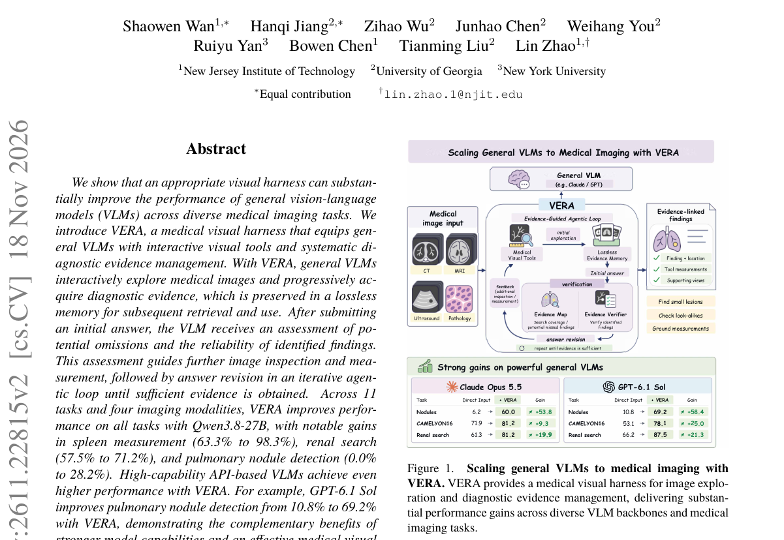

*Result - Overview of VERA. Top: a frozen general VLM works with four modules. (A) Medical Visual Tools inspect and measure the image. (B) Lossless Evidence Memory stores views and tool readouts verba*

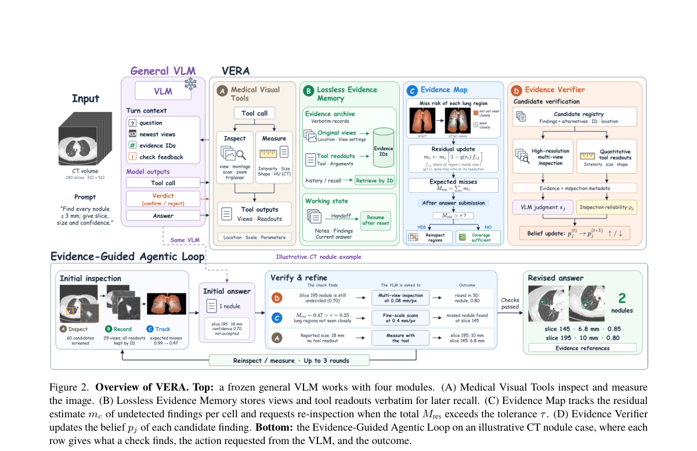

**Why this ranks #11**: VERA 给通用 VLM 配上医学视觉工具、无损证据记忆、证据地图与证据验证器，Qwen3.8-27B 在 11 个任务、4 种模态上全部提升：脾脏测量 63.3%→98.3%、肾脏检索 57.5%→71.2%、肺结节检出 0.0%→28.2%；换成 GPT-6.1 Sol 后结节检出从 10.8% 升到 69.2%。

---

### 12. Learning Grounded Reasoning from Human Gaze

**arXiv**: [2611.23209](https://arxiv.org/abs/2611.23209) | **Score**: 8.7 (relevance 9 x 0.7 + quality 8 x 0.3) | **Direction**: `vlm_core` | **Tags**: LLM-VLM, human-gaze, grounded-reasoning, eye-tracking, visual-search, reinforcement-learning, Princeton University | **Categories**: cs.CV | **Pages**: 25

**Authors**: Gabriel Sarch; Declan Campbell; Nicholas Budny; Kia Ghods; Katerina Fragkiadaki; Jonathan D. Cohen; Brenden M. Lake; Taylor W. Webb

**Affiliation**: Princeton University; Perceptron AI; Carnegie Mellon University

**Abstract**

> Human visual reasoning is driven by systematic exploration and extraction of task-relevant visual evidence. Human gaze provides a window into this process, making gaze a useful source of guidance for visually-grounded reasoning in vision-language models (VLMs). However, human gaze also includes noise and redundancies that may transfer poorly to VLMs. In this work, we investigate how human gaze data can be effectively leveraged to improve visual reasoning in VLMs, while maintaining alignment with human behavior. We collect 7,109 human gaze trials from a diverse and challenging set of visual reasoning tasks, and train grounded reasoning models with different forms of gaze guidance. Across evaluations in chart understanding, visual search, and counting, we find that using human gaze as a prior for grounded reasoning consistently outperforms supervision using the full gaze sequence. Based on these findings, we introduce GGR (Gaze-Guided Reasoner), which achieves greater human alignment and more reliable visual grounding while matching or outperforming leading grounded-reasoning baselines in accuracy. Reinforcement learning further improves task accuracy, gaze alignment, and grounding quality despite using no gaze supervision. Behavioral analyses show that gaze supervised models exhibit more visual exploration before arriving at an answer. Our results suggest that the value of human gaze lies in guiding spatial exploration and shaping reasoning behavior without requiring complete imitation of human behavior.

**Key findings**

- **Finding**: Gaze-All 相比 Gaze-Subset 的眼动对齐更高（1.04 对 0.82 bits/fix），但任务准确率更低（55.9% 对 62.8%）；Gaze-All 在 RL 后相对基线的重复检视行为增加 54.8 个百分点（p<0.001），常导致自我混淆与重复循环。
- **Inference**: 完整模仿人类注视序列会把人类特有的感知与记忆约束一并带进模型，反而破坏原本的推理节奏，眼动只适合当松散的先验而非逐帧目标。
- **Recommendation**: 要用眼动监督 VLM，先只保留与问题相关的注视子集做 SFT，再用不带眼动监督的 RL（如 GSPO）优化，避免模型学成不断重看的循环。

**Key figures**

*Framework - GGR achieves higher human gaze alignment and better visual grounding while maintaining strong task performance. (Left) Mean accuracy versus human fixation log-likelihood relative to uniform*

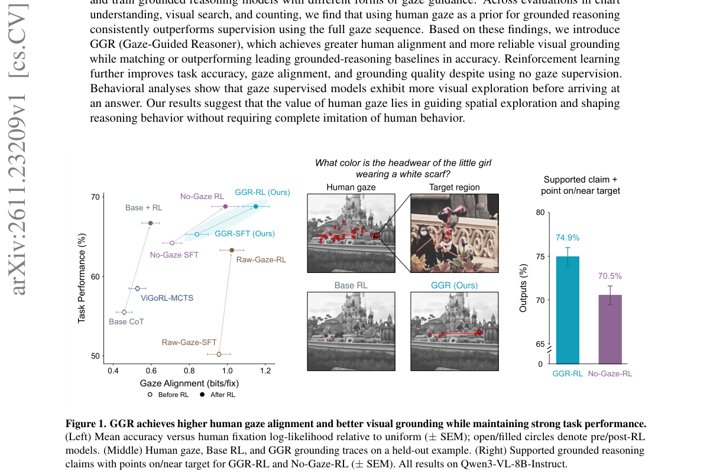

*Result - Learning grounded reasoning with gaze guidance. (a) Eye gaze was recorded while human participants solved visual reasoning problems. (b) We give the image 𝐼, question 𝑞, and fixation list 𝐹t*

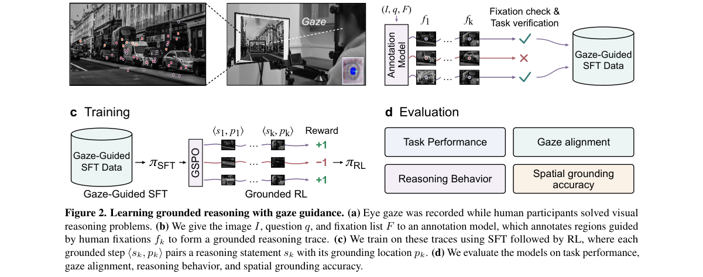

**Why this ranks #12**: 研究收集 7,109 次人类眼动试次训练有依据的推理模型，发现把眼动当作先验比监督完整注视序列更有效：SFT 后整体准确率从 Gaze-All 的 55.9% 升到 Gaze-Subset 的 62.8%，且 Gaze-All 的眼动对齐更高（1.04 对 0.82 bits/fix）却在 RL 后出现 54.8 个百分点的重复检视而陷入自乱。

---

### 13. Spool: Low-Latency Streaming Inference for Hybrid Vision-Language Models

**arXiv**: [2611.23228](https://arxiv.org/abs/2611.23228) | **Score**: 8.7 (relevance 9 x 0.7 + quality 8 x 0.3) | **Direction**: `vlm_core` | **Tags**: LLM-VLM, streaming-video, hybrid-vlm, inference-engine, recurrent-state, latency, Massachusetts Institute of Technology | **Categories**: cs.CV, cs.LG | **Pages**: 19

**Authors**: Rui Ning; Om Chabra; Hari Balakrishnan

**Affiliation**: Massachusetts Institute of Technology; Computer Science and Artificial Intelligence Laboratory

**Abstract**

> Applications such as visual accessibility agents and robotics require answering questions about recent video content promptly, over a bounded window of past frames (e.g., the last two minutes). Hybrid vision-language models (VLMs), which interleave attention with linear recurrent layers such as Gated DeltaNet (GDN), are attractive for this setting, but maintaining a sliding window is expensive. The reason is that recurrent layers combine all past frames into a shared state, so expiring old frames normally requires re-running the entire window through the model. We observe that the recurrent update is affine in the state with input-dependent coefficients, so the effect of each frame can be captured as a transformation that composes associatively. We present Spool, a training-free framework that caches per-frame state transformations and composes them efficiently as the window advances, removing expired frames from each recurrent layer's state without replaying frames through the backbone. Removal is exact within each layer; as with key-value eviction in attention, expired frames can retain residual influence through the cached inputs computed by earlier layers. We design a dedicated data structure and GPU kernels to achieve low caching and composition overhead. Across five open-source hybrid VLMs and four video reasoning benchmarks, Spool achieves the lowest p95 time-to-first-token in all 20 model-benchmark tests, reducing it by a geometric mean of $6.6\times$ over the faster of two recent vLLM baselines, while improving accuracy by 2.3 percentage points on average.

**Key findings**

- **Finding**: Qwen3.5-9B 在 128 帧窗口下重建整个窗口中位耗时 6.288 秒，而正常追加一帧只要 0.215 秒，相差 29.2×；Spool 在 20 项测试中 p95 首 token 延迟全部最低（几何均值快 6.6×，最高 35.7×），16 项 p95 保持在 1 秒内而增量 prefill 只有 3 项。
- **Inference**: 只要每帧的递归更新能拆成可组合的仿射变换，滑动窗口淘汰就退化成矩阵乘法，而不是把保留帧重跑一遍。
- **Recommendation**: 跑混合 VLM 的流式视频服务时用段树缓存块级仿射变换来重建循环状态，并用「淘汰 1024 帧后与 vLLM-Omni 的 KL 偏移约低 2.5 倍」这一指标监控误差是否累积。

**Key figures**

*Framework - Spool maintains a sliding video window without replaying retained frames. (a) Shifting the window retains four of five*

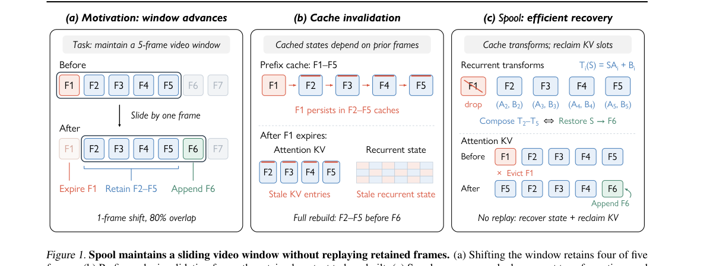

*Result - Architecture of the hybrid VLM. Multiple input frames*

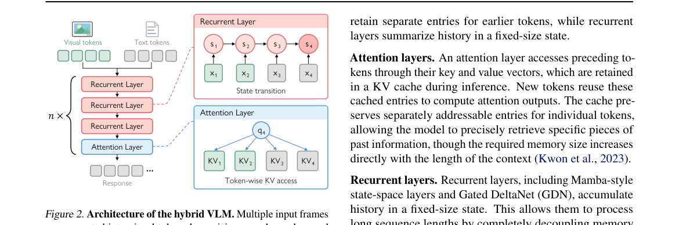

**Why this ranks #13**: 线性循环层的更新对状态是仿射变换（s_t = A_t s_{t-1} + b_t），因此每帧的影响可缓存为一个可组合的变换，Spool 由此无需重放帧就能把过期帧从递归状态中精确移除；在覆盖 0.8B–122B 开源混合 VLM 的 4 个视频推理基准上，20 项模型-基准测试的 p95 首 token 延迟全部最低，几何均值比更好的 vLLM 基线快 6.6×（最高 35.7×），准确率平均还高 2.3 个点。

---

### 14. SpecLook: Speculating Where to Look for Fast and Reliable Agentic MLLMs

**arXiv**: [2611.23483](https://arxiv.org/abs/2611.23483) | **Score**: 8.7 (relevance 9 x 0.7 + quality 8 x 0.3) | **Direction**: `vlm_core` | **Tags**: LLM-VLM, agentic-mllm, speculative-decoding, zoom-in-tool, high-resolution, uncertainty, University of Wisconsin–Madison | **Categories**: cs.AI, cs.CL, cs.CV, cs.LG | **Pages**: 34

**Authors**: Xi Ding; Jiawei Zhang

**Affiliation**: University of Wisconsin–Madison

**Abstract**

> Agentic multimodal large language models (MLLMs) that think with images interleave reasoning with zoom-in tool calls. However, this sequential loop is slow, and its answers carry no reliability score. Prior speculation of tokens, reasoning steps, or answers keeps the loop, and answer speculation also accepts confident errors. We find that the loop mostly adds one zoom-in step, with which a small model is ahead of the agent on most splits. Our key insight is to speculate the agent's next observation, which, unlike a drafted answer, can be verified, corrected, and used to test the answer. We propose SpecLook, a training-free speculate-and-verify framework with three levels. A small model drafts a glimpse and re-answers from it, and the question ends if the answer is unchanged and confident. Otherwise, the agent's large model verifies and corrects the glimpse without tools, and their answers are fused. Only questions that still lack evidence reach the agent, in one forward pass that SpecLook-Fast skips, so no question runs the loop. The trace scores every answer's reliability without labels. Extensive experiments on V*, HR-Bench, and POPE show that both are more accurate than every baseline on every split. SpecLook reaches 87.2% and 86.2% mean accuracy with 7.7x and 4.7x speedups over the DeepEyes-7B and Thyme-RL agents, and SpecLook-Fast reaches 9.9x and 6.3x.

**Key findings**

- **Finding**: SpecLook 相对 DeepEyes-7B 平均准确率 87.2%、加速 7.7×，相对 Thyme-RL 为 86.2% 与 4.7×；SpecLook-Fast 分别达到 9.9× 与 6.3× 加速，单题耗时从 agent 的 9.92 秒降到 1.28 秒与 1.00 秒，同时准确率还分别高出 4.9 与 4.2 个点。
- **Inference**: 答案草稿无法验证，而「看哪里」的观察草稿可以被裁剪区域本身核验并纠正，所以把投机对象从答案换成观察既能提速也能拒掉自信的错答。
- **Recommendation**: 做高分辨率 agentic 视觉问答时优先投机「下一个观察」而非最终答案：小模型起草 glimpse 并重答，一致且置信度不低于 98% 即退出，否则升级到大模型核验。

**Key figures**

*Framework - Accuracy and speed with DeepEyes-7B as the expert. (a) Accuracy on each split and speedup over the agent. (b) Mean accuracy over the six splits versus speedup.*

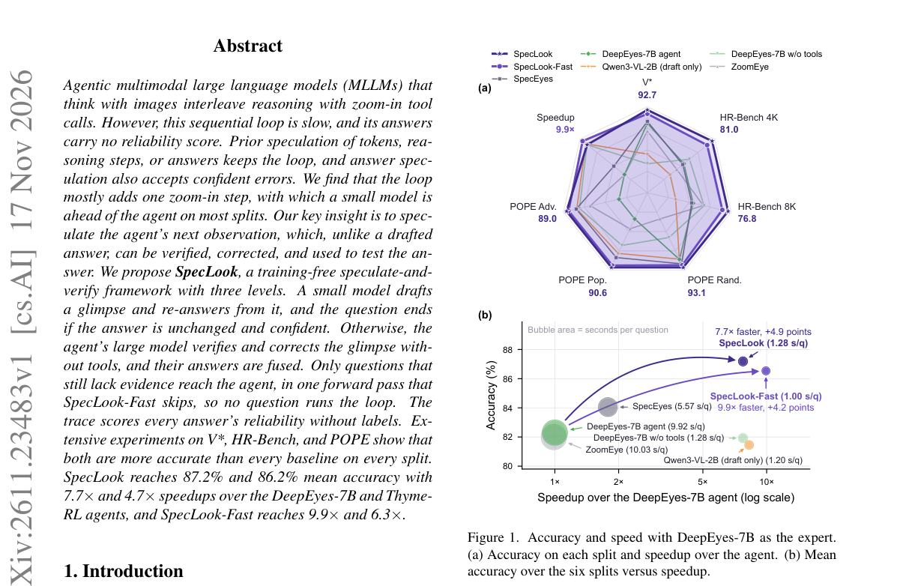

*Result - Three prior paradigms and SpecLook on an HR- Bench 8K question. (a) DeepEyes-7B [85], (b) ZoomEye [59] (schematic), and (c) SpecEyes [32]. Markers 1 to 5 match the bot- tom rows. Speedups us*

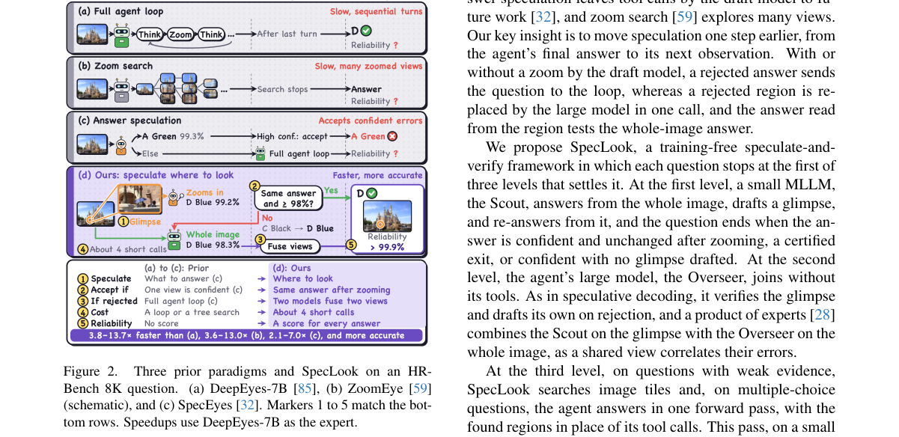

**Why this ranks #14**: SpecLook 训练免用地让小模型先「猜一眼」并据此重答，答案一致且双方置信度都达到 98% 就直接给出，否则由大模型在不用工具的情况下核验并纠正 glimpse；在 V*、HR-Bench、POPE 上比所有基线在每个 split 都更准，相对 DeepEyes-7B 与 Thyme-RL 达到 87.2% 与 86.2% 的平均准确率与 7.7×、4.7× 加速，SpecLook-Fast 加速 9.9× 与 6.3×。

---

### 15. Read Together, Answer Apart: How Earlier Questions Help Vision-Language Models Look

**arXiv**: [2611.24785](https://arxiv.org/abs/2611.24785) | **Score**: 8.7 (relevance 9 x 0.7 + quality 8 x 0.3) | **Direction**: `vlm_core` | **Tags**: LLM-VLM, co-asking, attention-mask, decoding-mask, vlm-eval, training-free, South China Normal University | **Categories**: cs.CV | **Pages**: 20

**Authors**: Xinyi Guo; Kaile Huang; Xitong Ling; Mingyi He; Chende Zheng; Jianyu Xu; Chao He; Dongqing Song

**Affiliation**: South China Normal University; Tsinghua University; Beijing University of Chemical Technology; Xi'an Jiaotong University

**Abstract**

> Vision-language models (VLMs) are often asked several questions about the same image in a single prompt (co-asking), yet existing evaluations report conflicting accuracy gains and hallucinations at the prompt level without tracking how individual answers change. By pairing each question's single-question and co-asked answers across 22 open-weight VLMs (1B-35B), we find that erratic net shifts reflect two opposing effects: on Densely Captioned Images (DCI), every model repairs 15.4%-29.8% of its single-question errors under co-asking, while the share of correct answers turned wrong falls from 30.8% on weaker models to 4.7% on stronger ones. Across all 14 models supporting custom attention masks, we show through attention readouts and layer-window interventions that earlier same-image questions read visual information into their question tokens in the early-to-middle layers during prefill, helping later questions concentrate image attention onto their queried targets. This visual help accumulates across the scene even across non-overlapping regions, whereas blocking earlier questions from attending to the image lowers both target localization and accuracy in all 14 models. While cross-question help is established during shared question reading, part of the co-asking damage enters later during answer decoding when the decoder attends to other question stems. We therefore introduce Read Together, Answer Apart, a training-free decoding mask that keeps shared prefill intact and isolates each answer from other stems, improving co-asking accuracy on 12 of 14 models on DCI (up to +4.71 percentage points, closing 70% of the pooled gap to asking alone) and on 10, 8, and 5 of the 14 models on WebUI, FinTabNet, and GQA (up to +11.4, +5.3, and +1.1 points).

**Key findings**

- **Finding**: 在 14 个支持自定义掩码的模型上，前序同图问题在 prefill 的早中层把视觉信息读进自己的问题 token，使后序问题的目标注意力提升到单独提问的 1.01–1.55 倍；屏蔽前序问题看图会让 14 个模型的目标定位与准确率全部下降（合计 −1.77%）。
- **Inference**: 共问带来的收益发生在共享读取阶段、伤害发生在答案解码阶段，因此可以只切断后者而完整保留前者。
- **Recommendation**: 在同一个 prompt 里问多个问题时不要简单屏蔽前序问题，改用「共享 prefill、各自答案后重新索引 position id」的解码掩码，可保住跨问题的视觉收益。

**Key figures**

*Framework - Earlier questions help a later question find its target. Two repaired DCI examples on Gemma-4-12B (layers 17, 23, 29 of 48 at the final question token; answers abbreviated). Each pair shares*

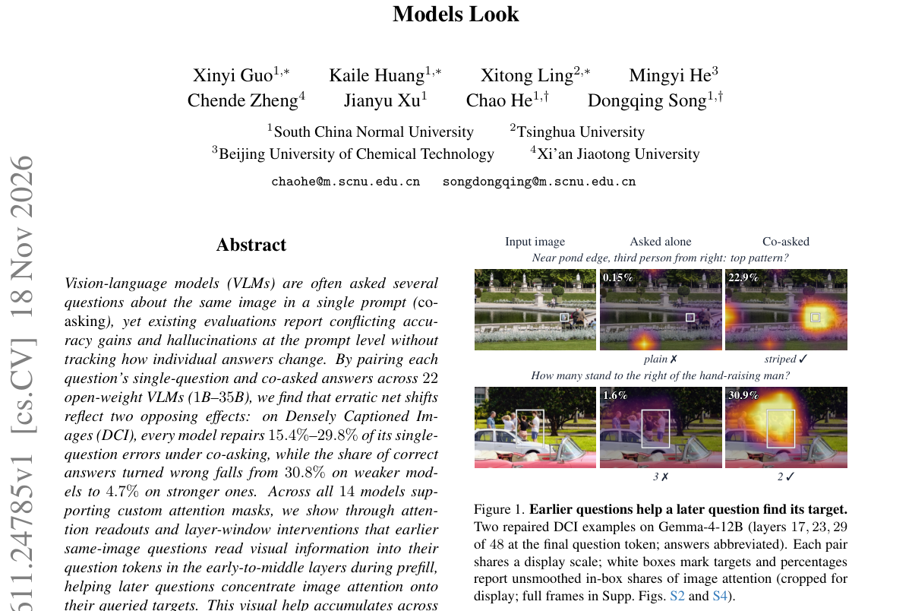

*Result - Repair, damage, and preceding-context effects across 22 VLMs on DCI (one shared question order across all 22 models and panels). (a) Single-question accuracy (1-Q), paired co-asking accuracy*

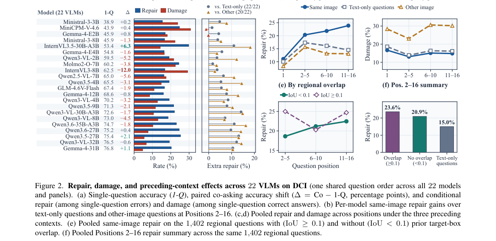

**Why this ranks #15**: 在 22 个 1B–35B 开源 VLM 上配对单问与共问答案，发现净变化由两种相反效应叠加：共问能修好 15.4%–29.8% 的单问错误，而把正确答案改错的比例从弱模型的 30.8% 降到强模型的 4.7%；Read Together, Answer Apart 用免训练解码掩码保留共享 prefill、隔离各答案，在 14 个可加掩码模型的 DCI 上 12 个提升，最多 +4.71 分。

---

### 16. The Elephant in the Question: Unified Models Picture the Concepts Behind Their Answers

**arXiv**: [2611.24793](https://arxiv.org/abs/2611.24793) | **Score**: 8.7 (relevance 9 x 0.7 + quality 8 x 0.3) | **Direction**: `vlm_core` | **Tags**: LLM-VLM, mechanistic-interpretability, unified-model, hidden-state-visualization, diffusion-lens, concept-recovery, Technische Universität Darmstadt | **Categories**: cs.CL, cs.CV, cs.LG | **Pages**: 32

**Authors**: Tobias Braun; Marcus Rohrbach; Lorenzo Cavallaro

**Affiliation**: Technische Universität Darmstadt; University College London; Mohamed bin Zayed University of Artificial Intelligence

**Abstract**

> Visualizing intermediate representations could help us inspect the reasoning steps underlying a model output. Unified multimodal models offer this opportunity by combining understanding and generation in one architecture. Their image generators can access representations formed while processing text. We introduce the V-lens, which uses this connection to visualize a chosen token's hidden state without training a decoder. Across four diffusion-based and two purely autoregressive unified models, the resulting images reveal key intermediate concepts that connect a question to its answer even when the concepts are never named explicitly. Controlled tests show how this content changes with context, token position, and depth. We then introduce lens tuning, which supervises selected hidden states with pictures through the V-lens. Across BAGEL, SenseNova-U1, and HunyuanImage-3.0, the rate of correct visualizations of pronoun referents rises from 2-11% to 86-94%. Surprisingly, such visual supervision also improves text answers without supervising the answer tokens directly. Code is available at https://github.com/multimodal-ai-lab/V-lens.

**Key findings**

- **Finding**: 未命名物体测试中 BAGEL 只有 2/30、Show-o2 8/30、SenseNova-U1 4/30、HunyuanImage-3.0 6/30 能被正确可视化，随机重标注基线下 p 值低至 0.004；20 个双义词里 Show-o2、SenseNova-U1、HunyuanImage-3.0 各命中 15/20，BAGEL 为 12.5/20。
- **Inference**: 模型内部确实存在可被绘制的中间概念，只是没有被文本通道命名出来，因此用模型自己的生成能力去读这些状态是一条现成的免训练通路。
- **Recommendation**: 要检查统一模型究竟「看到」了什么，直接用 V-LENS 在不同层读同一个 token 的隐状态并画出来，再对照 token 位置、上下文与深度的变化做对照实验。

**Key figures**

*Framework - All four unified vision-language models correctly answer the question with “Africa” without mentioning the “elephant” explicitly. The V-LENS reveals the elephant as an intermediate concept i*

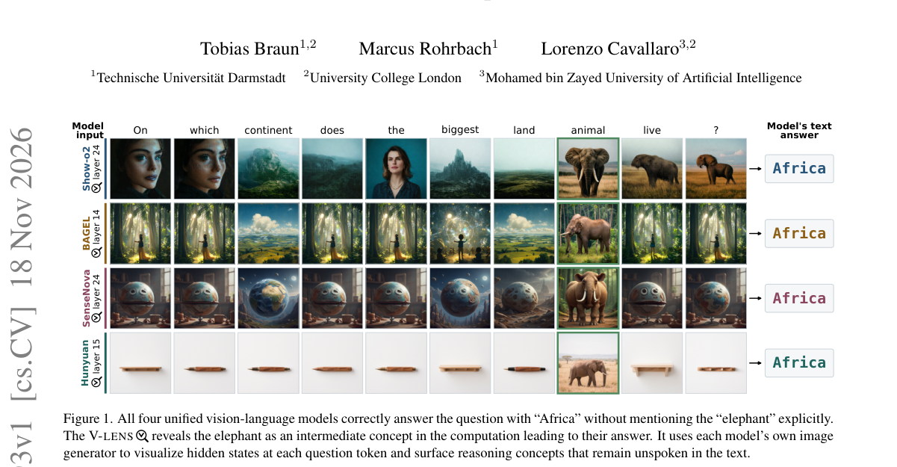

*Result - The V-LENS visualizes a hidden state through the model’s own image generator. Top, we take the state entering layer ℓat the token animal and center and rescale it with Eq. (1). The resulting*

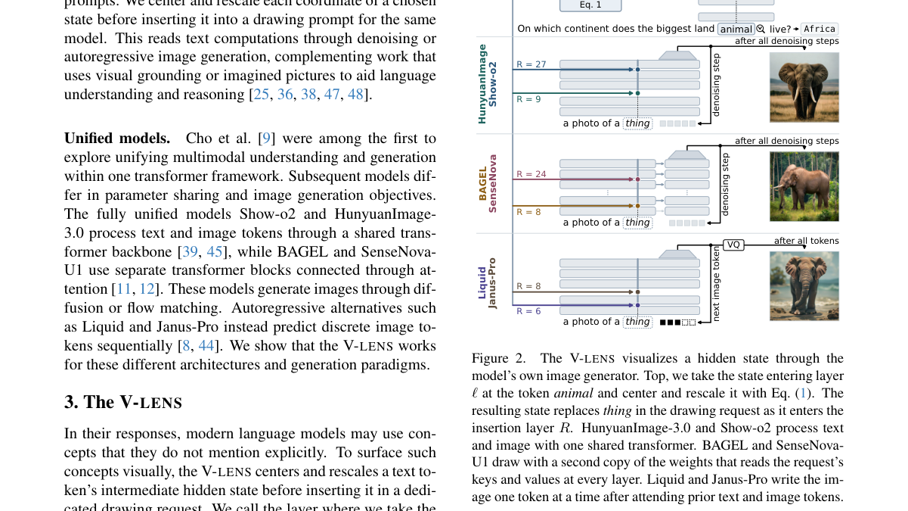

**Why this ranks #16**: V-LENS 直接借用统一多模态模型自带的图像生成器把某个 token 的隐状态画出来，无需训练解码器；在 BAGEL、SenseNova-U1、HunyuanImage-3.0 上正确可视化代词指代对象的比例从 2%–11% 提升到 86%–94%（lens tuning 之后），而且纯视觉监督还顺带改善了文本回答。

---

### 17. Ultimate3D: Teaching Multimodal LLMs 3D Camera-Object Relations by Large-Scale Visual Instruction Data

**arXiv**: [2611.24795](https://arxiv.org/abs/2611.24795) | **Score**: 8.7 (relevance 9 x 0.7 + quality 8 x 0.3) | **Direction**: `vlm_core` | **Tags**: LLM-VLM, synthetic-data, visual-instruction-tuning, camera-geometry, 3d-assets, controlnet, Amazon | **Categories**: cs.CV | **Pages**: 34

**Authors**: Liu He; Yizhi Song; Ruiqi Xu; Baris Sarper Tezcan; Xiao Zeng; Albert Y. C. Chen; Lu Xia; Shashwat Verma; Sankalp Dayal; Min Sun; Cheng-Hao Kuo; Daniel Aliaga

**Affiliation**: Amazon; Purdue University

**Abstract**

> Multimodal Large Language Models (MLLMs) struggle with accurately capturing camera-object relations, especially for object orientation, camera viewpoint, and camera shots. This stems from the fact that existing MLLMs are trained on images with limited diverse camera-object relations and corresponding textual descriptions. To address this, we propose a synthetic generation pipeline to create large-scale 3D visual instruction datasets. Our framework takes 3D assets as input and uses rendering and diffusion-based image generation models to create photorealistic images preserving precise camera-object relations. Additionally, large language models (LLMs) are used to generate text prompts for guiding visual instruction tuning and controlling image generation. We create Ultimate3D, a large-scale 3D-grounded 2D visual instruction dataset. Ultimate3D consists of 240K VQAs with precise camera-object annotations, and corresponding benchmark. MLLMs fine-tuned on our proposed dataset outperform commercial models by a large margin, achieving an average accuracy improvement of 29.7% on camera-object relation recognition tasks. Our code, dataset, and benchmark will contribute to broad MLLM applications.

**Key findings**

- **Finding**: 相机-物体相对位姿被显式参数化为 β = (φ, θ, D)：朝向角 φ∈[0, 2π)、视点仰角 θ∈[−π/2, π/2] 与距离 D；数据集含 240K 条 VQA 与 8K 条基准，微调后的开源 MLLM 在相机-物体关系识别上平均提升 29.7%，超过 GPT-5.5、Gemini-3.5 等商用模型。
- **Inference**: 商用模型在这类任务上落后源于训练数据缺少可控的相机-物体几何真值，而不是容量不足，用渲染出的几何先验补齐这块最省事。
- **Recommendation**: 要补 MLLM 的相机视角与物体朝向能力，优先用 3D 资产加渲染几何先验加 ControlNet 合成大规模指令数据，而不是逐张手工标注真实照片。

**Key figures**

*Framework - Generating Synthetic Visual Instruction Dataset. Our framework uses open-sourced 3D assets to generate photo-realistic images with precisely controlled camera-object relation. Corresponding te*

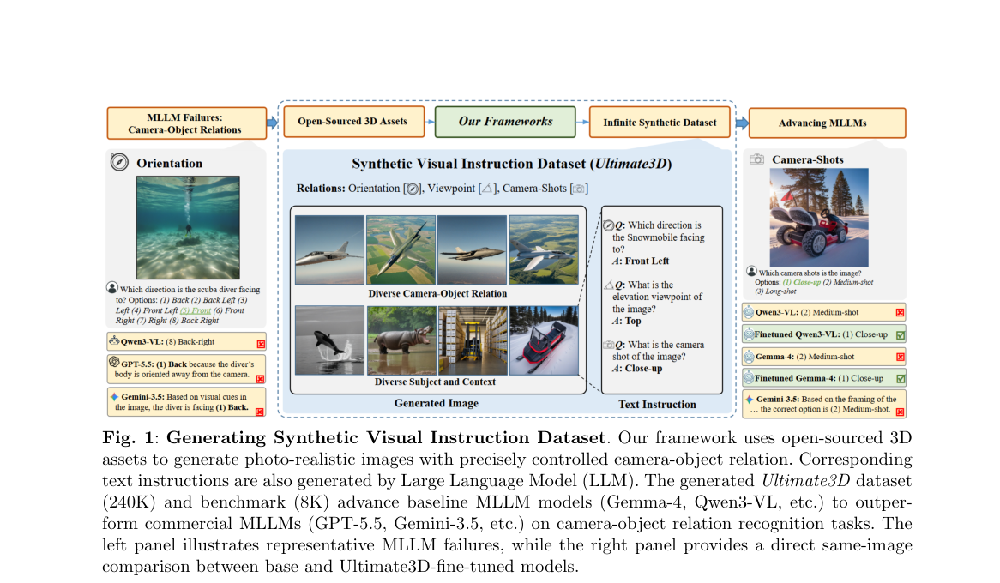

*Result - Our Framework. Each shade box corresponds to a section in Sec. 3. Given open-sourced 3D assets, our approach leverages a 3D Renderer to generate 3D visual priors (Iβ) preserving ground truth c*

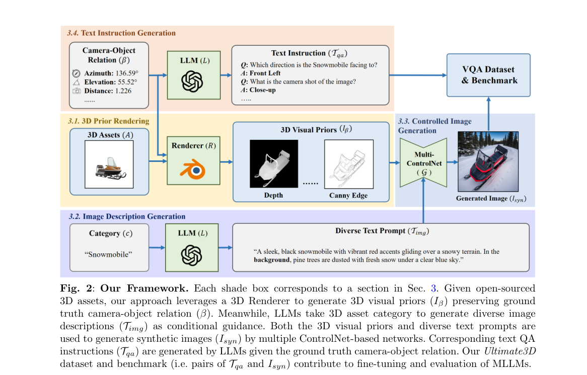

**Why this ranks #17**: 用开源 3D 资产经 Blender 渲染出深度、边缘、分割等几何先验，再以 ControlNet 生成保留精确相机-物体关系的照片级图像，配 240K 条带精确标注的 VQA 指令数据与 8K 基准；用其微调的开源 MLLM 在相机-物体关系识别上平均比商用模型高 29.7 个百分点。

---

## LLM / VLM 的 RL 与偏好优化 · `llm_vlm_rl` (1 papers)

多模态 RL 今天只有 1 篇入选。ViStep-RL 把长程视觉 agent 建模成依赖图上的证据子目标，由验证器判定证据支持并用图势变化给出净进度信号，再配主动记忆写入；ViInteract 上 Qwen2.5-VL-7B 严格完成率 60.0%（基座 10.0%、SFT 46.5%），通用交互框架下答准率 59.5%，比 6 个通用模型中最高者还高 24.0 分。`llm_vlm_rl` 的方向基准是 5 篇，而候选池里 primary 落在该方向的只有 13 篇、rel≥9 仅 1 篇，本轮按弹性配额让出 4 个名额。

### 18. ViStep-RL: Stepwise Reinforcement Learning for Long-Horizon Visual Agents

**arXiv**: [2611.24170](https://arxiv.org/abs/2611.24170) | **Score**: 8.7 (relevance 9 x 0.7 + quality 8 x 0.3) | **Direction**: `llm_vlm_rl` | **Tags**: LLM-VLM, visual-agent, verifier-guided-reward, graph-potential, active-memory, multi-turn-tool-use, Southeast University | **Categories**: cs.CV | **Pages**: 19

**Authors**: Junyang Chen; Yao Qin; Xiao Li; Ningchao Wang; Yiguo Qiao; Wenbin Li; Xin Geng

**Affiliation**: Southeast University; University of Science and Technology of China; University of Bath

**Abstract**

> Long-horizon visual agents must do more than inspect images: they must turn observations into evidence that remains usable as a task unfolds. Existing active-perception methods teach agents where and how to look, while a final-answer reward gives little structure for deciding which observations satisfy dependent subgoals or should be retained for later use. We present ViStep-RL (Visual Stepwise Reinforcement Learning), which models execution as a dependency-linked graph of evidence-bearing subgoals. A verifier tracks which subgoals are supported by valid evidence, and changes in graph potential provide a net-progress learning signal; an active memory protocol preserves evidence across turns and links retrieval to downstream use. On ViInteract, ViStep-RL reaches 60.0% strict completion with Qwen2.5-VL-7B, compared with 10.0% for the base model and 46.5% after supervised fine-tuning. Controlled studies show that incremental task-state rewards outperform cumulative rewards by 3.2 points, while active evidence writing improves strict completion by 7.75 points over automatic writing. Under a common interaction framework, the task-trained ViStep-RL policy achieves 59.5% answer accuracy, 24.0 points above the strongest of six general-purpose reference models. Held-out episodes confirm the gain at both Qwen scales, and gains extend to three external visual reasoning benchmarks.

**Key findings**

- **Finding**: Qwen2.5-VL-7B 在 ViInteract Core200 上严格完成率 60.0%（基座 10.0%、SFT 46.5%、同预算标准 GRPO 48.5%），3B 上从 15.0% 提到 20.5%；统一交互框架下答准率 59.5%，比六个通用模型中最强者高 24.0 个百分点。
- **Inference**: 增益来自奖励形状而非 backbone 规模——增量图势奖励比累计奖励高 3.2 分（25.8% 对 22.6%，McNemar p=0.0113），主动证据写入比自动写入高 7.75 分，说明长程视觉 agent 的真瓶颈是「哪条观察算证据、要不要留存」。
- **Recommendation**: 复现时优先把任务拆成带前置依赖的可验证子目标图，用图势增量而非终局奖励做 shaping，并让策略自己决定写什么证据；同时接受代价——输入 token 增至 8.67 倍、单 episode 延迟从 23.58s 升到 37.00s。

**Key figures**

*Framework - ViStep-RL: from visual observations to verified task progress. (a) Source-grounded examples illustrate object counting, pose measurement, and chart reading. (b) Tool observations are stored*

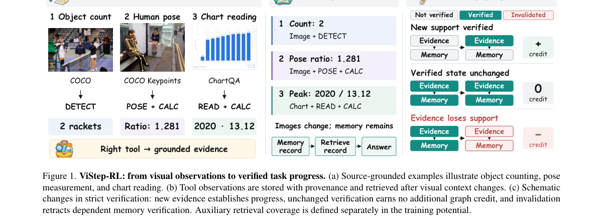

*Result - Action budget and visual horizon. (a, b) Qwen2.5-VL-3B SFT and ViStep-RL on 200 episodes per budget. (c) Qwen2.5-VL-7B Strict completion on Core200, grouped by visual turns; episode counts a*

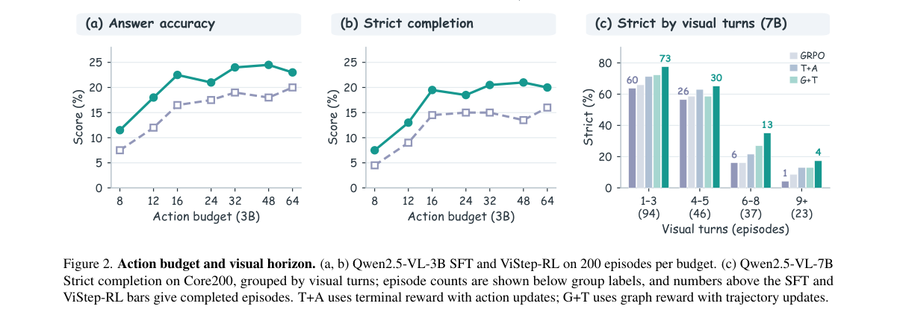

**Why this ranks #18**: 本 direction 唯一入选的一篇，也当方向门面：把长程视觉 agent 的执行建模成带依赖关系的证据子目标图，验证器按图势增量发放净进展奖励、主动记忆协议跨轮保留证据。Qwen2.5-VL-7B 在 ViInteract 上严格完成率达 60.0%，基座仅 10.0%、SFT 46.5%、同预算标准 GRPO 48.5%，也就是比标准 GRPO 高 11.5 个百分点。

---

## Footer

- Total papers reviewed across all 4 axes: 60
- llm_vlm axis final count: 18
- Wild-cards in this axis: 0
- Figure assets: 2026-11-20/res/

Generated by `mine-arxiv-daily-digest` skill. Sister file: `2026-11-20_llm_vlm_entry.md`.
