# Mine Arxiv Daily Digest - 2026-11-20 (具身智能与世界模型 Axis, 20 papers)

**Generated**: 2026-11-20 01:41 CST

**Source**: arXiv cs.CV, cs.SD, eess.AS, cs.CL, cs.AI, cs.RO, cs.LG, cs.IR submissions, listing day 2026-11-17,2026-11-18 (announced 2026-11-17 01:00 UTC / 2026-11-19 01:00 UTC)

**Batch window**: 2026-11-16T19:00:00Z .. 2026-11-18T19:00:00Z（arXiv 公告批次横跨两个 UTC 日：从前一日的美东 14:00 截止时刻起算（EDT 为 18:00Z，EST 为 19:00Z），到当日的同一时刻为止）

**Axis**: world_embodied (20 papers, base 15, cap 20)

**Directions**: world_model (7), embodied_ai (13)

**Selection**: 20 papers ranked by relevance x quality, with 0 wild-card slots

**Day total**: 60 papers across 4 axes (target 60)

**Scope**: 世界模型、学习型模拟器与具身智能，含移动操作、人形控制、触觉反射、VLA 策略与面向具身任务的强化学习

**Wild-card**: 0 篇 —— 本 axis 已经打到 AXIS_CAP = 20，没有任何可用的补位名额；两个方向合计 32 篇 rel≥9 争 20 个位置，落选的 12 篇按「over quota」如实记录。

> **本 axis 撞到 AXIS_CAP = 20**：20 篇（`world_model` 7 / `embodied_ai` 13），基准 15。

> 原因很直接：两个方向合计有 **32 篇 relevance≥9**（`world_model` 13 / `embodied_ai` 19），20 个 axis 名额装不下。

> `embodied_ai` 拿到 13 篇（基准 8，超 5），此时 `axis_surplus = 20 − 15 = 5` 恰好等于其超出量，因此放行；`world_model` 停在自身基准 7 上。

> 落选的 12 篇 rel≥9 全部是 8.7 分（`world_model` 6 篇、`embodied_ai` 6 篇），不是质量不够，而是轴上限是硬约束 —— skill 同时写了「relevance ≥ 9 必进」与「单个 axis 不超过 20 篇」，两者冲突时上限优先。

---

## 世界模型与学习型模拟器 · `world_model` (7 papers)

世界模型今天 7 篇，密度和质量都高。**反事实与安全**：Counterfactual World Models 证明只训事实转移的世界模型无法回答反事实问题，给出无需反事实数据与重训的构造及 O(h²) 误差界与匹配的 minimax 下界，四个渲染模拟器上 counterfactual R² 从 38–46% 提升到 86–96%，事后规划命中率 35–69% 对比 oracle 规划器 14–23%；Risk-Triggered Search 在冻结 JEPA 世界模型里展开动作条件潜前缀训练风险头，用同一风险准则兼作搜索触发与可行性门限，五个任务上 Safe Arrival Rate 比 Direct 高 12.67–41.67 个百分点并保持 100% 动作一致性。**效率与可部署**：SpikWM 用 Spiking Regional Encoding、Bi-Spike Action Encoding 与 Causal Membrane Prediction 构成脉冲 JEPA，Push-T/Two-Room/Reacher/OGBench-Cube 成功率 88.67%/97.33%/99.33%/86.67%，估算算力能耗比 LeWM 降 75.6%；APM 用锚点优先更新把 World Action Model 蒸馏成 1/2/4 步，RoboTwin 2.0 上单步成功率比基线蒸馏高 2.0/1.4 个点、视频 PSNR 30.169→32.317 dB，真实机器人上控制周期延迟比八步教师降 21.3 倍。**记忆与因果**：EPM 让显式知觉状态与神经潜动力学一同在想象中演化并监督 reward head，Memory Maze 13×13 上 30.37 vs 23.37（增益 7.00，CI [3.80,10.21]），并用真实触觉帧验证记忆确实起作用；CaFe 量化了交通仿真里的 intent leakage——现有条件设计会 displace 23–83% 未受指令 agent，它构建 531,099 场景的 WOMD-PACT 并用 CaFe 扩散强制消除泄漏。

### 1. Distilling World Action Models for Efficient Bimanual Manipulation via Anchored Path Matching

**arXiv**: [2611.22592](https://arxiv.org/abs/2611.22592) | **Score**: 9.0 (relevance 9 x 0.7 + quality 9 x 0.3) | **Direction**: `world_model` | **Tags**: embodied, world-action-model, few-step-distillation, flow-matching, bimanual-manipulation, latent-distillation, Astribot | **Categories**: cs.CV, cs.RO | **Pages**: 11

**Authors**: Jialong Liu; Junjie He; Yandu Chen; Bin Zhou; Heng Su; Peijun Tang; Jianan Wang; Changhao Chen

**Affiliation**: Astribot; Harbin Institute of Technology; Chongqing University; The Hong Kong University of Science and Technology (Guangzhou); The Hong Kong University of Science and Technology

**Abstract**

> World Action Models (WAMs) jointly generate future video and robot actions through iterative denoising. Few-step distillation reduces the number of model evaluations, but its coarse updates can move the student away from the teacher's trajectory. We propose Anchored Path Matching (APM), which supervises endpoint and short-transition predictions from states reached by the student. From each state, we continue the teacher to zero noise and use its endpoint and first intermediate state as targets. Modality-routed adapters learn to match both targets from the same starting state. When the two gradients conflict, anchor-priority updates preserve the endpoint gradient and remove the opposing component of the local gradient within each modality. One checkpoint supports 1-, 2-, and 4-step joint generation. The sampling budget can be chosen at deployment without retraining or teacher queries. On RoboTwin 2.0, we train only on Clean demonstrations and evaluate directly on the domain-randomized Random setting. At one step, APM improves closed-loop success over continued base distillation at matched inference budgets by 2.0 percentage points on Clean and 1.4 on Random. Video peak signal-to-noise ratio (PSNR) rises from 30.169 to 32.317 dB, with gains in structural similarity (SSIM) and learned perceptual image patch similarity (LPIPS). On two real-robot tasks, APM improves success over the one-step teacher and reduces control-cycle latency by $21.3\times$ relative to the eight-step teacher.Project page: https://jialonglong.github.io/Anchored-Path-Matching/.

**Key findings**

- **Finding**: 在 RoboTwin 2.0 的 50 个任务、每条件 2500 回合上，APM 一步平均成功率 80.9%（Clean 84.3 / Random 77.5），比同参数量、同训练步数的续训蒸馏基线高 1.7 个点，2 步 88.8%（+0.1）、4 步 91.4%（+1.6）；一步视频 PSNR 由 30.169 升到 32.317 dB，SSIM 与 LPIPS 同时改善。
- **Inference**: 少步蒸馏的瓶颈不在教师质量而在学生偏离教师轨迹——把监督锚定到学生实际到达的状态（restart anchor）并用锚点优先修正剔除冲突梯度后，即使一步采样也能在闭环上超过未蒸馏教师，说明误差来源是轨迹偏移而非容量不足。
- **Recommendation**: 部署 WAM 时优先蒸馏成单 checkpoint 多预算（1/2/4 步可切换、无需重训或查询教师）；真机验证要同时看成功率与视频 PSNR，并注意两步预算的增益只有 0.1 个点，蒸馏收益集中在最极端的一步档。

**Key figures**

*Framework - Student-state deviation in few-step generation. Coarse student transitions can depart from the dense teacher trajectory and change the remaining prediction. APM constructs restart-anchor and*

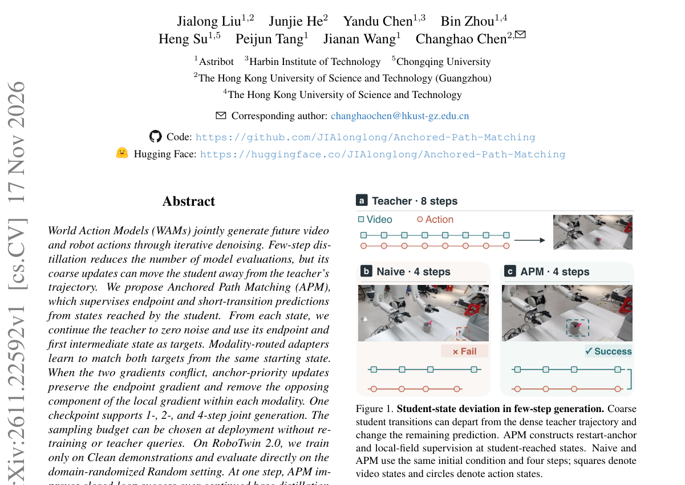

*Result - Anchored Path Matching (APM). (a) One teacher continuation from zr supplies the restart endpoint and next nonzero-time local target. The gray path supplies the Original anchor used in ablati*

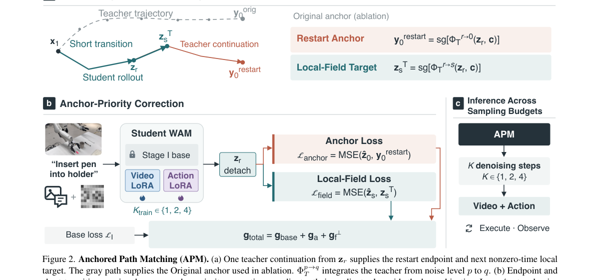

**Why this ranks #1**: 它是把世界动作模型压到少步采样的蒸馏方法：APM 在学生自己到达的状态上同时监督终点与短转移目标，一个 checkpoint 支持 1/2/4 步生成；RoboTwin 2.0 上 1 步平均成功率 80.9%，比同预算续训基线高 1.7 个点，视频 PSNR 从 30.169 升到 32.317 dB，真机控制周期从 4323.6 ms 降到 203.1 ms（21.3 倍）。

---

### 2. SpikWM: Efficient End-to-End Spiking World Modeling for Visual Planning

**arXiv**: [2611.22981](https://arxiv.org/abs/2611.22981) | **Score**: 9.0 (relevance 9 x 0.7 + quality 9 x 0.3) | **Direction**: `world_model` | **Tags**: embodied, spiking-neural-network, world-model, jepa, goal-conditioned-planning, energy-efficiency, [unverified] | **Categories**: cs.CV | **Pages**: 10

**Authors**: Shuhan Ye; Hongbin Yu; Chong Wang; Hui Lu; Jiaming He; Yi Yu; Jiangbo Qian; Xudong Jiang

**Affiliation**: [unverified]

**Abstract**

> Goal-conditioned planning with image observations and goals requires predictions that distinguish visual states and action consequences. Spiking neural networks offer sparse computation, but single-step spikes can obscure motion cues and merge actions with different physical outcomes. We propose the Spiking Latent World Model (SpikWM), an end-to-end joint-embedding predictive architecture (JEPA) with one simulation step per image and one neural update per latent position. Spiking Regional Encoding retains spatial cues through regional pooling. Bi-Spike Action Encoding combines positive and negative binary responses, while Causal Membrane Prediction carries subthreshold evidence across the latent history with learned group-wise time constants. The encoder and predictor are trained jointly on reward-free image--action trajectories using next-embedding prediction and SIGReg. With a common planner, SpikWM achieves mean success rates of $88.67\%$, $97.33\%$, $99.33\%$, and $86.67\%$ on Push-T, Two-Room, Reacher, and OGBench-Cube, respectively, outperforming two spiking baselines. Push-T ablations support each module, and controlled replays examine responses to appearance and physical state changes. Under a matched planning budget, SpikWM reduces estimated arithmetic energy by $75.6\%$ relative to LeWM. Code will be released at https://github.com/ShawnYE618/SpikWM.

**Key findings**

- **Finding**: SpikWM 作为端到端 JEPA，在 Push-T / Two-Room / Reacher / OGBench-Cube 上取得 88.67% / 97.33% / 99.33% / 86.67% 的成功率；Push-T 上它用 16.81M 部署参数拿到 88.67%，而 18.03M 的 Spiking-LeWM 只有 53.33%，同规划预算下估计算术能耗比 LeWM 低 75.6%，300 个共享动作块下给出 270.3 个互异的 Cube 预测。
- **Inference**: 单步脉冲化之所以伤害规划，是因为正阈值把强负电流与近零电流压成同一零响应——Spiking-LeWM 在 Push-T 上把 300 个不同动作块只映射到 120 个预测条件，两条仅首块不同的计划因此得到完全相同的预测与目标代价，最终物体中心相差 60.8 仿真像素。
- **Recommendation**: 要在神经形态硬件上跑世界模型，必须给动作编码补上负向脉冲流并按区域池化保留空间线索；同时要接受能效与性能的取舍——SpikWM 在 Push-T 上的 88.67% 仍低于 LeWM 的 90.4%，Two-Room 97.33% 也低于 DINO-WM 的 99.6%。

**Key figures**

*Result - SpikWM architecture and planning. Spiking Regional Encoding (SRE) combines spatial spike processing, regional pooling and an output projection. Bi-Spike Action Encoding (BAE) uses learned gr*

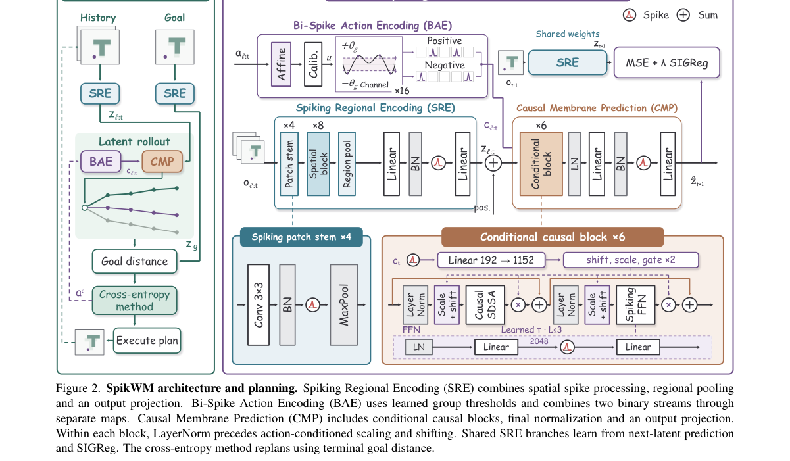

**Why this ranks #2**: 它是端到端脉冲化的 JEPA 世界模型，用每图一次仿真步、每个潜变量位置一次神经更新把世界建模搬到脉冲网络：Push-T / Two-Room / Reacher / OGBench-Cube 成功率 88.67% / 97.33% / 99.33% / 86.67%，同规划预算下估计算术能耗比 LeWM 低 75.6%，部署参数 16.81M。

---

### 3. Risk-Triggered Search: Behavior-Preserving Safe Control

**arXiv**: [2611.24409](https://arxiv.org/abs/2611.24409) | **Score**: 9.0 (relevance 9 x 0.7 + quality 9 x 0.3) | **Direction**: `world_model` | **Tags**: embodied, world-model, safe-control, cross-entropy-method, risk-prediction, process-safety, Zhejiang University | **Categories**: cs.AI | **Pages**: 22

**Authors**: Xinyu Deng; Bohao Lan; Kunpeng Li; Mingkai Yuan; Weihang Pan; Binbin Lin

**Affiliation**: Zhejiang University

**Abstract**

> Pre-trained visual world models generate multi-step action plans from current and goal observations, yet terminal-proximity objectives fail to prevent forbidden-zone traversal or rigid-body collision sliding. Purely visual interfaces may lack analytical dynamics, structured states, or explicit collision geometry, requiring internal prediction of action-conditioned process risk. We propose Risk-Triggered Search (RTS) for frozen Joint-Embedding Predictive Architecture (JEPA) world models. Rather than relying on static state features that cannot distinguish candidate plans sharing an observation, RTS unrolls action-conditioned future latent prefixes in the frozen world model and trains a lightweight risk head with process-violation supervision. To intervene selectively while preserving safe nominal behavior, RTS uses the same predicted prefix-risk criterion as both the search trigger gate and hard feasibility gate: safe nominal plans execute directly, whereas alarms trigger local Cross-Entropy Method (CEM) search to minimize nominal deviation within the feasible set. To prevent isotropic Euclidean minimal modification from shrinking obstacle-directed actions into zero-amplitude stalling, we introduce an amplitude-preserving metric $d_{\mathrm{AP}}$ that retains tangential progression while maintaining a unique zero at the nominal plan. Under unified gating and this unique-zero condition, bypassing safe-state search yields closed-loop trajectories strictly identical to every-step same-kernel search. Evaluated under a process-safety benchmark and Safe Arrival Rate (SAR) metric across five tasks, RTS improves SAR over Direct by 12.67--41.67 percentage points on navigation and articulated control and +2.08/+4.17 pp on Cube/PushT boundary cohorts, maintaining 100% action identity with every-step search while cutting controller time by 17.71%--70.41% across 1,968 paired trajectories.

**Key findings**

- **Finding**: RTS 在冻结 INTACT（JEPA）世界模型上用预测潜前缀训练风险头：TwoRoom / Reacher / PointMaze 的安全到达率比 Direct 高 12.67 / 41.67 / 27.34 个百分点，违规率从 21.50% / 84.50% / 50.00% 降到 2.33% / 37.83% / 8.59%；1,968 条配对轨迹上与逐步 CEM 搜索的动作 100% 相同，控制时间减少 17.71%–70.41%。
- **Inference**: 触发门与可行性门必须共用同一判据、且修正距离在标称解处唯一取零，才能把「只在不安全时搜索」变成闭环轨迹逐条等价于全搜索；只靠静态状态特征的风险头在同观测的多候选计划间无法区分，AUROC 仅 0.500，展开预测潜前缀后升到 0.791。
- **Recommendation**: 在冻结视觉世界模型上加安全修正时，优先采用统一判据加唯一零点的距离度量，并用欧氏最小修改做对照：欧氏投影会把朝向障碍的动作压成零幅停滞，而在保幅度量下最优解是保留 w = v/2 的切向推进。

**Key figures**

*Framework - Schematic of risk-triggered correction. Direct/Guarded A issue obstacle-directed commands (red), RTS-MSE (mean squared error) stalls (gray), and RTS-AP preserves tangential pro- gression (gr*

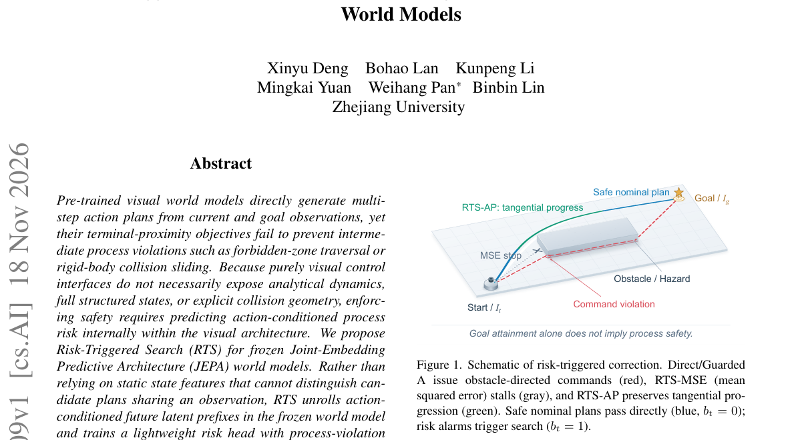

*Result - Overall RTS architecture. Frozen policy π generates nominal plan UD, and world model F unrolls predicted latent prefixes*

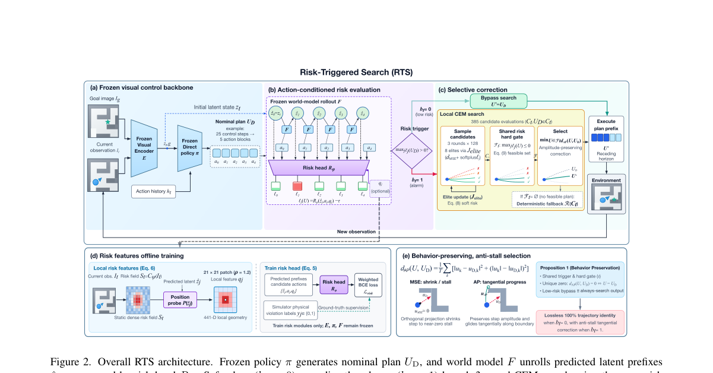

**Why this ranks #3**: 它把冻结 JEPA 世界模型上的安全修正做成可证明无损的触发式搜索：同一前缀风险判据同时充当触发门与可行性门，1,968 条配对轨迹上与逐步搜索的动作 100% 一致却省下 17.71%–70.41% 控制时间；五个任务的安全到达率比 Direct 基线高 12.67–41.67 个百分点。

---

### 4. Counterfactual World Models: JEPAs That Reason About "What If"

**arXiv**: [2611.24778](https://arxiv.org/abs/2611.24778) | **Score**: 9.0 (relevance 9 x 0.7 + quality 9 x 0.3) | **Direction**: `world_model` | **Tags**: embodied, counterfactual-inference, world-model, jepa, residual-correction, causal-inference, Brown University | **Categories**: cs.AI, cs.CV, cs.LG, cs.RO, stat.ML | **Pages**: 78

**Authors**: Randall Balestriero; Yann LeCun; Kerda Varaku

**Affiliation**: Brown University; AMI Labs; New York University; Independent Researcher

**Abstract**

> World models operate in a world they cannot fully observe. When a hidden disturbance, such as a current pushing a boat, changes the outcome of an action, a counterfactual question follows: what would have happened under a different action, subject to the same disturbance? Its answer separates bad decisions from bad luck. We prove that world models trained on factual transitions cannot answer it on their own, whatever their data or capacity. For many physical systems, the observed outcome and a simple property of the dynamics suffice: natura non facit saltus, nature makes no leaps. When actions and disturbances act as separate forces, their interaction is second-order in time, so the counterfactual outcome is, to first order, the observed outcome plus the difference between the world model's predictions under the alternative and factual actions. This yields a counterfactual world model with no counterfactual data, extra parameters, or retraining. For transitions of duration $h$, we prove an $O(h^2)$ bound on the counterfactual error relative to the disturbance variance, establish a matching minimax lower bound from unpaired factual data, and characterize failures at discontinuities, coordinate folds, and disturbances that scale the command. We validate these predictions from pixels with JEPA world models on frozen DINOv2 and masked autoencoder (MAE) encoders. On four rendered simulators, our approach improves counterfactual $R^2$ from $38$--$46\%$ to $86$--$96\%$ with the same world models; on a fifth, an underwater vehicle, it reaches $90$--$94\%$ with sixteen times more factual data. Four further frozen encoders, DINOv3, SigLIP~2, CLIP and EVA-02, give $81$--$95\%$ on the same simulators. In hindsight planning, it finds the action that would have reached the goal in $35$--$69\%$ of events, against $14$--$23\%$ for an oracle planner that knows the simulator but not the outcome.

**Key findings**

- **Finding**: 在四个渲染模拟器上，用同一批事实训练的世界模型加上残差修正后，物理反事实 R² 从 38–46% 提升到 86–96%；换成 DINOv3 / SigLIP 2 / CLIP / EVA-02 四个冻结编码器仍有 81–95%，第五个水下机器人在多 16 倍事实数据下达到 90–94%。
- **Inference**: 反事实误差由动作与扰动相互作用的混合偏导控制——当动作与外扰是分离通道时，该作用对时间步 h 是二阶的，于是观测残差可以直接复用；论文同时给出用非配对事实数据估计时的 minimax 下界，说明这不是数据量或容量问题。
- **Recommendation**: 要在已有世界模型上做反事实推理，先确认动作与外扰是分离通道的，再直接套用 b(a') = 观测结果 + μ(z,a') − μ(z,a)；若动作会放大扰动（乘性故障）或存在接触不连续，该修正会失效，必须补充结构而不是换更大模型。

**Key figures**

*Framework - One observed outcome lets a world model predict what the other actions would have done.*

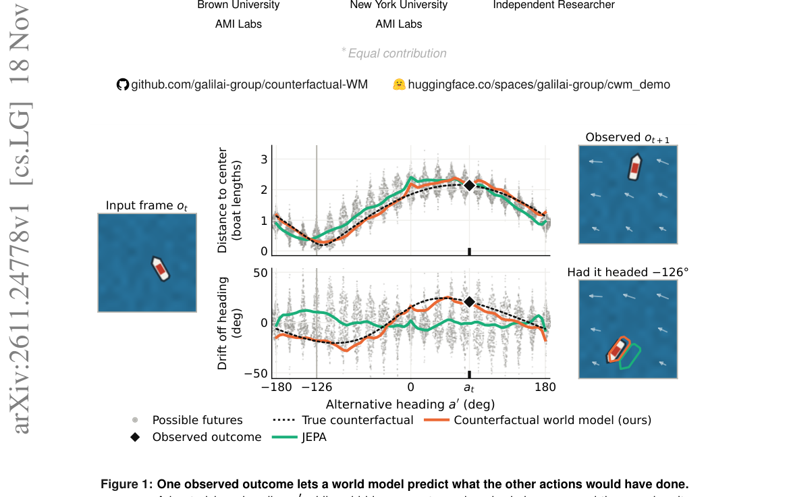

**Why this ranks #4**: 它证明只训练事实转移的世界模型无论容量多大都无法回答反事实问题，并给出零反事实数据、零额外参数、零重训的解法：四个渲染模拟器上反事实 R² 从 38–46% 提到 86–96%，另四种冻结编码器给出 81–95%，后见规划找到可达目标动作的比例 35–69% 对 14–23%。

---

### 5. Phoenix: Learning Scene Structure Representations for Generalizable World-Action Models

**arXiv**: [2611.24938](https://arxiv.org/abs/2611.24938) | **Score**: 9.0 (relevance 9 x 0.7 + quality 9 x 0.3) | **Direction**: `world_model` | **Tags**: embodied, world-action-model, scene-structure-representation, dual-teacher-distillation, data-scaling, cross-embodiment, Institute of Automation | **Categories**: cs.RO | **Pages**: 33

**Authors**: Yupeng Zheng; Chaoyue Li; Linbo Wang; Xiang Li; Yuhang Zheng; Xiaotong Su; Songen Gu; Yichen Zhang; Zebin Xing; Shuai Tian; Jingxiang Guo; Jing Li

**Affiliation**: Institute of Automation, Chinese Academy of Sciences; Anyverse Dynamics; Tsinghua University; National University of Singapore; Fudan University

**Abstract**

> World-action models jointly predict future observations and actions, yet reconstruction-oriented visual representations do not explicitly emphasize the spatial relationships and object-state changes needed for manipulation. We introduce Phoenix, which learns representations of scene structure for world-action modeling. Specifically, Phoenix Encoder enriches DINOv3's general visual semantics through dual-teacher distillation of geometric and spatiotemporal semantic knowledge. Next, CS-VAE causally aggregates and compresses Phoenix Encoder features into generative latents while preserving scene information and spatial layout. Finally, Phoenix jointly predicts these latents, complementary appearance latents, and robot actions, linking scene evolution with action generation. To study pretraining data efficiency, we curate approximately 39,000 hours of egocentric and robot manipulation data for representation learning and use the robot demonstration subset for WAM pretraining. Following benchmark-specific post-training, Phoenix achieves state-of-the-art performance across simulation and real-robot benchmarks spanning single-arm, bimanual, and dexterous manipulation. It demonstrates strong robustness to perturbations, achieving success rates of 94.8% on LIBERO-Plus and 72.4% on RoboTwin 2.0 C2R, alongside strong cross-embodiment transfer and real-world manipulation performance on Bench2Dex and RoboDojo-RealWorld, respectively. Pretraining-scale analysis shows larger performance gains from data scaling than a video-VAE-only baseline, indicating stronger scaling benefits and more effective data utilization. Moreover, Phoenix maintains high success rates when adapted with limited downstream demonstrations, demonstrating strong few-shot adaptation. Our code, pretraining data, and models are available on the project page to help the community reproduce our results.

**Key findings**

- **Finding**: Phoenix 从 54,413 小时数据筛出 39,306 小时（机器人演示 31.09%、第一人称视频 63.58%、UMI 5.33%），LIBERO-Plus 总成功率 94.8%（超 InternW0-Δ 2.0 点）、RoboTwin 2.0 C2R 72.4%（超 π0.5 26.4 点）、Bench2Dex 45.6%（超 GR00T N1.5 17.3 点）、RoboDojo-RealWorld 均值 30.0%。
- **Inference**: 重建保真度并不等于操作质量——把场景几何与时空语义蒸馏进编码器后，PCA48 压缩下 LIBERO-Plus 就从 DINOv3 的 74.4% 升到 84.4%，换成 CS-VAE 再到 88.2%，说明收益来自表示而不是后训练数据量。
- **Recommendation**: 做 WAM 预训练时优先投资表示学习而非堆后训练演示：50% 预训练数据已达 67.7%，超过纯 VAE 基线用全量数据的 47.7%；后训练只需 25% 演示即可拿到 91.1%，接近全量的 94.8%。

**Key figures**

*Framework - Phoenix generalizes across environments and embod- iments. We report success rates (%) on six simulation and real- world benchmarks after benchmark-specific adaptation.*

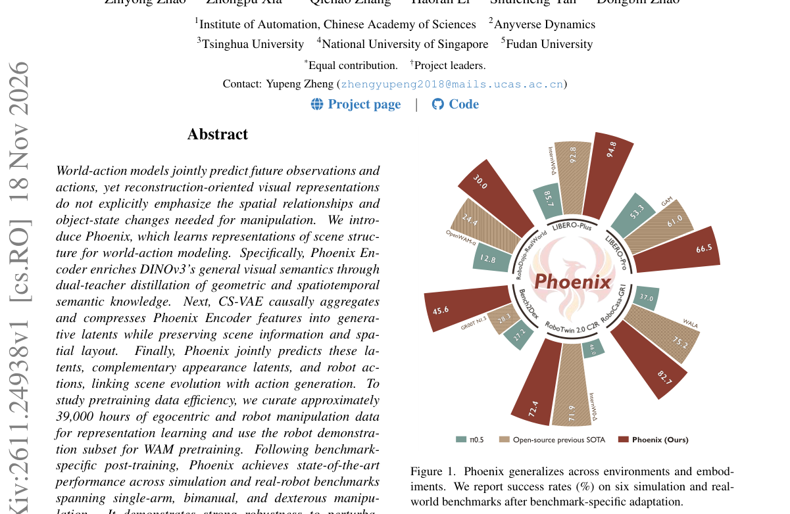

*Result - Phoenix architecture. (a) VGGT-Ωand V-JEPA 2.1-L distill geometry and spatiotemporal semantics into a DINOv3-based Phoenix Encoder. (b) CS-VAE reconstructs frozen Phoenix Encoder features wh*

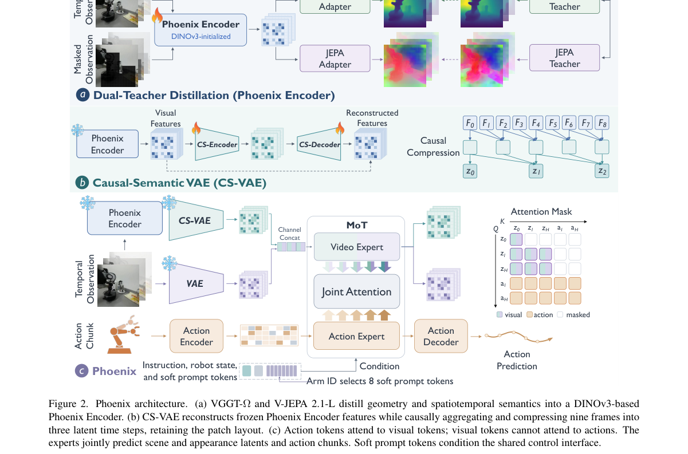

**Why this ranks #5**: 它把「场景结构表示」当成世界动作模型的第一性问题：Phoenix Encoder 用 VGGT-Ω 与 V-JEPA 2.1-L 双教师蒸馏 DINOv3，39,306 小时数据下 LIBERO-Plus 94.8%、RoboTwin 2.0 C2R 72.4%，预训练数据从 25% 增到 100% 涨 27.0 点，而纯 VAE 基线只涨 11.4 点。

---

### 6. Perception into Imagination: Executable Memory for World Models

**arXiv**: [2611.22294](https://arxiv.org/abs/2611.22294) | **Score**: 8.7 (relevance 9 x 0.7 + quality 8 x 0.3) | **Direction**: `world_model` | **Tags**: embodied, world-model, explicit-memory, dreamer, reward-prediction, multimodal, [unverified] | **Categories**: cs.AI, cs.CV, cs.LG, cs.RO | **Pages**: 18

**Authors**: Xianyao Li; Ruitong Tian; Rui Min; Fang Xu; Jing Du

**Affiliation**: [unverified]

**Abstract**

> Physical agents must use what they previously saw or touched after visibility or contact is lost. Their actions change the implications of these remembered facts. We introduce executable perceptual memory (EPM), a world-model framework that advances explicit perceptual state alongside neural latent dynamics during imagination. Its evolving read-out informs reward prediction, value estimation and policy learning. We align reward inputs with the transitions that produced them and supervise the reward head on open-loop rollouts of recorded actions. On Memory Maze $13\times13$, EPM reaches 30.37 return at 1M interactions, compared with 23.37 when the same evolving read-out informs only policy and value on a common perceptual front end: a gain of 7.00 [3.80, 10.21]. The complete method also improves control on $9\times9$ and in MiniWorld. Probes of remembered, out-of-view arrivals show stronger reward anticipation in both visual implementations. Concentration, tactile recovery and real tactile frames demonstrate complementary roles of remembered facts in imagined-policy training, motion-dependent decisions and sensory-content retention. EPM connects persistent perception to the predicted consequences and learning signals of a world model for Physical AI.

**Key findings**

- **Finding**: EPM 在 Memory Maze 13×13 上 100 万次交互达 30.37 回报，policy/value-only 接口为 23.37（+7.00 [3.80, 10.21]，6 个初始化标签全为正）、仅观测访问为 14.18（+16.19）；9×9 上 +6.08，MiniWorld 2M 上 21.83 对 18.09（+3.74）。
- **Inference**: 记忆的价值不在存储而在参与想象训练——奖励头接入按转移对齐的读出后，Memory Maze 9×9 的「记住的目标」奖励预期从 0.154 升到 0.587（+0.434，12/12 标签为正），记忆与可见目标的差距从 0.329 缩到 0.092。
- **Recommendation**: 在 Dreamer 类世界模型里加显式感知记忆时，务必把读出同时接到奖励预测而不只是策略与价值，并按转移对齐奖励输入；同时注意「只持有不演化」反而有害，9×9 与 MiniWorld 上持有读出加奖励访问分别把回报压低 5.10 与 15.15 点。

**Key figures**

*Framework - Executable perceptual memory within a world model. Perception maintains facts beyond immediate visibility. Policy actions advance neural dynamics and explicit local state in parallel, couple*

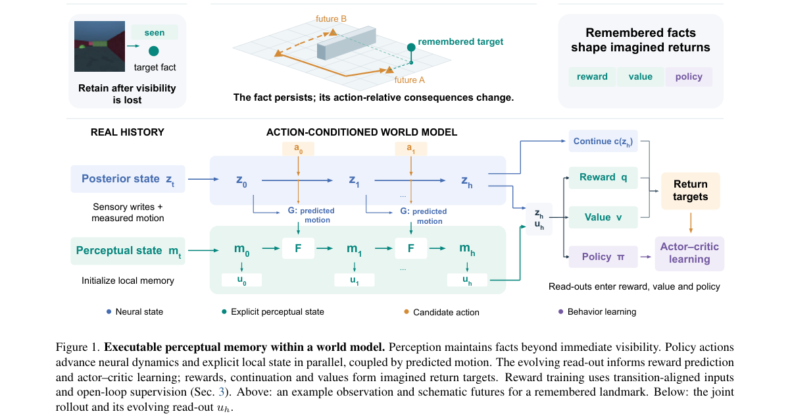

*Result - Control with executable perceptual memory. Mean return at evaluation checkpoints; bars show one standard error over initialization labels. Each panel is a separate experiment with a common f*

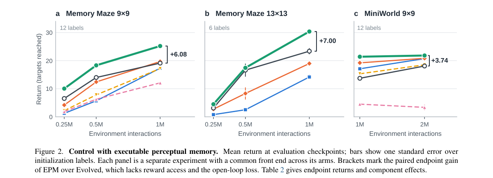

**Why this ranks #6**: 它把「记住」变成可执行的世界模型组件：在 DreamerV3 上让显式感知状态与神经潜动力学同步推进并参与奖励、价值与策略学习，Memory Maze 13×13 在 100 万次交互后回报 30.37，比只喂策略与价值的同类接口高 7.00，比仅观测访问高 16.19。

---

### 7. CaFe: Causally Faithful Conditional Traffic Scenario Generation

**arXiv**: [2611.22855](https://arxiv.org/abs/2611.22855) | **Score**: 8.7 (relevance 9 x 0.7 + quality 8 x 0.3) | **Direction**: `world_model` | **Tags**: embodied, traffic-simulation, intent-leakage, diffusion-forcing, causal-faithfulness, closed-loop, CARIAD SE | **Categories**: cs.CR, cs.CV, cs.RO | **Pages**: 11

**Authors**: Steven Yu Tung; Shubham Vaijanath Phoolari; Christoph Lauer; Abhinav Valada; Steven Peters

**Affiliation**: CARIAD SE; University of Freiburg; TU Darmstadt

**Abstract**

> Language-conditioned traffic simulation enables scalable test scenarios steered by natural language. The goal is to control selected agents while surrounding traffic reacts to their observed behaviour. For example, a vehicle instructed to cut in late should cause the following vehicle to brake only when the manoeuvre becomes observable. Yet simulators can leak private instructions across agents, causing surrounding vehicles to react before the instructed behaviour becomes observable. Such premature reactions defuse desired events and alter the ensuing closed-loop scenario. Existing benchmarks measure what agents do, not what they could have known, leaving this failure unmeasured. We formalise it as intent leakage and address it through evaluation, data and modelling. Our paired intervention test holds an instructed agent's executed trajectory fixed while varying its private instruction, isolating leakage-induced changes in surrounding agents. We also construct WOMD-PACT, an automatically generated, verifiable dataset of 531,099 WOMD scenes with timed behaviour tags with reaction episodes identified through a counterfactual ghost test and grounded private instructions. Finally, we introduce CaFe, a dual-stream diffusion-forcing simulator fine-tuned in closed loop that restricts inter-agent interactions to public beliefs, preserving legitimate anticipation without leaking private intent. Our evaluation reveals that existing conditioning designs displace 23-83% of nearby uninstructed agents through private-intent leakage, even when the instructed agent's executed motion is held fixed. CaFe eliminates measurable leakage while maintaining comparable WOSAC realism (0.763), demonstrating that causal faithfulness can be enforced without sacrificing measured simulation realism.

**Key findings**

- **Finding**: 在 1,000 个 WOMD-PACT 验证场景、每场景 32 次滚动的配对干预测试里，广播式指令让 82.7% 的邻近未受指令车辆在 8 秒内位移超过 0.5 m，读取他人私有未来 token 为 26.7%、ECoSim 为 22.6%；CaFe 测得 0.0%，WOSAC 真实度 0.7631 对单流 0.7628，碰撞率从 5.82% 降到 4.81%。
- **Inference**: 泄漏不是训练不足而是信息接口设计问题——把私有指令只放进本智能体的私有 token、跨智能体只传递由已执行运动推出的公共信念后，构造上不再泄漏，泄漏带来的「抢跑反应」也随之消失，单流基线里后车先动 2.6% 的现象在 CaFe 中归零。
- **Recommendation**: 评测语言条件交通模拟时必须用「固定被指令者执行轨迹、只改私有指令」的配对干预测试，并把 30 m 内位移超 0.5 m 的邻近车辆计为受影响；注意单靠删掉跨智能体注意力会把 WOSAC 真实度从 0.7481 拖到 0.7238。

**Key figures**

*Framework - Intent leakage and how CaFe prevents it. Agent A is privately instructed to cut in late ahead of B, which receives no instruction. Top (existing simulators): A’s intent reaches B through sha*

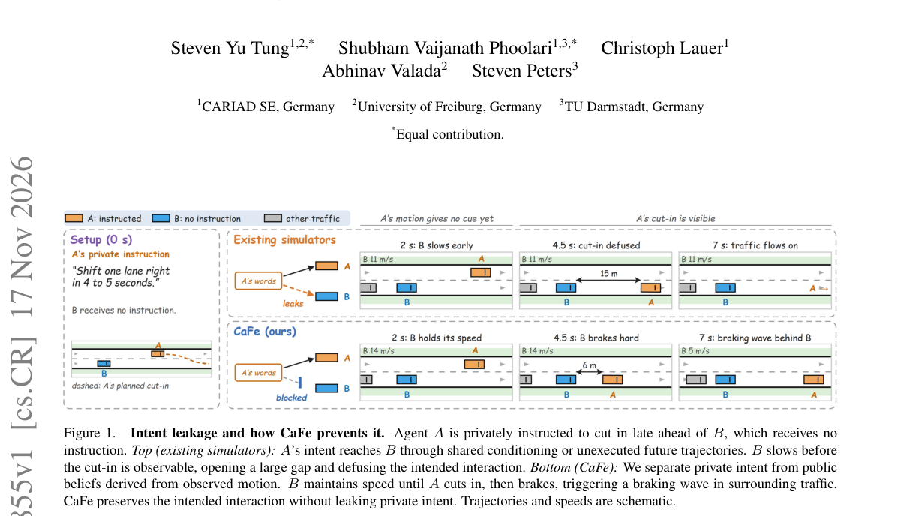

*Result - Measuring intent leakage. We replay the instructed agent’s motion without its private instruction, compare surround- ing agents across rollouts, and quantify leakage along two dimen- sions:*

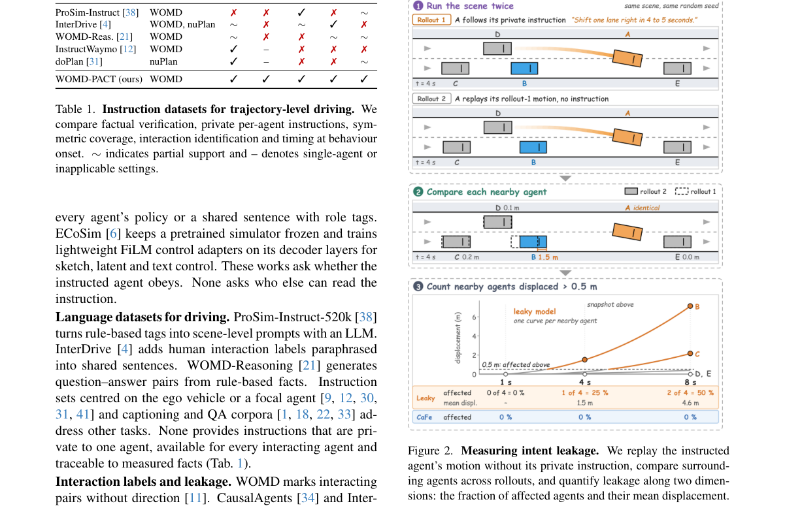

**Why this ranks #7**: 它把「条件生成会不会泄密」变成可测量的问题：配对干预测试显示现有条件设计在指令智能体执行动作固定不变时仍让 23–83% 的邻近未受指令车辆偏移，而 CaFe 把泄漏降到 0.0%，WOSAC 真实度 0.763 与单流基线 0.7628 持平。

---

## 具身智能与机器人学习 · `embodied_ai` (13 papers)

具身方向 13 篇，是本批最大的一块。**通用策略架构**：Body Schema Policy 把关节/连杆 token 放到运动学树上做 body-queried vision，9 个 Unitree G1 全身任务上以 75 倍更少参数追平 Ψ_0 人形基础模型，并在真机 G1 与 Fetch 上复现；BiCAT 用跨臂对称注意力与联合解码器共享双臂运动表征，在 RoboTwin 2.0 十个任务与三形态真机六个任务上平均成功率比八个最强基线高 17.6 个点，每动作块仅 40.5 ms。**动作空间与数据**：TCP4D 以 tool-center-point 为统一动作空间、用共享 4D 场景表示同时跟踪与生成 TCP 轨迹，DROID/RoboLab 绝对轨迹误差 7.60 与 16.07 mm、RoboTwin 生成器成功率 69.19%，跨本体增广让目标机器人成功率提升 41.5%；Ego2X 用 CORE 接触表示（表面锚点 + 相对力 + 抓取模式 + 交互状态）把单目第一视角转成可执行机器人数据，EgoDex 上实现 62.9% 标注接触（官方 HuRo 仅 27.9%），仅用其数据后训 X-VLA 把 RoboTwin 2.0 成功率从 40.5% 提到 67.0%。**触觉**：3DTouch 在机器人基座系统一表达 RGB-D 场景点与五指密集触觉，构造手-物与物-物相对几何关系条件化 VLA，五个真机灵巧任务平均成功率比对应 VLA 基线高 42 个百分点；SPICE 是首个纯触觉条件扩散策略，180 余次真机试验分支操控 95% 成功（最强触觉基线 45%）、未见番茄青柠零样本 87.5%。**视角与泛化**：Homeward 无训练地把部署相机观测规范化回训练视角，LIBERO-Plus 1599 个相机变体下把 OpenVLA-OFT/π0.5/π0/OpenVLA 的成功率从 62.5/76.5/68.0/3.6% 抬到 77.6/95.1/91.2/26.4%。**长程与自改进**：GTI 用观测与执行历史定位当前子任务及阶段、持续偏离时回滚重观测，GR00T 在 RoboCasa365 由 14.6/12.1% 升到 31.8/20.4%、真机 21.7%→59.2%；AeroRSI 让失败的 VLA 策略靠「从修复处继续飞行」自评修复并每轮重锚失败，TravelUAV 上 2B 策略成功率从 46.4% 升到 67.5%、碰撞减半，比先前 SOTA 高 10.6 点且无额外人工标注；RoboBuilder 让编码智能体在真实视频反馈闭环中共同设计机器人硬件与程序，16427 次仿真、135 台实体机器人、66% 仿真通过率可迁移，看到实拍失败视频后重设计可消除 72% 的 1–2 级失败。另有 ALOHA Lightning（运动学示教采集近人类速度的双臂演示，仅 50 条演示即成功率超 80%）与 WAM-Policy（跨形态策略适配 + on-policy 自蒸馏把 WAM 变成四足 loco-manipulation 策略，QLM-Bench 上 77.0% → OPSD 学生 76.7% → RL+M-OPD 85.0%，并在真实 Unitree Go2 Air 部署）。

### 8. Body Schema Policy: Body as the Vision-Action Interface for Efficient Robot Loco-Manipulation

**arXiv**: [2611.22713](https://arxiv.org/abs/2611.22713) | **Score**: 9.0 (relevance 9 x 0.7 + quality 9 x 0.3) | **Direction**: `embodied_ai` | **Tags**: embodied, imitation-learning, body-schema, loco-manipulation, action-chunking, humanoid, Mohamed bin Zayed University of | **Categories**: cs.RO | **Pages**: 11

**Authors**: Lechen Zhang; Chenyuan Chen; Muxin Zhou; Zewen He; Yoshihiko Nakamura

**Affiliation**: Mohamed bin Zayed University of Artificial Intelligence

**Abstract**

> Currently, robots can learn whole-body loco-manipulation through scale: the strongest policies have billions of parameters and still need task-specific fine-tuning. Humans have limited processing capacity, yet learn and act efficiently through a body schema that organizes what they see and how they move. We introduce Body Schema Policy (BSP), an imitation learning policy that builds such a schema into the vision-action interface. Its latent body schema places joint and link tokens on the robot's kinematic tree, where learned screw motions carry features between links. Through body-queried vision, each body part retrieves its own visual evidence, which conditions the denoising of its actions. With this inductive bias, BSP returns an action chunk faster than any policy we compare. Compact, body-specific visual readouts also emerge without spatial supervision: manipulation commands depend strongly on task objects, while locomotion commands respond more broadly to the scene. On nine simulated Unitree G1 whole-body tasks, BSP matches the $Ψ_0$ humanoid foundation model with $75\times$ fewer parameters and nearly doubles Diffusion Policy's success. The same holds on a real G1 and a Fetch mobile manipulator.

**Key findings**

- **Finding**: SIMPLE 基准九个 Unitree G1 全身任务（每任务每难度 10 个回合）上，35.0M 参数的 BSP 总分 221（L0/L1/L2 为 74/76/71），与 2.63B 的 Ψ0（220）、22.9B 的 DreamZero（167）、3.62B 的 π0.5（121）相当甚至更好，而 Diffusion Policy 只有 111；每动作块耗时 13.9 ms 对 Ψ0 的 148.2 ms。
- **Inference**: 有效归纳偏置来自「身体结构 + 身体取像」而非规模——去掉潜身体图后 LPBT 与 XMBP 两项基本归零（23 降到 5、28 降到 0），把身体查询视觉换成单一池化向量总分从 75 降到 60，换成从头训练的 ResNet-18 直接腰斩到 31。
- **Recommendation**: 整机策略优先用运动学图上的螺旋运动表示做结构化归纳偏置，并把视觉按身体部位分派；但不要指望它替代大规模预训练——通用网络在训练范围外的外推误差平均至少是它的 11 倍，且它仍需每任务约 100 条演示。

**Key figures**

*Framework - From the human body schema to a robot’s latent body schema. Left: the human body schema links perception with the body and its movement. Middle: Body Schema Policy (BSP) organizes visual que*

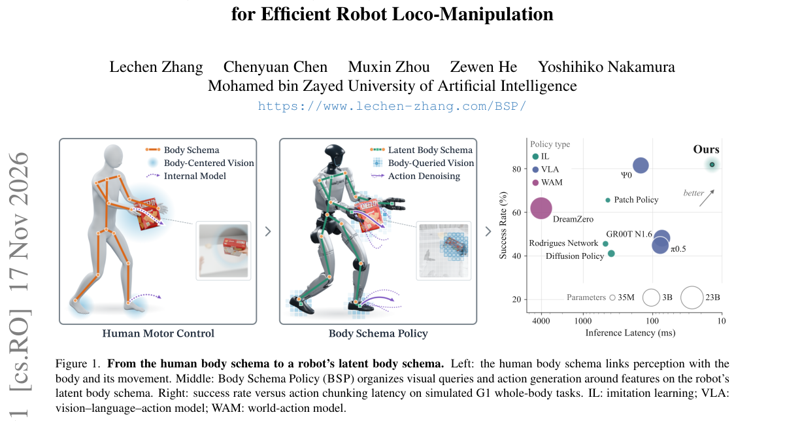

*Result - Body Schema Policy architecture. The state st, denoising step k, and current action hypothesis x(k)*

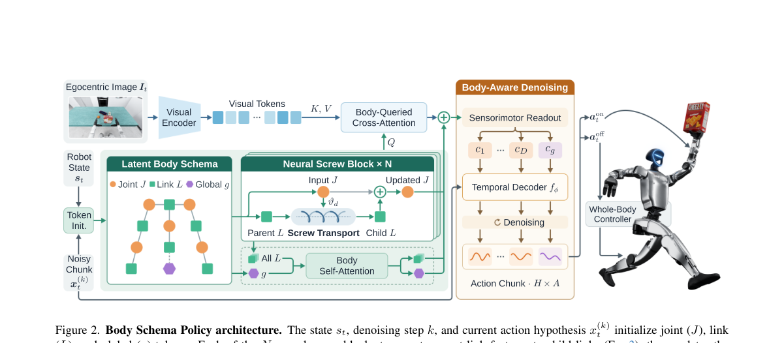

**Why this ranks #8**: 它把身体结构做成视觉-动作接口：35.0M 参数的 BSP 在 SIMPLE 基准的九个 Unitree G1 全身任务上总分 221，与 2.63B 的 Ψ0 打平（参数少约 75 倍），每个动作块只要 13.9 ms 对 Ψ0 的 148.2 ms，而同规模的 Diffusion Policy 只有 111 分。

---

### 9. Homeward: No Place Like the Training View

**arXiv**: [2611.24455](https://arxiv.org/abs/2611.24455) | **Score**: 9.0 (relevance 9 x 0.7 + quality 9 x 0.3) | **Direction**: `embodied_ai` | **Tags**: embodied, viewpoint-robustness, vla-policy, kinematic-rendering, 3d-foundation-model, training-free, Institute of Automation | **Categories**: cs.RO | **Pages**: 22

**Authors**: Mingyang Lyu; Yinqian Sun; Gongce Cao; Guobin Shen; Yuhao Zhang; Lu Jia; Chenfei Yan; Qian Zhang; Pin Lyu; Chen Gao; Bo Wang

**Affiliation**: Institute of Automation, Chinese Academy of Sciences; Zhongguancun Academy; University of Chinese Academy of Sciences; ByteDance; Beihang University

**Abstract**

> Vision-language-action (VLA) policies implicitly assume that third-person cameras remain fixed at their data-collection poses; once a camera is bumped, remounted, or swapped at deployment, task success degrades precipitously even though the underlying task and robot remain unchanged. We present Homeward, a training-free, plug-and-play observation adapter that canonicalizes observations from an uncalibrated deployment camera back into the training view for frozen VLA policies. Our design stems from a closed-loop diagnostic paradox in simulation: while re-rendering perturbed views into the training camera with oracle geometry recovers much of the lost performance, substituting an off-the-shelf feed-forward 3D foundation model can leave the policy worse off than applying no correction at all. This degradation concentrates on the thin, articulated robot arm, which feed-forward depth prediction tears and scatters - yet the arm's exact 3D state is already known from robot kinematics. Homeward exploits this asymmetry: it estimates what is unknown - camera parameters and static scene depth - from the live RGB frame and a single training-view reference, and renders what is known - the moving robot links - directly from the kinematic model. Evaluated across $\sim$300,000 closed-loop episodes spanning four frozen VLAs, Homeward boosts success across all 1,599 camera variants of LIBERO-Plus from 62.5%, 76.5%, 68.0%, and 3.6% to 77.6%, 95.1%, 91.2%, and 26.4% for OpenVLA-OFT, $π_{0.5}$, $π_0$, and OpenVLA, respectively. Without any scene fine-tuning or deployment camera calibration, Homeward extends to 6-DoF random placements, focal-length changes, and, with per-step pose estimation, continuous intra-episode camera drift, while matching or surpassing a calibrated, scene-trained view-synthesis baseline on three of four policies on LIBERO-Plus.

**Key findings**

- **Finding**: LIBERO-Plus 全部 1,599 个相机变体上，Homeward 把 OpenVLA-OFT / π0.5 / π0 / OpenVLA 的成功率从 62.5% / 76.5% / 68.0% / 3.6% 提升到 77.6% / 95.1% / 91.2% / 26.4%；LIBERO-Goal 上仅用 VGGT 做场景修复反而从 79.7% 掉到 72.8%，叠加运动学渲染后回升到 91.4%，与 oracle 重渲染的 90.4% 相当。
- **Inference**: 前馈 3D 模型的失败集中在细长高光的机械臂上，而机械臂的三维几何本来就能从关节角精确推出——把「未知的相机与场景深度」和「已知的机器人几何」分开处理比整帧重投影更可靠；纯单应变换因离面视差未解，则让三个模型都低于不修正基线。
- **Recommendation**: 部署相机被挪动时先试训练无关的观测规范化：首帧用冻结 VGGT 估外参并缓存、后续帧只做静态像素尺度对齐的深度缩放，再用正运动学渲染移动连杆做合成；注意渲染整机会遮住工作区（Goal 成功率掉到 39.0%），且总开销约 0.21 秒/次查询。

**Key figures**

*Framework - Naive 3D scene restoration can leave a frozen VLA worse off than no correction—unless paired with kinematic robot rendering. (a) Displacing the third-person camera (34◦azimuth, 15◦elevation)*

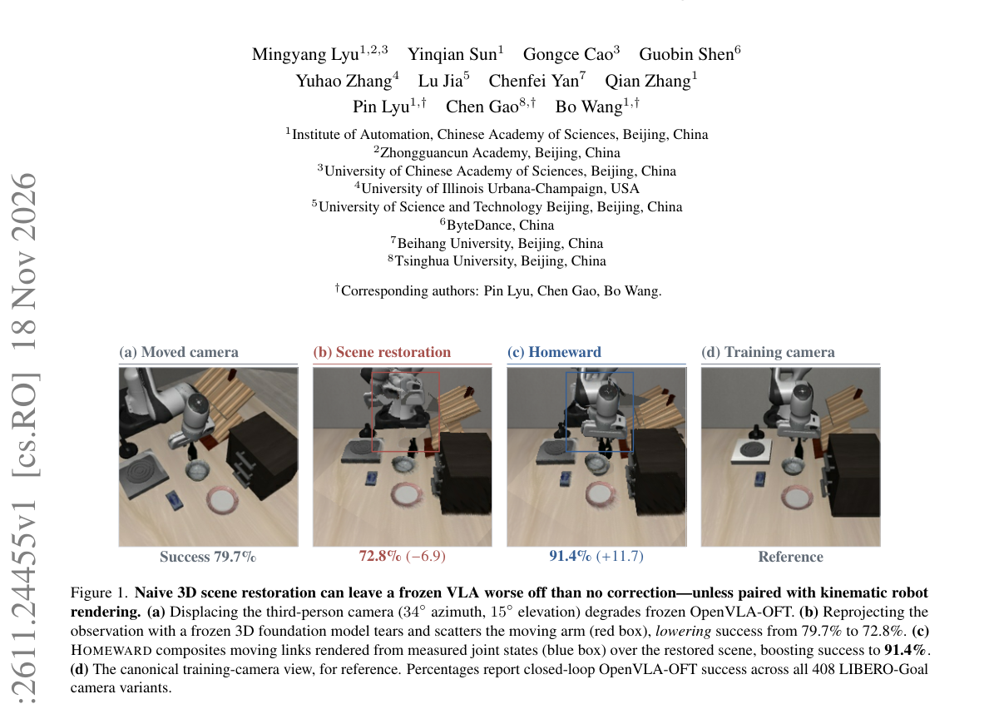

*Result - Overview of HOMEWARD. (a) Monocular scene restoration: At the first policy query, frozen VGGT estimates and caches the deployment camera transform (C′ →C⋆) from [Iref, I′*

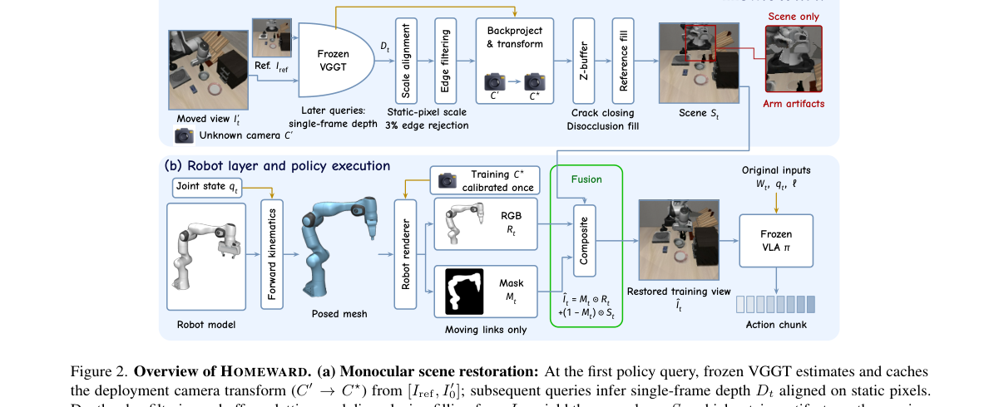

**Why this ranks #9**: 它是无需训练的可插拔观测适配器：约 30 万次闭环回合、四个冻结 VLA、1,599 个 LIBERO-Plus 相机变体上，成功率从 62.5% / 76.5% / 68.0% / 3.6% 提升到 77.6% / 95.1% / 91.2% / 26.4%，且不需要部署相机标定或场景微调。

---

### 10. ALOHA Lightning: Learning Fast and Precise Manipulation

**arXiv**: [2611.21919](https://arxiv.org/abs/2611.21919) | **Score**: 8.7 (relevance 9 x 0.7 + quality 8 x 0.3) | **Direction**: `embodied_ai` | **Tags**: embodied, imitation-learning, high-speed-manipulation, kinesthetic-teaching, test-time-smoothing, bimanual, Stanford University | **Categories**: cs.AI, cs.LG, cs.RO, eess.SY | **Pages**: 8

**Authors**: John Hua Yao. Qi Wu; Yihuai Gao; Chelsea Finn; Zipeng Fu

**Affiliation**: Stanford University

**Abstract**

> Learning from human demonstrations has enabled robots to acquire a wide range of manipulation skills, but learned policies typically execute far slower than ordinary humans. This speed gap is mainly due to lack of an interface for collecting demonstration data at high speed, and the difficulty in training policies that can robustly execute high-speed motions. In this paper, we present ALOHA Lightning (Flash ALOHA), a system for learning fast and precise robotic manipulation. Our system uses kinesthetic teaching to intuitively collect near-human-speed demonstrations on a backdrivable bimanual platform, yielding natural and fast trajectories. We also present a learning pipeline that enables smooth high-speed execution through test-time action smoothing and aligns the visual data distribution between data collection and deployment with masking. Given 50 demonstrations for each task, ALOHA Lightning autonomously completes bimanual tasks such as ball tossing and catching, folding shorts, battery insertion, and bussing tables for over 80% success rates while close to human speed. Project website: https://flash-aloha.github.io/

**Key findings**

- **Finding**: 每任务 50 条演示下，ALOHA Lightning 的叠杯 / 电池插入 / 收桌整段耗时分别为 3.97 / 5.70 / 6.81 秒，对照遥操作基线 8.84 / 17.87 / 16.05 秒；抛球接球整段仅 1.85 秒，六个任务的整体成功率均超 80%。
- **Inference**: 速度瓶颈同时在采集端与执行端——动觉示教把演示采集拉到近人手速，测试时平滑再把相邻动作块重叠区按 sigmoid 权重混合以消除高速下的 chunk 边界抖动；用图像修补替代掩码会把折短裤成功率从 90% 降到 80%，而完全不平滑时该任务成功率掉到 80%。
- **Recommendation**: 要训高速策略先解决数据接口（动觉示教或高频遥操作）再解决执行平滑；不要改用时序聚合，平滑权重下折短裤耗时是 5.94 秒、时序聚合则涨到 11.60 秒；部署前请确认力矩控制与 50 Hz 采集链路能跟住。

**Key figures**

*Framework - ALOHA Lightning. We present a full-stack system for learning precise and high-speed manipulation policies, which can autonomously do bimanual toss and catch in under 2 seconds, bus a full dini*

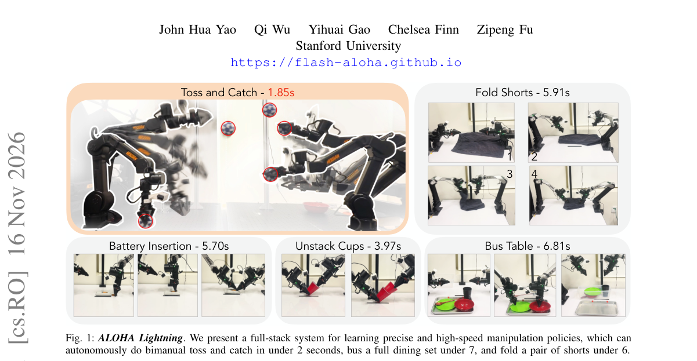

*Result - Hardware Setup. Our printed handles allow for easy operation and data collection.*

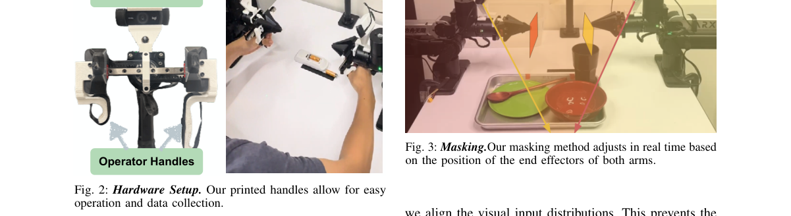

**Why this ranks #10**: 它是近人手速的双臂操作全栈：动觉示教在可反驱平台上采到每任务 50 条近人手速演示，配合测试时动作平滑与按双端执行器位置实时更新的掩码，叠杯整段 3.97 秒（遥操作 8.84 秒）、电池插入 5.70 秒（17.87 秒）、抛接 1.85 秒，各任务成功率超 80%。

---

### 11. Making Future-Predictive Representations Actionable

**arXiv**: [2611.22994](https://arxiv.org/abs/2611.22994) | **Score**: 8.7 (relevance 9 x 0.7 + quality 8 x 0.3) | **Direction**: `embodied_ai` | **Tags**: embodied, world-action-model, transition-space, flow-matching, representation-mismatch, generalization, Xinjiang University | **Categories**: cs.RO | **Pages**: 15

**Authors**: Fangchuan Wang; Hao Zhang; Qiyan Zhao; Huanqi Zhao; Guanting Ye; Xu-Yao Zhang; Yuqing Gao

**Affiliation**: Xinjiang University; Tongji University; Institute of Automation, Chinese Academy of Sciences; University of Science and Technology of China

**Abstract**

> Recent world action models (WAMs) drop future prediction at inference, assuming that representations learned through auxiliary future supervision still benefit action generation. However, our layerwise analysis of Fast-WAM reveals a depth-dependent mismatch: while probes decode future state transitions more accurately from deeper visual layers, the gradients and visual focuses of the future and action objectives increasingly diverge with depth, leaving much of this predictive information unused by the action pathway. To address this issue, we introduce RelayWAM, which adds an explicit transition space between the video and action backbones. Conditioned on the task instruction, robot state, and current action estimate, recurrent transition layers extract step-relevant predictive cues across depth and relay them directly into the action attention, without generating future frames at inference. Experiments show that RelayWAM substantially amplifies the benefit of future supervision, translating into stronger generalization under distribution shifts in both simulation and real-world robot tasks. On LIBERO-Plus, RelayWAM achieves 72.03% mean success, compared to 56.42% without future supervision and 51.50% for Fast-WAM.

**Key findings**

- **Finding**: LIBERO-Plus 上 RelayWAM 总成功率 72.03%，对照 Fast-WAM 51.50%、无未来监督 56.42%、推理时联合生成的 OpenWAM-α 69.2%、DreamWAM 63.4%；标准 LIBERO 四套件平均 98.2%，LIBERO-PRO 44.7%（Fast-WAM 40.7%），额外参数 34.96M、主干 6.02B。
- **Inference**: 问题不在骨干缺乏预测能力，而在未来信息没被动作通路读取——线性探针显示未来监督把预测信息写进深层 Video DiT，但动作敏感子空间解码出的未来 R² 反而低于同维随机子空间；抹除残余未来方向时 Fast-WAM 动作几乎不变，RelayWAM 却在第 12–20 层出现明显偏移。
- **Recommendation**: 复用 WAM 时先做训练焦点归因与未来方向抹除这两个诊断，确认动作是否真的在用未来信息；若未利用，加一层共享权重的 transition 空间把多层预测线索转成动作可读形式，其代价只有 34.96M 参数、不到 0.6% 的推理开销。

**Key figures**

*Framework - Overview of RelayWAM and the representation–utilization gap. Left: Training-focus attribution reveals that existing future- supervised WAMs suffer from an objective mismatch—action relies on*

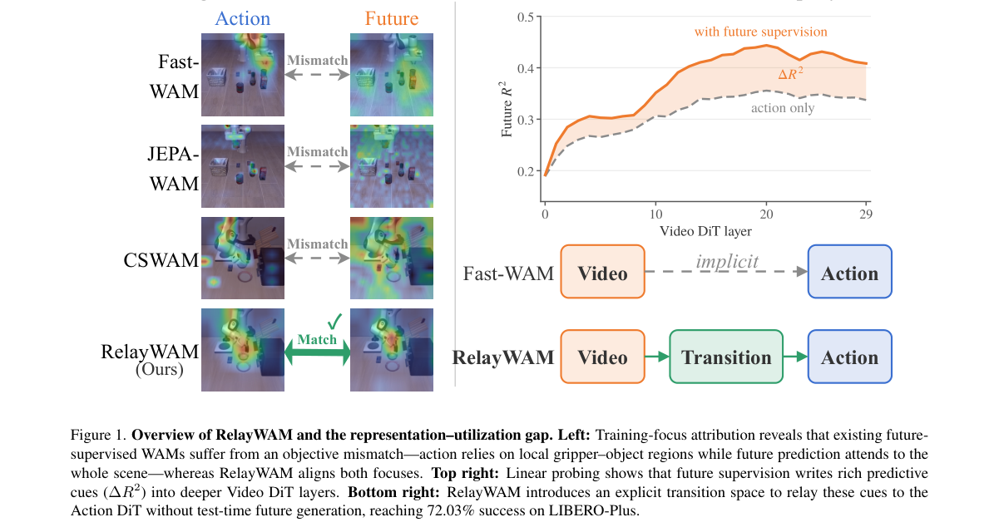

*Result - Causal erasure of future information in Fast-WAM vs. RelayWAM. We erase residual future directions from a sliding window of 4 consecutive Video DiT layers read by the action path- way, leavi*

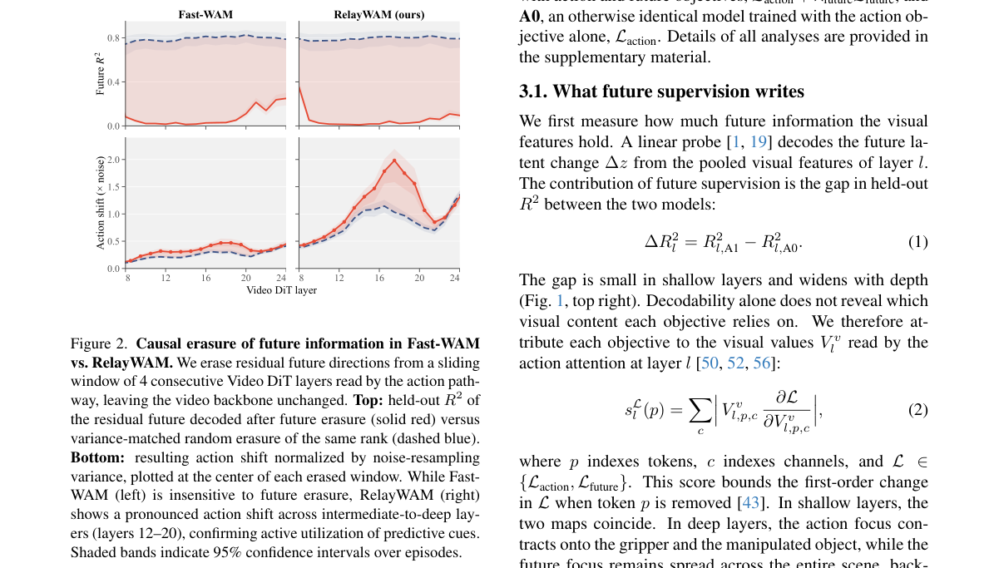

**Why this ranks #11**: 它诊断并修复 WAM 的「表示-利用鸿沟」：未来监督与动作目标的梯度在深层近乎正交，RelayWAM 用 34.96M 参数（不到 6.02B 主干的 0.6%）的显式 transition 空间把深层预测线索接进动作注意力，LIBERO-Plus 从 51.50% 提到 72.03%，标准 LIBERO 平均 98.2%。

---

### 12. TCP4D: A Unified Tool-Center-Point Tracking and Generation Model for Robot Manipulation

**arXiv**: [2611.23143](https://arxiv.org/abs/2611.23143) | **Score**: 8.7 (relevance 9 x 0.7 + quality 8 x 0.3) | **Direction**: `embodied_ai` | **Tags**: embodied, 4d-representation, tcp-tracking, action-generation, cross-embodiment, flow-matching, Hong Kong University of Science and | **Categories**: cs.CV, cs.RO | **Pages**: 34

**Authors**: Haosong Peng; Xiangyang Liu; Zhengshen Zhang; Yunfeng Fan; Tianyu Qi; Xin Xia; Yufeng Zhan; Wenchao Xu

**Affiliation**: The Hong Kong University of Science and Technology; Beijing Institute of Technology; National University of Singapore; The Hong Kong Polytechnic University; Sun Yat-sen University

**Abstract**

> Robot manipulation videos provide a rich visual experience, yet recovering robot action and gripper-state annotations from RGB observations still remains challenging. Using the embodiment-agnostic tool-center-point (TCP) pose as the action space, we present TCP4D, a unified model in which a shared 4D scene representation both tracks observed TCP motion and generates future TCP trajectories. Given a monocular video and initial 2D TCP queries, the tracker directly recovers metric TCP poses in SE(3) and gripper states alongside scene geometry and camera parameters. The generator samples local features from the same 4D representation along the recovered TCP tracks, then combines them with robot observations and language instructions to predict future TCP states. Our new cross-embodiment augmentation pipeline converts existing RGB videos into demonstrations for alternative embodiments by retargeting the recovered motion and synthesizing the corresponding observations, without recorded source-robot states. Experiments show that the tracker achieves absolute trajectory errors of 7.60 and 16.07 mm on DROID and RoboLab and adapts to a new embodiment with only ten demonstrations. The generator achieves 69.19% mean success on RoboTwin and outperforms well-established policy models on two real-world tasks, while joint training on source and augmented demonstrations improves target-robot success by 41.5% over augmented-only training.

**Key findings**

- **Finding**: TCP4D 跟踪器在 DROID 与 RoboLab 上 APD 达 74.78% 与 43.71%（超最强基线四倍以上）、绝对轨迹误差 7.60 与 16.07 mm、跟踪成功率 100%（基线最好为 89.64% 与 96.33%），换到 UR5 新本体只用 10 条演示即达 8.85 mm；生成器在 RoboTwin 上 69.19% 均值成功率，真机两任务 78.33%。
- **Inference**: 把动作空间选成与本体无关的 TCP 位姿（SE(3)）就让「跟踪到的运动」与「要执行的动作」共用一套表示，因此可以用逆运动学把源机器人视频重定向到目标本体，完全不需要源机器人的关节状态记录。
- **Recommendation**: 要做跨本体数据增广，优先选本体无关的动作空间并先解跟踪再做重定向；同时注意生成器是 flow matching、四次欧拉更新，而 Stage 1 跟踪器与完整模型分别约 1.522B 与 2.272B 参数，增广前要评估这套开销。

**Key figures**

*Framework - We propose TCP4D, a unified model that tracks tool-center-point (TCP) poses and gripper states from RGB videos and generates task-conditioned future TCP trajectories and gripper states, enab*

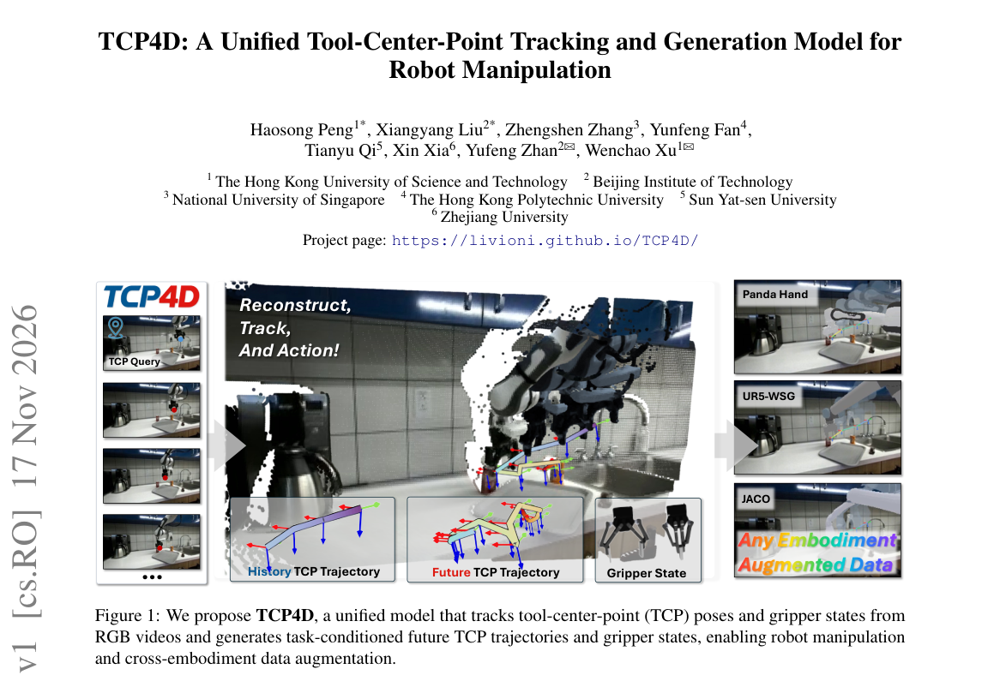

*Result - Overview of TCP4D. 1⃝TCP4D Tracker takes a monocular video as input and constructs a 4D scene representation. Given the TCP’s 2D location in the initial frame as a query, it decodes the scen*

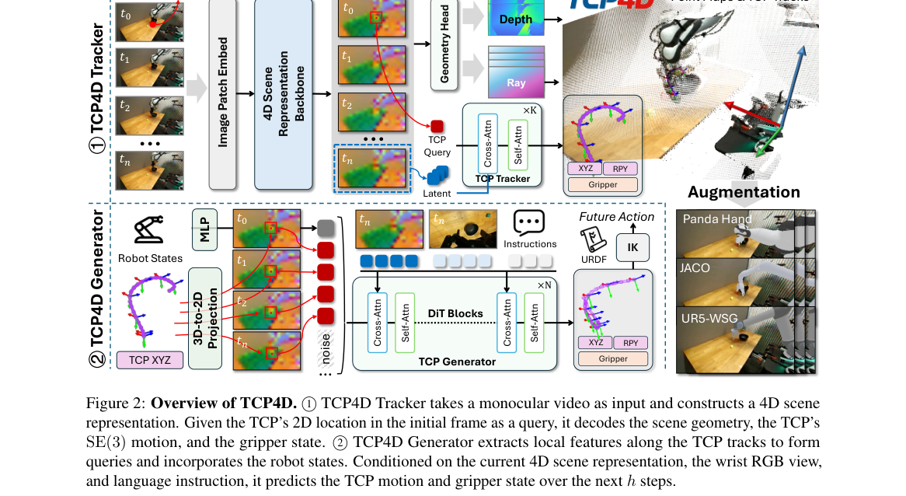

**Why this ranks #12**: 它用同一份 4D 场景表示同时做 TCP 跟踪与未来动作生成：DROID 与 RoboLab 上的绝对轨迹误差 7.60 与 16.07 mm、APD 74.78% 与 43.71%（是最强基线的四倍以上），生成器在 RoboTwin 上 69.19% 均值成功率，跨本体增广后联合训练比只用增广数据再提升 41.5%。

---

### 13. BiCAT: Bimanual Coordination Action Tokenization

**arXiv**: [2611.23499](https://arxiv.org/abs/2611.23499) | **Score**: 8.7 (relevance 9 x 0.7 + quality 8 x 0.3) | **Direction**: `embodied_ai` | **Tags**: embodied, action-tokenizer, bimanual-manipulation, fsq-quantization, cross-arm-attention, vla, National University of Singapore | **Categories**: cs.RO | **Pages**: 19

**Authors**: Xuanwei Liu; Guipu Cao; Zhongyi Luo; Jiafei Duan

**Affiliation**: National University of Singapore

**Abstract**

> Autoregressive vision-language-action (VLA) models predict discrete action tokens with the next-token objective of their vision-language backbone, so the action tokenizer defines the interface between the policy and the robot. In bimanual manipulation, the two arms share a repertoire of movements yet coordinate through complementary roles, and an action representation should capture both. However, most existing tokenizers encode both arms as a single concatenated action vector, in which motion patterns common to the two arms are not shared and cross-arm dependencies remain entangled within each token. The policy must therefore learn both aspects implicitly. We propose Bimanual Coordination Action Tokenization (BiCAT), which shares one motion representation across arms while conditioning each arm's tokens on its partner through symmetric cross-arm attention and a joint decoder. The policy then predicts all tokens of each arm in parallel, generating the left arm first and the right arm conditioned on it. Across ten RoboTwin 2.0 tasks and six real-world tasks on three embodiments, BiCAT achieves the highest success among the compared tokenizers. In simulation, it improves mean success by 17.6 percentage points over the strongest of eight baselines, with the largest gains on tasks that require close coordination between the arms, while requiring only 40.5 ms per action chunk. These results suggest that the action tokenizer is a natural place to model bimanual coordination.

**Key findings**

- **Finding**: RoboTwin 2.0 十个任务上 BiCAT 平均成功率 69.3%，最强基线 NAC 为 51.7%（+17.6 点），增益随双臂耦合增强：单臂任务 +1.5、松耦合 +17.5、紧耦合 +21.3；真机六任务 150 次试验成功 113 次对 OAT 的 74 次，每个动作块仅 40.5 ms，词表 1920、参数量 7.40M 为各基线中最小。
- **Inference**: 把两臂拼成一个长向量会同时丢掉共享运动模式与跨臂依赖——去掉量化前跨臂注意力、去掉联合解码或两者都去掉，成功率分别掉到 51.7% / 56.0% / 50.0%，说明共享表示与伙伴上下文必须同时存在，缺一都不超过最强基线。
- **Recommendation**: 做双臂离散动作 VLA 时优先在 tokenizer 层面建协同：共享编码器加对称跨臂注意力加联合解码，并保留分臂两段预测日程（改成单段预测只剩 51.1%）；同时别指望重建保真度能预测控制效果，论文实测两者相关性仅 −0.13。

**Key figures**

*Framework - A bimanual robot is two arms, not one arm with twice the joints. Left: existing tokenizers treat the two arms as a single arm and mix the left and right arm in every token; BiCAT gives each a*

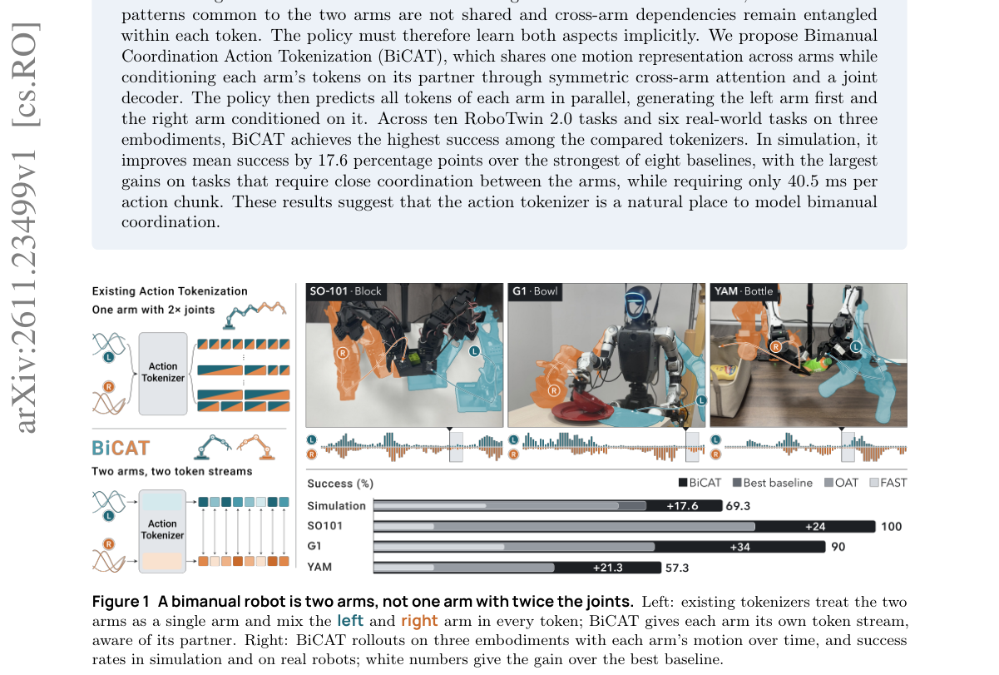

*Result - Overview of BiCAT. Top: mirror canonicalization C flips the signed joints of the right arm (q1, . . . , q7, with q7 the gripper) and applies shared normalization; the shared encoder Eϕ and ca*

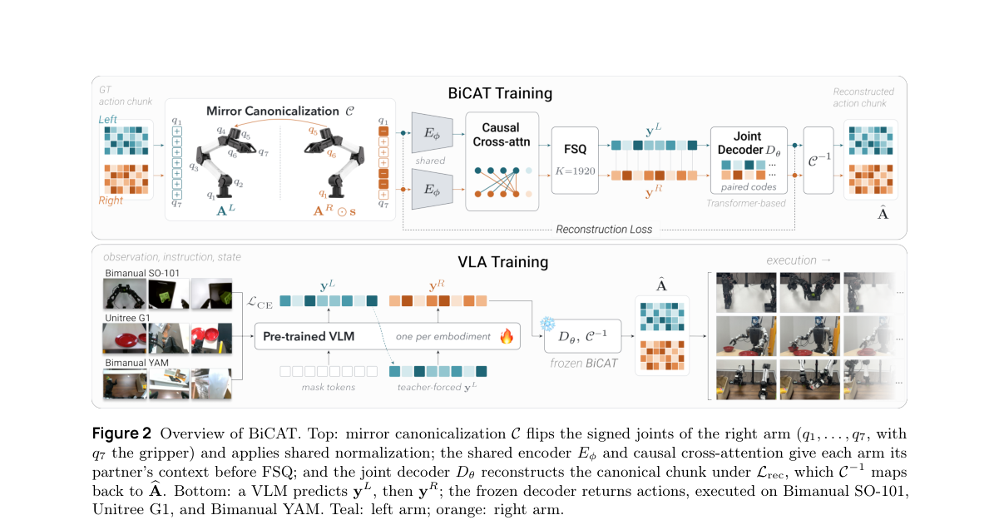

**Why this ranks #13**: 它证明动作 tokenizer 本身就是双臂协同的建模位置：BiCAT 共享一份运动表示、对称跨臂注意力加联合解码，RoboTwin 2.0 十个任务平均成功率 69.3%，比八个基线里最强的 NAC 高 17.6 个点，且耦合越紧增益越大（单臂 +1.5、松耦合 +17.5、紧耦合 +21.3）。

---

### 14. SPICE: Stochastic Policy for Interaction in Cluttered Environments

**arXiv**: [2611.23585](https://arxiv.org/abs/2611.23585) | **Score**: 8.7 (relevance 9 x 0.7 + quality 8 x 0.3) | **Direction**: `embodied_ai` | **Tags**: embodied, tactile-sensing, diffusion-policy, contact-rich, plant-canopy, visual-occlusion, [unverified] | **Categories**: cs.RO, eess.SY | **Pages**: 9

**Authors**: Nidhi Parayil; Benjamin Greenland; Thierry Peynot; Chris Lehnert

**Affiliation**: [unverified]

**Abstract**

> Agricultural tasks such as harvesting and pruning require robots to reach through dense foliage, where contact is often unavoidable and vision is obstructed. Intermittent contact creates an imbalance between free-space and contact-rich observations, complicating the learning of contact-responsive behaviours. We present SPICE, a tactileconditioned diffusion policy for reaching targets in dense plant canopies using tactile sensing as the sole environmental feedback. SPICE exhibits three behaviours: moving through compliant foliage, manoeuvring around partially obstructing stems, and manipulating branches that block the target path. To the best of our knowledge, SPICE is the first tactile-conditioned diffusion policy for target reaching through physically cluttered plant canopies. Across over 180 real-robot trials, SPICE was evaluated against tactile-conditioned, image-conditioned, and reactive-control baselines. Spatial tactile information and explicit contact conditioning proved important, with SPICE achieving 95% branch-manoeuvring success versus 45% for the strongest tactile baseline. SPICE also achieved branch manipulation beyond the reactive controller and remained effective under visual occlusion, where the image-conditioned DP failed. Zero-shot transfer across 40 trials on unseen tomato and lime plants achieved 87.5% success rate. These results demonstrate the potential of tactile-conditioned generative policies for interaction in visually occluded plant environments.

**Key findings**

- **Finding**: SPICE 在 170 次汇总试验（40 次触达、90 次绕枝、40 次推枝）中成功率分别为 100% / 98.9% / 85.0%；绕枝 19/20（95%）对最强触觉基线 RICE-y-DP 的 8/20（40%），平均目标误差 1.73±1.11 cm 且峰值触觉响应最低（2766±1344 单位）；对比反应式 RICE 时推枝 20/20 对 0/30。
- **Inference**: 「空间触觉 + 显式接触信号」两件事缺一不可——去掉接触信号的 SPICE 变体在绕枝任务 0/10 全败，而只给三轴均值或无空间布局的触觉基线最好也只有 40%；因为冠层里约 70% 的轨迹本就包含自由空间运动，策略必须先分清「没碰到」和「碰到了」。
- **Recommendation**: 在严重遮挡的农业或狭窄场景里可考虑以触觉为主、视觉为辅的扩散策略：它对 RICE 类反应式控制器同样能完成推枝，但要先确认传感器能给出 4×4 三轴 taxel 的空间分布与接触强度，且要准备 240 条左右的示范数据。

**Key figures**

*Framework - Contact-responsive motion adaptation of SPICE in a cluttered tomato canopy. The blue inset shows tactile-driven trajectory adaptation, with the red and gray dashed lines indicating the modifie*

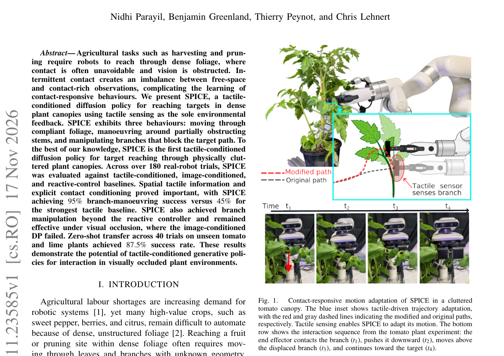

*Result - Contact-dependent behaviours for reaching an occluded target (red): direct motion towards target through compliant foliage, manoeuvring around an obstructing branch, and displacing a branch aw*

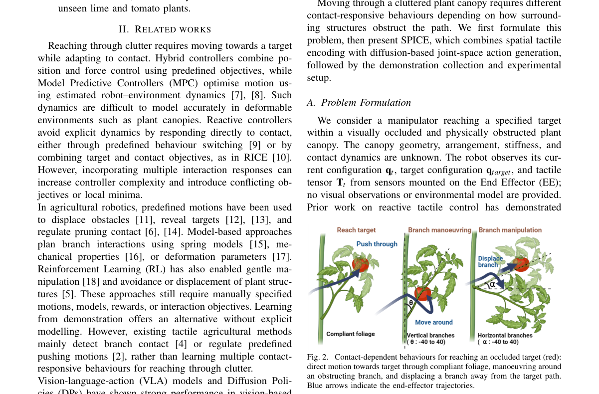

**Why this ranks #14**: 它是首个只用触觉做环境反馈的扩散策略，在稠密植物冠层里伸臂取目标：180 余次真机试验中绕枝 19/20 成功（95%），最强触觉基线 RICE-y-DP 只有 8/20（40%），视觉被遮挡时图像条件 DP 的绕枝成功率为 0/20，换到未见过的番茄与青柠 40 次零样本成功 87.5%。

---

### 15. RoboBuilder: Agentic Robot Co-Design with Real-world Video Feedback in the Loop

**arXiv**: [2611.23855](https://arxiv.org/abs/2611.23855) | **Score**: 8.7 (relevance 9 x 0.7 + quality 8 x 0.3) | **Direction**: `embodied_ai` | **Tags**: embodied, agentic-robot-design, sim-to-real, coding-agent, benchmark, simulator-learning, Massachusetts Institute of Technology | **Categories**: cs.AI, cs.CV, cs.RO | **Pages**: 44

**Authors**: Ghadi Nehme; Dahyun Nam; Akshay Govind Srinivasan; Faez Ahmed

**Affiliation**: Massachusetts Institute of Technology; Department of Mechanical Engineering

**Abstract**

> Can AI agents design robots that work in the real world? We introduce RoboBuilder, a benchmark in which coding agents co-design a robot's hardware and program from standard parts, motors and a custom 3D-printed part, and every design that passes in simulation is built and tested on a physical course. Simulation alone is not enough: under public part data, none of 15 initial passing designs crossed the real course, so an agent learns the simulator from measurements it requests and videos of real runs. Across four frontier coding agents, ten obstacles at three difficulty levels, 16,427 simulations of 12,774 distinct robots and 135 physical robots built in an estimated 240 hours, agents solve nearly all easy obstacles and invent mechanisms our search baselines do not reach, but falter at harder levels, when one robot must cross every obstacle, and in the real world, where 66% of simulated passes hold across all levels. Closing the loop helps: shown a video of its real failure, an agent redesigns the robot, sometimes correcting its simulator, and removes 72% of level-1 and level-2 failures. RoboBuilder measures progress toward agents that engineer real machines. Project Page: https://ghadinehme.com/robobuilder.github.io/

**Key findings**

- **Finding**: RoboBuilder 上 15 个用公开零件数据通过仿真的初始设计在真机 44 次尝试中无一通关；学到的模拟器让 66% 的仿真通过在真机成立，经一轮真实失败反馈重设计后升到 93%，智能体一轮内消掉 72% 的一二级失败；智能体通过 98% 的 level-1 任务，而全库存搜索一道都过不了（10 倍预算下最多 20%）。
- **Inference**: 协同设计里的 sim-to-real 缺口无法靠标定固定机器人解决，因为每轮机器人都变——智能体必须自己请求台架测量（实测摩擦销 4.5 N·mm 而非假设的 24.5）并拟合物理参数，模拟器要能覆盖尚未被造出来的设计。
- **Recommendation**: 做机器人协同设计时把「学模拟器」当成第一阶段而非附属环节：学到的模拟器能预测 38 条标注运行中的 35 条、验证集 10 条中的 9 条；并预留真实失败回放预算，因为智能体在多数步骤只微调同一台机器（仅 4% 的步骤换概念）。

**Key figures**

*Framework - AI agents design robots that pass in simulation, and we physically build and test them; videos of real failures drive a simulator update and a redesign. (1) Agents assemble standard parts, d*

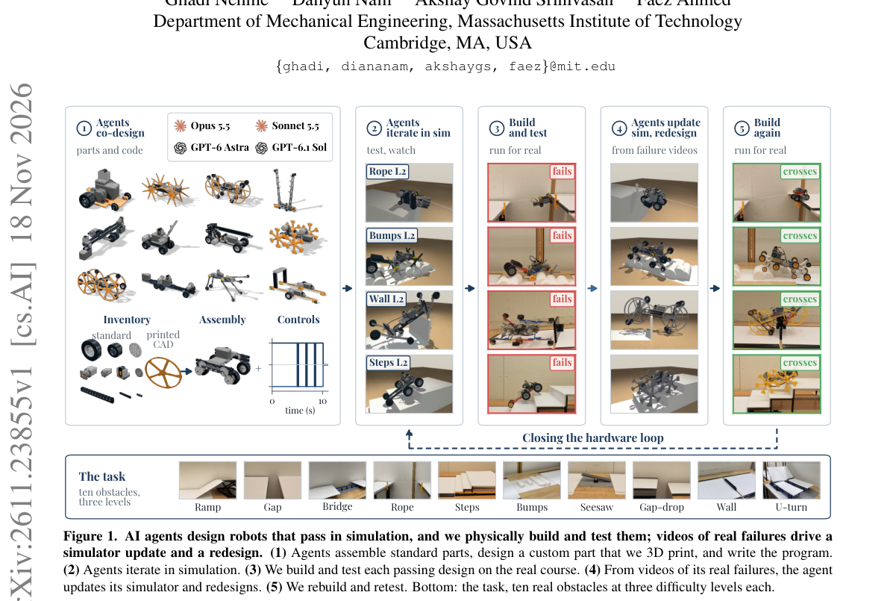

*Result - Agent-designed robots, built by hand on their real courses. Twelve of the 135 robots we built: whegs, printed hoops and cam wheels, cord trolleys, lever arms, legs and a spoked wheel that va*

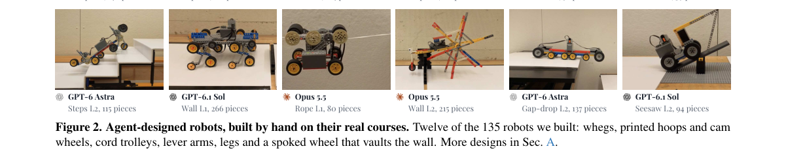

**Why this ranks #15**: 它是首个把真实视频反馈接回设计闭环的机器人协同设计基准：四个前沿编码智能体跑了 16,427 次仿真、造出 12,774 个不同机器人并手工搭了 135 台真机（约 240 小时），但仿真通过的机器人只有 66% 真能通过，给它看失败视频后它能消掉 72% 的一二级失败。

---

### 16. GTI: Grounding Task Intent Throughout Long-Horizon VLA Manipulation

**arXiv**: [2611.23926](https://arxiv.org/abs/2611.23926) | **Score**: 8.7 (relevance 9 x 0.7 + quality 8 x 0.3) | **Direction**: `embodied_ai` | **Tags**: embodied, long-horizon-manipulation, task-intent-grounding, phase-conditioning, vla-policy, failure-recovery, Shanghai Jiao Tong University | **Categories**: cs.RO | **Pages**: 8

**Authors**: Tianqi Gong; Haochen Niu; Yusheng Zhao; Lantao Zhang; Haoyu Liu; Rendong Ying; Peilin Liu

**Affiliation**: Shanghai Jiao Tong University

**Abstract**

> Vision-language-action (VLA) models generate local actions from visual observations, language, and robot state, but long-horizon manipulation requires the global task intent to remain grounded in the currently executable context. We propose GTI (Grounding Task Intent), which uses the current observation and execution history to localize the active subtask and its execution phase. For the same local subtask, GTI generates two phase-dependent visual targets: an interaction/contact state and a local completion state. The local language instruction and the corresponding phase-specific visual target jointly condition the VLA, specifying both what to do now and what state should be reached at the current phase. During execution, anomaly monitoring and local recovery re-establish an intent-consistent execution context through rollback, re-observation, and phase re-evaluation after persistent deviation. We evaluate GTI on RoboCasa365, VLA-Arena Horizon-Long, and real-world PiPER tasks. Relative to matched Global-FT baselines, GR00T success on seen composite RoboCasa365 tasks increases from 14.6%/12.1% to 31.8%/20.4% under ID/OOD evaluation. On VLA-Arena, GTI+$π_{0.5}$ reaches 47.6% overall success versus 45.2% for an adapted ForeAct baseline, with gains of 5.2/6.0 percentage points on the harder L1/L2 tasks. In the three real-robot task experiments, mean full-task success increases from 21.7% to 59.2%. The results indicate that persistent semantic intent localization and phase-conditioned visual grounding improve multi-stage execution, while failure-triggered local recovery provides additional deployment-time support.

**Key findings**

- **Finding**: RoboCasa365 上 GTI+GR00T 的复合任务成功率 ID 为 31.8%（Global-FT 14.6%）、OOD 20.4%（12.1%）；VLA-Arena 上 GTI+π0.5 总体 47.6%，L1 11.5%、L2 6.0%（π0.5 基线 3.5% 与 0%）；真机三任务各 30 次试验，全任务成功率 21.7% 升到 59.2%。
- **Inference**: 收益主要来自视觉目标而不是更好的规划——消融里只用规划语言时总体 43.8%，加阶段文本 44.8%，单一 K2 目标 44.9%，而相位条件化的 K1/K2 双目标升到 47.0%，说明「接触里程碑 vs 完成里程碑」这类语义化视觉锚点才是关键。
- **Recommendation**: 长程 VLA 可优先补相位条件的双视觉里程碑（K1 接触态 + K2 完成态）而不是加长上下文：它不增加 Wan 调用次数（L0 2.00 对 1.99 次，L1 11.64 对 10.60 次）；但要注意人工核对下 K1/K2/几何正确率只有 90.1% / 83.0% / 72.0%。

**Key figures**

*Framework - Task-intent grounding throughout long-horizon VLA execution. The planner localizes the currently active intent, the visual predictor supplies phase-specific K1/K2 milestones, and the VLA execu*

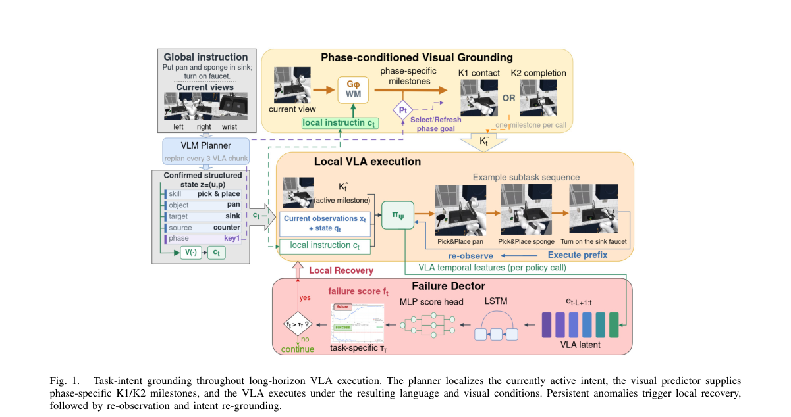

*Result - Adaptation of intent localization and phase-conditioned visual grounding. Phase controls K1/K2 generation; five RGB supervision frames map to two VAE temporal latent positions.*

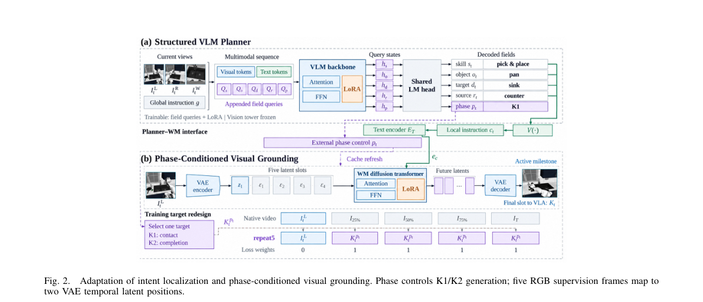

**Why this ranks #16**: 它把长程任务拆成「当前子任务 + 当前阶段」两件事再落到视觉：RoboCasa365 上 GR00T 的复合任务成功率从 14.6% / 12.1% 提到 31.8% / 20.4%（ID / OOD），VLA-Arena 上 GTI+π0.5 总体 47.6% 对 ForeAct 的 45.2%，真机三任务从 21.7% 提到 59.2%。

---

### 17. 3DTouch: A Tactile-aware VLA Model with 3D Geometric Relations for Dexterous Manipulation

**arXiv**: [2611.23961](https://arxiv.org/abs/2611.23961) | **Score**: 8.7 (relevance 9 x 0.7 + quality 8 x 0.3) | **Direction**: `embodied_ai` | **Tags**: embodied, tactile-sensing, vla-policy, dexterous-manipulation, 3d-grounding, geometric-relation, University of Science and Technology of | **Categories**: cs.RO | **Pages**: 11

**Authors**: Xin Zhang; Shiqi Zhang; Siyuan Cao; Juncheng Cai; Yedong Shen; Yuxuan Gao; Dianlong Wen; Kaixue Long; Lu Zhang; Yao Li; Jiajun Deng; Yanyong Zhang

**Affiliation**: University of Science and Technology of China

**Abstract**

> In contact-rich dexterous manipulation, occlusion by the fingers and interacting objects obscures local geometry, preventing visual observations from fully capturing contact locations. Visually similar scenes may also differ subtly in the relative positions of interacting objects, leading to different contact states. We propose 3DTouch, a tactile-geometric conditioning approach for vision-language-action (VLA) models. 3DTouch constructs a shared 3D visuo-tactile representation by expressing RGB-D scene points and dense five-finger tactile measurements in the robot-base frame, preserving each taxel's spatial location and force vector. Hand-object and object-object relations derived from hand landmarks and pose-aligned reconstructed surfaces explicitly describe the relative arrangement of interacting entities. Together, these representations condition the VLA action expert on spatially localized contact forces and relative surface geometry, providing explicit cues for contact adjustment and object alignment. We evaluate 3DTouch on five real-world contact-rich dexterous manipulation tasks using a UR7e robot arm equipped with an XHand dexterous hand. 3DTouch improves the average success rate by 42 percentage points over the corresponding VLA baseline and by 20 percentage points over the strongest evaluated alternative. Ablation studies reveal the complementary benefits of scene geometry and spatial tactile feedback, with further gains from shared spatial grounding and explicit geometric relations.

**Key findings**

- **Finding**: 五个真机接触密集任务（漏斗插入 / 插头装配 / 按按钮 / 擦海绵 / 移液器按压，每任务 20 次）上，3DTouch 平均成功率 65.0%，比对应 VLA 基线高 42 个点、比最强触觉 VLA Tactile-VLA 高 20 点；漏斗插入上 35.0% 对最好基线 20.0%，并在四个任务上单独最优。
- **Inference**: 关键是让触觉 token 与场景 token 共用度量坐标系——每根手指 120 个 taxel 的三维位置与归一化力向量经正运动学落到基座系，若只用手部局部触觉编码则平均成功率低 11 点；手-物与物-物关系 token 再带来 12 点，反映接触微调与抓取稳定性。
- **Recommendation**: 做接触密集的灵巧操作时，把触觉位置（而不只是力值）与场景点云统一到同一基座坐标系，并用显式相对位移与距离 token 表达手-物、物-物关系；注意给 π0.5 直接加原始触觉反而可能掉分，按钮任务就从 75.0% 降到 30.0%。

**Key figures**

*Framework - Overview of 3DTouch. Compared with the 2D-only VLA shown on the left, 3DTouch augments a pretrained vision-language- action policy with scene geometry, spatially grounded tactile feedback, a*

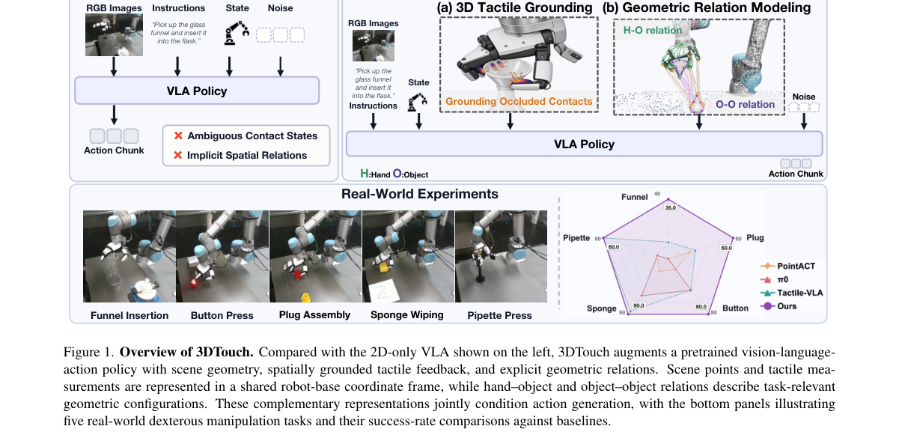

*Result - Pipeline of 3DTouch. (a) 3D Tactile Grounding (3DTG) back-projects RGB-D observations into scene point clouds and transforms taxel positions and force vectors into a shared robot-base frame*

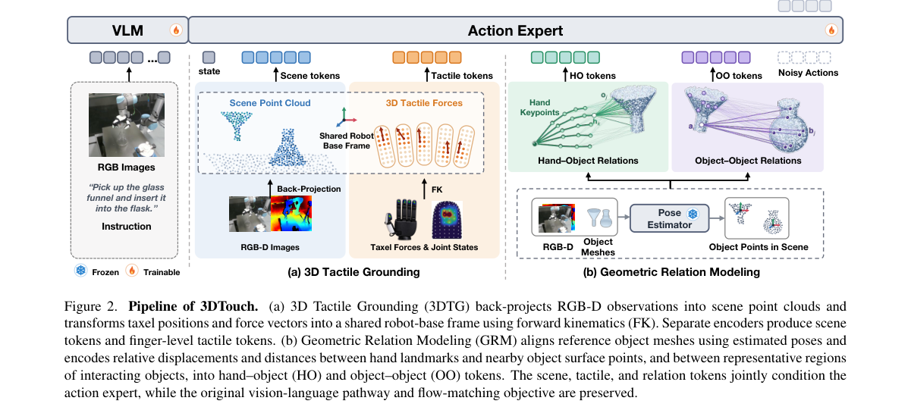

**Why this ranks #17**: 它把多指触觉的空间位置和力向量与场景几何统一到机器人基座坐标系：UR7e 加 XHand 上五个接触密集真机任务平均成功率 65.0%，比对应 VLA 基线高 42 个点、比最强触觉 VLA 高 20 个点，空间共享接地再贡献 11 点、显式几何关系再贡献 12 点。

---

### 18. WAM-Policy: World Action Models with On-Policy Distillation for Quadrupedal Loco-Manipulation

**arXiv**: [2611.24011](https://arxiv.org/abs/2611.24011) | **Score**: 8.7 (relevance 9 x 0.7 + quality 8 x 0.3) | **Direction**: `embodied_ai` | **Tags**: embodied, world-action-model, distillation, quadruped-loco-manipulation, reinforcement-learning, language-conditioned, Australian Centre for Robotics | **Categories**: cs.CV, cs.RO | **Pages**: 30

**Authors**: Junlin Long; Xu Deng; Yiran Wang; Yue Yang; Yang Zhao; Zeyu Zhang

**Affiliation**: Australian Centre for Robotics, University of Sydney; UNSW Sydney; Maincode; La Trobe University

**Abstract**

> Arm-free quadrupeds can perform loco-manipulation, walking on three legs while manipulating with a front leg, yet no existing policy for it follows language instructions. World action models (WAMs) have emerged as effective language-conditioned manipulation policies, but are pretrained for robot arms and sample slowly. WAM-Policy turns one WAM into a quadrupedal loco-manipulation policy via two stages. The first, Cross-Morphology Policy Adaptation and Acceleration, adapts the arm-centric WAM to quadrupeds and distills the transferred policy into a student with one video and two action steps by on-policy self-distillation (OPSD). This student, however, is bounded by its teacher, which only imitates demonstrations. The second stage, Task-Specific Improvement and Merging, therefore tunes the teacher by reinforcement learning (RL) and merges the slow specialists into one few-step student by multi-teacher on-policy distillation (M-OPD). On QLM-Bench, ten simulated tasks with 1,000 demonstrations synthesized without teleoperation, the transferred policy reaches 77.0%, and the OPSD student keeps 76.7% while sampling 14 times faster. Task-specific RL and M-OPD lift it to 85.0%. We also deploy the OPSD student on a real Unitree Go2 Air. WAM-Policy thus achieves a stronger quadrupedal policy at a fraction of the inference cost.

**Key findings**

- **Finding**: QLM-Bench 十个任务上，迁移后的高 NFE 教师成功率 77.0%、单次生成 2.226 秒；OPSD 学生（1/2 NFE、0.159 秒、14.0 倍加速）保持 76.7%，不蒸馏直接降采样只有 69.3%；经任务级 RL 与多教师合并后学生达 85.0%，推箱与开门两项 90% 与 87%（OPSD 教师 47% 与 53%）。
- **Inference**: 少步蒸馏必须让教师用自己的闭环上下文标注学生的采样轨迹——训练上下文混成 (1−η)·dπS + η·dπT 才能覆盖学生自己的分布偏移；同时任务级 RL 用来打破「被教师示范水平锁死」的上限，再用多教师合并才不会牺牲加速收益。
- **Recommendation**: 把 WAM 迁到新本体时先只替换视觉与动作接口、其余（含 VAE 与文本编码器）冻结微调以保住通用性；蒸馏加速后务必复测逐任务成功率（开门从 93% 掉到 37%），并注意真机上采样期间机体漂移会让采样前算出的动作失效。

**Key figures**

*Framework - WAM-Policy is a language-conditioned policy for arm-free quadrupedal loco-manipulation, in which a front leg serves as the end-effector. Top: the OPSD student (Stage 1) on three tasks on the*

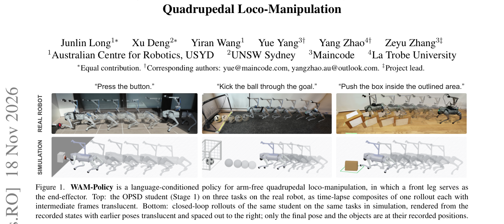

*Result - Stage 1: Cross-Morphology Policy Adaptation and Acceleration. Stage 1.1 (Sec. 3.1.1) fine-tunes an arm-centric WAM on quadruped demonstrations synthesized in QLM-Bench (Sec. 4). Visual Adapt*

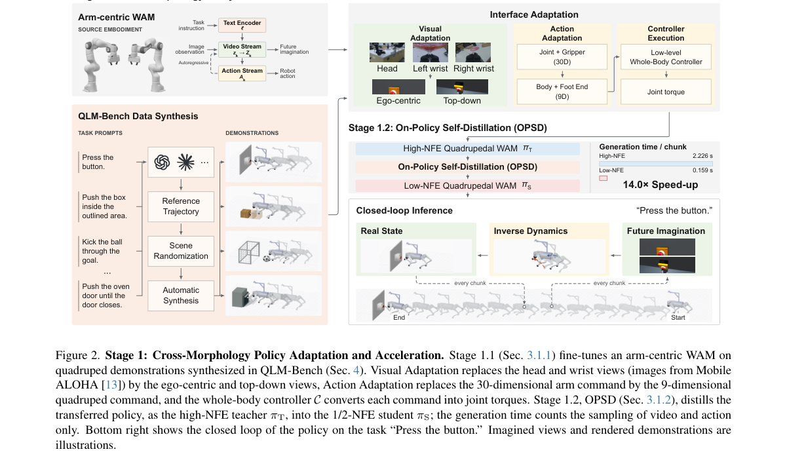

**Why this ranks #18**: 它是首个无臂四足腿-臂操作的语言条件策略：把为手臂预训练的 WAM 迁到 Go2（30 维双臂指令换成 9 维腿指令）后用在线自蒸馏压到 1/2 NFE，生成时间从 2.226 秒降到 0.159 秒（14 倍）而成功率只从 77.0% 掉到 76.7%，再经任务级 RL 与多教师蒸馏升到 85.0%。

---

### 19. AeroRSI: Recursive Self-Improvement for Aerial Vision-Language Navigation

**arXiv**: [2611.24077](https://arxiv.org/abs/2611.24077) | **Score**: 8.7 (relevance 9 x 0.7 + quality 8 x 0.3) | **Direction**: `embodied_ai` | **Tags**: embodied, aerial-navigation, self-improvement, vision-language-action, self-verification, recursive-training, Tsinghua University (SIGS) | **Categories**: cs.AI, cs.CV, cs.RO | **Pages**: 15

**Authors**: Shiwei Wu; Yuwen Pan; Zhi Li; Yaowen Li; Yan Zhou; Xuemiao Xu; Yu Liu

**Affiliation**: Tsinghua University (SIGS); Tsinghua University (Department of Electronic Engineering); Foshan University; South China University of Technology

**Abstract**

> Vision-language-action (VLA) models enable unmanned aerial vehicles (UAVs) to follow natural-language instructions, yet still fail frequently in closed-loop flight. Correcting these failures requires repairs, i.e., actions that avoid them at the states the policy itself reaches, which human pilots cannot label at scale and rule-based planners cannot supply reliably. In this paper, we present AeroRSI, a recursive self-improvement framework in which an aerial navigation policy iteratively learns from its own failures. Our key insight is that a failing policy should judge its own repairs by flying on from them. Judged in this way, its sampled actions and even rule-based proposals that hurt it when imitated directly become reliable supervision. Moreover, an episode terminates at its first failure, concealing subsequent failures until the earlier ones are repaired. AeroRSI thus renews its supervision in every round, anchoring the failures of the current policy, verifying repairs by its continuation, and distilling them while keeping its behavior elsewhere. On TravelUAV, three rounds raise the success rate of a supervised 2B-parameter policy from 46.4% to 67.5% and reduce collisions by half, surpassing the previous state of the art by 10.6 points from the same initialization without extra human labels or inference cost. Code and models are available at https://github.com/starsholic/AeroRSI.

**Key findings**

- **Finding**: TravelUAV 测试集 SR 从 46.4% 经三轮升到 57.6% / 66.0% / 67.5%，每轮增益 11.2 → 8.4 → 1.5 点；碰撞路线占比从 38.6% 降到 19.1%，超时占比从 1.2% 升到 6.8%；以 AeroDPO 初始化则达 69.9%，比 AeroDPO 高 13.0 点，整体比 AeroDPO 多赢 649 条、少输 330 条路线。
- **Inference**: 关键在于让策略「飞出去验证」而不是只比对前几步——只按两步后打分会让碰撞再多 4.2 个百分点，因为候选常常是后来才失败；反过来，把所有锚点直接标成势场避障规则动作会让 SR 掉 6.6 点，必须由策略自己续飞验证。
- **Recommendation**: 自改进闭环每轮都要重新锚定当前策略的失败并重新验证：第一轮验证过的修复在后续锚点上仍有 87–89% 有效，但只重训第一轮得 60.3%、不如第二轮的 66.0%；同时保留上一轮修复可防止新策略遗忘旧技能。

**Key figures**

*Framework - Recursive self-improvement with self-verified repairs. (a) In round k, πk fails at A and judges its own candidate repairs. From the state before A, each candidate from its sampled actions or*

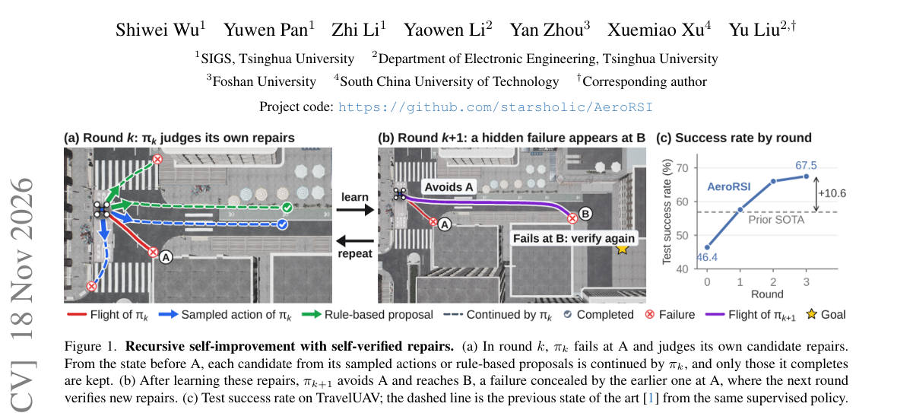

*Result - Overview of AERORSI. The top row shows the policy πk, of which only the visual merger and the LoRA are trained. In each round, (1) AFA samples anchors from probes before every failure of πk;*

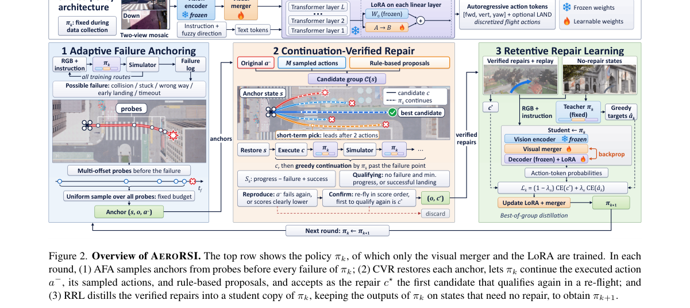

**Why this ranks #19**: 它让失败的导航策略自己给自己的修复打过分：TravelUAV 上 2B 策略经三轮递归自改进从 46.4% 升到 67.5%，碰撞率减半，比同样初始化的先前 SOTA 高 10.6 点；换成更强的 DPO 初始化可到 69.9%，全程不需要人工标注也不增加推理成本。

---

### 20. Ego2X: Contact-aware Transfer from Egocentric Human Data to Any Robot

**arXiv**: [2611.24138](https://arxiv.org/abs/2611.24138) | **Score**: 8.7 (relevance 9 x 0.7 + quality 8 x 0.3) | **Direction**: `embodied_ai` | **Tags**: embodied, egocentric-transfer, cross-embodiment, contact-representation, data-conversion, vla-post-training, BUPT | **Categories**: cs.CV, cs.RO | **Pages**: 10

**Authors**: Xinke Lyu; Bowen Yang; Zhicheng Wang

**Affiliation**: BUPT; Institute of Automation, Chinese Academy of Sciences; PowerTech

**Abstract**

> Embodied models depend on real interaction data, yet collecting it on physical robots is slow and labor-intensive. Recent ego-to-robot pipelines retarget first-person view human videos to robot data via transferring hand and arm motion. They judge fidelity mainly by visual appearance. However, trajectories often fail in terms of physics: fingers hover beside objects, and grippers close on empty space. We argue that how the object moves and the contacts that drive the motion count. Thus, we present Ego2X, an object-centric framework that converts monocular egocentric video into physically executable robot data across dexterous hands and parallel grippers. Ego2X centers on CORE (Contact-centric Object-interaction REpresentation), which records each contact on the object by its surface anchor, as well as relative force, grasp mode, and interaction state. Throughout the pipeline, CORE corrects hand-object drift via object-relative constraints, steers inverse kinematics toward contacts the robot must realize, and preserves held objects during arm erasure and robot compositing. On HOT3D, contact-driven correction reduces in-contact hand depth error by 33.7%, while on EgoDex, contact-driven retargeting realizes 62.9% of annotated contacts, surpassing the official HuRo pipeline (27.9%). In RoboTwin 2.0, post-training X-VLA on Ego2X episodes alone, without simulator demonstrations, raises task success rate from 40.5% zero-shot to 67.0% across 200 paired scenes. We will publicly release our conversion pipeline and CORE-annotated dataset for dexterous hands and parallel grippers.

**Key findings**

- **Finding**: HOT3D 上接触驱动的深度修正把接触中手部射线深度误差降 33.7%；EgoDex 上灵巧手实现 62.9% 的标注接触对官方 HuRo 的 27.9%，平行夹爪物理接触拟合 63.2% 对 Ego2Robot 的 9.7%；RoboTwin 2.0 的 200 个配对场景里 X-VLA 仅用 Ego2X 数据后训练成功率从 40.5% 升到 67.0%，闭环转换成功率 59.6% 对 1.9%。
- **Inference**: 只看手部运动轨迹会被单目深度漂移毁掉（手指在物体旁悬空、夹爪合在空处），而把接触锚在物体坐标系里就换来了跨形态的可迁移性；接触证据还必须分级——只有 CERTIFIED 与 TRUSTED 锚点允许参与深度修正与逆运动学。
- **Recommendation**: 做 ego-to-robot 转换时先在物体坐标系里定接触点与法线，再做深度对齐和跨形态 IK，并给锚点打证据等级；注意形态兼容是硬约束——七种握持模式各自对应不同的机器人 pad 组合，精度捏取只能用拇指与食指指节。

**Key figures**

*Framework - Ego2X transfers object-frame contacts rather than hand motion. From monocular video, Ego2X (a) recovers object-frame CORE contact records, (b) drives decoupled depth alignment, cross-morphol*

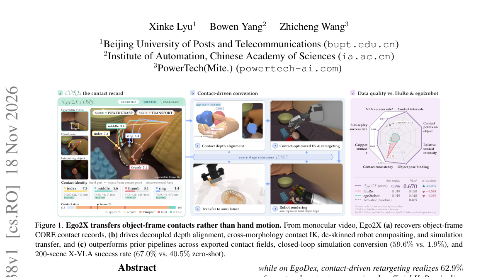

**Why this ranks #20**: 它主张 egocentric 视频可迁移的是物体上的接触而非手的动作：CORE 用表面锚点、外法线、相对力、握持模式与交互状态记录每次接触，EgoDex 上实现 62.9% 的标注接触（官方 HuRo 只有 27.9%），RoboTwin 2.0 里仅用转换数据后训练 X-VLA 就把成功率从 40.5% 零样本提到 67.0%。

---

## Footer

- Total papers reviewed across all 4 axes: 60
- world_embodied axis final count: 20
- Wild-cards in this axis: 0
- Figure assets: 2026-11-20/res/

Generated by `mine-arxiv-daily-digest` skill. Sister file: `2026-11-20_world_embodied_entry.md`.
