# Mine Arxiv Daily Digest - 2026-11-21 (AIGC 视觉生成与编辑 Axis, 17 papers)

**Generated**: 2026-11-21 01:28 CST

**Source**: arXiv cs.CV, cs.SD, eess.AS, cs.CL, cs.AI, cs.RO, cs.LG, cs.IR submissions, listing day 2026-11-18,2026-11-19 (announced 2026-11-20 01:00 UTC (2026-11-20 09:00 CST))

**Batch window**: 2026-11-17T19:00:00Z .. 2026-11-19T19:00:00Z（arXiv 公告批次横跨两个 UTC 日：从前一日的美东 14:00 截止时刻起算（EDT 为 18:00Z，EST 为 19:00Z），到当日的同一时刻为止）

**Axis**: aigc_visual (17 papers, base 15, cap 20)

**Directions**: aigc_generation (8), aigc_editing (4), aigc_rl (5)

**Selection**: 17 papers ranked by relevance x quality, with 0 wild-card slots

**Day total**: 60 papers across 4 axes (target 60)

**Scope**: 图像 / 视频 / 3D / 4D 内容的生成与编辑，以及面向视觉生成的 RL / 偏好优化与奖励模型

**Wild-card**: 本 axis 未启用任何补位名额。空位来自 aigc_rl 全部 5 篇够格候选都够格的真实供给上限，而该方向剩下的 rel 6–7 论文属于正常够格候选，不是「比够格论文更该进」的邻接选题；aigc_editing 的 4 篇入选已是 rel 8 里的最优，再补只会重复刷分。

本轴 17 篇比基准 15 多 2，原因是 aigc_rl 拿到 5 篇（基准 3），而它 5 篇够格候选里的 4 篇 rel≥9 全部入选。但这不是随意溢出：按「某方向超基准时，同轴其他方向必须都达标」的判据，aigc_generation（8/8）与 aigc_editing（4/4）必须都停在自身基准上，aigc_rl 多出来的 2 个名额才成立。

供给结构值得记一笔：aigc_editing 的 37 篇够格候选里 rel≥9 是 0 篇（rel 8 有 7 篇、rel 7 有 15 篇），4 篇入选全是 rel 8；aigc_rl 候选只有 5 篇却出了 4 篇 rel≥9。生成与编辑的「必进」密度差了一个数量级，这直接决定了本轴 17 篇的构成。

---

## AIGC 生成（图像 / 视频 / 3D / 4D） · `aigc_generation` (8 papers)

本批次生成侧的主线是：视频扩散的工程优化已经跑到内容正确性前面。Spark-H3 用免训练的块稀疏注意力（Spark-Reblock 重分块 + Spark-Reweight 重加权）压长视频扩散的注意力开销，而《Text Lives in the Guidance》给出反面证据——特征缓存会让 DiT 静默改写已经渲染好的文字，Z-Image 上 TaylorSeer 降到 2.9x FLOPs 时字就变了，而图像级指标查不出这件事。ViDecide 试图对冲，把状态转移预测与何时停止直接训进视频扩散模型。另一支线走向 3D 与物理：UltraTex 用级联多视图把物理知识注入 PBR 纹理，EyeDiT 用 OCT 与解剖点云做 3D 眼睛（单视图新视角 24.9 dB 对 21.8 dB），AVM 则以视图流生成场景、不显式建模 3D。

### 1. Spark-H3: Adaptive Block Sparse Attention for Video Diffusion Models

**arXiv**: [2611.24256](https://arxiv.org/abs/2611.24256) | **Score**: 8.7 (relevance 9 x 0.7 + quality 8 x 0.3) | **Direction**: `aigc_generation` | **Tags**: AIGC-visual, block-sparse-attention, video-diffusion, training-free, attention-reweighting, speedup, Peking University | **Categories**: cs.CV | **Pages**: 13

**Authors**: Zecheng Tang; Jiaye Fu; Youtian Lin; Xinyao Rao; Liuxuan Sun; Jian Zhang; Yao Yao; Wei Li

**Affiliation**: Peking University; Nanjing University

**Abstract**

> Long video sequences make attention a substantial cost in video diffusion models. Block sparse attention (BSA) reduces this cost by computing selected blocks exactly while compressing the remaining blocks. However, fixed token grouping can place tokens with dissimilar attention preferences in the same group, while uniform key averaging can underestimate the attention mass of compressed blocks. We introduce Spark-Attn, a training-free BSA method comprising Spark-Reblock and Spark-Reweight. Spark-Reblock recursively groups tokens by attention preference while preserving regular block shapes for efficient GPU execution. Spark-Reweight uses the global mean query as an anchor to construct attention-weighted key-value representations and logit biases for the compressed blocks, calibrating their attention mass. We instantiate Spark-Attn in MiniMax-H3 as Spark-H3. At 10% exact-block density, Spark-H3 delivers a 2.49$\times$ DiT speedup and reaches 24.81 dB PSNR against the corresponding dense outputs on MiniMax-H3 (20 denoising steps, 345 frames, 1344$\times$768). Increasing the density to 20% further improves PSNR to 26.76 dB while still achieving a 2.26$\times$ DiT speedup. These results demonstrate that Spark-H3 achieves a state-of-the-art quality-efficiency trade-off for training-free BSA on video diffusion models.

**Key findings**

- **Finding**: 在 MiniMax-H3 上以 20 步去噪、345 帧、1344×768 生成 14.4 秒视频，Spark-H3 在 10% 精确块密度下达到 2.49× DiT 加速与 24.81 dB PSNR，20% 密度时 PSNR 升到 26.76 dB、加速比仍有 2.26×。
- **Inference**: 固定 token 分组与均匀 key 平均会同时丢掉偏好对齐和压缩块的注意力质量，把这两点拆成 Spark-Reblock 与 Spark-Reweight 后，训练无关的块稀疏化就能逼近稠密输出。
- **Recommendation**: 要用块稀疏注意力加速视频 DiT，先按注意力偏好递归重分块，再对压缩块做注意力加权重标定，密度从 0.1 起步、按 PSNR 预算逐档上调到 0.2。

**Key figures**

*Framework - MiniMax-H3 and Spark-H3. (a,b) Qualitative comparisons on 14.4s, 1344 × 768 videos generated using 20 denoising steps. Spark-H3 uses exact-block density ρ = 0.2 in these examples. (c) DiT sp*

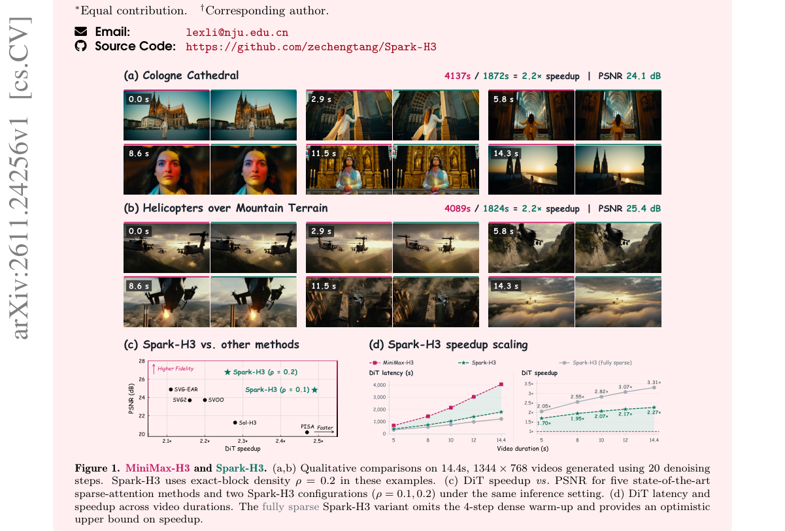

*Result - BSA, CSA, and Spark-Reblock. Colors denote attention preferences, and N denotes the number of video tokens. Spark-Reblock uses recursive balanced splits to construct preference-aligned, unif*

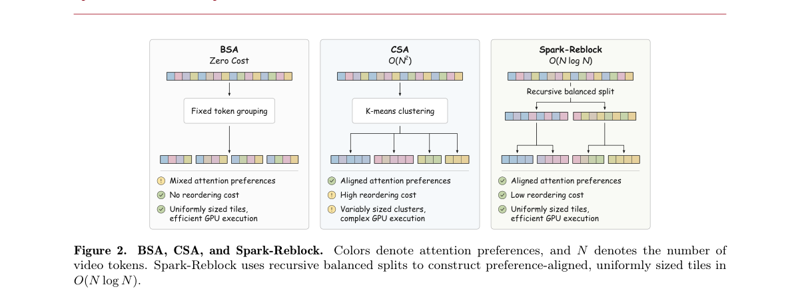

**Why this ranks #1**: Spark-Reblock 递归按注意力偏好重分组 token，召回率在 10%/20% 精确块密度下分别提升 18.33 和 14.58 个百分点；Spark-H3 在 10% 密度拿到 2.49× DiT 加速与 24.81 dB PSNR，20% 密度进一步到 26.76 dB 与 2.26× 加速，并比相近密度的 PISA 高 4.61 dB。

---

### 2. Text Lives in the Guidance: Preventing Silent Text Rewriting in Cached Diffusion Transformers

**arXiv**: [2611.25382](https://arxiv.org/abs/2611.25382) | **Score**: 8.7 (relevance 9 x 0.7 + quality 8 x 0.3) | **Direction**: `aigc_generation` | **Tags**: AIGC-visual, feature-caching, text-rendering, classifier-free-guidance, diffusion-transformer, acceleration, [unverified] | **Categories**: cs.CV | **Pages**: 17

**Authors**: Kun Zhou; Wenmian Yang; Zhensheng Wang; Weijia Jia

**Affiliation**: [unverified]

**Abstract**

> Diffusion transformers (DiTs) now render long, legible text in images, and feature caching is a standard way to accelerate them. Caches are judged by image-level metrics, which do not check whether the rendered text is still correct. We find that caching silently rewrites this text. On Z-Image, TaylorSeer at 2.9x fewer FLOPs lowers word accuracy from 62% to 46%, while ImageReward and CLIP Score barely change. Sampling with fewer steps at the same compute keeps almost all of this text, so the loss comes from how the cache predicts the skipped steps. Decomposing the cache error along classifier-free guidance (CFG), we trace this loss mainly to the guidance term, the difference between the conditional and unconditional predictions, which caches extrapolate worst on text. Correcting the guidance inside the text alone recovers most of the lost text. We therefore propose GuideCache, which recomputes both CFG branches only on the tokens with the largest predicted guidance error, using the guidance terms that the cache already stores. At 2.4x fewer FLOPs, GuideCache restores full-compute prompt fidelity on Z-Image and Qwen-Image, and on Z-Image it renders text as well as or better than ToCa, TeaCache, and FasterCache while staying much closer to the full model's output. GuideCache works with caches of any order, and on top of fewer sampling steps it keeps more text than step reduction at a higher speedup. These results suggest that acceleration methods for text-rendering models should be evaluated on the text they render.

**Key findings**

- **Finding**: Z-Image 上 TaylorSeer 在 2.94× FLOPs 时词准确率从 0.621 跌到 0.464，只重算文本区域内的 guidance 分支即可把 0.464 拉回 0.586，而分步减少采样几乎不损失文字。
- **Inference**: 图像级指标完全看不出缓存把字改写了，说明加速方案对文字渲染模型必须单独按 OCR 词准确率评测，否则会误判为无损压缩。
- **Recommendation**: 用特征缓存加速文字渲染 DiT 时，把 CFG 双支重算限定在预测 guidance 误差最大的文本 token 上，并在评测里同时报告词准确率而不是只看 ImageReward。

**Key figures**

*Framework - Feature caching silently rewrites text. Full-compute images (left) and text crops on Z-Image (top) and Qwen-Image (bottom); tags count the target strings that OCR reads correctly. FORA and T*

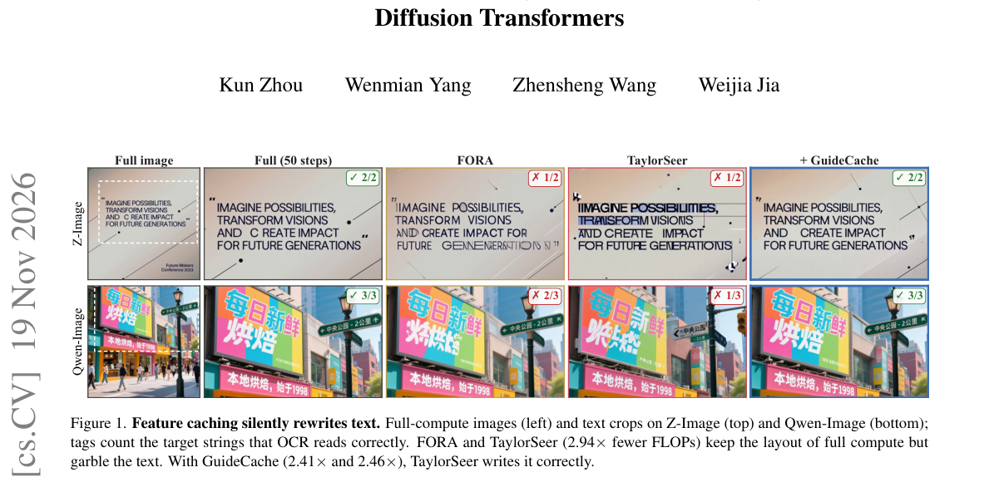

*Result - The text error of the cache comes mainly from the guidance term. (a) Guidance share ρ and extrapolation errors of u and w g on one prompt. (b) Lost prompt fidelity recovered by making one pa*

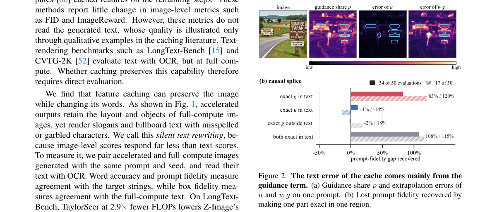

**Why this ranks #2**: TaylorSeer 在 2.9× 更少 FLOPs 下把 Z-Image 的词准确率从 62% 压到 46%，而 ImageReward 与 CLIP Score 几乎不动；GuideCache 只在文本 token 上重算 CFG 两支，2.4× 更少 FLOPs 就恢复了全算力下的提示词保真度。

---

### 3. Streaming-AAA: Streaming AAA Game Video Generation at High Resolution, High Frame Rate, and Low Latency

**arXiv**: [2611.26040](https://arxiv.org/abs/2611.26040) | **Score**: 8.7 (relevance 9 x 0.7 + quality 8 x 0.3) | **Direction**: `aigc_generation` | **Tags**: AIGC-visual, streaming-video-generation, real-time-interaction, distillation, kv-cache, diffusion-forcing, Tencent AIPD | **Categories**: cs.CV | **Pages**: 19

**Authors**: Zhihao Hu; Jianqi Ma; Jun Zhang; Jiayang Bai; Haifeng Shi; Yanxiang Zhuang; Zhongqian Sun; Weidong Zhang; Wei Yang

**Affiliation**: Tencent AIPD

**Abstract**

> Controllable streaming video generation offers a promising route toward interactive game simulation, yet existing methods remain far from practical gameplay. They often fail to jointly achieve high visual fidelity, high frame rates, and low interaction latency, resulting in poor responsiveness and degraded user experience. We present Streaming-AAA, a new paradigm for controllable infinite generation of AAA-quality game videos. Our system generates 1080p gameplay videos at 43 FPS with 198 ms end-to-end latency interaction on merely NVIDIA A800 GPUs, while supporting long-horizon play without severe temporal degradation or collapse. Streaming-AAA is built upon three key designs. First, we redesign the VAE architecture for efficient high-resolution decoding, enabling real-time synthesis at 1080p. Second, we pretrain the diffusion model using diffusion forcing and significantly extend the temporal training horizon, allowing the model to capture long-term dependencies and maintain persistent memory. Third, we perform post-training distillation and memory compression to improve inference efficiency while retaining visual quality and temporal consistency. Experiments show that Streaming-AAA substantially improves visual fidelity, frame rate, latency, and long-term stability over prior controllable video generation approaches, enabling a significantly more playable experience for interactive AAA game video generation.

**Key findings**

- **Finding**: Streaming-AAA 在只有 NVIDIA A800 的情况下实现 1080p、43 FPS、198 ms 端到端交互延迟，VAE 对原始像素做 16 倍空间压缩，后训练用 DMD 把模型对齐到 2 步生成以稳住长时间 rollout。
- **Inference**: 可交互高分辨率视频生成的瓶颈主要在解码开销与采样步数而非生成能力上限，因此重写因果 VAE 加分布匹配蒸馏比堆采样步更有效。
- **Recommendation**: 做可交互长时视频生成时，优先重写因果视频 VAE 并用 DMD 蒸馏压到 2 步，再用短期加长期的混合 KV cache 同时换取长时一致性与低延迟。

**Key figures**

*Framework - Overview of Streaming-AAA: Streaming AAA game video generation framework applied to Genshin Impact, demonstrating high-resolution, high-frame-rate, and low-latency gameplay synthesis. Speed*

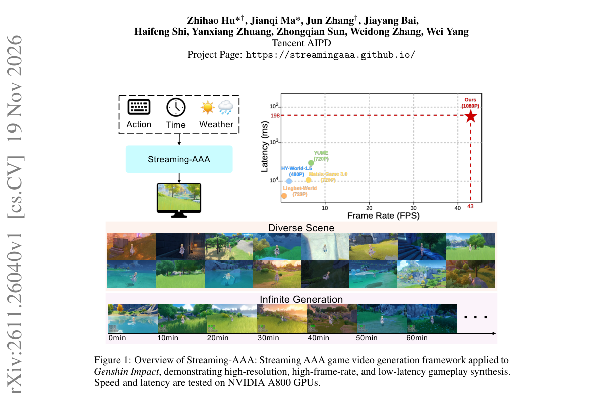

*Result - Overview of the ADCS. Designed to capture rich features of AAA games—including diverse landscapes, dynamic interactions (e.g., climbing, swimming), and photorealistic lighting—the system ach*

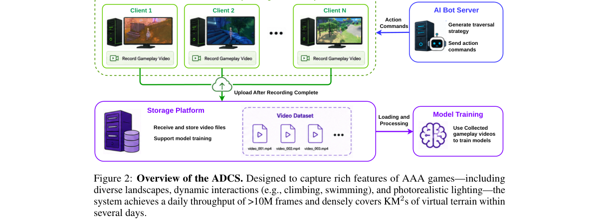

**Why this ranks #3**: 在仅一张 NVIDIA A800 上把 1080p 游戏视频做到 43 FPS 与 198 ms 端到端交互延迟：VAE 空间压缩 16 倍、时空总压缩 4×16×16，再用 Diffusion Forcing 预训练加 DMD 蒸馏对齐到 2 步生成并配合混合长短时 KV cache。

---

### 4. ViDecide: Teaching Video Diffusion Models to Reason and Plan Step by Step

**arXiv**: [2611.26389](https://arxiv.org/abs/2611.26389) | **Score**: 8.7 (relevance 9 x 0.7 + quality 8 x 0.3) | **Direction**: `aigc_generation` | **Tags**: AIGC-visual, video-diffusion, decision-centric-training, planning, corrective-finetuning, multi-step-reasoning, S-Lab | **Categories**: cs.CV | **Pages**: 28

**Authors**: Kaiwen Zhang; Yiming Gao; Zeqi Xiao; Xintao Wang; Pengfei Wan; Kun Gai; Xingang Pan

**Affiliation**: S-Lab, Nanyang Technological University; KlingAI Research; CUHK

**Abstract**

> Current leading video generation models can synthesize highly realistic videos, while still frequently violating physical and logical constraints in multi-step reasoning and planning, even after training with large-scale reasoning data or existing diffusion RL methods. We attribute these failures to the conventional video training paradigm, which treats a solution as a fixed-length clip rather than a chain of decisions. We present ViDecide, a decision-centric framework that trains video diffusion models to predict state transitions causally and decide when to stop, with a decision-focused training schedule. We further propose Corrective Fine-tuning (CFT), which corrects failed decisions by mapping their noise to the model's own successful continuations, achieving stable improvement without policy-gradient optimization. Across abstract games, planning tasks, and a new benchmark of multi-step robot planning, ViDecide achieves an average strict success rate of 83.8%, far above 23.3% for standard fine-tuning and 67.8% for the strongest prior method, and generalizes to larger puzzles and unseen layouts. Our framework therefore unlocks greater potential for video generation models as reliable reasoners and planners in the visual world. Project page: https://kevin-thu.github.io/ViDecide.

**Key findings**

- **Finding**: ViDecide 在抽象游戏、规划任务和新的多步机器人规划基准上平均严格成功率 83.8%，标准微调只有 23.3%、最强先前方法 67.8%，RoboTwin 2.0 上达 78.0%。
- **Inference**: 多步推理失败源于训练范式把解当成定长片段而非决策链，改成逐状态转移生成加自适应终止，并用 Corrective Fine-tuning 把失败决策映射回自身成功续写即可大幅提升。
- **Recommendation**: 用视频扩散模型做多步规划时，应把目标改成状态转移加视觉 EOS 终止符的因果生成，并用 Corrective Fine-tuning 而非策略梯度来修正失败决策。

**Key figures**

*Framework - Left: Seedance 2.5 [3] hallucinates physically impossible moves to reach the target arrangement, and the reasoning-tuned VBVR-Pro-RLVR [53] breaks the rules of Snake without reaching the goa*

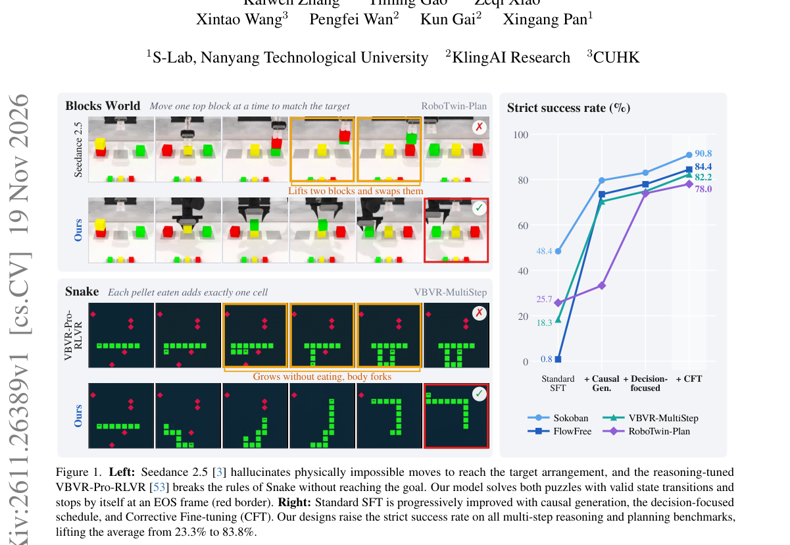

*Result - Method overview. (a) Instead of jointly generating a fixed-length clip, the model generates state transitions causally and ends with a visual EOS frame. (b) The decision-focused schedule mov*

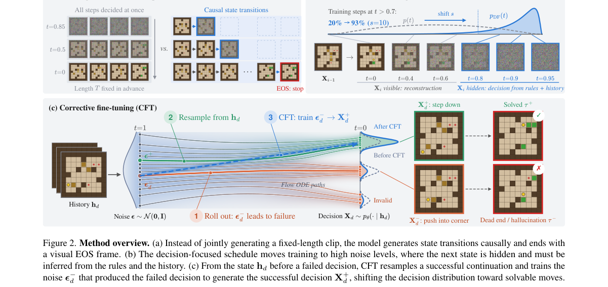

**Why this ranks #4**: 把视频训练目标从固定长度片段改成因果状态转移加视觉 EOS，平均严格成功率从标准微调的 23.3% 提到 83.8%，比最强先前方法的 67.8% 高 16 个点；RoboTwin 2.0 上 78.0% 对 63.9%。

---

### 5. UltraTex: Aligning Physical Knowledge for High-Fidelity PBR Texture Generation

**arXiv**: [2611.24941](https://arxiv.org/abs/2611.24941) | **Score**: 8.3 (relevance 8 x 0.7 + quality 9 x 0.3) | **Direction**: `aigc_generation` | **Tags**: AIGC-visual, pbr-texture, material-generation, multi-view-diffusion, intrinsic-material, relighting, SSE | **Categories**: cs.CV | **Pages**: 14

**Authors**: Jingzhi Bao; Xiaohe Ma; Hong Li; Yuanming Hu; Xiaoguang Han

**Affiliation**: SSE, CUHKSZ; Meshy AI; SLAI

**Abstract**

> Generating physically based rendering (PBR) texture maps for a 3D mesh from a single reference image is highly ambiguous, as the observed appearance entangles material identity, surface reflectance, and illumination. While current generative methods produce realistic albedo maps, they still struggle to infer accurate metallic and roughness attributes for relighting. We present UltraTex, a cascaded multi-view framework that moves beyond appearance matching by integrating physical knowledge into multi-view diffusion-based PBR generation. UltraTex first jointly predicts albedo and world-space shading normals to generate more detailed albedo maps, and then predicts metallic-roughness (MR) maps conditioned on the generated albedo, reference image, and material semantic priors. To inject material semantics, a lightweight adapter transforms hidden-layer features of a vision-language model (VLM) into intrinsic material representation tokens, providing part-level knowledge anchors for MR estimation. To model material-light interaction, photometric representation alignment guides intermediate diffusion features toward ground-truth material renderings under controlled lighting. This makes metallic and roughness variations observable through highlight intensity, specular sharpness, and local reflectance contrast, providing stronger guidance for fine-grained material prediction without explicit lighting supervision. Extensive experiments show that UltraTex generates high-quality textures and outperforms existing open-source and commercial methods in visual fidelity, material accuracy, and physical plausibility.

**Key findings**

- **Finding**: UltraTex 在 152 个 Objaverse-XL 物体上 FID 111.2、LPIPS 0.0988，优于 LumiTex 的 144.4 与 TRELLIS.2 的 158.4；31 位专业建模师盲评平均 4.31 分，最强对手 Seed3D 2.0 仅 3.20。
- **Inference**: 单图到 PBR 的歧义来自材质身份、表面反射与光照纠缠，用 VLM 隐藏层抽出的材质语义 token 加受控光照下的光度对齐能把固有属性从外观里解耦出来。
- **Recommendation**: 做单图材质生成时应先预测 albedo 与着色法线再预测 MR 贴图，并分别对材质语义 token 与光度对齐两项约束做消融，确认固有属性确实被建模而非烘焙光照。

**Key figures**

*Framework - PBR texture gallery generated by UltraTex. Our method produces detailed and physically plausible PBR materials across diverse assets under environmental lighting. In the first row, the right c*

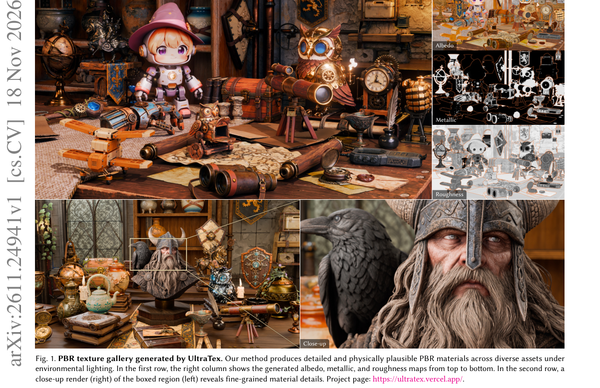

*Result - Overall pipeline of UltraTex. UltraTex adopts a cascaded two-stage multi-view diffusion pipeline. Stage 1 jointly predicts albedo maps and world- space shading normals from the reference image*

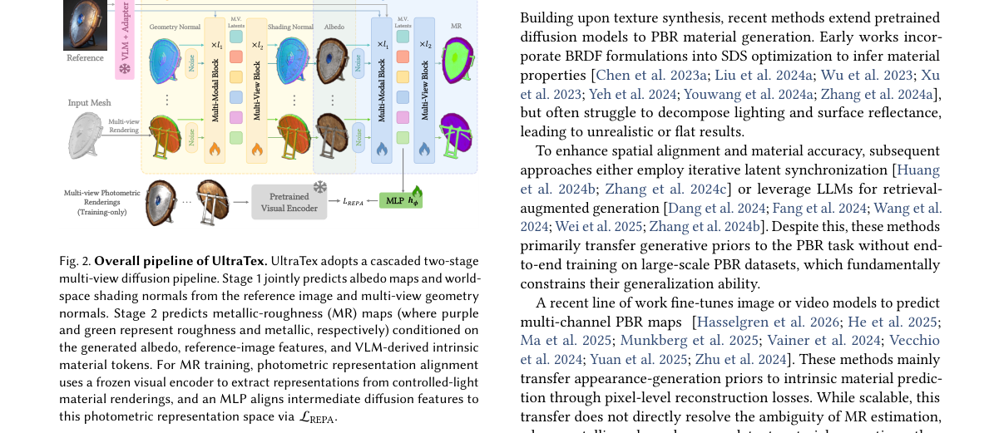

**Why this ranks #5**: 两阶段级联多视图扩散先联合预测 albedo 与世界空间着色法线，再以生成 albedo 加 VLM 材质语义 token 预测金属-粗糙度贴图；在 152 个 Objaverse-XL 物体上 FID 111.2，显著低于 TRELLIS.2 的 158.4 与 LumiTex 的 144.4。

---

### 6. Autoregressive View Model

**arXiv**: [2611.23417](https://arxiv.org/abs/2611.23417) | **Score**: 8.0 (relevance 8 x 0.7 + quality 8 x 0.3) | **Direction**: `aigc_generation` | **Tags**: AIGC-visual, novel-view-synthesis, autoregressive-video, in-context-generation, world-model, scene-persistence, Meta | **Categories**: cs.CV | **Pages**: 27

**Authors**: Jensen; Zhou; Samuel Rota Bulo; Denis Rozumny; Duncan Zauss; Peter Hedman; Nikhil Keetha; Philip Torr; Christian Rupprecht; Andrea Vedaldi; Peter Kontschieder

**Affiliation**: Meta; University of Oxford

**Abstract**

> We present the Autoregressive View Model (AVM), which generates a scene as a stream of views without constructing an explicit 3D representation. Through a unified in-context interface, AVM conditions on images or videos to generate short clips along a requested camera path. Visual context grounds reconstruction and interpolation, while a learned prior enables extrapolation into unseen regions. AVM retrieves relevant views from inputs and generated history to form a bounded active context. We fine-tune a pretrained bidirectional video diffusion transformer with flow matching in an N-in-1-out formulation. We then tune a causal model on its own rollouts to improve photorealism, reduce denoising steps, and limit long-horizon drift. We scale training to approximately 8M scenes and video clips. We evaluate generation capacity and scene persistence across benchmarks for camera control, text control, visual quality, dynamics, sparse and 4D reconstruction, and long-horizon consistency. The results demonstrate that AVM adapts to diverse input and output settings through one in-context interface.

**Key findings**

- **Finding**: AVM 微调 140 亿参数的预训练视频扩散 Transformer 并扩到约 800 万场景与视频片段，生成能力上 FID 18.69 对次优基线 25.04，长时场景重访的 PSNR 为 28.04 对 12.29。
- **Inference**: 显式 3D 重建既昂贵又难覆盖未见区域，把视觉上下文与生成历史统一成 in-context 界面后，一个模型就能同时支撑重建、插值与外推。
- **Recommendation**: 若想一个模型同时做相机控制、文本控制与稀疏重建，可用统一 in-context 接口加检索式有界活跃上下文，避免为每种输出设定单独训练模型。

**Key figures**

*Framework - A scene as a stream of views conditioned on context. AVM generates short video clips along a requested camera path with observed views as context. These views come from prefill images or vide*

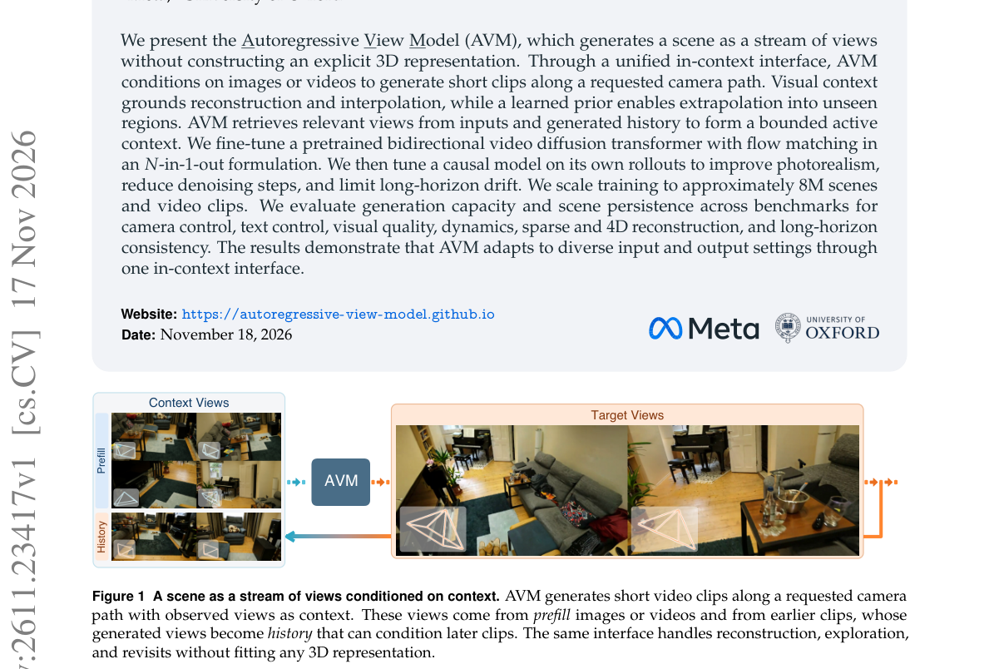

*Result - AVM capabilities. The same model handles different input and output settings through a unified in-context interface. It uses context ranging from a single image to dense image sets and synchr*

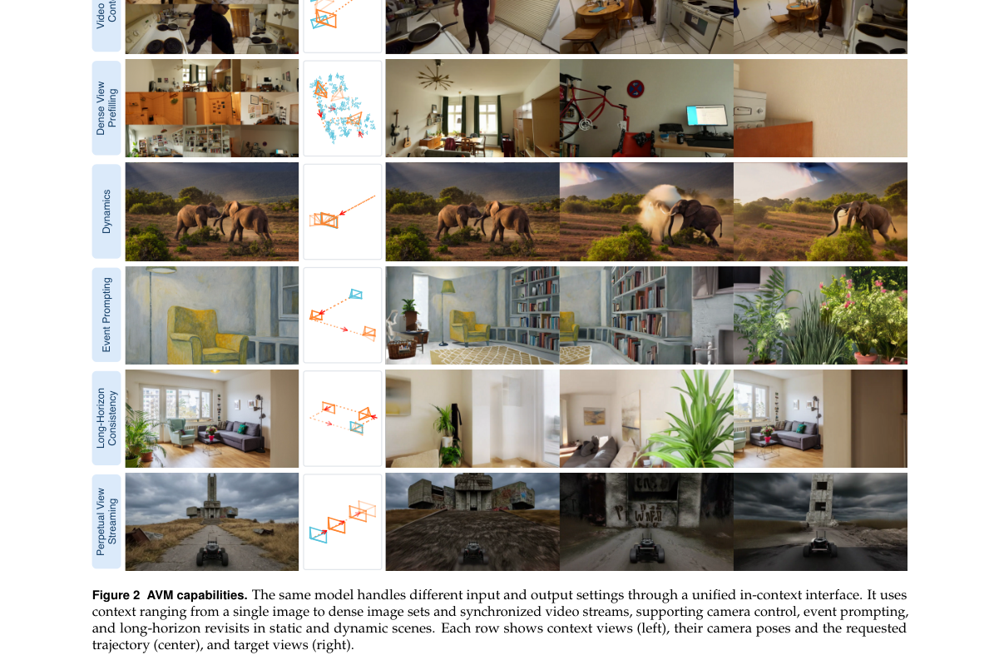

**Why this ranks #6**: AVM 不构建显式 3D 表示，直接把场景当视角流生成：用 N-in-1-out 流匹配微调 140 亿参数的预训练视频 DiT，训练规模约 800 万场景与视频片段，在 141 个 DL3DV 场景上 FID 18.69，优于次优基线的 25.04。

---

### 7. Layer-Matched Sparse Attention for Low-Redundancy 3D Reconstruction

**arXiv**: [2611.23554](https://arxiv.org/abs/2611.23554) | **Score**: 8.0 (relevance 8 x 0.7 + quality 8 x 0.3) | **Direction**: `aigc_generation` | **Tags**: AIGC-visual, sparse-attention, 3d-reconstruction, attention-approximation, training-free, pose-accuracy, BRAC University | **Categories**: cs.CV | **Pages**: 29

**Authors**: Sammam Mahdi; Fariha Binta Salim; K. M. Jubair Sami; Rakin Bin Rabbani

**Affiliation**: BRAC University

**Abstract**

> VGGT reconstructs cameras and geometry from unposed images in one pass, but its global attention grows quadratically with the number of views. Training-free accelerators thin this attention and work well on redundant video, but lose pose accuracy when views share little geometry. This paper traces these losses to two kinds of cross-view information that a uniform sparse approximation can fail to preserve together: diffuse layers aggregate distributed context, whereas matching layers depend on query-specific interactions that carry little attention mass. A per-layer statistic measures the log-mass missed by a mean token. Its row-free proxy is the logit variance, and it selects the estimator for each layer. Diffuse layers use shared, importance-sampled hub keys, with log-weights that make the softmax numerator and denominator unbiased. Matching layers stay exact: every aggressive thinning tested cost accuracy. At equal cost, the selected layers outperform the four shifted windows tested. On 13 unseen low-redundancy scenes with 32 views, LMSA stays within 1.4 AUC@5 of dense attention, compared with 10.3 for AVGGT and 4.5 for SAF3R; its difference from contemporaneous GPA-VGGT is not significant, and only its gains over AVGGT pass both scene-level tests. With 100 views, it stays within 1.9 AUC@5 while its aggregator runs $2.0\times$ faster. Used post hoc to choose the layers GPA-VGGT protects, the statistic improves it by 1.2 AUC@5 for 5% more FLOPs. Applied untuned to $π^3$, it beats AVGGT but remains further from dense accuracy.

**Key findings**

- **Finding**: 13 个低冗余场景、32 视图时 LMSA 与稠密注意力相差 1.4 AUC@5，AVGGT 相差 10.3、SAF3R 相差 4.5；扩到 100 视图仍只差 1.9，而其聚合器快 2.0 倍。
- **Inference**: 匹配层靠 query 特定的少量键定位对应点但注意力质量很低，均匀稀疏化一旦抽掉这些键就直接丢掉位姿精度，所以必须逐层区分估计器。
- **Recommendation**: 加速多视图重建的全局注意力时，先离线统计每层 logit 方差，把低方差层换成分布式 hub 聚合、高方差层保持精确，不要对所有层做统一稀疏化。

**Key figures**

*Framework - LMSA on a frozen VGGT-1B. (a) N unposed views (ETH3D courtyard [35]), each P patch and 5 special tokens. (b) Frame attention (grey) is unchanged. The offline statistic ¯Γℓ(black bars, once p*

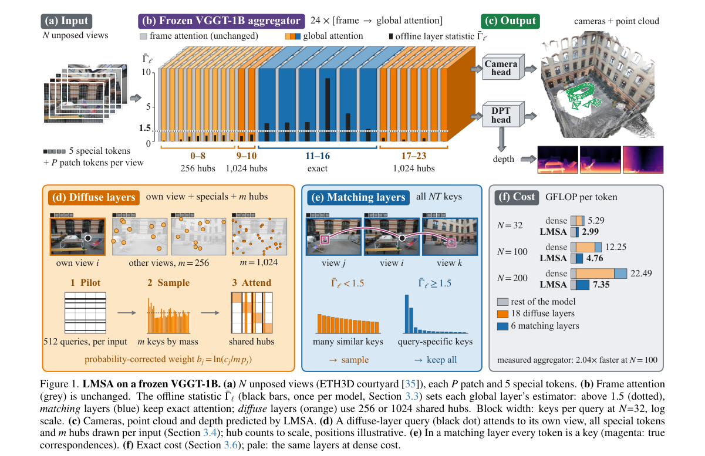

*Result - One statistic assigns the layer roles; attention mass is not importance. (a) Log-mass deficit Γ of a count-biased mean token against the row-free logit variance s2 (Eqs. (3) and (5)), for 1.*

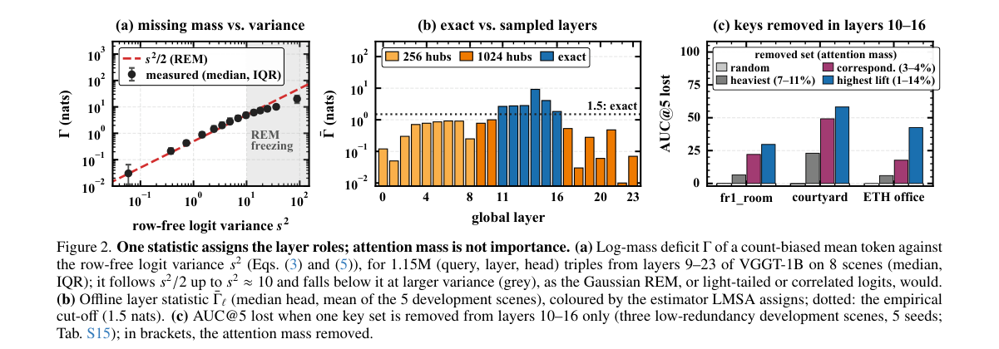

**Why this ranks #7**: 用每层 log-mass 缺失量选估计器：logit 方差超过 1.5 nats 的 11-16 层保留精确注意力，其余层改用共享 hub 键；在 13 个低冗余场景、32 视图下与稠密注意力只差 1.4 AUC@5，而 AVGGT 差 10.3、SAF3R 差 4.5。

---

### 8. EyeDiT: Anatomy-Grounded Multi-Modal Eye Generation and Simulation

**arXiv**: [2611.23670](https://arxiv.org/abs/2611.23670) | **Score**: 8.0 (relevance 8 x 0.7 + quality 8 x 0.3) | **Direction**: `aigc_generation` | **Tags**: AIGC-visual, eye-generation, 3d-gaussian, anatomy-grounded, latent-diffusion, eye-tracking, Meta Reality Labs | **Categories**: cs.CV | **Pages**: 28

**Authors**: Yonghan Lee; Zachary Willms; Kun Liu; Pushkar Anand; Ali Behrooz; Dmitri Model; Dinesh Manocha; Yatong An

**Affiliation**: Meta Reality Labs; University of Maryland, College Park

**Abstract**

> Synthetic eye data are critical for rapid development of eye tracking (ET) in AR/VR applications. However, existing synthetic eye generators are largely image-centric and lack a high-quality underlying 3D anatomy of the eye, which limits their control mainly to the gaze and provides no anatomical labels. To address this problem, we propose EyeDiT, an anatomy-grounded, multi-modal 3D eye generation and simulation model trained with optical coherence tomography (OCT), labeled anatomy point clouds and near-eye images. Our pipeline first trains a Multi-Modal Anatomy Variational Autoencoder (VAE), which encodes an anatomy-aware latent representation from all input modalities. Then, our Eye Latent DiT is trained to generate latent samples conditioned on the optical axis, the pupil position and radius, and the subject identity. Together with Gaussian decoders for novel-view simulation, our model enables control over the pupil, subject identity and viewpoint for data synthesis. We show that our model outperforms previous eye image synthesis models in novel-view synthesis (24.9 against 21.8 dB PSNR from a single view), and that a public ET neural network trained on our synthetic data shows a smaller sim-to-real gap than when trained on data from other generators (3.5$^\circ$ vs. 8.4$^\circ$ gaze error), approaches a network trained on real data, and further improves ET performance when combined with real data (2.3$^\circ$ vs. 2.6$^\circ$). More information is available on the project page: https://lyhan12.github.io/eyedit

**Key findings**

- **Finding**: EyeDiT 单视图新视角合成达 24.9 dB PSNR，此前最优为 21.8 dB；用其合成数据训练的 Aria 眼动网络与真实数据的模拟-现实差距只有 3.5°，其他生成器则是 8.4°。
- **Inference**: 图像中心的合成眼生成器只能控注视方向、给不出解剖标签，把 OCT 与标注点云纳入统一潜空间后，才能同时控瞳孔半径与身份并支持新视角渲染。
- **Recommendation**: 做 AR/VR 眼动训练数据合成时，先建多模态解剖 VAE 再叠条件 DiT，并用真实数据与合成数据混训以压缩模拟-现实差距。

**Key figures**

*Framework - We present EyeDiT, which demonstrates controlled simulation (right) of gaze, pupil radius, subject identity and novel views for synthetic near-eye images. The examples show simulated gaze and*

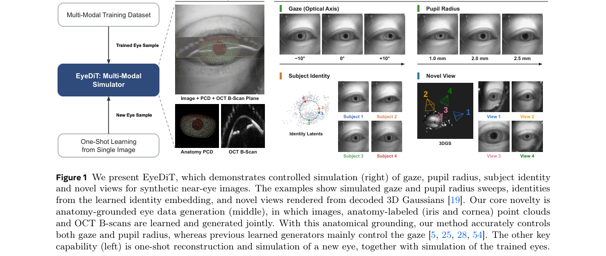

*Result - Overview of EyeDiT. (Stage 1) Our multi-modal anatomy VAE learns a shared latent space from OCT volumes, near-eye images and anatomy point clouds. (Stage 2) Our eye latent DiT is then trained*

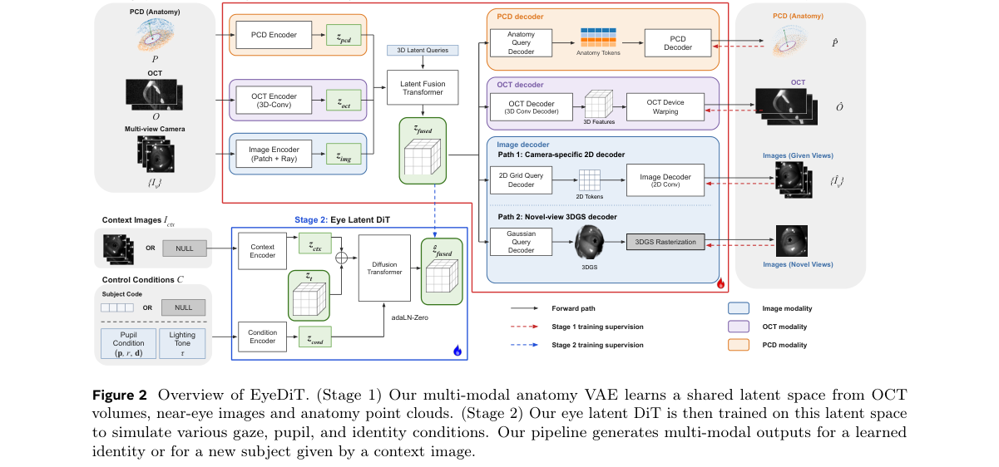

**Why this ranks #8**: EyeDiT 先用多模态解剖 VAE 融合 OCT 体数据、解剖点云与近眼图像，再由 Eye Latent DiT 条件于光轴、瞳孔位置半径与身份生成潜变量，单视图新视角合成 24.9 dB 对此前最优的 21.8 dB，眼动误差 3.5° 对 8.4°。

---

## AIGC 编辑（指令编辑 / 修补 / 个性化） · `aigc_editing` (4 papers)

这一批 4 篇几乎没有一篇是典型的指令编辑或个性化，供给整体偏向「退化图像的复原 + 可控重建」。DAWN 是免训练数据的盲反卷积框架，用 Wiener 引导与网络自身先验交替迭代；AesDistill 把生成式美学蒸馏成可复用的色彩增强监督；DetailScale-SR 把复原与细节量解耦，用偏好条件连续控制细节而不改动被复原的场景；ReDraw 最特殊，把古汉字修复重定义为 SVG 代码生成与编辑，用 120 万合成样本与 320 个真实字形导出 6400 个适配对，换来笔画几何的可控。值得注意的是，这一批里 rel≥9 的论文是 0 篇。

### 9. DAWN: Robust Neural Blind Deconvolution via Alternating Wiener Guidance

**arXiv**: [2611.25621](https://arxiv.org/abs/2611.25621) | **Score**: 8.0 (relevance 8 x 0.7 + quality 8 x 0.3) | **Direction**: `aigc_editing` | **Tags**: AIGC-visual, blind-deconvolution, deep-image-prior, wiener-filter, training-free, image-restoration, University of Michigan | **Categories**: cs.AI, cs.CV | **Pages**: 33

**Authors**: Yida Pan; Yixuan Jia; Chaoyan Huang; Qing Qu; Ismail Alkhouri

**Affiliation**: University of Michigan; Michigan State University; Los Alamos National Laboratory

**Abstract**

> Blind image deconvolution (BID) is an ill-posed inverse problem that aims to jointly recover a sharp image and blur kernel from a single degraded observation. Under nontrivial and high noise, which is common in photography and scientific imaging such as microscopy, BID remains particularly challenging, as existing methods suffer from noise overfitting and inaccurate kernel estimation. Existing training-data-free learning methods for BID, such as those based on the deep image prior (DIP), often utilize external guidance by including model-based estimates as additional loss terms, which underexploits the information these estimates carry especially under nontrivial noise. To address these challenges, we propose DAWN, a training-data-free DIP framework that alternates between injecting model-based estimates directly into the model input and refining this imperfect estimate with the network's own prior. To provide more reliable kernel estimates for these injections, we apply autoencoding regularization to both the image and kernel networks. On natural and scientific images under varying levels of Gaussian and Poisson noise, DAWN outperforms state-of-the-art methods in both image and kernel quality (achieving up to +4.5 dB over the next best baseline on the Levin dataset at $σ= 0.1$). Without any training images, DAWN remains highly competitive with a state-of-the-art diffusion model on FFHQ, despite the latter being trained on a massive number of in-distribution images.

**Key findings**

- **Finding**: Levin 数据集噪声 σ=0.1 时 DAWN 的图像与核质量比次优基线高最多 4.5 dB；实验用 K=2000 轮外迭代、每轮 N=2 步梯度、注入周期 M=200、图像自编码权重 λx=1。
- **Inference**: 已有 DIP 类盲反卷积只把模型估计当额外损失项，浪费了估计里携带的信息；把估计直接写进网络输入相当于把模型先验当成观测条件来用。
- **Recommendation**: 做免训练盲去模糊时可交替注入 Wiener 反卷积估计与网络精修，并对图像与核两侧都加自编码正则；论文消融显示去掉任一项优势都会明显缩水。

**Key figures**

*Framework - Comparison on a blurry image from the real-world subset of Lai, Huang, et al. [Lai+16], with noise of 𝜎= 0.1. No ground truth image or kernel is available. Zoom in for best viewing. Addition*

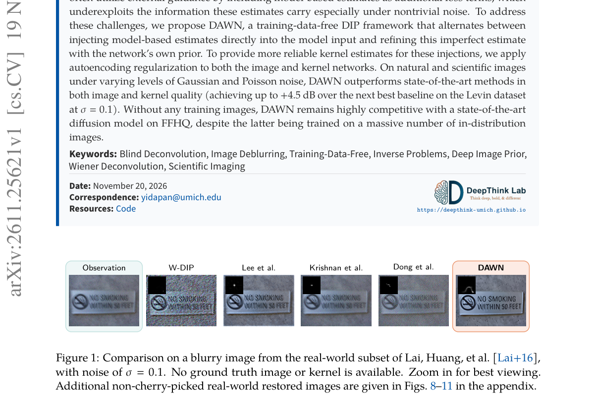

*Result - Overview of the DAWN framework. The image and kernel networks are jointly optimized with a data fidelity loss and dual autoencoding regularization. Every 𝑀outer iterations, the image network*

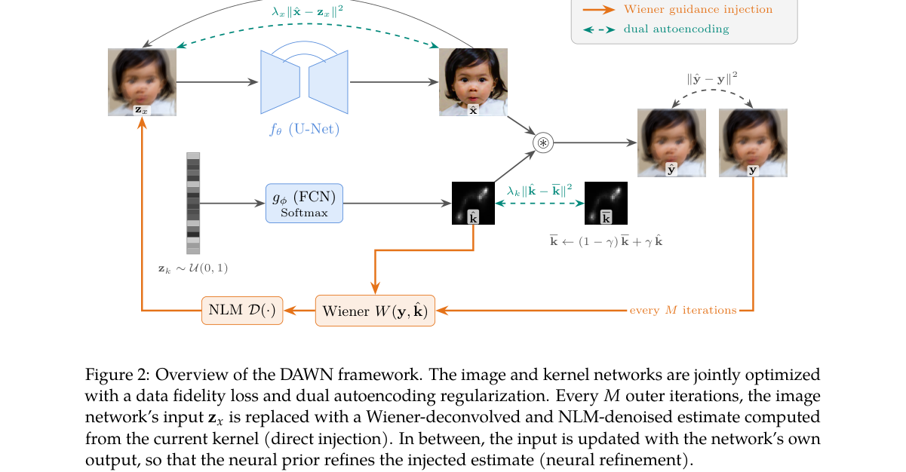

**Why this ranks #9**: DAWN 是免训练数据的 DIP 框架，每 M=200 轮把 Wiener 反卷积估计直接注入网络输入并用网络自身先验修正，同时对图像与核两侧施加自编码正则；在 Levin 数据集 σ=0.1 上比次优基线高最多 4.5 dB。

---

### 10. AesDistill: Distilling Generative Aesthetics for Image Color Enhancement

**arXiv**: [2611.25635](https://arxiv.org/abs/2611.25635) | **Score**: 8.0 (relevance 8 x 0.7 + quality 8 x 0.3) | **Direction**: `aigc_editing` | **Tags**: AIGC-visual, color-enhancement, knowledge-distillation, aesthetic-scoring, generative-teacher, compact-model, University of Sydney | **Categories**: cs.AI, cs.CV | **Pages**: 33

**Authors**: Chuanzhi Xu; Chengkun Yue; Huiqi Liang; Haoyang Li; Zihan Deng; Qingwen Zeng; Pengfei Ye; Weidong Cai

**Affiliation**: The University of Sydney; Indiana University; The University of Hong Kong; Massachusetts Institute of Technology

**Abstract**

> Image color enhancement aims to improve visual appeal, but previous methods often learn to reproduce ground-truth expert targets. These targets reflect the preferences of a few experts and cover a limited range of aesthetic choices. Matching them does not ensure stronger aesthetic quality across different tastes and scenes. By contrast, large generative models learn rich visual knowledge from large image collections and often produce vivid, appealing image edits. However, direct generation can change the source image's semantic structure along with its colors. In this paper, we introduce AesDistill, a framework for distilling generative aesthetics into image color enhancement. We use 4 leading open-source large generative models to produce 64,644 edited images as teacher targets at a cost of about 3,360 H100 GPU-hours, forming the AesDistill Dataset. AesDistill also includes AesDistill Student, a 1.13M-parameter model that learns teacher color changes through confidence-weighted supervision while preserving the source image's semantic structure. We evaluate AesDistill with 12 aesthetic and 4 image-quality assessment models. Every teacher's targets rank above the FiveK and PPR10K expert target means in the joint assessment. Across both datasets, AesDistill Student outperforms all 20 baseline methods and ranks directly behind the 4 teachers. These results demonstrate that distilling aesthetics from generative models enables a compact student to outperform methods trained on expert targets.

**Key findings**

- **Finding**: 四个教师的输出在全部 12 个审美与 4 个画质评估上平均分都高于 FiveK 与 PPR10K 的专家目标均值；1.13M 参数的 AesDistill Student 在两个数据集上综合排名仅次于四个教师，领先全部 20 个基线。
- **Inference**: 直接拟合少数专家的目标会把审美空间限制在专家偏好内，改用大生成模型当教师可以覆盖更广的审美取向，再靠置信度加权监督把原图语义结构保住。
- **Recommendation**: 做色彩增强时可先用开源生成模型批量造教师编辑做蒸馏，但必须配合置信度加权与结构保持约束，否则会把原图的语义结构一起改掉。

**Key figures**

*Framework - AesDistill distills aesthetic knowledge from large generative model teachers trained on diverse images into a compact student. Our teachers and AesDistill Student show higher aesthetic quali*

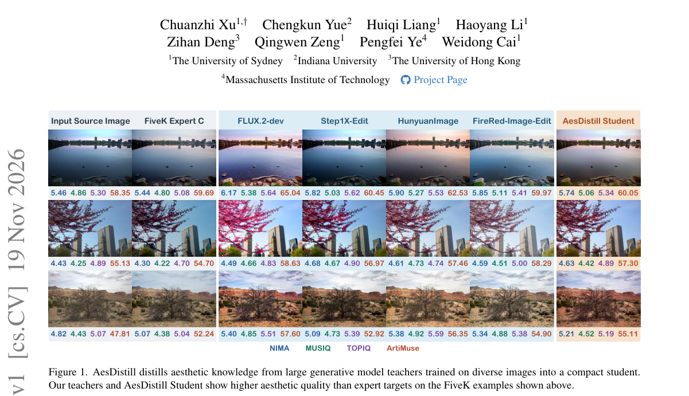

*Result - Joint Score averages percentile ranks over 12 aesthetic and 4 image-quality assessments. AesDistill Student leads all 20 baselines, directly behind the four large generative teachers.*

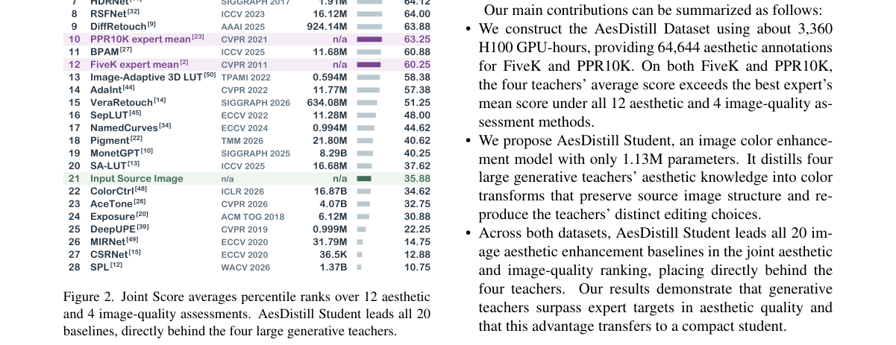

**Why this ranks #10**: 用 FLUX.2-dev、Step1X-Edit、HunyuanImage（83.0B）、FireRed-Image-Edit 四个生成模型产出 64,644 张教师编辑图（约 3,360 H100 GPU-小时），蒸馏到 1.13M 参数的学生模型，在 12 个审美加 4 个画质模型上全面超过 20 个基线。

---

### 11. From Restoration to Redrawing: Revitalizing Ancient Chinese Characters by SVG Code Generation and Editing

**arXiv**: [2611.24084](https://arxiv.org/abs/2611.24084) | **Score**: 7.7 (relevance 8 x 0.7 + quality 7 x 0.3) | **Direction**: `aigc_editing` | **Tags**: AIGC-visual, svg-generation, character-restoration, vlm, chain-of-thought, grpo, University of Liverpool | **Categories**: cs.CV | **Pages**: 11

**Authors**: Weiguang Zhang; Linhua Dong; Bin Dong; Shanshan Jiang; Maizhen Ning; Xiaoqiang Kang; Kun Zhang; Hao Xu; Xiaowei Huang; Wei Wang; Kaizhu Huang; Qiufeng Wang

**Affiliation**: University of Liverpool; Xi'an Jiaotong-Liverpool University; Ricoh Software Research Center Beijing Co., Ltd.; Tencent; Duke Kunshan University

**Abstract**

> Hanjian manuscripts written on Han Dynasty bamboo and wooden slips are invaluable heritage of ancient Chinese writing but suffer from damaged ink and incomplete strokes. Existing image-to-image restoration methods may alter observed strokes and offer limited control over stroke geometry. Inspired by experts' manual redrawing practices, we address these issues by introducing \textbf{ReDraw}, a two-stage vision-language model(VLM) that reformulates character restoration as Scalable Vector Graphics(SVG) code generation and editing. Stage one targets faithful vectorization of observed strokes geometry or conservative tracing of mildly degraded strokes. Guided by skeleton chain-of-thought reasoning and reinforcement learning with structure-aware rewards, stage two predicts skeletons before contours to redraw severely incomplete strokes by appending paths while keeping existing SVG paths unchanged. To support training, we develop a multi-layer data synthesis pipeline that disentangles ink, material, and degradation to generate 1.2M samples, and derive up to 6,400 adaptation pairs from 320 annotated real glyphs. Experiments demonstrate synthetic restoration performance and adaptability to real Hanjian glyphs. Code and demo will be available upon acceptance.

**Key findings**

- **Finding**: ReDraw 在 600 个合成测试样本上 SSIM 0.9225、LPIPS 0.0850，SSIM 比 DocRes 高 0.0493、LPIPS 比 PromptIR 相对下降 35.7%；GRPO 相对纯 SFT 再把 LPIPS 与 MSE 降约 24% 与 27%。
- **Inference**: 图像到图像的修复无法约束笔画几何，而 SVG 路径是可编辑、可逐段追加的结构表示，先描骨架再补轮廓才能在不改动既有笔画的前提下补全残缺部分。
- **Recommendation**: 处理古文字与线描类残损图像时，改走矢量代码生成与编辑的思路，并用骨架优先的链式思维加结构感知奖励做强化学习微调。

**Key figures**

*Framework - Comparison on ancient Chinese character restoration paradigms. Image-to-image restoration models (a) and general- purpose VLMs (b) may alter observed strokes or fail to restore severely inco*

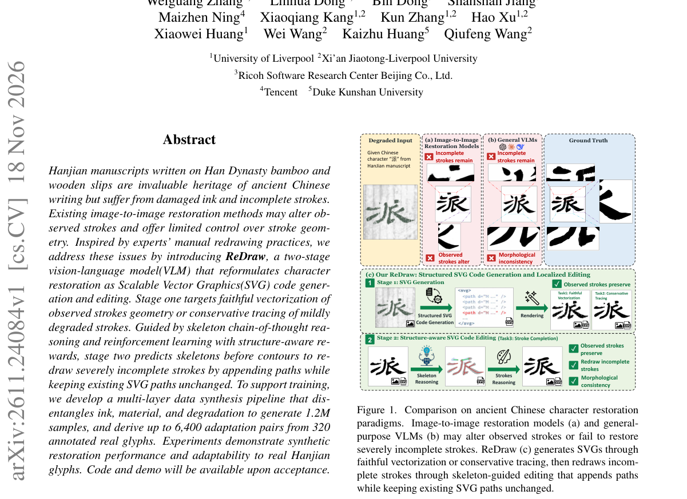

*Result - The pipeline of multi-layer data synthesis. Ink, degradation, and material layers produce degraded observations with paired SVG labels for three subtasks: faithful vectorization, conservativ*

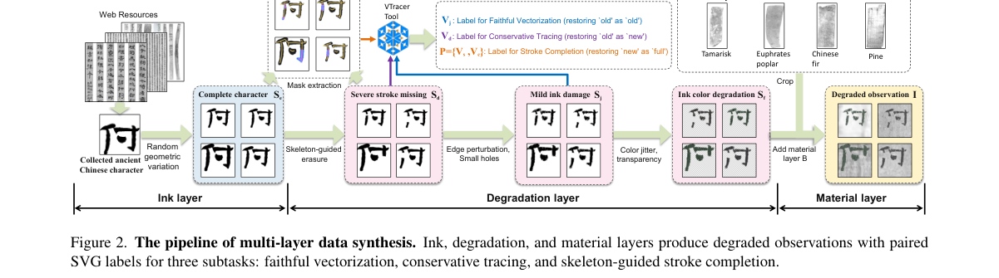

**Why this ranks #11**: ReDraw 把汉简字修复重写为 SVG 代码生成与编辑：先保真矢量化，再用骨架链式思维先出骨架后出轮廓补全残缺笔画，配合 GRPO 结构感知奖励，600 个合成测试样本上 SSIM 0.9225、LPIPS 0.0850，比 DocRes 高 0.0493 SSIM、比 PromptIR 降 35.7% LPIPS。

---

### 12. DetailScale-SR: Decoupling Restoration and Continuous Detail Control for Real-World Super-Resolution

**arXiv**: [2611.24212](https://arxiv.org/abs/2611.24212) | **Score**: 7.7 (relevance 8 x 0.7 + quality 7 x 0.3) | **Direction**: `aigc_editing` | **Tags**: AIGC-visual, super-resolution, controllable-generation, flow-matching, detail-control, text-restoration, Shanghai Jiao Tong University | **Categories**: cs.CV | **Pages**: 11

**Authors**: Shengchuan Gao; Zhongjie Duan; Yingda Chen; Jingjing Chen

**Affiliation**: Shanghai Jiao Tong University; ModelScope Team, Alibaba Group; Fudan University

**Abstract**

> Real-world image super-resolution often seeks the most detailed plausible reconstruction, although more detail is not always desirable. The same degraded image may require restrained restoration, faithful reconstruction, or enhanced visual detail according to user intent. We present DetailScale-SR, a preference-conditioned framework that continuously controls reconstructed detail for a fixed low-resolution input without altering the scene being restored. Rather than relying on post-processing or repeatedly rewriting prompts, it learns a continuous family of reconstructions while separating content recovery from detail preference. This enables a smooth transition from conservative restoration to richly textured results under consistent input and semantic constraints. Its controllable range also extends beyond conventional restoration: DetailScale-SR can enhance high-frequency structures and generate perceptually richer textures than the paired high-resolution reference. Text restoration is another distinct strength. For text-rich scenes, especially Chinese posters and signs, it recovers more legible and character-faithful text than prior generative SR methods under matched textual guidance. DetailScale-SR therefore unifies continuous detail control, beyond-reference enhancement, and reliable recovery of semantically important content. Our model is available at https://modelscope.cn/models/DiffSynth-Studio/Qwen-Image-2.1-SR

**Key findings**

- **Finding**: RealSR 上细节标量 s 从 0.0 到 1.0 时 PSNR 由 26.69 单调降到 25.48、MUSIQ 由 60.94 升到 65.53，LPIPS 在 s=0.8 取最优 0.2215；Detail-CFG（γ=2）进一步把 MANIQA 提到 0.6653。
- **Inference**: 冻结第一阶段修复 LoRA、只优化第二阶段的细节模板，能让同一模型在保守修复与超越参考的增强之间连续过渡，而联合训练会把修复能力一起改写掉。
- **Recommendation**: 做真实图像超分时，用单一标量而不是改提示词或换采样噪声来控制细节强度，并额外用 Detail-CFG 打开超过参考分辨率的增强区间。

**Key figures**

*Framework - Qualitative results of DetailScale-SR. Besides recovering fine textures and structures from heavily degraded inputs, our method enables detail-controllable SR through a single scalar that de*

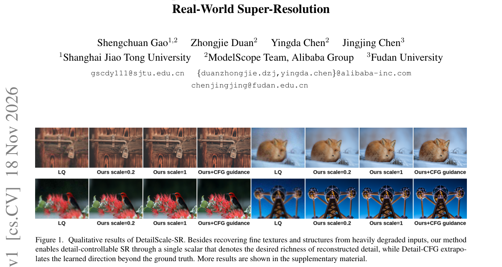

*Result - Overview of the proposed DetailScale-SR framework.*

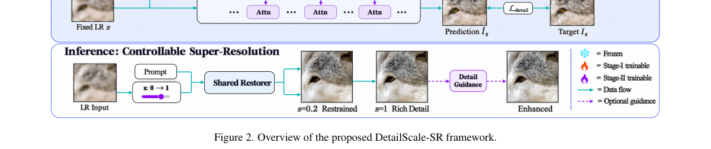

**Why this ranks #12**: DetailScale-SR 把连续细节标量注入冻结修复模型的注意力层，RealSR 上 s 从 0 到 1 时 PSNR 单调从 26.69 降到 25.48、MUSIQ 从 60.94 升到 65.53，LPIPS 在 s=0.8 取最优 0.2215，Detail-CFG 还能把 MANIQA 推到 0.6653。

---

## 面向视觉生成的 RL 与奖励模型 · `aigc_rl` (5 papers)

本方向 5 篇里有 3 篇的核心主张是同一个反直觉判断：真正需要修的是奖励或判别侧，而不是策略侧。头名《RL Post-Training in Diffusion Transformers Is Activation Steering》发现，冻结全部预训练权重、只加一组固定的 steering vector，就能复现大部分 RL 后训练带来的提升——RL 的作用可能只是激活空间里的一个方向。CANDOR 则指出生成器自己的去噪精度并不是 prompt 忠实度的代理，改用无参照去噪对数比；Keystone 更直接，生成结果在去噪一开始时就已经定下，失败的是判别器在早期预览上接近随机。另两篇补的是结构性问题：SPM 处理少步扩散「是采样器而非 score model」导致的信用分配失效，EVA-RSI 用固定代理考试做视频评估器的递归自改进。

### 13. RL Post-Training in Diffusion Transformers Is Activation Steering

**arXiv**: [2611.26627](https://arxiv.org/abs/2611.26627) | **Score**: 9.0 (relevance 9 x 0.7 + quality 9 x 0.3) | **Direction**: `aigc_rl` | **Tags**: AIGC-visual, activation-steering, rl-post-training, diffusion-transformer, steering-vectors, reward-gain, Virginia Tech | **Categories**: cs.CV, cs.LG | **Pages**: 27

**Authors**: Tuna Han Salih Meral; Kaan Oktay; Alec Helbling; Atakan Kara; Duen Horng Chau; Pinar Yanardag

**Affiliation**: Virginia Tech; fal; Georgia Tech; IBM Research

**Abstract**

> Reinforcement learning (RL) post-training substantially improves the visual quality, text rendering, and compositional accuracy of diffusion transformers. Because capabilities such as rendering requested text or composing multiple objects are inherently prompt-dependent, a natural hypothesis is that improving them requires learning complex, input-dependent transformations. To isolate how much of these gains an input-independent shift explains, we probe each RL-tuned model with a deliberately simple parameterization: a fixed set of steering vectors added to the block outputs of the frozen base model. On SD3.5-M, these vectors hold 65x fewer parameters than the RL-tuned LoRA (0.29M against 18.8M). We fit them to match the velocity predictions of public RL-tuned checkpoints, with no reward in the objective. Although the vectors are identical for every prompt, token, and sampling seed, they recover 90.0-96.3% of the reward gains of six RL-tuned image models, and 89.8% and 111.9% on two RL-tuned video models. Initialized at zero and trained with online RL, the vectors alone exceed the reward gains of weight-based RL on text rendering (OCR) and human preference (PickScore) on SD3.5-M. A constant shift thus suffices for most of the gain of policy-gradient RL post-training: without new input-dependent transformations, it steers the pretrained generator toward what it can already compute.

**Key findings**

- **Finding**: 对冻结基座 SD3.5-M 加 188 个定长 steering 向量（0.29M 参数，对比 RL 微调 LoRA 的 18.8M），可恢复六个 RL 微调图像模型 90.0–96.3% 的奖励增益，两个视频模型为 89.8% 与 111.9%。
- **Inference**: 同一组向量对所有 prompt、token 与采样种子都相同却能复现大部分收益，说明策略梯度后训练主要学到的是一个常数偏移，而不是提示词相关的输入依赖变换。
- **Recommendation**: 做扩散模型 RL 后训练时，先用定长 steering 向量拟合公开 RL 检查点的速度预测当作基线；若常数偏移已覆盖大部分增益，再考虑上可训练权重以省参数。

**Key figures**

*Framework - A constant shift of a frozen base model recovers 90.0% to 96.3% of the RL reward gain on six image models. Base + s adds the same steering vectors, sOCR or sPickScore, to the frozen Base SD3.*

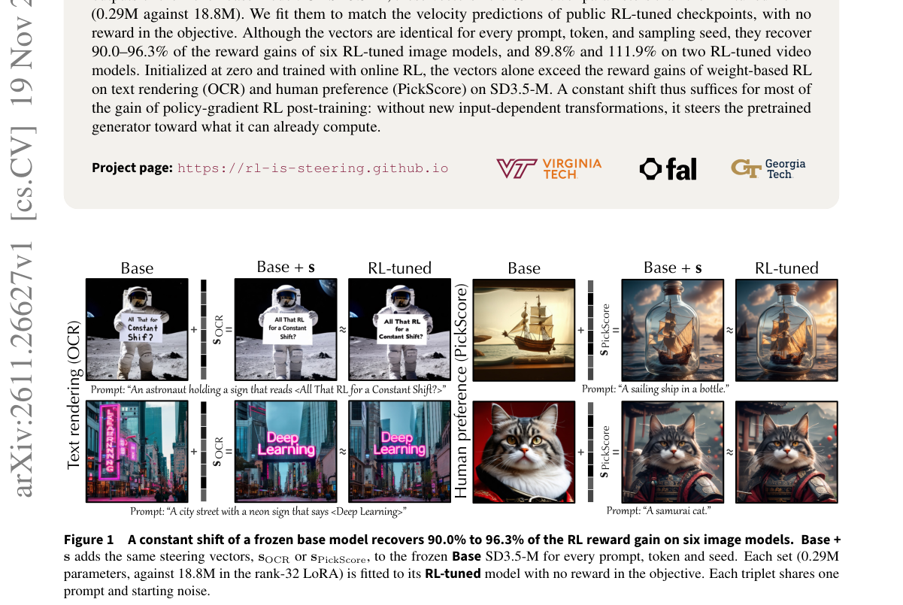

*Result - The steering vectors add the same vector to every token of every prompt. Block ℓon two text-rendering prompts, with a linear layer W, token inputs zi and zj, and block outputs hi and hj. Base*

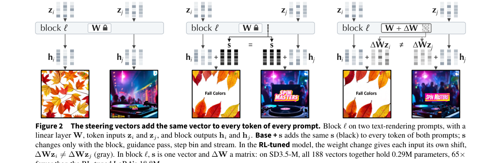

**Why this ranks #13**: 在 SD3.5-M 上拟合 RL 微调模型速度预测的 188 个定长 steering 向量只要 0.29M 参数，是 rank-32 LoRA 的 1.5%、少 65 倍，却能恢复六个图像模型 90.0–96.3% 的奖励增益，两个视频模型上达到 89.8% 与 111.9%。

---

### 14. CANDOR: Contrastive Self-Denoising Rewards for Label-Free Text-to-Image Post-Training

**arXiv**: [2611.25457](https://arxiv.org/abs/2611.25457) | **Score**: 8.7 (relevance 9 x 0.7 + quality 8 x 0.3) | **Direction**: `aigc_rl` | **Tags**: AIGC-visual, intrinsic-reward, flow-grpo, text-to-image, denoising-error, label-free, Seoul National University | **Categories**: cs.CV | **Pages**: 10

**Authors**: Junhyeok Lee; Byung-Hoon Kim; Kyu Sung Choi

**Affiliation**: Seoul National University; EverEx

**Abstract**

> Post-training text-to-image generators with reinforcement learning usually relies on external reward models that need annotated preferences or auxiliary evaluators and are prone to reward hacking. We show that the generator's own denoising accuracy, used by a recent intrinsic reward, is a poor proxy for prompt fidelity. Within a same-prompt group, this absolute self-confidence is dominated by image complexity and ranks correct samples above incorrect ones near chance. We introduce CANDOR (Contrastive Alignment from Null-referenced Denoising lOg-Ratio), the log-ratio of unconditional to conditional denoising errors under shared noise probes, which measures how much the prompt helps the model denoise its own sample. It cancels prompt-independent difficulty that scales both errors and ranks the better of two same-prompt samples higher in 60% and 63% of pairs on compositional generation and text rendering. As the only Flow-GRPO reward for a flow-matching model, CANDOR improves text rendering, aesthetic and human-preference scores over the base model and a prior absolute self-confidence reward, with text-rendering and preference gains that stronger classifier-free guidance does not reproduce. On public Flow-GRPO adapters trained on external rewards, CANDOR further raises PickScore and ImageReward, so it can complement those rewards. Code is available at https://github.com/jhlee0619/candor.

**Key findings**

- **Finding**: CANDOR 在同提示词成对排序上的正确率为 60%（组合生成）与 63%（文字渲染），而绝对自置信度几乎等于随机（0.48 与 0.50）；作为 Flow-GRPO 唯一奖励时 GenEval 从基准 0.474 升到 0.706、OCR 升到 0.70。
- **Inference**: 绝对自置信度被图像复杂度主导而非提示词保真度，改用无条件与条件去噪误差之比可以抵消与提示词无关的难度，从而得到无标签的内在奖励。
- **Recommendation**: 文本到图像后训练拿不到偏好标注时可先试这类去噪误差对比内在奖励，并把它与外部奖励叠加而非替代，同时监控生成 PNG 体积等复杂度代理指标以防 reward hacking。

**Key figures**

*Framework - Base model before and after CANDOR post-training. GenEval (left) and OCR text-rendering (right) test prompts; OCR labels: text to render. Hand-picked to show differences.*

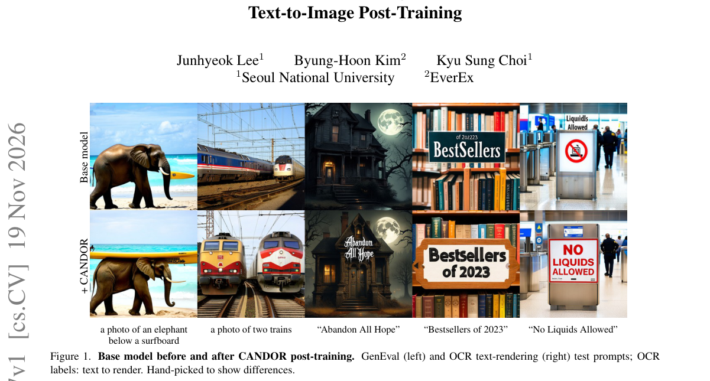

*Result - Overview of CANDOR. Rollout & re-noising: policy samples re-noised with antithetic probes. Contrastive denoising log-ratio: Di,t of empty-prompt to prompt errors (CFG off). GRPO: per-sample*

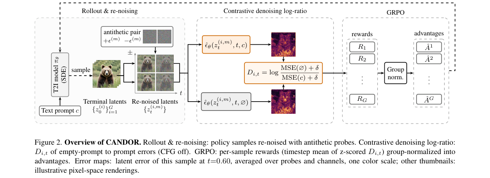

**Why this ranks #14**: CANDOR 用空提示与条件提示在共享噪声探针下的去噪误差对数比做内在奖励，同提示词成对排序正确率在组合生成与文字渲染上分别达 60% 与 63%，把 GenEval 从 0.474 提到 0.706、OCR 提到 0.70，且完全不需要偏好标注。

---

### 15. Keystone: Judging Previews at Key Steps for Test-Time Search in Diffusion Models

**arXiv**: [2611.25530](https://arxiv.org/abs/2611.25530) | **Score**: 8.7 (relevance 9 x 0.7 + quality 8 x 0.3) | **Direction**: `aigc_rl` | **Tags**: AIGC-visual, test-time-search, verifier, preview-judging, geneval, best-of-n, UIUC | **Categories**: cs.AI | **Pages**: 65

**Authors**: Jiajun Fan; Chaoran Cheng; Ziwen Wang; Changyi Yang; Bangji Yang; Qinglong Zheng; Ge Liu

**Affiliation**: UIUC; NYU; CMU

**Abstract**

> Text-to-image diffusion and flow models yield a preview, their clean-image estimate, at every denoising step. When they miscount, drop or misplace objects, test-time search is in a bind: its verifiers are reward models built for finished images, so judging early misreads blurry previews, and judging late, as best-of-N does, pays to fully denoise doomed candidates. We find that the image is not the problem: the outcome is settled as denoising starts, by the seed or by a stochastic sampler's first steps, and already shows in early previews; what fails on them is the judge, as reward models read them near chance on several kinds of prompts. We introduce Keystone, a training-free judge of previews that compiles a prompt into typed questions about its objects, counts, colours and positions and has an off-the-shelf multimodal decision model answer them. Asked this way, the judge reads counts and positions from early previews better than reward models read them from finished images. Searching at these key steps on GenEval with SD3.5-Medium, Keystone's adaptive search and pruning significantly outperform best-of-8 with every other verifier at under half its generator compute, and as a drop-in verifier there, the Keystone score significantly improves best-of-N, progressive seed pruning and FK steering; without retuning, both searches stay significantly above the strongest other verifier's best-of-N on average over four base models and three benchmarks. Keystone thus moves test-time judgment to the key steps where the outcome already shows.

**Key findings**

- **Finding**: Keystone 在 SD3.5-Medium 的第 8 步预览上读取数量与位置优于在成图上读数的 VQAScore、ImageReward 与 HPSv2.1；在测试提示上从第 12 步起的预览也优于其它验证器对成图的读数。
- **Inference**: 生成结果在去噪一开始就被种子或随机采样器的头几步决定，早期预览已经暴露对错，失败的是只适配成图的奖励模型而非图像本身。
- **Recommendation**: 想在测试期少花算力提升构图正确率，应在关键步做分支与剪枝，而不是等所有候选都去噪完再做 best-of-N，因为晚期评判要为注定失败的候选付全额算力。

**Key figures**

*Framework - The outcome is visible long before denoising ends. Four of eight candidates for a development prompt on SD3.5-Medium. Keystone asks whether there are exactly four bananas and scores each cand*

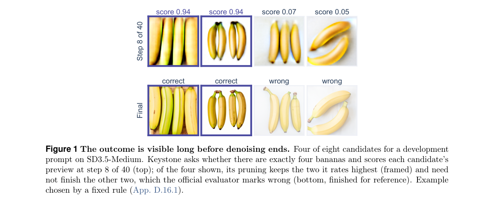

*Result - Keystone compiles the prompt, reads previews at the key steps and searches there. (a) The prompt becomes typed questions about its slots, and an image’s score is its smallest slot score (Sec.*

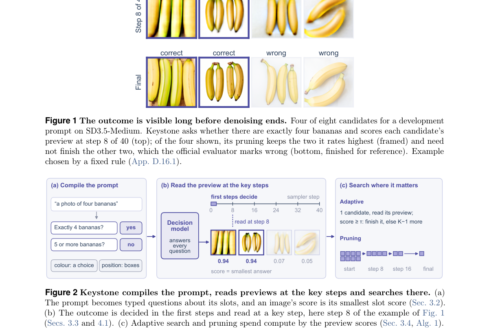

**Why this ranks #15**: Keystone 把提示词编译成关于物体、数量、颜色与位置的定型问题，让现成的多模态决策模型在早期预览上作答；在 GenEval 加 SD3.5-Medium 上，自适应搜索与剪枝用不到 best-of-8 一半的生成算力就显著优于所有其它验证器。

---

### 16. Reinforcing Few-Step Diffusion Models via Shadow Posterior Matching

**arXiv**: [2611.25998](https://arxiv.org/abs/2611.25998) | **Score**: 8.7 (relevance 9 x 0.7 + quality 8 x 0.3) | **Direction**: `aigc_rl` | **Tags**: AIGC-visual, few-step-distillation, rl-post-training, shadow-posterior, black-box-reward, reward-hacking, [unverified] | **Categories**: cs.LG | **Pages**: 10

**Authors**: Jingqiao Xiu; Yicong Li

**Affiliation**: [unverified]

**Abstract**

> Few-step diffusion models are widely deployed for their efficiency. However, reinforcing them with black-box rewards, as is routine for multi-step models, faces two structural challenges. First, a few-step generator is a sampler rather than a score model, so its velocity is not the forward velocity of the generated distribution. Second, it must be anchored to the undistilled teacher, which shares no transitions with it. Existing few-step RL methods handle the latter with a marginal KL to the teacher, but each pays for the former in its reward credit. We propose Shadow Posterior Matching (SPM), which renoises generated samples into shadow inputs and obtains the credit from their shadow posterior. From the KL-regularized reward objective, we derive a regression loss that turns reward values into a reward direction while anchoring the generator's outputs to the teacher and aligning the shadow inputs with the deployed inputs. Applied to 4-step generators, SPM achieves higher rewards with less reward hacking than prior few-step RL methods.

**Key findings**

- **Finding**: SPM 在 4 步生成器上取得 GenEval 0.94、OCR 0.96、PickScore 23.84，而最强少步方法为 0.86、0.95、23.36；SPM 在 15 个任务-指标组合中的 10 个领先 4 步方法，并超过多步教师。
- **Inference**: 少步生成器是采样器而非 score 模型，其速度不是生成分布的前向速度，常规奖励加权反传无法把信用传到最后一次调用，重加噪得到的 shadow 后验提供了可微的替代信用。
- **Recommendation**: 给少步蒸馏模型做黑盒奖励 RL 时，应把奖励信用放到重加噪样本的 shadow 后验上，并把倾斜温度 α 保持在 0.1 附近（α=0.01 会让 ImageReward 崩到 −1.50，α=1 则 OCR 掉到 0.87）。

**Key figures**

*Framework - Reward curves with a single black-box reward. The reward is GenEval (top) or OCR (bottom). Left: training reward on test prompts. Right: ImageReward on DrawBench prompts. SPM achieves higher*

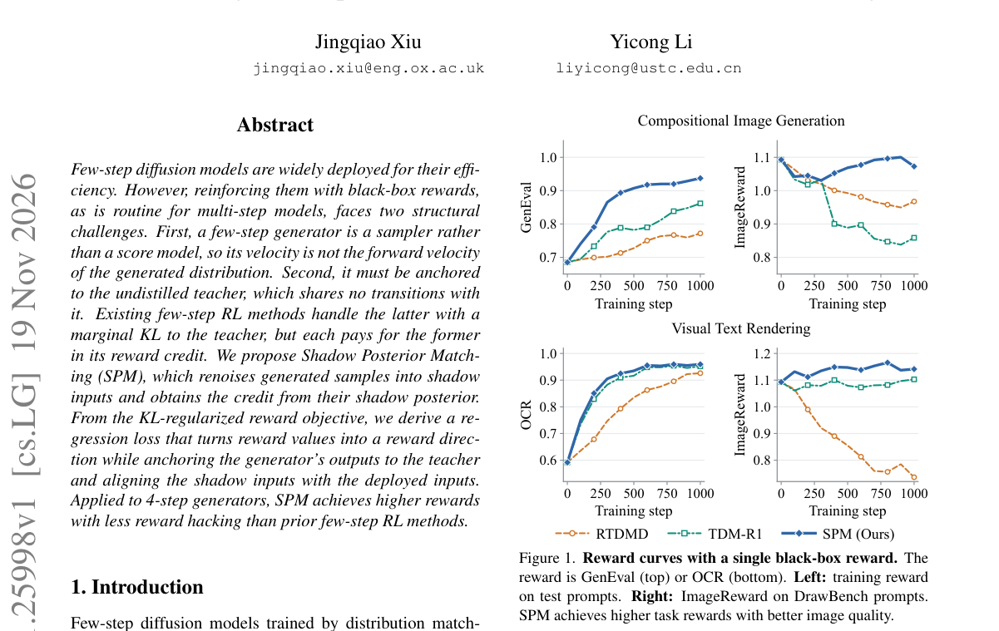

*Result - Overview of Shadow Posterior Matching. (a) The deployed few-step sampler generates final samples without gradients, and their black-box rewards yield group-relative advantages. (b) Renoising*

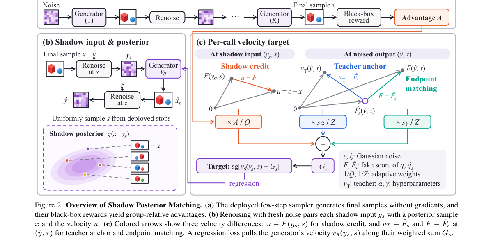

**Why this ranks #16**: SPM 把生成样本重新加噪成 shadow 输入、从其 shadow 后验取奖励信用，绕开少步采样器不是 score 模型拿不到信用的结构性问题；在 4 步生成器上把 GenEval 提到 0.94、OCR 提到 0.96、PickScore 提到 23.84，均高于最强少步基线。

---

### 17. EVA-RSI: Recursive Self-Improvement of Video Evaluators for Judging Temporal Quality

**arXiv**: [2611.23890](https://arxiv.org/abs/2611.23890) | **Score**: 8.0 (relevance 8 x 0.7 + quality 8 x 0.3) | **Direction**: `aigc_rl` | **Tags**: AIGC-visual, video-evaluator, recursive-self-improvement, multi-agent, reward-model, motion-quality, Roblox | **Categories**: cs.AI | **Pages**: 24

**Authors**: Yu Yuan; Ruizhou Ding; Shaoheng Fang; Stanley H. Chan; Zhuo Chen

**Affiliation**: Roblox; Purdue University; University of Texas at Austin

**Abstract**

> Video evaluators play an important role in video generation, yet they miss motion defects, limiting the quality of generated videos. Recursive self-improvement (RSI) has made strong progress in mathematics and coding, where explicit verifiers provide reliable feedback on a single goal. Video evaluation poses two difficulties for RSI: it has no verifier, and it must judge many dimensions at once, such as physics, smoothness and dynamics, where a gain on one can cost another. We introduce EVA-RSI, a multi-agent framework for exploring RSI under these two constraints. We build a fixed proxy exam with construction-defined targets by applying controlled changes to videos, such as temporal reversal and frame dropping. These edits supply supervision without human annotation. A small set of human-labeled real videos anchors the exam to human judgment. Each dimension has an LLM agent that proposes improvements. A leader agent coordinates the proposals, and a Nash bargaining rule selects updates that balance progress across dimensions. Humans design the exam, review candidate changes and revise the curriculum between stages. Starting from Qwen3-VL-8B, EVA-RSI improves motion evaluation, with the largest gain on smoothness, and the gains carry over to defect types never seen during the run. On the dynamics subsets of public benchmarks, our evaluator achieves the highest observed scores among 21 tested models. As an RL reward, it increases generated motion and earns human preference. A data-selection pipeline incorporating it also increases motion.

**Key findings**

- **Finding**: EVA-RSI 从 Qwen3-VL-8B 起步，经 170 个候选、88 轮在主维度把分数从 0.706 提到 0.906，平滑度从 0.461 升到 0.888；在 VBench 动态子集上取得 21 个受测模型中的最高分。
- **Inference**: 视频评测既没有现成验证器又要同时权衡物理、平滑与动态等多个维度，因此用构造式受控破坏做固定目标、再用纳什谈判在维度间平衡，比直接拟合人工偏好更可行。
- **Recommendation**: 造视频奖励模型时，先用时间反转、抽帧等受控破坏造固定目标考卷并锚定少量真人标注，再用多智能体加纳什谈判逐轮改进，避免只在单一维度上刷分。

**Key figures**

*Framework - A reward that misjudges motion trains generators that do not move. Top: physics ratings for a clip and for a copy in which the person freezes. Bottom: Wan2.1 after 50 RL updates with VideoRe*

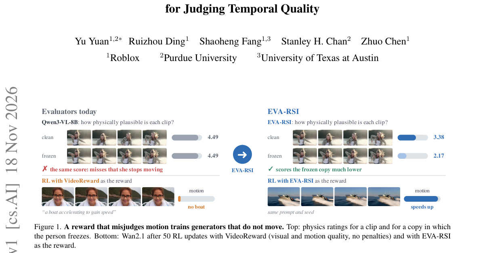

*Result - The EVA-RSI system. ①A team of LLM agents proposes, implements and trains candidate evaluators from the current champion. ②A frozen verifier scores each candidate on an exam with fixed targe*

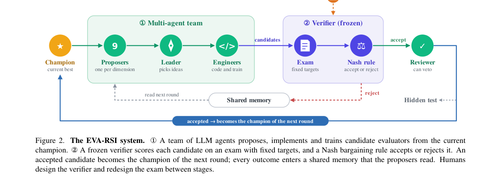

**Why this ranks #17**: EVA-RSI 用时间反转、抽帧等受控改动构造固定目标考卷来替代人工标注，配合多智能体提案与纳什谈判做视频评测器的递归自我改进，从 Qwen3-VL-8B 起步把主维度分数从 0.706 提到 0.906、平滑度从 0.461 提到 0.888。

---

## Footer

- Total papers reviewed across all 4 axes: 60
- aigc_visual axis final count: 17
- Wild-cards in this axis: 0
- Figure assets: 2026-11-21/res/

Generated by `mine-arxiv-daily-digest` skill. Sister file: `2026-11-21_aigc_visual_entry.md`.
