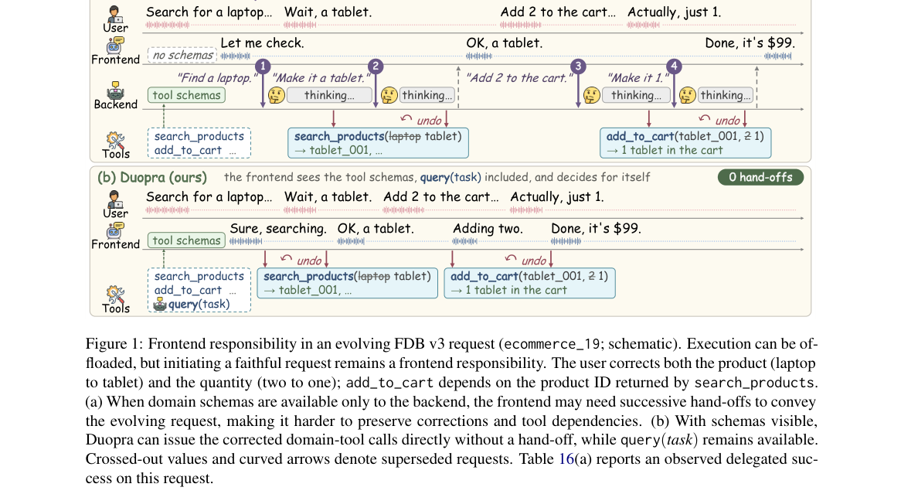
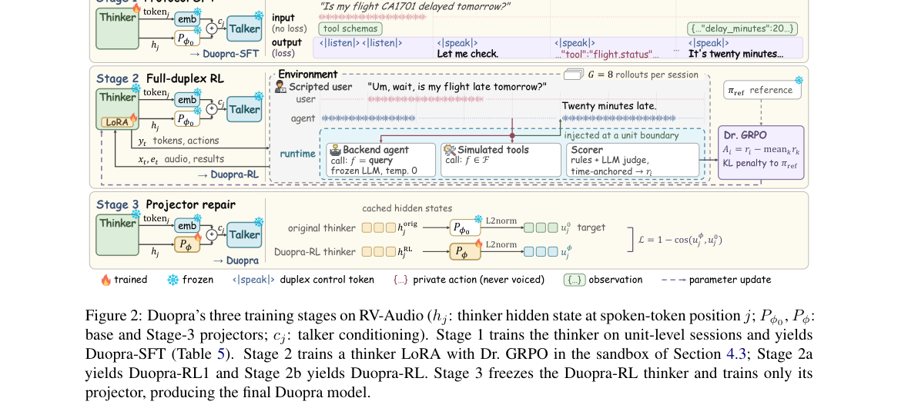
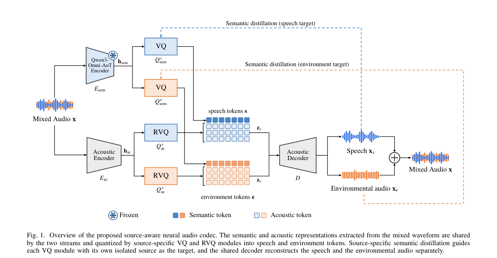
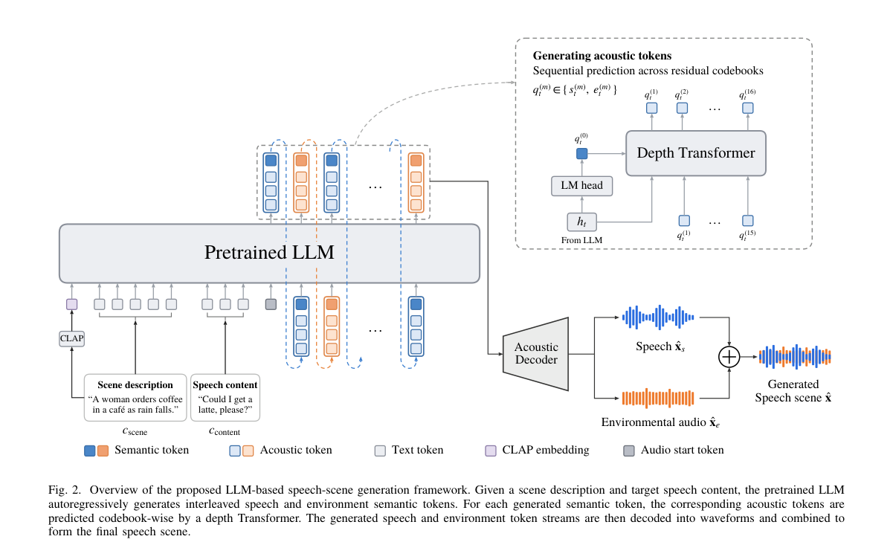
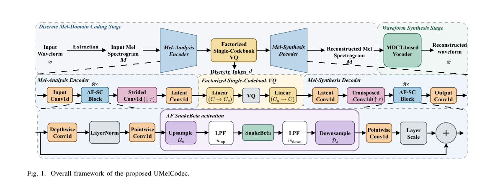
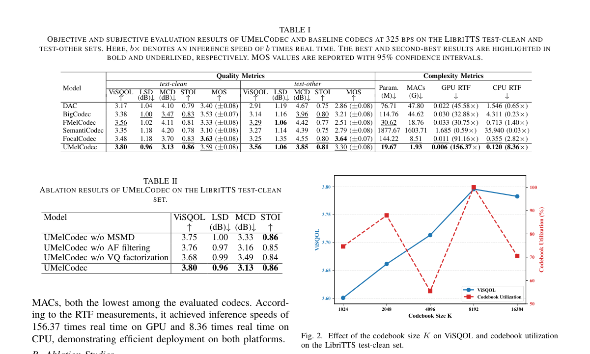
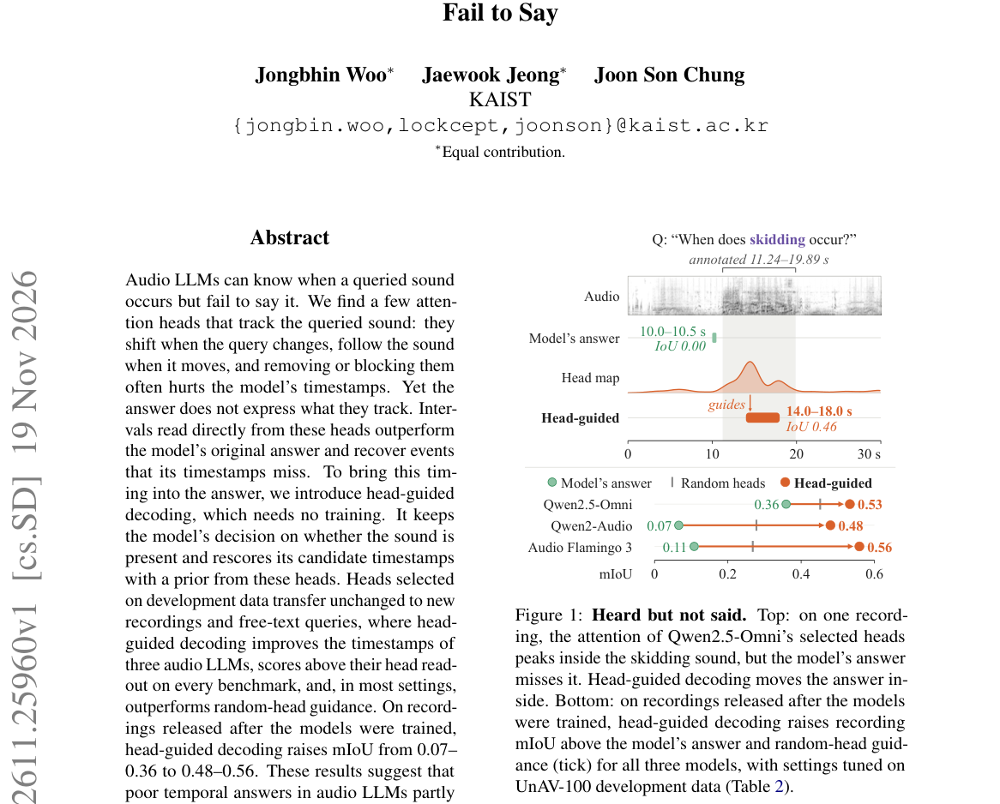
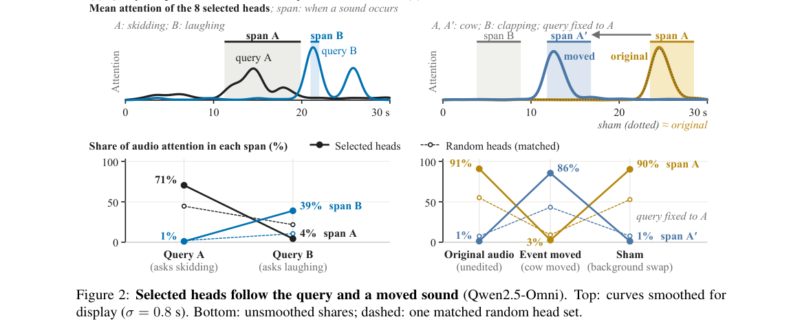
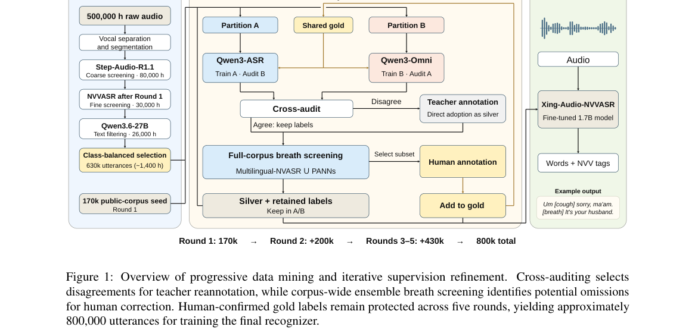
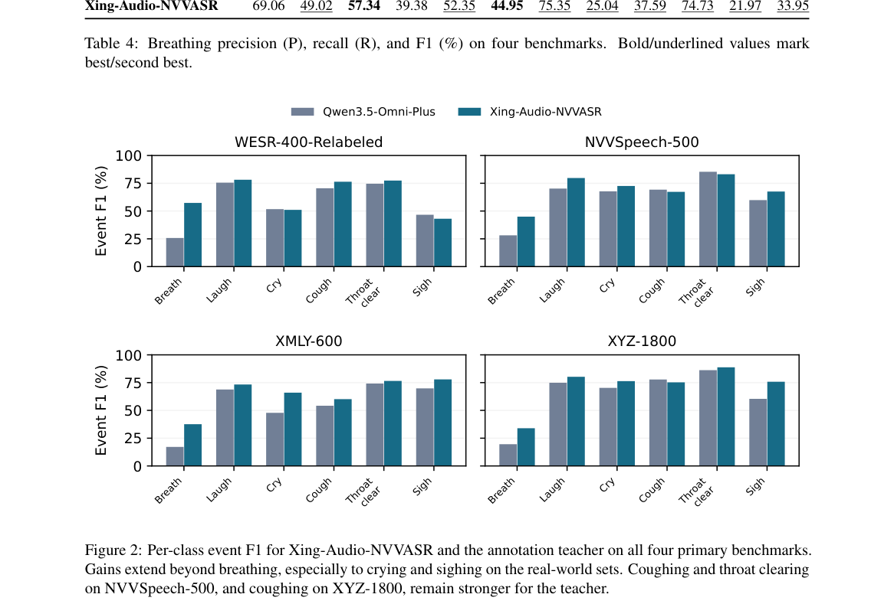

# Mine Arxiv Daily Digest - 2026-11-21 (全双工语音与语音 LM Axis, 5 papers)

**Generated**: 2026-11-21 01:28 CST

**Source**: arXiv cs.CV, cs.SD, eess.AS, cs.CL, cs.AI, cs.RO, cs.LG, cs.IR submissions, listing day 2026-11-18,2026-11-19 (announced 2026-11-20 01:00 UTC (2026-11-20 09:00 CST))

**Batch window**: 2026-11-17T19:00:00Z .. 2026-11-19T19:00:00Z（arXiv 公告批次横跨两个 UTC 日：从前一日的美东 14:00 截止时刻起算（EDT 为 18:00Z，EST 为 19:00Z），到当日的同一时刻为止）

**Axis**: duplex_speech (5 papers, base 12, cap 20)

**Directions**: duplex_speech_core (5), speech_rl (0)

**Selection**: 5 papers ranked by relevance x quality, with 0 wild-card slots

**Day total**: 60 papers across 4 axes (target 60)

**Scope**: 全双工 / 实时 / 流式语音语言模型、speech-to-speech 语音助手、TTS / 语音克隆 / 语音转换，以及语音大模型的 RL 与奖励模型

**Wild-card**: 本 axis 未启用任何补位名额。缺口是真实断供——speech_rl 在 1215 篇候选里一篇都没有，duplex_speech_core 也只有 16 篇够格候选。用 rel 6–7 的语音论文去填属于正常够格候选，不是「比够格论文更该进」的邻接选题，因此宁可让出 7 个名额给别轴的 rel≥9 论文。

本轴只有 5 篇，基准 12，缺 7 个名额，这是连续第二天语音轴供给断供（上一份日报是 7 篇）。证据链完整：1215 篇候选里 primary 落在 duplex_speech_core 的只有 16 篇、speech_rl 的是 0 篇；rel≥9 的语音论文只有 1 篇（Duopra），rel 8 有 5 篇、rel 7 有 7 篇。

缺口的形状也很清楚：这 5 篇里没有一篇是全双工语音对话本体——只有 Duopra 沾边，其余是语音编解码（UMelCodec 325 bps）、语音-环境场景生成、非言语发声识别，以及音频大模型事件时序的解码修补。让出的 7 个名额没有平均分给别轴，而是被「rel≥9 优先占位」的硬规则吸走：world_embodied 有 33 篇 rel≥9 争 20 个席位，代价是 13 篇 rel 9 被挤出、其中没有任何一篇属于语音方向。

---

## 全双工语音与语音 LM · `duplex_speech_core` (5 papers)

本方向 5 篇里只有头名 Duopra 是真正的全双工交互本体：它建立在 RV-Audio 之上，把会话控制与任务执行一起学，在对话里发出私有的工具动作，并在用户纠正后及时修订工具参数。其余四篇是语音的基础能力层——源感知的神经音频编解码器把语音与环境音拆成两路时间对齐的离散 token 流（UMelCodec 进一步把纯声学语音编码压到 325 bps）、Xing-Audio-NVVASR 用渐进挖掘与迭代监督精化扩展六类非言语发声标签的监督、以及《When Sounds Turn Heads》：音频大模型知道声音何时发生却说不出来，但少数注意力头一直在跟踪它，去掉这些头模型的时刻预测就会崩，于是有了免训练的 head-guided decoding。

### 1. Duopra: From Full-Duplex Conversation to Full-Duplex Agency

**arXiv**: [2611.25773](https://arxiv.org/abs/2611.25773) | **Score**: 8.7 (relevance 9 x 0.7 + quality 8 x 0.3) | **Direction**: `duplex_speech_core` | **Tags**: duplex-speech, full-duplex, tool-use, agent, reinforcement-learning, speech-llm, Shanghai Jiao Tong University | **Categories**: cs.AI | **Pages**: 27

**Authors**: Chiyu Chen; Pengzhou Cheng; Yuezhao Ma; Xiaocheng Li; Can Liu; Haonan Hu; Yao Yao; Yifei Yang; Yijie Lu; Taolei Wang; Yansi Li; Muhuan Wu

**Affiliation**: Shanghai Jiao Tong University; Tencent; Shanghai University; University of Bristol

**Abstract**

> Full-duplex interaction models exhibit strong conversational agency, enabling natural, low-latency turn-taking, backchannels, and interruptions. However, completing tasks further requires task agency: timely tool invocation and argument revision following user corrections. Frontend-backend agents separate initiation from execution: the frontend decides whether and what to request, while the backend determines how. Execution can be offloaded, but unsent requests cannot be executed, and incomplete ones can misdirect the backend. On Full-Duplex-Bench v3 (FDB v3), most failures of Realtime-Venus-Audio + Harness in our streaming pipeline occur before a domain tool executes. We introduce Duopra, a full-duplex interaction model that learns task execution alongside conversational control. Duopra treats the backend as a tool, accepting a self-contained natural-language request. Direct calls and backend delegation share an action interface and requirements for faithful initiation and correct execution. Its three-stage training combines protocol SFT, full-duplex RL rewarding timely and complete execution, and projector-only repair of talker conditioning after thinker updates. With the same backend, Pass@1 rises from 4.7% to 44.7%; Duopra achieves 47.7% calling tools directly (26.0% after SFT) and 49.3% with a DeepSeek backend. It improves three FDB v1.0 takeover rates over the base model. These results show that task agency can coexist with key conversational agency.

**Key findings**

- **Finding**: 同一 Qwen3-8B 后端下，RV-Audio + Harness 仅 11.0% 的会话发起后端交接、Pass@1 为 4.7%；Duopra 的后端配置把 Pass@1 提到 44.7%，纯直接执行配置更达 47.7%。
- **Inference**: 任务失败首先卡在「是否发起」而不是「怎么执行」，所以把工具 schema 暴露给前端、让它自己发请求，比换更强的后端更有效。
- **Recommendation**: 做全双工语音 Agent 时，把域工具 schema 直接暴露给前端并统一成 JSON 动作，奖励里显式惩罚过时参数（每个被纠正的值扣 0.6）；同时要接受 Stage 3 后自发 backchannel 会丢失。

**Key figures**

*Framework - Frontend responsibility in an evolving FDB v3 request (ecommerce_19; schematic). Execution can be of- floaded, but initiating a faithful request remains a frontend responsibility. The user c*

*Result - Duopra’s three training stages on RV-Audio (hj: thinker hidden state at spoken-token position j; Pϕ0, Pϕ: base and Stage-3 projectors; cj: talker conditioning). Stage 1 trains the thinker on*

**Why this ranks #1**: 在同一 Qwen3-8B 后端下把 FDB v3 的 Pass@1 从 4.7% 提到 44.7%。关键在三件事：把后端包装成 query(task) 工具与域工具共用一套动作接口；用协议 SFT + Dr. GRPO 全双工 RL（kact=3 单位内执行得 1.2 分，编造结果扣 0.95）+ 仅投影器修复三阶段训练；基线 RV-Audio + Harness 只有 11.0% 会话发起交接，构成 11.0% 的交接天花板，而 Duopra-RL1 在需要 2~3 次调用的请求上 Pass@1 仍为 0，说明「发起」与「完成」是两件事。

---

### 2. Joint Language Modeling for In-the-Wild Speech-Scene Generation with Distinct Token Representations

**arXiv**: [2611.25503](https://arxiv.org/abs/2611.25503) | **Score**: 8.0 (relevance 8 x 0.7 + quality 8 x 0.3) | **Direction**: `duplex_speech_core` | **Tags**: duplex-speech, speech-scene-generation, neural-audio-codec, audio-language-model, token-interleaving, text-to-speech, Institute of New Media and Communications | **Categories**: cs.AI, cs.LG, eess.AS | **Pages**: 11

**Authors**: Semin Kim; Ju Yeon Kang; Sunghwan Ahn; Seonuk Kim; Nam Soo Kim

**Affiliation**: Institute of New Media and Communications, Department of Electrical and Computer Engineering, Seoul National University

**Abstract**

> Speech-scene generation aims to synthesize intelligible target speech together with diverse environmental sounds as a coherent acoustic scene. The task is considered challenging in two respects. Speech and environmental audio differ substantially in their semantic and acoustic characteristics, yet existing approaches typically model the complete scene using a single mixed acoustic representation. At the same time, the two sounds are closely related in real-world speech scenes, whereas conventional approaches usually rely on simulated scenes mixed from independently recorded sources. We propose a large language model (LLM)-based framework for joint modeling of distinct speech and environment token streams. A source-aware neural audio codec extracts temporally aligned speech and environment tokens from mixed audio, and a pretrained LLM generates both token streams in an interleaved fashion conditioned on the natural-language scene description and speech content. This formulation preserves source-specific representations while modeling the token streams within a shared generative context. Since both streams are extracted directly from mixed recordings, the model can also be adapted to in-the-wild speech scenes without isolated sources. Our experimental results demonstrate that the proposed framework improves speech intelligibility, scene relevance, and audio quality over existing speech-scene generation techniques, with consistent gains from real-world adaptation. We further investigate the effects of distinct token representations and interleaved generation, and analyze whether the environmental sound remains stable while speech is active and how the two streams interact.

**Key findings**

- **Finding**: 同样的模拟场景与相同解码设置下，混单 token 目标的 WER 为 11.33%、CLAP 0.235、FAD 6.66，换成语音/环境分离表示后为 6.43%、0.255、4.76。
- **Inference**: 把混合场景压进同一个预测空间会同时拖累语音与环境两侧，分离目标让两路 token 各负其责，收益来自表征结构而不是换骨干。
- **Recommendation**: 复用现有神经音频编解码器做带环境声的语音生成时，先把混合 latent 拆成源专属 token 再自回归；生成顺序选交错（并行时 WER 9.68 对 6.27），并用 EMA 权重做保守的真实场景微调以防可懂度崩塌。

**Key figures**

*Framework - Overview of the proposed source-aware neural audio codec. The semantic and acoustic representations extracted from the mixed waveform are shared by the two streams and quantized by source-spec*

*Result - Overview of the proposed LLM-based speech-scene generation framework. Given a scene description and target speech content, the pretrained LLM autoregressively generates interleaved speech and*

**Why this ranks #2**: 把 speech-scene 生成重写成语音/环境双 token 流的联合语言建模：源感知神经音频编解码器（OmniCodec 骨干 + WavLM 语义蒸馏 + M=16 层 RVQ）从混合录音里抽出时间对齐的两路离散 token，再由 Qwen3-0.6B 交错自回归生成。核心证据是消融——模拟预训练下混单 token 目标 WER 为 11.33%，换成分离表示降到 6.43%；真实场景适配后分离模型 WER 6.27%、CLAP 0.264，同条件的混单基线仍停在 8.76% 与 0.239。

---

### 3. UMelCodec: An Ultra-Low-Bitrate and Lightweight Mel-Domain Neural Speech Codec

**arXiv**: [2611.25569](https://arxiv.org/abs/2611.25569) | **Score**: 8.0 (relevance 8 x 0.7 + quality 8 x 0.3) | **Direction**: `duplex_speech_core` | **Tags**: duplex-speech, neural-audio-codec, ultra-low-bitrate, mel-spectrogram, model-compression, neural-vocoder, National Engineering Research Center of | **Categories**: eess.AS | **Pages**: 5

**Authors**: Hui-Peng Du; Yang Ai; Zhen-Hua Ling

**Affiliation**: National Engineering Research Center of Speech and Language Information Processing, University of Science and Technology of China

**Abstract**

> Ultra-low-bitrate speech coding is crucial for bandwidth-constrained communication and compact storage, but preserving intelligibility, naturalness, and fine-grained acoustic details at bitrates of only a few hundred bps remains challenging. Existing purely acoustic codecs generally operate at relatively high bitrates, whereas incorporating semantic representations can reduce the bitrate, but at the cost of increased complexity. Therefore, we propose UMelCodec, a purely acoustic neural speech codec operating in the mel domain at an ultra-low bitrate of 325 bps with a lightweight architecture. UMelCodec consists of two stages. In the first mel-domain coding stage, alias-free Snake-ConvNeXt (AF-SC) encoder-decoder backbones model temporal and harmonic structures, a factorized single-codebook vector quantizer (VQ) enables ultra-low-bitrate quantization, and a multi-scale mel-spectrogram discriminator (MSMD) improves mel-spectrogram reconstruction. In the second waveform synthesis stage, a lightweight modified discrete cosine transform (MDCT)-based neural vocoder predicts the MDCT spectrum from the reconstructed mel spectrogram and recovers the waveform through inverse MDCT. Experiments on LibriTTS dataset demonstrate that UMelCodec outperforms strong baselines across most objective reconstruction metrics while maintaining competitive subjective naturalness. In terms of model complexity and inference efficiency, UMelCodec has only 19.67 M parameters, requires 1.93 G MACs, and supports real-time inference on both GPU and CPU platforms.

**Key findings**

- **Finding**: 在 325 bps 同门比较中 UMelCodec 以 19.67 M 参数、1.93 G MACs 取得 test-clean 的 ViSQOL 3.80、LSD 0.96 dB、STOI 0.86，GPU RTF 0.006；SemantiCodec 则需 1877.67 M 参数与 1603.71 G MACs。
- **Inference**: 几百 bps 档位上，纯声学 mel 域路线能同时拿到更省算力与更高的全参考保真，语义增强带来的比特节省是以模型体积和细粒度声学细节为代价换来的。
- **Recommendation**: 做超低码率语音传输可直接试 mel 域 + 因子化单码本 VQ；码本 K 选 8192 时利用率达 100%，扩到 16384 利用率反降到约 70% 且 ViSQOL 略降，不要盲目加大码本。

**Key figures**

*Framework - Overall framework of the proposed UMelCodec.*

*Result - Effect of the codebook size K on ViSQOL and codebook utilization on the LibriTTS test-clean set.*

**Why this ranks #3**: 在纯声学、不依赖任何预训练语义模型的前提下做到 325 bps：AF-SC 编解码器骨干 + 因子化单码本 VQ（C=32、Cq=8、K=8192）+ MSMD 判别器做 mel 域编码，再由 MDCT 声码器还原波形。全模型仅 19.67 M 参数、1.93 G MACs，GPU 0.006 RTF（156.37×）、CPU 0.120 RTF（8.36×）；LibriTTS test-clean 上 ViSQOL 3.80、LSD 0.96 dB、MCD 3.13 dB、STOI 0.86，同码率组内质量与复杂度双优。

---

### 4. When Sounds Turn Heads: Recovering Event Timing That Audio LLMs Fail to Say

**arXiv**: [2611.25960](https://arxiv.org/abs/2611.25960) | **Score**: 8.0 (relevance 8 x 0.7 + quality 8 x 0.3) | **Direction**: `duplex_speech_core` | **Tags**: duplex-speech, audio-language-model, temporal-grounding, attention-head, inference-time-decoding, mechanistic-interpretability, KAIST | **Categories**: cs.CL, cs.SD | **Pages**: 11

**Authors**: Jongbhin Woo; Jaewook Jeong; Joon Son Chung

**Affiliation**: KAIST

**Abstract**

> Audio LLMs can know when a queried sound occurs but fail to say it. We find a few attention heads that track the queried sound: they shift when the query changes, follow the sound when it moves, and removing or blocking them often hurts the model's timestamps. Yet the answer does not express what they track. Intervals read directly from these heads outperform the model's original answer and recover events that its timestamps miss. To bring this timing into the answer, we introduce head-guided decoding, which needs no training. It keeps the model's decision on whether the sound is present and rescores its candidate timestamps with a prior from these heads. Heads selected on development data transfer unchanged to new recordings and free-text queries, where head-guided decoding improves the timestamps of three audio LLMs, scores above their head readout on every benchmark, and, in most settings, outperforms random-head guidance. On recordings released after the models were trained, head-guided decoding raises mIoU from 0.07-0.36 to 0.48-0.56. These results suggest that poor temporal answers in audio LLMs partly reflect a failure to say rather than to hear, and that the model's own attention can close part of this gap.

**Key findings**

- **Finding**: 只读这 8 个头的输出，pooled held-out 录音级 mIoU 就从 0.210 升到 0.327（Omni）、0.069 到 0.213（Qwen2-Audio）、0.092 到 0.311（AF3）；RealDESED 上 head-guided decoding 把 0.07–0.36 提到 0.48–0.56。
- **Inference**: 模型内部已经存在定位被查询声音的时间信息，只是没有被解码器用上，因此这类时序问题可以在推理期用注意力内部信号修正而不必重新训练。
- **Recommendation**: 评估音频 LLM 的时序定位时先做「读头 vs 模型答案」对照；部署时保留 presence gate 并用 head prior 重打分完整候选区间，但要计入每个开启门控的查询多耗 12.35–22.20 GPU 秒。

**Key figures**

*Framework - Heard but not said. Top: on one record- ing, the attention of Qwen2.5-Omni’s selected heads peaks inside the skidding sound, but the model’s answer misses it. Head-guided decoding moves the*

*Result - Selected heads follow the query and a moved sound (Qwen2.5-Omni). Top: curves smoothed for display (σ = 0.8 s). Bottom: unsmoothed shares; dashed: one matched random head set.*

**Why this ranks #4**: 指出音频 LLM 的时间戳错误很大一部分是「知道却不说」：用 query-following 指标在 23 段 UnAV-100 开发集上选出 8 个跟踪被查询声音的注意力头（Qwen2.5-Omni 的 QF 为 0.669，随机头仅 0.269），再用这些头的 real-minus-silent 注意力构造 head prior 去重打分候选时间戳，全程不训练。在 RealDESED 上把三个主模型的录音级 mIoU 从 0.07–0.36 提升到 0.48–0.56，且不改动模型的 head readout 在 Table 2 的 18 个模型–基准单元里全部高于模型原答案。

---

### 5. Xing-Audio-NVVASR: Scaling and Refining Supervision for Joint Recognition of Speech and Non-Verbal Vocalizations

**arXiv**: [2611.26000](https://arxiv.org/abs/2611.26000) | **Score**: 8.0 (relevance 8 x 0.7 + quality 8 x 0.3) | **Direction**: `duplex_speech_core` | **Tags**: duplex-speech, non-verbal-vocalization, speech-recognition, data-mining, label-refinement, asr, Xingchen AGI Lab | **Categories**: cs.CL | **Pages**: 18

**Authors**: Pengyu Xu; Gang Liu; Genliang Zhao; Hongjie Chen; Jian Kang; Jie Lian; Jie Li; Yongxiang Li

**Affiliation**: Xingchen AGI Lab, China Telecom Artificial Intelligence Technology Co. Ltd

**Abstract**

> Joint recognition of speech and non-verbal vocalizations (NVVs) is hindered by scarce event-rich training data and inaccurate or missing event labels. We present Xing-Audio-NVVASR, an end-to-end recognizer trained through progressive data mining and iterative supervision refinement. Guided by unified acoustic criteria, two heterogeneous models cross-audit annotations, flagging disagreements for teacher reannotation. To uncover shared omissions that model agreement may conceal, complementary breath detectors screen the entire corpus for human review. Human-confirmed labels accumulate across rounds and are preserved during subsequent refinement. Over five rounds, we refine annotations for 170,000 utterances from public corpora and incorporate 630,000 mined utterances. The resulting corpus of approximately 800,000 utterances is used to train a single 1.7B-parameter model that transcribes speech with inline tags for six NVV classes. Across four human-annotated benchmarks, Xing-Audio-NVVASR ranks first among nine models in both composite score and six-class Macro-F1. It achieves a mean composite score of 64.46, surpassing the strongest comparison model, StepAudio 3 Chat Preview, by 6.03 points, and exceeds the annotation teacher's breathing F1 by 14.40 to 31.57 percentage points. We plan to release the model weights, inference code, four evaluation benchmarks, annotation guidelines, and evaluation code.

**Key findings**

- **Finding**: 五轮迭代后语料约 80 万条（17 万条公开 + 63 万条挖掘），训出的 1.7B 模型在四个基准上复合分均值 64.46、六类 Macro-F1 领先，比次强的 StepAudio 3 Chat Preview 高 6.03 分，比自己的标注教师高 6.88 分。
- **Inference**: 教师的呼吸标注以高精确率换来极低召回（XMLY-600 上召回仅 9.44%），因此模型一致并不等于标注正确，必须用互补检测器兜住共同遗漏。
- **Recommendation**: 建事件标注语料时在模型交叉审计之外加一条全语料级的互补检测通道，人审确认过的金标要锁定不被自动覆盖；注意 WESR-400 加 2.4 万人审数据在旧标注上反降 7.59 分、重标后才涨 5.97 分。

**Key figures**

*Framework - Overview of progressive data mining and iterative supervision refinement. Cross-auditing selects disagreements for teacher reannotation, while corpus-wide ensemble breath screening identifie*

*Result - Per-class event F1 for Xing-Audio-NVVASR and the annotation teacher on all four primary benchmarks. Gains extend beyond breathing, especially to crying and sighing on the real-world sets. Co*

**Why this ranks #5**: NVV 联合识别的瓶颈在监督而非模型：五轮「两异构模型交叉审计 + Qwen3.5-Omni-Plus 教师重标注 + Multilingual-NVASR 与 PANNs 全语料呼吸筛选 + 约 3 万人次人审」修正了 17 万条公开语料标注，并从 50 万小时内部音频里筛出 63 万条（1,400 小时）入池，最终约 80 万条训练 1.7B 的 Qwen3-ASR；四套人标基准上复合分均值 64.46，比次强的 StepAudio 3 Chat Preview 高 6.03 分，呼吸 F1 高出教师 14.40–31.57 个百分点。

---

## Footer

- Total papers reviewed across all 4 axes: 60
- duplex_speech axis final count: 5
- Wild-cards in this axis: 0
- Figure assets: 2026-11-21/res/

Generated by `mine-arxiv-daily-digest` skill. Sister file: `2026-11-21_duplex_speech_entry.md`.
