# Mine Arxiv Daily Digest - 2026-11-21 (LLM / VLM 与其强化学习 Axis, 18 papers)

**Generated**: 2026-11-21 01:28 CST

**Source**: arXiv cs.CV, cs.SD, eess.AS, cs.CL, cs.AI, cs.RO, cs.LG, cs.IR submissions, listing day 2026-11-18,2026-11-19 (announced 2026-11-20 01:00 UTC (2026-11-20 09:00 CST))

**Batch window**: 2026-11-17T19:00:00Z .. 2026-11-19T19:00:00Z（arXiv 公告批次横跨两个 UTC 日：从前一日的美东 14:00 截止时刻起算（EDT 为 18:00Z，EST 为 19:00Z），到当日的同一时刻为止）

**Axis**: llm_vlm (18 papers, base 18, cap 20)

**Directions**: llm_core (12), vlm_core (4), llm_vlm_rl (2)

**Selection**: 18 papers ranked by relevance x quality, with 0 wild-card slots

**Day total**: 60 papers across 4 axes (target 60)

**Scope**: 大语言模型与视觉语言模型的设计、推理、agent、效率与上下文工作，以及面向 LLM / VLM 的 RL 与偏好优化、奖励模型

**Wild-card**: 本 axis 未启用任何补位名额。18 个席位已被 18 篇 rel≥9 论文占满，没有需要补位的空位；llm_vlm_rl 的 17 篇够格候选里只有 2 篇 rel≥9，其余 rel 8 及以下属于正常够格候选而非邻接选题，补进来只会挤掉同轴的 rel≥9。

本轴 18 篇正好等于基准，是四轴里唯一一个名额一步没多的轴。原因是三个方向合计恰好 18 篇 rel≥9（llm_core 12 / vlm_core 4 / llm_vlm_rl 2），刚好占满 18 个席位——任何「再要一篇」的诉求都会挤掉另一篇 rel≥9。

内部让位很有信息量：llm_core 拿 12 篇（超自身基准 4），vlm_core（4/5）与 llm_vlm_rl（2/5）分别让出 1 个与 3 个名额。而本轴推到 19 或 20 篇反而更差——一旦超过基准，llm_vlm_rl 会被硬性抬到 5 篇，llm_core 反而只能留住 9 篇 rel≥9，总数更少。

---

## LLM 核心（架构 / 推理 / agent / 效率 / 上下文） · `llm_core` (12 papers)

本轴 12 篇里有 7 篇是纯推理效率，共同约束都是「省但不牺牲精度」。RoCoKV 针对大推理模型里循环、自验证、纠错产生的高注意力低效用 token 做不确定性加冗余感知的 KV 压缩，并配了融合三阶段 CUDA decode kernel 集成进 vLLM；VR-SparseQuant 用 Vera Rubin 的 2:4 稀疏性把 FP4 量化精度补回来，做法是用两个不同 scale 的 2:4 稀疏矩阵相加表示一个激活；DTS 用 delta-based tile scoring 做免训练的自适应稀疏注意力；MTP 与 FrontierReplay 分别处理投机解码的草稿质量与混合语言模型的精确前缀缓存；FlashMorph2 把混合注意力的层选择改成 on-policy。与效率并行的是另一条支线：扩散语言模型（LED 把替换式修订扩成 Levenshtein 式插入删除、Clover-35B-A3B 用 Gated Delta Network 适配 block diffusion），以及长程 agent 的状态-证据分离（SCH）与原子数学技能组合（AMR）。

### 1. Chorus: Shared N-gram Embeddings with Layer-wise Adaptation

**arXiv**: [2611.23386](https://arxiv.org/abs/2611.23386) | **Score**: 8.7 (relevance 9 x 0.7 + quality 8 x 0.3) | **Direction**: `llm_core` | **Tags**: LLM-VLM, ngram-embedding, layer-wise-adaptation, embedding-table-scaling, memory-efficient-optimizer, DualverseAI | **Categories**: cs.CL | **Pages**: 18

**Authors**: Stephen Chung; Wenyu Du

**Affiliation**: DualverseAI

**Abstract**

> Language models can gain capacity at little computational cost from n-gram embedding tables: large tables of learned vectors for short sequences of consecutive tokens, which are looked up and added to the model's input or to its intermediate layers. Recent designs commonly use a separate n-gram embedding table for each layer, which makes the tables costly in memory and prevents layers from sharing what they learn. However, a single shared table gives every layer the same embedding, leaves no room for layer-wise preferences, and performs poorly in practice. We propose Chorus, in which one set of n-gram embedding tables serves the whole network and every layer reads it in its own way. Each layer maps the refined embedding through its own projection layer, after rescaling its components by factors computed from its current hidden state. Chorus matches the quality of existing n-gram methods with 87% smaller tables: with 1.2B table parameters it predicts text better than FactorEngram and DeepSeek's Engram do with 9.6B. It outperforms Engram, TN-gram and FactorEngram in every setting where we compared them, across table sizes from 20M to 9.6B parameters. We also show that the recently proposed memory-efficient optimizer Ember works well with Chorus, saving 99.2% of table-optimizer memory compared with AdamW without degrading training performance. These results enable further scaling of n-gram embedding tables along the table-size axis by reducing memory use and allowing shared knowledge to be reused across layers.

**Key findings**

- **Finding**: Chorus 以单套共享 n-gram 表加逐层投影取代逐层独立表，表规模小 87%，1.2B 表参数下预测质量优于 Engram 与 FactorEngram 的 9.6B 表。
- **Inference**: n-gram 嵌入表的收益主要来自跨层共享到的知识而非表容量本身，把共享与层偏好解耦后表规模这条扩展轴才重新可用。
- **Recommendation**: 若要继续扩展 n-gram 表规模，优先复用共享表加逐层投影的设计，并搭配 Ember 优化器省下 99.2% 的表优化器显存。

**Key figures**

*Framework - Scaling curves with respect to table size. ClimbMix, nine-layer model (20.7M backbone), ten table sizes. Validation bits per byte (lower is better) against table size. Curves show Chorus, En*

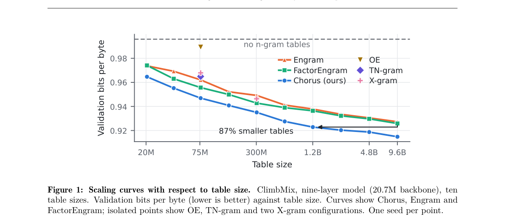

*Result - Existing n-gram embedding tables and Chorus. (a) Engram, TN-gram and FactorEngram keep a separate n-gram table for every place that reads one, including the input. (b) Chorus looks up one se*

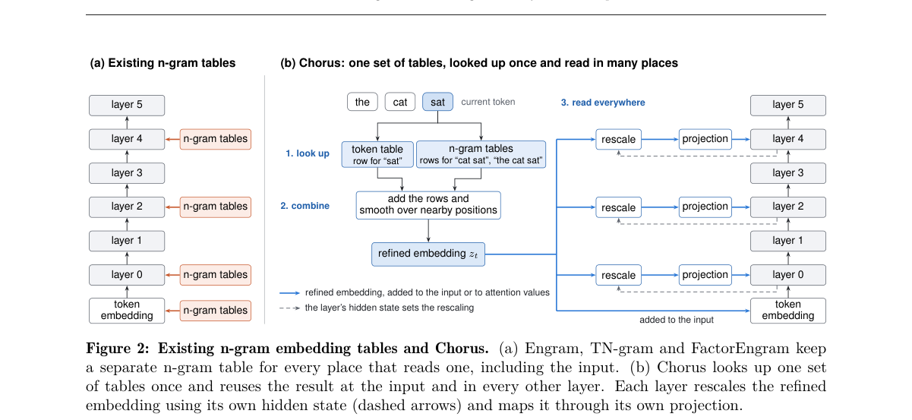

**Why this ranks #1**: Chorus 用一套共享 n-gram 嵌入表服务全网络、每层经自己的投影层读取，表规模比逐层独立表小 87%，1.2B 表参数即可胜过 Engram 与 FactorEngram 的 9.6B 配置。

---

### 2. Beyond Replacement: Levenshtein Editing for Diffusion Language Models

**arXiv**: [2611.23750](https://arxiv.org/abs/2611.23750) | **Score**: 8.7 (relevance 9 x 0.7 + quality 8 x 0.3) | **Direction**: `llm_core` | **Tags**: LLM-VLM, diffusion-language-model, sequence-editing, post-training, self-correction, Southern University of Science and | **Categories**: cs.AI, cs.CL | **Pages**: 21

**Authors**: Shuaidi Wang; Zhuocheng Gong; Xuejie Liu; Jianguo Li; Yu Zhang

**Affiliation**: Southern University of Science and Technology; Inclusion AI, Ant Group

**Abstract**

> Diffusion language models (DLMs) offer a flexible alternative to autoregressive models, enabling any-order infilling. While most existing decoding methods treat decoded tokens as fixed, some recent models allow previously decoded tokens to be revised only by replacing them with alternative tokens, a paradigm we refer to as replacement-only editing (ROE). Although ROE can correct individual tokens, it is inefficient for sequence shifts caused by missing or extra tokens and struggles when errors occur across many positions. To address these limitations, we propose LED (Levenshtein Editing for Diffusion Language Models), a post-training framework that extends ROE with insertion and deletion, enabling Levenshtein-style refinement of generated sequences. It uses two training designs. First, it reconstructs edit supervision on the fly during supervised fine-tuning using longest-common-subsequence alignment, enabling insertion and deletion learning without manually annotated labels. Second, it adopts multi-stage training, where the state from one stage becomes the input to the next, exposing the model to its earlier errors and enabling it to correct them. When applied to the 16B-parameter LLaDA2.1-Mini Base, LED raises the average score across twelve benchmarks from 54.86 to 57.10 under confidence-guided decoding while increasing tokens per forward from 6.14 to 7.05, whereas under confidence-free decoding it raises the average score from 27.52 to 47.19. We further show that LED achieves higher pass@k at large k than thresholded decoding without editing, demonstrating improved generation diversity and revealing the diversity potential of DLMs without confidence guidance. LED also improves robustness to large block sizes, raising the average score from 36.97 to 51.34 at block size 128. Together, these results suggest that LED supports more robust self-correction in DLMs.

**Key findings**

- **Finding**: 在 16B 参数 LLaDA2.1-Mini Base 上，LED 把十二个基准的均分从 54.86 提到 57.10，置信度解码下每前向 token 数从 6.14 升到 7.05。
- **Inference**: 扩散语言模型的瓶颈不在于能否重解码单个 token，而在于缺少插入删除导致的序列错位修正能力。
- **Recommendation**: 评估扩散语言模型解码时除置信度阈值外应一并对比带编辑的方案，并关注 block size 128 下 LED 把均分从 36.97 提升到 51.34 的稳定性。

**Key figures**

*Framework - Sequence misalignment and repair. Left: Schematic illustration of sequence misalignment. The center row is the target sequence, and the outer rows show fixed-length corrupted blocks after on*

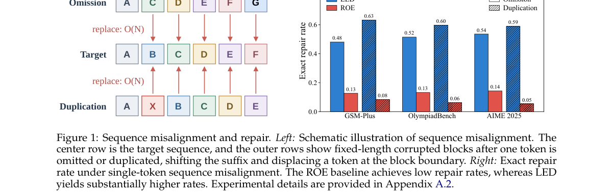

*Result - LCS-based edit-target construction. Green links denote matched anchor pairs (ik, jk). Within each unmatched gap, surplus source positions receive [Del], and at most one surplus target token*

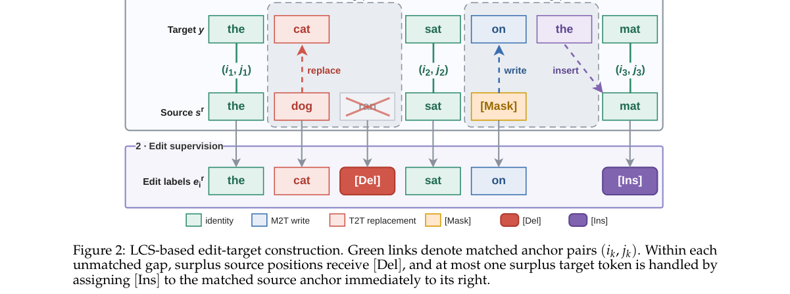

**Why this ranks #2**: LED 把扩散语言模型的替换式编辑扩成插入加删除的 Levenshtein 编辑，用最长公共子序列对齐自动构造编辑监督，在 16B 的 LLaDA2.1-Mini Base 上把无置信度解码均分从 27.52 提到 47.19。

---

### 3. Semantic Context Handoff with On-Demand Evidence for Long-Horizon Agents

**arXiv**: [2611.24357](https://arxiv.org/abs/2611.24357) | **Score**: 8.7 (relevance 9 x 0.7 + quality 8 x 0.3) | **Direction**: `llm_core` | **Tags**: LLM-VLM, long-horizon-agent, context-management, evidence-recovery, swe-bench, Minjiang University | **Categories**: cs.AI | **Pages**: 22

**Authors**: Guolong Zheng; Chen Hou; Xu Yang; Jianshan Zhang; Tao Huang

**Affiliation**: Minjiang University

**Abstract**

> Traditional long-horizon LLM agents often hand off context through full-history prompting, retaining all previous action--observation interactions. As execution proceeds, this history keeps growing, increasing inference cost and potentially degrading accuracy. Existing methods control this growth by preserving compact conclusions while removing earlier observations, but doing so can discard evidence that later becomes relevant. We introduce Semantic Context Handoff (SCH), whose central abstraction is state--evidence separation: a compact semantic state carries the agent's current interpretation, while supporting action--observation evidence remains separately addressable and can re-enter context when later execution makes it relevant, without separate summarization or retrieval-model calls. Empirically, SCH improves long-horizon agent performance while substantially reducing context cost. In a controlled 150-task SWE-bench study, SCH's evidence recovery improves Pass@1 from $80.0\%$ to $86.9\%$ at essentially unchanged token use and execution time. In the complete-system comparison, SCH achieves 86.9% Pass@1 while using 43% fewer tokens and 41% less wall-clock time than the strongest baseline by task performance. Across models and benchmarks, SCH consistently reduces token use relative to full-history prompting while remaining competitive with or improving upon the evaluated baselines. Trajectory analysis confirms that SCH recovers evidence from substantially earlier parts of the interaction history rather than merely preserving a recent context window.

**Key findings**

- **Finding**: 在受控的 150 任务 SWE-bench 实验中，SCH 的证据恢复把 Pass@1 从 80.0% 提升到 86.9%，而 token 用量与执行时间基本不变。
- **Inference**: 长程 Agent 的上下文瓶颈不是保留多少 token，而是被摘要掉的证据在后续步骤无法重新取回。
- **Recommendation**: 搭建长程 Agent 时应把语义状态与可寻址证据分开存放，并为证据预留按需回填上下文的接口。

**Key figures**

*Framework - SCH workflow. The LLM receives the current semantic state together with relevant evidence and returns a sparse state delta and environment action. The controller updates the state, executes*

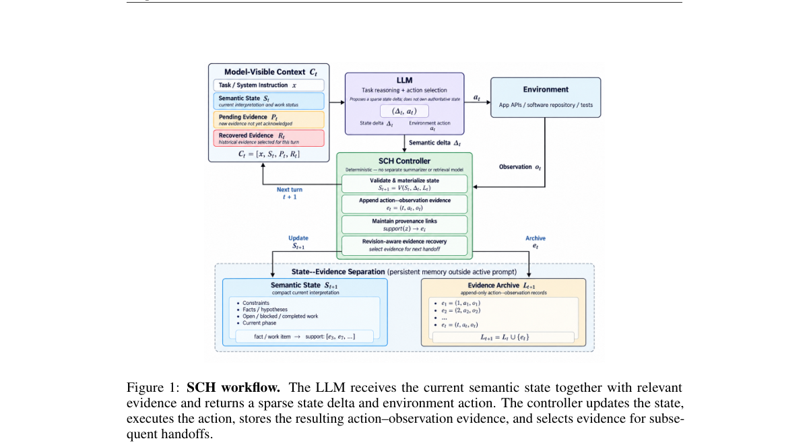

**Why this ranks #3**: SCH 用状态与证据分离的交接机制替代全历史提示，在 150 任务 SWE-bench 上把 Pass@1 从 80.0% 提到 86.9%，同时比最强基线 PACT 少用 43% token、少 41% 墙钟时间。

---

### 4. Late Entry in Looped Language Models

**arXiv**: [2611.24576](https://arxiv.org/abs/2611.24576) | **Score**: 8.7 (relevance 9 x 0.7 + quality 8 x 0.3) | **Direction**: `llm_core` | **Tags**: LLM-VLM, looped-language-model, test-time-compute, kv-cache, wake-verification, Nanyang Technological University | **Categories**: cs.CL | **Pages**: 32

**Authors**: Ziqi Jin; Jiaxi Li; Weiwen Xu; Aixin Sun

**Affiliation**: Nanyang Technological University; Singapore University of Technology and Design; The Chinese University of Hong Kong

**Abstract**

> Looped language models deepen reasoning at a compact parameter count by iterating a shared layer stack T times per token, turning recurrence depth directly into sequential decoding latency. Conventional early-exit decoding halts after initial passes without cache completion, truncating cached key-value states of past tokens to shallow depth. We study the opposite strategy, late entry, where new tokens skip initial passes and enter directly into the final K < T passes over a deep context cache. Once lightweight fine-tuning resolves hidden-state norm mismatch at the entry boundary, deep cached context substitutes for skipped token-local passes, allowing late entry to outperform matched early exit across model families and pass budgets. To turn this asymmetry into wall-clock speedups without stalling to build deep caches, candidate blocks verify through only the final K passes on the critical path while previously committed tokens complete passes 1 -> T alongside subsequent steps at zero extra serial calls. Projecting these finished T-pass wake states inside the existing output GEMM (Wake verification, governed by logit-margin tolerance tau in [0, inf]) unifies greedy-exact T-pass decoding (tau = 0, matching K = T block decoding within bf16 reduction order), margin-gated verification (tau > 0), and non-rollback lossy late entry (tau = inf) inside a single static CUDA graph. On Ouro-2.6B (T = 4), K = 2 Wake reaches 5.2x greedy-exact speedup at tau = 0 (+26% over K = 4 block decoding on GSM8K) and 6.8x at tau = inf (+16.9 points over trained early exit at matched speed). Scaling test-time recurrence across T in {8, 16, 32, 64} on Huginn-3.5B cuts K = T/4 rollbacks 21.5x with depth, driving greedy-exact (tau = 0) speedups to 6.1x (T = 32) and 8.4x (T = 64, +153% over K = 64 block) and tau = inf speedups to 10.6 to 12.5x.

**Key findings**

- **Finding**: Ouro-2.6B 上 K=2 的 Wake 在 tau=0 时取得 5.2 倍贪心精确加速并在 GSM8K 上比 K=4 分块解码高 26%，tau=inf 时加速 6.8 倍。
- **Inference**: 循环语言模型的解码延迟由递归深度决定，深上下文 KV 缓存可以替代被跳过的 token 局部 pass。
- **Recommendation**: 部署循环式推理模型时可优先尝试晚入场加 Wake 验证，Huginn-3.5B 上递归深度取 32 或 64 时回滚次数随深度减少 21.5 倍。

**Key figures**

*Framework - Early exit vs. late entry in looped language models. (a) Full depth ( ): runs all 𝑇= 4 passes. (b) Early exit ( ): halts after pass 1, truncating context KV caches to shallow depth. (c) Late*

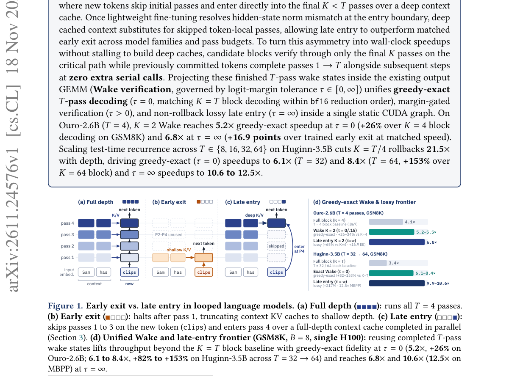

*Result - Why a single adapted late pass suffices: deep context KV substitutes for token-local passes on fine-tuned Ouro-2.6B. (a) Mechanism: under shallow early exit (𝐾= 2, 𝐷= 2, ), token 𝑥𝑖executes*

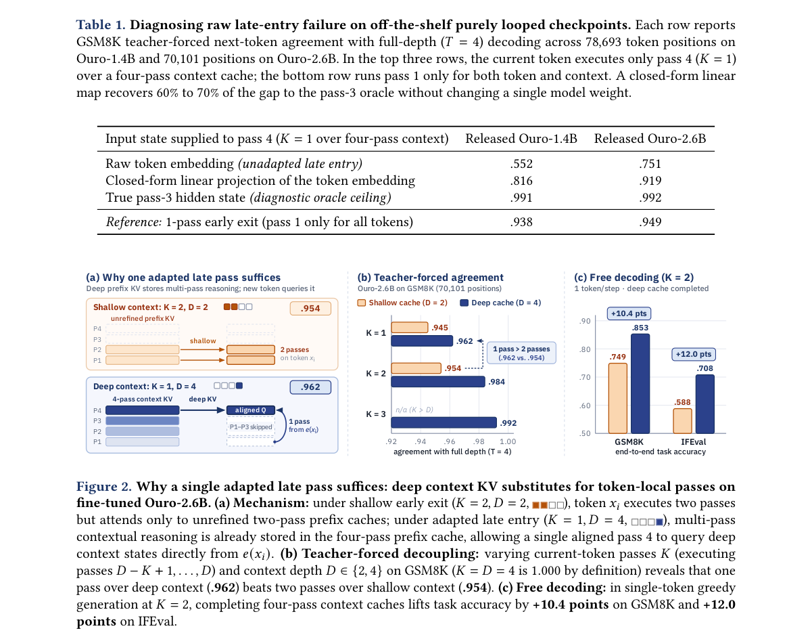

**Why this ranks #4**: 晚入场让新 token 跳过前序 pass 直接接入末段 K 层并复用深上下文 KV 缓存，在 Ouro-2.6B 上 K=2 的 Wake 验证取得 5.2 倍贪心精确加速，Huginn-3.5B 上 T=64 时达 8.4 倍。

---

### 5. Clover-35B-A3B-Preview Technical Report

**arXiv**: [2611.24636](https://arxiv.org/abs/2611.24636) | **Score**: 8.7 (relevance 9 x 0.7 + quality 8 x 0.3) | **Direction**: `llm_core` | **Tags**: LLM-VLM, diffusion-language-model, gated-delta-net, mixture-of-experts, block-diffusion, DiffuSpace Technical Team | **Categories**: cs.AI, cs.CL, cs.LG | **Pages**: 20

**Authors**: DiffuSpace Technical Team

**Affiliation**: DiffuSpace Technical Team

**Abstract**

> We introduce Clover-35B-A3B-Preview (Clover), a mixture-of-experts diffusion language model with 35 billion total parameters and 3 billion activated parameters, supporting thinking-mode generation. Clover adapts Gated Delta Networks to block diffusion by combining recurrent memory of previously generated context with bidirectional softmax attention inside the current block. Historical memory readout competes with current-block tokens in a shared softmax, with learnable block-size calibration and a separate, zero-initialized right-context convolution branch. Clover leads the seven evaluated agent metrics, including 73.6 on SWE-bench Verified and 51.7 on Terminal-Bench 2.1. On internal agent workloads, it reaches a reported generation speed of 680 tokens/s using one NVIDIA GB300 GPU at BF16 precision and batch size one. We organize the evaluation around model quality, drafting and verification costs, and deployment under constrained memory. We also describe a decision-model variant that generates answers to related questions in one denoising pass. On an internal set of 500 groups, joint prediction raises question accuracy from 90.37% to 93.88% and all-correct group accuracy from 65.4% to 77.0%.

**Key findings**

- **Finding**: Clover 骨干由 40 层组成，三个 BD-GDN 层加一层全注意力层为一组重复十次，共 30 个循环层与 10 个全注意力层，并配 token 级 top-8 路由的 dMoE。
- **Inference**: 块扩散模型需要把历史记忆读取与当前块内的双向交互放进同一次 softmax，靠可学习块长标定与零初始化右上下文卷积分支来协调。
- **Recommendation**: 搭建块扩散语言模型时可复用 BD-GDN 的历史读出与当前块竞争设计，并用单卡吞吐与七项 Agent 指标同时校验效果。

**Key figures**

*Framework - Clover architecture. (a) Three BD-GDN–dMoE layers and one full-attention–dMoE layer form a group repeated ten times. Backbone normalizations are RMSNorm. (b) Pink boxes are linear projection*

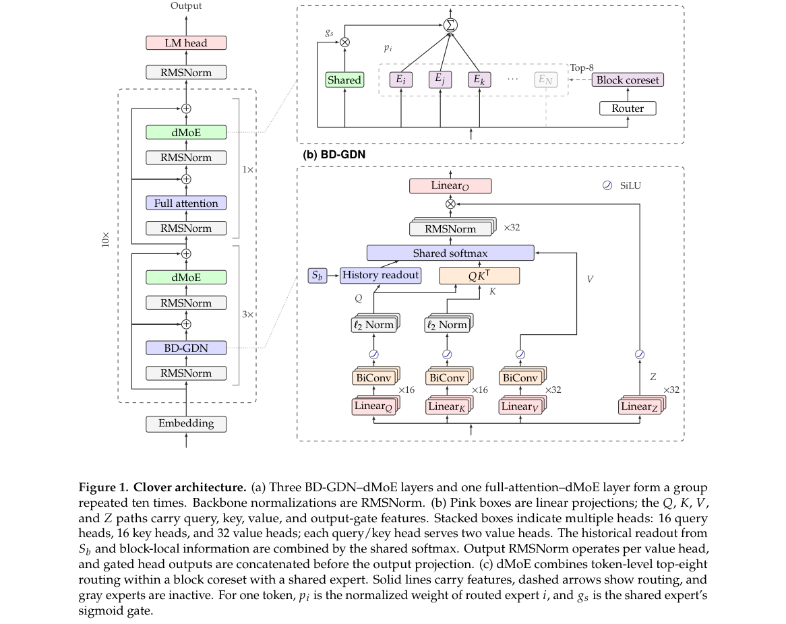

*Result - The two block-diffusion adaptations in BD-GDN. (a) The query-specific history readout 𝑟𝑗from Eq. (9) competes with 𝑁𝑏current-block values in one softmax. Its logit includes learnable block-s*

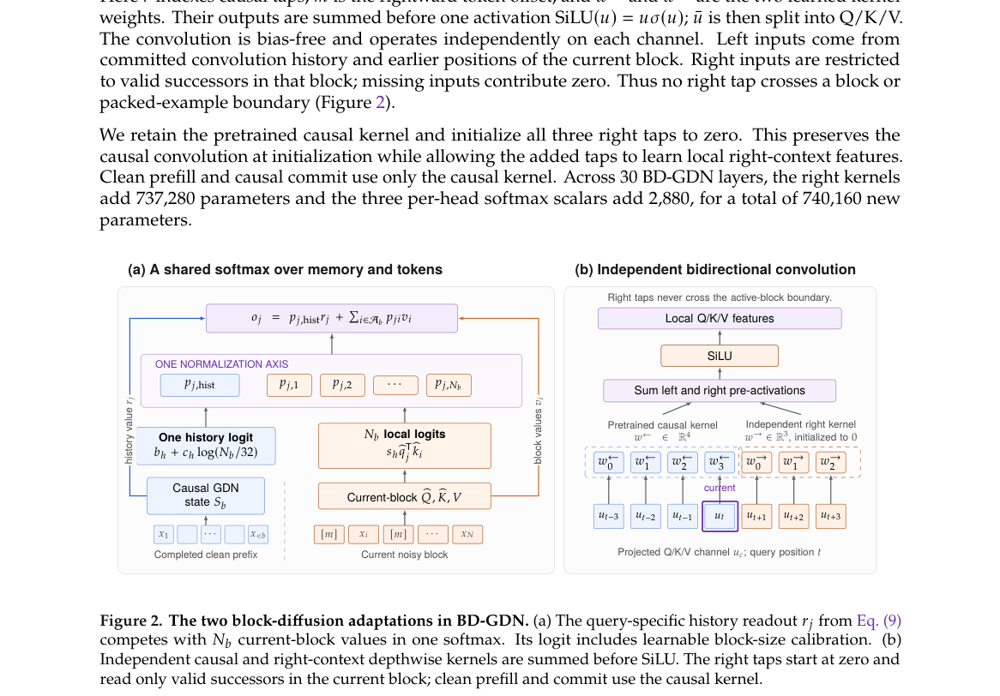

**Why this ranks #5**: Clover 把 Gated Delta Network 改造成块扩散的 BD-GDN，35B 总参 3B 激活的 dMoE 结构在七项 Agent 指标上领先，SWE-bench Verified 得 73.6、Terminal-Bench 2.1 得 51.7，单卡 GB300 达 680 tokens/s。

---

### 6. On-Policy Morphing into Hybrid Attention Models

**arXiv**: [2611.24809](https://arxiv.org/abs/2611.24809) | **Score**: 8.7 (relevance 9 x 0.7 + quality 8 x 0.3) | **Direction**: `llm_core` | **Tags**: LLM-VLM, hybrid-attention, layer-selection, linear-attention, model-conversion, Fudan University | **Categories**: cs.CL | **Pages**: 18

**Authors**: Disen Lan; Xuanda Wang; Jianbin Zheng; Huafeng Kuang; Wei Tang; Yu Cheng

**Affiliation**: Fudan University; ByteDance Seed; Nanyang Technological University

**Abstract**

> Hybrid attention models combine full and linear attention to achieve a better quality--efficiency trade-off. Converting pretrained Transformers into such models requires identifying which layers should retain full attention under a prescribed budget. We identify two off-policy mismatches in FlashMorph's layer selection: (i) continuous branch interpolation and teacher-forced hidden states differ from discrete hybrid computation; and (ii) frozen model weights fail to account for parameter adaptation during subsequent recovery. We introduce FlashMorph2, an on-policy layer-selection method that (I) evaluates sampled discrete hybrid architectures end to end using their own hidden states, and (II) jointly optimizes layer-selection scores and model weights under the recovery objective to reflect post-adaptation performance. Experiments across Qwen3 model scales and linear-attention variants show that FlashMorph2 consistently outperforms existing layer-selection methods, improving average scores over FlashMorph by $+2.42$ points on RULER, $+1.08$ on LongBench, and $+0.76$ on recall-intensive tasks, while completing layer selection in only $0.72$--$3.57$ GPU hours across 0.6B--8B models, demonstrating high efficiency and scalability.

**Key findings**

- **Finding**: FlashMorph2 相对 FlashMorph 在 RULER 上平均高 2.42 分、LongBench 高 1.08 分、召回类任务高 0.76 分，0.6B 到 8B 模型的选层耗时为 0.72 到 3.57 GPU 小时。
- **Inference**: FlashMorph 的两处策略外错配在于连续分支插值与教师强制隐状态不同于离散混合计算，且冻结权重无法反映恢复期的参数自适应。
- **Recommendation**: 把预训练 Transformer 转成混合注意力时应改用采样出的离散结构做端到端评估，并让层选择分数与权重在恢复目标下联合优化。

**Key figures**

*Framework - Comparison between FlashMorph and FlashMorph2.*

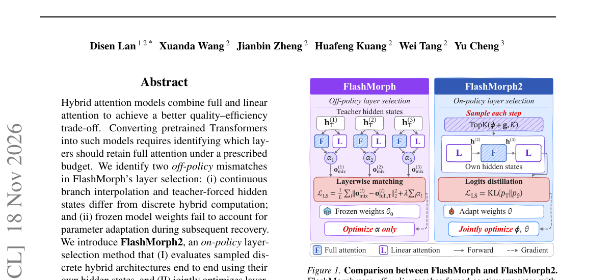

*Result - Overview of FlashMorph2. Following layerwise alignment, FlashMorph2 constructs a hybrid attention model through*

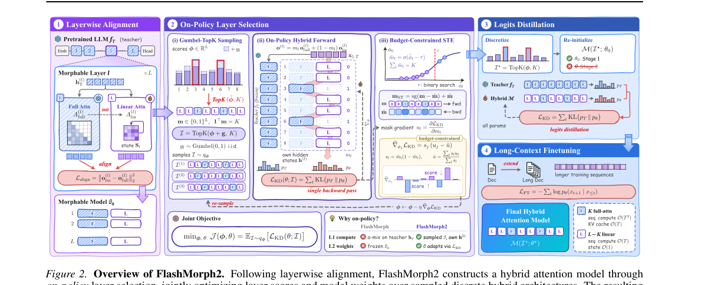

**Why this ranks #6**: FlashMorph2 把层选择改为在策略评估，用离散混合结构自身隐状态端到端打分并联合优化选择分数与权重，在 RULER 上比 FlashMorph 高 2.42 分，0.6B 到 8B 模型选层仅耗 0.72 到 3.57 GPU 小时。

---

### 7. Atomic MathReasoner: Instance-Level Composition of Atomic Reasoning Skills for Mathematical LLMs

**arXiv**: [2611.24846](https://arxiv.org/abs/2611.24846) | **Score**: 8.7 (relevance 9 x 0.7 + quality 8 x 0.3) | **Direction**: `llm_core` | **Tags**: LLM-VLM, math-reasoning, lora-experts, skill-composition, router, [unverified] | **Categories**: cs.LG | **Pages**: 11

**Authors**: Jiashu Li; Tianyu Gao; Qinglong Liu; Jinping Wang; Ye Wei; Zhiqiang Gao

**Affiliation**: [unverified]

**Abstract**

> Most existing approaches enhance mathematical reasoning in large language models (LLMs) as a monolithic capability, despite the fact that different mathematical problems require different reasoning skills. Recent work has explored a more fine-grained perspective by decomposing mathematical reasoning into atomic skills and developing specialized modules for individual capabilities. However, how to effectively utilize these atomic abilities remains underexplored. To address this challenge, we propose Atomic MathReasoner (AMR), an instance-level framework for composing atomic reasoning skills. AMR first trains a library of capability-specific LoRA experts and performs gradient-free optimization over held-out validation subsets to discover a diverse set of low-loss composition prototypes. It evaluates the preference of each prototype using the token-level negative log-likelihood of reference solutions, filters ambiguous assignments through a confidence margin, and distills the resulting pseudo-labels into a lightweight router. During inference, the router selects an appropriate composition prototype for each problem, enabling problem-specific utilization of atomic skills without costly online optimization. Experiments on the AtomicMath benchmark across general and mathematics-specialized LLMs demonstrate consistent improvements. On Qwen2.5-Math-Instruct-7B, AMR increases average field accuracy from 64.4% to 68.1% at Level 1 and from 59.3% to 63.7% at Level 2, while improving average logical reasoning performance from 39.4% to 46.8%. These results demonstrate that effectively composing specialized atomic skills provides a promising approach to strengthening mathematical reasoning in LLMs.

**Key findings**

- **Finding**: 在 Qwen2.5-Math-Instruct-7B 上，AMR 把 Level 1 场均分从 64.4% 提到 68.1%，Level 2 从 59.3% 提到 63.7%，逻辑推理均分从 39.4% 提到 46.8%。
- **Inference**: 数学推理的瓶颈在于不同题目需要不同的子技能组合，固定合并全部专家不如按实例挑选组合原型。
- **Recommendation**: 提升数学能力时可先拆解出原子技能 LoRA 专家，再用少量样本训练路由，本文中 512 个样本即达到 56.4% 的总准确率。

**Key figures**

*Framework - Conventional LLMs treat mathematical reasoning as a monolithic capability, often failing across diverse mathematical problems. In contrast, AMR dynamically composes atomic reasoning experts*

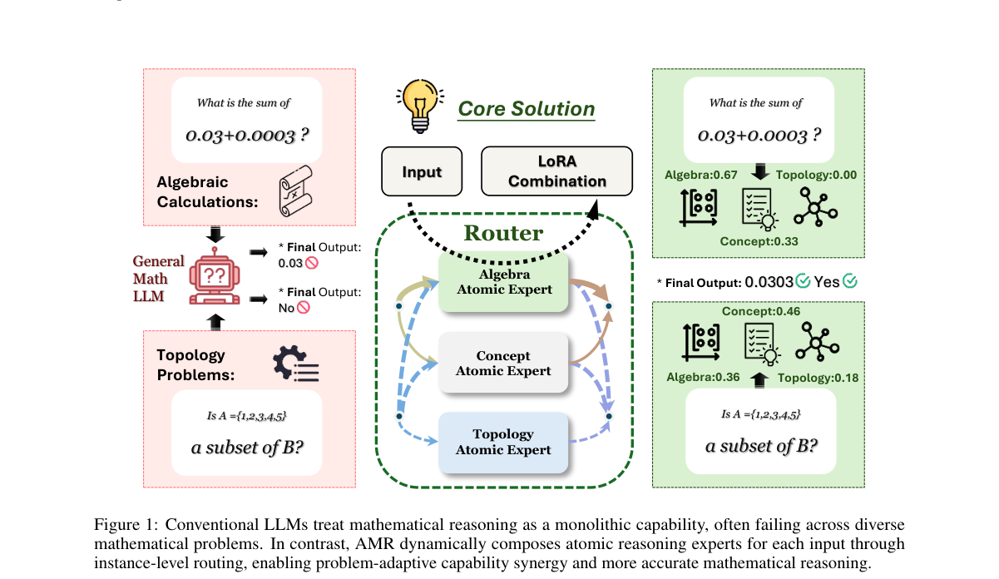

*Result - Overview of the proposed Atomic MathReasoner (AMR) framework. Top (Stage 1): Prototype Construction. We first decouple mathematical reasoning into atomic capabilities and train corresponding*

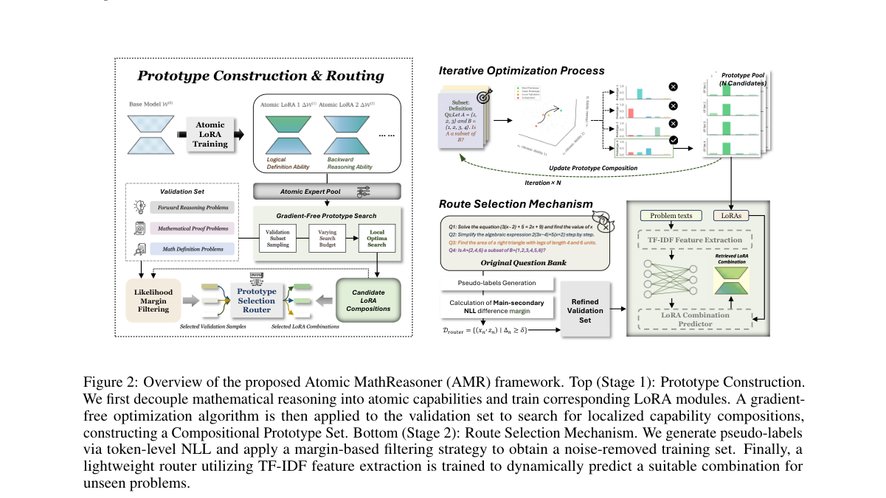

**Why this ranks #7**: AMR 先训练一批能力专属 LoRA 专家，再无梯度搜索组合原型并蒸馏成轻量路由，在 Qwen2.5-Math-Instruct-7B 上把 Level 1 均分从 64.4% 提到 68.1%，逻辑推理均分从 39.4% 提到 46.8%。

---

### 8. RoCoKV: Accelerating LLM Inference Serving through Uncertainty and Redundancy Aware KV Cache Compression

**arXiv**: [2611.25433](https://arxiv.org/abs/2611.25433) | **Score**: 8.7 (relevance 9 x 0.7 + quality 8 x 0.3) | **Direction**: `llm_core` | **Tags**: LLM-VLM, kv-cache-compression, reasoning-model, vllm-plugin, cuda-kernel, Georgia Institute of Technology | **Categories**: cs.CL | **Pages**: 17

**Authors**: Payman Behnam; Elaheh Sobhani; Saad Amin; Yahya Hassan; Daniyal Khan; Biswadeep Chakraborty; Tanish Patwa; Souvik Kundu; Alexey Tumanov

**Affiliation**: Georgia Institute of Technology, USA; Independent Researcher, USA; Annapurna Labs, Amazon, USA; Mercuria Energy Americas, USA; Google, USA

**Abstract**

> KV cache compression is critical for large reasoning models, where most of the cost comes from long generated reasoning traces rather than the input prompt. These traces often contain redundant and low-utility tokens due to looping, self-verification, and corrections. However, such tokens may still receive high attention scores, making it difficult to remove them without harming the reasoning process. We propose RoCoKV, a KV cache compression method designed for large reasoning models. RoCoKV introduces two key components. First, uncertainty-guided adaptive pruning adjusts the compression strength based on the model's confidence, allocating more memory during uncertain phases and applying stronger pruning when the model is confident. Second, redundancy-aware token selection reduces the impact of tokens that are highly similar to recent reasoning content, encouraging the model to retain more informative and diverse tokens. Beyond the algorithm, we co-design RoCoKV with the serving stack: we develop fused three-phase CUDA decode kernels and integrate them into vLLM as a drop-in plugin that preserves its paged KV layout and CUDA graph capture, turning algorithmic savings into real end-to-end speedups. Extensive experiments across three reasoning benchmarks and two reasoning models demonstrate that RoCoKV consistently improves reasoning accuracy under constrained KV cache budgets, achieving higher accuracy compared to state-of-the-art KV cache compression methods. For DeepSeek-R1-Distill-Llama-8B in vLLM, RoCoKV achieves a 1.27X speedup and 38% higher throughput on AIME25, the most challenging evaluated reasoning benchmark, and a 1.43X speedup and 45% higher throughput on the long synthetic benchmark, compared with Full-KV.

**Key findings**

- **Finding**: 在 vLLM 上，RoCoKV 让 DeepSeek-R1-Distill-Llama-8B 在 AIME25 取得 1.27 倍加速与 38% 吞吐提升，在长合成基准上取得 1.43 倍加速与 45% 吞吐提升。
- **Inference**: 推理轨迹里的回环与自校验 token 仍拿到高注意力分数，只按注意力分数分配预算会保留低价值且重复的内容。
- **Recommendation**: 部署推理模型时应把 KV 压缩与内核一起做，并保留 paged KV 布局与 CUDA graph 捕获，否则算法收益会被额外开销抵消。

**Key figures**

*Framework - Observation 1 - Attention approximation errors are more harmful at uncertain decoding steps.*

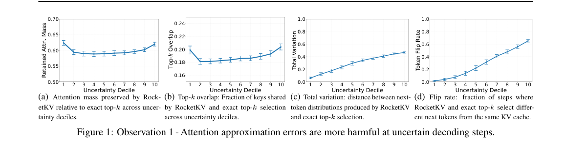

**Why this ranks #8**: RoCoKV 用不确定性引导的自适应剪枝加冗余感知打分，按模型置信度动态调整压缩强度，作为 vLLM 插件把 DeepSeek-R1-Distill-Llama-8B 在 AIME25 上加速 1.27 倍、吞吐提升 38%。

---

### 9. VR-SparseQuant: Accurate FP4 Quantization with 2:4 Sparsity on Vera Rubin

**arXiv**: [2611.25717](https://arxiv.org/abs/2611.25717) | **Score**: 8.7 (relevance 9 x 0.7 + quality 8 x 0.3) | **Direction**: `llm_core` | **Tags**: LLM-VLM, fp4-quantization, structured-sparsity, vera-rubin, moe-inference, Nebius Applied AI | **Categories**: cs.CL | **Pages**: 16

**Authors**: Samir Khaki; Wei-Chen Wang; Song Han; Ryan Hanrui Wang

**Affiliation**: Nebius Applied AI; Massachusetts Institute of Technology

**Abstract**

> In recent years, GPUs have incorporated increasingly specialized support for low-precision computation, from Hopper's FP8 to Blackwell's FP4 Tensor Cores. Precision formats have evolved alongside this hardware, from MXFP4 and NVFP4 on Blackwell to E2M1 FP4 with direct UE5M3 block scaling on Vera Rubin, which we term as $\boldsymbol{VRFP4}$. These advances help serve larger language models at lower cost, but four-bit activation quantization can substantially degrade model quality. We introduce VR-SparseQuant, which uses Vera Rubin's elementwise 2:4 sparsity to recover accuracy while retaining native FP4 execution. By allowing two sparse streams to overlap, we use the same FP4 value budget as dense quantization to refine activations with larger errors. Offline scale-ratio calibration avoids runtime search, while a shared-weight GEMM accumulates both streams efficiently. On Nemotron-3-Nano-30B-A3B, VR-SparseQuant reduces WikiText-2 perplexity from $\boldsymbol{6.85}$ to $\boldsymbol{5.57}$ versus dense RTN W4A4. Including activation preparation, our native Rubin kernels for VRFP4 achieve up to $\boldsymbol{3.1\times}$ GEMM and $\boldsymbol{2.7\times}$ MoE speedup over BF16. To the best of our knowledge, this is the first study of adaptive activation quantization using Vera Rubin's elementwise 2:4 structured sparse FP4 instructions.

**Key findings**

- **Finding**: VR-SparseQuant 在 Nemotron-3-Nano-30B-A3B 上把 WikiText-2 困惑度从密集 RTN W4A4 的 6.85 降到 5.57，同时保持原生 FP4 执行路径。
- **Inference**: 四位激活量化的精度损失主要来自大误差值，两路重叠的 2:4 稀疏流可以在不增加 FP4 值预算的前提下细化这些激活。
- **Recommendation**: 在 Rubin 上做低比特推理时可先离线标定两路 scale 比例，再评估 Qwen3.5-4B 上 AIME2026 准确率相对 W4A4 的提升幅度。

**Key figures**

*Framework - Structured sparsity for accurate and efficient FP4 inference. (a) Two 2:4 sparse FP4 streams approximate a dense activation*

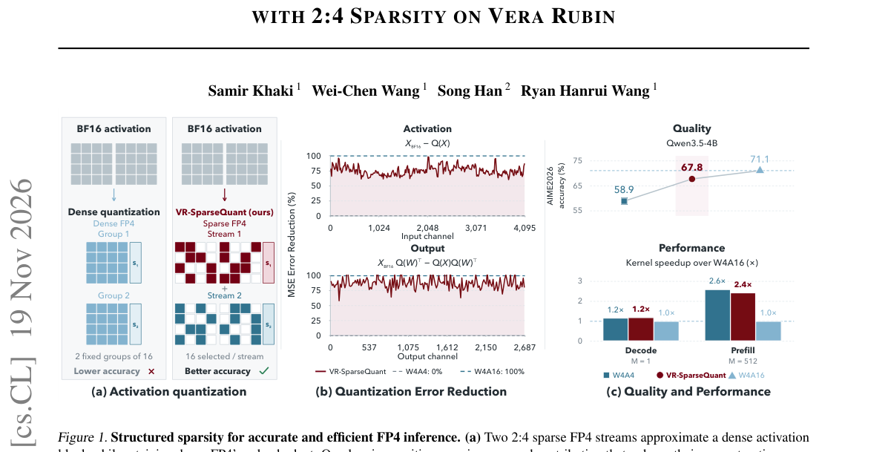

*Result - Rubin brings elementwise 2:4 sparsity to the compact*

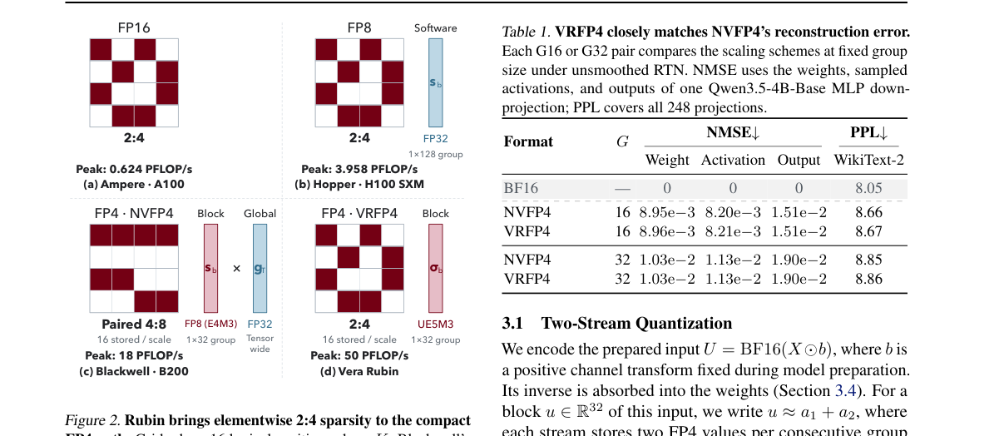

**Why this ranks #9**: VR-SparseQuant 用 Vera Rubin 的逐元素 2:4 稀疏把一个激活拆成两路稀疏 FP4 流，在 Nemotron-3-Nano-30B-A3B 上把 WikiText-2 困惑度从 6.85 降到 5.57，原生内核相对 BF16 达 3.1 倍 GEMM 与 2.7 倍 MoE 加速。

---

### 10. Efficient and Robust Drafting with Multi-Token Prediction

**arXiv**: [2611.25813](https://arxiv.org/abs/2611.25813) | **Score**: 8.7 (relevance 9 x 0.7 + quality 8 x 0.3) | **Direction**: `llm_core` | **Tags**: LLM-VLM, multi-token-prediction, speculative-decoding, clustered-vocabulary, edge-inference, Google | **Categories**: cs.CL | **Pages**: 17

**Authors**: Filippo Galgani; Ziwei Ji; Omri Homburger; Ganesh Jawahar; Michelle Ramanovich; Ivan Korotkov; Luciano Martins; Utku Evci; Edouard Yvinec; Pooja Consul; Vivek Kumar; Tal Schuster

**Affiliation**: Google

**Abstract**

> Speculative decoding has emerged as a critical technique for accelerating Large Language Model (LLM) inference by decoupling generation into a drafting phase and a parallel verification phase. A crucial challenge is therefore designing a drafter that is both lightweight and accurate enough to approximate the predictions of the target model. We present a highly optimized Multi-Token Prediction (MTP) architecture that extends existing backbone LLMs to efficiently produce high-quality drafts. Built around a single shared drafting head, our approach features three core architectural optimizations: target activation injection to anchor semantic planning, zero-copy KV-cache cross-attention to bypass prefill compute and reduce memory overhead, and an efficient clustered vocabulary projection to reduce the cost of full-vocabulary decoding. Testing these improvements with the Gemma 4 model family, our G-MTP shows out-of-the-box speedups for both large server-side setups (up to 3.1$\times$) and smaller models targeting memory-constrained on-device environments (up to 2.3$\times$ on H100 and up to 2.2$\times$ on a smartphone GPU). In addition, we present parameter-efficient fine-tuning recipes for G-MTP that keep the drafter aligned with the backbone LLM under domain shift, requiring up to 1.83$\times$ fewer target forward passes than tuning only the backbone.

**Key findings**

- **Finding**: 聚类词表投影把每步 token-logit 计算从 d 乘 262,144 降到 d 乘 2048 加 4096，约减少 43 倍乘加次数，同时保持超过 97% 的 token 命中率。
- **Inference**: 独立草稿模型要重复处理整段上下文，在手机等内存受限设备上直接禁止部署，因此草稿头必须复用主干 KV 而不另付 prefill 成本。
- **Recommendation**: 接入 G-MTP 时应按域偏移用参数高效微调对齐草稿头，该配方比只调主干少用最多 1.83 倍的目标前向次数。

**Key figures**

*Framework - Architecture of the optimized Multi-Token Prediction (G-MTP) module. The input to the drafter is constructed by concatenating the token embedding (𝑒(𝑥)) with the backbone hidden state (ℎ(𝐿)*

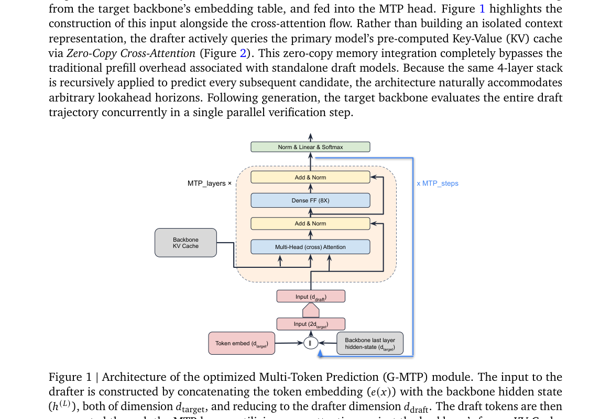

*Result - The autoregressive G-MTP drafter (blue blocks) is initialized with activations from the main model (gray blocks) and cross-attends to its KV cache. Across successive drafting steps, the pos*

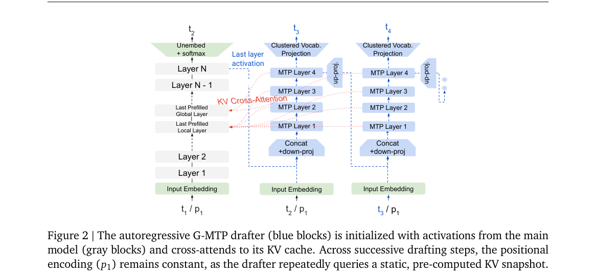

**Why this ranks #10**: G-MTP 用共享 4 层起草头加目标激活注入、零拷贝 KV 交叉注意力与聚类词表投影改造 Gemma 4，服务器端加速最高 3.1 倍，H100 端侧 2.3 倍、手机 GPU 2.2 倍。

---

### 11. DTS: Delta-Based Tile Scoring for Efficient Long-Context Sparse Attention

**arXiv**: [2611.25938](https://arxiv.org/abs/2611.25938) | **Score**: 8.7 (relevance 9 x 0.7 + quality 8 x 0.3) | **Direction**: `llm_core` | **Tags**: LLM-VLM, sparse-attention, long-context, prefill-acceleration, training-free, Leiden Institute of Advanced Computer | **Categories**: cs.LG | **Pages**: 7

**Authors**: Emre Uğur; Jiawen Qi; Qinyu Chen

**Affiliation**: Leiden Institute of Advanced Computer Science (LIACS), Leiden University

**Abstract**

> Large language models (LLMs) increasingly need to process long documents and codebases, making long-context attention a major prefill bottleneck. Block sparse attention reduces computation by skipping unimportant blocks of the attention matrix, but scoring blocks accurately can itself be expensive. We propose Delta-Based Tile Scoring (DTS), a training-free, content-adaptive tile scoring method for sparse block attention. DTS selects query and key anchors according to local vector changes, using fewer representatives in redundant regions while retaining more detail in heterogeneous regions. To accelerate anchor selection, parallel delta packing partitions the query and key sequences into tile-aligned chunks and performs bounded local scans over these chunks concurrently. The selected tiles are then computed using the original query, key, and value vectors. On LLaMA-3.1-8B-Instruct, DTS keeps average RULER and LongBench scores within 0.10 percentage points of full attention, with RULER evaluated up to 128K tokens. At 128K tokens, DTS reduces measured scoring-pipeline latency by 38% compared with XAttention. On four NVIDIA H100 GPUs, it achieves a 3.3$\times$ prefill speedup over a PyTorch full-attention baseline using FlashAttention-2 at 512K tokens.

**Key findings**

- **Finding**: DTS 在 LLaMA-3.1-8B-Instruct 上把 RULER 与 LongBench 均分保持在全注意力 0.10 个百分点内，RULER 评测最长做到 128K token。
- **Inference**: 稀疏注意力真正的开销在块打分而非块计算，按固定密度采样的 XAttention 仍把预算浪费在冗余区域。
- **Recommendation**: 做长上下文 prefill 优化时可采用无需训练的 tile 打分，并在 128K 以上长度对比 XAttention 的打分流水线延迟。

**Key figures**

*Framework - Comparison of XAttention [8] and DTS. (a) XAttention samples strided antidiagonals at a fixed density. (b) DTS selects query and key anchors based on local vector changes, reducing redundant s*

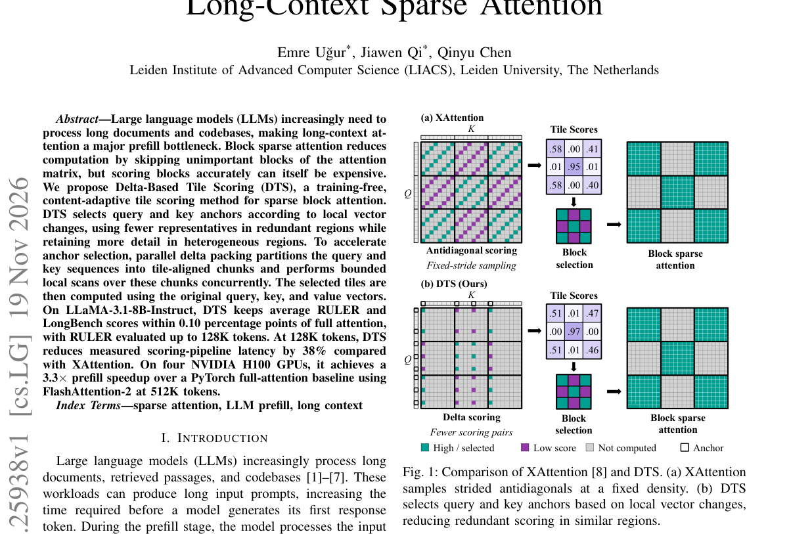

*Result - Mean cosine similarity of neighboring query (Q) and key (K) vectors in natural and shuffled order across context lengths. Results average all layers and heads over 50 PG-19 books and 50 WikiTe*

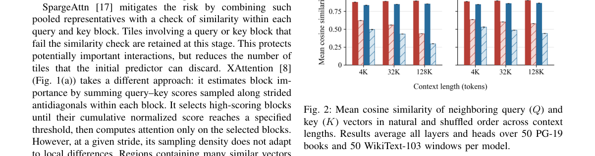

**Why this ranks #11**: DTS 用局部向量变化选取 query 与 key 锚点并做并行 delta 打包，在 LLaMA-3.1-8B-Instruct 上 RULER 与 LongBench 均分与全注意力相差不超过 0.10 个百分点，512K 长度下 4 张 H100 取得 3.3 倍 prefill 加速。

---

### 12. FrontierReplay: Split-Free Exact Prefix Caching for Hybrid Language Models

**arXiv**: [2611.26020](https://arxiv.org/abs/2611.26020) | **Score**: 8.7 (relevance 9 x 0.7 + quality 8 x 0.3) | **Direction**: `llm_core` | **Tags**: LLM-VLM, prefix-caching, hybrid-language-model, vllm, ttft-optimization, School of Computer Science | **Categories**: cs.LG | **Pages**: 15

**Authors**: Zekun Wang; Yizhuo Wang

**Affiliation**: School of Computer Science, Beijing Institute of Technology

**Abstract**

> Hybrid language models combine self-attention with recurrent layers whose in-place state updates restrict prefix reuse to exact saved positions. Saving states on a coarse grid wastes reusable prefixes, whereas existing fine-grained exact caches must cut the prefill forward pass at each mid-prompt checkpoint, adding scheduler steps that outweigh the reuse gains under load. We observe that across multi-turn chat, agent loops, document question answering, and tree search, prefix reuse almost always ends at structural boundaries predictable in advance, such as turn ends and known branch points. We present FrontierReplay, a prefix caching system that materializes exact checkpoints at these boundaries without cutting the prefill. While the forward pass runs uncut, FrontierReplay logs a short window of recurrent-layer inputs and invokes a cross-layer, state-only replay kernel to build the target state 6-37x cheaper per token than full recomputation without host synchronization. A frontier-aware retention policy prioritizes active anchors and proven branches while lending dead checkpoint slots to the attention KV cache. Across diverse hybrid architectures, model scales, and workloads, FrontierReplay delivers clear gains over existing exact caches, lowering median time to first token (TTFT) by 16-89% (up to 8.9x), raising 80% service-level objective (SLO) capacity by up to 1.73x, and improving goodput by up to 4.26x (3.67x at larger scales). Compared with approximate replay methods, FrontierReplay delivers up to 1.54x higher goodput while preserving exact task accuracy, avoiding the up to 17% accuracy drop suffered by approximation on long contexts.

**Key findings**

- **Finding**: FrontierReplay 相对现有精确缓存把 TTFT 中位数降低 16% 到 89%（最高 8.9 倍），80% SLO 容量最高提升 1.73 倍，goodput 最高提升 4.26 倍。
- **Inference**: 混合语言模型的循环层状态只能原位更新，前缀复用几乎总落在可提前预判的结构边界上，粗粒度状态网格因此浪费了大量可复用前缀。
- **Recommendation**: 在 vLLM 上做混合模型前缀缓存时应在轮次结束等结构边界物化精确检查点，而不是靠切断 prefill 前向来取检查点。

**Key figures**

*Framework - Reuse ends at predictable positions that vLLM’s state grid misses. Measured across each workload trace with an unbounded KV cache. (a) Share of reusable prefix tokens that lie past the last*

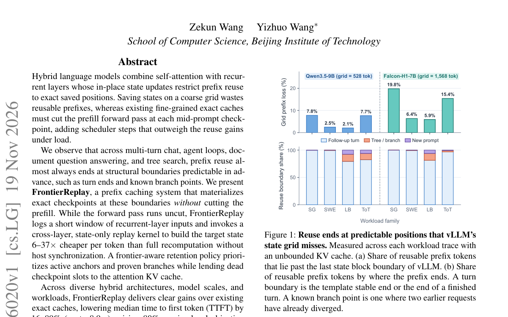

*Result - Granularity mismatch in hybrid prefix caching. (a) Attention-only models reuse 16-token KV pages up to any reuse boundary t. (b) With in-place recurrent state S saved only on a coarse grid g*

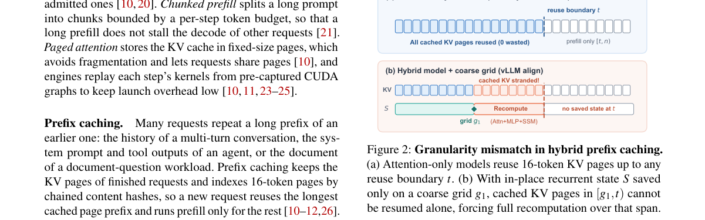

**Why this ranks #12**: FrontierReplay 在可预判的结构边界上免切断 prefill 地物化精确检查点，跨层只重放状态的核比整段重算每 token 便宜 6 到 37 倍，TTFT 中位数下降 16% 到 89%、goodput 最高提升 4.26 倍。

---

## VLM 核心（多模态架构 / 理解 / 视频 / GUI agent） · `vlm_core` (4 papers)

四篇里有两篇给出结构性的诊断。RecurrentVLM 指出 VLM 在贝壳游戏这类隐藏物体追踪上接近随机的根因是串行计算：每次交换都要和上一次结果复合，固定深度的 VLM 只有固定次状态转移，于是让每个注意力层在时间上自我循环，用该层自己的输出去算下一帧组的 key 与 value。WhereBits 则用无标注的问题对比压掉 attention sink，证明注意力本身就能挑出会做定位的层（COCO pointing 0.72 对平均注意力的 0.22），无需框标注。MobileWeave 给出第三种结构论断：把 GUI 任务合成从自由文本改成可执行程序、让子目标之间的显式依赖本身成为训练信号后，8B 模型在 MobileGym 提升 26.7 分，组合性变得可学。WeMM-Video 走的是另一条路，直接堆规模。

### 13. Bits, Not Boxes: Label-Free Layer Selection for Visual Localization in VLMs

**arXiv**: [2611.23432](https://arxiv.org/abs/2611.23432) | **Score**: 8.7 (relevance 9 x 0.7 + quality 8 x 0.3) | **Direction**: `vlm_core` | **Tags**: LLM-VLM, visual-grounding, layer-selection, attention-sink, training-free, University of British Columbia | **Categories**: cs.CV, stat.ME | **Pages**: 35

**Authors**: Haisheng Fu; Gexin Huang; Haikai Zhao; Jie Liang; Zhenman Fang; Jingning Han; Xiaoxiao Li

**Affiliation**: University of British Columbia; Simon Fraser University; University of Minnesota–Twin Cities; Google

**Abstract**

> Attention maps cheaply show where a vision-language model (VLM) looks, but attention sinks make them unreliable for localization. Contrasting the question with a generic prompt suppresses sinks, yet only some layers localize the queried object. Existing methods find these layers with box annotations or fixed rules. We show that attention itself can identify them. A question changes how much a head attends to the image and where this attention goes. The two effects separate exactly, and the second, measured in bits on unlabeled questions, indicates which layers localize. WhereBits turns these where-to-look bits into a layer prior and combines it with per-head contrastive scores. Its three design constants were fixed once on labeled COCO data, and a new model or resolution needs only unlabeled questions. Across eight VLMs, WhereBits matches the pointing accuracy of box-tuned layers on COCO and RefCOCO and ranks target tokens better. This advantage holds on a held-out model family and at higher resolutions. Its COCO pointing accuracy is 0.72, against 0.22 for mean attention. In training-free zoom-in, its crops raise V* accuracy by 6.0 points under forced-choice evaluation.

**Key findings**

- **Finding**: 在留出 COCO 问题上，Qwen3-VL-8B 的均值注意力 89% 的时候峰值落在左上角视觉 token，只命中 9.7% 的被问对象，低于随机 token 的 19.3%。
- **Inference**: 注意力 sink 干扰了定位信号，但问题对注意力的影响量与落点位置这两种效应可以分离，后者才是可用的层选择依据。
- **Recommendation**: 用注意力做训练无关的裁剪放大时应先用 WhereBits 的层先验选层，V* 上其裁剪把强制选择准确率提高了 6.0 个百分点。

**Key figures**

*Framework - Attention sinks pull zoom-in crops away from the evidence. For each model, we show the first V∗question on which WhereBits hits the target (cyan box) while mean attention misses on a sink. R*

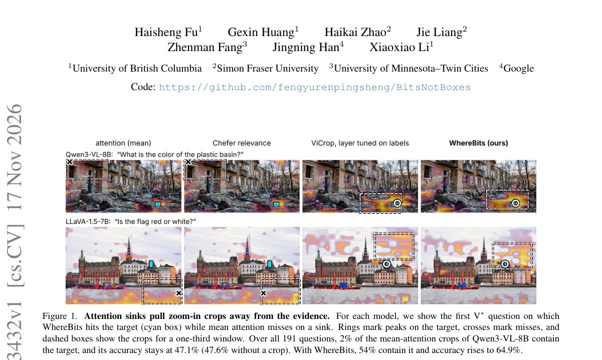

*Result - From attention rows to a question-specific map. (a) The inputs pair the image x or a gray image ∅with the question t or a generic prompt g. (b,c) On a held-out COCO example (supplement), hea*

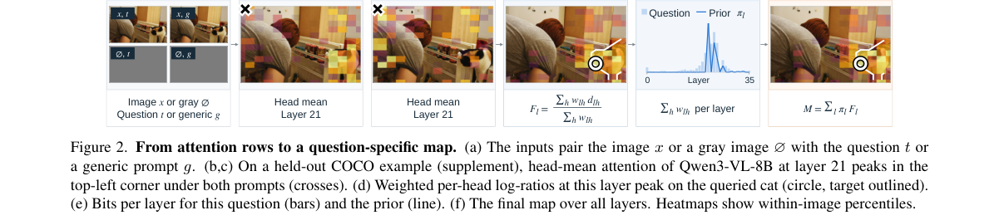

**Why this ranks #13**: WhereBits 用无标注问题测得注意力落点位置的比特数作为层先验，再与逐头对比分数结合选层，在 COCO 上把指向准确率做到 0.72，而均值注意力只有 0.22。

---

### 14. MobileWeave: Program-First Synthesis of Dependency-Linked Tasks for Training Mobile GUI Agents

**arXiv**: [2611.23860](https://arxiv.org/abs/2611.23860) | **Score**: 8.7 (relevance 9 x 0.7 + quality 8 x 0.3) | **Direction**: `vlm_core` | **Tags**: LLM-VLM, gui-agent, task-synthesis, mobile, program-synthesis, University of Hong Kong | **Categories**: cs.CV | **Pages**: 36

**Authors**: Ziyi He; Xian Wu; Qiyuan Chen; Haitao Li; Cehao Yang; Yinghao Zhu; Xichen Zhang; Xiao Chen; Yushi Feng; Lequan Yu

**Affiliation**: The University of Hong Kong; LIGHTSPEED; The Hong Kong University of Science and Technology (Guangzhou); The Hong Kong University of Science and Technology; The Hong Kong Polytechnic University

**Abstract**

> Native mobile GUI agents require large-scale training trajectories covering both individual app functions and multi-goal workflows within and across apps, which makes automatic task synthesis a promising way to scale training data. Existing synthesis pipelines, however, produce each task as free-form text, leaving implicit how its subgoals depend on one another. This matters because composition is a skill in its own right: a policy may complete each subtask of a workflow on its own, yet fail to chain these subtasks into the complete workflow. We present MobileWeave, which instead synthesizes every task as an executable program derived from the app implementations of a controllable simulator. MobileWeave abstracts each app into a typed capability graph with semantic types shared across apps, composes atomic programs into single- and cross-app composite programs through explicit value and object dependencies, and verifies each program by native execution, deriving both its instruction and its completion check from the same program. Trained on teacher trajectories collected for these tasks and on recovery supervision at the policy's own stalls, MobileWeave-8B improves its base model by 26.7 points on MobileGym and by 8.6, 21.3, and 17.6 points on AndroidWorld, AndroidLab, and MobileWorld, with comparable gains at 4B. Beyond these gains, we find that composition is learnable from task structure: explicit dependencies between subgoals act as a training signal that teaches a policy to compose skills it already masters. We release data, model, and code at https://maxxnotmarx.github.io/MobileWeave/ .

**Key findings**

- **Finding**: MobileWeave-8B 在 MobileGym 上把基线的 16.5 提到 43.2，AndroidLab 从 43.2 到 64.5，MobileWorld 从 10.3 到 27.9，AndroidWorld 从 47.4 到 56.0。
- **Inference**: 自由文本任务把子目标之间的依赖关系隐式化，策略能单独完成各子任务却无法把子任务串成完整工作流。
- **Recommendation**: 合成 GUI 训练任务时应直接输出带显式值与对象依赖的可执行程序，并用同一程序同时生成指令与完成判据。

**Key figures**

*Framework - Text-first vs. program-first task synthesis. Top: exist- ing pipelines prompt an LLM with screens or trajectories to write each task directly as text, leaving the dependencies between its su*

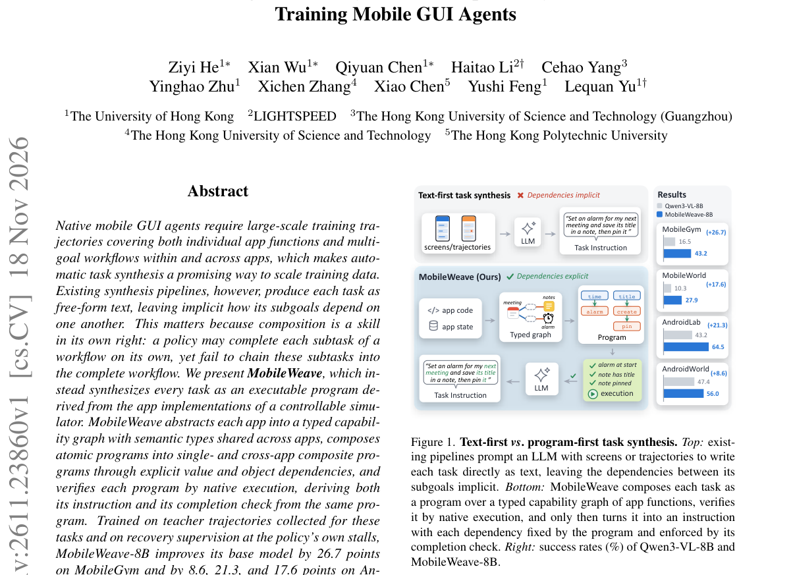

*Result - Overview of MobileWeave. Left: a typed capability graph of entities, semantic types, and operators is extracted from app code and state and grounded in native functions. Middle: atomic progr*

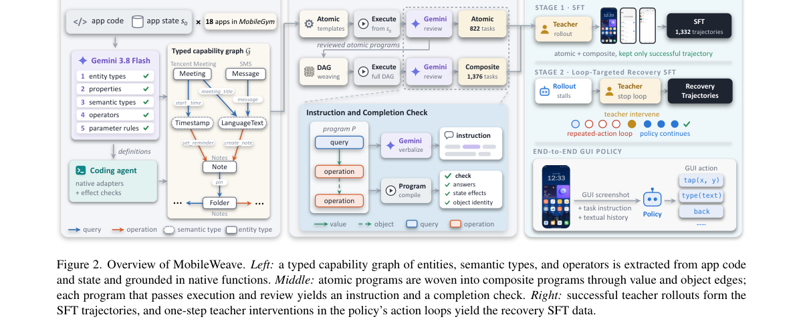

**Why this ranks #14**: MobileWeave 从可控制模拟器的应用实现抽象出带类型的能力图，把任务合成改为可执行程序并在原生执行中验证，8B 模型在 MobileGym 上比基线高 26.7 分、AndroidLab 高 21.3 分。

---

### 15. Recurrent Vision Language Models Solve the Shell Game

**arXiv**: [2611.25210](https://arxiv.org/abs/2611.25210) | **Score**: 8.7 (relevance 9 x 0.7 + quality 8 x 0.3) | **Direction**: `vlm_core` | **Tags**: LLM-VLM, recurrent-vlm, object-tracking, video-reasoning, attention-cache, Johns Hopkins University | **Categories**: cs.CV | **Pages**: 11

**Authors**: Dingqiang Ye; Jiacong Xu; Wen Zhang; Yiqun Mei; Vishal M. Patel

**Affiliation**: Johns Hopkins University

**Abstract**

> Tracking a hidden object through a video is effortless for humans, yet it remains a bottleneck for vision language models (VLMs). In the shell game, where a ball is hidden under one of several identical cups that are then swapped, VLMs that answer directly stay near chance, thinking models fail on long games, and fine-tuning learns only the lengths it has seen. We argue that the limit is serial computation: each swap must be composed with the last result, and a VLM of fixed depth has only a fixed number of state transitions for it. To address this, we propose RecurrentVLM, which makes every attention layer of a pretrained VLM recur over time by computing the keys and values of finished frame groups from the layer's own output. With a single answer token, RecurrentVLM reaches 100% on VET-Bench and 99.6% on MET-Bench, and 99% on 50-swap games after training on at most 30 swaps. We also observe several interesting phenomena: length generalization emerges suddenly at an aha moment; without recurrence, each swap costs an attention layer; the ball's state forms in the first four attention layers; and recurrence keeps the latest state at the cost of details of earlier moments. These results suggest that recurrent VLMs are a potential solution for tracking the states of unobserved objects in video. Code will be released.

**Key findings**

- **Finding**: RecurrentVLM 用单个答案 token 在 VET-Bench 上达到 100%、MET-Bench 上 99.6%，训练最多 30 次交换后在 50 次交换游戏中达到 99%。
- **Inference**: 固定深度的 VLM 每层只能提供固定次数的状态转移，而每次杯子交换都必须与上一次结果复合，因此瓶颈是串行计算量。
- **Recommendation**: 评测视频跟踪能力时应覆盖训练未见过的交换长度，并注意无循环时每多一次交换就多消耗一个注意力层。

**Key figures**

*Framework - Current VLMs struggle with the shell game. Claude-Opus-5.5 thinks for thousands of tokens and still errs; fine-tuned Qwen3.5-4B drifts on games longer than in training. RecurrentVLM stays cor*

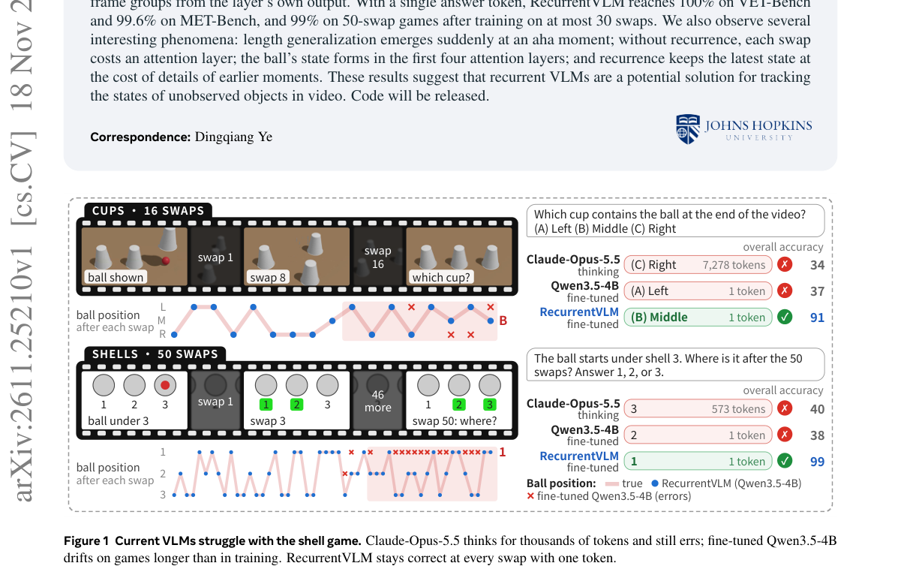

*Result - Recurrent KV cache. (a) A standard attention layer of the LLM caches keys and values of its input tokens. (b) We cache keys and values of the layer’s own output, once per frame group, so ever*

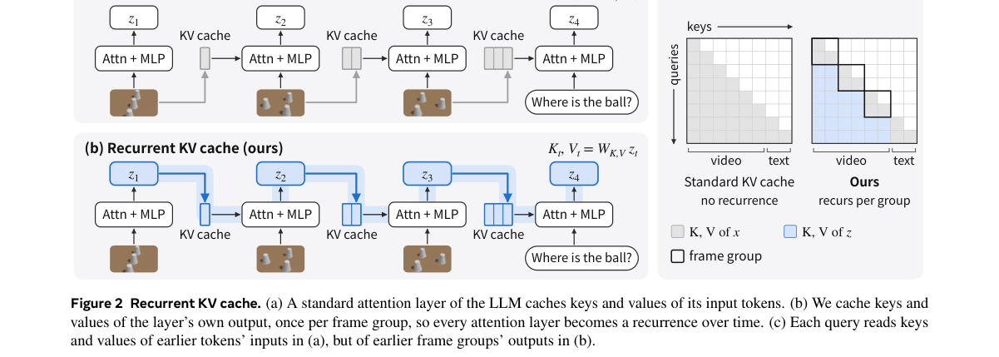

**Why this ranks #15**: RecurrentVLM 让预训练 VLM 的每个注意力层随时间循环，用该层自身输出计算已结束帧组的 key 与 value，在 VET-Bench 上达 100%、MET-Bench 上达 99.6%，训练不超过 30 次交换即在 50 次交换游戏上达 99%。

---

### 16. WeMM-Video: Pushing the Frontiers of Open-Source Omni-Modal Video Understanding

**arXiv**: [2611.26409](https://arxiv.org/abs/2611.26409) | **Score**: 8.7 (relevance 9 x 0.7 + quality 8 x 0.3) | **Direction**: `vlm_core` | **Tags**: LLM-VLM, omni-modal, video-understanding, hybrid-thinking, multimodal-pretraining, WeChat Vision | **Categories**: cs.CV, eess.AS | **Pages**: 21

**Authors**: Changli Tang; Jie Yang; Tianyi Wang; Lei Li; Daoze Zhang; Zijie Xin; Zhan Liu; Li Li; Jinchang Xu; Fengyun Rao; Chao Zhang; Jing Lyu

**Affiliation**: WeChat Vision, Tencent Inc.; Tsinghua University

**Abstract**

> Video understanding, particularly with accompanying audio, remains a central challenge in multimodal intelligence. In this report, we introduce \textbf{WeMM-Video}, a family of Chinese-English bilingual omni-modal foundation models spanning 2B, 4B, 9B, and 35B-A3B variants. Centering on joint audio-visual perception and reasoning, WeMM-Video unifies text, image, audio, and video processing within a hybrid-thinking paradigm, seamlessly supporting both a non-thinking instruct mode for fast, direct responses and a thinking mode for explicit step-by-step reasoning. The models are trained on a large-scale multimodal corpus of approximately 1.2 trillion tokens through progressive pre-training and a multi-stage post-training pipeline incorporating multi-teacher OPD, anti-repetition MrDPO, and specialist RL. Evaluated across more than 120 benchmarks, WeMM-Video demonstrates superior performance in omni-modal video understanding and reasoning, while maintaining highly competitive capabilities across general audio, silent video, image, and text tasks. Specifically, in omni-modal video evaluations, our flagship WeMM-Video-35B-A3B establishes a new open-source state of the art, substantially outperforming proprietary models such as Qwen3.5-Omni-Flash and Seed2.0-Mini-0428 while narrowing the gap with the strong Gemini-3.0-Flash, and our compact WeMM-Video-9B surpasses the larger open-source Qwen3-Omni-30B-A3B-Instruct. We publicly release the WeMM-Video family along with our evaluation and reproduction pipeline to foster further research and development in the open-source community.

**Key findings**

- **Finding**: WeMM-Video-35B-A3B 的思维模式在通用音视频理解的 17 个基准中，有 16 个超过 Seed2.0-Mini-0428 与 Qwen3.5-Omni-Flash。
- **Inference**: 全模态视频理解的差距主要来自训练阶段的跨模态对齐与后训练中的重复解码抑制，而非单纯扩大参数规模。
- **Recommendation**: 复现全模态视频模型时可沿用渐进预训练加多教师 OPD、反重复 MrDPO 与专家 RL 的三段式后训练，并同时评测 instruct 与 thinking 两种模式。

**Key figures**

*Framework - WeMM-Video can perceive and understand omni-modal videos, perform complex multimodal reasoning, and effectively handle general tasks across audio, image, and text modalities.*

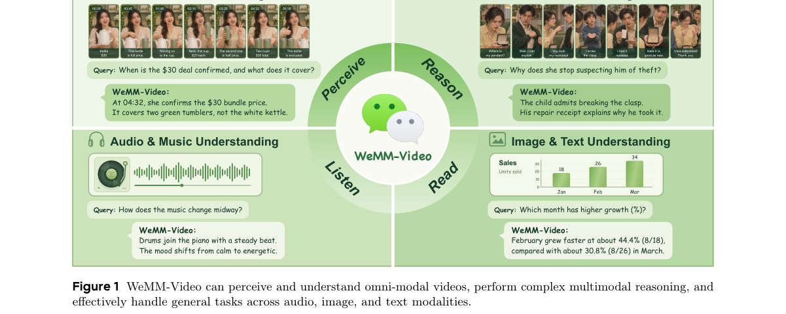

*Result - Model architecture of WeMM-Video.*

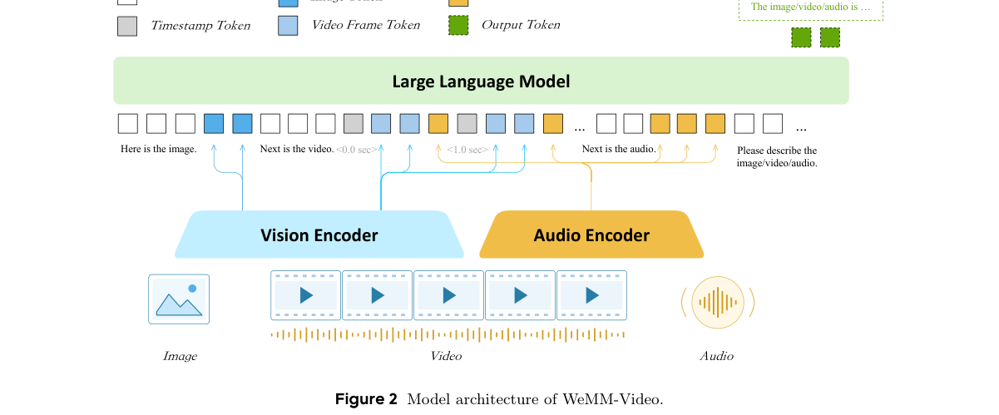

**Why this ranks #16**: WeMM-Video 是 2B 到 35B-A3B 的中英双语全模态视频基础模型，用约 1.2 万亿 token 语料渐进预训练并叠加多教师 OPD 与抗重复 MrDPO 后训练，在 120 多个基准上完成评测。

---

## LLM / VLM 的 RL 与偏好优化 · `llm_vlm_rl` (2 papers)

本轮这个方向只有 2 篇，但两篇都确实是多模态 RL。ReSynth 用 Qwen-Image-2.1 的编辑与视点生成造出 44 万条多图关系问答，把可控生成变成跨图关系监督，再用 GRPO 训练，Qwen2.5-VL-7B 提升 17.73 分，8B 版本在 BLINK 与 MUIRBench 上反超 Qwen3-VL-235B。EgoWitness 则从评测侧补上实例级空间记忆这个空白，用 8453 个人工核验问题、约 324 小时第一视角视频测「在哪里、什么时候、谁看见过」，并用 SFT + GRPO 训控制器，把 4B 模型从 23.64% 提到 72.65%，周长问题达到 74.85%。

### 17. ReSynth: Constructing Synthetic Supervision for Multi-Image Understanding

**arXiv**: [2611.23996](https://arxiv.org/abs/2611.23996) | **Score**: 8.7 (relevance 9 x 0.7 + quality 8 x 0.3) | **Direction**: `llm_vlm_rl` | **Tags**: LLM-VLM, multi-image-understanding, synthetic-supervision, grpo-training, visual-relation, qwen-vl, ZJU | **Categories**: cs.CV | **Pages**: 13

**Authors**: Yilin Wang; Xin Yu; Xinyi Guo; Xiangxi Zheng; Dongxing Mao; Linjie Li; Zhengyuan Yang; Alex Jinpeng Wang

**Affiliation**: ZJU; Columbia; CSU; NJU; UW

**Abstract**

> People often understand the world by comparing different views of it. Vision-language models (VLMs), however, receive these views as separate images and still struggle to relate them. One problem is data. Training on these tasks requires groups of images with a known relationship: the same object from different viewpoints, or the same scene before and after a change. Such examples are hard to collect at scale from existing photo collections. We introduce ReSynth, which turns single-image perception and controllable image generation into cross-image relational supervision. Localized editing produces before-and-after pairs, viewpoint generation produces multiple views of the same instance, and verified scene contents support comparisons of counts and attributes. ReSynth combines Qwen3-VL-8B's captioning, grounding, and counting capabilities with Qwen-Image-2.1's generation and editing capabilities. It verifies single-image facts such as object counts and attributes, then combines these facts to construct multi-image QA. Using GRPO on approximately 440K ReSynth questions, with no real images during training, Qwen2.5-VL-7B and Qwen3-VL-8B improve by 17.73 and 6.10 average points on BLINK, MUIRBench, and VLM2-Bench, while single-image performance is broadly preserved on Qwen2.5-VL-7B and improves across all four evaluated benchmarks on Qwen3-VL-8B. Notably, this supervision enables the 8B perception model itself to outperform Qwen3-VL-235B on BLINK and MUIRBench.

**Key findings**

- **Finding**: ReSynth 用约 440K 条完全由生成图像构造的多图题，覆盖身份/变化/数量/组成/对应/视角/时序七类共 15 种 QA 操作；GRPO 训练后 Qwen2.5-VL-7B 三基准平均 53.9→71.6 分，Qwen3-VL-8B 72.6→78.7 分。
- **Inference**: 训练全程不含真实图像，多图理解仍大幅提升，说明决定上限的是关系被验证并复用的构造方式，而不是数据是否来自真实照片。
- **Recommendation**: 复现时先搭「验证单图事实→生成/编辑出关系→组合 QA」三段流水线，再照论文的对照实验排查答案泄漏：改用反向描述后变化追踪 44.75→72.15，去掉可见区域干扰项后补全 40.00→84.67。

**Key figures**

*Framework - Existing-image curation retrieves and annotates available images. ReSynth plans and gen- erates candidate relations, verifies the resulting visual evidence, and reuses it to construct questi*

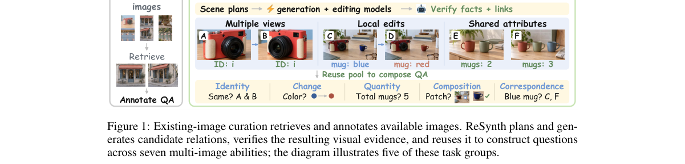

*Result - Overview of ReSynth. (a) Verified image facts and associations form a reusable pool. (b) Selected images yield checked QA for GRPO training. (c) Example identity, counting, and change tasks.*

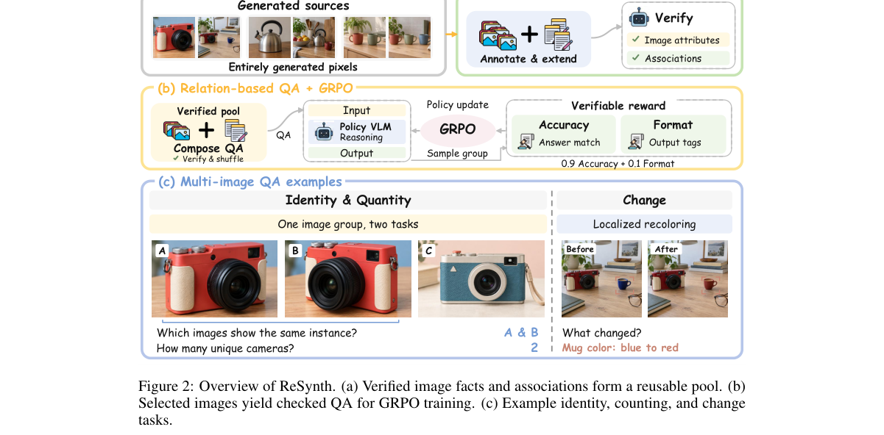

**Why this ranks #17**: ReSynth 把单图感知与可控生成拼成跨图关系监督，用约 440K 条纯生成图像的多图题做 GRPO（奖励 = 0.9×答案正确率 + 0.1×格式），Qwen2.5-VL-7B 在 BLINK/MUIRBench/VLM2-Bench 上平均从 53.9 涨到 71.6 分（+17.73），Qwen3-VL-8B 涨 6.10 分并在 BLINK/MUIRBench 上超过 Qwen3-VL-235B，是本 direction 里多模态 RL 的直接证据。

---

### 18. EgoWitness: Benchmarking Instance-Level Spatial Memory and Reasoning in Egocentric Video Streams

**arXiv**: [2611.25849](https://arxiv.org/abs/2611.25849) | **Score**: 8.7 (relevance 9 x 0.7 + quality 8 x 0.3) | **Direction**: `llm_vlm_rl` | **Tags**: LLM-VLM, egocentric-video, spatial-memory, agent-rl, grpo-training, benchmark, Hong Kong University of Science and | **Categories**: cs.CV | **Pages**: 43

**Authors**: Zhengru Fang; Zehao Liu; Mingyu Tsoi; Yaoyu Zhu; Junlong Li; Fengmao Lv; Sijie Cheng; Yuanliang Sun; Fang Yang; Jun Zhang

**Affiliation**: The Hong Kong University of Science and Technology; Tsinghua University; Southeast University; The Hong Kong Polytechnic University; Southwest Jiaotong University

**Abstract**

> Recalling where and when an object was last seen and who saw it requires recognizing it across days and people. Existing long-video benchmarks focus on events, object categories, or relative locations, leaving instance-level spatial memory largely untested in multimodal models. To address this gap, we present EgoWitness, a benchmark for instance-level spatial memory and reasoning in egocentric video. Its 8,453 human-verified questions span approximately 324 hours of week-long and short-horizon recordings and test seven abilities, from recognizing an object or room to recalling who saw it and reasoning about room visits. Over one million reviewed masks of 34 registered landmarks and 21 movable-object labels are linked through room timelines. Among twelve direct vision-language models (VLMs), open-weight models reach at most 46.97% accuracy, and none exceeds 35% on identifying who saw an object last. We therefore propose EgoClue, a spatial-memory agent that retrieves candidate intervals, verifies instance identity, and computes spatial and temporal relations with five tools. Two-stage training with supervised fine-tuning (SFT) and Group Relative Policy Optimization (GRPO) raises its 4B controller from 23.64% to 72.65% accuracy on 1,320 held-out questions. Evidence-trace synthesis matches the best direct VLM at 74.85% on week-long questions and achieves 80.56% in environments excluded from training.

**Key findings**

- **Finding**: 12 个直接 VLM 中最强开源模型仅 46.97%，无人能在「谁最后看到」上超过 35%（Gemini 4 Argon 仅 34.17%）；EgoClue 经 SFT+GRPO 后在 1320 道留出题上从 23.64% 升到 72.65%，叠加证据合成达 74.85%、跨环境 80.56%。
- **Inference**: 瓶颈在检索到每一次出现并核验身份，而非长视频表征本身，所以把工具调用与 RL 绑在一起比单纯放大 VLM 更有效。
- **Recommendation**: 做长时记忆评测可直接复用 EgoWitness 的房间时间线与实例标注体系，并照其消融配置工具集：去掉 Video 掉 25.68 分、去掉 Timeline 掉 8.64 分、去掉 Topology 掉 5.91 分。

**Key figures**

*Framework - Instance-level spatial memory across egocentric streams. (A) Instance-reference comparison. (B) Historical ob- servations with wearer, time, and room context. (C) Seven QA abilities in two gr*

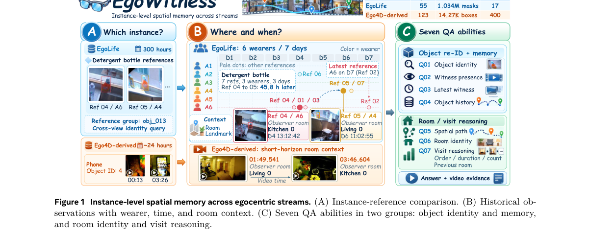

*Result - Room references, object annotations, and question coverage. a. The external room catalog contains 400 source- local reference entries across 81 scopes and 18 room types, separate from the 17*

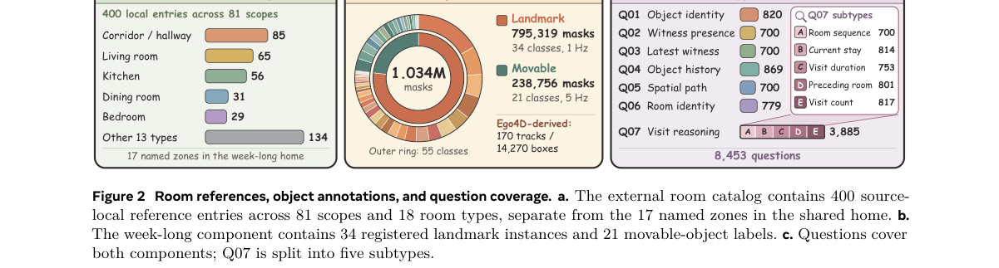

**Why this ranks #18**: EgoWitness 用 8453 个人工核验问题、约 324 小时第一视角录像立起实例级空间记忆基准，并给出五工具（Memory/Video/Image/Topology/Timeline）的 EgoClue 智能体：SFT+GRPO 把 4B 控制器在 1320 道留出题上从 23.64% 抬到 72.65%，去掉 Video 工具掉 25.68 分，是 llm_vlm_rl 里少见的「基准 + 工具型 RL」闭环。

---

## Footer

- Total papers reviewed across all 4 axes: 60
- llm_vlm axis final count: 18
- Wild-cards in this axis: 0
- Figure assets: 2026-11-21/res/

Generated by `mine-arxiv-daily-digest` skill. Sister file: `2026-11-21_llm_vlm_entry.md`.
