# Mine Arxiv Daily Digest - 2026-11-21 (具身智能与世界模型 Axis, 20 papers)

**Generated**: 2026-11-21 01:28 CST

**Source**: arXiv cs.CV, cs.SD, eess.AS, cs.CL, cs.AI, cs.RO, cs.LG, cs.IR submissions, listing day 2026-11-18,2026-11-19 (announced 2026-11-20 01:00 UTC (2026-11-20 09:00 CST))

**Batch window**: 2026-11-17T19:00:00Z .. 2026-11-19T19:00:00Z（arXiv 公告批次横跨两个 UTC 日：从前一日的美东 14:00 截止时刻起算（EDT 为 18:00Z，EST 为 19:00Z），到当日的同一时刻为止）

**Axis**: world_embodied (20 papers, base 15, cap 20)

**Directions**: world_model (7), embodied_ai (13)

**Selection**: 20 papers ranked by relevance x quality, with 0 wild-card slots

**Day total**: 60 papers across 4 axes (target 60)

**Scope**: 世界模型、学习型模拟器与具身智能，含移动操作、人形控制、触觉反射、VLA 策略与面向具身任务的强化学习

**Wild-card**: 本 axis 未启用任何补位名额。20 个席位是被 AXIS_CAP 卡死的，不是供给不足——该轴有 69 + 168 篇够格候选，缺口是被硬上限挤掉的；在上限内补位只会重复刷分，而把名额让给别的轴也换不来更多 rel≥9。

本轴 20 篇撞到 AXIS_CAP = 20，是四轴里唯一触顶的。两个方向合计 33 篇 rel≥9（world_model 10 / embodied_ai 23），20 个席位装不下：embodied_ai 拿 13 篇（基准 8，超 5），world_model 停在自身基准 7 上，dir_over = 5 恰好等于 axis_surplus = 20 − 15 = 5 才放行；再往上推，两个方向的 dir_over 会同时超过允许值。

落选的 13 篇 rel≥9 全部是 8.7 分（world_model 3 篇 / embodied_ai 10 篇），挑不出「谁更该进」的差别，只能按方向计数与分数取舍。这也是最近几轮里继上一轮之后第二次出现 rel≥9 挤不进的情况，上一轮是 46/61，本轮是 47/60——冲突规模相近，但这次全部集中在具身轴。

---

## 世界模型与学习型模拟器 · `world_model` (7 papers)

这一批 7 篇像同一场诊断的连续剧。底座诊断是《Search or Scoring? Diagnosing Why Visual World-Model Planners Fail》：视觉世界模型（DINO-WM、JEPA-WM）用优化器搜预测代价最低的动作，失败要么是没试到好动作（搜索失败），要么是代价把坏动作排在前面（打分失败）——这把「世界模型不够好」拆成两个可分别修的部件。修法各异：Verify2Act 让 VLM 提语义动作、由潜空间世界模型做物理验证；GEMS 用生成式子目标加经验记忆延长规划视野；ACTUS 把冻结模型反过来运行，对假想的执行偏移预测「本该看到什么」并与实测比对，不动权重就能自我纠偏。F³ 则把经验价值重定义为「在被使用的那一刻是否提高了完成任务的概率」。

### 1. How Uncertain Is My Action? Self-Correcting Visual Planning with Frozen World Models

**arXiv**: [2611.23620](https://arxiv.org/abs/2611.23620) | **Score**: 8.7 (relevance 9 x 0.7 + quality 8 x 0.3) | **Direction**: `world_model` | **Tags**: embodied, world-model, self-correction, actuation-shift, model-predictive-control, test-time-adaptation, Ohio State University | **Categories**: cs.CV, cs.LG, cs.RO | **Pages**: 11

**Authors**: Siqing Li; Luming Yang; Yijia Jiao; Junze Deng; Alper Yilmaz

**Affiliation**: The Ohio State University; Photogrammetric Computer Vision Laboratory (PCVLab)

**Abstract**

> A frozen latent world model combined with sampling-based model predictive control is a visual planner. At deployment, the executed action can depart from the commanded one, and the frozen model has no way to notice. We show that the model can be run in reverse: for any hypothesized actuation shift, it predicts what it should have observed under that shift, and comparing this prediction with what was actually observed quantifies the shift and lets the planner correct itself. Unlike the residual energy, which mixes the shift with the model's own error, the score keeps only the part of the residual that a shift can produce. This shift score detects the shift with a locally optimal test, estimates it with Cramer-Rao error bars, names the dominant generator, and compensates the planner once an alarm fires. On PushT, TwoRoom and OGBench-Cube with a frozen latent world model, measured detection follows the prediction to within 0.05 AUROC. Self-correction raises success from 0.650 to 0.862 on PushT and from 0.378 to 0.432 on the harder Cube task, levels with an oracle that is told the true shift at the same block, better than five common test-time adaptation methods. On a real robotic arm, the score identifies a base-joint offset that no joint encoder registers and reduces the reach error from 36 mm to 3-5 mm, and under shifts drawn at random and sealed before the session, estimates recover 92-94% of the error reduction achieved with the true shift. The broader implication is that a frozen world model can act as a filter by predicting the future, testing action-interface uncertainty and validity, and finally correcting failures.

**Key findings**

- **Finding**: 冻结潜空间世界模型在 PushT、TwoRoom、OGBench-Cube 上的检测表现与理论预测吻合在 0.05 AUROC 以内；ACTUS 自纠正把 PushT 成功率从 0.650 提到 0.862、OGBench-Cube 从 0.378 提到 0.432。
- **Inference**: 残差能量把驱动偏移和模型自身误差混在一起所以一阶不敏感，而只保留「偏移可解释分量」的 shift score 能把两者分开，于是冻结模型不改权重也能当检测器用。
- **Recommendation**: 部署视觉规划器时把 shift score 做成常开的看门狗，并用 Cramer-Rao 误差棒给偏移估计定置信区间；真机要预期无编码器覆盖的基座关节偏移仍得靠这个分数兜住。

**Key figures**

*Framework - Reading a frozen world model backwards. (a) A toy boat and a two-link arm under an unknown actuation shift T(θ): the frozen planner (grey) drifts, ACTUS (Action Uncertainty Self-correction,*

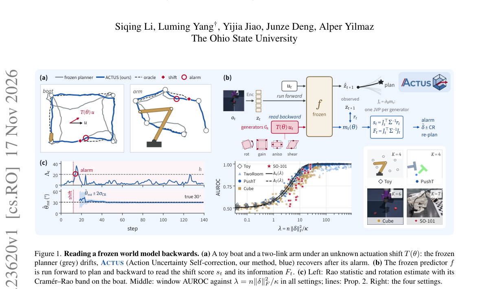

*Result - Energy against score (Prop. 1). (a) a shift moves the residual rt only inside the span of Jt (blue), the model error εt in all D directions. (b,d) change of the whitened energy E (grey) and*

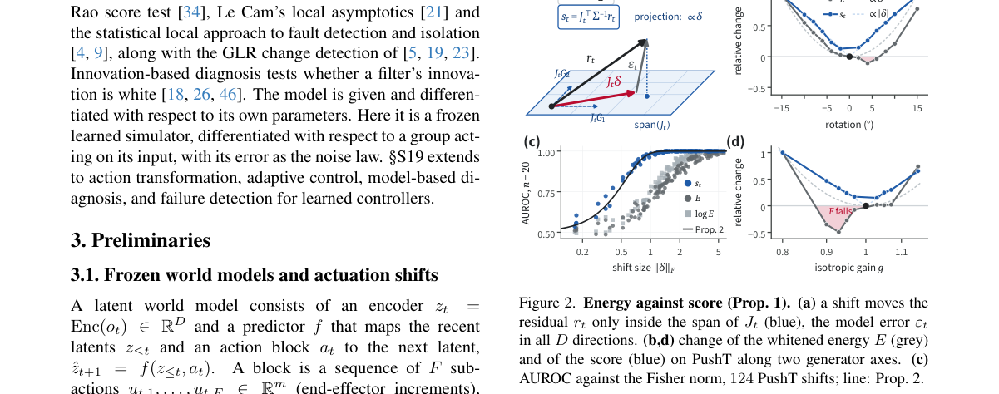

**Why this ranks #1**: 核心是把冻结潜空间世界模型「倒着跑」：对任一假设的驱动偏移 θ，世界模型预测「在该偏移下本应观测到什么」，与实际观测之差构成 shift score——只保留残差里能被偏移解释的那部分。PushT 上自纠正把成功率从 0.650 抬到 0.862，更难的 OGBench-Cube 从 0.378 到 0.432，检测 AUROC 与理论预测吻合在 0.05 以内，真机 reach 误差从 36 mm 压到 3–5 mm。

---

### 2. JEPA Dots: Dual-Latent World Model for Language-Guided Robot Control

**arXiv**: [2611.24062](https://arxiv.org/abs/2611.24062) | **Score**: 8.7 (relevance 9 x 0.7 + quality 8 x 0.3) | **Direction**: `world_model` | **Tags**: embodied, jepa, dual-latent, flow-matching, libero, vision-language-action, Z Robotics | **Categories**: cs.RO | **Pages**: 18

**Authors**: Xianhao Pan; Chi Li; Hanchao Li; Yunxin Liu; Jiankai Sun; Luhui Hu

**Affiliation**: Z Robotics; Tsinghua University; Stanford University

**Abstract**

> Predictive world models for language-guided robot control face a fundamental conditioning challenge: instructions should influence action selection without altering the predicted consequences of fixed actions under identical observations. To address this challenge, we introduce JEPA Dots (Dynamics-Oriented Task Separation), a compact dual-latent framework that jointly learns visual dynamics and language-guided control through separate dynamics and task representations. Language-conditioned task features guide a flow-matching policy, while masked attention restricts world prediction to instruction-independent dynamics history and supplied actions. In closed-loop evaluation on 40 trained LIBERO tasks, JEPA Dots achieves 84.9% overall success with approximately 39.1M parameters, compared with the published 78.7% of NanoVLA-S with 161.0M parameters under a different evaluation protocol. In the reference experiment, JEPA Dots also improves overall success from 76.0% for our task-ID-conditioned adaptation baseline to 84.9%, with LIBERO-Goal success increasing from 67.1% to 88.5%. Instruction-switching experiments further confirm that task representations and policy outputs respond to language changes, while dynamics representations and world predictions remain invariant under fixed observations and supplied actions.

**Key findings**

- **Finding**: JEPA Dots 在 40 个 LIBERO 训练任务上以约 39.1M 参数取得 84.9% 闭环成功率，论文引用的 NanoVLA-S 为 78.7% 但需 161.0M 参数；同协议下把 task-ID 条件基线的 76.0% 提到 84.9%，LIBERO-Goal 从 67.1% 到 88.5%。
- **Inference**: 只有让语言条件只接在 task 表征一侧、世界预测分支只看指令无关的动力学历史，指令切换时策略输出才会变而预测后果保持不变，这比把模型做大更有效。
- **Recommendation**: 做语言条件机器人控制时把「指令切换实验」当验收项：策略输出与 task 表征必须随语言变，而动力学表征与世界预测在固定观测和动作下必须不变。

**Key figures**

*Framework - JEPA Dots separates instruction-independent dynamics representations from language-conditioned task representations within a shared visual architecture. Masked world queries read only histor*

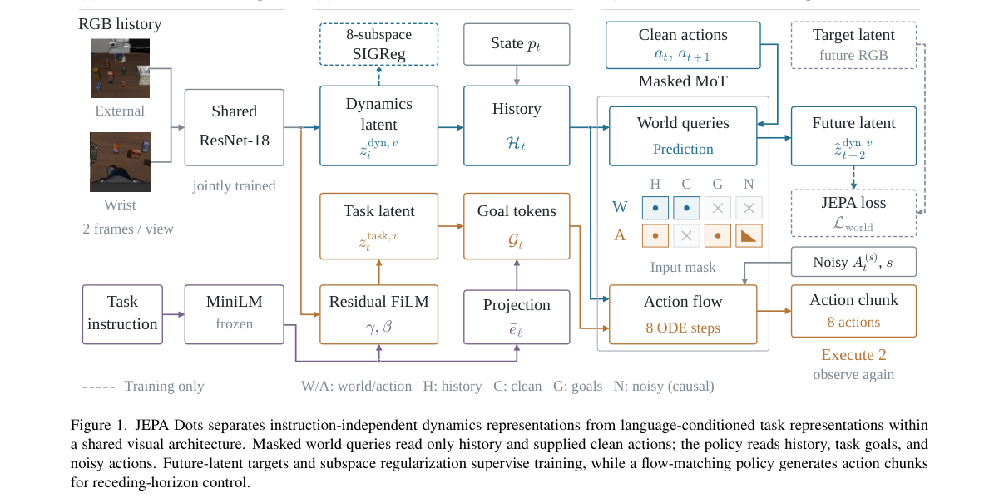

*Result - Total parameter counts. DOTS and V-JEPA 2.1 + flow matching include frozen MiniLM (approximately 22.7M). Pub- lished policy counts follow their sources. Parameter count does not measure late*

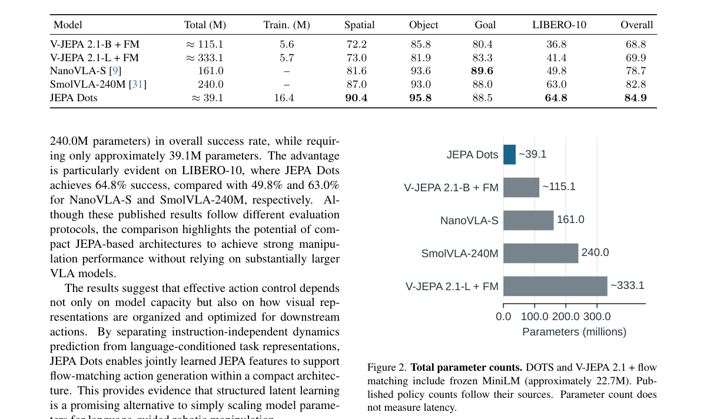

**Why this ranks #2**: 它解决的是一个条件化矛盾：指令该影响动作选择、却不该改变固定动作下的后果预测。JEPA Dots 用掩码注意力把世界预测限制在「指令无关的动力学历史 + 给定动作」上，另开一路语言条件的 task 表征去驱动 flow-matching 策略。40 个训练过的 LIBERO 任务上闭环成功率 84.9%，参数量约 39.1M（对比 NanoVLA-S 的 78.7% / 161.0M，评测协议不同）；同协议下把 task-ID 条件基线的 76.0% 拉到 84.9%，LIBERO-Goal 从 67.1% 到 88.5%。

---

### 3. WM^MLLM: Turning MLLMs into World Models

**arXiv**: [2611.24193](https://arxiv.org/abs/2611.24193) | **Score**: 8.7 (relevance 9 x 0.7 + quality 8 x 0.3) | **Direction**: `world_model` | **Tags**: embodied, interactive-world-model, mllm, panorama-state, persistent-editing, video-generation, Princeton University | **Categories**: cs.CV | **Pages**: 25

**Authors**: Baiang Li; Enze Xie; Jincheng Yu; Jin Wang; Haozhe Liu; Yitong Li; Juanxi Tian; Felix Heide

**Affiliation**: Princeton University; NVIDIA; OpenEnvision

**Abstract**

> Video world models keep the world in the context of a generator, so a revisit is synthesized again and earlier edits can drift or disappear. We present WM^MLLM, the first interactive world model built on multimodal large language models (MLLMs), for persistent, editable world generation from a single image. WM^MLLM keeps the world state outside every generator, as a panorama with a revision history, and lets the MLLMs write it: they turn each request into operations on this state, select where a local edit is written, and check every candidate before it becomes the next state. Image generators only propose views, and video only presents them. Users can walk to new places and return, edit objects through text or a box, place subjects, and change lighting, weather or season. By construction, a revisit at the same revision reproduces the earlier view exactly, a local edit leaves every panorama pixel outside its region unchanged, and each request starts from the result of the previous one. Against six world model baselines on MBench-A, WM^MLLM has the highest mean on all four environment-recovery metrics (Epipolar 91.5 versus 0.1 to 74.0) and completes the most camera round trips (85.3% versus at most 50.9%). It has the best value in all 15 CompBench columns against 15 baselines. On 112 local edits judged blind, selecting the region to write after generation raises completion from 34.8% to 83.0%. On 258 WBench and MBench-A items, all 46 revisits recover their earlier views, and all 97 local edits that pass the check leave panorama pixels outside their region unchanged.

**Key findings**

- **Finding**: 112 次盲评局部编辑中，「生成后再选写入区域」把完成率从 34.8% 提到 83.0%；258 个 WBench 与 MBench-A 条目里 46 次重访全部复现早先视角，97 次通过检查的局部编辑全部保持区域外全景像素不变。
- **Inference**: 持久性来自状态外置而不是生成器记忆，所以「同一修订号重访必须复现」「局部编辑不得影响区域外像素」能做成构造性保证，而不只是评测指标。
- **Recommendation**: 做可交互世界模型时先把全景图当唯一真源、把生成器降级为只提议视角的渲染器，并照论文做法在生成之后再选写入区域；MBench-A 上相机往返完成率 85.3% 可作参考基线。

**Key figures**

*Framework - Overview of WMMLLM results. WMMLLM opens objects, relights scenes, walks to new places and moves subjects; each panel shows one turn: video frames, the panorama state and the rendered view. A*

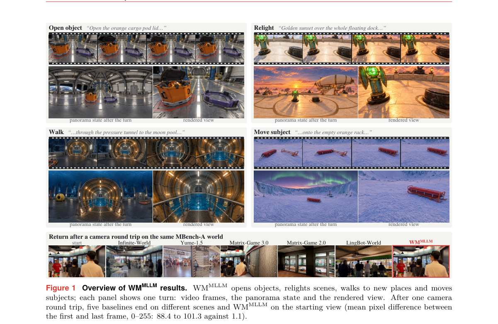

**Why this ranks #3**: 视频世界模型把世界寄存在生成器里，重访同一处会重新合成、旧编辑可能漂移。WM^MLLM 把世界状态外置成带修订历史的全景图，由 MLLM 把每个请求翻译成对该状态的操作、选定局部编辑写入位置并逐个检查候选，图像生成器只提议视角、视频只负责呈现。MBench-A 四个环境恢复指标均值全部最高（Epipolar 91.5，基线 0.1–74.0），相机往返完成率 85.3%（基线最高 50.9%），对 15 个基线在 15 个 CompBench 列上全优。

---

### 4. MAWAM: A Multi-Agent World-Action Model for Coordinated Manipulation

**arXiv**: [2611.25105](https://arxiv.org/abs/2611.25105) | **Score**: 8.7 (relevance 9 x 0.7 + quality 8 x 0.3) | **Direction**: `world_model` | **Tags**: embodied, multi-robot, world-action-model, flow-matching, cross-agent-attention, coordination, NVIDIA | **Categories**: cs.AI, cs.CV, cs.RO | **Pages**: 23

**Authors**: Xianzhe Fan; Chi-Pin Huang; Fu-En Yang; Jing Wang; Yecheng Wu; Yu-Cheng Chou; Johan Bjorck; Linxi "Jim" Fan; Jan Kautz; Yu-Chiang Frank Wang; Zhiding Yu; Hengshuang Zhao

**Affiliation**: NVIDIA; The University of Hong Kong; MIT

**Abstract**

> Every move in a robot team changes the world in which its teammates must act. Coordinated manipulation therefore calls for predicting the team's actions together with the physical future they jointly create. We introduce MAWAM, a multi-agent world-action model that jointly generates each robot's future views and executable action chunks in a single sample. Built from a pretrained single-robot world-action backbone, MAWAM jointly denoises all robots' action and future-view tokens through cross-agent attention, while preserving a separate control interface for each robot. MAWAM achieves the highest success on all three real-robot tasks (laundry-bag collection, bath-towel folding, and umbrella handover), with 67.8% mean success, 18.9 percentage points above MA-VLA trained on the same demonstrations and cameras. In simulation, MAWAM reaches 90.3% mean success on eight tasks with teams of up to four arms. Ablations show that cross-agent attention and team-stage future-video supervision both improve coordinated control: without attention, a four-arm relay falls from 95.0% to 39.0%, and without this supervision, Place Food falls from 78.0% to 47.0%.

**Key findings**

- **Finding**: MAWAM 在三个真机协作任务上平均成功率 67.8%，比同演示同相机训练的 MA-VLA 高 18.9 个百分点；仿真八个任务（最多四臂）平均 90.3%，MA-VLA 为 83.4%。
- **Inference**: 联合生成整队未来视角与动作，等于把「队友先动」的后果直接写进自己的采样路径，从而省掉模块式通信带来的延迟与误差累积。
- **Recommendation**: 做多机器人协作时把团队未来视频作为监督一起训：去掉跨机器人注意力后四臂接力从 95.0% 掉到 39.0%，去掉团队阶段未来视频监督后 Place Food 从 78.0% 掉到 47.0%。

**Key figures**

*Framework - One sample, the whole team’s future. Mawam generates every robot’s future camera views and action chunk together; training it to predict the whole team’s future teaches each robot to coordin*

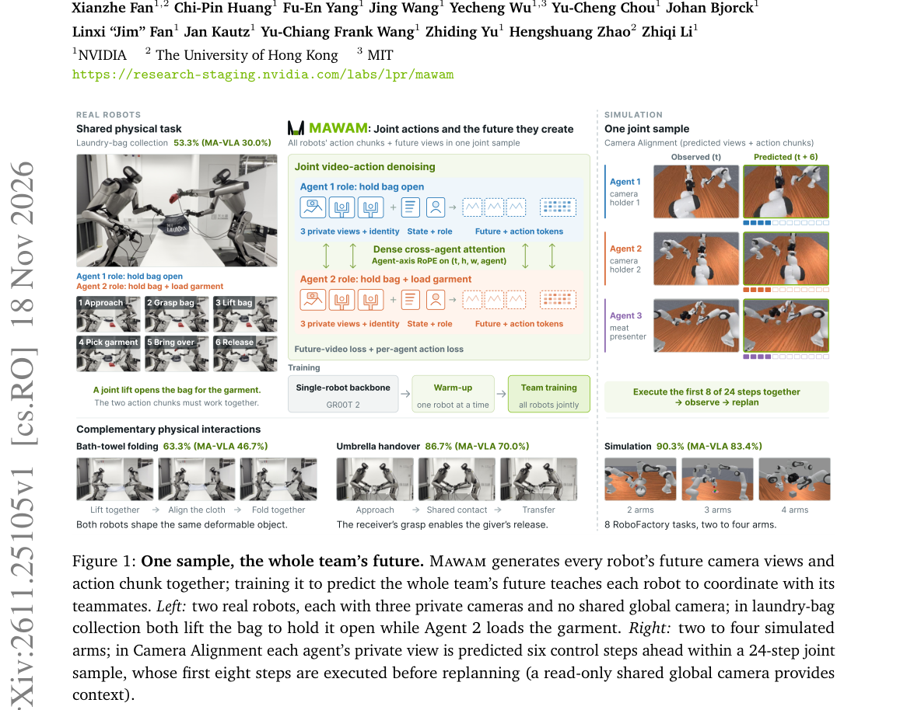

*Result - Joint actions, shared consequences. Each robot’s actions change the scene for its teammates. Warm-up adapts the pretrained single-robot backbone one robot at a time; team training (a–c) then*

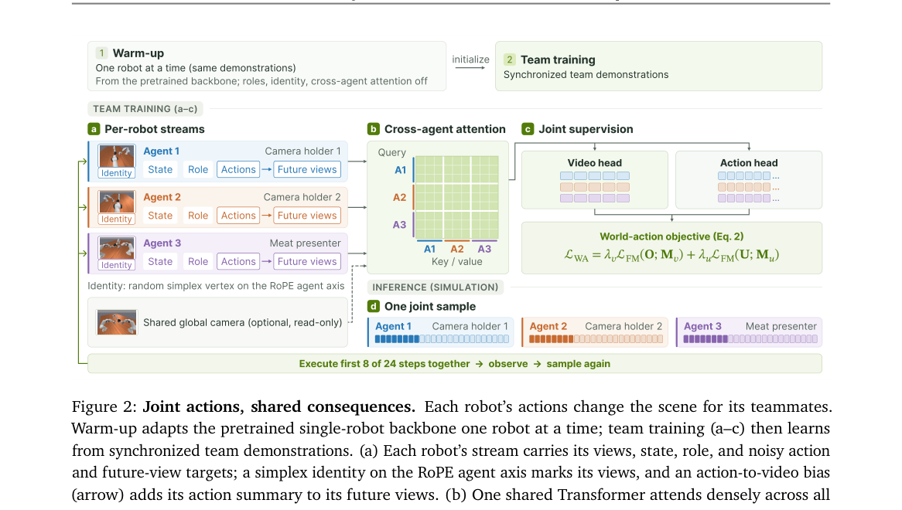

**Why this ranks #4**: 团队协作的难点是「队友的动作会改变我要面对的世界」，MAWAM 因此在单次采样里同时去噪所有机器人的动作 token 与未来视角 token，用跨机器人注意力把它们绑在一起，同时保留每台机器人各自的控制接口。真机三个任务（收洗衣袋、折浴巾、递伞）平均成功率 67.8%，比同演示同相机训练的 MA-VLA 高 18.9 个百分点；仿真八任务、团队最多四臂时平均 90.3%（MA-VLA 83.4%）。

---

### 5. GEMS: Generation and Experience Memory for Subgoal-Guided Long-Horizon World Model Planning

**arXiv**: [2611.25134](https://arxiv.org/abs/2611.25134) | **Score**: 8.7 (relevance 9 x 0.7 + quality 8 x 0.3) | **Direction**: `world_model` | **Tags**: embodied, long-horizon-planning, world-model, subgoal-generation, experience-memory, cem, University of Minnesota | **Categories**: cs.CV, cs.RO | **Pages**: 11

**Authors**: Yangchen Zhao; Ali Payani; Caiwen Ding

**Affiliation**: University of Minnesota, Twin Cities; Cisco

**Abstract**

> Visual world models enable effective short-horizon goal-conditioned planning, such as reaching nearby targets and pushing objects over short distances, by predicting candidate action outcomes and comparing their representations with a goal representation. However, extending this approach to long-horizon tasks is challenging: prediction errors accumulate over extended rollouts, while latent-space similarity to distant goals provides limited guidance for ranking candidate outcomes. Existing methods address these limitations by introducing intermediate subgoals, either generated by learned models or selected from experience memory. Generated subgoals can contain hallucinations or be inaccurate in aspects such as object positions and timing. Memory-based approaches are constrained by experience coverage and may lack precise guidance for selecting appropriate intermediate states from stored observations. We introduce GEMS, which generates temporally structured subgoals to guide action search and state selection from Latent Experience Memory (LEM). A distance gate determines whether predicted outcomes are evaluated against the generated subgoal or the selected memory state. Experiments across six tasks and task suites spanning manipulation, navigation, and reaching demonstrate the effectiveness of GEMS for long-horizon planning. GEMS outperforms state-of-the-art world-model planning baselines across different manipulation settings, achieving success rates of 92.8% on Cube, 68.4% on Push-T, and 54.1% on Meta-World. It improves over the strongest evaluated baseline on these tasks by 24.0, 7.3, and 22.2 percentage points, respectively. These results demonstrate that generated subgoals and experience memory can jointly strengthen long-horizon planning with a frozen world model.

**Key findings**

- **Finding**: GEMS 在 Cube、Push-T、Meta-World 上分别取得 92.8%、68.4%、54.1% 成功率，相对最强被测基线提升 24.0、7.3、22.2 个百分点，且世界模型全程冻结不做更新。
- **Inference**: 远目标的潜相似度提供不了排序信号，所以收益来自「可验证的中间子目标」与「真实观测过的记忆状态」这两条锚，而不是把世界模型训得更准。
- **Recommendation**: 搭长程规划时同时准备生成子目标与经验记忆两条来源并用距离门决定比谁；只有子目标会含幻觉（物体位置、时序不准），只有记忆又受覆盖度限制。

**Key figures**

*Framework - Long-horizon planning with experience-grounded subgoals. Left: planning toward the final goal alone never picks up the cube, whereas GEMS reaches the goal by planning toward intermediate sub*

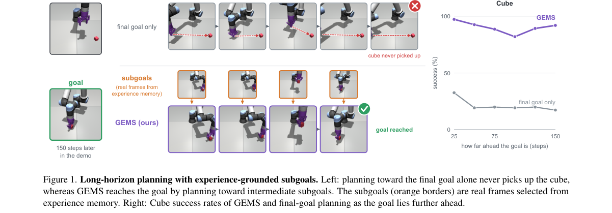

*Result - Overview of GEMS. The generator proposes a subgoal τ steps ahead, and the experience memory grounds it in a stored frame when one lies close. CEM with the frozen world model plans τ actions*

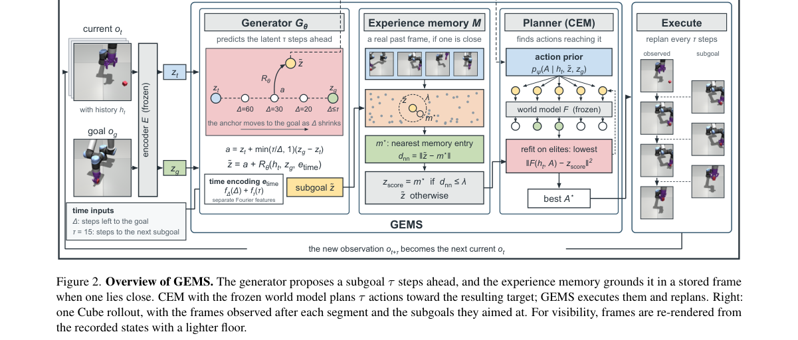

**Why this ranks #5**: 长程规划里预测误差会随 rollout 累积，而「与远目标图像的潜空间相似度」几乎不给候选排序信号。GEMS 让生成器产出带时间结构的子目标，用距离门决定该拿生成子目标还是从潜经验记忆（LEM）里选出的历史帧当参照，再用 CEM 配合冻结世界模型规划。六个任务上 Cube 成功率 92.8%、Push-T 68.4%、Meta-World 54.1%，比最强被测基线分别高 24.0、7.3、22.2 个百分点。

---

### 6. Verify2Act: Critic-Guided Latent World Models for Verifying Language-Conditioned Manipulation Plans

**arXiv**: [2611.25243](https://arxiv.org/abs/2611.25243) | **Score**: 8.7 (relevance 9 x 0.7 + quality 8 x 0.3) | **Direction**: `world_model` | **Tags**: embodied, plan-verification, latent-world-model, critic, flow-matching, sim-to-real, Computer Science | **Categories**: cs.RO | **Pages**: 7

**Authors**: Chrisantus Eze; Christopher Crick

**Affiliation**: Department of Computer Science, Oklahoma State University

**Abstract**

> Vision-Language Models (VLMs) can propose multi-step manipulation plans, but they have no grounded model of how a scene will change, and the pixel-level world models that could check those plans are slow and drift over long horizons. We present Verify2Act, a modular verification framework that separates semantic action proposal from latent physical verification. A VLM proposes candidate plans, a latent world model (V2A-WM) imagines each of them in the DINOv2 feature space, and a dual-head critic checks the imagined rollouts for temporal consistency and goal satisfaction before anything is executed. V2A-WM extends recent flow-matching world models with cross-attention action grounding and a causal temporal history window. We deploy the full system on a low-cost robot arm, training the world model and critic only on data generated in a digital twin. Across six language-conditioned tasks, Verify2Act reaches 83.3\% task success, compared with 61.7\% for a latent world model without our architectural changes, 53.3\% for the VLM alone, and 46.7\% for a pixel-diffusion world model. It verified every plan it executed and incurred no planning-induced failures: all of its failed episodes were caused by low-level grasp or placement slips. In simulation, Verify2Act obtains the highest five-task chain success on CALVIN among the compared baselines with 30$\times$ fewer reflective VLM calls than pixel-diffusion verification, and the highest success on cluttered nut assembly.

**Key findings**

- **Finding**: Verify2Act 在六个语言条件任务上成功率 83.3%，而无架构改动的潜世界模型为 61.7%、纯 VLM 53.3%、像素扩散世界模型 46.7%；它执行过的每条计划都通过验证，未出现因规划导致的失败。
- **Inference**: 纯 VLM 提的计划在语义层看着对却缺接地模型，错误要到执行才暴露；把验证放在潜空间做，可以在动作真正发出之前拦下错误计划。
- **Recommendation**: 做 VLM 规划时在提案与执行之间插一道潜空间验证，让 critic 双头分别看时序一致性与目标达成；CALVIN 上它比像素扩散验证少 30 倍的反思式 VLM 调用。

**Key figures**

*Framework - Verify2Act overview. Stage 1: a VLM proposes candidate multi-step plans from the camera observation and the language instruction. Stage 2: V2A-WM rolls out each candidate in the frozen DINOv2*

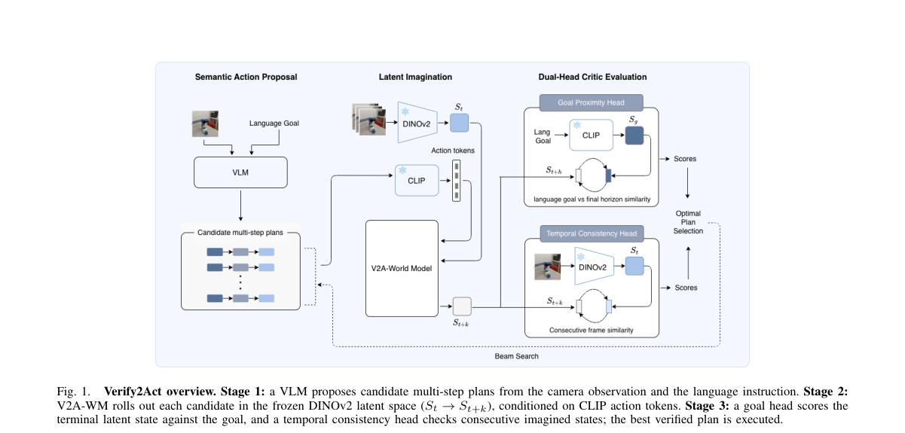

*Result - V2A-WM training and inference. Training: the delta encoder gives the target latent zgt = fenc(∆St); we interpolate zτ = τzgt + (1 −τ)z0 and the flow-matching transformer, conditioned on past f*

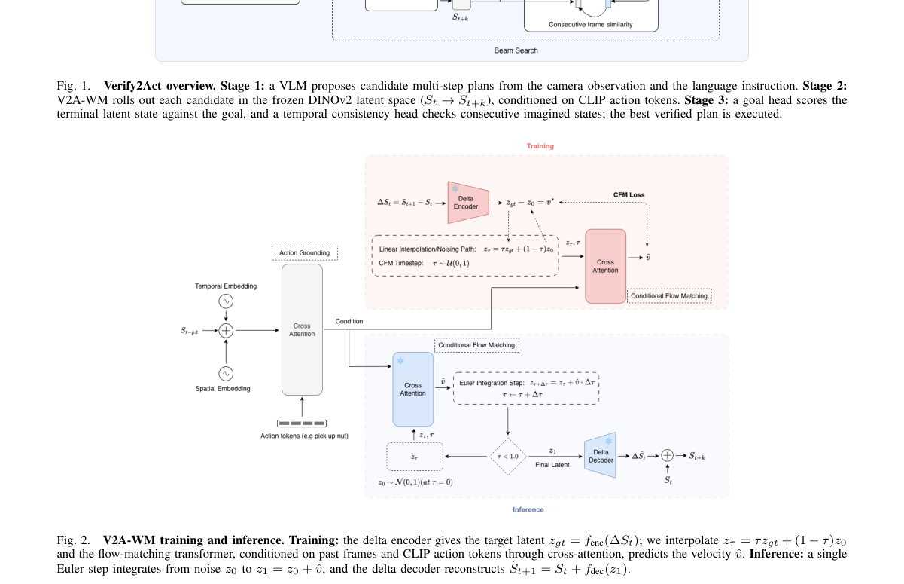

**Why this ranks #6**: 它把「语义上说得通的计划」和「物理上站得住的计划」拆开：VLM 只提候选多步计划，潜世界模型 V2A-WM 在冻结 DINOv2 特征空间里想象每条计划，再用双头 critic 检查想象 rollout 的时序一致性与目标达成，通过后才执行；V2A-WM 给流匹配世界模型补了跨注意力动作接地与因果时间历史窗。六个语言条件任务上成功率 83.3%，无架构改动的潜世界模型 61.7%、纯 VLM 53.3%、像素扩散世界模型 46.7%。

---

### 7. Search or Scoring? Diagnosing Why Visual World-Model Planners Fail

**arXiv**: [2611.25347](https://arxiv.org/abs/2611.25347) | **Score**: 8.7 (relevance 9 x 0.7 + quality 8 x 0.3) | **Direction**: `world_model` | **Tags**: embodied, world-model-planner, failure-diagnosis, cem-optimizer, demo-windows, error-model, Nanyang Technological University | **Categories**: cs.CV | **Pages**: 43

**Authors**: Haoxuan Jia; Yang Liu; Shang Luo; Chenhao Wu; Zixiang Ni; Yingguang Yang; Feng Zhang; Chongyang Zhang; Hao Zheng; Kefu Xu; Congjing Ran; Jifeng Zhu

**Affiliation**: Nanyang Technological University; Peking University; University of Chinese Academy of Sciences; Xi’an Jiaotong University; Fuzhou University

**Abstract**

> Visual world models such as DINO-WM and JEPA-WM plan with an optimizer that searches for actions whose predicted outcome has the lowest cost, its distance to a goal image. A plan can thus fail in two ways: the optimizer never tries a good action that the cost would prefer (a search failure), or the cost, computed on predictions, ranks a bad action first (a scoring failure). The two need different remedies, more search or a better model, but a planner does not record which one occurred. We tell them apart by executing the optimizer's candidates, scoring a known solution with the planner's own cost, and comparing costs on predicted and real outcomes. An error model explains when each arises and so how to use retrieved demonstration windows (DemoProp): start the search from them (a warm start) when prediction errors are small, and average them without the model when large errors make the optimizer pick overrated actions. Across four simulated environments and three world models, on short tasks whose goals the planner can represent, PushT and Wall fail mostly by search, while Metaworld and RoboCasa fail by scoring because the cost, sound on real outcomes (AUROC 0.94 on Metaworld), is at chance on predictions (0.54). The diagnosis tells which remedy pays off: a four times larger search lowers the real-outcome cost only where failures come from search (clearly for DINO-WM), and where they come from scoring, averaging the windows without the model solves 127 of 168 new Metaworld tasks, against at most 87 when the model chooses among them. Within PushT, degrading only the model flips which use is better, and our rule, frozen in advance, follows the flip and solves 678 of 960 new episodes, against 530 for the best fixed use.

**Key findings**

- **Finding**: Metaworld 上规划器的代价函数在真实结果上 AUROC 0.94，在模型预测上只有 0.54（接近随机）；在属于打分失败的场景里，平均 demo 窗口解出 168 个新任务中的 127 个，而让模型在候选中挑选最多只有 87 个。
- **Inference**: 代价函数在真实观测上准、在预测上不成立，说明失效来自潜动力学预测质量而不是优化器搜索不足，因此加大搜索预算救不回来。
- **Recommendation**: 评估世界模型规划器时先跑「已知解探针」区分 search/scoring 失败再决定投入方向；论文事先冻结的 DemoProp 规则在 PushT 上随模型退化自动翻转用法，解出 960 个新回合中的 678 个，优于最优固定用法的 530 个。

**Key figures**

*Framework - Two ways a world-model planner fails. Left, a search failure on PushT (development task): the model’s cost for the known solution (0.091) is far below that of the best of the 900 candidates*

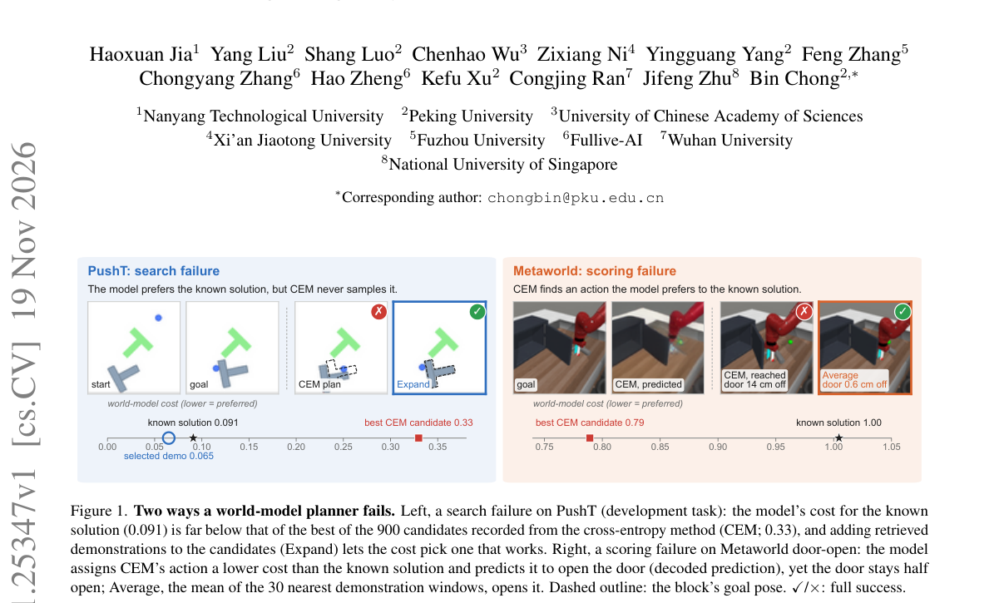

*Result - The known-solution probe across settings. One dot per full-success failure of CEM, on a log scale: the cost of the known solution divided by that of the cheapest candidate the optimizer eval*

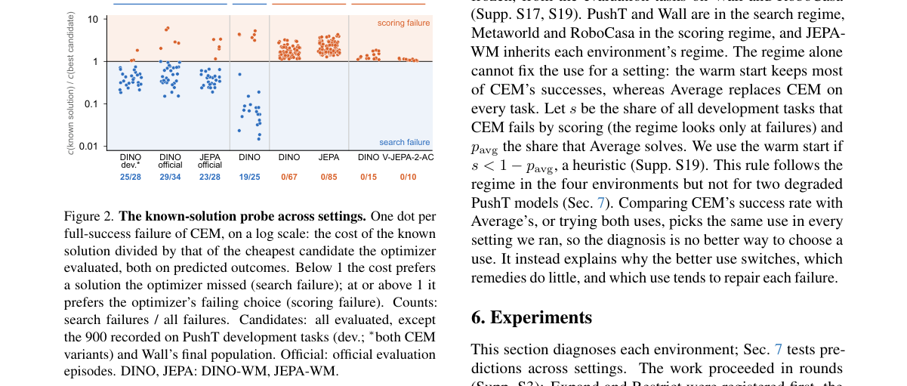

**Why this ranks #7**: 它把「视觉世界模型规划失败」拆成搜索失败（优化器没试到好动作）与打分失败（代价函数把坏动作排在前面），因为两者解法不同但规划器自己不留痕。做法是执行优化器候选、用规划器自己的代价给已知解打分，再比较代价在预测结果与真实结果上的差距。四个仿真环境、三个世界模型上，Metaworld 的代价在真实结果上 AUROC 0.94 却在预测上只有 0.54（接近随机），因此平均 demo 窗口（不过模型）在 168 个新任务里解出 127 个，而让模型自己选最多只有 87 个。

---

## 具身智能与机器人学习 · `embodied_ai` (13 papers)

13 篇的主线是「机器人缺的不是规模而是对齐与经验」。人形两条路互补：Awaken-HI 用约 5 万小时第一视角立体视频配同步全身人体动作、覆盖 100 多项技能，并证明人形轨迹直接监督动作专家时技能迁移更有效；ReLoco 用行为条件化的对抗运动先验，把行走、起身、恢复运动统一进一个本体策略。数据侧 RecallFlow 把情景记忆当作生成式策略的源分布，在 MIKASA-Robo 上拿到 80.4% 的 SOTA、比最强基线高 20.3 分；F³ 追问何为好经验，结论是价值在被使用的那一刻是否提高完成概率。工程侧 WACO 用前向运动学把手臂摆到实测关节角作外参靶子，修少样本 VLA 的相机漂移失效；RoboMorpher 用形态条件化动作 tokenizer 支撑跨本体预测。

### 8. Bridging vision-language reasoning and learned control for legged navigation in the wild

**arXiv**: [2611.25215](https://arxiv.org/abs/2611.25215) | **Score**: 9.0 (relevance 9 x 0.7 + quality 9 x 0.3) | **Direction**: `embodied_ai` | **Tags**: embodied, legged-navigation, vision-language-model, risk-map, reinforcement-learning, outdoor-navigation, ETH Zurich | **Categories**: cs.AI, cs.CV, cs.RO | **Pages**: 42

**Authors**: Takahiro Miki; Robin Schmid; Manthan Patel; Turcan Tuna; Julia Richter; Julian Nubert; Joonho Lee; Matthias Müller; Marco Hutter

**Affiliation**: ETH Zurich; Apple

**Abstract**

> Autonomous navigation in diverse real-world environments remains one of the greatest challenges in robotics. It demands both robust low-level motion control to handle diverse terrain and high-level reasoning to interpret environmental cues. We present ROAM (Robust Open-world Autonomous Mobility), a system that enables legged robots to perform kilometer-scale navigation in complex alpine and urban settings. ROAM combines the world knowledge of a Vision-Language Model (VLM), pre-trained on internet-scale data, with robust locomotion and local planning policies learned in simulation via reinforcement learning (RL). The VLM provides common-sense reasoning and semantic interpretation of the scene, assessing risks, interpreting signs, and producing semantic labels with associated navigation costs. An open-vocabulary segmentation module converts these labels into a dense, real-time risk map, which conditions two pre-trained RL policies responsible for agile locomotion and local navigation, effectively coupling high-level VLM reasoning with low-level physical control. Real-world experiments showed the system's ability to autonomously navigate a wide range of complex real-world environments. The robot completes kilometer-long hikes with minimal intervention, interprets signs to avoid danger, and evaluates its environment to identify safe areas on which to step. This work represents a step toward the reliable deployment of systems in unstructured environments. However, it also underscores the challenges that remain in VLM reliability and spatial reasoning, indicating that foundational models are a crucial component but not yet a complete solution for navigation in the wild.

**Key findings**

- **Finding**: 瑞士阿尔卑斯 Zermatt 路线中机器人自主走完 10.1 km、累计落差 1220 m，起始的 Gornergrat 车站海拔超过 3000 m；系统还用 VLM 读懂路牌并避开危险区域。
- **Inference**: VLM 只负责高层语义与风险代价、低层运动交给仿真 RL 策略，这种两层解耦让公里级户外任务不依赖 VLM 的空间精度，因此基础模型虽不完整但已足够可用。
- **Recommendation**: 做野外腿式导航时按论文的三段式接：VLM 出语义标签与代价、开词表分割转稠密风险图、风险图条件化两条 RL 策略；同时要承认 VLM 的空间推理仍是可靠性瓶颈。

**Key figures**

*Framework - Overview of the ROAM pipeline. The proposed system bridges high-level reasoning from vision-language models (VLMs) with low-level actuator commands for autonomous robot control. It processes R*

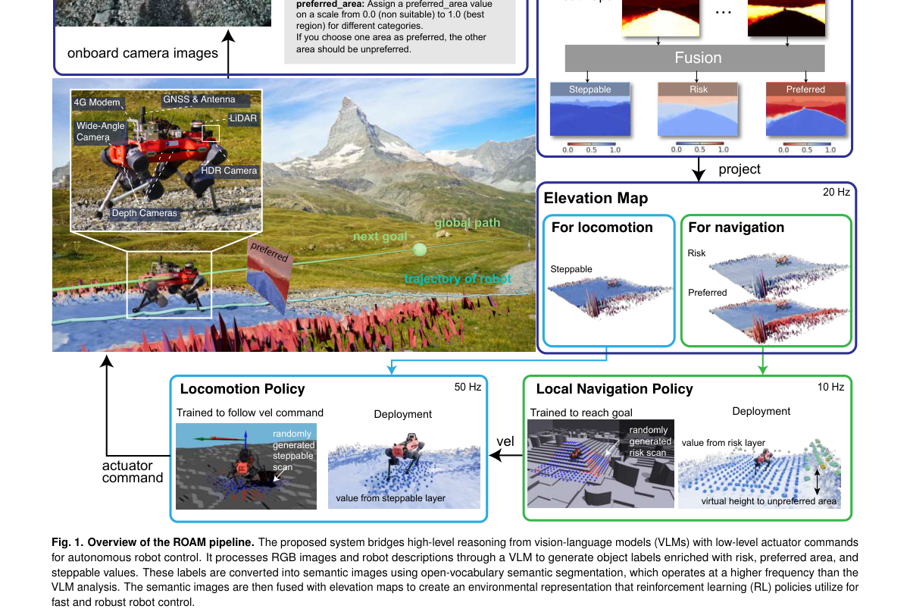

*Result - Deployment of ROAM across diverse environments. These include natural outdoor settings such as mountain trails (A to E), forests (F), and grassy areas (G), as well as urban environments such a*

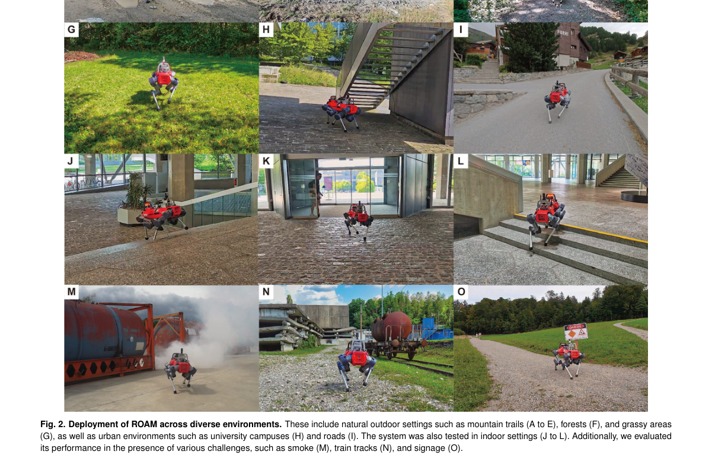

**Why this ranks #8**: ROAM 把互联网尺度预训练的 VLM 世界知识接到仿真里用 RL 学出的两条预训练策略上：VLM 给出语义标签与导航代价，开词表分割模块把标签转成稠密实时的风险图，再去条件化敏捷运动与局部导航两条 RL 策略。真实部署中机器人在阿尔卑斯山区与城市完成公里级徒步，Zermatt 一条路线长 10.1 km、落差 1220 m，起始的 Gornergrat 车站海拔在 3000 m 以上。

---

### 9. Awaken-HI: Scaling Humanoid Intelligence with Whole-Body Human Experience

**arXiv**: [2611.26420](https://arxiv.org/abs/2611.26420) | **Score**: 9.0 (relevance 9 x 0.7 + quality 9 x 0.3) | **Direction**: `embodied_ai` | **Tags**: embodied, humanoid, human-pretraining, vision-language-action, loco-manipulation, scaling-law, EngineAI | **Categories**: cs.AI, cs.CV, cs.RO | **Pages**: 19

**Authors**: EngineAI

**Affiliation**: EngineAI

**Abstract**

> A central goal of humanoid robotics is for robots to perform the everyday work people do in homes and workplaces. Existing egocentric video datasets cover many of these activities but provide little synchronized whole-body motion data for learning loco-manipulation at scale. We build Awaken-Human, which pairs approximately 50,000 hours of egocentric stereo video with synchronized whole-body human motion and covers more than 100 skills. Building on this, we also introduce Awaken-HI (Humanoid Intelligence), a vision-language-action model for humanoid loco-manipulation that jointly predicts original human motion and retargeted robot actions through a shared action expert. We show that loco-manipulation skills transfer more effectively from people to humanoids when human trajectories directly supervise the shared action expert. Increasing human pretraining data reduces held-out robot action prediction error according to an empirical scaling law and raises the mean success rate on downstream real-robot tasks. After full-corpus pretraining and T800 adaptation, Awaken-HI achieves a mean success rate of 93.75% across eight individual tasks and outperforms GR00T N1.7 and $π_{0.5}$ in both individual and long-horizon evaluations. The same policy generalizes to objects unseen during robot post-training and to new pairings of familiar objects and destinations.

**Key findings**

- **Finding**: Awaken-Human 含约 5 万小时第一人称立体视频、1702 万个 episode、100 多种技能；预训练量从 5k 增到 50k 小时时留出集动作预测误差持续下降，全量预训练加 T800 适配后 8 个任务平均成功率 93.75%，优于 GR00T N1.7 与 π0.5。
- **Inference**: 让人类轨迹直接监督共享 action expert 比只靠重定向标签更能把 loco-manipulation 迁移到人形机器人上，而且这份收益随人类数据量单调增长。
- **Recommendation**: 做人形 loco-manipulation 时优先搭「人体动作 + 重定向机器人动作」双监督的共享 expert，并把人类预训练时长当作可调超参；该策略还能泛化到机器人后训练阶段没见过的物体。

**Key figures**

*Framework - Overview of Awaken-HI and the Awaken-Human dataset. Awaken-Human pairs approximately 50,000 hours of egocentric stereo video with synchronized whole-body motion (left). We pretrain Awaken-HI*

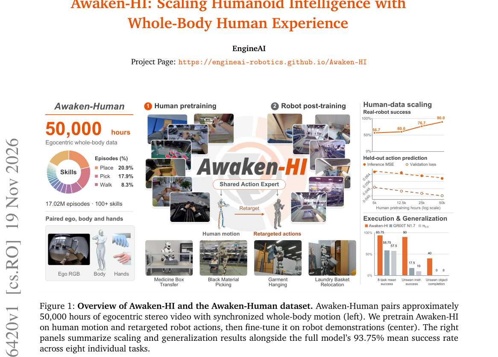

*Result - Object and skill coverage in Awaken-Human. The dataset contains 17.02 million episodes spanning more than 100 skills. The left panels show the distribution of object categories (top) and epi*

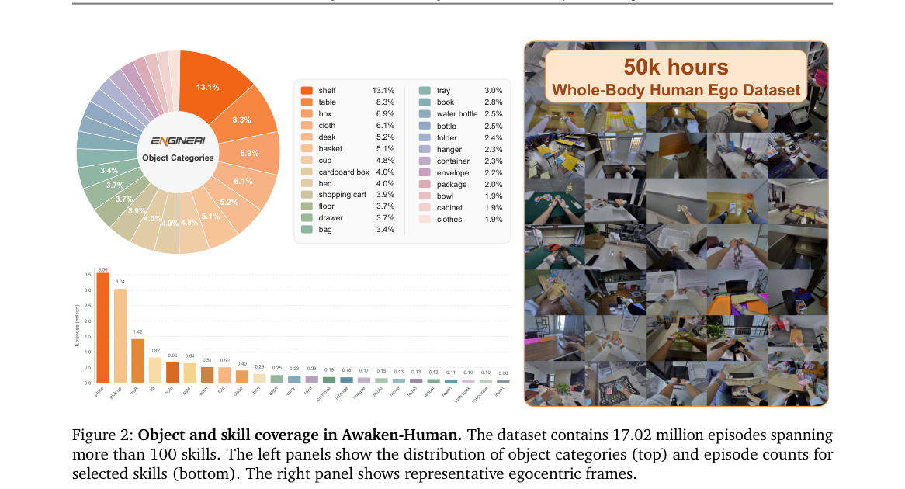

**Why this ranks #9**: 人形机器人缺的是同步的全身动作标注：Awaken-Human 把约 5 万小时第一人称立体视频与全身人体动作配对，覆盖 100 多种技能、1702 万个 episode；Awaken-HI 用共享 action expert 同时预测原始人体动作与重定向后的机器人动作。关键证据是一条经验 scaling law——人类预训练从 5000 小时加到 50000 小时，留出集上的机器人动作预测误差持续下降；全量预训练加 T800 适配后，8 个单项任务平均成功率 93.75%，超过 GR00T N1.7 与 π0.5。

---

### 10. GRID-UAV: Geometry and Ray-depth Integrated Decision-making for Unmanned Aerial Vehicles

**arXiv**: [2611.23491](https://arxiv.org/abs/2611.23491) | **Score**: 8.7 (relevance 9 x 0.7 + quality 8 x 0.3) | **Direction**: `embodied_ai` | **Tags**: embodied, uav, vla, depth-lifting, geometry-alignment, long-range-flight, Mohamed bin Zayed University of | **Categories**: cs.CV | **Pages**: 13

**Authors**: Anas Anwarul Haq Khan; Amrin Kareem; Muhammad Umer Sheikh; Biplab Banerjee; Muhammad Haris Khan

**Affiliation**: Mohamed bin Zayed University of Artificial Intelligence; CSRE, IIT Bombay

**Abstract**

> Vision-language-action models (VLAs) encode images with 2D encoders that capture little 3D structure. A common approach is to feed the policy estimated depth, but a UAV chooses its own altitude, must judge distances tens of meters away, where monocular depth is less reliable, and must relate its forward and downward views. On long aerial routes, adding depth features directly brings no significant gain (42.5% vs. 42.6% success), so we study how 3D information should be given to the policy. Analyzing flight failures, we find that two forms of 3D grounding fail in opposite ways: explicit 3D lifting of depth collides less on the way but more often fails to finish at the target, while implicit alignment with a 3D geometry model finishes more often but collides more. We propose GRID, which combines both: (1) it lifts monocular depth into ray-corrected 3D positions in the UAV's frame for both cameras, and (2) during training only, it aligns its visual features with a frozen multi-view geometry model, at no inference cost. GRID adding explicit lifting to implicit alignment significantly increases how often the policy reaches the target ($61.5\% \rightarrow 69.5\%$, $p<0.001$), and adding implicit alignment to explicit lifting significantly increases how often it completes the task once there ($57.7\% \rightarrow 61.4\%$, $p<0.05$). On TravelUAV (3,005 test episodes), GRID achieves the best success rate on every split, with relative gains over the state of the art of 9.5% (seen), 17.1% (unseen objects) and 25.4% (unseen map).

**Key findings**

- **Finding**: 长距离航线上直接加深度特征几乎无增益（42.5% 对 42.6% 成功率），只做深度抬升能提到 46.6%；GRID 合并两者后到达率 61.5%→69.5%（p<0.001），到达后完成率 57.7%→61.4%（p<0.05）。
- **Inference**: 显式 3D 抬升让策略路上少撞但更容易停在目标前，隐式几何对齐让策略更容易走到目标却更容易撞，两种失效相反说明两者互补而不是替代。
- **Recommendation**: 给 VLA 补 3D 信息时两条路一起上——推理期做射线校正的深度抬升、训练期做几何模型特征对齐；TravelUAV 的 3005 个测试回合可作对照，未见地图划分上相对 SOTA 提升 25.4%。

**Key figures**

*Framework - One flight on an unseen map, from the same start, chosen to show the two failure. Implicit grounding alone collides on the way (T1); explicit 3D lifting alone reaches the target but hovers a*

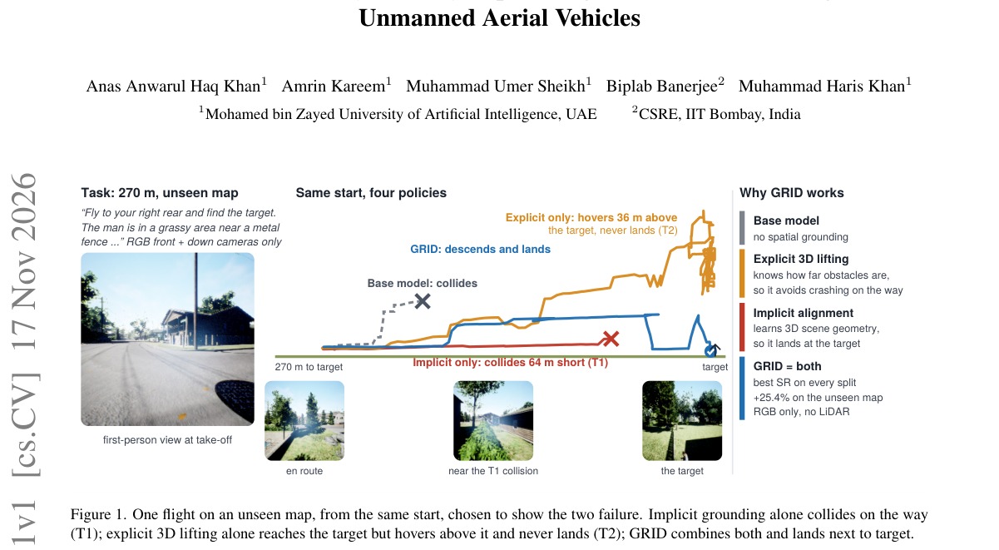

*Result - Overview of GRID on a real TravelUAV frame, following one token on a utility pole (yellow). Top: explicit 3D lifting (Sec. 3.2). The frozen depth model Φ predicts range maps Dc (on the flat*

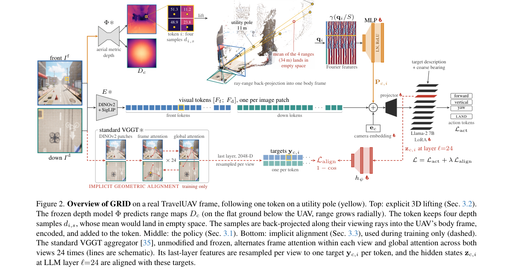

**Why this ranks #10**: VLA 用 2D 编码器吃图像，几乎不编码 3D；无人机要自己选高度、判断几十米外的距离，还要把前视与俯视对上，直接喂深度特征在长航线上毫无增益（42.5% 对 42.6%）。GRID 做两件事：把单目深度经射线校正抬升成无人机坐标系下双相机的 3D 位置，以及只在训练期把视觉特征与冻结的多视图几何模型对齐（推理零开销）。到达率 61.5%→69.5%（p<0.001），到达后完成率 57.7%→61.4%（p<0.05）。

---

### 11. RageVLA: Augmentation-Trained Perception and Action for State-of-the-Art Robustness on LIBERO

**arXiv**: [2611.23517](https://arxiv.org/abs/2611.23517) | **Score**: 8.7 (relevance 9 x 0.7 + quality 8 x 0.3) | **Direction**: `embodied_ai` | **Tags**: embodied, vla, data-augmentation, robustness, libero-pro, grounded-perception, ragento.ai | **Categories**: cs.CV, cs.RO | **Pages**: 10

**Authors**: Amrit Lal Singh; Smarak Kanjilal

**Affiliation**: ragento.ai

**Abstract**

> Vision-language-action (VLA) models look saturated on LIBERO, yet most of them fall apart on LIBERO-PRO as soon as an object moves or the instruction asks for something new. We argue that what is missing is not scale but decoupling. In these policies, what to do is tied to where things were during training, to the scene around them and to the wording of the instruction. We cut these ties in two places. In the data, LIBERO demonstrations are re-arranged by general rules: every object and fixture is moved and rotated, tasks are carried into other environments and onto other surfaces, and every instruction is paraphrased. In the policy, a perception engine on frozen DINOv3 features, trained on this augmented data, hands the action model the scene in decoupled form: a list of objects with their positions, and a compact code of what the gripper is looking at, next to image and instruction embeddings from TinyCLIP. A flow-matching diffusion transformer, trained from scratch, acts on this view. We call this combination of Robust Augmentation and Grounded Encoding RageVLA. With 0.21 billion parameters, RageVLA sets a new state of the art on LIBERO-PRO among VLA policies, scoring 0.72 against 0.53 for the best published model, and a larger variant reaches 0.73. Two further tests on LIBERO-Object show that the policy acts on what it perceives. When the object positions it is given are shuffled while the camera images stay correct, its success falls from 0.965 to 0.215. When the target object is displaced by 28 cm, it still succeeds in 0.865 of the episodes, where $π_{0.5}$, run through the same harness, succeeds in 0.105.

**Key findings**

- **Finding**: RageVLA 仅 0.21B 参数就在 LIBERO-PRO 上取 0.72，最好的已发表 VLA 为 0.53，更大变体到 0.73；LIBERO-Object 上目标物被挪 28 cm 后成功率仍为 0.865，同一评测架下 π0.5 只有 0.105。
- **Inference**: 把「做什么」与「训练时东西在哪」解耦后策略才真正依赖当前感知；论文把感知里的物体位置打乱而保持图像正确，成功率从 0.965 掉到 0.215，说明策略确实在读感知输出。
- **Recommendation**: 评测 VLA 鲁棒性时把位置置换与物体位移当成必做项（位置打乱 0.965→0.215、位移 28 cm 后 0.865 对 π0.5 的 0.105），并优先做数据侧通用增强而不是堆模型规模。

**Key figures**

*Framework - LIBERO-PRO’s official total (grey) against the mean over the position and task perturbations only (colored). Prior VLAs keep high totals while scoring close to zero once objects move or the ta*

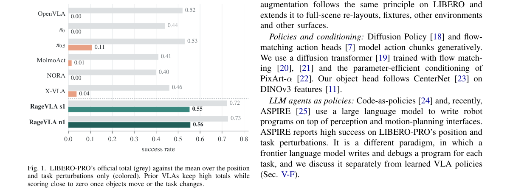

*Result - RageVLA s1 on the held-out test data. Each row is one task: the original LIBERO layout, the perturbed test layout with fixtures and objects moved and rotated, and the scene after the policy ha*

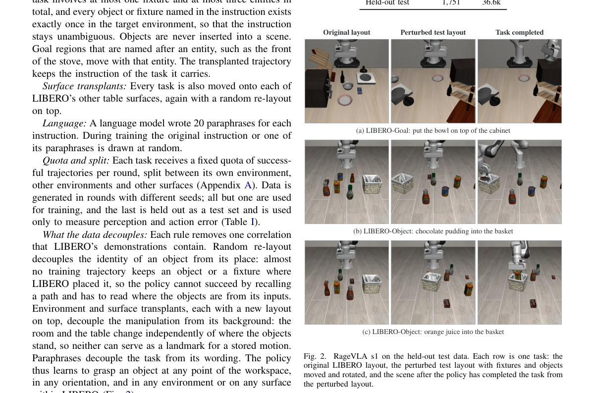

**Why this ranks #11**: LIBERO 已经饱和，但 LIBERO-PRO 一动物体或换指令就崩；RageVLA 认为缺的不是规模而是解耦。数据侧按通用规则重排 LIBERO 示教：所有物体与夹具移位旋转、任务搬到别的环境与表面、每条指令改写；策略侧用冻结 DINOv3 特征训感知引擎，把场景拆成「物体列表+位置」和「夹爪在看什么的紧凑码」，再配 TinyCLIP 的图像与指令嵌入，交给从头训练的流匹配扩散 transformer。仅 0.21B 参数就在 LIBERO-PRO 上拿到 0.72，而最好的已发表模型是 0.53。

---

### 12. RecallFlow: Episodic Memory as the Source Distribution of Generative Robot Policies

**arXiv**: [2611.23731](https://arxiv.org/abs/2611.23731) | **Score**: 8.7 (relevance 9 x 0.7 + quality 8 x 0.3) | **Direction**: `embodied_ai` | **Tags**: embodied, flow-matching, episodic-memory, memory-dependent-manipulation, recall-anchors, mikasa-robo, University of Science and Technology of | **Categories**: cs.RO | **Pages**: 17

**Authors**: Xuji Zhang; Qilin Zhong; Zichen Zhang; Wei Zhai; Jian Di; Kun Li; Yang Cao; Wenjun Lv

**Affiliation**: University of Science and Technology of China

**Abstract**

> Diffusion and flow-matching policies have become a standard choice for visuomotor imitation learning, owing to their ability to model multimodal action distributions. In memory-dependent manipulation, the robot must act on information that is no longer visible. Existing methods feed the observation history to the policy as an additional condition, while action generation still starts from Gaussian noise. However, the policy must then pick out the relevant target from a long and redundant history, leading to spurious correlations and unreliable decisions as the memory load grows. Additionally, the initial noise carries no information about what the robot has seen, leaving generation without guidance toward the remembered target. To address these issues, we propose RecallFlow, a flow-policy framework that builds the source distribution from episodic memory. Recall-Relocalization relates the memory to the current view through a few recall slots, so that the source reflects where the remembered targets are now. Recall Anchors then turns each slot into a Gaussian component of the source, enabling generation to start close to the intended action instead of from noise. The transport network then completes the action from the current observation alone, keeping inference nearly as cheap as a memoryless policy. We further build a suite of memory-dependent tasks grouped by memory load and compare all policies under a matched protocol. Extensive experiments show that RecallFlow achieves a state-of-the-art average success rate of 80.4% on the public MIKASA-Robo memory benchmark, and outperforms the strongest baseline by 20.3 points on our suite and by 18.8 points on four real-robot tasks.

**Key findings**

- **Finding**: RecallFlow 在公开 MIKASA-Robo 记忆基准上取得 80.4% 的平均成功率，在自建的记忆依赖任务套件上比最强基线高 20.3 个百分点，在四个真机任务上高 18.8 个百分点。
- **Inference**: 初始噪声不含任何记忆信息，是记忆依赖任务里「记得却用不上」的直接原因；把记忆搬到源分布而不是条件里，才能让生成一开始就朝正确目标走。
- **Recommendation**: 做记忆依赖操作时优先改流匹配的起点而不是加长上下文：Recall Anchors 把每个 recall slot 变成源分布的一个高斯分量，运输网络仍只用当前观测补完动作，推理成本接近无记忆策略。

**Key figures**

*Framework - Start from what you remember. In memory-dependent manipulation, the evidence that decides which action to take (cue) disappears before the robot acts (now). (a) Feeding the memory to the pol*

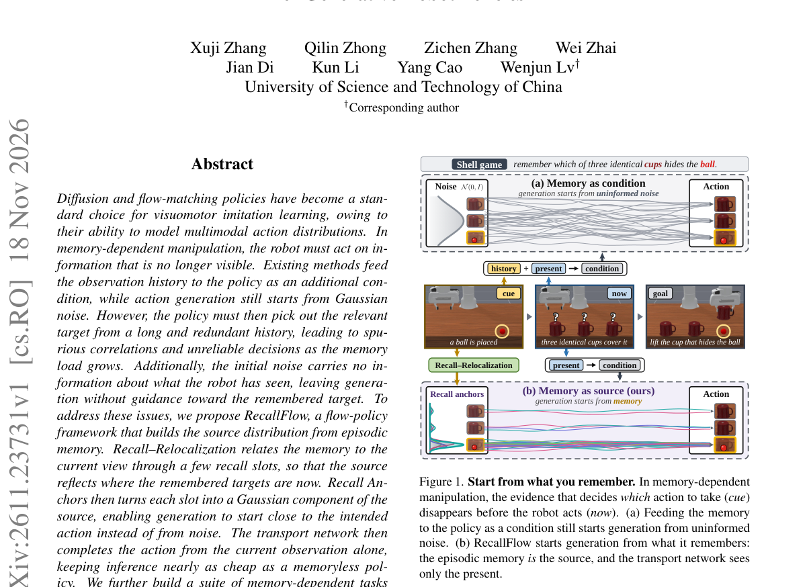

*Result - Overview of RecallFlow. The present observation is encoded into tokens Zt. Recall–Relocalization lets Zt read the episodic memory bank and decodes K recall slots, each attending to the curre*

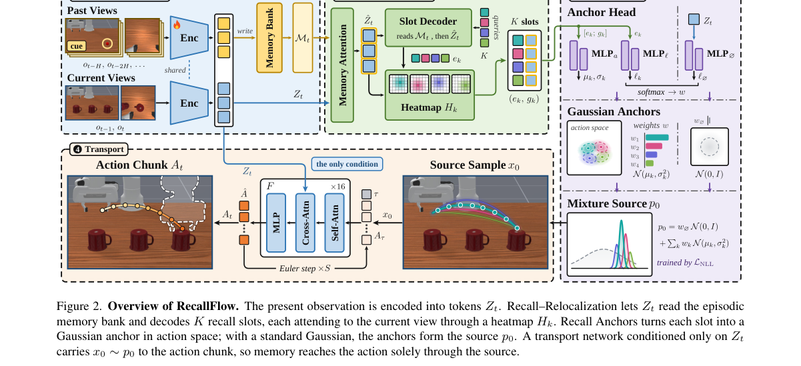

**Why this ranks #12**: 记忆依赖操作里关键证据在机器人动手前就消失了；把观测历史当附加条件喂给策略、却仍从高斯噪声起步生成，会让策略在冗长历史里挑错目标。RecallFlow 把情节记忆当成流的源分布：Recall-Relocalization 用少量 recall slot 把记忆与当前视角对上，Recall Anchors 再把每个 slot 变成源分布的一个高斯分量，让生成从接近正确动作处起步，运输网络只靠当前观测补完动作，因此推理开销接近无记忆策略。MIKASA-Robo 记忆基准平均成功率 80.4%。

---

### 13. LAGR: Language-Aware Grasp Re-Ranking for Task Oriented Grasping

**arXiv**: [2611.23858](https://arxiv.org/abs/2611.23858) | **Score**: 8.7 (relevance 9 x 0.7 + quality 8 x 0.3) | **Direction**: `embodied_ai` | **Tags**: embodied, grasp-selection, task-oriented, language-conditioned, grasp-dataset, vision-language, Purdue University | **Categories**: cs.AI, cs.LG, cs.RO | **Pages**: 10

**Authors**: Manav Kulshrestha; Shreyans Jain; Apoorva Vashisth; Ankush Gupta; Damon Conover; Aniket Bera

**Affiliation**: Purdue University; IIT Delhi; DEVCOM ARL

**Abstract**

> Grasping is a fundamental capability for robotic manipulation, with the appropriate grasp depending on the downstream task. For example, a hammer should be held by its handle for hammering but by its head when it is handed over. Selecting such a grasp requires consideration of two criteria: physical feasibility on the object and suitability for the task. Developing such an approach requires dense grasp labels with both feasibility and task scores on real observations, but existing task-oriented grasping datasets are small, synthetic, or costly to annotate. To address this gap, we construct a dataset of 2.68 million scored 5-DoF grasp annotations over 100,911 image-task pairs from $17$ object categories. Additionally, we introduce LAGR, a task-oriented grasp detection method that explicitly addresses both these challenges. Given vision-language inputs, LAGR first generates task-independent grasp proposals along with a physical feasibility score, and then scores the generated grasps with a language-conditioned re-ranker that reasons over all proposals jointly. Experiments show that LAGR outperforms the next best method by 9.3 percentage points. We further validate LAGR on real objects by executing task-oriented grasps with a Franka Research 3 robot.

**Key findings**

- **Finding**: 数据集含 268 万条带分数抓取标注、覆盖 100911 个图像-任务对、17 个物体类别与 51 个类别-任务组合；LAGR 每个观测预测 96 个候选抓取再交语言重排序器打分，比次优方法高 9.3 个百分点。
- **Inference**: 把「物理可行性」与「任务适配性」拆成两阶段——先生成带可行性分数的提案、再按语言整体重排——才能同时满足抓得住与拿来做对事两个约束。
- **Recommendation**: 做任务导向抓取时保证提案阶段覆盖足够多样性（论文用 96 个候选），再补一个能联合推理全部提案的语言重排序器；数据侧可直接复用这 268 万条带可行性与任务分数的标注。

**Key figures**

*Framework - Examples of LAGR generating distinct task-specific grasps for the same real-world objects. Functional tasks favor grasps that enable effective tool use, whereas handover tasks fa- vor grasps*

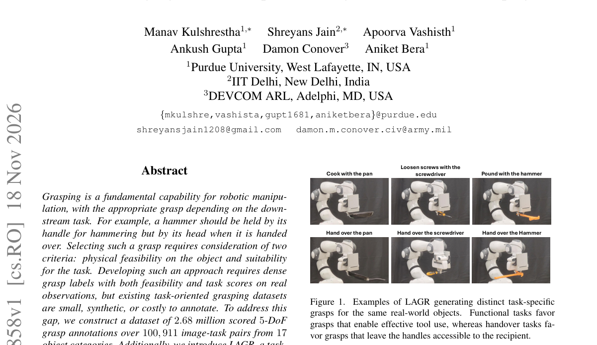

**Why this ranks #13**: 同一个物体的合适抓法取决于下游任务（锤子锤击要抓柄、递交时要抓头），而现有任务导向抓取数据集要么小、要么合成、要么标注昂贵。论文构建了覆盖 17 个物体类别、100911 个图像-任务对的 268 万条带分数 5-DoF 抓取标注；LAGR 先生成与任务无关的抓取提案并给出物理可行性分数，再用语言条件的重排序器把所有提案一起推理着打分，比次优方法高 9.3 个百分点，并在 Franka Research 3 上真机执行验证。

---

### 14. ReLoco: Unified Humanoid Locomotion and Fall Recovery via Behavior-Conditioned Motion Priors

**arXiv**: [2611.23916](https://arxiv.org/abs/2611.23916) | **Score**: 8.7 (relevance 9 x 0.7 + quality 8 x 0.3) | **Direction**: `embodied_ai` | **Tags**: embodied, humanoid, fall-recovery, adversarial-motion-prior, locomotion, behavior-conditioning, Huazhong University of Science and | **Categories**: cs.RO | **Pages**: 10

**Authors**: Lequn Fu; Yufeng Hu; Yijun Zhong; Jie Zhang; Xiao Li; Lingxiang Ji; Zhiyuan Xu; Jian Tang; Shiqi Li

**Affiliation**: Huazhong University of Science and Technology; Beijing Innovation Center of Humanoid Robots

**Abstract**

> Humanoid robots must recover from falls and resume commanded motion to sustain locomotion. Learning these behaviors in one policy requires supervision that accommodates both upright movement and ground-contact recovery. We present ReLoco, a framework that uses behavior-conditioned adversarial motion priors to learn locomotion, get-up from arbitrary fallen postures, and command resumption within one proprioceptive policy. During training, robot posture selects the expert pool and conditions a shared discriminator with two behavior-specific outputs. Task rewards and shared regularization support command tracking and recovery, while temporary assistance facilitates exploration. A simulation-based refinement stage supplies robot-executed motion references for this supervision. Ablations examine conditional supervision, output separation, and reference quality under matched settings. At a common training iteration, the full policy achieves $96.80\%$ independent get-up success and $96.96\%$ push-recovery success, including command resumption. Its torso planar velocity root-mean-square error is $0.1266$~m/s, $14.7\%$ lower than the conditional single-output variant, with similar joint-angle discrepancy measured by dynamic time warping. Deployment on the 64.5-kg Tiangong~3.0 humanoid demonstrates walking, running, get-up, and locomotion resumption after falls using one proprioceptive actor, without controller switching or on-robot policy fine-tuning.

**Key findings**

- **Finding**: 同一训练迭代下完整策略的独立起身成功率 96.80%、被推恢复成功率 96.96%（含指令恢复），躯干平面速度 RMSE 0.1266 m/s，比条件化单输出变体低 14.7%。
- **Inference**: 用姿态选择专家池加双输出头的共享判别器，可以在同一个本体感知策略里同时容纳直立运动与地面接触恢复，从而免掉控制器切换。
- **Recommendation**: 人形策略要同时覆盖行走、奔跑、起身与恢复时，把行为条件加输出分离当作必备结构，并保留仿真精修后的运动参考；论文在 64.5 kg 的 Tiangong 3.0 上无需上机微调即完成部署。

**Key figures**

*Framework - Overview of ReLoco. Retargeted human motions are refined in simulation to form locomotion and get-up reference sets. Posture conditions expert sampling and the output of a shared discriminator*

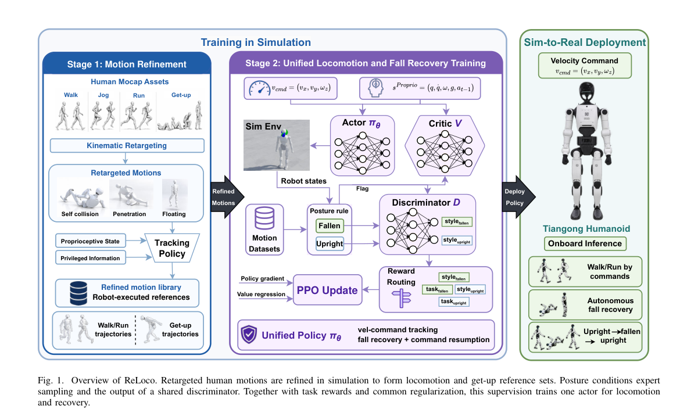

*Result - Effect of reference-motion refinement on AMP training. (a) Mean task reward. (b) Get-up success rate. Raw uses the original retargeted motions; Refined uses simulation-refined references. Shad*

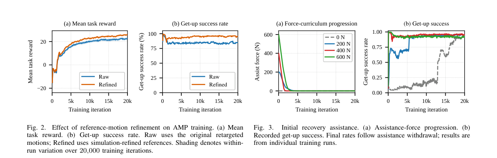

**Why this ranks #14**: 人形机器人要能从任意摔倒姿态起身并接着执行指令，一个策略要同时覆盖直立运动与地面接触恢复，就需要行为条件化的对抗式运动先验。ReLoco 用机器人姿态选择专家池，并给共享判别器接两个行为专属输出头，任务奖励加共享正则保证指令跟踪与恢复，临时辅助用于探索，再由仿真精修阶段提供机器人实际执行的运动参考。同一训练迭代下独立起身成功率 96.80%、被推恢复成功率 96.96%（含指令恢复），躯干平面速度 RMSE 0.1266 m/s，比单输出变体低 14.7%。

---

### 15. BEV-Diffusion: Camera-Only Traversability Navigation with BEV Memory and Efficient Cross-Robot Adaptation

**arXiv**: [2611.24155](https://arxiv.org/abs/2611.24155) | **Score**: 8.7 (relevance 9 x 0.7 + quality 8 x 0.3) | **Direction**: `embodied_ai` | **Tags**: embodied, camera-only, bev-traversability, diffusion-planner, uncertainty, cross-robot, Intelligent Space Robotics Laboratory | **Categories**: cs.RO | **Pages**: 8

**Authors**: Iana Zhura; Timofei Kozlov; Dmitrii Plotnikov; Ivan Valuev; Miguel Altamirano Cabrera; Dzmitry Tsetserukou

**Affiliation**: Intelligent Space Robotics Laboratory, Skolkovo Institute of Science and Technology

**Abstract**

> Robot navigation requires both an understanding of the scene and an efficient adaptation to new robots, yet current methods rely on expensive LiDAR sensors, long mapping and modular pipelines. We present BEV-Diffusion, a camera-only model that learns a bird's-eye view (BEV) traversability map, its uncertainty and the path in a single network. A frozen DINOv2 backbone encodes consecutive RGB frames, which inverse perspective mapping and Bayesian fusion lift into the BEV, and a ranking loss keeps outdoor traversability graded rather than binary, separating asphalt from grass (median 0.94 vs. 0.75). On this map, a transformer denoiser generates polar waypoints in a few DDIM steps, and uncertainty-aware guidance refines the path and ends it where the map is no longer reliable. At deployment, a metric BEV memory keeps obstacles after they leave the camera view and warm starts each sample from the previous, ego-motion compensated path. Because the planner jointly learns the path, the map, and its uncertainty, it selects routes through terrain it can confidently traverse. In an unseen courtyard, a wheeled-legged robot autonomously traveled 120 m, completing 96% of the route without intervention, compared with 75-88% for the baselines. Even under low-light conditions after sunset, the proposed model completed the route without requiring any intervention. Retraining only the BEV head, about 3% of the parameters, adapts the model to a small legged robot in 2.3 min. Indoors, the memory gets this robot out of maze-like traps: it retains 62-66% of the nearby out-of-view obstacles, against at most 3% for the baselines, and the robot achieves 67-100% task progress, compared with 20-40% for the evaluated baselines.

**Key findings**

- **Finding**: 排序损失让户外可通行性保持分级而非二元，沥青与草地中位可通行性分开为 0.94 对 0.75；未见庭院中轮腿机器人自主走完 120 m，96% 路线无需干预，基线为 75–88%。
- **Inference**: 把地图、路径与不确定性放进一个网络联合学，规划器才会主动挑自己敢走的路；不确定性还被用来在地图不可靠处终止路径。
- **Recommendation**: 换机器人时只重训 BEV 头（论文称约 3% 参数、2.3 min 内适配）；室内迷宫场景要靠度量 BEV 记忆，它保留 62–66% 的视野外障碍，而基线最多只有 3%。

**Key figures**

*Framework - BEV-Diffusion on two legged robots. Top: on the wheeled quadruped, the model reconstructs graded BEV traversability from the camera and generates the path on it by polar diffusion. Bottom: ret*

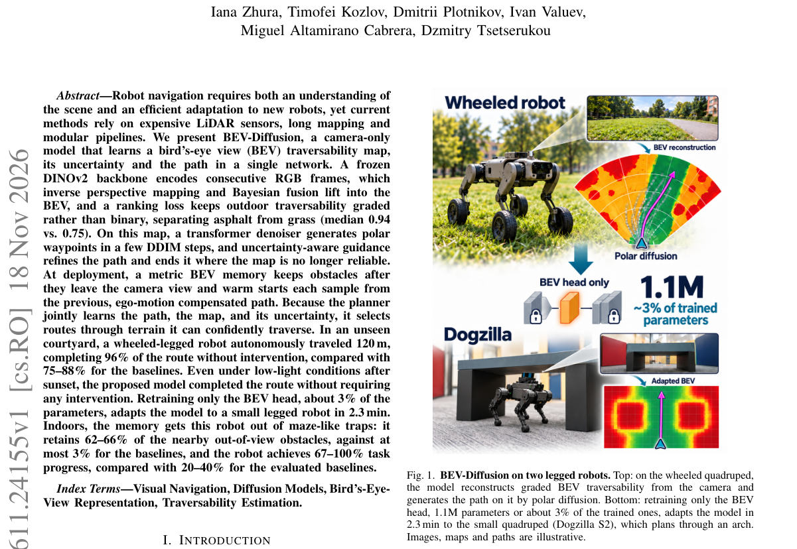

*Result - Overview of BEV-Diffusion. A frozen DINOv2 encodes two RGB frames, which are projected and fused into a polar BEV, where the BEV head predicts the traversability p with its epistemic (u) and a*

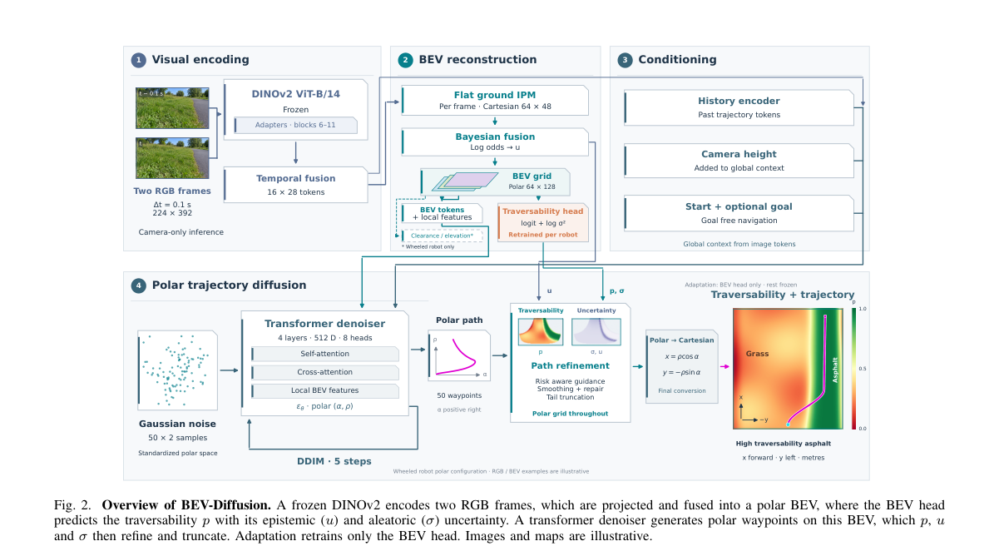

**Why this ranks #15**: 现有导航依赖昂贵 LiDAR、长建图和模块化流水线；BEV-Diffusion 用冻结 DINOv2 编码连续 RGB 帧，经逆透视映射与贝叶斯融合抬到 BEV，在一个网络里同时学出分级可通行性、其不确定性以及路径（排序损失让草地与沥青分开，中位数 0.94 对 0.75），再用 transformer 去噪器在少量 DDIM 步内生成极坐标路点，部署时用度量 BEV 记忆保留已离开视野的障碍并做自运动补偿的路径热启动。

---

### 16. Towards Pose-Robust Few-Shot Vision-Language-Action Models

**arXiv**: [2611.24360](https://arxiv.org/abs/2611.24360) | **Score**: 8.7 (relevance 9 x 0.7 + quality 8 x 0.3) | **Direction**: `embodied_ai` | **Tags**: embodied, vla, pose-shift, canonicalization, few-shot, extrinsic-calibration, School of Software | **Categories**: cs.AI, cs.CV, cs.RO | **Pages**: 17

**Authors**: Wenhao Li; Zhongyi Han; Yuhao Wei; Liang Han; Yilong Yin; Liqiang Nie

**Affiliation**: School of Software, Shandong University; Shenzhen Loop Area Institute; School of Life Science and Technology, Xidian University; School of Computer Science and Technology, Harbin Institute of Technology (Shenzhen)

**Abstract**

> Fine-tuning a vision-language-action (VLA) model on a few dozen demonstrations is the standard way to put a manipulation policy on a robot, yet the resulting policy silently assumes that the camera and the robot base stay exactly where they were during data collection: a bumped tripod or a base re-docked a few centimetres away makes it reach for the wrong place. We show that both failures are one phenomenon, a change of the camera-to-base extrinsic that the policy has memorised, and that the robot carries everything needed to undo it. We introduce WACO, a world-anchored canonicalization framework for VLA models: the arm, placed by forward kinematics at the measured joint angles, serves as a metric calibration target, and the static scene serves as the world anchor that tells a moved camera from a moved robot. From a single RGB-D frame, WACO estimates both shifts without ground-truth extrinsics or extra data, canonicalises the image to the calibration viewpoint and the state, action and start pose to the calibration base frame, and fine-tunes the unmodified policy under the artefacts of its own estimator. We also introduce LIBERO-PoseShift, the first benchmark for RGB VLAs with graded camera, base and compound shifts. Across LIBERO-PoseShift, the LIBERO-Plus camera track and four real-world tasks on a UR5e robot, WACO consistently outperforms the standard few-shot recipe and prior viewpoint-robust methods, raising shifted success by 13.2 points in simulation and by 36.7 points on the real robot, recovering 90% of the simulation gap to a ground-truth oracle and 87% of the real-robot gap, and establishing a new state of the art among methods that use no perturbed training data, with no test-time calibration. Project page: https://peacelwh.github.io/WACO/.

**Key findings**

- **Finding**: WACO 在 LIBERO-PoseShift 上把受扰动成功率提高 13.2 个百分点、在 UR5e 真机上提高 36.7 个百分点，恢复了到 ground-truth oracle 差距的 90%（仿真）与 87%（真机），且不使用任何扰动训练数据、无测试时标定。
- **Inference**: 相机移动与基座偏移本质是同一个外参变化，把机器人自身的机械臂与静态场景当标定靶，就能免掉额外数据和外部标定地同时估出两个偏移。
- **Recommendation**: 部署少样本 VLA 前先做一次重标定：单帧 RGB-D 用正运动学放出的机械臂配深度做臂锚、静态场景配空场景做世界锚，再在自身估计器的伪影下微调策略；LIBERO-PoseShift 可直接当分级评测集。

**Key figures**

*Framework - Overview. A few-shot fine-tuned VLA memorises the camera-to-base extrinsic of its demonstrations and misses the target once the camera is bumped or the robot is re-docked (left: our UR5e setup*

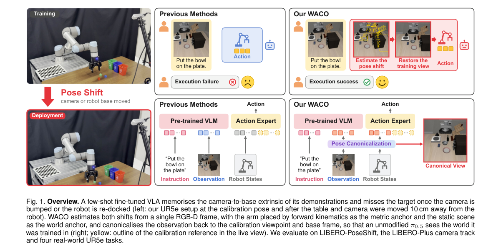

*Result - Model Pipeline. WACO wraps an unmodified π0.5. At reset, a training-free front end registers the FK-placed arm model to the observed depth (arm anchor) and matches the static scene to an empty*

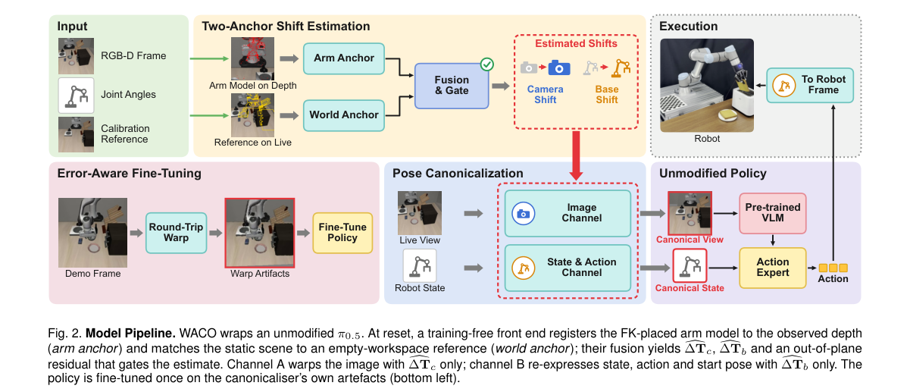

**Why this ranks #16**: 少样本微调出的 VLA 会默记采数时的相机-基座外参，三脚架被碰一下或基座重新对接几厘米就会抓错地方。WACO 认为相机移动与机器人移动是同一现象——外参变了，而机器人自己带着解法：把机械臂按正运动学放到实测关节角处当作度量标定靶，静态场景作为世界锚点来区分「相机动了」还是「机器人动了」；从单张 RGB-D 帧同时估计两个偏移，再把图像、状态、动作与起始位姿统一到标定视角与标定基座坐标系。

---

### 17. SHAPE: Discrete Supervision and Parallel Continuous Streams for Learning Dexterous Manipulation from Egocentric Human Data

**arXiv**: [2611.24585](https://arxiv.org/abs/2611.24585) | **Score**: 8.7 (relevance 9 x 0.7 + quality 8 x 0.3) | **Direction**: `embodied_ai` | **Tags**: embodied, dexterous-manipulation, human-pretraining, discrete-action-tokens, flow-matching, egocentric-data, Sharpa Robotics | **Categories**: cs.RO | **Pages**: 28

**Authors**: Yaping Li; Zhihong Liu; Jiacheng Li; Yi Yang; Wenchao Yue; Mingzhe Ye; Xiangcheng Liu; Yiyang Chen; Haotian He; Qi Zhang; Haonan Wang; Dahua Lin

**Affiliation**: Sharpa Robotics; The Chinese University of Hong Kong; SJTU-Sharpa Joint Lab for Embodied AI, SJTU

**Abstract**

> Egocentric human recordings are far cheaper than dexterous robot demonstrations, promising stronger pretraining and direct skill learning without task-specific robot data. Yet humans and robots differ in morphology and kinematics, so human recordings lack the joint positions and actuator commands that supervise robot policies, providing only retargeted end-effector (EEF) actions. This raises two questions: how human data should supervise the policy, and how a dexterous robot should read out actions at deployment. We address both in SHAPE (Supervision from Human Action tokens with Parallel Executable streams), a vision-language-action (VLA) model whose backbone predicts discrete action tokens of EEF chunks as an auxiliary task, while a shared flow-matching expert outputs two executable streams, EEF and joint. On a bimanual robot with 22-DoF hands, a matched study shows that discrete supervision helps learn from human data, driving backbone gradients and shaping action-informative representations across domains. Under standard control pipelines at deployment, direct joint readout excels at fine-grained control with robot demonstrations, scoring 0.80 across six tasks against 0.63 for π0.5, whereas IK-based EEF readout excels at human-to-robot transfer. Pretrained with human data and discrete tokens, SHAPE learns new tasks from human demonstrations without task-specific robot data.

**Key findings**

- **Finding**: 在 22-DoF 双手机器人上，直接关节读出在六项任务上得分 0.80，π0.5 为 0.63；骨干预测的离散 FAST token 用一套人机共用词表直接监督骨干，并与并行流匹配 expert 的 EEF、关节两条流同时存在。
- **Inference**: 人类数据没有关节角与执行器指令、只能给重定向后的 EEF 动作，用离散 token 做辅助监督能造出反向的梯度并塑造出与动作相关的表征。
- **Recommendation**: 用人类录像预训练灵巧策略时，骨干加离散 EEF token 辅助头、expert 同时保留 EEF 与关节双流：关节流负责机器人示教下的精细控制，EEF 流负责人到机器人迁移。

**Key figures**

*Framework - SHAPE learns dexterous manipulation from egocentric human data. (a) Pretraining pairs human recordings, providing only retargeted end-effector (EEF) actions, with robot teleoperation (EEF and*

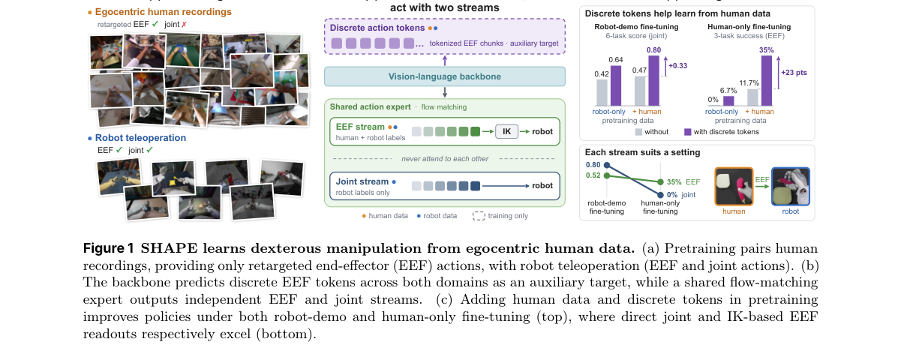

*Result - Overview of SHAPE. Human recordings (orange) provide head images and EEF actions; robot data (blue) add wrist images and joint actions. The backbone predicts discrete FAST tokens of the EEF c*

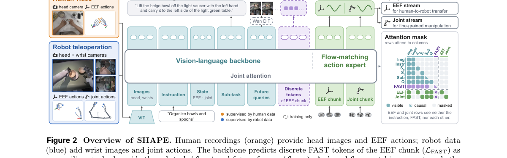

**Why this ranks #17**: 第一人称人类录像比灵巧机器人示教便宜得多，但人机形态与运动学不同，人类数据只提供重定向后的末端执行器动作。SHAPE 一并回答两个问题：骨干把每个 EEF chunk 编码成离散 FAST token 当辅助任务直接监督（人机共用一套词表），并行的流匹配 expert 同时输出 EEF 流与关节流两条可执行流。在 22 自由度双手机器人上，匹配对照显示离散监督能从人类数据里学到东西；部署时直接读关节流在六项任务上得 0.80，而 π0.5 为 0.63。

---

### 18. F$^3$: What Makes Good Experience in World-Action Models?

**arXiv**: [2611.24708](https://arxiv.org/abs/2611.24708) | **Score**: 8.7 (relevance 9 x 0.7 + quality 8 x 0.3) | **Direction**: `embodied_ai` | **Tags**: embodied, world-action-model, experience-reuse, self-improvement, action-prior, few-shot, Peking University | **Categories**: cs.AI | **Pages**: 12

**Authors**: Zihe Huang; Sirui Zhou; Haozhi Han; Ruge Zhang; Teng Ma; Tao Ma; Zheng Liu; Ce Zhang; Ting Cao; Yunxin Liu; Yunquan Zhang; Yifeng Chen

**Affiliation**: Peking University; Institute for AI Industry Research (AIR), Tsinghua University; Independent Researcher; University of Chinese Academy of Sciences; Alibaba Group

**Abstract**

> Deployed world-action models (WAMs) can keep improving only if they make good use of their own experience. Existing methods supply retrieved rollouts or demonstrations to the policy as context, yet such experience often turns previously solved tasks into failures. What, then, makes good experience for a WAM? We show that experience is valuable only in use: its value depends not on whether the source rollout succeeded but on what is stored, when it is used, and where it enters the policy. We therefore propose F$^3$, which makes these three decisions with Form, Fit, and Fusion. Form compresses successful and failed rollouts alike into short, verified operation records; Fit teaches the policy to read a record and to predict when it helps; Fusion injects the record's images, text and actions into the policy as a prefix and an action prior. Trained once on only 200 examples and deployed with a growing experience library, the model achieves state-of-the-art results on MolmoSpaces and RoboLab without any training on RoboLab: over native Cosmos 3 Nano, it raises success by 12.0 pp and 10.8 pp, reduces steps to success by 12.2% and 11.3%, and cuts regressions by 57%.

**Key findings**

- **Finding**: F3 只用 200 个样本训练一次、部署时挂持续增长的经验库，在 MolmoSpaces 与 RoboLab 上比原生 Cosmos 3 Nano 成功率分别高 12.0 与 10.8 个百分点，成功步数减少 12.2% 与 11.3%，回退减少 57%。
- **Inference**: 记录的价值不由来源 rollout 是否成功决定，而由它在当前状态能否提高完成概率决定——所以失败经验同样该被压缩保存，只是不能无条件使用。
- **Recommendation**: 复用经验时先按 Form 把 rollout 压成已验证的最小操作记录，再由 Fit 决定何时用，最后用 Fusion 以前缀加动作先验注入；并照论文方式在完全没训练过的 RoboLab 上直接部署来检验泛化。

**Key figures**

*Framework - Which past experience a WAM reuses decides whether it succeeds. (a) Form turns a rollout into short multimodal records. (b) On the same knife-to-bowl task, the native WAM times out, whereas*

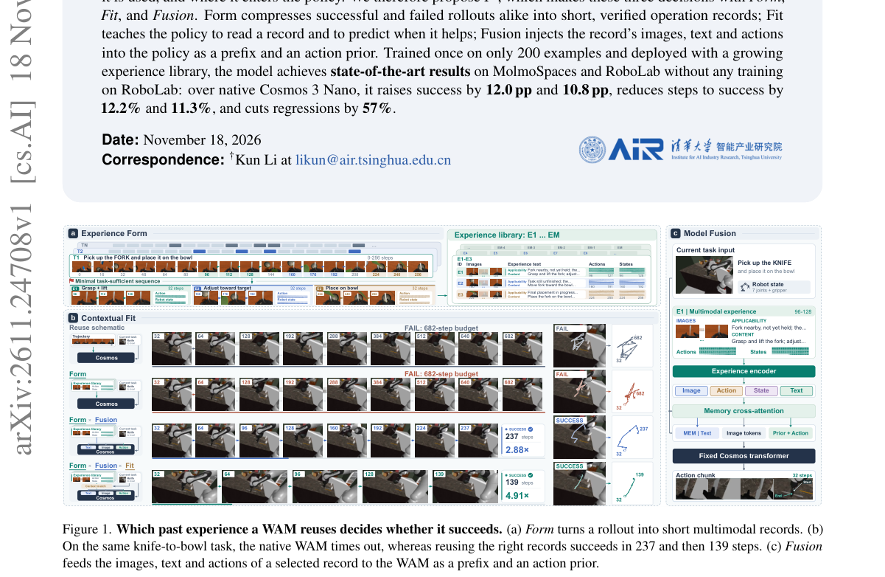

*Result - F3 succeeds more often and in fewer steps. (a) Suc- cess rate on MolmoSpaces and RoboLab; the dotted line marks native Cosmos 3 and hatching the gain of F3. (b) Mean steps on episodes that b*

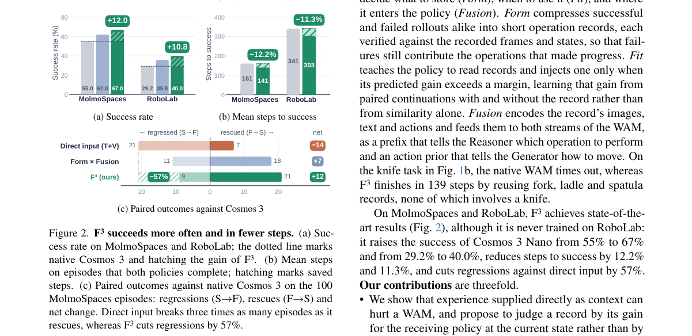

**Why this ranks #18**: 部署后的世界-动作模型要靠自己的经验继续变好，但把检索到的 rollout 或示教当上下文塞进去，常常把原本已完成的任务搞砸。F3 的判断是经验的价值只在被使用的那一刻才存在——取决于存了什么、何时用、从哪里进策略，于是拆成 Form/Fit/Fusion：把成功与失败的 rollout 都压成简短且已验证的操作记录，Fit 教策略读记录并预测它何时有用，Fusion 把记录的图像、文本与动作以前缀和动作先验注入策略。

---

### 19. RoboMorpher: Scaling Robot Morphology Representations for Cross-Embodiment Action Prediction

**arXiv**: [2611.24816](https://arxiv.org/abs/2611.24816) | **Score**: 8.7 (relevance 9 x 0.7 + quality 8 x 0.3) | **Direction**: `embodied_ai` | **Tags**: embodied, cross-embodiment, action-tokenizer, kinematics, urdf, vla, University of Hong Kong | **Categories**: cs.RO | **Pages**: 17

**Authors**: Wenwei Lin; Yan Qin; Weiliang Deng; Zixuan Li; Kaixuan Wang; Zanxin Chen; Yue Chen; Tianshuo Yang; Junting Chen; Zhixuan Liang; Yao Mu; Ximin Lyu

**Affiliation**: The University of Hong Kong; HKUST (Guangzhou); Sun Yat-sen University; Shanghai Jiao Tong University; Peking University

**Abstract**

> Learning shared action representations is central to cross-embodiment manipulation. However, identical joint values can produce different spatial configurations across robots, limiting representations learned from joint values alone. We introduce RoboMorpher, a morphology-conditioned action tokenizer that jointly reconstructs joint angles and link poses to associate control coordinates with their kinematic effects. MorphGen supplies scalable kinematic supervision by generating serial-arm descriptions from survey-derived geometric priors. We pretrain RoboMorpher on 40 million morphology-state pairs and integrate the frozen tokenizer into a vision-language-action policy for discrete prediction and continuous refinement. We also introduce EmbodiBench, a ten-task benchmark with 30 generated URDFs per task. With downstream URDFs excluded from tokenizer pretraining, the policy achieves 56.40% success on RoboTwin 2.0 and 23.27% on EmbodiBench, exceeding continuous joint-space control by 9.73 and 15.34 percentage points. Removing link-pose supervision reduces EmbodiBench success by 17.94 percentage points, supporting morphology-aware geometric supervision for joint-action representation learning.

**Key findings**

- **Finding**: RoboMorpher 在 4000 万条形态-状态对上预训练，冻结 tokenizer 接入 VLA 后在 RoboTwin 2.0 上成功率 56.40%、EmbodiBench 23.27%，比连续关节空间控制分别高 9.73 与 15.34 个百分点；去掉连杆位姿监督会让 EmbodiBench 掉 17.94 个百分点。
- **Inference**: 把控制坐标与其运动学效果一起重建，才能让同一套离散动作码在不同形态间迁移；只重建关节角无法区分同值不同构型。
- **Recommendation**: 做跨形态动作表征时按论文配方走：MorphGen 从 33 个 URDF/MJCF 的连杆长度先验程序化生成串联臂、正运动学给连杆位姿目标，并务必保留连杆位姿重建这一路监督。

**Key figures**

*Framework - Survey and morphology generation. (a) Seven Gaussian priors N(µi, σ2*

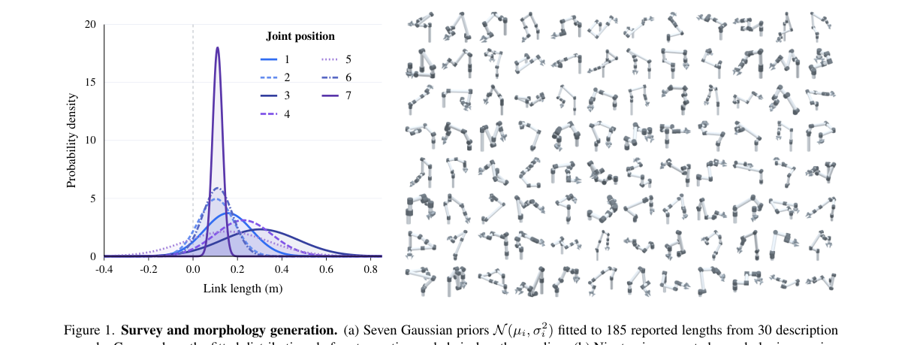

*Result - RoboMorpher pipeline. (a) MorphGen samples local-Z chains using survey priors and IK filtering. (b) URDF-conditioned tokenization learns two codes per joint with FK supervision. (c) The VLA*

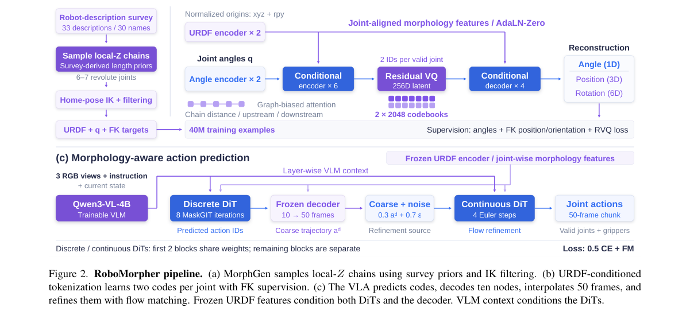

**Why this ranks #19**: 相同关节值在不同机器人上对应不同空间构型，只用关节值学到的共享动作表征因此受限。RoboMorpher 做成形态条件化的动作 tokenizer，联合重建关节角与连杆位姿，把控制坐标和它的运动学效果绑在一起；MorphGen 从 33 个 URDF/MJCF 描述的统计先验程序化生成串联臂描述，前向运动学为 4000 万条形态-状态对提供连杆位姿目标。冻结 tokenizer 接入 VLA 后在 RoboTwin 2.0 上成功率 56.40%、EmbodiBench 23.27%。

---

### 20. NereidVLA: Learning to Understand and Navigate the Underwater World

**arXiv**: [2611.24864](https://arxiv.org/abs/2611.24864) | **Score**: 8.7 (relevance 9 x 0.7 + quality 8 x 0.3) | **Direction**: `embodied_ai` | **Tags**: embodied, underwater, vla, marine-pretraining, navigation, discrete-motion-token, Zhejiang University | **Categories**: cs.CV, cs.RO | **Pages**: 13

**Authors**: Chenjie Zhao; Zhiliang Zhu; Quan Chen; Yuquan Xue; Xingxue Shi; Puyue Wang; Zhiqiang Zhao; Kangye Zheng; Boyang Xu; Mingwei Lin; Dejun Li

**Affiliation**: Zhejiang University; Harbin Engineering University; Nanyang Technological University; Harbin Institute of Technology; University of Auckland

**Abstract**

> Underwater navigation requires translating visual spatial cues into motion, yet marine vision-language datasets rarely include paired robot trajectories. We present NereidVLA, a vision-language-action model that transfers marine spatial knowledge to language-conditioned 3D navigation. We first train Sea2Know on approximately two million marine examples to learn target grounding, spatial relations, and scene structure without paired robot-motion supervision. We then adapt it using expert trajectories executed under simulated underwater vehicle dynamics. Given RGB histories and a language instruction, NereidVLA predicts discrete motion tokens that decode into local 3D trajectories for closed-loop tracking. Evaluation combines an independent six-dimensional underwater navigation understanding benchmark with offline prediction and closed-loop navigation. Under matched navigation training and execution settings, marine spatial pretraining increases simulation success from 72.4% to 84.4%. Without fine-tuning on the real test environment, NereidVLA achieves 78.75% success in laboratory-pool robot trials, compared with 47.50% for InternVLA-N1. These results show that marine spatial supervision can support downstream motion learning and physical underwater navigation.

**Key findings**

- **Finding**: Sea2Know 用约 200 万条海洋样本预训练且不带配对的机器人运动监督；匹配设置下海洋空间预训练把仿真成功率从 72.4% 提到 84.4%，不在真实环境微调时实验室水池真机成功 78.75%，InternVLA-N1 为 47.50%。
- **Inference**: 领域内的空间关系与目标接地可以脱离机器人运动数据单独学到，再作为初始化迁移到导航适配阶段，比直接收集带轨迹的领域数据更可行。
- **Recommendation**: 缺少带轨迹数据的专有领域（水下、野外）可复用两步法：先用大规模无轨迹数据做空间与接地预训练，再用模拟动力学下的专家轨迹做离散运动 token 适配；评测务必包含真实环境零微调这一项。

**Key figures**

*Framework - Overview of the two-stage learning framework for NereidVLA. Marine spatial learning produces Sea2Know, which initializes the navigation model. Expert demonstrations executed under simulated*

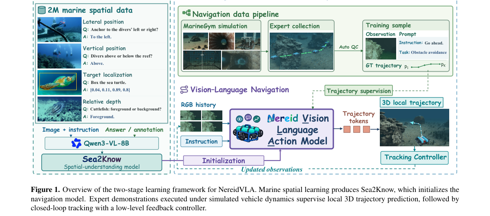

*Result - Navigation architecture and trajectory supervision. A Sea2Know-initialized navigation VLA predicts discrete motion tokens from four historical RGB observations and a task instruction. Execut*

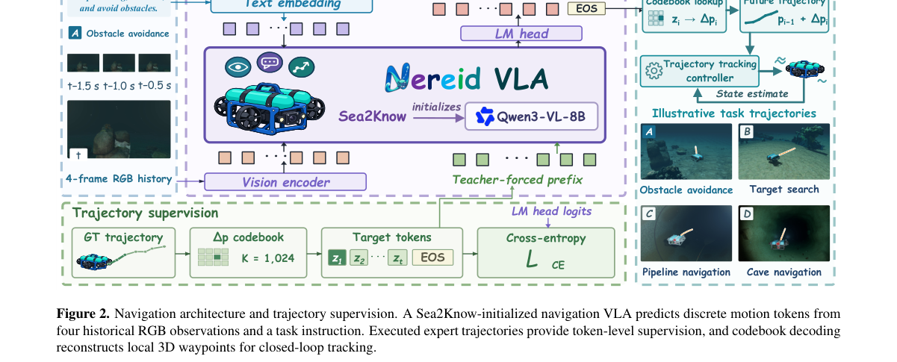

**Why this ranks #20**: 海洋视觉-语言数据集很少带成对的机器人轨迹。NereidVLA 分两步：先用约 200 万条海洋样本训 Sea2Know 学目标接地、空间关系与场景结构，全程不带配对的机器人运动监督；再用模拟水下载具动力学下执行的专家轨迹做适配，给定 RGB 历史与语言指令后预测离散运动 token、解码成局部 3D 轨迹做闭环跟踪。匹配训练与执行设置下，海洋空间预训练把仿真成功率从 72.4% 提到 84.4%。

---

## Footer

- Total papers reviewed across all 4 axes: 60
- world_embodied axis final count: 20
- Wild-cards in this axis: 0
- Figure assets: 2026-11-21/res/

Generated by `mine-arxiv-daily-digest` skill. Sister file: `2026-11-21_world_embodied_entry.md`.
