# Mine Arxiv Daily Digest - 2026-11-24 (AIGC 视觉生成与编辑 Axis, 15 papers)

**Generated**: 2026-11-24 01:23 CST

**Source**: arXiv cs.CV, cs.SD, eess.AS, cs.CL, cs.AI, cs.RO, cs.LG, cs.IR submissions, listing day 2026-11-19,2026-11-20 (announced 2026-11-20 01:00 UTC（listing 11-19）、2026-11-23 01:00 UTC（listing 11-20）)

**Batch window**: 2026-11-18T19:00:00Z .. 2026-11-20T19:00:00Z（arXiv 公告批次横跨两个 UTC 日：从前一日的美东 14:00 截止时刻起算（EDT 为 18:00Z，EST 为 19:00Z），到当日的同一时刻为止）

**Axis**: aigc_visual (15 papers, base 15, cap 20)

**Directions**: aigc_generation (12), aigc_editing (2), aigc_rl (1)

**Selection**: 15 papers ranked by relevance x quality, with 0 wild-card slots

**Day total**: 60 papers across 4 axes (target 60)

**Scope**: 图像 / 视频 / 3D / 4D 内容的生成与编辑，以及面向视觉生成的 RL / 偏好优化与奖励模型

**Wild-card**: 0 篇 —— 该轴供给充足,aigc_generation 一个方向就有 72 篇够格候选,没有任何名额需要靠邻接选题补位;aigc_editing 与 aigc_rl 的缺口来自各自方向的候选不足,按口径让出而不是被填充。

本轴 15 篇正好落在基准上,内部结构是「一超两让」:aigc_generation 拿 12 篇(超自身基准 4),aigc_editing 与 aigc_rl 各让出 2 个,`dir_over = 4 = dir_under`,配平成立。值得注意的是 aigc_rl 的候选池只有 2 篇 —— 这一轮「面向视觉生成的 RL」几乎是空窗,整份日报只剩 UR-GRPO 一篇,说明视觉 RL 的产出正明显向通用多模态 RL 迁移。

---

## AIGC 生成（图像 / 视频 / 3D / 4D） · `aigc_generation` (12 papers)

本方向 12 篇几乎被「生成即服务」占满:一半压成本、一半扩能力。效率侧给出三组硬数字:TRQ 把视频 DiT 的 KV cache 压到 2 bit,VBench 主体一致性从 90.38 提到 92.02;CalibCache 离线校准特征二阶差分,FLUX.1-dev 的 LPIPS 从 0.563 降到 0.429 并换来 2.86 倍加速;D3-Cache 不训练、不调标定曲线,四个模型上稳定拿到 2.6–3.8 倍。能力侧 AURA 1.3B 单卡实时吐 576p(16 Hz 播放下 20.7 fps)、比自己的双向教师快 23 倍,StreamEgo 的 Exo2Ego 在单张 H100 上跑到 24.3 fps;Zing-1.0 把「可玩世界」写成实现无关的规范,单 H200 稳定 23.82 fps。Asuka-FM 反向把门槛压低:206M 双流 DiT 在单张 4090 上约 160 GPU 小时、不到 55 美元训完,GenEval 0.588。蒸馏一侧 PMD 用后验均值匹配取代反向 KL,PP-CFG 保住少步生成的 CFG 极性,四步拿到 81.46 VBench。

### 1. Online Temporal Rotations for 2 Bit KV-Cache Quantization in Video Diffusion Transformers

**arXiv**: [2611.26334](https://arxiv.org/abs/2611.26334) | **Score**: 8.7 (relevance 9 x 0.7 + quality 8 x 0.3) | **Direction**: `aigc_generation` | **Tags**: AIGC-visual, kv-cache-quantization, video-diffusion, rotation-quantization, inference-efficiency, 2-bit-weights, Massachusetts Institute of Technology | **Categories**: cs.AI, cs.CV | **Pages**: 13

**Authors**: Ryan Lucas; Petros Prastakos; Rahul Mazumder

**Affiliation**: Massachusetts Institute of Technology

**Abstract**

> Video diffusion transformers reuse key--value (KV) caches across denoising steps, which quickly becomes a bottleneck for long video generation. We find that quantizing temporally distant cache vectors leads to a large range and high quantization error, but that nearby video tokens in the KV-cache share a persistent pattern per channel. These patterns also vary across videos, motivating rotations that are adapted to each video's unique cache. We propose Temporal Rotation Quantization (TRQ), a method that rotates frames in the cache that are adjacent in time before quantization. For each block of temporally adjacent cache vectors, TRQ fits an orthogonal transform that maps the block's per-channel means to a vector that is close to a constant across channels. To keep the quantization format lightweight, we parameterize this rotation as a tree of $2 \times 2$ planar rotations, each stored with only two bits, followed by a fixed Hadamard transform shared across all blocks. The rotations are fit without gradients or changes to model weights, and we prove that a simple greedy fit is globally optimal for our 'mean-flattening' objective. The transforms are fit online for each new video, and we release fused Triton kernels to make this process efficient at inference. At 2-bit precision and matched compression, TRQ improves VBench subject consistency over the state-of-the-art method QVG from 90.38 to 92.02 on LongCat-Video-13B and from 86.33 to 87.61 on HY-WorldPlay-8B, as well as improving other metrics.

**Key findings**

- **Finding**: 2 bit 精度下 TRQ 在 LongCat-Video-13B 上把 VBench 主体一致性从 90.38 提到 92.02，在 HY-WorldPlay-8B 上从 86.33 提到 87.61，均优于同样压缩率下的 QVG。
- **Inference**: 时间上相邻的 KV 帧共享逐通道的持久模式、不同视频之间模式又不同，说明旋转必须针对每个视频在线拟合，而不能沿用逐模型离线标定。
- **Recommendation**: 做长视频扩散推理时可直接接入论文发布的 fused Triton kernel 把 KV 缓存压到 2 bit，并按 90 分以上的主体一致性核对画质是否掉出基线区间。

**Key figures**

*Framework - Structure of video-diffusion KV cache. Each panel overlays key and value magnitudes (|K| and |V |) on the corresponding video frame. We observe that (i) Within a video, nearby frames share p*

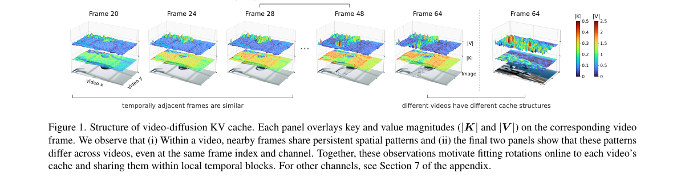

*Result - Block-wise temporal rotations. At each image patch, the cached keys and values are divided into temporal blocks of nB consecutive latent frames. Each block receives its own key rotation RK*

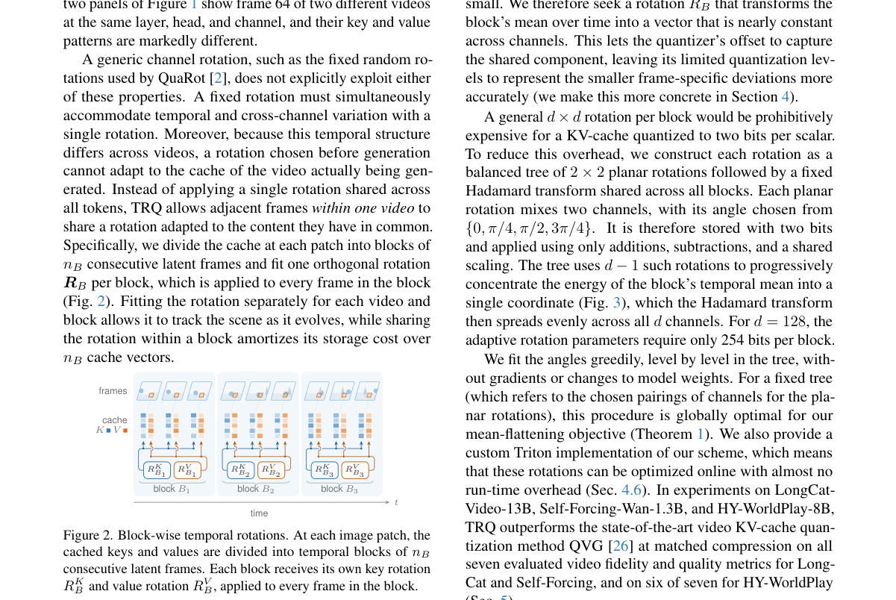

**Why this ranks #1**: 2 bit 精度下 TRQ 把 LongCat-Video-13B 的 VBench 主体一致性从 QVG 的 90.38 提到 92.02，在 HY-WorldPlay-8B 上从 86.33 提到 87.61；旋转树每块只需 2(d-1)=254 bit（d=128、nB=8），约合每标量 0.25 bit，量化格式本身几乎不占额外存储。

---

### 2. Asuka-FM: A System-Architectural Co-Design Framework for Efficient Text-to-Image Pretraining on Consumer Hardware

**arXiv**: [2611.26437](https://arxiv.org/abs/2611.26437) | **Score**: 8.7 (relevance 9 x 0.7 + quality 8 x 0.3) | **Direction**: `aigc_generation` | **Tags**: AIGC-visual, text-to-image, efficient-pretraining, sequence-sparsification, consumer-gpu, patch-detailer, Universidad Carlos III de Madrid | **Categories**: cs.AI, cs.CV | **Pages**: 40

**Authors**: Víctor Rodrigo González; Pablo M. Olmos; Ignacio Peis; Alejandro Lancho

**Affiliation**: Universidad Carlos III de Madrid, Spain; Technical University of Denmark (DTU), Denmark; Universidad de Granada, Spain

**Abstract**

> Frontier text-to-image (T2I) foundation models predominantly rely on multi-billion parameter Diffusion Transformers (DiTs) pretrained across massive compute clusters, creating an accessibility barrier for academic laboratories. When training DiTs from scratch on single consumer GPUs (e.g., an NVIDIA RTX 4090 with 24\,GB VRAM), practitioners encounter three primary bottlenecks: quadratic attention sequence costs, Just-In-Time (JIT) compilation graph breaks induced by variable aspect-ratio bucketing, and an autoencoder throughput wall where frozen Variational Autoencoder (VAE) operations dominate step latency. In this work, we introduce \textbf{Asuka-FM}, an end-to-end system and architectural framework demonstrating that competitive dual-stream DiTs ($\sim$206M parameters) can be pretrained from scratch on a single consumer GPU in $\sim$160 GPU hours for under \$55. Asuka-FM integrates four core designs: (i) an AdaLN-free dual-stream DiT backbone reducing parameter count; (ii) structured sequence sparsification via Sparse-Dense Residual Fusion (SPRINT) to cut attention FLOPs by over 50\%; (iii) continuous aspect-normalized Rotary Position Embeddings (RoPE) coupled with shifted square crop training, guaranteeing static tensor shapes while unlocking zero-shot virtual camera control; and (iv) a pixel adaptation phase utilizing a lightweight (10M parameter) Patch Detailer Head operating under velocity regression ($v$-prediction). Evaluated on open-domain benchmarks without benchmark-specific fine-tuning, Asuka-FM achieves GenEval 0.588 / DPG 78.96 scores at 256px and GenEval 0.609 / DPG 78.51 scores at 512px, setting a new Pareto-optimal efficiency standard for democratic foundation modeling.

**Key findings**

- **Finding**: Asuka-FM 的 206M 双流 DiT 在单张 RTX 4090 上约 160 GPU 小时、不到 55 美元训完，256px 得到 GenEval 0.588 与 DPG 78.96，512px 得到 0.609 与 78.51。
- **Inference**: 训练阶段冻结 VAE 前向占墙钟约 60%、推理阶段解码占延迟 70% 以上，说明消费级预训练的主要瓶颈在自编码器吞吐而不是 DiT 本身。
- **Recommendation**: 想在单卡复现文生图预训练时按「稀疏化注意力、连续纵横比 RoPE 加方形裁剪、像素适配」三段式排期，并把 VAE 吞吐单独列为独立优化项。

**Key figures**

*Framework - Asuka-FM framework overview. (a) Denoiser training compute vs. compositional alignment (DPG-Bench). (b) High-fidelity visual synthesis from our 206M dual-stream backbone. (c) Representative*

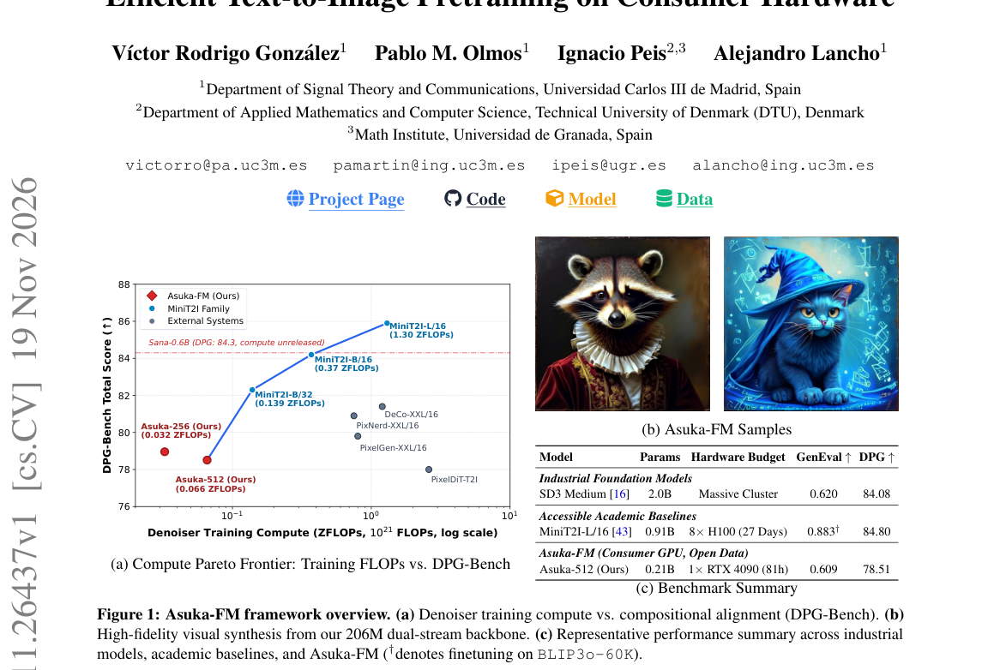

*Result - High-fidelity zero-shot visual synthesis from scratch on a single consumer GPU. Curated open- domain samples synthesized by Asuka-FM (206M backbone) following two-stage pretraining (2562 →51*

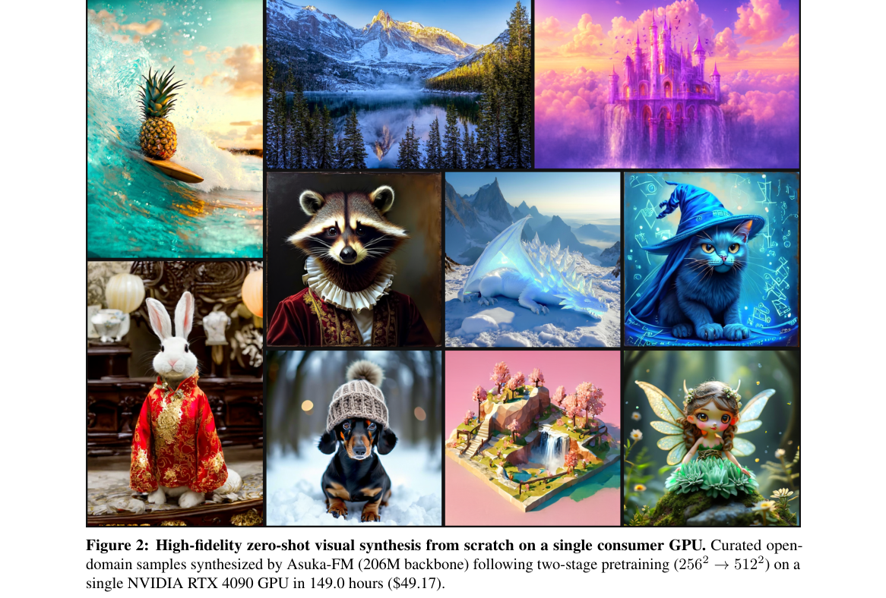

**Why this ranks #2**: 206M 双流 DiT 在单张 24GB RTX 4090 上从头预训练约 160 GPU 小时、成本不到 55 美元，256px 拿到 GenEval 0.588 / DPG 78.96，512px 为 0.609 / 78.51；SPRINT 的 75% 稀疏化把注意力 FLOPs 砍掉 50% 以上，全流程保持 75.6% 的物理 MFUact。

---

### 3. AURA: AUdio-dRiven streaming Avatar

**arXiv**: [2611.26540](https://arxiv.org/abs/2611.26540) | **Score**: 8.7 (relevance 9 x 0.7 + quality 8 x 0.3) | **Direction**: `aigc_generation` | **Tags**: AIGC-visual, streaming-talking-head, audio-driven-video, few-step-distillation, rolling-kv-cache, real-time, Kyutai | **Categories**: cs.AI, cs.CV | **Pages**: 32

**Authors**: Nathaniel Cohen; Nicolas Dufour; Amélie Royer; Alasdair Newson; Patrick Pérez

**Affiliation**: Kyutai, Paris, France; ISIR, Sorbonne Université, Paris, France; Google DeepMind

**Abstract**

> Current audio-driven video diffusion models can synthesize realistic talking-head videos but generally require dozens of diffusion denoising steps over multi-second video chunks, making them unsuitable for streaming applications such as voice assistants and virtual avatars, where low-latency and online causal generation are required properties. AURA generates video chunk by chunk with a rolling KV cache, requiring only the audio of the current chunk to start generating, rather than a multi-second audio look-ahead like bidirectional models. It comes in two sizes: AURA 1.3B streams 576p video in real time on a single GPU (20.7 fps for a 16 Hz playback rate), making it suited to interactive avatar applications, and AURA 5B streams 720p video at 9.7 fps. Our two-stage distillation pipeline first aligns the causal student with the teacher, by training it to match the teacher's trajectories with fewer diffusion steps and a chunk-wise sliding window causal attention mask, then applies Distribution Matching Distillation (DMD) with backward simulation to close the remaining quality gap. On standard talking-head benchmarks, AURA 1.3B runs 23x faster than its own bidirectional teacher and reaches a quality comparable to TalkVerse at a lower resolution, and AURA 5B matches its TalkVerse teacher at 720p while running 17x faster. To support reproducibility and further research on streaming avatar generation, we release the weights of both models along with a dataset of 30K synthetic videos and their precomputed teacher trajectories.

**Key findings**

- **Finding**: AURA 1.3B 在单 GPU 上以 20.7 fps 流式生成 576p（16 Hz 播放），AURA 5B 在 720p 下为 9.7 fps，分别比各自的双向教师快 23 倍和 17 倍。
- **Inference**: 逐 chunk 生成加滚动 KV 缓存让模型只需当前块音频，省掉双工模型那种多秒音频前瞻，这正是语音助手与虚拟形象需要的低延迟因果结构。
- **Recommendation**: 做实时数字人时可直接复用其「ODE 轨迹初始化加带反向模拟的 DMD」两段蒸馏，并按每 chunk 4 步、16 Hz 播放的节奏对齐端到端延迟预算。

**Key figures**

*Framework - AURA streams talking-head video chunk by chunk on a single GPU: AURA 5B at 720p and 9.7 fps, AURA 1.3B at 576p in real time (20.7 fps for 16 Hz playback). (Left) Two reference identities and*

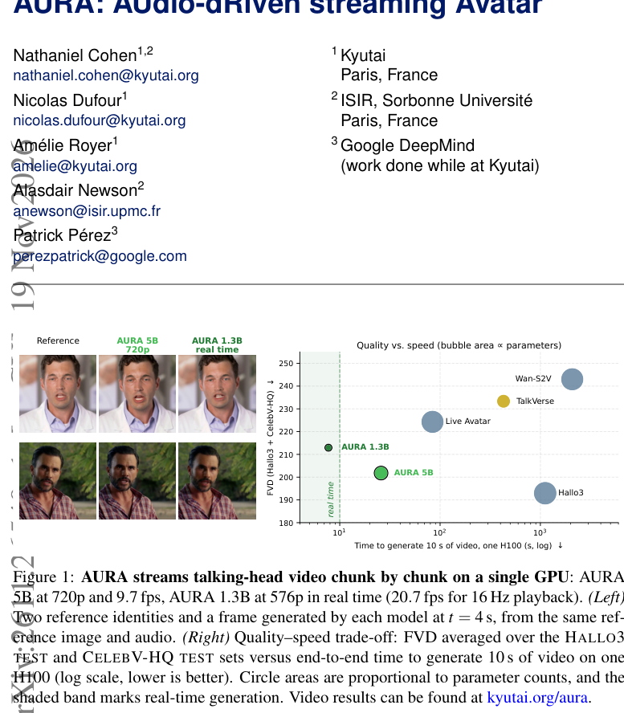

**Why this ranks #3**: AURA 1.3B 在单卡上以 20.7 fps 流式输出 576p（对应 16 Hz 播放），比自己的双工教师快 23 倍；AURA 5B 输出 720p 达 9.7 fps、快 17 倍，且每个 chunk 只跑 4 步去噪，滚动 KV 缓存让模型只需当前块音频即可起算。

---

### 4. Posterior Matching Distillation

**arXiv**: [2611.26629](https://arxiv.org/abs/2611.26629) | **Score**: 8.7 (relevance 9 x 0.7 + quality 8 x 0.3) | **Direction**: `aigc_generation` | **Tags**: AIGC-visual, diffusion-distillation, mode-covering, posterior-matching, any-step-sampling, few-step-generation, Virginia Tech | **Categories**: cs.CV | **Pages**: 30

**Authors**: Hidir Yesiltepe; Julius Berner; Arash Vahdat; Pinar Yanardag

**Affiliation**: Virginia Tech; NVIDIA

**Abstract**

> Diffusion distillation accelerates image and video generation by compressing a pretrained teacher's iterative sampling process into a few network evaluations. Distribution-based methods achieve this by matching the student's output distribution to the teacher's. This matching is often driven by reverse-KL objectives, whose mode-seeking bias favors dominant teacher modes at the expense of diversity across samples. We introduce Posterior Matching Distillation (PMD), a new member of the distribution-based distillation family that combines mode-covering posterior sampling with any-step generation. At zero population loss, PMD recovers the teacher's full posterior of clean images at each trained noise level. Its stochastic student supports any-step sampling budgets within the trained timestep grid without further training. To learn these posteriors, PMD matches exponentially reweighted averages of student samples conditioned on a fixed noisy state to corresponding teacher posterior means. Under Gaussian corruption, exponentially tilted posterior mean is a single teacher evaluation at a shifted input. We prove that, matching tilted means over an open neighborhood uniquely identifies the full posterior. PMD thus supervises the entire conditional distribution through a family of mean constraints, without any auxiliary student-score network. Experiments on SDXL and FLUX.2 [klein] 4B demonstrate that PMD achieves the best FID among 4-step methods on both models, while maintaining competitive or leading performance across prompt-alignment and perceptual-quality metrics.

**Key findings**

- **Finding**: PMD 在 SDXL 和 FLUX.2 [klein] 4B 上都取得四步方法中最好的 FID，FLUX.2 上为 24.12，对比使用外部奖励监督的 RTDMD 的 31.57。
- **Inference**: 用指数重加权的学生样本去匹配平移输入处的教师后验均值，可以在零总体损失下唯一确定教师完整后验，因此不受 reverse-KL 模式坍缩的束缚。
- **Recommendation**: 需要少步蒸馏又要保留多样性时优先试这类后验匹配蒸馏，并直接在同一权重上切换 2 步与 4 步推理来做部署取舍。

**Key figures**

*Framework - Samples in Four-Step Distillation. Samples generated by four-step PMD-distilled models. The top and bottom rows show SDXL samples, with each group generated from the same prompt to illustrat*

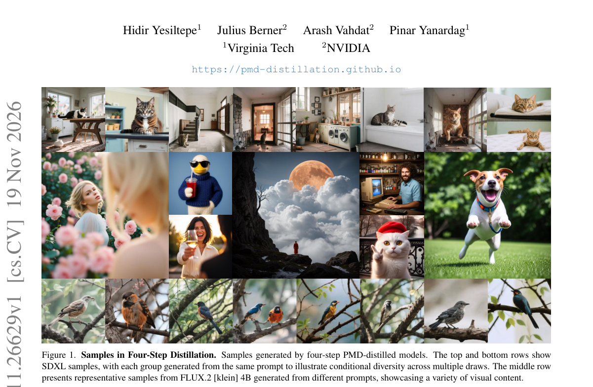

*Result - Tilt=Shift Identity. (Left) Estimating a tilted poste- rior mean requires multiple stochastic reverse-diffusion trajecto- ries from the same noisy state, followed by exponential reweight- in*

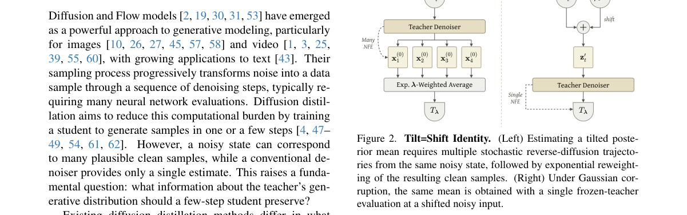

**Why this ranks #4**: PMD 在 SDXL 与 FLUX.2 [klein] 4B 上都取得四步方法中最好的 FID，其中 FLUX.2 上为 24.12，而引入外部奖励监督的 RTDMD 是 31.57；其学生是随机性的，可在训练好的时间步网格内任意切换 2 步或 4 步采样而无需重训。

---

### 5. PP-CFG: Polarity-Preserving Guidance for Controllable Few-Step Image and Video Generation

**arXiv**: [2611.27266](https://arxiv.org/abs/2611.27266) | **Score**: 8.7 (relevance 9 x 0.7 + quality 8 x 0.3) | **Direction**: `aigc_generation` | **Tags**: AIGC-visual, classifier-free-guidance, few-step-distillation, negative-prompting, video-generation, distilled-student, Fudan University | **Categories**: cs.CV | **Pages**: 22

**Authors**: Junyi He; Xu Peng; Chengming Xu; Sixiao Zheng; Donghao Luo; Chao Wen; Peng Tang; Xijie Huang; Chengjie Wang; Yanwei Fu

**Affiliation**: Fudan University; Tencent YouTu Lab

**Abstract**

> Few-step diffusion distillation reduces sampling cost but often weakens adjustable classifier-free guidance (CFG) and runtime negative prompting. We introduce PP-CFG, an architecture that keeps positive and negative text conditions separate and combines their attention responses with opposite signs within a shared visual backbone. Its Scale-Time Polarity Mixer refines each condition using the guidance scale and denoising timestep, allowing prompt influence to vary throughout generation. The student retains a continuous scale input and selectable negative prompts with one visual backbone pass per step. We evaluate PP-CFG on Wan2.1 for video generation with distribution matching distillation (DMD), and on Qwen-Image with both latent consistency model (LCM) distillation and DMD. PP-CFG achieves 81.46 VBench in four steps and lower video teacher-student distances across guidance scales than step-distilled DMD. On NegElement-1K, our benchmark of 1,000 matched image and video prompt cases, it achieves higher target-removal rates than the corresponding teachers. These experiments support the method's generality across attention architectures, generation modalities, and distillation objectives while retaining competitive generation quality.

**Key findings**

- **Finding**: PP-CFG 的 Wan2.1 学生四步达到 VBench 81.46，高于 DMD 80.66、AVD 81.35 与教师 80.13；NegElement-1K 上图像移除率 12.08% 对教师 7.35%，视频 22.00% 对 10.20%。
- **Inference**: 把正负文本条件的注意力响应以相反符号在共享视觉主干内合成，等于把 CFG 内化成架构本身，从而避免外部 CFG 作用在少步采样上时出现过度曝光与细节丢失。
- **Recommendation**: 用少步蒸馏模型时优先换成内建引导的方案，并把 guidance scale 当作连续可调参数在 1 到 9 之间扫一遍，再按 FVD 与 VBench 双指标验收。

**Key figures**

*Framework - CFG after distillation. External CFG can degrade student outputs and increase their discrepancy from the teacher. PP-CFG learns scale-dependent guidance within a shared visual stream.*

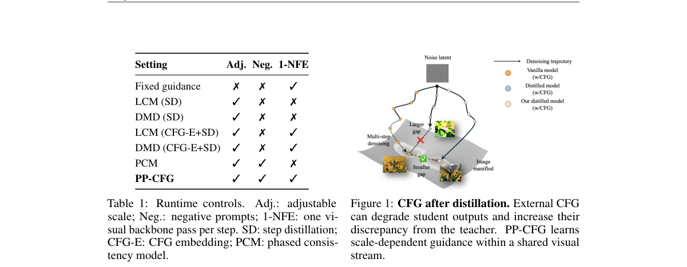

*Result - PP-CFG on Qwen-Image. (a) The mixer refines each text condition using guidance scale g and denoising time t; internal projections are omitted in the diagram. (b) Joint-attention paths update*

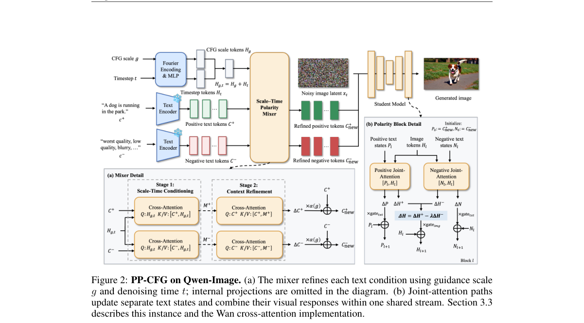

**Why this ranks #5**: PP-CFG 蒸馏出的 Wan2.1 学生四步拿到 VBench 81.46，高于 DMD 的 80.66、AVD 的 81.35 与教师的 80.13；在自建 NegElement-1K 上图像目标移除率 12.08% 对教师的 7.35%，视频 22.00% 对 10.20%，说明负向提示在少步模型上依然可控。

---

### 6. Zing-1.0: A Playable World System Built on Controllable Rendering

**arXiv**: [2611.27336](https://arxiv.org/abs/2611.27336) | **Score**: 8.7 (relevance 9 x 0.7 + quality 8 x 0.3) | **Direction**: `aigc_generation` | **Tags**: AIGC-visual, playable-world, streaming-renderer, interaction-runtime, controllable-rendering, world-kit, Zing Team | **Categories**: cs.CV | **Pages**: 34

**Authors**: Wenbo Zhang; Guoli Zhang; Xuewen Yu; Xueliang Yang; Jiangqiao Yan; Teng Xia; Xinmiao Wu; Zeyang Tian; Haoze Sun; Jinghui Niu; Hongli Ning; Zhiyuan Liu

**Affiliation**: Zing Team, SeedLeap.ai

**Abstract**

> We present Zing-1.0, a Playable World System built on Controllable Rendering. An executable engine resolves player actions under the world's rules and produces proxy video from the updated state. A streaming video model synthesizes the player's view from this proxy, and the runtime delivers it to inform subsequent actions. (1) Principle and system. We formulate Controllable Rendering and define the interfaces among world construction, world execution, observation synthesis, and the interaction runtime. To our knowledge, this is the first implementation-independent specification of a Playable World System. (2) AI-native engine. WorldKit provides structured authoring tools and reusable character, camera, and control components for coding agents to construct executable proxy worlds. It supports extensible interactions and precise geometric motion control while separating executable behavior from final visual appearance. (3) Streaming renderer. We adapt MiniMax-H3 for block-causal autoregressive generation and incremental decoding. Proxy video constrains structure and motion, while text and separate scene and subject references specify appearance. We train the generator on diverse tasks and distill it to generate each block in a few denoising steps. The renderer leads the compared streaming editors on OpenVE (3.90) and LongV2VBench (3.44). On StreamEval, Zing-1.0 scores 57.86 on instruction editing and 54.06 on reference editing, exceeding the published baselines on both tracks. (4) Interaction infrastructure. We build an Interaction Runtime that routes player actions to WorldKit while supporting in-play prompt and reference updates. Cross-block joint execution and sparse attention with compressed K/V reduce inference overhead. With the DiT on a single H200 and encoding and decoding on one H100 each, the serving system achieves a steady-state throughput of 23.82 FPS at $832\times480$.

**Key findings**

- **Finding**: Zing-1.0 渲染器在 OpenVE 得 3.90、LongV2VBench 得 3.44，StreamEval 上指令编辑 57.86、参考编辑 54.06，服务端在 832×480 稳态吞吐 23.82 FPS。
- **Inference**: 用可执行引擎产生的 proxy 帧约束结构与运动、把外观交给文本与独立的场景与主体参考，等于把「世界逻辑」与「画面生成」拆成两个可独立替换的模块。
- **Recommendation**: 想搭交互式世界系统时按世界构建、世界执行、观测合成、交互运行时四个接口分层，先把 proxy 帧的语义契约定死，再替换背后的渲染模型。

**Key figures**

*Framework - Conceptual overview of Zing-1.0 as a Playable World System. World construction produces an ex- ecutable WorldKit world. Player actions update its state, and proxy frames guide observation sy*

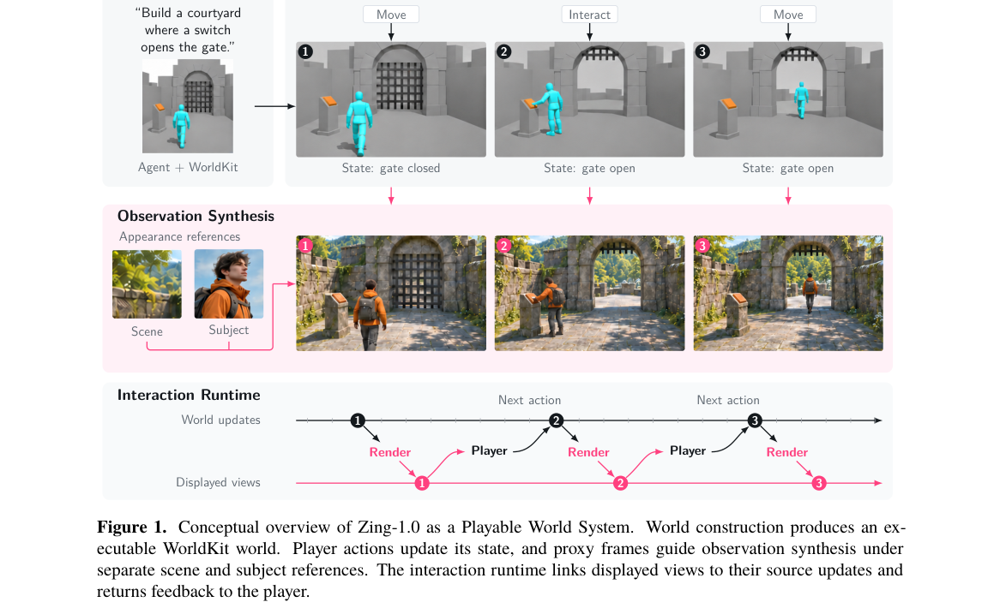

*Result - Zing-1.0 system architecture, with the control side (the coding agent and WorldKit) and the rendering side (the streaming renderer) connected by proxy frames. Offline construction produces a*

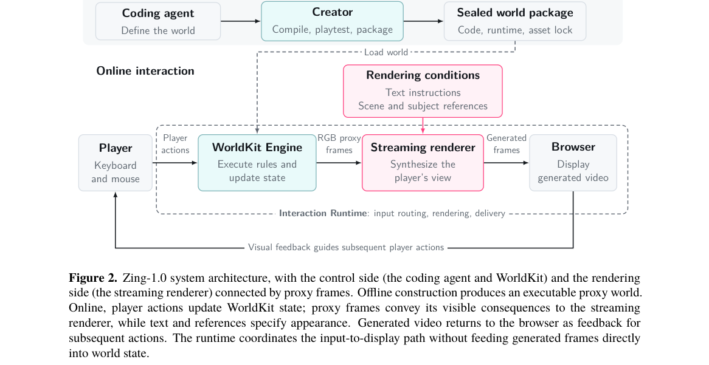

**Why this ranks #6**: Zing-1.0 的流式渲染器在 OpenVE 上得 3.90、LongV2VBench 上得 3.44，StreamEval 的指令编辑 57.86 与参考编辑 54.06 都超过已发表基线；服务系统 DiT 放单张 H200、编解码各占一张 H100，832×480 下稳态吞吐 23.82 FPS。

---

### 7. CalibCache: Cache-to-Full Feature Dynamics Calibration for Diffusion Transformers

**arXiv**: [2611.25296](https://arxiv.org/abs/2611.25296) | **Score**: 8.0 (relevance 8 x 0.7 + quality 8 x 0.3) | **Direction**: `aigc_generation` | **Tags**: AIGC-visual, feature-caching, diffusion-transformer, offline-calibration, sampling-acceleration, taylor-extrapolation, Nanjing University | **Categories**: cs.CV | **Pages**: 24

**Authors**: Mingyu Liang; Dingkun Xu; Jingwei Xu

**Affiliation**: Nanjing University

**Abstract**

> Diffusion Transformers generate high-quality images, but iterative sampling remains computationally expensive. Feature caching reduces the number of full network evaluations, yet its approximation error can become more severe under short sampling schedules, where fewer full-compute steps and a coarser sampling grid can make history-based extrapolation less reliable. In this paper, we propose CalibCache, a lightweight offline calibration method that corrects systematic discrepancies between cached and full-compute feature dynamics. Specifically, CalibCache calibrates feature acceleration, defined as the second-order finite difference across sampling steps. Using only a single pair of full-compute and naive-cache trajectories at each setting, CalibCache fits scalar acceleration maps offline by centered least squares. These maps are then applied during sampling without additional full-network evaluations or online optimization. Across FLUX.1-dev and Qwen-Image on DrawBench and DiT-XL/2 on ImageNet-256, CalibCache consistently improves fidelity or generation quality over TaylorSeer under 20-step sampling at cache intervals $N=3,4,5$. At $N=5$, it reduces FLUX.1-dev LPIPS from $0.563$ to $0.429$ while achieving a $2.86\times$ denoising speedup over full-compute sampling, and lowers DiT-XL/2 FID from $16.39$ to $10.37$ relative to TaylorSeer.

**Key findings**

- **Finding**: N=5 时 CalibCache 把 FLUX.1-dev 的 LPIPS 从 0.563 降到 0.429，ImageReward 从 0.775 提到 0.899，去噪加速 2.86 倍；DiT-XL/2 的 FID 从 16.39 降到 10.37，均优于 TaylorSeer。
- **Inference**: 缓存与全量计算的偏差主要落在特征加速度这一二阶量上，因此离线用一条成对轨迹拟合标量加速度图就能在采样时零额外全量前向地修正系统性误差。
- **Recommendation**: 用特征缓存加速 DiT 时可直接套用「成对轨迹加中心最小二乘」的离线标定，每个缓存间隔只需一条轨迹对，并分别用 LPIPS 与 FID 两套指标验收。

**Key figures**

*Framework - Five-column qualitative comparison on FLUX.1-dev with 20-step DrawBench sampling. Within each row, all methods use the same prompt and initial noise. The columns show Native, FORA (N = 3, 2.*

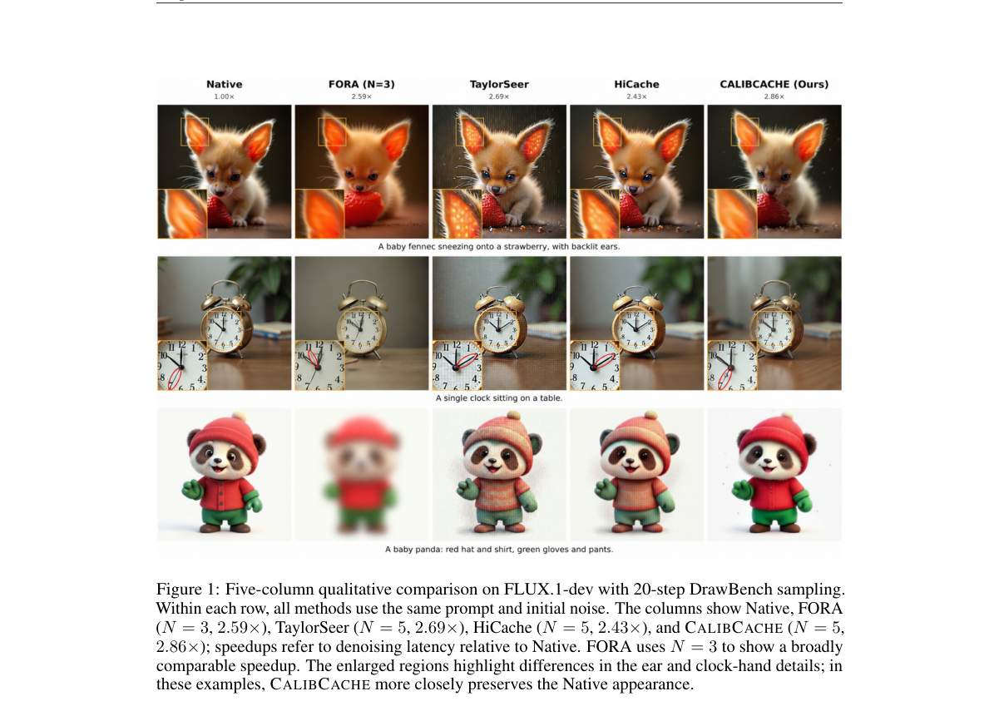

*Result - Overview of CALIBCACHE. (a) One full-compute/naive-cache trajectory pair with the same condition and initial noise provides acceleration observations for centered scalar fitting at the first*

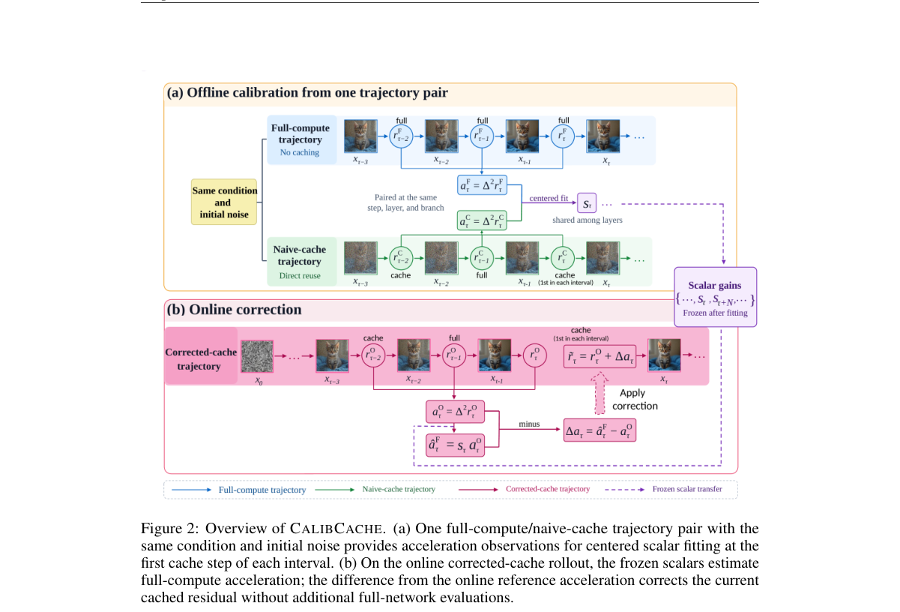

**Why this ranks #7**: 在缓存间隔 N=5 时 CalibCache 把 FLUX.1-dev 的 LPIPS 从 TaylorSeer 的 0.563 降到 0.429、ImageReward 从 0.775 提到 0.899，同时拿到 2.86 倍去噪加速；DiT-XL/2 的 FID 从 16.39 降到 10.37，且每个设置只用一条成对轨迹做标定。

---

### 8. VideoRNG: Relightable Neural Gaussians from Generative Video Models

**arXiv**: [2611.25338](https://arxiv.org/abs/2611.25338) | **Score**: 8.0 (relevance 8 x 0.7 + quality 8 x 0.3) | **Direction**: `aigc_generation` | **Tags**: AIGC-visual, 3d-generation, neural-gaussians, relightable, video-diffusion, turntable-reconstruction, NVIDIA | **Categories**: cs.CV, cs.GR | **Pages**: 23

**Authors**: Bowen Xue; Saeed Hadadan; Fabrice Rousselle; Ravi Ramamoorthi; Zahra Montazeri; Miloš Hašan

**Affiliation**: NVIDIA; University of Manchester; University of California, San Diego

**Abstract**

> Generating realistic 3D assets remains constrained by classical representations: surface meshes and compact physically based materials struggle to express objects whose appearance arises from fine geometry or complex light transport, while existing Gaussian-splatting generators typically bake fixed illumination into appearance. We introduce VideoRNG, a two-stage method that generates complete, relightable 3D assets from a text prompt or a single image without prescribing a mesh or analytic material model. A video generator fine-tuned from a pretrained video diffusion backbone first produces a structured RGBA turntable sequence under a known pose, camera, and illumination. A feed-forward large reconstruction model initialized from a pretrained video diffusion backbone then maps the video-VAE latent frames of selected turntable frames directly to millions of anisotropic Gaussians with learned neural appearance features. A shared directional decoder and stochastic Gaussian ray tracer turn this representation, which we call ray-traced Relightable Neural Gaussians (rtRNG), into radiance under novel viewpoints and illumination. To preserve high-frequency appearance while learning geometry, we introduce depth-anchored appearance training, and we make million-Gaussian reconstruction practical through foreground token selection and cost-aware distributed sampling. VideoRNG generates complex assets such as fur, feathers, and spider webs that can be interactively rendered, relit, and integrated into scenes.

**Key findings**

- **Finding**: VideoRNG 的视频生成器产出 81 帧 RGBA 转台，取其中 29 帧编成 8 个 VAE latent 帧，一次前向映射为百万级各向异性高斯，渲染约 50 ms 每帧（1280×720、1 spp）。
- **Inference**: 训练数据只需约 22K 条带标注的转台片段即可让视频扩散模型承担几何先验，重建阶段再用深度锚定的外观训练把高频纹理与几何分开优化。
- **Recommendation**: 需要可重光照 3D 资产时，先用转台视频方案拿到带 RGBA 的几何，再用共享方向解码器加随机高斯光线追踪更换光照，避免退回网格加 PBR 材质。

**Key figures**

*Framework - VideoRNG generates relightable 3D assets from a text prompt or an image. Here we show rtRNG assets rendered together in a single scene using a full path tracer: a fur coat, pyrite crystal cl*

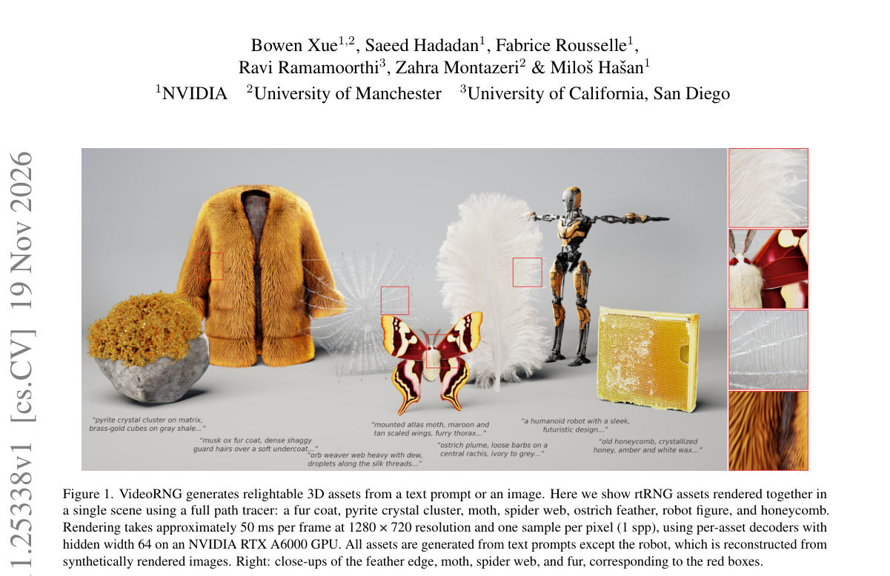

*Result - VideoRNG inference pipeline. (a) A fine-tuned video generator produces an 81-frame turntable. (b) 29 uniformly spaced frames are encoded into eight VAE latent frames. (c) The reconstruction*

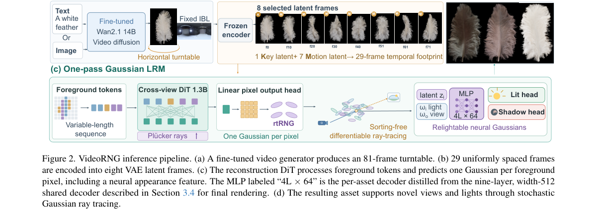

**Why this ranks #8**: VideoRNG 先让微调后的视频扩散模型产出 81 帧 RGBA 转台序列，再把其中 29 帧编成 8 个 VAE latent 帧，一次前向重建出百万级各向异性高斯；最终渲染约 50 ms 每帧（1280×720、1 spp），且可重新打光而不需要网格或解析材质。

---

### 9. CaT-Movie: Balancing Global Planning and Local Rendering for Long Multi-Shot Video Generation

**arXiv**: [2611.25620](https://arxiv.org/abs/2611.25620) | **Score**: 8.0 (relevance 8 x 0.7 + quality 8 x 0.3) | **Direction**: `aigc_generation` | **Tags**: AIGC-visual, multi-shot-video, storyboard-planning, cross-shot-consistency, long-video-generation, reference-routing, University of Science and Technology of | **Categories**: cs.CV | **Pages**: 31

**Authors**: Jinpeng Lu; Haoyuan Shi; Yuanshen Guan; Jiyuan Xia; Bin Wu; Yinda Chen; Zhiwei Xiong

**Affiliation**: University of Science and Technology of China

**Abstract**

> Current multi-shot video generators render only limited durations per pass, requiring long movies to be stitched from local segments across which narrative progression and visual identity drift. To synthesize long-horizon movies with Coherence across Time, we present CaT-Movie, a multi-shot generation system consisting of a global story planner and a local window renderer. The planner expands user requests via a large language model to preserve, infer, and complete story details, while deterministic code maintains the resulting storyboard across shots to compile self-contained shot prompts and index reference frames from generated history. To execute this guidance, the renderer applies reference-routed sparse self-attention and shot-wise cross-attention to route identities from the indexed frames while isolating per-shot textual conditions. Given the scarcity of high-quality open-source multi-shot data, we construct a dataset of over 350K film shots annotated with semantic state transitions, entity grounding, and multi-granularity requests. We further build CaT-MBench, a benchmark on held-out films with the same annotations. It gives every baseline its native format and counts cross-shot consistency only when a cut opens a new camera setup, preventing repeated framing from passing as consistency. On CaT-MBench, CaT-Movie attains the highest average score and the most consistent characters among all methods. The project page is available at https://jinplu.github.io/CaT-Movie/.

**Key findings**

- **Finding**: CaT-Movie 在 CaT-MBench 的 92 个测试故事（1012 道问题、740 个计划切点）上取得最高平均分 0.597，高于 HoloCine 的 0.571，角色一致性 0.651 领先全部基线。
- **Inference**: 基准只在切换真正开启新机位时才统计跨镜一致性，反复沿用同一构图无法刷分，这解释了逐镜基线与多镜基线之间的明显差距。
- **Recommendation**: 评估长视频一致性时务必启用切点门控，并把 LLM 规划器输出的分镜脚本当作一等中间产物单独核对，而不是只看最终视频。

**Key figures**

*Framework - Cross-window drift, copied framing, and cut-gated evaluation. Each film strip is one generation pass. Joint generation switches camera setup at the cut from shot 3 to 4 but changes the man i*

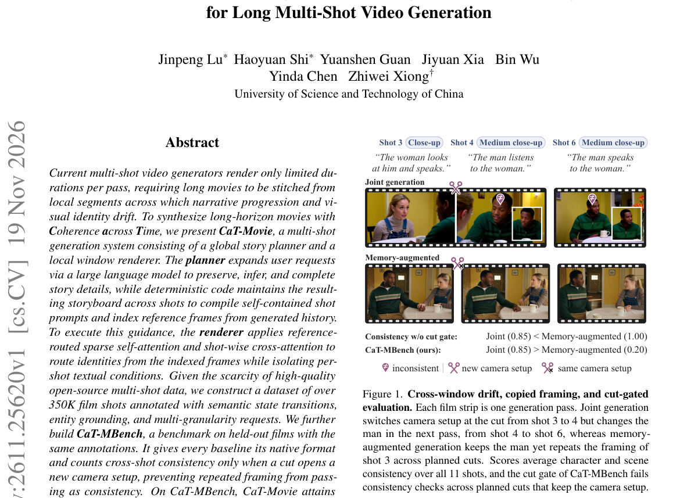

*Result - Overview of CaT-Movie. A planner writes one storyboard, from which a prompt compiler maintains cross-shot state and derives per-shot text ck, the frames each shot recalls, and an identity li*

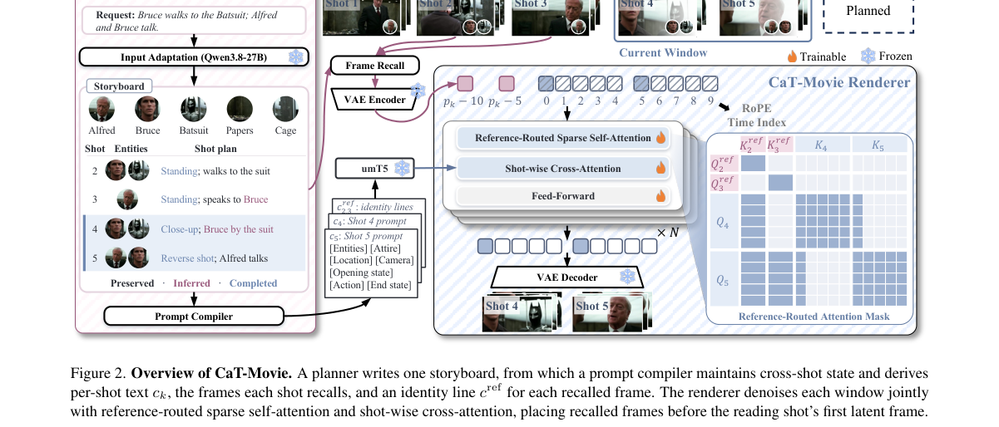

**Why this ranks #9**: CaT-Movie 在 CaT-MBench 的 92 个测试故事（1012 道问题、740 个计划切点）上取得最高平均分 0.597，高于次优 HoloCine 的 0.571，角色一致性 0.651 领先全部基线；训练侧用了 358302 个电影镜头共 332.8 小时的多粒度标注数据。

---

### 10. D3-Cache: Accelerating Diffusion Models with Dynamic Mode Decomposition

**arXiv**: [2611.25689](https://arxiv.org/abs/2611.25689) | **Score**: 8.0 (relevance 8 x 0.7 + quality 8 x 0.3) | **Direction**: `aigc_generation` | **Tags**: AIGC-visual, dynamic-mode-decomposition, velocity-forecasting, sampling-acceleration, training-free, closed-loop-gating, University of Chinese Academy of Sciences | **Categories**: cs.CV | **Pages**: 12

**Authors**: Yanbo Li; An Xiang; Xiaoxin Hu; Feng Wang; Cheng-zhong Xu; Kejiang Ye; Xitong Gao

**Affiliation**: University of Chinese Academy of Sciences; University of Macau

**Abstract**

> Diffusion Transformers generate high-quality images and videos, but every sampling step requires a full network evaluation. Training-free caching reduces this cost by reusing or forecasting network outputs across steps, but common approaches use per-model calibrated skip criteria or maintain per-layer prediction histories. We present D3-Cache, which applies Dynamic Mode Decomposition (DMD) to Diffusion sampling: it fits DMD to a short history of exact velocities and forecasts only the velocity that the scheduler consumes. A horizon-aware gate decides when to skip: whenever the network is evaluated, its output is compared with the forecast for that step, and the larger the error, the sooner the network is evaluated again, up to a cap on consecutive skipped steps. D3-Cache requires no training or per-model offline calibration curve and adds negligible memory. It shares one history length and risk tolerance across the four evaluated models. On four state-of-the-art image and video models, D3-Cache achieves speedups of 2.6-3.8x with high fidelity to the base model output.

**Key findings**

- **Finding**: D3-Cache 用同一组 H=3、τ=0.56 的超参在四个模型上取得 2.6 到 3.8 倍加速，HiDream 上 SSIM 从 0.772 升到 0.855、PSNR 从 19.75 dB 升到 24.51 dB、LPIPS 从 0.189 降到 0.111。
- **Inference**: 用动态模态分解拟合最近几次精确速度的历史、再由已实现的预测误差反推风险水平，等于把离线标定的跳步判据换成了闭环纠偏，因此一组超参即可跨模型复用。
- **Recommendation**: 想给扩散模型加速时可直接复用其「预测、打分、刷新」闭环，只需调一个风险阈值 τ 与连续跳步上限 S，不必再为每个模型画标定曲线。

**Key figures**

*Framework - Velocity and patch-correlation diagnostic on FLUX. (a) Absolute difference between the patch-correlation matrices of forecast (Cmethod) and exact (Cbase) velocities. (b,c) Per-prompt correla*

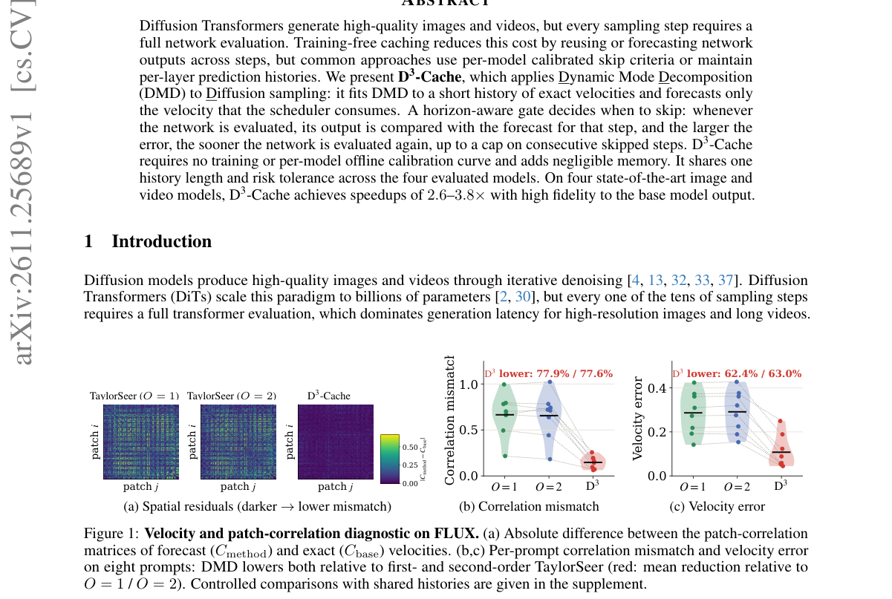

*Result - Overview of D3-Cache. (a) After warmup, each sampling step either runs a full evaluation or reuses a DMD forecast of the velocity. The estimated risk grows with the horizon since the last fu*

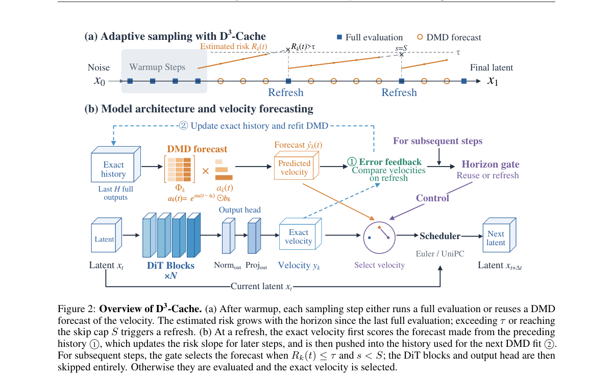

**Why this ranks #10**: D3-Cache 让四个图像与视频模型共享同一组 H=3、τ=0.56 超参即拿到 2.6 到 3.8 倍加速；HiDream 上相对最强基线 MagCache，SSIM 从 0.772 提到 0.855、PSNR 从 19.75 提到 24.51 dB、LPIPS 从 0.189 降到 0.111，且不需要任何训练或逐模型标定曲线。

---

### 11. Why Flat Drafts Stay Flat: Region-Mean Latents Govern Texture in Flow-Based Image Generation

**arXiv**: [2611.25930](https://arxiv.org/abs/2611.25930) | **Score**: 8.0 (relevance 8 x 0.7 + quality 8 x 0.3) | **Direction**: `aigc_generation` | **Tags**: AIGC-visual, latent-analysis, flow-matching, texture-control, vae-encoding, training-free, Institute of Information Engineering | **Categories**: cs.CV | **Pages**: 27

**Authors**: Zihan Gu; Jiangcan Jia; Hua Zhang; Lulu Zhao

**Affiliation**: Institute of Information Engineering, Chinese Academy of Sciences; School of Cyber Security, University of Chinese Academy of Sciences; East China Normal University; Alibaba Group

**Abstract**

> Flat color-block drafts specify layout and regional color while leaving interior detail unspecified, yet pretrained flow-based generators can preserve their flat appearance even under photorealistic prompts. We trace this behavior to a cross-scale mechanism linking fine pixel variation to regional means in variational autoencoder (VAE) latent space. Flattening photo regions systematically shifts their latent means, with offsets concentrated along a shared channel direction within each backbone. Controlled field exchanges in FLUX.1-dev and Qwen-Image establish the effect of this displacement on texture generation: adding the photo-derived regional mean field to a flat latent restores texture, whereas adding its complementary field alone largely preserves flatness. A second-order encoding expansion explains how encoder curvature can convert zero-mean perturbations into mean shifts. An analytically solvable conditional Gaussian flow shows how regional noise averaging enables near-unit endpoint sensitivity at high signal-to-noise ratios. This mechanism motivates training-free rendering through pixel dither before encoding, mean-field scaling, and early boundary holding. Paired low-rank adaptation (LoRA) with draft conditioning improves content recovery and produces photo-like regional means under the standard velocity objective. Explicit regional mean guidance remains effective after adaptation, continuously controlling texture and improving color fidelity. These findings connect encoding shifts to persistent generation behavior and support interventions evaluated for texture, spatial fidelity, and semantic recovery.

**Key findings**

- **Finding**: 照片区域与平坦草图的潜变量均值偏移有 78%（FLUX.1-dev）和 95%（Qwen-Image）集中在一个共享通道方向上，等于把纹理差异压缩成单一方向。
- **Inference**: 编码器的二阶非线性能把零均值扰动转成均值偏移，而条件高斯流在高信噪比下靠区域噪声平均拿到接近单位增益的端点敏感度，平坦外观因此被一路保留。
- **Recommendation**: 用平涂色块草图做布局控制时，先在编码前加像素抖动并按均值场缩放（示例取 1.15），再配早期边界保持，可免训练把纹理找回来。

**Key figures**

*Framework - Flatness follows regional latent means. FLUX.1-dev with matched prompt/noise. Left: draft d and photo x, with equal regional RGB means before quantization. Their VAE latents zf, zp have diff*

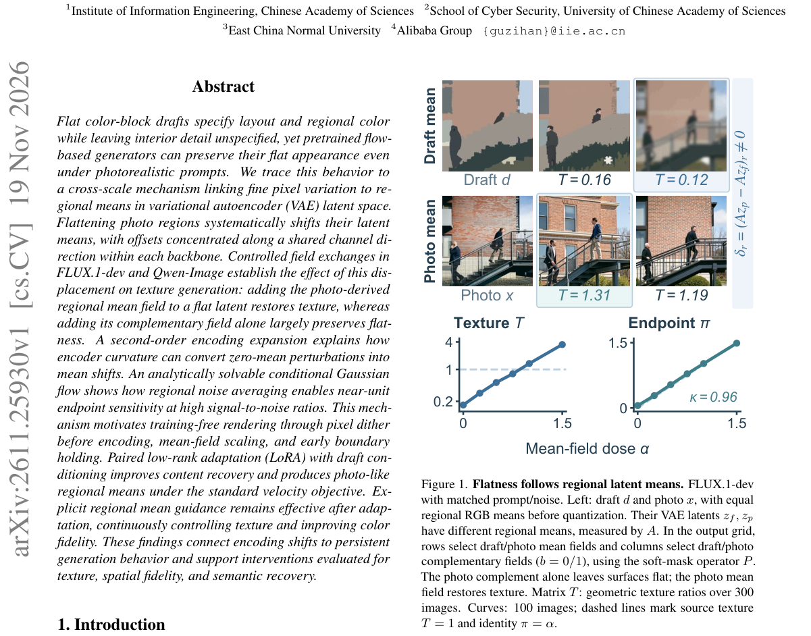

*Result - Regional means connect encoding, trajectory retention, and rendering control. Pre-encoding dither produces a latent displacement; its mean field is scaled while its spatial complement is ret*

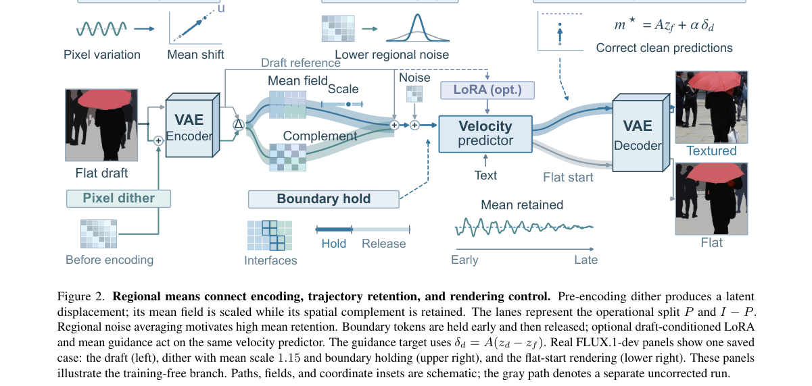

**Why this ranks #11**: 论文测得照片区域与平坦草图的潜变量均值偏移有 78%（FLUX.1-dev）到 95%（Qwen-Image）集中在一个共享通道方向上；据此提出编码前像素抖动、均值场缩放与早期边界保持的免训练修正，示例中均值缩放系数取 1.15。

---

### 12. StreamEgo: Streaming Exocentric-to-Egocentric Video Generation

**arXiv**: [2611.26165](https://arxiv.org/abs/2611.26165) | **Score**: 8.0 (relevance 8 x 0.7 + quality 8 x 0.3) | **Direction**: `aigc_generation` | **Tags**: AIGC-visual, egocentric-video, streaming-generation, real-time, chunk-autoregressive, region-aware-curriculum, Peking University | **Categories**: cs.CV | **Pages**: 26

**Authors**: Tianyi Xu; Boyang Lyu; Yunkai Tang; Kairan Ding; Jiahang Li; Weiyu Guo; Yandong Guo; Shuchen Weng; Boxin Shi

**Affiliation**: Peking University; AI2 Robotics; Beijing Academy of Artificial Intelligence (BAAI)

**Abstract**

> Exocentric-to-egocentric (Exo2Ego) video generation transforms third-person recordings into first-person viewpoints, unlocking immersive AR/VR experiences and scalable demonstration synthesis for embodied robotics. Extending it to a streaming setting is expected to further enable live applications. However, existing methods suffer from degraded manipulation regions, overfitting and confinement to fixed-length clips with prohibitive latency. To address these limitations, we present StreamEgo, a real-time framework for unbounded, generalizable Exo2Ego video generation. To resolve intricate manipulation dynamics while supporting the streaming pipeline, a streaming dual-branch prior provides pixel-aligned guidance for translating appearance and skeletal kinematics. We also introduce a region-aware loss curriculum to improve generalization and stabilize multi-objective diffusion training. Furthermore, we distill the model into a chunk-wise autoregressive model, augmented with a region-aware corruption mechanism and a first-chunk curriculum, enabling high-quality, generalizable real-time streaming Exo2Ego generation at 24.3 FPS on a single H100 GPU.

**Key findings**

- **Finding**: StreamEgo 在单张 H100 上把 Exo2Ego 生成推到 24.3 FPS，而同样离线的 EgoX 只有 0.08 FPS；评测基于 Ego-Exo4D 的 5 秒 24 fps 片段。
- **Inference**: 流式双分支先验分别给出动态自我视角与人体姿态的像素级对齐引导，配合区域感知损失课程与区域感知损坏的分块自回归蒸馏，才能同时兼顾实时与跨动作泛化。
- **Recommendation**: 做实时第一视角生成时可直接照搬其「流式双分支先验、区域感知损失课程、区域感知损坏的分块自回归」三段结构来排训练顺序。

**Key figures**

*Framework - Streaming exocentric-to-egocentric (Exo2Ego) video generation. Left: Tri-regional decomposition of the task of Exo2Ego. Right: Comparison of our method with state-of-the-art Exo2Ego method E*

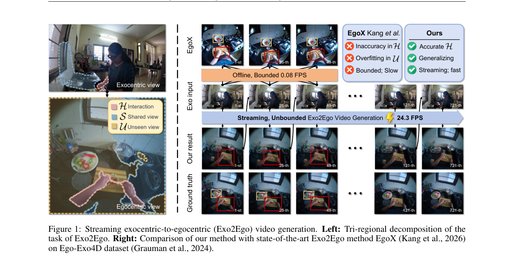

*Result - Overview of the bidirectional teacher. (a) Causal construction of the streaming dual-branch priors, com- prising the dynamic ego prior and human pose prior. (b) Conditioning assembly and fin*

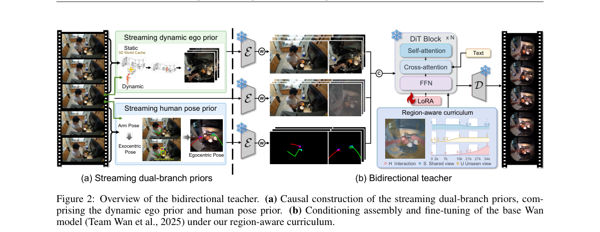

**Why this ranks #12**: StreamEgo 在单张 H100 上把 Exo2Ego 生成推到 24.3 FPS，而对比的离线方法 EgoX 只有 0.08 FPS；评测基于 Ego-Exo4D，每个片段 5 秒、24 fps，模型经分块自回归蒸馏后还能配合区域感知损坏保持无限流式。

---

## AIGC 编辑（指令编辑 / 修补 / 个性化） · `aigc_editing` (2 papers)

本轮只有 2 篇,方向刚好卡在「有真实增量、但供给稀薄」的位置。CRIE-Agent 提出复杂冗余指令编辑(同一句请求里既新增对象又撤销早先的编辑),并造了带最终意图标注的 CRIE-S 基准 1 万条;结果直白——五个编辑后端上,直接编辑的完整编辑成功率是 **0%**,拆成多步则会把已撤销的旧编辑留下,CRIE-Agent 把完整成功率抬到 27.5–50.0%。GameScrub 走的是另一条路:不合成带 HUD 的配对素材,而是用视频扩散模型从真实录屏里「回收」干净目标,最终在 Game2World 上把 artifact 修正后的去除分从 GameCleaner 的 57.86 提到 71.95,标注 HUD 元素去除率从 59.07% 提到 90.06%。

### 13. What Stays in the Picture? From Redundant Instructions to Dependency-Aware Image Editing

**arXiv**: [2611.27388](https://arxiv.org/abs/2611.27388) | **Score**: 8.0 (relevance 8 x 0.7 + quality 8 x 0.3) | **Direction**: `aigc_editing` | **Tags**: AIGC-visual, redundant-instructions, agent-based-editing, final-intent, dependency-aware-planning, benchmark, Sun Yat-sen University | **Categories**: cs.CV | **Pages**: 20

**Authors**: Zi-Jun Wang; Yu Lin; Zhilin Zhao

**Affiliation**: Sun Yat-sen University

**Abstract**

> We introduce complex redundant-instruction image editing, where a single request specifies multiple objects, their attributes, and spatial relations while revising or canceling earlier editing requirements. Direct editing can fail to recover this intent, while splitting the request into successive steps can preserve obsolete edits and visual errors. Our key insight is to resolve the revision history into a final editing target that jointly guides planning and verification, so that obsolete requests do not become visual edits. Based on this insight, CRIE-Agent learns to consolidate revisions into object-level final intent and executes the retained objects in reference-first blocks, establishing referenced objects before their dependents. Verification then guides complete re-execution from the source image, with conditional layout hints, preventing visual errors from failed attempts from being carried into subsequent ones. We also construct CRIE-S, a benchmark containing 10,000 complex and redundant editing instructions with exact final intent annotations. Across five image-editing backends on CRIE-S, CRIE-Agent raises complete editing success from 0% under direct editing to 27.5--50.0%.

**Key findings**

- **Finding**: 在 CRIE-S 的 10000 条冗余指令上，CRIE-Agent 让五个编辑后端的完整编辑成功率从直接编辑的 0% 提升到 27.5% 至 50.0%，Qwen-Image-2.1 达 50.0%、FLUX.2-klein-4B 为 27.5%。
- **Inference**: 标点切分与 VLM 重组这类朴素指令处理只能拿到 0% 到 1.0% 的完整成功率，说明必须先把修订历史解析成最终意图、再按依赖顺序执行。
- **Recommendation**: 遇到带修订与取消的复合编辑请求时，先让意图代理输出对象级最终意图，再按参考优先顺序执行并在失败后从原图整体重做，不要沿用失败结果继续叠加。

**Key figures**

*Framework - Qualitative examples of complex redundant-instruction image editing with FLUX.2-klein-4B [6] and Qwen-Image-2.1 [22]. Top: direct editing. Bottom: the corresponding editor augmented with CRI*

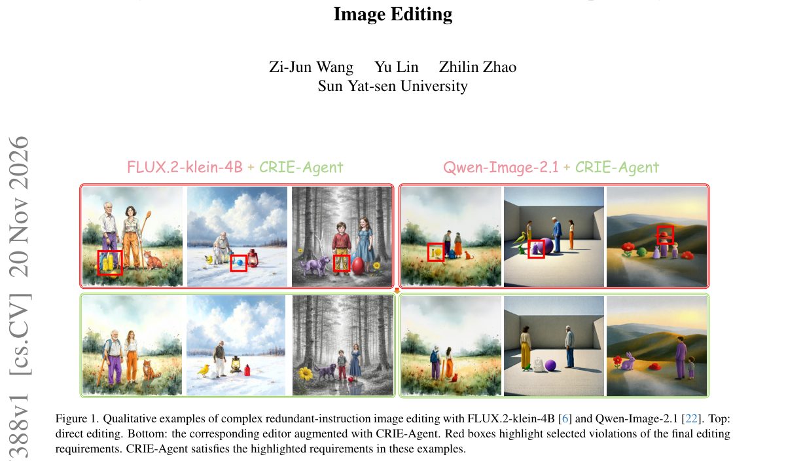

*Result - Qualitative comparison of instruction processing methods with Qwen-Image-Edit-2511. A: direct editing; B: punctuation-based splitting; C: VLM-based splitting; D: VLM re- organization into mu*

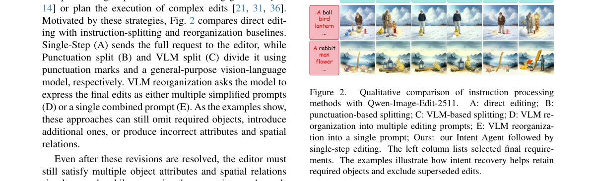

**Why this ranks #13**: CRIE-S 收录 10000 条带精确最终意图标注的复杂冗余编辑指令；在五个图像编辑后端上，CRIE-Agent 把完整编辑成功率从直接编辑的 0% 提到 27.5% 到 50.0%，其中 Qwen-Image-2.1 达 50.0%、FLUX.2-klein-4B 为 27.5%。

---

### 14. GameScrub: Learning HUD Removal from Real Gameplay with Recovered Targets

**arXiv**: [2611.27547](https://arxiv.org/abs/2611.27547) | **Score**: 8.0 (relevance 8 x 0.7 + quality 8 x 0.3) | **Direction**: `aigc_editing` | **Tags**: AIGC-visual, hud-removal, gameplay-video, pseudo-clean-targets, video-inpainting, world-model-data, Institute of Foundation Models | **Categories**: cs.CV | **Pages**: 24

**Authors**: Mohammad Areeb Qazi; Yiyan Hu; Yanan Wang; Xuezhi Liang; Xin Li; Fan Yang; Xin Gao; Guangyi Liu

**Affiliation**: Institute of Foundation Models

**Abstract**

> Gameplay videos are a rich source of experience for learning virtual-world dynamics, yet their frames contain heads-up displays (HUDs) that follow interface rules rather than scene dynamics. Removing HUDs would make this footage directly usable for learning world dynamics. However, training a removal model requires paired clips with and without HUDs, whereas real recordings contain only HUD-overlaid footage. Existing work synthesizes pairs by compositing HUD graphics onto HUD-free footage, requiring a separately curated clean corpus and producing HUDs that only approximate real ones. Models trained on such pairs leave 40 to 50% of real HUD elements untouched. We instead recover pseudo-clean targets directly from real recordings by inpainting HUD regions with a pretrained video diffusion model. Preventing HUD traces from leaking into recovered targets is challenging because latent video autoencoders mix information across mask boundaries. Our training-free recovery pipeline, GameScrub-Data, pre-fills HUD regions with flow-guided background estimates before encoding, excludes HUDs from scene conditioning, and confines restoration to masked regions through pixel-space compositing. The resulting pairs train GameScrub, a video diffusion removal model that handles diverse HUDs without inference-time masks or clean reference images. On the in-the-wild Game2World benchmark, GameScrub achieves an artifact-adjusted removal score of 71.95, compared with 57.86 for the strongest reference-free GameCleaner configuration, and removes 90.06% of annotated HUD elements versus 59.07%. These results demonstrate that real recordings with recovered targets can support effective HUD removal, advancing HUD-free gameplay data for world models and controllable video generation.

**Key findings**

- **Finding**: 在 Game2World 真实野外基准上，GameScrub 取得 71.95 的伪影校正去 HUD 分数，而最强无参考配置的 GameCleaner 只有 57.86；标注 HUD 元素移除率 90.06% 对 59.07%。
- **Inference**: 合成 HUD 配对训练出来的模型在真实片子上留下 40% 到 50% 的 HUD 未处理，说明必须先用扩散模型从真实录屏反推伪干净目标，数据构造才是整条链路的瓶颈。
- **Recommendation**: 需要干净游戏录屏做世界模型训练时，可直接跑 GameScrub-Data 的免训练恢复流程拿伪干净目标，再训练专用去 HUD 模型，推理端无需提供掩码。

**Key figures**

*Framework - GameScrub removes diverse HUDs from real gameplay. (a) A frame from the in-the-wild split of the Game2World benchmark Shen et al. (2026) with its annotated HUD elements, colored by how they*

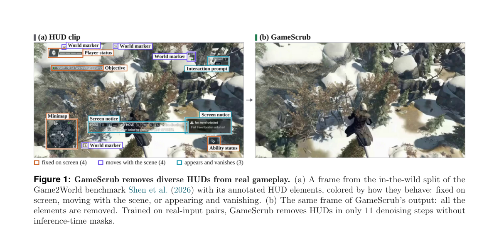

*Result - GameScrub-Data: Recovering paired supervision from real gameplay. Top: Game2World Shen et al. (2026) composites HUD assets onto clean footage, yielding synthetic inputs with exact targets. B*

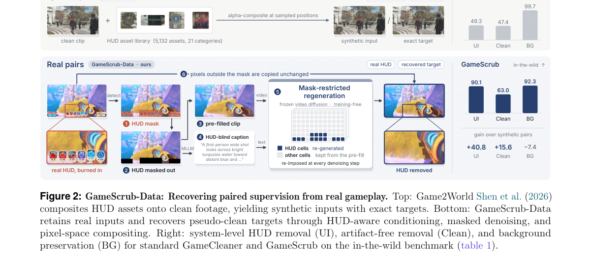

**Why this ranks #14**: 在真实录屏上 GameScrub 的去 HUD 分数达 71.95，最强无参考配置的 GameCleaner 只有 57.86；标注 HUD 元素移除率 90.06% 对 59.07%，而用合成配对训练的方法会漏掉 40% 到 50% 的真实 HUD，推理端也不需要掩码或干净参考图。

---

## 面向视觉生成的 RL 与奖励模型 · `aigc_rl` (1 papers)

唯一一篇,但它恰好是这一轮视觉侧 RL 的全部供给。Zero to Four Views 用同一个模型从文本加 K∈{0..4} 个透视条件视图生成整幅等距柱状全景:第一阶段把每个条件视图连同相机槽位 ID 一起拼进 token 序列、训练时随机改变视图数量,于是**一套权重覆盖所有输入档位**;第二阶段专门改进未被任何条件视图覆盖的区域。关键设计是 Uncovered-Region GRPO —— 监督训练只对真值加噪 latent 计损失,从不评判模型自己生成并解码出来的全景,因此 RL 阶段改用「视觉语言模型在裁剪块上两两比较更偏好哪个候选」作奖励。在 Laval Indoor 上单条件视图超过了同数据同代码的 360Anything,SUN360 室内子集则结果不一。

### 15. Zero to Four Views: Unified Panorama Generation and Preference RL for Unobserved Regions

**arXiv**: [2611.25389](https://arxiv.org/abs/2611.25389) | **Score**: 8.7 (relevance 9 x 0.7 + quality 8 x 0.3) | **Direction**: `aigc_rl` | **Tags**: AIGC-visual, panorama-generation, grpo, preference-reward, view-conditioning, reinforcement-learning, George Mason University | **Categories**: cs.CV | **Pages**: 20

**Authors**: Rui Hong; Xugang Ye; Jana Košecká; Kai Fan

**Affiliation**: George Mason University; Independent Researcher

**Abstract**

> Panoramas can serve as shared scene backgrounds for multi-shot video generation, but most existing panorama generators take text alone or a single input image. We present a single model that generates a full equirectangular panorama from a text caption and K in {0,...,4} perspective conditioning views taken by a four-camera rig at one viewpoint. We fine-tune a pretrained text-to-image rectified-flow transformer in two stages. In the first stage, each conditioning view is appended to the token sequence together with the ID of its camera slot, and the number of views varies during training, so one set of weights serves every input setting. In the second stage, we improve the region not covered by any conditioning view. Supervised training computes its loss on noisy latents of the ground truth and never scores a panorama the model has generated and decoded, so we propose Uncovered-Region GRPO (UR-GRPO), a reinforcement-learning recipe that rewards the candidates a vision-language model prefers in pairwise comparisons on crops around this region. Because the slot ID alone does not tell the model which way the rig points, we also offer an optional variant that writes each view's camera direction into its position encoding, which lets the user decide where each view appears in the output. With one conditioning view, our model outperforms the previous state of the art, 360Anything, trained on the same data and evaluated with the same code, on Laval Indoor and gives mixed results on an indoor subset of SUN360; the second stage improves the results for every number of conditioning views.

**Key findings**

- **Finding**: 第二阶段 UR-GRPO 把 Laval Indoor 在 K=1 的 crop FID 从 34.25 降到 13.44，与双边 CFG 对照相比为 14.91 降到 10.20，SUN360 上为 23.03 降到 21.11。
- **Inference**: 监督训练只在真值噪声潜变量上算损失，从不对模型自己生成并解码的全景打分，因此只有引入基于裁剪块两两比较的强化学习信号才能补上未覆盖区域。
- **Recommendation**: 做少视角条件生成时用一套权重覆盖 K=0 到 4，并把奖励集中在未被条件视角覆盖的区域，而不是一味增加条件视角数量。

**Key figures**

*Framework - Overview of training. Stage 1 fine-tunes one model for any number K of conditioning views, with a flow-matching loss on the noisy ground-truth panorama; each view token carries its camera sl*

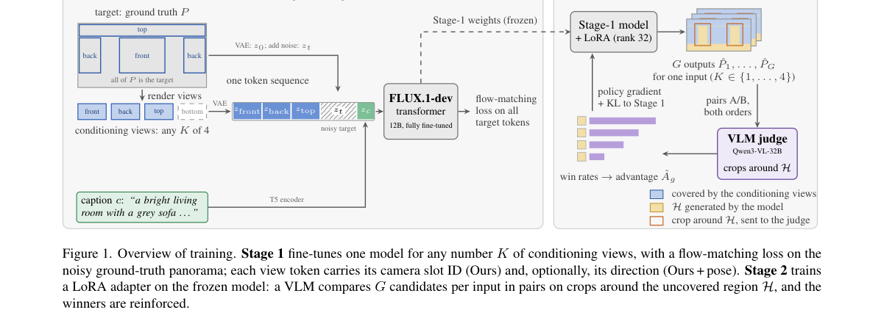

*Result - Held-out Laval Indoor scenes at K=1 with CFG (same noise seed for all models). Left: the conditioning view of our models and the caption (shortened); the 360Anything re-implementation receiv*

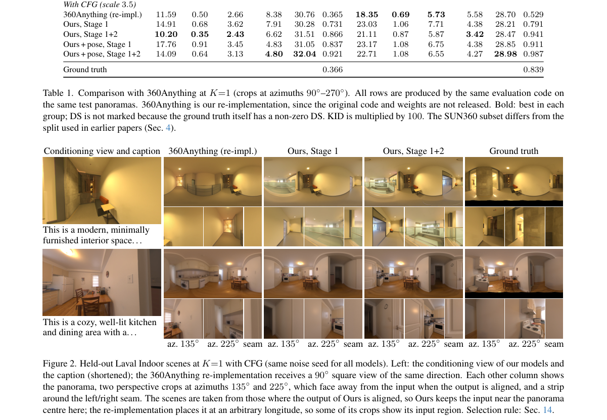

**Why this ranks #15**: UR-GRPO 让同一套权重支持 K=0 到 4 个条件视角，Laval Indoor 上 K=1 的 crop FID 从 Stage 1 的 34.25 降到 13.44，双边都开 CFG 时为 14.91 降到 10.20，SUN360 上从 23.03 降到 21.11；奖励来自视觉语言模型对未覆盖区域裁剪块的两两偏好比较。

---

## Footer

- Total papers reviewed across all 4 axes: 60
- aigc_visual axis final count: 15
- Wild-cards in this axis: 0
- Figure assets: 2026-11-24/res/

Generated by `mine-arxiv-daily-digest` skill. Sister file: `2026-11-24_aigc_visual_entry.md`.
