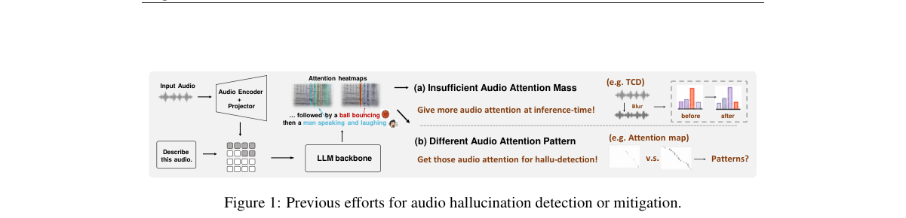
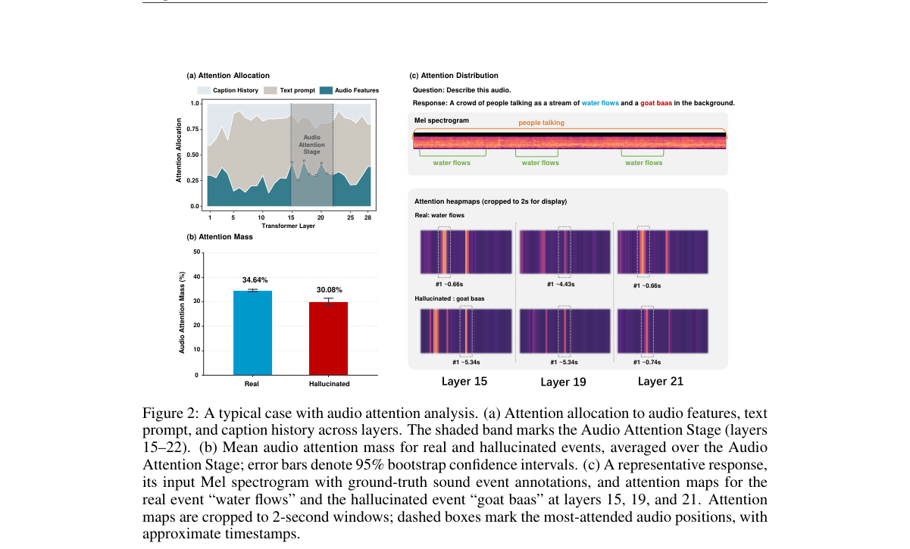
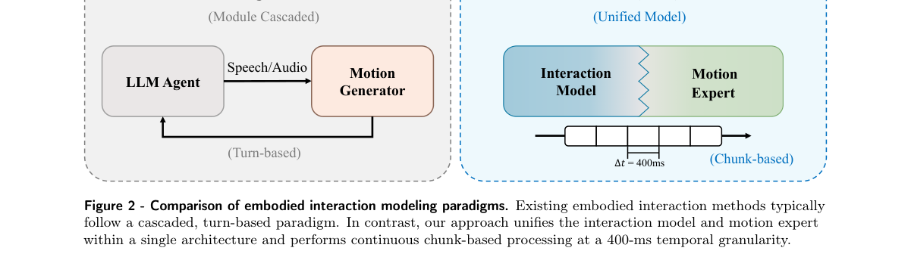
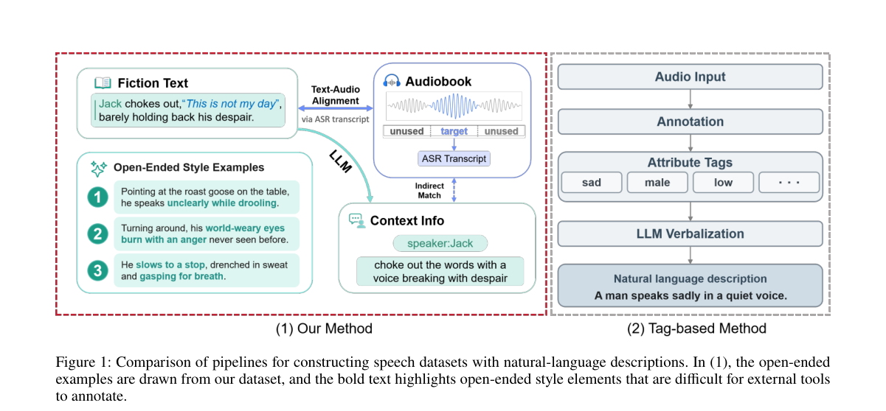
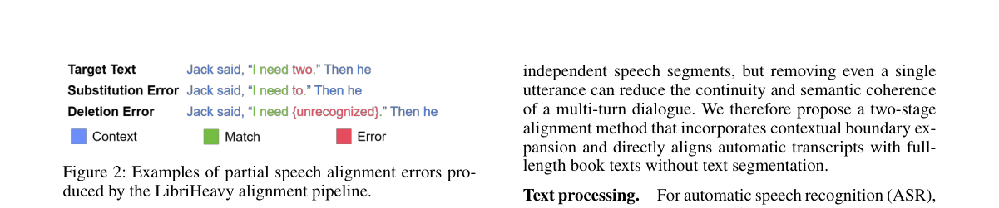
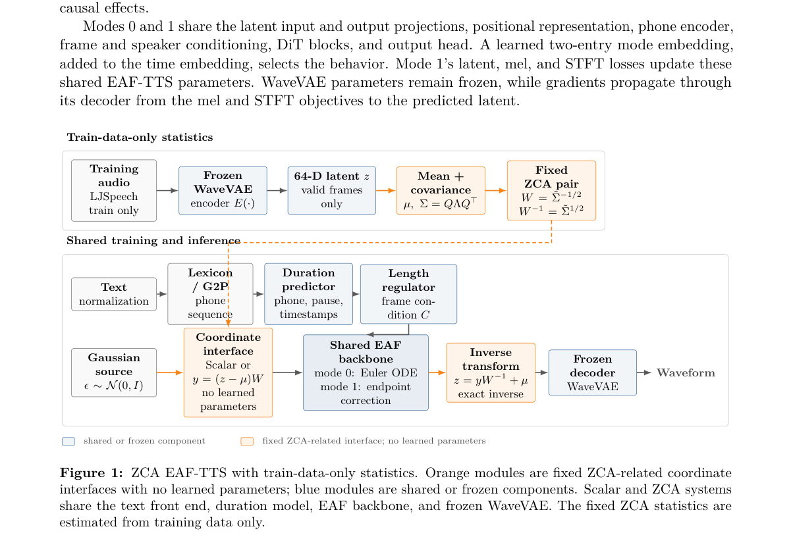
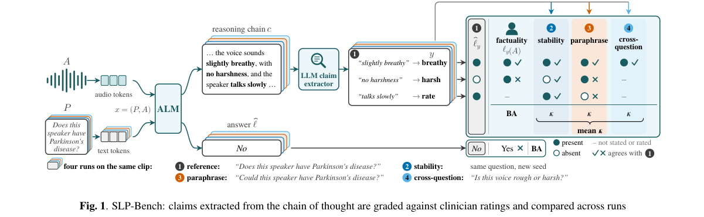
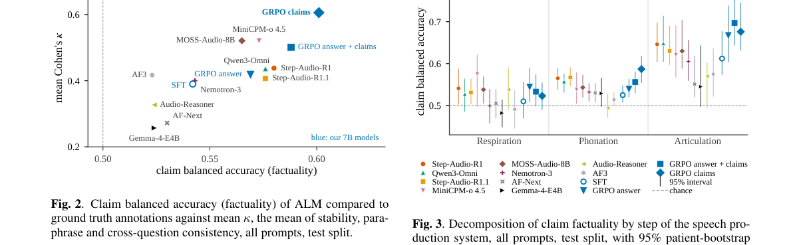

# Mine Arxiv Daily Digest - 2026-11-24 (全双工语音与语音 LM Axis, 5 papers)

**Generated**: 2026-11-24 01:23 CST

**Source**: arXiv cs.CV, cs.SD, eess.AS, cs.CL, cs.AI, cs.RO, cs.LG, cs.IR submissions, listing day 2026-11-19,2026-11-20 (announced 2026-11-20 01:00 UTC（listing 11-19）、2026-11-23 01:00 UTC（listing 11-20）)

**Batch window**: 2026-11-18T19:00:00Z .. 2026-11-20T19:00:00Z（arXiv 公告批次横跨两个 UTC 日：从前一日的美东 14:00 截止时刻起算（EDT 为 18:00Z，EST 为 19:00Z），到当日的同一时刻为止）

**Axis**: duplex_speech (5 papers, base 12, cap 20)

**Directions**: duplex_speech_core (4), speech_rl (1)

**Selection**: 5 papers ranked by relevance x quality, with 0 wild-card slots

**Day total**: 60 papers across 4 axes (target 60)

**Scope**: 全双工 / 实时 / 流式语音语言模型、speech-to-speech 语音助手、TTS / 语音克隆 / 语音转换，以及语音大模型的 RL 与奖励模型

**Wild-card**: 0 篇 —— 该轴候选池本身只有 15 篇(duplex_speech_core 14 篇 + speech_rl 1 篇),而且没有一篇 rel≥9;发出 5 篇已经是全部够格供给,既不需要也无法靠邻接选题补位。

本轴 5 篇 vs 基准 12,是本轮最尖锐的结构性缺口,证据链完整:1136 篇候选里 primary 落在 duplex_speech_core 的只有 14 篇、speech_rl 的只有 1 篇,rel≥9 的语音论文 **0 篇**。让出的 7 个名额没有平均分给其他轴,而被 world_embodied(21 篇 rel≥9 争 20 席)与 llm_vlm(llm_vlm_rl 多 2 篇 rel≥9)吸走。5 篇的构成也说明缺口的形状:全双工对话本体只有 1 篇(EIP),其余是语音幻觉检测、对话式 TTS 与流式 TTS 的 codec 几何 —— 不是筛得太严,是这一窗口语音投稿确实薄。

---

## 全双工语音与语音 LM · `duplex_speech_core` (4 papers)

4 篇里只有 1 篇贴着「全双工语音对话」本体:EIP 用分层联合注意力把 Audio-Interaction 专家与动作专家缝在一起,分块因果掩码挡住未来上下文,vocal token 编码说话状态与情绪语义,相对级联系统把热身延迟降低 **64%**。其余三篇分别落在语音幻觉、对话式合成与流式 TTS 的几何上:声音事件幻觉那篇发现真实与幻觉事件获得的音频注意力质量可以相当、区别只在注意了**哪一段**音频,于是用 LatentLens 取语义支持再作差分掩码;PromptTTSD 配套发布 PromptDialog(中文 8,383 小时 + 英文 120 小时),79% 的语句带开放式风格描述;EAF-TTS 指出 codec latent 重构得好不等于几何适合做 Flow 生成,改用 ZCA 坐标后 UTMOS22 提升 +0.405、RTF 降到 1/3.34。

### 1. From Attention to Semantics: Detecting and Mitigating Sound Event Hallucinations in Large Audio-Language Models

**arXiv**: [2611.25789](https://arxiv.org/abs/2611.25789) | **Score**: 8.0 (relevance 8 x 0.7 + quality 8 x 0.3) | **Direction**: `duplex_speech_core` | **Tags**: duplex-speech, audio-language-model, hallucination-detection, attention-analysis, latentlens, differential-masking, Shanghai Jiao Tong University | **Categories**: cs.SD | **Pages**: 24

**Authors**: Tianyi Sun; Minghao Lv; Chunyang Yu; Shenyue Wang; Mengyue Wu

**Affiliation**: Shanghai Jiao Tong University; Guangdong OPPO Mobile Telecommunications Corp., Ltd.

**Abstract**

> Large Audio-Language Models (LALMs) excel at diverse audio tasks, yet remain prone to hallucinating sound events absent from the input. Prior work links such hallucinations to insufficient audio attention. However, we find that real and hallucinated events can receive comparable audio attention mass while attending to different audio positions. To examine whether the attended representations support the generated events, we adapt LatentLens to retrieve neighboring contextualized text representations. The retrieved contexts reveal semantic support for real events, but a semantic mismatch between hallucinated events and their attended audio representations. Directly masking the corresponding audio regions can suppress hallucinated events at the cost of real content. We are motivated by these findings to introduce an explainable and training-free detect-then-mitigate framework for effectively hallucination detection and mitigation that aggregates semantic support and applies differential audio masking to protect regions associated with events predicted to be supported. Extensive experiments on three LALMs and two datasets demonstrate that our method significantly improves hallucination detection and hallucination mitigation performance.

**Key findings**

- **Finding**: 在 Audio Flamingo 3 的第 15–22 层（Audio Attention Stage）上，真实事件平均分到 34.64% 的音频注意力，幻觉事件为 30.08%，但两者峰值落在不同音频位置（真实水流在约 0.66 s，幻觉山羊叫在约 5.34 s）。
- **Inference**: 注意力总量既然无法区分真假事件，声音事件幻觉的可用检测信号必须是被关注表征的语义是否支撑生成内容，而不是注意力强度本身。
- **Recommendation**: 评估 LALM 幻觉时先做 LatentLens 式的近邻文本语境语义支持判定，再决定遮蔽哪些音频区域，不要直接套用 AAD、TCD 这类只加强音频注意力的推理期方法。

**Key figures**

*Framework - Previous efforts for audio hallucination detection or mitigation.*

*Result - A typical case with audio attention analysis. (a) Attention allocation to audio features, text prompt, and caption history across layers. The shaded band marks the Audio Attention Stage (lay*

**Why this ranks #1**: 在 495 条 AudioCaps 验证片段上做注意力分析后可见，真实事件的音频注意力质量为 34.64%、幻觉事件为 30.08%，几乎相同，说明光看注意力强度检测不了声音事件幻觉。该文据此提出免训练的检测-缓解框架，在 AudioSet Strong 上把 Audio Flamingo 3 的事件级 F1 从 0.5977 提到 0.7466，抑制端 ECHO-I 由 Greedy 的 22.7% 降到 14.9%，并保住 34.1% 的内容覆盖率。

---

### 2. Embodied Interaction Policy: A Unified Model for Full-Duplex Human-Robot Interaction

**arXiv**: [2611.27327](https://arxiv.org/abs/2611.27327) | **Score**: 8.0 (relevance 8 x 0.7 + quality 8 x 0.3) | **Direction**: `duplex_speech_core` | **Tags**: duplex-speech, full-duplex, human-robot-interaction, streaming, co-speech-gesture, flow-matching, Sichuan University | **Categories**: cs.RO | **Pages**: 24

**Authors**: Youqiang Gui; Yunfei Liu; Lijian Lin; Ye Zhu; Jianan Wang; Cheng Peng; Yu Li

**Affiliation**: Sichuan University; International Digital Economy Academy (IDEA); Astribot

**Abstract**

> Real-time human-robot social interaction requires continuous coordination between speech and physical behavior. Existing systems often separate interaction agents from motion generation, complicating coordination as conversational states change. We propose \textbf{Embodied Interaction Policy (EIP)}, a unified streaming framework that couples an Audio-Interaction expert with a motion expert through layer-wise joint attention. This allows motion generation to directly access the evolving interaction context. A chunk-wise causal mask prevents access to future context, while a vocal token encodes speaking state and the semantic emotion of the response. We construct \textbf{Embodied Interaction Dataset (EI-Data)} from co-speech and dyadic interaction data and train our model in two stages to learn state-adaptive and emotion-conditioned behavior. Combined with the frozen interaction expert, EIP supports continuous robot motion during proactive responses and interruption-aware turn-taking. Quantitative evaluations demonstrate improved motion quality over representative gesture-generation baselines. Compared with a representative cascaded system, EIP achieves higher interaction success and reduces warm-start latency by 64\%. Physical deployment and user studies further demonstrate improved motion naturalness and interaction comfort.

**Key findings**

- **Finding**: EIP 让动作专家通过 400 ms 分块的层间联合注意力直接读取被冻结的 Qwen2.5-3B 交互专家隐状态，并用分块因果掩码切断未来上下文；约 60,000 条 20 秒的 EI-Data 训练后，Astribot S1 上 FGD 由最强基线 74.51 降到 43.83。
- **Inference**: 把语音交互决策与身体动作放进同一个流式模型，才可能同时拿到更低的响应延迟和更自然的动作，说明级联式 ASR-LLM-TTS 管线才是全双工场景的真正瓶颈。
- **Recommendation**: 做全双工机器人语音时优先复用交互模型的内部隐状态驱动动作生成，并按 400 ms 分块设计因果掩码，而不是把语音链路与动作生成串成互相等待的独立模块。

**Key figures**

*Result - Comparison of embodied interaction modeling paradigms. Existing embodied interaction methods typically follow a cascaded, turn-based paradigm. In contrast, our approach unifies the interact*

**Why this ranks #2**: EIP 用 400 ms 分块的因果注意力把 Qwen2.5-3B 语音交互专家与 380M 参数的动作专家统一进同一个流式模型，EI-Data 约 6 万条 20 秒交互片段。Astribot S1 上 FGD 从最强基线的 74.51 降到 43.83，观察者打分里运动自然度相对 RoboGesture 从 3.20 升到 6.33，相对级联系统把 warm-start 延迟降低 64%，属于全双工语音交互少见的具身化落地。

---

### 3. PromptTTSD: Controllable Text to Spoken Dialogue Synthesis with Open-Ended Text Descriptions

**arXiv**: [2611.27601](https://arxiv.org/abs/2611.27601) | **Score**: 8.0 (relevance 8 x 0.7 + quality 8 x 0.3) | **Direction**: `duplex_speech_core` | **Tags**: duplex-speech, spoken-dialogue-synthesis, style-control, voice-cloning, open-ended-prompts, audiobook-alignment, Beijing University of Posts and | **Categories**: cs.AI, cs.SD | **Pages**: 16

**Authors**: Sulong Yang; Zhi Zeng; Xiupeng Wu; Juewen Hu; Pring Wong; Shuwu Zhang; Shuo Chen

**Affiliation**: Beijing University of Posts and Telecommunications; National Key Laboratory of General Artificial Intelligence, BIGAI

**Abstract**

> Spoken dialogue synthesis aims to generate multi-turn conversational speech from dialogue scripts while maintaining speaker consistency and contextual appropriateness. However, existing models largely lack fine-grained controllability, which is critical for capturing the dynamic, context-dependent style shifts in natural conversations. While prompt-based TTS has enabled such control for single-speaker speech, existing datasets heavily rely on predefined tags, which fundamentally limits their capacity to capture open-ended styles. To address this gap, we propose a scalable pipeline for extracting conversational speech from multi-narrator audiobooks, featuring an improved two-stage alignment algorithm to preserve dialogue continuity, paired with LLM-based extraction of style descriptions directly from narrative text. We release PromptDialog, a large-scale multi-speaker conversational speech dataset comprising 8,383 hours of Chinese speech and 120 hours of English speech, with open-ended style descriptions for 79% of utterances. We further introduce PromptTTSD, a spoken dialogue synthesis model built via a prompt-aware fine-tuning strategy that integrates style prompts into text-speech interleaved sequences. PromptTTSD is an open-source spoken dialogue synthesis model that supports both zero-shot voice cloning and natural language style control. Experiments demonstrate that PromptTTSD not only maintains strong fundamental synthesis capabilities but also achieves competitive open-ended style control compared with proprietary models, and substantially improves contextual appropriateness in multi-turn dialogues.

**Key findings**

- **Finding**: 两阶段对齐把有声书引文对齐的句匹配率从 LibriHeavy 的 71.39% 提到 94.13%（词匹配 89.12% 到 94.38%），据此得到中文 8,383 小时、英文 120 小时、79% 语句带开放式描述的 PromptDialog。
- **Inference**: 有声书里的表演张力与原书叙事几乎一一对应，因此开放式风格标签可以直接从小说文本抽出，不必依赖封闭的情感标签表或逐条人工标注。
- **Recommendation**: 需要中文多说话人对话合成时可直接用 PromptDialog，并在合成时为每轮 utterance 显式给出自然语言风格描述，实测可把上下文贴合度 CA-MOS 从 3.06 提到 3.52。

**Key figures**

*Framework - Comparison of pipelines for constructing speech datasets with natural-language descriptions. In (1), the open-ended examples are drawn from our dataset, and the bold text highlights open-end*

*Result - Examples of partial speech alignment errors pro- duced by the LibriHeavy alignment pipeline.*

**Why this ranks #3**: PromptTTSD 依托 107 部中文、20 部英文多人有声书构造的 PromptDialog（中文 8,383 小时、英文 120 小时，79% 语句带开放式风格描述），两阶段对齐把引文句匹配率从 71.39% 提到 94.13%。模型在 TTSD-ZH 上用风格描述做条件，把上下文贴合度 CA-MOS 从 3.06 提到 3.52，开放风格控制的 Q-MOS 达 4.750，高于 CosyVoice3 的 4.173。

---

### 4. EAF-TTS: Rethinking Codec-Latent Coordinates for Flow TTS

**arXiv**: [2611.27214](https://arxiv.org/abs/2611.27214) | **Score**: 7.7 (relevance 8 x 0.7 + quality 7 x 0.3) | **Direction**: `duplex_speech_core` | **Tags**: duplex-speech, flow-tts, codec-latent, zca-whitening, latent-geometry, sampling-efficiency, AI Lab | **Categories**: cs.AI, cs.SD | **Pages**: 17

**Authors**: Yumiao Li; Haoxiang Jie; Xinbei Li; Yaoyuan Yan; Yue Qu

**Affiliation**: AI Lab, Country Garden Services Group; Tongji University

**Abstract**

> Latent text-to-speech (TTS) systems generate codec latents decoded by a frozen decoder, but good reconstruction does not ensure geometry suitable for Flow generation from isotropic Gaussian noise. We present Embedded Acoustic Flow TTS (EAF-TTS), an acoustic-latent adaptation of ELF with phone- and duration-conditioned generation, shared-network terminal correction, and frozen WaveVAE decoding. EAF-TTS supports a fixed ZCA interface estimated from training data and adding no learned parameters. The codec, conditioning modules, Flow backbone, and 20-call inference are shared. The intervention is the full ZCA coordinate protocol---training and sampling coordinates, induced loss metric, and terminal perturbation---not an inference-only transform. In single-speaker LJSpeech, the 64-D training-latent covariance has condition number 1355.44. On text-disjoint Val399 strict-GT with fixed E100 raw checkpoints across three matched seeds, ZCA improves UTMOS22 Strong---an automatic naturalness proxy, not human MOS---by $+0.405\pm0.027$ over Scalar normalization (mean $\pm$ seed SD of per-seed paired differences). Absolute scores remain below codec-reference levels. Without retraining, ZCA-5 retains $+0.375\pm0.027$ UTMOS over Scalar-20 while reducing generation-path RTF by $3.34\times$. This three-seed analysis shows no statistically detectable WER or exact-match degradation, but does not establish equivalence. ZCA-3 gives $5.03\times$ with a $+0.165$ UTMOS advantage. At matched reduced call counts, ZCA's advantage shrinks, indicating full-step headroom rather than better low-step integration. A secondary text-only selected-checkpoint result is directionally consistent but confounded by checkpoint type. We claim only proxy-naturalness and measured quality--latency effects within this protocol; human listening, blind text, and broader validation remain necessary.

**Key findings**

- **Finding**: LJSpeech 训练集 64 维 WaveVAE 潜变量协方差条件数为 1355.44（特征值区间 0.0061128 到 8.28546），标量归一化只修均值与尺度、留着通道相关性；改用训练集估计的 ZCA 后字素内条件数从 524.98 降到 5.06。
- **Inference**: 重建质量好不等于潜空间适合从各向同性高斯出发的 Flow 生成，条件数只是表象，真正起作用的是完整坐标协议同时改变了训练度量与末端扰动。
- **Recommendation**: 做 codec-latent Flow TTS 时应把白化当作完整坐标协议来审计（含潜变量往返误差、解码域影响与少步数 RTF），而不是只报告一个条件数下降。

**Key figures**

*Framework - ZCA EAF-TTS with train-data-only statistics. Orange modules are fixed ZCA-related coordinate interfaces with no learned parameters; blue modules are shared or frozen components. Scalar and Z*

**Why this ranks #4**: EAF-TTS 把 ELF 的共享网络生成与末端修正模式迁到 64 维 WaveVAE 声学潜变量上，只用训练集统计估计 ZCA 坐标、不增加任何可学习参数。LJSpeech 训练潜变量协方差条件数高达 1355.44（特征值 0.0061128 至 8.28546），三组匹配种子在 Val399 严格 GT 上把 UTMOS22 代理自然度提高 +0.405±0.027，ZCA-5 还能把生成路径 RTF 降低 3.34 倍。

---

## 语音 LM 的 RL 与偏好优化 · `speech_rl` (1 papers)

整个候选池里只有这一篇,且它的价值不在「做了什么 RL」,而在**评什么**。SLP-Bench 不看最终答案,而是把推理音频语言模型 CoT 里的每一条声学断言,逐条拿去和临床医师对同一条录音的知觉评分对齐,覆盖 5 个临床标注数据集、25 个知觉维度,并考察事实性、重采样稳定性与改写后一致性。十个开源推理 ALM 零样本跑下来,断言的 balanced accuracy 只有 0.52–0.58,且**最一致的模型并不是最准确的**。用「与医师一致的断言」作奖励做 GRPO 微调 7B ALM 后,断言 balanced accuracy 从 0.54 升到 0.60、mean kappa 从 0.39 升到 0.61,同时保住了逐维度问答的答案准确率。

### 5. SLP-Bench: Evaluating and Improving Acoustic Claims of Reasoning Audio Language Models on Clinical Speech

**arXiv**: [2611.27810](https://arxiv.org/abs/2611.27810) | **Score**: 7.7 (relevance 8 x 0.7 + quality 7 x 0.3) | **Direction**: `speech_rl` | **Tags**: duplex-speech, grpo, audio-language-model, clinical-speech, chain-of-thought, benchmark, Callyope | **Categories**: cs.AI, cs.CL, cs.LG, cs.SD | **Pages**: 5

**Authors**: Côme Hosxe; Rachid Riad; Quentin Spinat

**Affiliation**: Callyope, Paris, France

**Abstract**

> Audio language models (ALMs) can answer clinical questions from speech, outperforming baselines built on handcrafted acoustic features. Reasoning ALMs generate a chain of thought that refers to properties of the speaker's voice before predicting. Each statement the model makes about the voice needs to be checked against clinicians' perceptual ratings of the same recording. On clinical speech, existing evaluations score only the final answer. We introduce Speech Language Pathologist Bench (SLP-Bench), a benchmark grading each acoustic claim in the chain of thought against clinicians' perceptual ratings of the same recording. It covers five clinician-rated datasets and 25 perceptual dimensions, and assesses claims for factuality, stability under resampling, and consistency across reworded and different questions. Across ten open-weight reasoning ALMs evaluated zero-shot, claim balanced accuracy ranges from 0.52 to 0.58, claims change under resampling and rewording, and the most consistent models are not the most factual. Fine-tuning a 7B ALM with GRPO on a reward for claims that agree with clinicians raises its claim balanced accuracy from 0.54 to 0.60 and its mean kappa from 0.39 to 0.61, while preserving answer accuracy on per-dimension questions. SLP-Bench is available upon request, subject to approval by the providers of each dataset.

**Key findings**

- **Finding**: 在 794 段临床语音、3,452 条提示上，10 个开源推理 ALM 的声学断言平衡准确率只有 0.52 至 0.58（随机水平 0.5），重采样或改写问法后断言会变化，一致性 κ 全部不超过 0.61。
- **Inference**: 自洽不等于正确——最一致的模型往往不是最准确的模型，因此这类推理链暂时还不能当作可交给临床医生逐条核对的解释。
- **Recommendation**: 评估语音推理模型要把链中每条声学断言对齐到同一录音的临床评分，并优先做奖励断言事实性的 GRPO 训练，而不是只奖励最终答案。

**Key figures**

*Framework - SLP-Bench: claims extracted from the chain of thought are graded against clinician ratings and compared across runs*

*Result - Claim balanced accuracy (factuality) of ALM compared to ground truth annotations against mean κ, the mean of stability, para- phrase and cross-question consistency, all prompts, test split.*

**Why this ranks #5**: SLP-Bench 用 5 个临床语音数据集、25 个感知维度、794 段测试音频和 3,452 条提示，逐条给推理链里的声学断言打分。10 个开源推理 ALM 零样本下断言平衡准确率只有 0.52 至 0.58（忽略音频的随机水平为 0.5），用 GRPO 奖励与临床评分一致的断言后，7B 模型的断言 BA 从 0.54 升到 0.60、平均 κ 从 0.39 升到 0.61。

---

## Footer

- Total papers reviewed across all 4 axes: 60
- duplex_speech axis final count: 5
- Wild-cards in this axis: 0
- Figure assets: 2026-11-24/res/

Generated by `mine-arxiv-daily-digest` skill. Sister file: `2026-11-24_duplex_speech_entry.md`.
