# Mine Arxiv Daily Digest - 2026-11-24 (具身智能与世界模型 Axis, 20 papers)

**Generated**: 2026-11-24 01:23 CST

**Source**: arXiv cs.CV, cs.SD, eess.AS, cs.CL, cs.AI, cs.RO, cs.LG, cs.IR submissions, listing day 2026-11-19,2026-11-20 (announced 2026-11-20 01:00 UTC（listing 11-19）、2026-11-23 01:00 UTC（listing 11-20）)

**Batch window**: 2026-11-18T19:00:00Z .. 2026-11-20T19:00:00Z（arXiv 公告批次横跨两个 UTC 日：从前一日的美东 14:00 截止时刻起算（EDT 为 18:00Z，EST 为 19:00Z），到当日的同一时刻为止）

**Axis**: world_embodied (20 papers, base 15, cap 20)

**Directions**: world_model (10), embodied_ai (10)

**Selection**: 20 papers ranked by relevance x quality, with 0 wild-card slots

**Day total**: 60 papers across 4 axes (target 60)

**Scope**: 世界模型、学习型模拟器与具身智能，含移动操作、人形控制、触觉反射、VLA 策略与面向具身任务的强化学习

**Wild-card**: 0 篇 —— 两个方向合计 210 篇够格候选、21 篇 rel≥9,该轴是被 20 篇的 axis 上限卡住的,而不是靠 wild-card 补进来的;让出的名额流向同一天的其他轴。

本轴 20 篇撞到 axis 上限,但**冲突结构与上一轮不同**:上一轮是 embodied_ai 一家独大,本轮 world_model 自己就有 11 篇 rel≥9(10 篇入选、1 篇落选),具身侧 10 篇 rel≥9 全部入选。胜负手落在 world_model 内部 —— Bradley-Terry 概率失真、forced-response 物理探针、AFFECT 动作效应匹配三篇在问同一件事:世界模型学到的究竟是物理,还是只是会动的像素。

---

## 世界模型与学习型模拟器 · `world_model` (10 papers)

10 篇里有 8 篇 rel≥9,是本轮质量最高的一格。三篇领衔的都在拆同一个疑问:世界模型学到的是物理,还是只是会动的像素。Bradley-Terry 训练给出反例:模拟机器人推物任务上,原本准确的模型(hazard error 2.4 个百分点)会把 **33–43 个百分点** 的概率挪到物理上不可能的结果上,原因在目标函数本身。Forced Response 探针用非线性激励逼出动力学:六个视频世界模型全部复现线性响应(含共振),五个复现高阶动力学(含非线性软化),而软化在训练数据里只占摆动平方位移的 0.74%。AFFECT 是正面证据:注入时序相关噪声后,DROID 上模型内与真机策略成功率的相关从 0.47 升到 0.79,规划成功率最多提升 8.3%。

### 1. Bradley-Terry Training Can Distort Outcome Probabilities of Initially Accurate Language World Models

**arXiv**: [2611.25594](https://arxiv.org/abs/2611.25594) | **Score**: 9.0 (relevance 9 x 0.7 + quality 9 x 0.3) | **Direction**: `world_model` | **Tags**: embodied, bradley-terry, language-world-model, comparative-feedback, probability-calibration, robot-push, Beijing University of Posts and | **Categories**: cs.AI, cs.CV, cs.LG | **Pages**: 10

**Authors**: Xinze Shi; Litian Zhang; Zhenjie Su; Zelong Yu; Yuting Zhang; Qihua Feng; Zifeng Kang; Chaozhuo Li; Zhengxuan Hu

**Affiliation**: Beijing University of Posts and Telecommunications; Beihang University; Microsoft; Beijing Institute of Technology; Queen Mary, University of London

**Abstract**

> Comparative feedback, in which a judge says which of two candidate outcomes is closer to what happened, is a practical way to train language world models that assign probabilities to an action's outcomes. We show that, fitted with a Bradley-Terry objective, it need not teach the true outcome probabilities and can distort accurate ones. On a simulated robot push with enumerated outcome distributions, this objective takes a model that is accurate on unseen layouts (hazard error 2.4 percentage points, pp) and moves 33 to 43 pp of its probability onto outcomes that none of a condition's enumerated branches produces. The cause is the objective, not the comparisons: its optimum, computed before training, predicts where the model ends up, and a likelihood that knows the judge's rule learns from the same comparisons without the shift. The shift is robust: it recurs on unseen conditions, under five candidate laws and a three-fold denser enumeration, and about 29 pp remain without the physically impossible events. Its cost is conditional: with those events it inflates hazard probabilities, and a threshold inherited from the pre-feedback model costs about 3 pp of utility per decision on trained and 1 to 2 pp on unseen conditions, through false rejects; without them the utility loss averages below 1 pp over six seeds, though a small regret in action choice remains. Audits of readout, response and decision trace the effect from probabilities to actions.

**Key findings**

- **Finding**: 在枚举结局分布的仿真推杆任务上，Bradley-Terry 训练把模型 33 到 43 个百分点的概率质量挪到了任何枚举分支都不产生的事件上，未见布局上的危险概率误差原本只有 2.4 个百分点。
- **Inference**: 概率偏移来自目标函数本身而不是比较数据——训练前算出的最优解就能预测模型终态，而懂得评委规则的似然用同一批比较数据不会发生偏移。
- **Recommendation**: 若用比较反馈训练世界模型，请先在训练前求解 Bradley-Terry 最优解并做一次概率审计，不要把比较后的排序直接当作已校准的概率。

**Key figures**

*Framework - Comparative feedback on a robot push with two haz- ards H. (a) Before feedback, the hazard probability q of a language world model is close to the truth and below a fixed threshold τ: the pu*

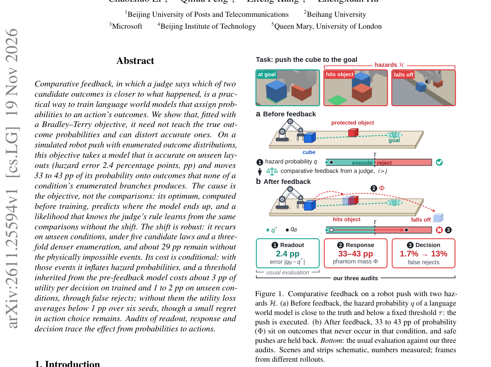

*Result - The three audits: what each takes as input, holds fixed (snowflake) or updates (flame), and measures (yellow; Eqs. (6), (7) and (9)). q is a probability and 1 pp = 0.01; D∗, h and ϵop are in*

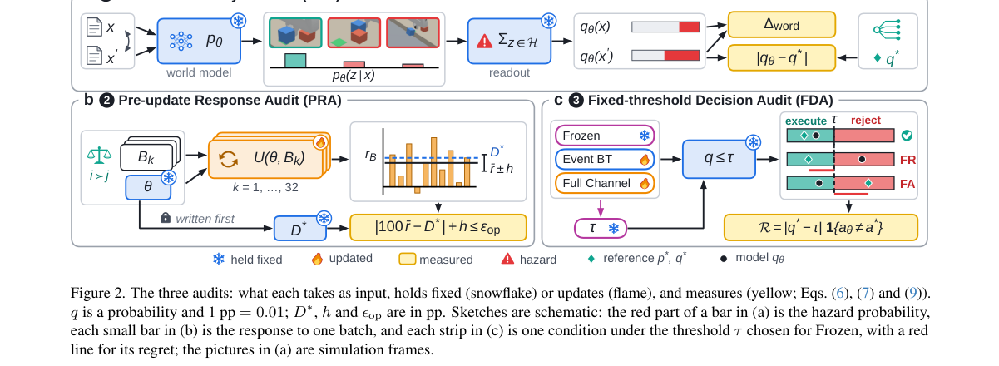

**Why this ranks #1**: 语言世界模型用 Bradley-Terry 目标拟合比较反馈时，会把原本准确的结局概率推向物理上不可能的分支：该模型在未见布局上的危险概率误差原本只有 2.4 个百分点，训练后却有 33 到 43 个百分点的概率质量被挪到任何枚举分支都不产生的结局上；这是本批次少见的、直接指出「训练目标本身会污染概率标定」的 world_model 工作，故列在本方向第 1 位。

---

### 2. Physical Laws without Physics Loss? Probing Learned Dynamics in Video World Models through Forced Response

**arXiv**: [2611.25626](https://arxiv.org/abs/2611.25626) | **Score**: 9.0 (relevance 9 x 0.7 + quality 9 x 0.3) | **Direction**: `world_model` | **Tags**: embodied, forced-response, video-world-model, flow-matching, physics-probing, taylor-expansion, Harbin Institute of Technology | **Categories**: cs.CV, cs.LG | **Pages**: 11

**Authors**: Yutao Li; Chen Wang; Wangmeng Zuo; Hui Li

**Affiliation**: Harbin Institute of Technology

**Abstract**

> Do video world models learn physical laws without a physics loss, or merely imitate motion? Overall motion and appearance scores cannot settle it. We investigate this through nonlinear forced response: an excitation shakes the support of a suspended object. We introduce dual visual-numeric conditioning and adapt six image-to-video backbones to predict this motion using only the flow-matching loss. Wan predicts motion accurately and generalizes to unseen excitations, objects, poses, and scenes. Counterfactual tests suggest capabilities beyond replaying training videos. But what laws have they learned? We design three tiers of tests using Taylor expansions of the dynamics and geometry. All six reproduce the linear response, including resonance; five capture higher-order dynamics, including nonlinear softening. Remarkably, softening is barely present in training: only 0.74% of the swing's squared displacement. Extensions to a double pendulum and a rocking block show sustained dynamics are learned more faithfully than brief impacts. Yet learned dynamics may fail to appear when state estimation or propagation goes wrong. We turn these tests and findings into strategies to improve video training and generation.

**Key findings**

- **Finding**: 6 个图像到视频骨干在只用 flow-matching 损失训练后全部复现线性响应（含共振），其中 5 个捕获到高阶动力学，包括非线性软化。
- **Inference**: 软化在训练数据中几乎不存在——只占摆动平方位移的 0.74%——说明这些模型学到的是可推广的物理规律，而不是对训练视频的复刻。
- **Recommendation**: 评估视频世界模型别只看运动与画质分数，用受控激励按泰勒展开分层测，才能判断它到底学到了哪几阶物理定律、又在什么状态下失效。

**Key figures**

*Framework - Physical laws are learned without a physics loss, tier by tier. (a) An earthquake shakes the ceiling holding a suspended object. (b) Six backbones learn the response from the flow-matching l*

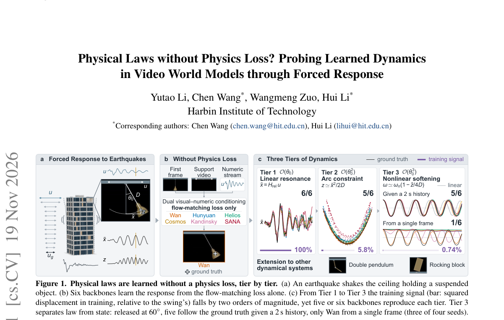

*Result - One conditioning interface for all six backbones. (a) The frozen encoder takes the history Hw and the support video, and cw groups 20 samples each of u and ∆u per latent frame with Ld and ℓ,*

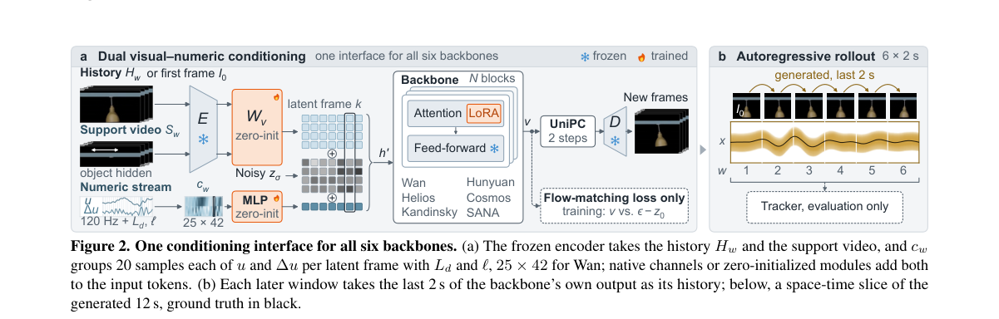

**Why this ranks #2**: 用双重视觉-数值条件改造 6 个图像到视频骨干，只靠 flow-matching 损失就学会受迫响应：6 个模型全部复现线性响应（含共振），5 个捕获到高阶动力学，包括非线性软化；而软化在训练数据中只占摆动平方位移的 0.74%，说明视频世界模型确实学到了训练集里几乎不出现的物理定律，作为本方向第 2 位。

---

### 3. Learning What Actions Change: Action Effect Matching for Dynamics-Faithful World Models

**arXiv**: [2611.25980](https://arxiv.org/abs/2611.25980) | **Score**: 9.0 (relevance 9 x 0.7 + quality 9 x 0.3) | **Direction**: `world_model` | **Tags**: embodied, action-effect, world-model, teleoperation, fvd, model-based-planning, KAIST | **Categories**: cs.CV, cs.RO | **Pages**: 27

**Authors**: John Won; Yonghoon Dong; Jinwoo Shin

**Affiliation**: KAIST; RLWRLD

**Abstract**

> World models aim to predict environment dynamics under actions, enabling the prediction of action consequences without executing them in the real world. Yet despite producing increasingly realistic videos, current world models often fail to capture how small action changes affect future observations. This limits their use in tasks such as robotic policy evaluation and model-based planning, where nearly identical actions can lead to qualitatively different outcomes. To address this, we propose AFFECT, an auxiliary training objective for learning the distribution of visual changes induced by action perturbations. Specifically, we inject temporally correlated noise into the actions of a policy trained on task-agnostic human teleoperation. We then train the world model so that its generated videos respond to this noise as the recorded videos do, without requiring repeated executions from the same initial state. Across OGBench simulation and real-world DROID and ALOHA-2 setups, AFFECT makes world-model rollouts more faithful to real outcomes. On DROID, the Pearson correlation between policy success rates in the world model and on the real robot rises from 0.47 to 0.79, alongside up to 23% lower FVD. These gains carry over to planning, where selecting actions with AFFECT-trained world models improves task success by up to 8.3%.

**Key findings**

- **Finding**: 在 DROID 上，世界模型预测的策略成功率与真机成功率的 Pearson 相关系数从 0.47 升到 0.79，同时 FVD 最多下降 23%。
- **Inference**: 只复现录像里的未来不足以支撑模型式评估，真正的瓶颈是世界模型对小幅动作变化不敏感，而这可以通过注入扰动的辅助目标补上。
- **Recommendation**: 要评估机器人策略或做模型式规划，请在世界模型训练数据里主动注入动作扰动，并单独报告成功率相关系数而不只是 FVD。

**Key figures**

*Framework - Small action perturbations lead to distinct action effects. From the same initial state, actions drawn from a narrow distribution change the gripper’s approach only slightly, yet produce qua*

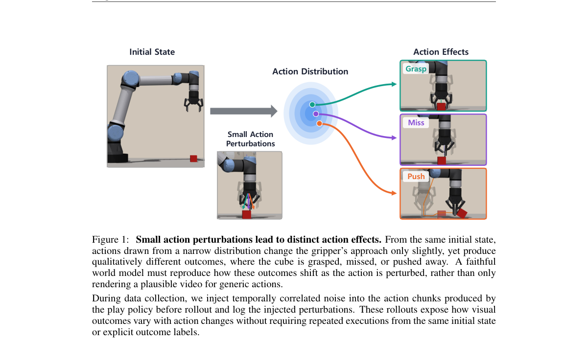

*Result - Overview of AFFECT. Frozen encoders ϕ, ψ extract video features from both the recorded and generated futures, and perturbation features from the logged action perturbations. Pair- ing the ce*

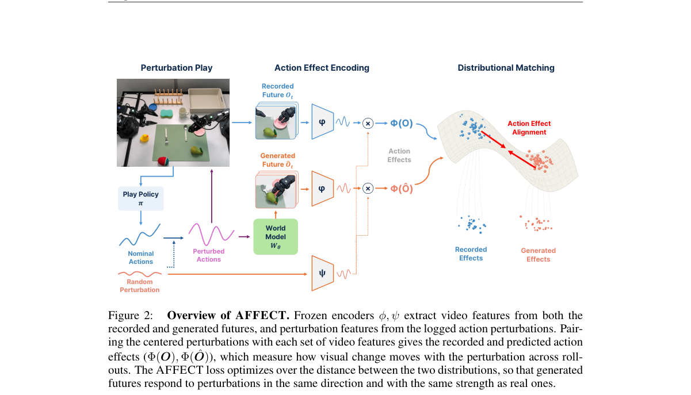

**Why this ranks #3**: AFFECT 向遥操作动作注入时间相关噪声，再用辅助目标训练世界模型，使其生成视频对动作扰动的响应与实录一致：DROID 上策略成功率的世界模型-真机相关系数从 0.47 提升到 0.79，FVD 最多降低 23%，并让规划选动作的任务成功率最多提高 8.3%；这是本方向唯一把「动作微调会怎样」量化到相关系数与规划收益的工作。

---

### 4. LATER: Learning Action-Conditioned Temporal Evidence Retrieval for Predictive World Models

**arXiv**: [2611.25671](https://arxiv.org/abs/2611.25671) | **Score**: 8.7 (relevance 9 x 0.7 + quality 8 x 0.3) | **Direction**: `world_model` | **Tags**: embodied, jepa, memory, action-conditioned, push-task, evidence-retrieval, [unverified] | **Categories**: cs.AI | **Pages**: 9

**Authors**: Zihan Zhou; Wenxi Xu; Qilin Wang; Hao Tang

**Affiliation**: [unverified]

**Abstract**

> Early interactions can reveal physical properties that later observations no longer show. These properties can still gov- ern the effects of future actions. Inspired by the distinction between retention and selective readout in working mem- ory and cognitive science, we introduce LATER, an action- conditioned world model built on CF-JEPA. LATER stores completed real transitions in partitioned memories that remain fixed during candidate rollouts. A response bridge queries these memories using the current state and candidate action, while multi-cut auxiliary supervision trains the memory writ- ers. On distracted Two-Stage PushT, LATER raises terminal success from 15.5% to 25.0% over reconstructed CF-JEPA. In a separate comparison across six models and two scratch- training seeds, LATER achieves the lowest mean physical readout error in both clean and distracted views, reducing along-push mean absolute error (MAE) under distractors by 20.2% relative to CF-JEPA. Controlled history interventions show that later predictions depend on earlier physical evi- dence even when query observations and actions are fixed, with larger effects during pushing than waiting.

**Key findings**

- **Finding**: 在受干扰的 Two-Stage PushT 上，LATER 把终局成功率从 15.5% 提到 25.0%，相对重建的 CF-JEPA 提升 9.5 个百分点。
- **Inference**: 早期交互揭示的接触属性在后续帧里消失却仍支配未来动作，因此必须把证据存进固定记忆并按动作条件化取回，而不是指望当前观测携带。
- **Recommendation**: 做长时程机器人任务时，请显式保存并按动作检索早期物理证据，不要假设当前视觉观测里还看得到物体属性。

**Key figures**

*Framework - LATER in a pushing task. An early push reveals how the T-shaped object responds to contact, but later frames may no longer show that response. Inspired by working memory and cognitive scienc*

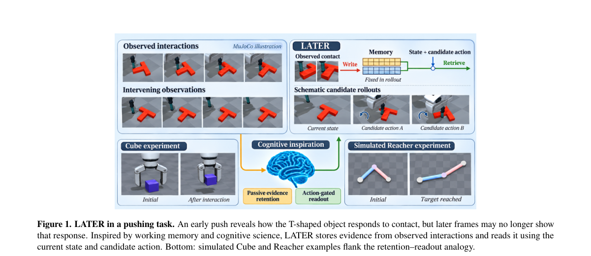

*Result - Architecture of LATER. (a) The trainable CF backbone receives recent tokens and zero-gated memory inputs. The bridge corrects only the controllable prediction; no pixel decoder is used. (b)*

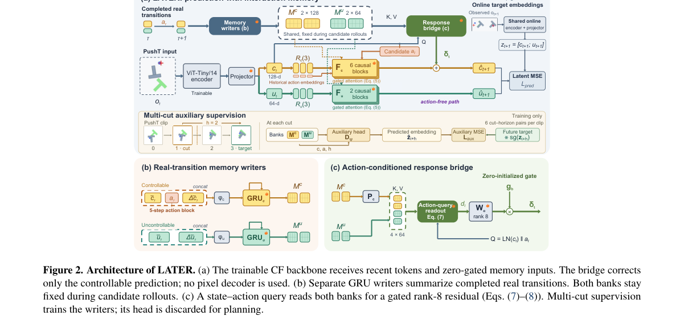

**Why this ranks #4**: LATER 在 CF-JEPA 之上加一个响应桥，用当前状态与候选动作去查询分区记忆中的历史物理证据：受干扰的 Two-Stage PushT 上终局成功率从 15.5% 提升到 25.0%，受干扰视角下沿推方向的物理读出 MAE 相对 CF-JEPA 下降 20.2%，把「早期交互揭示、后期观测看不出的物理属性」变成可显式检索的状态。

---

### 5. Fast-JEPA: Advancing the Success-Latency Frontier for Latent World Models

**arXiv**: [2611.25927](https://arxiv.org/abs/2611.25927) | **Score**: 8.7 (relevance 9 x 0.7 + quality 8 x 0.3) | **Direction**: `world_model` | **Tags**: embodied, jepa, planning-latency, cem-search, dynagoal, pareto-frontier, Wuhan University | **Categories**: cs.AI, cs.RO | **Pages**: 13

**Authors**: Yao Zhang; Bin Yu; Shijie Lian; Haishan Liu; Changti Wu; Yu Wu; Kai Chen

**Affiliation**: Wuhan University; Zhongguancun Academy; Harbin Institute of Technology; Huazhong University of Science and Technology; Nanjing University

**Abstract**

> Latent world models predict the outcomes of action sequences, but comparing candidate plans through recursive rollout remains expensive at test time. We introduce Fast-JEPA, a latent world model planning framework that advances the success-latency Pareto frontier of predictive search. Fast-JEPA reorganizes predictive computation to support effective action-sequence search at low planning cost. It constructs a goal-directed plan to guide search and directly predicts the outcomes of complete candidates for efficient comparison, avoiding recursive state rollout during refinement. Across PushT, Reacher, Cube, and TwoRoom, Fast-JEPA achieves 96.50% average success rate with 2.41x faster planning than INTACT. Search-budget sweeps show that its competitive success and low latency extend across candidate counts and refinement depths. We further introduce DynaGoal, a benchmark for evaluating world-model planning under dynamic out-of-distribution conditions, execution deadlines, and controlled response delays. Fast-JEPA achieves average success rates of 73.83% on DynaGoal-Shift and 87.67% on DynaGoal-Deadline, demonstrating the practical value of low-latency predictive planning under changing control conditions and execution-time constraints. Our code is available at https://github.com/Sofilyzia/Fast-JEPA.

**Key findings**

- **Finding**: Fast-JEPA 在 PushT、Reacher、Cube、TwoRoom 上取得 96.50% 的平均成功率，规划延迟 10.88 ms，比 INTACT 快 2.41 倍。
- **Inference**: 用终态直查替代递归展开，把比较候选的成本从整条 rollout 压成一次预测，因此成功率与延迟可以同时改善而不必互相让步。
- **Recommendation**: 选潜空间世界模型做规划时，请优先评估能否用终态直查替代递归 rollout，并在动态分布外与执行截止两类条件下分别测延迟。

**Key figures**

*Framework - Advancing the success–latency Pareto frontier. Fast- JEPA achieves 96.50% average success rate at 10.88 ms, improv- ing the observed frontier among the locally evaluated configura- tions and*

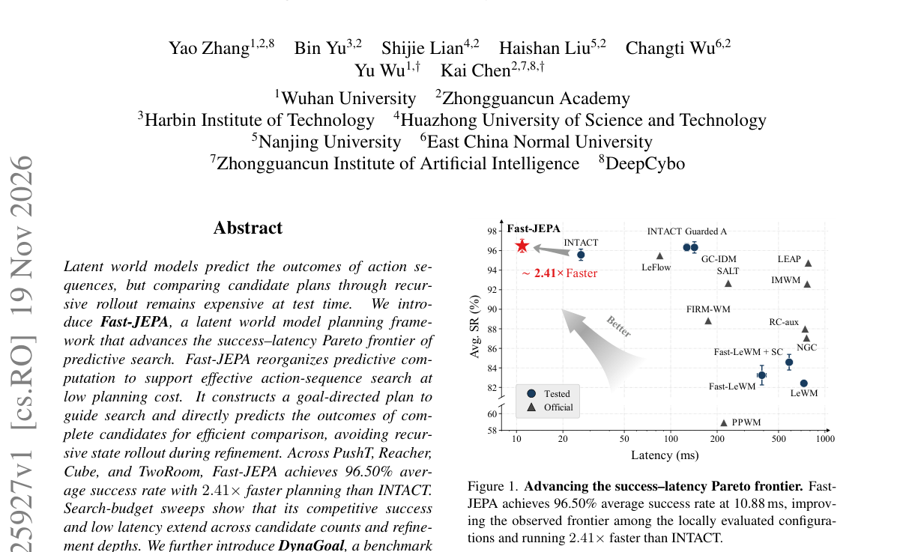

*Result - Fast-JEPA planning overview. Current and goal representations condition sequential proposal construction, where intermediate outcome queries guide subsequent action chunks. Local CEM samples*

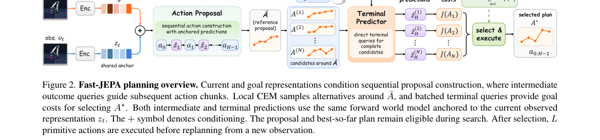

**Why this ranks #5**: Fast-JEPA 用目标导向的方案引导搜索、直接预测完整候选序列的终态，从而避免递归展开状态：PushT、Reacher、Cube、TwoRoom 上平均成功率 96.50%，规划比 INTACT 快 2.41 倍（10.88 ms），并在自建基准 DynaGoal 上取得 73.83%（Shift）与 87.67%（Deadline），把成功率与延迟两个维度一起推进，列第 5。

---

### 6. Point Dynamics as Proxy for Robotic World Models

**arXiv**: [2611.25946](https://arxiv.org/abs/2611.25946) | **Score**: 8.7 (relevance 9 x 0.7 + quality 8 x 0.3) | **Direction**: `world_model` | **Tags**: embodied, point-dynamics, 3d-points, robot-world-model, droid, proxy-simulation, Institute of Foundation Models | **Categories**: cs.CV | **Pages**: 24

**Authors**: Dong An; Tianyu Liu; Haoran Ding; Wen Yang; Anqing Duan; Zhengzhong Liu; Eric P. Xing; Guangyi Liu

**Affiliation**: Institute of Foundation Models; Mohamed bin Zayed University of Artificial Intelligence

**Abstract**

> Robotic world models predict future video frames from the current observation and a sequence of robot actions. While recent models follow the given actions closely, manipulated objects often collapse or move inconsistently with the action. We attribute this to the conditioning: an action, or a rendering of the robot, specifies where the robot goes but not how the scene responds, leaving a single video model to infer the interaction dynamics implicitly while also rendering appearance. We therefore separate dynamics prediction from visual rendering, with 3D point dynamics as the proxy between them. Specifically, we lift the first frame into 3D points, simulate how they respond to the robot's motion with a learned point dynamics model, and render the simulated points back into pixel-aligned videos that any video model can read. In controlled experiments on the DROID dataset with two video renderers of different architectures, this point dynamics proxy reduces object motion error by 8.6% and 6.2% without degrading image quality, and by 8.1% on a real bimanual robot. Moreover, the video follows the simulation: more accurate dynamics yield more accurate object motion, and editing the points steers the video. This suggests that advances in dynamics modeling can translate into more faithful robotic world models.

**Key findings**

- **Finding**: 在 DROID 上引入 3D 点动力学代理后，两个架构不同的视频渲染器分别把物体运动误差降低 8.6% 和 6.2%，真机双臂实验降低 8.1%，图像质量未退化。
- **Inference**: 动作只告诉机器人到哪去、不告诉场景如何响应，把这部分交给显式的点动力学模拟器后，视频模型只需负责渲染，误差就随动力学精度一起下降。
- **Recommendation**: 机器人世界模型若总出现「物体塌陷或与动作不一致」，可试把 3D 点动力学作为视频模型前的中介，并检查编辑点能否反向引导视频。

**Key figures**

*Framework - Action-only conditioning leaves the scene’s response to the video model. (a) A simulator predicts how scene points respond, so the video model mainly renders this response. (b) Two DROID tes*

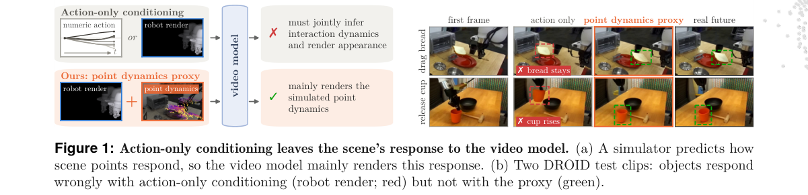

*Result - Overview. The first frame is lifted into scene points P0, and forward kinematics turns the actions into robot points Q0:T (light to dark blue over time). The simulator S predicts how the sce*

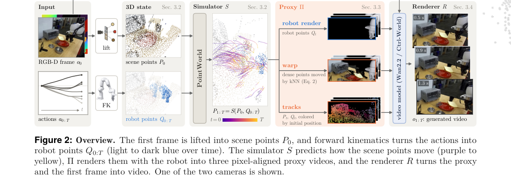

**Why this ranks #6**: 把首帧抬升到 3D 点、用学到的点动力学模型模拟场景对机器人动作的响应，再渲染回像素交给视频模型去读：DROID 上两个架构不同的渲染器分别降低 8.6% 与 6.2% 的物体运动误差，真机双臂实验降低 8.1%，且画质不下降，明确指出「动力学预测」与「视觉渲染」应该拆开。

---

### 7. Skill-JEPA: Learning Planner-Aligned Action Spaces for World Models

**arXiv**: [2611.26825](https://arxiv.org/abs/2611.26825) | **Score**: 8.7 (relevance 9 x 0.7 + quality 8 x 0.3) | **Direction**: `world_model` | **Tags**: embodied, jepa, skill-latent, variational-autoencoder, planner-alignment, antmaze, Centro Nacional De Inteligencia Artificial | **Categories**: cs.LG, cs.RO | **Pages**: 19

**Authors**: Tomás Couso Coddou; Christ Devia; Rex G. Liu; Rodrigo Toro Icarte

**Affiliation**: Centro Nacional De Inteligencia Artificial; Pontificia Universidad Católica de Chile

**Abstract**

> World models based on Joint-Embedding Predictive Architectures (JEPAs) learn from pixels to predict the outcome of actions in a latent space. To reach a goal, a planner samples many candidate action sequences, uses the model to predict where each one leads, and executes the best one. However, standard planners draw their candidates from a Gaussian, while the model has only seen the structured, state-dependent actions of its training data. Its predictions for such candidates are unreliable, and planning fails more often as goals move farther away. We propose Skill-JEPA, which learns an action space aligned with the planner. A variational autoencoder conditioned on the current state encodes short action sequences into latent skills with a standard Gaussian prior, and decodes them back into actions. The world model predicts the effect of skills rather than raw actions, and the planner searches over skills starting from that same Gaussian, so its candidates resemble the model's training data. Skill-JEPA adds a single module, trained end-to-end with the world model, and leaves the planner untouched, with no subgoals, hierarchy, or hand-designed skills. Across three JEPA world models and four benchmarks, average success on goals 80 steps away rises from 42% with raw actions to 62%; the gains grow with goal distance and hold across four planners. On AntMaze, a quadruped locomotion task, success on goals two maze cells away rises from 0.4% to 38%. This suggests that part of the difficulty of reaching distant goals lies in the action space, and can be removed without changing the planner.

**Key findings**

- **Finding**: 在 3 个 JEPA 世界模型与 4 个基准上，80 步远目标的平均成功率从使用原始动作的 42% 提升到 62%；AntMaze 上相隔两格迷宫的目标成功率从 0.4% 升到 38%。
- **Inference**: 远目标失败有很大一部分来自动作空间不匹配——规划器的高斯候选落在世界模型没见过的区域，把动作空间对齐就能在不换规划器的前提下恢复可达性。
- **Recommendation**: 若你的 JEPA 世界模型在远目标上频繁失败，先检查规划器候选分布与训练动作分布是否一致，必要时加一个条件 VAE 技能空间。

**Key figures**

*Framework - The same planner reaches farther goals when it searches over learned skills instead of raw actions. In OGBench- AntMaze [27] (left), a quadruped with eight actuated joints must reach goals u*

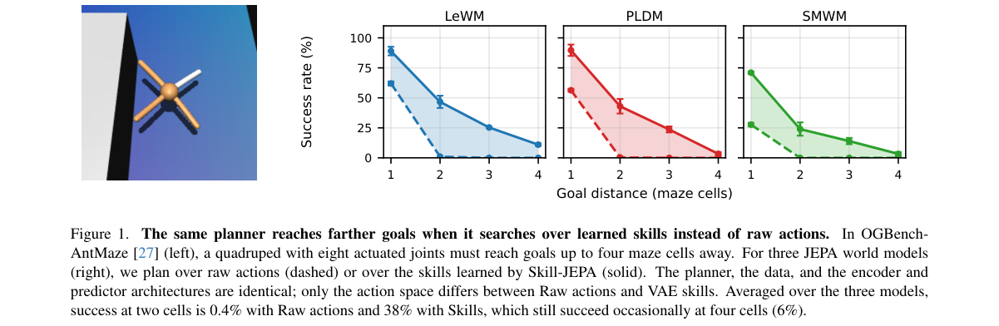

*Result - Overview. (a) Training: a conditional VAE encodes action chunks into skills lt given the latent observation zt, and the world model is trained to predict the next latent observation and to r*

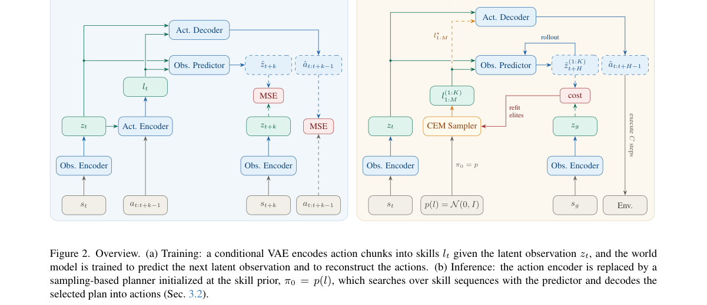

**Why this ranks #7**: 标准规划器从高斯分布采样动作，而世界模型只见过训练数据中结构化的状态相关动作。Skill-JEPA 用条件 VAE 把短动作序列编码成标准高斯先验下的技能并让模型预测技能效果：80 步远目标的平均成功率从 42% 升到 62%，AntMaze 上相隔两格迷宫的目标成功率从 0.4% 升到 38%，且完全不改动规划器。

---

### 8. LoCo-WAM: Test-Time Training as Long Context for World-Action Models

**arXiv**: [2611.26853](https://arxiv.org/abs/2611.26853) | **Score**: 8.7 (relevance 9 x 0.7 + quality 8 x 0.3) | **Direction**: `world_model` | **Tags**: embodied, world-action-model, test-time-training, low-rank-adapter, long-context, robocasa, Amazon AGI | **Categories**: cs.AI, cs.LG, cs.RO | **Pages**: 13

**Authors**: Sheng Cheng; Deqian Kong

**Affiliation**: Amazon AGI; University of California, Los Angeles

**Abstract**

> World-action models guide robot actions by predicting what happens next, but typically condition on a short observation history. Extending this history increases computation at every decision and can require a separately trained model. We introduce LoCo-WAM, which learns from the outcomes of its actions through test-time training while keeping the same short history length. It uses newly observed frames to update a low-rank adapter in the video expert, whose adapted predictions guide subsequent actions. The updates accumulate within each episode and are reset between episodes, allowing past observations to influence decisions after they leave the input window. LoCo-WAM thus learns from a longer stream of experience without expert action labels, additional data or meta-training. Experiments on two world-action models show improved task success across four simulation benchmarks. On RoboCasa GR-1, a model with 2.4,s of history matches one trained with 9.6,s, while a model with 4.8,s exceeds it by 4.8 percentage points. Our analysis shows that the updates improve prediction of upcoming frames, affect the action mainly through adaptation of the imagined future, and have an increasing effect on actions as the episode unfolds.

**Key findings**

- **Finding**: 在 RoboCasa GR-1 上，LoCo-WAM 让 2.4 秒历史的模型追平 9.6 秒历史的基线，4.8 秒历史的模型比该基线高 4.8 个百分点。
- **Inference**: 真正起作用的是测试时训练带来的长期经验而非更长的输入窗口——适配器更新在 episode 内累积、episode 间重置，使旧观测继续影响动作。
- **Recommendation**: 想在世界-动作模型上省算力又保留长程经验，优先试在执行期做低秩适配的测试时训练，而不是线性拉长观察历史。

**Key figures**

*Framework - Test-time training as long context. Success rate of Long-WAM on RoboCasa GR-1 for each history length, without and with LoCo-WAM. With LoCo-WAM, a model with 2.4 s of history matches the bas*

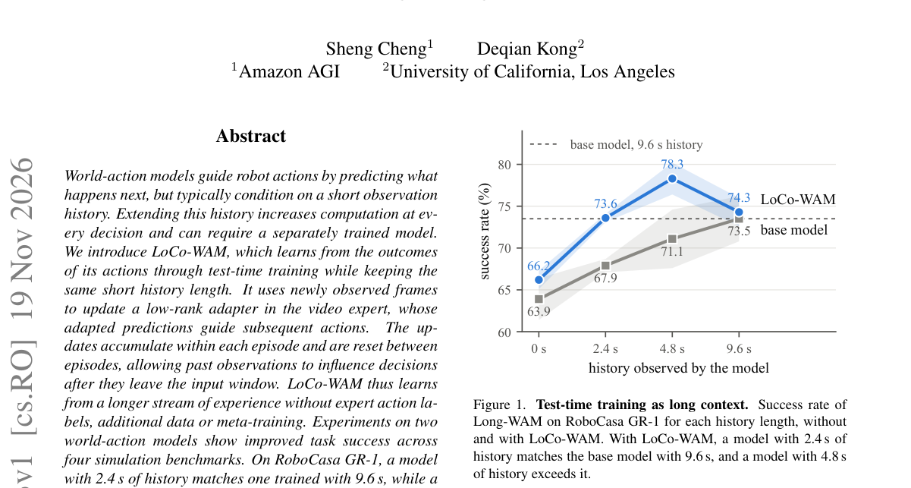

*Result - Prediction and action during an episode. (a) Relative reduction of the video loss on the next chunk. (b) L2 distance between the action chunks with and without the update, and with a random*

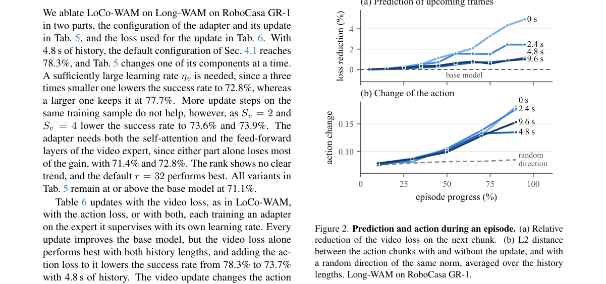

**Why this ranks #8**: LoCo-WAM 保持短历史窗口不变，改在执行过程中用新观测到的帧更新视频专家的低秩适配器，让已经滑出输入窗口的过去仍然影响后续动作：RoboCasa GR-1 上 2.4 秒历史追平 9.6 秒历史的基线，4.8 秒历史还高出 4.8 个百分点，且不需要专家动作标签、额外数据或元训练。

---

### 9. ViewDreamer: A Robot World Model beyond Fixed Camera Setups

**arXiv**: [2611.26981](https://arxiv.org/abs/2611.26981) | **Score**: 8.7 (relevance 9 x 0.7 + quality 8 x 0.3) | **Direction**: `world_model` | **Tags**: embodied, multi-view, robot-world-model, slot-token, camera-setup, robot-video, Meta AI | **Categories**: cs.CV | **Pages**: 29

**Authors**: Ye Mao; Jinhui Xiong; Egor Larionov; Shiyang Lu; Krystian Mikolajczyk; Wei Ye

**Affiliation**: Meta AI; Imperial College London

**Abstract**

> Video generation models are increasingly important for robot learning, yet most generate each camera view separately or tile all views in a fixed layout. Robot demonstrations, however, are captured by synchronized cameras whose number, placement, and order vary across embodiments. We present ViewDreamer, a single world model that handles variable sets of cameras by disentangling per-view generation from cross-view interaction. Each view follows the generation path of a pretrained single-view model, and views interact only through shared slot tokens. We stabilize multi-view training with a curriculum that gradually increases the number of views. Cross-View Slot Agreement uses visual foundation models to group geometrically and semantically similar regions across views into shared slots. On RoboView-Bench, which covers one to four cameras, ViewDreamer achieves the best generation quality among the models evaluated and improves cross-view consistency over independent per-view generation. These gains carry over to our world-action model (WAM) and action-conditioned world model (AC-WM). Our WAM outperforms the FastWAM-Joint baseline on LIBERO-Plus, RoboTwin 2.0, and RoboDojo, and on a real Franka robot. Both variants improve out-of-domain generalization to various camera settings and scenes.

**Key findings**

- **Finding**: ViewDreamer 在覆盖 1 到 4 个相机的 RoboView-Bench 上取得被评测模型中最好的生成质量，跨视角一致性优于逐视角独立生成；预训练用了来自 14 种本体的 2.99M 段机器人视频。
- **Inference**: 把跨视角耦合限制在共享 slot token 上，既保住了单视角生成器的成熟能力，又能支撑数量与布局都可变的相机集合。
- **Recommendation**: 训练机器人视频世界模型时，请按「每视角生成 + 单一跨视角交互通道」设计结构，并加入视角数递增的课程与 slot 一致性监督。

**Key figures**

*Framework - Robots often carry several cameras, whose number and placement vary widely, as in the single-arm, bimanual, and humanoid robots at the top. Pretrained on 2.99M robot video clips from 14 embod*

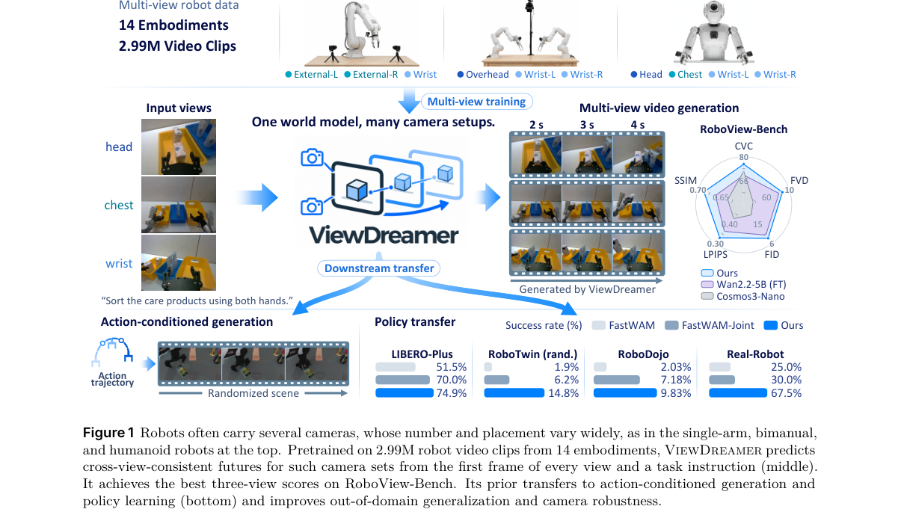

*Result - Overview of ViewDreamer. (a) Shared DiT blocks process each view, and a CVI module after every block is the only cross-view path. (b) CVI reads all view tokens into shared slots, mixes the sl*

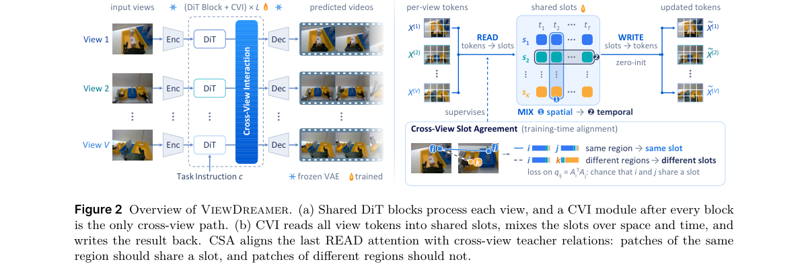

**Why this ranks #9**: 机器人相机的数量、位置与顺序随本体而变，ViewDreamer 把每路视角的生成路径与跨视角交互解耦，跨视角只通过共享 slot token 传递，并用视觉基础模型做跨视角 slot 一致性监督：在覆盖 1 到 4 个相机的 RoboView-Bench 上生成质量最好，预训练用了来自 14 种本体的 2.99M 段机器人视频。

---

### 10. A Plan or an Adversarial Example? A Round-Trip Check for Latent World Models

**arXiv**: [2611.27124](https://arxiv.org/abs/2611.27124) | **Score**: 8.7 (relevance 9 x 0.7 + quality 8 x 0.3) | **Direction**: `world_model` | **Tags**: embodied, world-model, adversarial-example, planner-diagnostic, cem, mppi, Zhejiang University | **Categories**: cs.CV, cs.LG | **Pages**: 12

**Authors**: Huiyuan Tian; Chih-Yung Wen; Shijian Li

**Affiliation**: Zhejiang University; The Hong Kong Polytechnic University

**Abstract**

> If we optimize an image until a classifier is confident it shows a cat, we may get an adversarial example, not a cat. Planning with a latent world model is a similar search for actions whose predicted future is closest to the goal. Is the result a plan, or an adversarial example of the world model? We show that it can be either. On the released DINO-WM and LeWM, more iterations of the cross-entropy method (CEM) lower the predicted cost but lose up to half of the problems CEM had already solved. The model's own predictions do not reveal these failures. We propose a simple test that executes the plan after every iteration and counts the problems a planner solves and then loses. Unlike an image, a plan comes with its actions, which our round-trip check reads back from the predicted states with a small network, penalizing mismatches. The check reads back the sum of each block of five actions, the part that two consecutive predicted states determine. Without retraining the world model and at only 0.2% to 3.1% more planning time, it improves the widely used planners CEM and MPPI on three released world models, and gains more where planners lose more problems. Without replanning, success rises from 0.39 to 0.76 on Wall with DINO-WM and from 0.56 to 0.94 for MPPI on JEPA-WM. With replanning (MPC), it rises from 0.70 to 0.81 on Cube with LeWM.

**Key findings**

- **Finding**: 在 DINO-WM 与 LeWM 上，CEM 迭代增多会降低预测代价却丢掉 CEM 已解出问题的近一半；round-trip check 只额外花 0.2% 到 3.1% 的规划时间，就把 Wall 成功率从 0.39 提到 0.76。
- **Inference**: 计划像对抗样本一样可以骗过世界模型，而模型的自身置信度无法暴露这一点；因为计划自带动作，可以从预测状态反读动作做一致性检查。
- **Recommendation**: 用 CEM 或 MPPI 搭配潜空间世界模型时，请每轮迭代都执行一次计划并做 round-trip 校验，宁可少迭代也不要相信更低的预测代价。

**Key figures**

*Framework - A plan can be an adversarial example of the world model. The model cannot recognize it, and our round-trip check repairs the planner. (a) A mosaic of color blocks optimized against an ImageN*

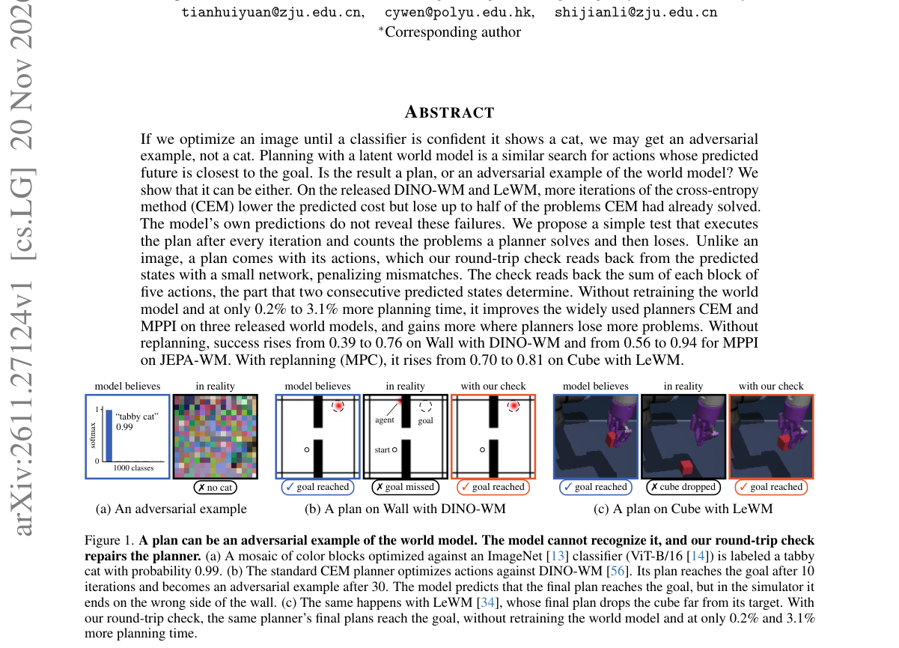

*Result - With the standard planner, planning longer makes the model more confident and the plan worse. The data are from DINO-WM on the Wall task with 148 problems. (a) With the standard CEM planner,*

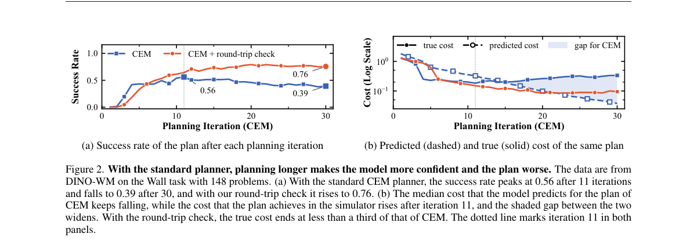

**Why this ranks #10**: CEM 迭代更多会降低预测代价，却丢掉 CEM 已经解出的近一半问题，而模型自己的预测看不出这种失败。Round-trip check 每次迭代后执行计划、从预测状态读回动作并惩罚不匹配，只多花 0.2% 到 3.1% 的规划时间：不重规划时 DINO-WM 的 Wall 成功率从 0.39 升到 0.76，MPPI 用 JEPA-WM 从 0.56 升到 0.94。

---

## 具身智能与机器人学习 · `embodied_ai` (10 papers)

10 篇全部 rel≥9,但真正刺眼的是**评测**:ManipScope 在 13,200 个回合里发现 84.6% 的失败是「挪走了干扰物」,十个策略 checkpoint 在 1,000 个同初始状态上遵循指令的比例只有 3.9%,**低于不看指令的选择器的 16%**,而阳性对照的 GPT-6 agent 能到 88% —— 场景里的成功主要来自与指令无关的偏好。正面进展集中在数据与后训练:FlowScope 用 1,149 例临床手术的 1.35M 片段做场景流预训练,把真机取针成功率从 54% 提到 90%、针交接从 4% 提到 52%;BeyondEgo 的 HELM 基准上成功率从 48.0% 提到 92.0%;ActMem 在 RoboMemArena 拿到 71.1% 任务成功率(比最强基线高 7.5 个百分点);EmbodyAgent 用 SFT+RL 把 held-out 成功率从 0/100 推到 84/100,每回合模型调用从 36 降到 11;A²-VLA 换工具比 π0.5 高 30.7 个百分点,GenPA 则用 19M 适配器在 LIBERO 拿到 99.10%。

### 11. ActMem: From Latent Memory Reasoning to Grounded Robotic Action

**arXiv**: [2611.25461](https://arxiv.org/abs/2611.25461) | **Score**: 8.7 (relevance 9 x 0.7 + quality 8 x 0.3) | **Direction**: `embodied_ai` | **Tags**: embodied, vla, latent-memory, flow-matching, robotic-manipulation, long-horizon, Beihang University | **Categories**: cs.CV, cs.LG | **Pages**: 17

**Authors**: Linfeng Dong; Jianwei Niu; Jiuyi Zhao; Ruibing Feng; Xinghao Wu; Wu Yang; Shuai Tao; Wulong Liu; Mu Li

**Affiliation**: Beihang University; Beta Infinity

**Abstract**

> Vision-Language-Action (VLA) models have shown promising results in real-world long-horizon manipulation, where memory plays a crucial role. However, existing memory-augmented VLAs either retrieve past observations without reasoning about what they imply, or reason over the full history in a shared context where it crowds out current perception. Cognitive science treats them as distinct systems: memory reconstructs past experience to decide what to do, while perception guides how to act. We therefore propose ActMem, an in-context memory framework that decouples memory reasoning from perceptual grounding within a single vision-language backbone. Built on a vision-language model with native video understanding, ActMem infers the current subtask from a timestamped interaction history and keeps the hidden states formed during this inference as a Latent Memory Chain-of-Thought (Memory CoT), which conditions a flow-matching action expert. Perception Attention further lets the expert attend directly to the current view. To keep inference fast under long histories, Efficient Memory CoT Inference reuses computation across consecutive decisions without changing the output. ActMem achieves 71.1% task success and 80.8% completion success on RoboMemArena, surpassing the strongest baseline by 7.5 and 8.7 percentage points, and 73.8% average success on MIKASA-Robo, the best among all compared methods. In the real world, it reaches 68.8% average success on exogenous, endogenous, and traceless memory tasks, 10.0 percentage points above the strongest memory-augmented VLA. Code and checkpoints will be released at https://github.com/LigphiDonk/ActMem and https://huggingface.co/donk111/ActMem.

**Key findings**

- **Finding**: ActMem 在 RoboMemArena 上达到 71.1% 任务成功率与 80.8% 完成成功率，分别超过最强基线 7.5 和 8.7 个百分点；真机三类记忆任务平均成功率 68.8%，高出最强记忆增强 VLA 10.0 个百分点。
- **Inference**: 记忆负责重建过去经验以决定做什么、感知负责决定怎么动，两者共享上下文会互相挤占，因此把记忆推理放进潜空间并单独保留当前视角注意力更有效。
- **Recommendation**: 做长时程具身任务时，请把记忆推理与当前感知分成两条通路，并检查在长历史下推理开销是否仍然可接受。

**Key figures**

*Framework - ActMem: history becomes action. (a) Human-inspired action: past experience is reconstructed into memory and spa- tial reasoning that determines what to do, while current percep- tion determi*

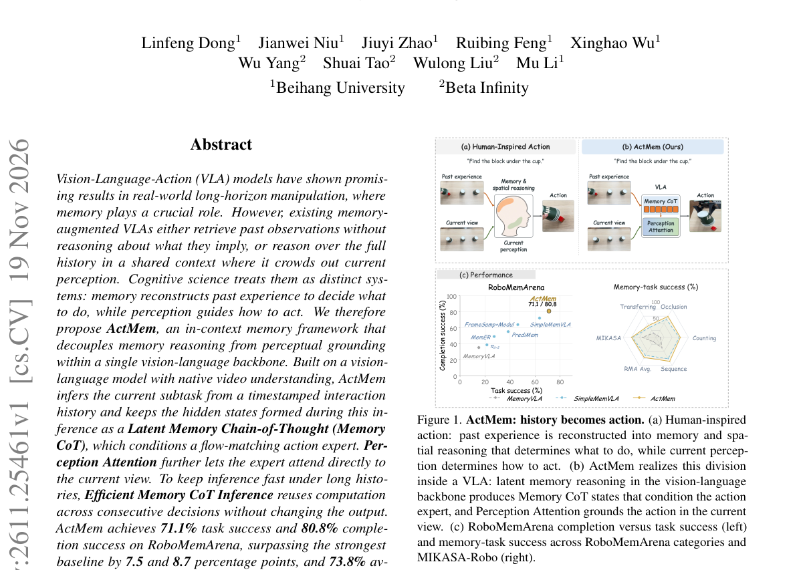

**Why this ranks #11**: ActMem 把记忆推理与感知接地解耦：用带时间戳的交互历史推断当前子任务，把推理中的隐状态留作潜空间记忆思维链去条件化 flow-matching 动作专家。RoboMemArena 上任务成功率 71.1%、完成率 80.8%，比最强基线高 7.5 和 8.7 个百分点，真机三类记忆任务平均 68.8%，高出最强记忆增强 VLA 10.0 个百分点。

---

### 12. A$^2$-VLA: Adapting Vision-Language-Action Policies to New Tools through Agentic Affordance Discovery

**arXiv**: [2611.25656](https://arxiv.org/abs/2611.25656) | **Score**: 8.7 (relevance 9 x 0.7 + quality 8 x 0.3) | **Direction**: `embodied_ai` | **Tags**: embodied, affordance-discovery, tool-adaptation, vla, skill-library, pi05, Shanghai Jiao Tong University | **Categories**: cs.AI, cs.RO | **Pages**: 16

**Authors**: Chenyuan Zhou; Chaoyi Huang; Zibo Wang; Zhiyuan Li; Yong-Lu Li

**Affiliation**: Shanghai Jiao Tong University

**Abstract**

> Tools with different shapes can have similar functions, but transferring manipulation skills across tools requires understanding how tool geometry relates to the specific task and adjusting the manipulation strategy accordingly. The key challenge is to discover the common affordances that contribute to task completion across different tools and verify whether they support new tools in performing similar work. We present A$^2$-VLA, a tool-adaptation framework that combines an embodied agent with a VLA policy. It treats tool affordances as hypotheses the agent can construct, test, and revise. Given teleoperated demonstrations with a few source tools, the agent reconstructs the scenes in simulation and autonomously determines task-relevant affordance features: functional regions and their key geometric properties. It develops affordance-extraction skills and refines both the features and skills through autonomous experiments in the reconstructed scenes. Validated extraction skills accumulate in a reusable skill library for unseen tools. Finally, A$^2$-VLA uses encoded functional-region features as conditioning inputs to a $π_{0.5}$ backbone during training and inference. Evaluation examines affordance reliability in reconstructed scenes and real-robot task success on unseen tools. Our method achieves 86.1% success in simulated cross-tool trajectory retargeting based on affordances. On three real-robot tool-use tasks, A$^2$-VLA improves task success by 30.7 percentage points over $π_{0.5}$.

**Key findings**

- **Finding**: A2-VLA 在基于可供性的仿真跨工具轨迹重定向上取得 86.1% 成功率，在三个真机工具使用任务上把成功率相对 π0.5 提升 30.7 个百分点。
- **Inference**: 把可供性当作可被实验证伪的假设并在仿真中自主检验，比直接从演示回归动作更能跨工具泛化，因为验证过的抽取技能可以沉淀复用。
- **Recommendation**: 要让策略适配陌生物体时，请先在仿真里把「功能区域 + 几何属性」做成可验证假设，再把区域特征接到 VLA 的条件输入上。

**Key figures**

*Framework - Given demonstrations of a task performed with a few source tools, A2-VLA analyzes functional-region features, reconstructs scenes in simulation, and validates the inferred affordances. Refin*

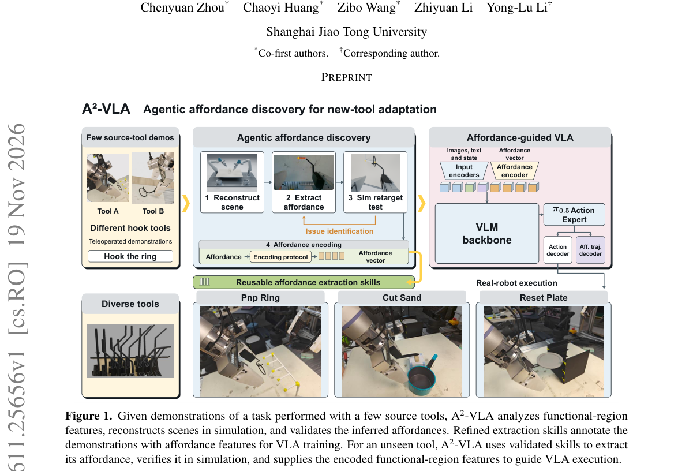

*Result - A2-VLA overview. (a) The agent reconstructs demonstrated scenes, autonomously determines task-relevant affordance features, develops affordance-extraction skills, and tests cross-tool retarg*

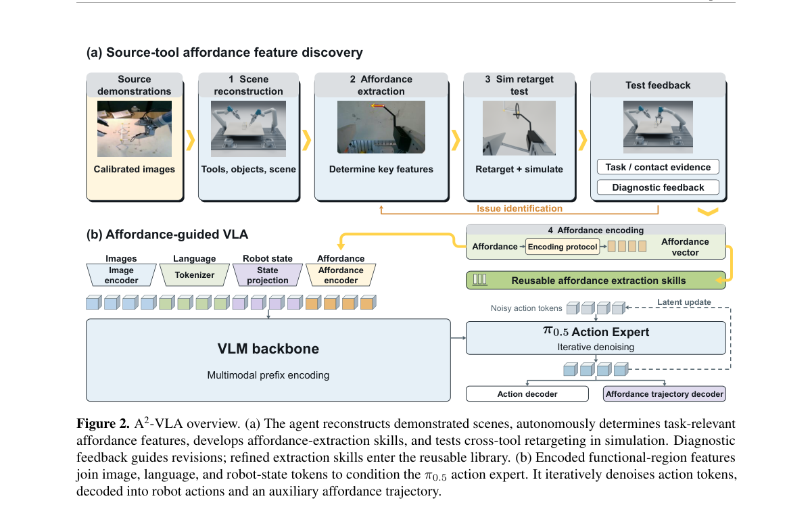

**Why this ranks #12**: 工具形状不同但功能相似，关键在发现跨工具共享的可供性：A2-VLA 让智能体在仿真里自主提出、验证并修正「功能区域及其关键几何属性」假设，把验证过的抽取技能沉淀成可复用技能库，再把功能区域特征作为条件喂给 π0.5。仿真跨工具轨迹重定向成功率 86.1%，三个真机工具任务比 π0.5 高 30.7 个百分点。

---

### 13. One View, One Action: Spatially Generalizable VLAs through Observation-Aligned Experts and Cross Graph Consistency

**arXiv**: [2611.26161](https://arxiv.org/abs/2611.26161) | **Score**: 8.7 (relevance 9 x 0.7 + quality 8 x 0.3) | **Direction**: `embodied_ai` | **Tags**: embodied, multi-view, camera-frame-supervision, spatial-generalization, attention-graph, libero-plus, Sun Yat-sen University | **Categories**: cs.RO | **Pages**: 23

**Authors**: Jinxi Liu; Ruifeng Zhai; Hao Liu; Guangrun Wang

**Affiliation**: Sun Yat-sen University; X-Era AI Lab

**Abstract**

> Multi-view vision-language-action (VLA) models still face challenges in spatial generalization, particularly under changes in camera viewpoints and robot initial states. These models typically receive action supervision only in the robot base frame, requiring them to implicitly learn the spatial correspondence between observations from each view and base-frame actions. We propose One View, One Action (OVOA-VLA), which learns to predict actions in each view's camera frame, allowing the same physical motion to provide diverse, observation-aligned supervision across views. OVOA-VLA jointly trains a base-frame expert and view-specific action experts, whose robot-state inputs and action targets are expressed in their respective camera frames. Two complementary directed attention graphs model both directions of interaction between the base and view-specific experts, jointly leveraging view-specific action supervision to improve base-frame prediction. Cross Graph Consistency further encourages agreement between the two graphs' base-frame predictions for the same sample. With the same multi-view inputs, the model supports both full and base-only inference. Experiments across multiple simulation benchmarks demonstrate improved manipulation performance and robustness to camera-viewpoint and robot-initialization perturbations. Full and base-only inference achieve average success rates of 88.1% and 85.7% on LIBERO-Plus, respectively. In real-world evaluations, base-only inference raises the average success rates from $π_{0.5}$'s 28.3% to 58.3% across three tasks under spatial distribution shifts.

**Key findings**

- **Finding**: 在 LIBERO-Plus 上 OVOA-VLA 全视角推理平均成功率 88.1%、仅基座推理 85.7%；真机三个空间分布偏移任务上，仅基座推理把 π0.5 的 28.3% 提高到 58.3%。
- **Inference**: 让同一段物理运动在不同相机坐标系下提供多样且与观测对齐的监督，模型不必再隐式求解视角到基座的空间对应，从而对相机视角与初始状态变化更鲁棒。
- **Recommendation**: 部署多相机 VLA 时，请考虑加入相机坐标系的动作监督与基座-视角交叉注意力约束，以换取视角变化下的空间泛化能力。

**Key figures**

*Framework - Motivation and comparison of action supervision. (a) The same physical action has different representations in the robot base frame and different camera frames; as the camera pose changes, i*

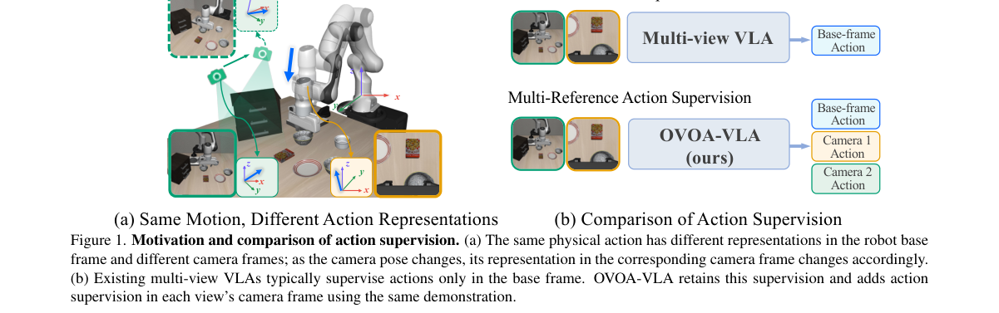

*Result - Overview of OVOA-VLA.(a) Each view-specific action expert attends to its own view and predicts camera-frame actions, jointly trained with the base expert. (b) Complementary attention graphs*

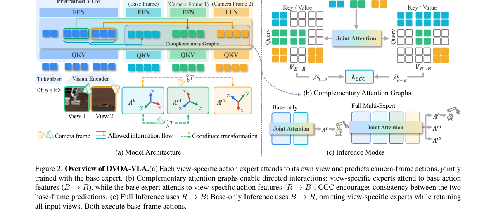

**Why this ranks #13**: 多视角 VLA 只在机器人基座坐标系接受动作监督，必须隐式学会各视角观测与基座动作的对应。OVOA-VLA 让每个视角都预测自己相机坐标系下的动作，并让基座专家与视角专家通过两个互补的有向注意力图互相作用、用跨图一致性对齐同一动作目标：LIBERO-Plus 上全视角推理 88.1%、仅基座推理 85.7%，真机三个空间偏移任务从 π0.5 的 28.3% 提到 58.3%。

---

### 14. EmbodyAgent: Post-Training Embodied VLM Agents via Distillation, SFT, and RL

**arXiv**: [2611.26196](https://arxiv.org/abs/2611.26196) | **Score**: 8.7 (relevance 9 x 0.7 + quality 8 x 0.3) | **Direction**: `embodied_ai` | **Tags**: embodied, embodied-vlm, post-training, sft, reinforcement-learning, code-as-policy, Tsinghua University | **Categories**: cs.RO | **Pages**: 11

**Authors**: Wei Dai; Jinkun Liu; Jiayi Chen; Han Liu; Wenbo Ding; Shaolun Huang

**Affiliation**: Tsinghua University; Xidian University

**Abstract**

> Vision-language models (VLMs) can act as closed-loop robot-use agents (RUAs) by writing and executing control code through tool interfaces. However, turning an open-weight VLM into a high-performing embodied agent requires a complete post-training stack: out-of-the-box open VLMs fail completely at interactive tool contracts, strong frontier teachers are accessible only as black-box endpoints without exposed weights or token probabilities, and supervised imitation alone plateaus under rollout distribution shift. We present EmbodyAgent, an end-to-end post-training framework with three tightly coupled pipelines: (1) a black-box data synthesis pipeline that queries a strong teacher under a forced think-then-code contract and filters trajectories by task success; (2) an SFT pipeline that distills the explanation-and-program targets into an open-weight 9B VLM with both vision and language encoders trainable; and (3) an online RL pipeline that optimizes student-generated episodes via group-relative advantage with a runtime-error-penalized outcome reward. All three pipelines share one primitive-free Python execution tool exposing only raw visual observation and seven-dimensional end-effector control, with no action decoder and no interface shift across stages. Under a strictly separated evaluation protocol on ten LIBERO Spatial tasks (disjoint state splits, greedy test-time decoding, training-only safeguards), held-out success on 100 test states rises from 0/100 (base 9B VLM) to 14/100 (after SFT) and 84/100 (after RL), while training rollout success climbs from 8.4% to 87.7% and median model calls per episode drop from 36 to 11. We further identify a self-reinforcing runtime-error mode induced by outcome-based RL on executable code, and establish a failure-category monitoring and sampling-side curation protocol that stabilizes training.

**Key findings**

- **Finding**: 在 10 个 LIBERO Spatial 任务的 100 个留出状态上，成功数从基础 9B VLM 的 0/100 升到 SFT 后的 14/100、RL 后的 84/100，训练 rollout 成功率从 8.4% 升到 87.7%，每 episode 模型调用中位数从 36 降到 11。
- **Inference**: 只做监督模仿会在 rollout 分布偏移下停滞，而基于可执行代码的结果奖励会诱发自我强化的运行时错误模式，需要按失败类别监控并做采样侧筛选才能稳定训练。
- **Recommendation**: 把开源 VLM 改造成机器人代理时，请按黑盒教师合成、SFT 蒸馏、在线 RL 三段推进，并单独监控运行时错误这一失败类别。

**Key figures**

*Result - Stage 3 RL progression across ten LIBERO Spatial tasks. Left: greedy success on the 100 held-out test states after each round alongside temperature-one training rollout success (round 0 is t*

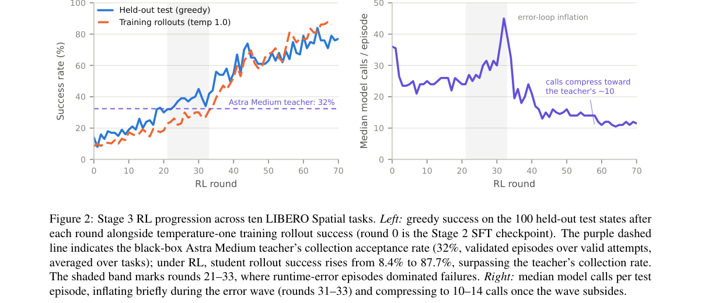

**Why this ranks #14**: 开源 9B VLM 直接当闭环机器人代理会在交互式工具契约上彻底失败，EmbodyAgent 用黑盒教师数据合成、SFT 蒸馏、在线 RL 三段管线补齐后训练栈：10 个 LIBERO Spatial 任务的留出成功率从 0/100 升到 SFT 后 14/100、RL 后 84/100，训练 rollout 成功率从 8.4% 升到 87.7%，每次 episode 的模型调用中位数从 36 降到 11。

---

### 15. TacInno: Teaching Vision-Language-Action Models the Contact Dynamics Beyond Vision and Action

**arXiv**: [2611.26405](https://arxiv.org/abs/2611.26405) | **Score**: 8.7 (relevance 9 x 0.7 + quality 8 x 0.3) | **Direction**: `embodied_ai` | **Tags**: embodied, visuo-tactile, vla, vector-quantization, contact-rich, auxiliary-target, ShanghaiTech University | **Categories**: cs.CV, cs.RO | **Pages**: 11

**Authors**: Weile Li; Yunfan Lou; Muqing Shi; Zihao Zhang; Zhenbiao Huang; Boxian Yao; Xiyu Zhu; Zhibo Pang

**Affiliation**: ShanghaiTech University; Institute of AI for Industries (IAII), Chinese Academy of Sciences; Peking University; Washington University in St. Louis; Beijing FiveAges Technology

**Abstract**

> Vision-Language-Action (VLA) models have recently been equipped with tactile sensing to perceive visually subtle contact events in contact-rich manipulation. However, adding tactile input yields inconsistent gains, and some visuo-tactile VLA models rely little on tactile input, because much of the tactile change, such as the gel deformation during gripper closure, is predictable from visual observations and executed actions. To address this problem, we introduce TacInno, which isolates the contact dynamics that vision and executed actions cannot explain, termed tactile innovation, and uses tactile innovation only as a training target. Specifically, the TacInno tokenizer, conditioned on visual observations and executed actions, compresses the future tactile change into a discrete code, and the policy, TacInno-VLA, learns to predict the code, adding no module for the code at deployment. TacInno-VLA achieves average success rates of 87.5% across six simulation tasks and 70.5% across four real-world tasks, outperforming the strongest visuo-tactile baseline by 10.7 and 9.0 percentage points, respectively. Ablation studies validate the contributions of visual and action conditioning, multi-frame encoding, and auxiliary code prediction. Together, these results demonstrate the effectiveness of tactile innovation as a supervision signal for contact-rich manipulation.

**Key findings**

- **Finding**: TacInno-VLA 在 6 个仿真任务上平均成功率 87.5%、4 个真机任务上 70.5%，分别超过最强视觉-触觉基线 10.7 和 9.0 个百分点；其 tokenizer 把 t 到 t+15 的触觉变化压成 16 位离散码。
- **Inference**: 触觉里大部分变化是视觉与动作可解释的冗余，只有剔除这部分后的触觉创新才是真正有信息量的监督信号，否则模型会退化成忽略触觉。
- **Recommendation**: 引入触觉模态时，请把目标设计成只监督视觉与动作解释不了的那部分接触响应，并在部署前去掉辅助码预测头以免增加推理开销。

**Key figures**

*Framework - Overview of TacInno. (a) The tactile change mixes a component explained by vision and executed actions with a contact response that only tactile input reveals. (b) The TacInno tokenizer enco*

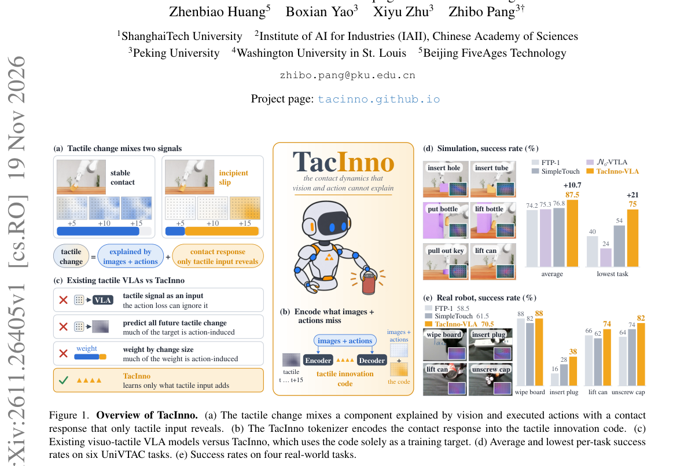

*Result - Architecture of the TacInno tokenizer. The encoder compresses the tactile observations from t to t+15 into the 16-bit code ct, and the decoder reconstructs the future tactile change from Xt*

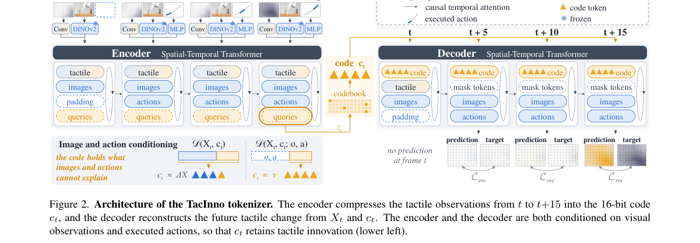

**Why this ranks #15**: 很多视觉-触觉 VLA 几乎不用触觉，因为闭合夹爪时的胶体形变可由视觉与动作预测出来。TacInno 只监督视觉与已执行动作解释不了的那部分接触动力学：把 t 到 t+15 的未来触觉变化压成 16 位离散码，策略只预测这个码、部署时不加任何模块，6 个仿真任务平均成功率 87.5%、4 个真机任务 70.5%，比最强视觉-触觉基线高 10.7 和 9.0 个百分点。

---

### 16. One Prior, Two Dynamics: Repurposing Video Diffusion Transformers for Self-Supervised Latent Action Learning

**arXiv**: [2611.26617](https://arxiv.org/abs/2611.26617) | **Score**: 8.7 (relevance 9 x 0.7 + quality 8 x 0.3) | **Direction**: `embodied_ai` | **Tags**: embodied, latent-action, video-diffusion, self-supervised, zero-shot-transfer, embodiment-transfer, Show Lab | **Categories**: cs.AI, cs.CV, cs.LG, cs.RO | **Pages**: 21

**Authors**: Yuxin Jiang; Wenqiang Sun; Jiaqi Li; Yuchao Gu; Lvmin Zhang; Ivor Tsang; Mike Zheng Shou

**Affiliation**: Show Lab, National University of Singapore; A*STAR, Singapore; Tencent; Stanford University

**Abstract**

> Videos reveal how the world changes, but rarely the actions that cause those changes. Latent action learning recovers such supervision from visual transitions, yet often learns the underlying dynamics largely from scratch. We ask whether a pretrained video generator can instead provide the prior for both inverse and forward dynamics. We introduce O$^{2}$LaF, built on a simple principle: one prior, two dynamics. We initialize both models from the same pretrained video DiT and adapt them to their distinct roles: a feed-forward transition encoder with learnable action queries for inverse dynamics, and a causal, action-conditioned video generator for forward dynamics. By controlling information access and optimizing both dynamics end-to-end through a compact bottleneck, O$^{2}$LaF learns transferable actions from unlabeled videos. Across navigation and robotic manipulation, O$^{2}$LaF sets a new state of the art in few-shot action probing and enables stronger zero-shot action transfer across visual contexts and embodiments. Beyond generative video priors, we further extend our framework to predictive representation priors such as V-JEPA2, achieving competitive performance. Our findings suggest a broader paradigm for latent-action learning: repurposing pretrained video models to discover transferable actions and predict their consequences.

**Key findings**

- **Finding**: O2LaF 在 GR-1 机器人上的 EEF R² 为 0.277，高于 DreamDojo 的 0.149，而训练只用了 EgoDex 人类示教、无机器人域适配；跨上下文导航中平移 NRMSE 1.289、旋转 RPE 0.786，均优于 AdaWorld 与 Olaf-World。
- **Inference**: 同一个预训练视频先验同时供逆向与前向动力学使用、配合紧凑瓶颈，能让潜动作既可被线性探针解码，又可跨视觉上下文与本体零样本迁移。
- **Recommendation**: 缺少动作标注时，可直接复用预训练视频 DiT 作为双向动力学先验并用紧凑瓶颈约束潜动作，而不是从零训练潜动作空间。

**Key figures**

*Framework - O2LaF: One Prior, Two Dynamics — a self-supervised Latent Action learning Framework. Latent actions from unlabeled videos share one unified space (center): e.g., the same 𝑧inferred from 1st*

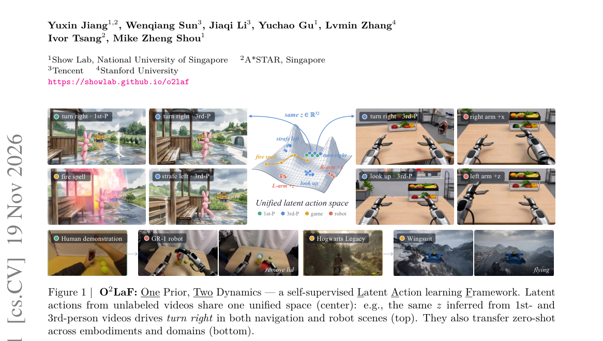

*Result - Paradigms for self-supervised latent-action learning. Existing methods learn latent actions (a) from scratch [3, 19, 20], (b) on frozen visual features [21, 22], (c) with a pretrained video*

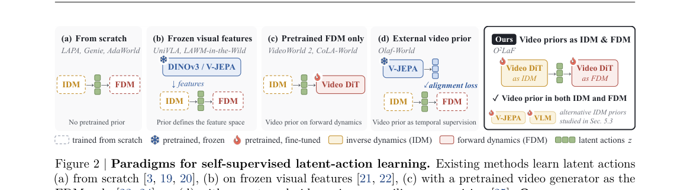

**Why this ranks #16**: 用同一个预训练视频 DiT 同时初始化逆向动力学（带可学习动作查询的转移编码器）与前向动力学（因果、动作条件的视频生成器），再靠紧凑瓶颈端到端训练：GR-1 上 EEF R² 达 0.277、明显高于 DreamDojo 的 0.149，而训练只用 EgoDex 人类示教；跨上下文导航 840 次生成中平移 NRMSE 降到 1.289、旋转 RPE 降到 0.786。

---

### 17. FlowScope: 3D Scene Flow Pretraining Improves Surgical Robot Policies

**arXiv**: [2611.26865](https://arxiv.org/abs/2611.26865) | **Score**: 8.7 (relevance 9 x 0.7 + quality 8 x 0.3) | **Direction**: `embodied_ai` | **Tags**: embodied, surgical-robot, scene-flow, pretraining, action-chunking, stereo-video, Vanderbilt University | **Categories**: cs.CV, cs.RO | **Pages**: 19

**Authors**: John J. Han; Adam Schmidt; Jingpei Lu; Zooey He; Muhammad Abdullah Jamal; Jie Ying Wu; Omid Mohareri

**Affiliation**: Vanderbilt University; Intuitive Surgical Inc.

**Abstract**

> Imitation learning for surgical robots is limited by the cost of collecting demonstrations. Meanwhile, many robot-assisted procedures are recorded as stereo video, yet policies cannot learn from them directly; clinical video carries no action labels. We present FlowScope, which pretrains a surgical policy network on unlabeled clinical video by forecasting scene flow, the metric 3D motion of scene points, with labels computed by off-the-shelf stereo depth and optical flow models. We pretrain the trunk of an Action Chunking Transformer (ACT) on a dataset of 1,149 clinical procedures (1.35M clips) and discard the flow head afterward, so the deployed policy is a standard ACT with no added inference cost. On a real surgical robotic system, FlowScope raises needle pickup success from 54% to 90% and first-handover success on needle regrasp from 4% to 52% (full task: 2% to 14%) over training from scratch (n=50 trials each), and retains its gains with a generative flow-matching action head. Ablations indicate that metric 3D motion is the strongest pretraining signal among those tested; kinematics, 2D tracks, depth alone, and scale-free 3D flow, each paired with kinematics, yield smaller or no gains. Representation analyses suggest that scene-flow pretraining encodes metric needle depth more accurately, that kinematics pretraining increases reliance on the robot state, and that needle-depth probes follow the ordering of real-robot success where offline validation error does not.

**Key findings**

- **Finding**: 在真实手术机器人系统上，FlowScope 把取针成功率从 54% 提升到 90%、换手后重新抓针从 4% 提升到 52%（完整任务 2% 到 14%），每个条件 50 次试验；预训练用了 1,149 例临床手术、135 万段片段。
- **Inference**: 消融显示带度量三维运动的场景流是最强预训练信号，而运动学、2D 轨迹、纯深度等弱信号收益小得多，说明关键在度量化的三维几何运动而非时序本身。
- **Recommendation**: 缺动作标签但有双目视频的领域（如手术），可先预训练主干去预测度量场景流、随后丢掉流头，再按标准 ACT 部署以保持零推理开销。

**Key figures**

*Framework - FlowScope. Each image is encoded by a frozen DINOv2 pretrained on surgical images. Pretraining (top): point queries read the image features at their pixels, and the flow head predicts each p*

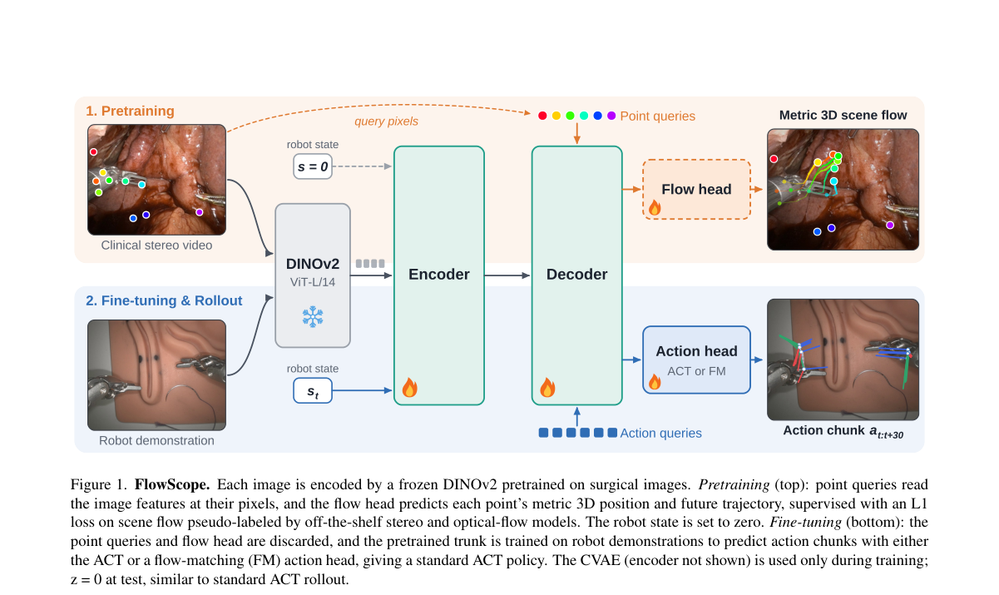

*Result - Scene-flow pseudo-labels on clinical video. Each track shows where a point on the anchor frame moves over the next 10 keyframes (1.7 s), computed from stereo depth and optical flow and kept*

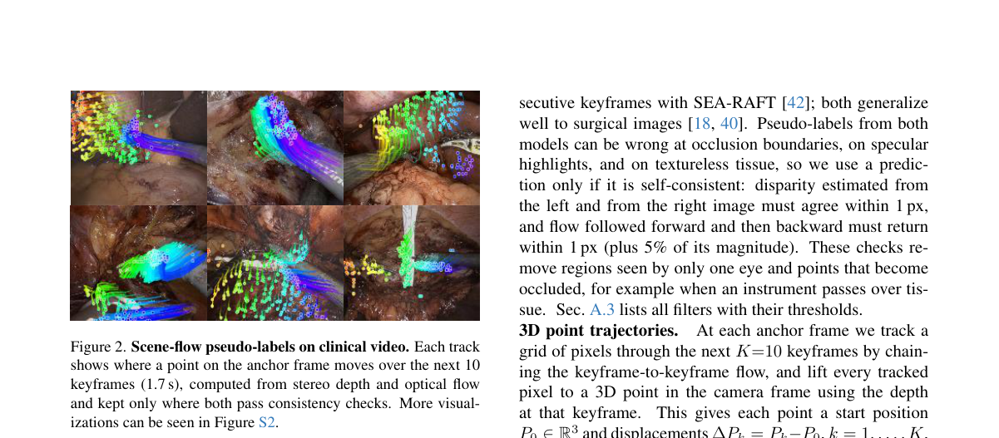

**Why this ranks #17**: 手术机器人的示范昂贵，而大量临床手术录的是双目视频、却没有动作标签。FlowScope 用现成立体深度与光流算出场景流伪标签，预训练 ACT 主干后再丢弃流头：1,149 例临床手术、135 万段片段，真机上取针成功率从 54% 提到 90%，换手再抓针从 4% 提到 52%（完整任务 2% 到 14%，各 50 次试验）。

---

### 18. BeyondEgo: Learning to Act Beyond Egocentric Perception via Humanoid Ego-Exo Foresight

**arXiv**: [2611.27047](https://arxiv.org/abs/2611.27047) | **Score**: 8.7 (relevance 9 x 0.7 + quality 8 x 0.3) | **Direction**: `embodied_ai` | **Tags**: embodied, humanoid, egocentric-exocentric, foresight, dinov3, loco-manipulation, Tongji University | **Categories**: cs.RO | **Pages**: 20

**Authors**: Zhaoshan Yang; Chenglei Li; Haoyu Lei; Yutao Zhang; Yuyu Yang; Zhuo Chen; Ling Ding; Zhongxing Ren; Yi Gu; Heyang Zhang; Peng Su; Jin Pan

**Affiliation**: Tongji University; Yingwang Intelligent Technology; Université de Montréal; The Chinese University of Hong Kong

**Abstract**

> Humanoid loco-manipulation requires coordinating whole-body motion to perform manipulation tasks in complex environments. Yet egocentric vision-language-action (VLA) policies can miss critical body--scene relationships, and action imitation alone provides no explicit supervision for future scene evolution. We propose BeyondEgo to extend VLA perception in space and time. Spatially, we encode a synchronized exocentric view with frozen DINOv3 and concatenate the resulting tokens with egocentric VLM tokens to condition the action expert. Temporally, we use future observations from both views as privileged supervision for a residual adapter on task-conditioned VLM features. A foresight expert regresses DINOv3 representations of both views 0.6s ahead. At deployment, the foresight expert is discarded and the 4.2M-parameter adapter is retained. We also introduce HELM, to our knowledge, the first closed-loop humanoid loco-manipulation benchmark with synchronized egocentric and exocentric views across five whole-body tasks.On HELM, BeyondEgo improves success from 48.0% to 92.0% in distribution and from 23.5% to 65.0% on 200 held-out scenes with layout, asset, material, and lighting shifts. Ablations show that dual-view DINOv3 foresight yields the best transfer results.

**Key findings**

- **Finding**: 在五项全身任务的 HELM 基准上，BeyondEgo 把同分布成功率从 48.0% 提升到 92.0%，在 200 个留出场景上从 23.5% 提升到 65.0%；部署时只保留 4.2M 参数的适配器。
- **Inference**: 第一视角的视野与时间都太窄，外部视角补上空间关系、双视角前瞻补上未来演化，残差适配器把两者蒸馏进原有的 VLM 特征而不必改动主干。
- **Recommendation**: 做人形 loco-操作时，请同时引入同步外部视角做空间扩展与短时前瞻做特权监督，部署时移除前瞻分支只保留小适配器。

**Key figures**

*Framework - Learning to act beyond egocentric perception in space and time. Egocentric and exocentric observations provide complementary spatial information, while DINOv3 features from both views 0.6 s*

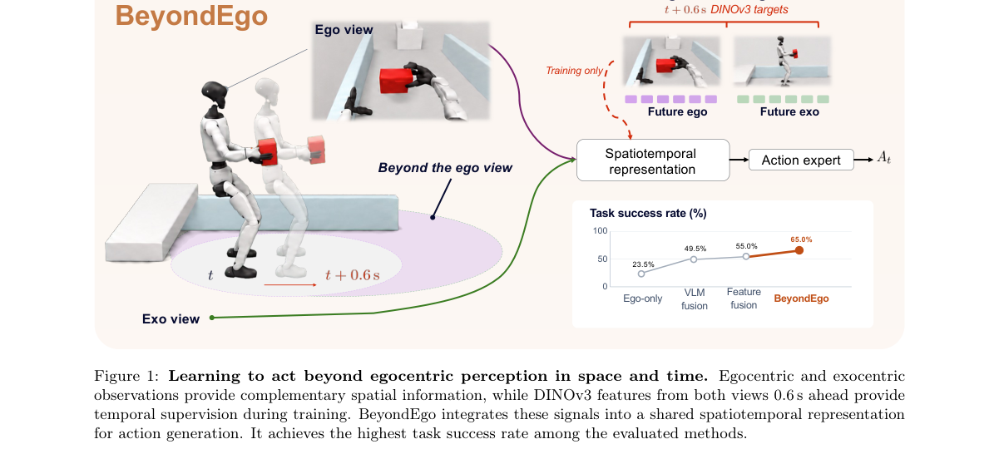

*Result - BeyondEgo architecture. Frozen VLM and DINOv3 encoders process the ego image with the instruction and the exo image, respectively. Adapted ego tokens, projected exo tokens, and robot state c*

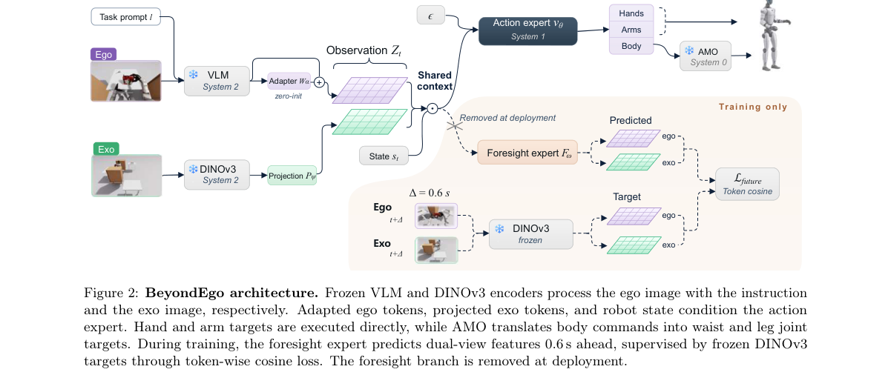

**Why this ranks #18**: 人形 loco-操作需要协调全身动作，而第一视角 VLA 常漏掉关键的身体-场景关系。BeyondEgo 在空间上用冻结 DINOv3 编码同步的外部视角并与第一视角 VLM token 拼接，在时间上用两个视角 0.6 秒后的观测做特权监督训练残差适配器，部署时丢掉前瞻专家只留 4.2M 参数的适配器：HELM 上同分布成功率由 48.0% 升到 92.0%，200 个留出场景上由 23.5% 升到 65.0%。

---

### 19. ManipScope: A Diagnostic Benchmark for Instruction Following and Generalization in Robotic Manipulation

**arXiv**: [2611.27305](https://arxiv.org/abs/2611.27305) | **Score**: 8.7 (relevance 9 x 0.7 + quality 8 x 0.3) | **Direction**: `embodied_ai` | **Tags**: embodied, benchmark, instruction-following, diagnostic, robot-manipulation, failure-analysis, University of Science and Technology of | **Categories**: cs.RO | **Pages**: 49

**Authors**: Jiacheng Li; Yaping Li; Congsheng Xu; Qingchen Liu; Haonan Wang; Zhijie Deng; Jiahu Qin

**Affiliation**: University of Science and Technology of China; Sharpa Robotics; Shanghai Jiao Tong University; SJTU-Sharpa Joint Lab for Embodied AI, SJTU; The Chinese University of Hong Kong

**Abstract**

> Completing a manipulation task does not establish that a robot follows the requested goal rather than a familiar routine. ManipScope is an evaluation-only diagnostic benchmark for robotic instruction following under changed task requirements. Built on RoboTwin 2.0's simulation resources, it specifies 48 held-out scenes across six task families with explicit source-task links; policies are trained on unmodified RoboTwin 2.0 demonstrations, and no demonstrations of the scenes are provided, so success requires reusing skills under a changed request rather than fitting supplied examples. Beyond task success, ManipScope provides a chain of diagnostics in which each step tests one explanation of a failure. For twelve policy checkpoints, 84.6% of failures in 13,200 episodes on eleven selection scenes displace a distractor, and gripper records show that failed episodes usually grasp a non-target. When the target is reassigned among the candidates on identical initial states, ten checkpoints follow every instruction on 3.9% of 1,000 states, below the 16% of an instruction-blind chooser, while a GPT-6 agent run as positive control reaches 88%. The failure recurs on unmodified training tasks and is not explained by missing manipulation skills, so success in these scenes largely reflects instruction-independent preferences; two checkpoints trained on the same data nevertheless follow color instructions. In a feasibility test, letting an agent select the target and the policy execute partly restores instruction following. Case studies with future-video and internal-intervention probes further show that forecasts and execution can agree on the wrong target and that action changes need not transfer the goal. Success, consistency, and sensitivity must each be checked against the requested goal.

**Key findings**

- **Finding**: 在 12 个策略检查点、11 个选择场景的 13200 个回合中，84.6% 的失败是抓取了非目标物；目标重指派后，10 个检查点只在 3.9% 的 1000 个状态上完全跟随指令，低于盲选策略的 16%，而 GPT-6 阳性对照达到 88%。
- **Inference**: 这些场景的成功率主要反映与指令无关的固有偏好而非目标导向能力，因为同一失败在未改动的训练任务上也会复现，缺失的并不是操作技能本身。
- **Recommendation**: 评测机器人策略时，请把一致性与对指令的敏感度同成功率分开检查，必要时让智能体先选目标、再由策略执行以定位问题环节。

**Key figures**

*Framework - Overview of MANIPSCOPE. Forty-eight scenes span six task families and three design levels. Policies and tool-using agents are evaluated through their respective interfaces. Diagnostics disti*

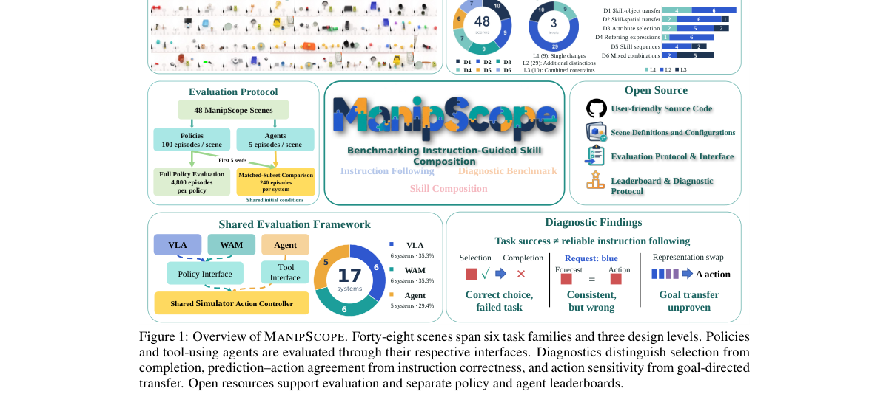

*Result - Target reassignment on the ten held-out selection scenes, ten checkpoints pooled (100 initial states per scene). (a) Initial states by class; ticks mark the follow share of an instruction-bl*

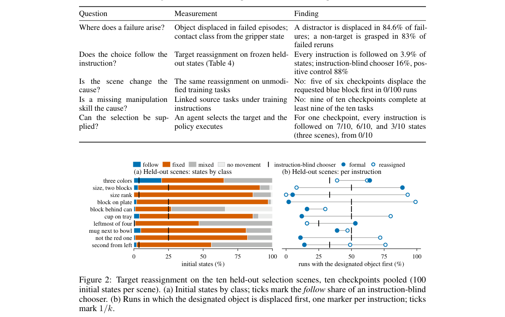

**Why this ranks #19**: 任务成功不等于机器人按指令做事。ManipScope 基于 RoboTwin 2.0 的仿真资源构造 48 个留出场景、6 个任务族，策略只在未改动的 RoboTwin 2.0 演示上训练：12 个策略检查点、11 个选择场景、13200 个回合里 84.6% 的失败是抓错目标；把目标在同一初始状态上重新指派时，10 个检查点只有 3.9% 的 1000 个状态能完全跟随指令，低于盲选策略的 16%，而 GPT-6 阳性对照达到 88%。

---

### 20. GenPA: Image Generators as Efficient Robot Policies

**arXiv**: [2611.27446](https://arxiv.org/abs/2611.27446) | **Score**: 8.7 (relevance 9 x 0.7 + quality 8 x 0.3) | **Direction**: `embodied_ai` | **Tags**: embodied, image-generation, action-regression, perception-co-training, latency, libero-plus, Fudan University | **Categories**: cs.RO | **Pages**: 35

**Authors**: Zian Deng; Tianyi Zhang; Zilong Zheng; Ziyu Liu; Tao Zhang; Yao Lyu; Shengbo Eben Li

**Affiliation**: Fudan University; Beijing Zhongguancun Academy; Tsinghua University; Delft University of Technology; SunRising AI Ltd.

**Abstract**

> Pretrained visual generation models have shown great promise in robotic manipulation. However, a representative line of work still treats future visual prediction as the central link between visual generative pretraining and action learning, retaining it as a training objective even when future scenes are no longer generated at inference time. We argue that the instruction-following, spatial understanding, and visual imagination capabilities acquired through image generation pretraining can support control without future visual prediction: image generation models themselves can be directly adapted into powerful action learners. Building on this perspective, we propose GenPA, which fine-tunes an image generation backbone with a lightweight 19M-parameter action regression adapter and reuses its native generative objective for perception co-training. The native image-editing interface accommodates different visual targets without task-specific perception heads, enabling comparisons of current-scene perception, future prediction, and their combinations within a common policy architecture. At deployment, GenPA requires only a single backbone forward pass and action regression, without visual generation or iterative action denoising. Without additional large-scale robot-data pretraining, GenPA demonstrates strong control performance and robustness to perturbations across simulation benchmarks (99.10% success on LIBERO and 83.79% on LIBERO-Plus) and real-world manipulation tasks. Under compiled inference, GenPA takes 20.9 ms per action chunk on a single H100 GPU, achieving 1.7-3.4x speedups over strong VLA and WAM baselines. Our latency analysis further highlights architectural advantages of visual generation backbones for efficient robot control. Ablations across visual tasks and their combinations identify current-depth supervision as a simple, effective training recipe.

**Key findings**

- **Finding**: GenPA 在 LIBERO 上成功率 99.10%、LIBERO-Plus 上 83.79%；编译推理下单张 H100 每个动作块耗时 20.9 毫秒，比强 VLA 与 WAM 基线快 1.7 到 3.4 倍。
- **Inference**: 图像生成主干本身就能当策略用，未来的视觉预测可以只作为训练期的感知协同目标，不必留在推理链路里，因此延迟不受去噪步数影响。
- **Recommendation**: 若被生成模型的高延迟劝退，请试把图像生成主干直接接一个轻量动作回归适配器、只保留单次前向，并在训练期用当前深度监督替代未来预测。

**Key figures**

*Framework - Motivation and overview of GenPA. (a) Given a scene image, a manipulation instruc- tion, and an editing request, GPT Image 2 visualizes a goal state or sketches end-effector paths in image s*

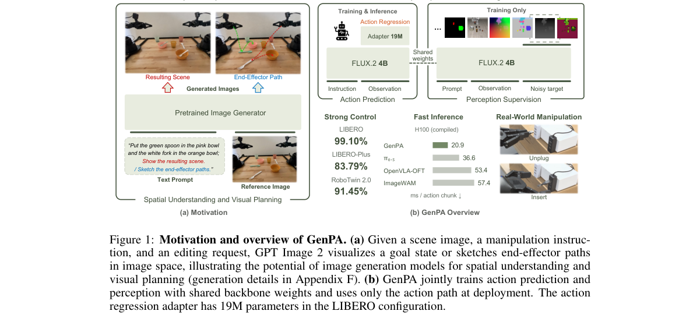

*Result - Architecture of GenPA. (a) The action path extracts instruction-conditioned observation features from the image generation backbone. A lightweight regression adapter reads these features and*

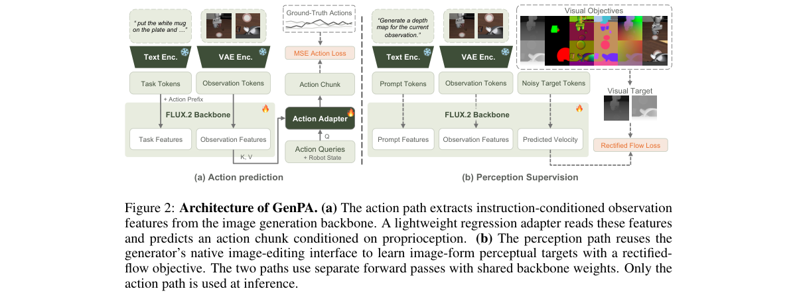

**Why this ranks #20**: GenPA 主张图像生成预训练带来的指令跟随、空间理解与视觉想象能力，无需靠「预测未来画面」这一中间目标兑现：直接在 FLUX.2 klein Base 4B 上挂一个 19M 参数的动作回归适配器，复用其原生生成目标做感知协同训练，部署时只需一次前向加回归、不做迭代去噪。LIBERO 成功率 99.10%、LIBERO-Plus 83.79%，单卡 H100 上每个动作块 20.9 毫秒，比强 VLA 与 WAM 基线快 1.7 到 3.4 倍。

---

## Footer

- Total papers reviewed across all 4 axes: 60
- world_embodied axis final count: 20
- Wild-cards in this axis: 0
- Figure assets: 2026-11-24/res/

Generated by `mine-arxiv-daily-digest` skill. Sister file: `2026-11-24_world_embodied_entry.md`.
