# Mine Arxiv Daily Digest - 2026-11-25 (AIGC 视觉生成与编辑 Axis, 17 papers)

**Generated**: 2026-11-25 02:02 CST

**Source**: arXiv cs.CV, cs.SD, eess.AS, cs.CL, cs.AI, cs.RO, cs.LG, cs.IR submissions, listing day 2026-11-20,2026-11-21,2026-11-22,2026-11-23 (announced listing 11-20 于 2026-11-23 01:00 UTC、listing 11-21/11-22/11-23 于 2026-11-24 01:00 UTC 公告)

**Batch window**: 2026-11-19T19:00:00Z .. 2026-11-23T19:00:00Z（arXiv 公告批次窗口按 listing 日逐段相接：每段的起点是前一日的美东 14:00 截止时刻（EDT 为 18:00Z，EST 为 19:00Z），终点是当日同一时刻）

**Axis**: aigc_visual (17 papers, base 15, cap 20)

**Directions**: aigc_generation (10), aigc_editing (4), aigc_rl (3)

**Selection**: 17 papers ranked by relevance x quality, with 0 wild-card slots

**Day total**: 60 papers across 4 axes (target 60)

**Scope**: 图像 / 视频 / 3D / 4D 内容的生成与编辑，以及面向视觉生成的 RL / 偏好优化与奖励模型

**Wild-card**: 0 篇 —— aigc_generation 110 / aigc_editing 42 / aigc_rl 12 篇够格候选都远够本轴 17 个席位，让出的名额被同轴内更靠前的论文占满，没有一篇需要靠邻接选题补位。

本轴 17 篇超出基准 15，代价是 aigc_generation 被硬抬到 10 篇（超自身基准 2）——只有当 aigc_editing 与 aigc_rl 双双站在自身基准（4 与 3）上时，dir_over = 2 = axis_surplus 才放行。结构上最值得注意的是本轴同时存在两种「省」：一边把生成器压到 1–4 步（HorizonFlow、SBM、DtR），一边把图像编辑器的算力直接迁移给视频编辑（TOGO 的速度场作差）。

---

## AIGC 生成（图像 / 视频 / 3D / 4D） · `aigc_generation` (10 papers)

10 篇里有一半在做「把生成器压到几步」：HorizonFlow 用 Chunk Evenness 与 Semantic Commitment 把 Wan2.1-T2V-1.3B 在 600 次迭代内蒸成 4 步模型（样本量少 4.6–304 倍），Mass Forcing 把 on-policy DMD 监督从整段视频挪到单状态，Dynamic Degree 从 12–32% 拉到 83%；DtR 与 SBM 分别从低分辨率早决策、Beckmann 单步映射拿到 11–25 倍加速与 FID 1.6。另三篇在问更基础的问题：Doob h-transform 靠二值干净样本评价就把 SD 1.5 的约束满足率从 7.2% 推到 60.0%，自回归 CFG 的纹理信息究竟来自哪里，以及流式生成的安全验证该花多少钱——599 条流上未防御时 46.25 帧有害，预算化后只剩 2.35 帧。

### 1. HorizonFlow: Few-Step Video Distillation in 600 Iterations

**arXiv**: [2611.29431](https://arxiv.org/abs/2611.29431) | **Score**: 8.7 (relevance 9 x 0.7 + quality 8 x 0.3) | **Direction**: `aigc_generation` | **Tags**: AIGC-visual, video-distillation, few-step-generation, dmd, motion-consistency, Nanjing University | **Categories**: cs.CV | **Pages**: 21

**Authors**: Xianglong Guo; Haobo Xu; Zanyi Wang; Zhen Lei; Chang Yu

**Affiliation**: Nanjing University; Tsinghua University; University of California, San Diego; Institute of Automation, Chinese Academy of Sciences

**Abstract**

> Distribution matching distillation (DMD) enables fast video generation by distilling a multi-step teacher into a few-step student. However, DMD-based methods often suffer from unnatural motion and costly training. We trace these limitations to the DMD gradient, which jointly optimizes appearance, layout, and motion without distinguishing their learning dynamics. Its static component, which carries appearance and layout, has a much higher signal-to-noise ratio than its motion component. As a result, per-frame quality converges within a few hundred iterations, whereas motion lags far behind. Beyond being noisy, the gradient also lacks two signals. (1) Video VAEs encode several frames into one latent frame (four in Wan2.1), and the gradient provides little guidance for spreading motion over these frames, causing periodic stutter. (2) DMD does not constrain the final sampling step to preserve the layout set by earlier steps, so objects merge and drift once the video moves. We propose HorizonFlow, which decouples the correction of motion from that of layout. It keeps the DMD loss and only shifts its regression target, with one training-only correction in the motion component and one in the orthogonal layout component. Chunk Evenness addresses (1) by spreading the motion of each latent chunk evenly over its frames, and Semantic Commitment addresses (2) by anchoring the coarse layout to the teacher's completion of the student's last step. In only 600 iterations, HorizonFlow distills Wan2.1-T2V-1.3B into a 4-step model using 8.4k training samples, 4.6-304$\times$ fewer than prior work. On VBench, HorizonFlow outperforms all released few-step Wan2.1-T2V-1.3B models. The same recipe transfers to Cosmos-Predict2.5-2B, where our student outperforms NVIDIA's distilled model. Code: https://github.com/XIANGLONGGUO/HorizonFlow-repo

**Key findings**

- **Finding**: 仅 600 次迭代、8.4k 训练样本就把 Wan2.1-T2V-1.3B 蒸馏成 4 步模型，VBench 总分 85.64，样本量比 DMD 少 11 倍、比 rCM 少 304 倍，训练算力少 3.8–314 倍。
- **Inference**: 少样本、少迭代仍能拿到高分，说明瓶颈不在训练规模，而在 DMD 梯度把外观、布局、运动混在一起优化——其中静态分量信噪比高、每帧质量几百步就收敛，运动却严重滞后。
- **Recommendation**: 做少步视频蒸馏时先按分量拆解 DMD 梯度、再改回归目标，可直接照搬其 Chunk Evenness（把运动摊到 latent chunk 各帧）与 Semantic Commitment（锚定老师补全的粗布局）两项训练期修正。

**Key figures**

*Framework - Few-step video distillation in 600 iterations. (a) HorizonFlow reaches a VBench total score of 85.64 with 8.4k training samples, 11× fewer than DMD and 304× fewer than rCM. (b) It has the hi*

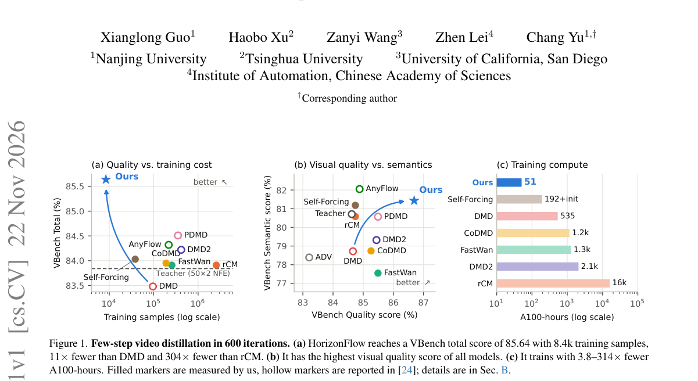

**Why this ranks #1**: 只花 600 次迭代就把 Wan2.1-T2V-1.3B 蒸馏成 4 步模型，训练样本只要 8.4k（比 DMD 少 11 倍、比 rCM 少 304 倍），VBench 总分仍达 85.64；关键在于把 DMD 梯度里最慢的运动分量单独纠偏。

---

### 2. Mass Forcing: On-Policy Mass-Aware Distillation for Autoregressive Video Generation

**arXiv**: [2611.29618](https://arxiv.org/abs/2611.29618) | **Score**: 8.7 (relevance 9 x 0.7 + quality 8 x 0.3) | **Direction**: `aigc_generation` | **Tags**: AIGC-visual, dmd, on-policy-distillation, video-generation, mode-collapse, City University of Hong Kong | **Categories**: cs.CV | **Pages**: 38

**Authors**: Yiyu Li; Fei Wei; Yong Wang; Zaiquan Yang; Gerhard Petrus Hancke; Xiangxiang Chu; Rynson W. H. Lau

**Affiliation**: City University of Hong Kong; AMAP, Alibaba Group; City University of Hong Kong (Dongguan)

**Abstract**

> Distribution Matching Distillation (DMD) has emerged as a promising paradigm for real-time video synthesis, distilling pretrained diffusion models into few-step autoregressive generators. However, its reverse-KL objective is mode-seeking and can collapse the student's conditional video distribution onto a narrow subset of modes, leading to reduced sample diversity, diminished temporal dynamics, and color oversaturation. Existing methods mitigate this issue mainly via coverage-oriented student initialization, but we observe that such coverage is transient: across three initializations, the fraction of dynamic videos drops sharply during subsequent DMD training, indicating that the mode-seeking objective, not the initialization, drives this degradation. We propose Mass Forcing, a probability-mass-aware framework that moves on-policy DMD supervision from whole videos to individual states. Each update branches several continuations from a shared student-generated prefix, making the student's probability mass at that state measurable against the teacher. First, Mass Forcing estimates relative teacher-to-student density ratios among these continuations through latent-space score integration and uses them to rebalance conditional DMD updates, amplifying rollouts underrepresented relative to the teacher. Second, since mismatched mode probabilities do not necessarily induce strong local score corrections, it aligns generated rollout sets with a reweighted reference distribution defined by the same mass estimates, providing cross-rollout supervision. Experiments on MovieGen and VBench show that Mass Forcing improves video fidelity and sustains temporal dynamics throughout training, achieving the highest Total scores among compared methods and a Dynamic Degree of 83% after 1,000 generator updates, versus 12-32% for the baselines, with no additional inference-time overhead.

**Key findings**

- **Finding**: 每次更新从同一学生前缀分叉 K=4 条 rollout 做潜空间打分积分来估计师生概率质量比；训练 1,000 次生成器更新后 VBench Dynamic Degree 仍为 83%，而基线只有 12–32%。
- **Inference**: 三种初始化的动态视频占比都在后续 DMD 训练中骤降，说明真正的问题是 mode-seeking 的逆向 KL 目标本身，覆盖率型初始化只是暂时有效。
- **Recommendation**: 复现自回归视频 DMD 时改用按状态而非按整段视频的质量估计，并改用 Dynamic Degree 而非 Total 分做主监控指标；MovieGen 上 Total 从 82.51 提到 83.38，VBench 上从 84.14 提到 84.98。

**Key figures**

*Framework - Mass Forcing sustains temporal dynamics during DMD training. (a) Videos from the same prompt. Self Forcing [17] stays nearly static and Causal Forcing [46] never inflates the balloon, while*

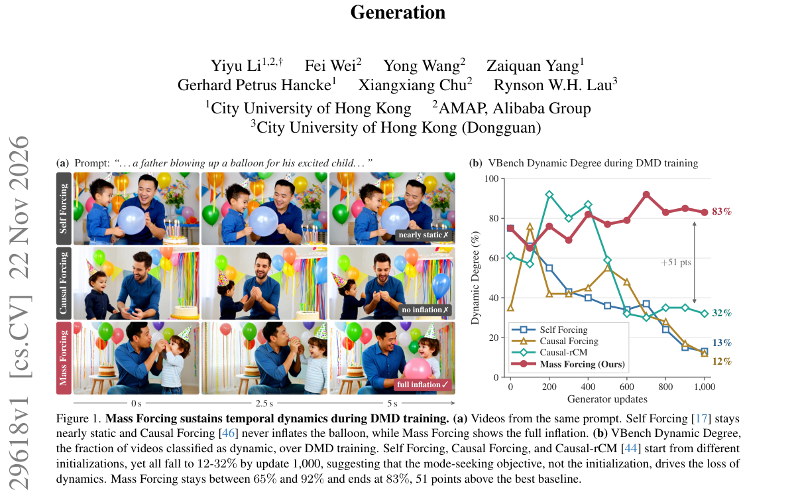

*Result - Mass Forcing training. Each update samples one chunk, generates its prefix with the current student, and draws K independent rollouts from that shared prefix. Integrating the difference betw*

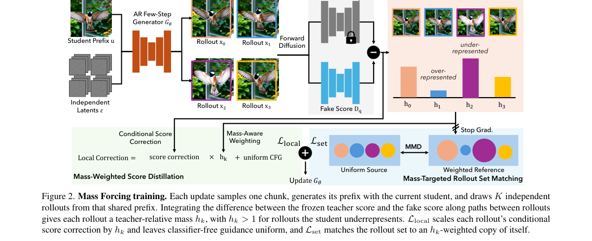

**Why this ranks #2**: 把 DMD 的逆向 KL 监督从整段视频下沉到单个状态：从同一学生前缀分叉 K=4 条 rollout，用潜空间打分积分估计师生概率质量比；训练 1,000 次生成器更新后 Dynamic Degree 仍有 83%，基线只剩 12–32%。

---

### 3. Constrained Diffusion from Binary Evaluations via Learned Doob h-Functions

**arXiv**: [2611.29779](https://arxiv.org/abs/2611.29779) | **Score**: 8.7 (relevance 9 x 0.7 + quality 8 x 0.3) | **Direction**: `aigc_generation` | **Tags**: AIGC-visual, constrained-generation, classifier-guidance, doob-h-transform, binary-feedback, University of Pennsylvania | **Categories**: cs.LG, stat.ML | **Pages**: 36

**Authors**: Ssaumya Kammal Jaiswal; Mahfuza Farooque

**Affiliation**: University of Pennsylvania; Pennsylvania State University

**Abstract**

> Conditional generation under constraints that can only be checked on a finished sample, such as a molecular property filter, remains challenging for diffusion models: most guidance methods require differentiable measurement operators, paired conditional data, or rollouts of the base model at every step. We present a framework grounded in the Doob $h$-transform that reduces conditional generation to learning a single function, the probability that a noisy sample denoises into the constraint set. We learn this function from binary clean-sample evaluations alone, by squared-error regression on forward-noised labels; the base model is frozen, one lightweight head is trained per constraint, and noisy-state classifier guidance arises as a special case. The exact guidance step fades where the constraint signal provably vanishes and carries a factor of the inverse probability across samples, which normalized guidance discards: with the schedule and mean step size held fixed, equalizing the step costs 17.0 to 18.5 points of constraint satisfaction on CIFAR-10 at comparable FID, across independently trained estimators. Guidance is more than 50$\times$ cheaper per satisfying sample than rejection sampling at a 1.7% base rate, raises a Lipinski-type property filter on QM9 from 54.3% to 96.8%, and lifts satisfaction on Stable Diffusion 1.5 from 7.2% to 60.0% at one sixteenth of the cost of derivative-free selection, which reaches 9.0%. These results demonstrate that binary evaluations of clean samples are sufficient supervision for constrained generation across pixel, latent, and molecular diffusion.

**Key findings**

- **Finding**: h 函数只在干净样本的二值标签上做平方误差回归，基座模型冻结、每个约束只额外训练一个轻量头；QM9 上类 Lipinski 过滤通过率由 54.3% 升到 96.8%，Stable Diffusion 1.5 上由 7.2% 升到 60.0%。
- **Inference**: 归一化 guidance 会丢掉跨样本的 1/h 因子，在同等调度与步长预算下让 CIFAR-10 的约束满足率低 17.0–18.5 个点，说明归一化正是质量的主要损耗来源。
- **Recommendation**: 遇到只能事后验收的约束（分子性质、审图规则）时优先学 h 函数做 guidance；它在 1.7% 基础通过率下每得到一个合格样本比拒绝采样便宜 50 倍以上，SD 1.5 上只用无导选择六分之一成本即达 60.0%（后者仅 9.0%）。

**Key figures**

*Framework - The learned hθ on held-out, forward-noised CIFAR-10 images (red-pixel, Y = 1C(x0)). (a) Two test images with Y = 1 and two with Y = 0 along one forward path, with hθ(xt, t) under each. (b) O*

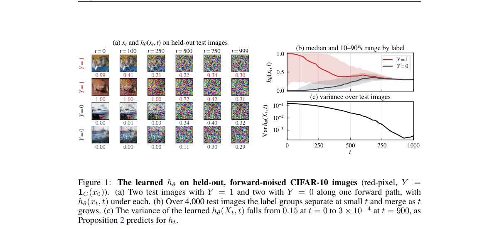

*Result - Paired CIFAR-10 samples at γ = 5. Each column starts from the same xT and uses the same sampling noise in every row. The figure shows the first ten samples generated without selection; acros*

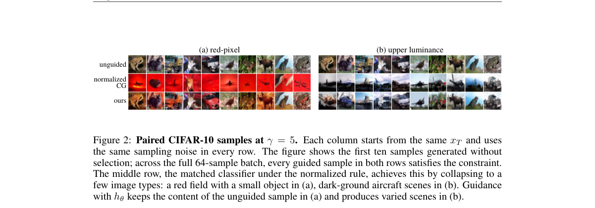

**Why this ranks #3**: 只需干净样本的二值评测就能训出一个 h 函数：基座扩散模型冻结、每个约束只训一个轻量头；QM9 上类 Lipinski 性质过滤的通过率从 54.3% 提到 96.8%，Stable Diffusion 1.5 上从 7.2% 提到 60.0%。

---

### 4. Same Seed, Different Picture? Deciding Early at Low Resolution for Seed-Faithful Few-Step Flow Sampling

**arXiv**: [2611.30728](https://arxiv.org/abs/2611.30728) | **Score**: 8.7 (relevance 9 x 0.7 + quality 8 x 0.3) | **Direction**: `aigc_generation` | **Tags**: AIGC-visual, seed-fidelity, few-step-sampling, flow-matching, training-free, City University of New York | **Categories**: cs.CV | **Pages**: 43

**Authors**: Huiran Duan; Weilun Feng; Yuqi Li; Yingli Tian

**Affiliation**: The City University of New York; Institute of Computing Technology, Chinese Academy of Sciences; University of Chinese Academy of Sciences

**Abstract**

> Few-step samplers make large text-to-image flow models fast, but from the same noise they no longer generate the image of the standard 50-step sampler. Subjects, attributes and layout change, not just fine detail. We trace this loss of seed fidelity to the start of sampling. The coarse part of the initial noise decides coarse structure first, while the noise level is still above 0.9. Few-step samplers cross this range in their first steps, which account for 25-52% of their distance to the 50-step reference. Because this decision is coarse, a half-resolution run from the same coarse noise can make nearly the same decision at a third of the cost. We therefore propose Decide-then-Render (DtR), a training-free sampler that decides the composition in a few low-resolution steps, rebuilds the full-resolution state with the seed's own noise and renders the details. On 4 large models, DtR runs 11-25$\times$ faster than the reference sampler. At each speed-up, it is closer to the reference and rated higher by ImageReward than every compared sampler, including few-step schedules calibrated per budget and published multi-resolution samplers. On FLUX.1-dev, it remains the most faithful sampler down to about $8\times$, ahead of caching accelerators. A user study on this model found DtR's samples closer to the reference in 86% of pairwise trials. DtR transfers to a held-out model and to video, and distilled models can serve as its renderers. Project link: https://duanhuiran.github.io/DtR

**Key findings**

- **Finding**: 粗结构在噪声水平仍高于 0.9 时即被初始噪声的粗频率段决定，少步调度在前 1 到 2 步跨过该区间，丢掉与 50 步参考 25–52% 的距离；DtR 在 4 个大模型上比参考采样器快 11–25 倍。
- **Inference**: 构图决策既然是粗粒度的，半分辨率运行就能做出几乎相同的决定，所以省下来的预算应从高分辨率细节挪到决策阶段，而不是一味压缩总步数。
- **Recommendation**: 部署少步采样前先做同种子保真测试而非只看画质分；DtR 在 FLUX.1-dev 上直到约 8 倍加速仍是最贴近参考的采样器，用户研究里 86% 的成对试验判定其样本更接近参考。

**Key figures**

*Framework - From the same noise, few-step samplers generate a different image from the 50-step sampler, whereas DtR stays closest to it. Left: FLUX.1-dev samples at about 4 NFEs, with SPEED [64] at 4 NF*

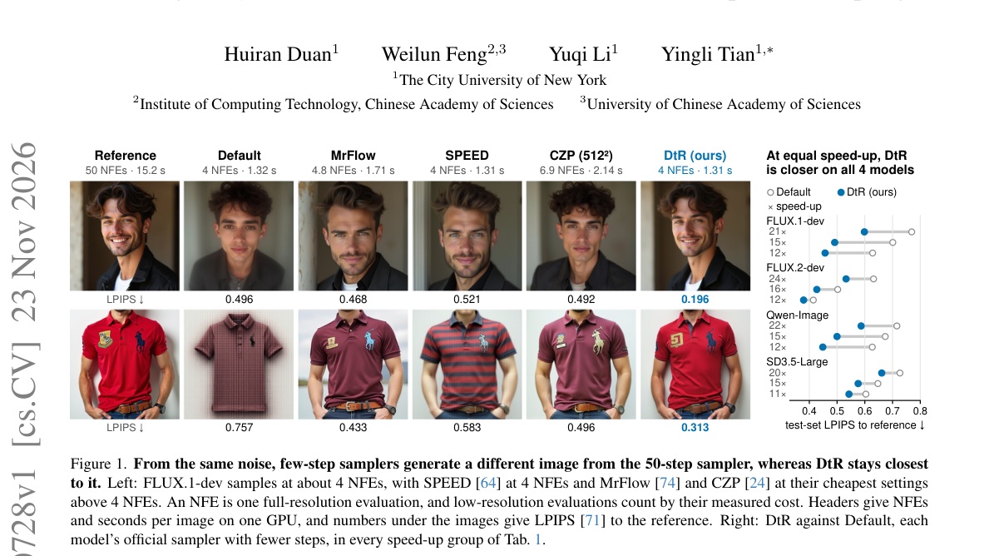

*Result - Samples are decided early, coarse structure first, and a half-resolution run makes nearly the same decision. (a) Clean estimates ˆx0(σ) along FLUX.1-dev’s 50-step trajectory at 10242 and, be*

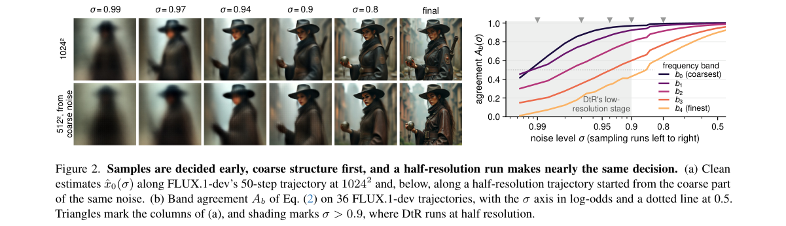

**Why this ranks #4**: 发现构图在噪声水平仍高于 0.9 时就被初始噪声的粗频率段决定，而少步采样器恰在这几步丢掉与 50 步参考 25–52% 的差距；DtR 用半分辨率先决策再全分辨率渲染，在 4 个大模型上快 11–25 倍。

---

### 5. DyLoMo-DiT: Dynamic Looped Mixture-of-Experts Diffusion Transformers

**arXiv**: [2611.30844](https://arxiv.org/abs/2611.30844) | **Score**: 8.7 (relevance 9 x 0.7 + quality 8 x 0.3) | **Direction**: `aigc_generation` | **Tags**: AIGC-visual, mixture-of-experts, recurrent-depth, diffusion-transformer, parameter-efficiency, [unverified] | **Categories**: cs.CV, cs.LG | **Pages**: 46

**Authors**: Lernie Li; Yuanliu Liu; Pengfei Xiong; Wei Zhang

**Affiliation**: [unverified]

**Abstract**

> Diffusion Transformers (DiTs) scale model capacity by increasing both parameter count and computation. Mixture-of-Experts (MoE) variants expand parameter capacity while keeping per-token computation roughly fixed, but still require substantial parameter storage. In this paper, we propose Dynamic Looped MoE DiT (DyLoMo-DiT), which reuses parameters rather than adding them: a weight-shared loop repeatedly applies the middle layers, while sparse experts allocate parameter capacity across tokens. This design deepens the network without adding parameters, freeing the parameter budget for other uses, such as more experts or more distinct layers. It also allocates compute dynamically, varying the number of passes across noise levels. Experiments show that DyLoMo-DiT makes more effective use of parameter and compute budgets, with further gains from assigning more passes to low-noise steps. On ImageNet $256\times256$, DyLoMo-DiT reduces FID by 11-24% relative to DiT and 36-56% relative to DiT-MoE at matched parameter and compute budgets. For text-to-image generation, a scaled DyLoMo-DiT achieves a higher GenEval score than FLUX.1 (0.714 vs. 0.673), with less than one tenth of its active parameters (1.05B vs. 12B).

**Key findings**

- **Finding**: 在同等参数与前向算力预算下，DyLoMo-DiT 把 ImageNet 256×256 的 FID 相对 DiT 分别降低 11%、14%、24%，相对 DiT-MoE 降低 36%、56%、56%；文本生成 GenEval 0.714（FLUX.1-schnell 0.673、FLUX.1-dev 0.671），激活参数 1.05B 对 12B。
- **Inference**: 深度、参数容量与计算量可以分别定价——循环层把加深从参数预算换成算力预算，省下的参数再换成稀疏专家容量，三者不必同时涨。
- **Recommendation**: 做 DiT 规模化时先固定参数与算力预算再比 FID，并把更多循环次数分配给低噪声步；该模型总参数 15.48B，每图像 token 激活 1.05B。

**Key figures**

*Framework - Selected text-to-image samples from DyLoMo-DiT (15.48B total parameters, 1.05B active per image token). Prompts are listed in App. A.*

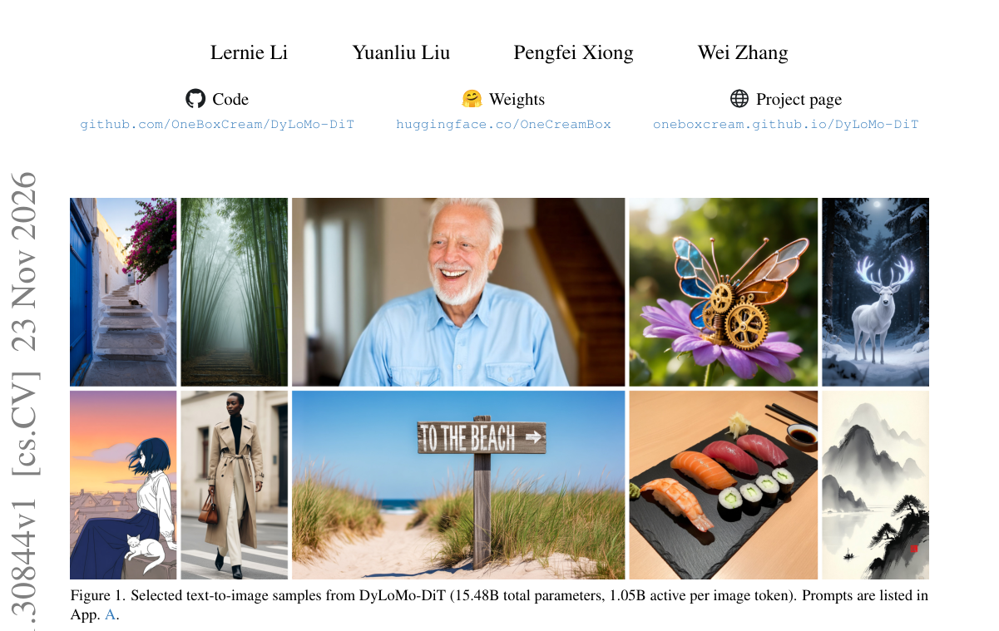

*Result - FID versus training steps on ImageNet-256: DiT (top; B, L, XL tiers) and DiT-MoE (bottom; S, B, L tiers) against the DyLoMo-DiT with the same parameters and forward compute. Percentages give*

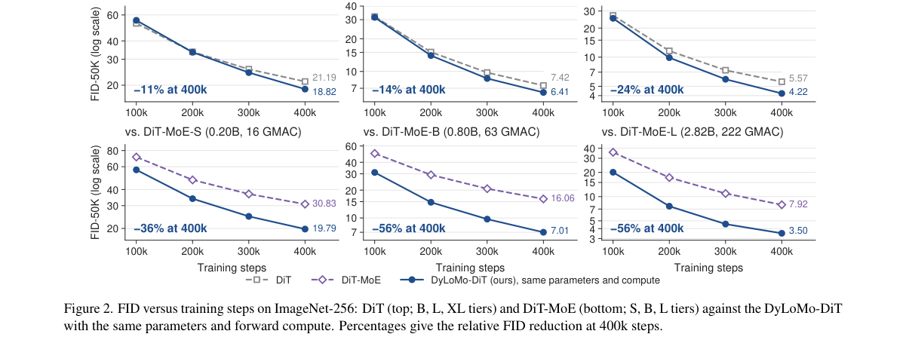

**Why this ranks #5**: 用权重共享的循环层加深网络、用稀疏专家分配参数容量，把深度与参数解耦：ImageNet 256×256 上同等参数与算力下 FID 相对 DiT 降 11–24%、相对 DiT-MoE 降 36–56%，文本生成 GenEval 0.714 超过 FLUX.1 的 0.673，激活参数却只有 1.05B。

---

### 6. Demystifying Classifier-Free Guidance for Auto-Regressive Image Generation

**arXiv**: [2611.29002](https://arxiv.org/abs/2611.29002) | **Score**: 8.3 (relevance 8 x 0.7 + quality 9 x 0.3) | **Direction**: `aigc_generation` | **Tags**: AIGC-visual, autoregressive-generation, classifier-free-guidance, attention-reuse, texture, Yale University | **Categories**: cs.AI, cs.CV, cs.LG | **Pages**: 62

**Authors**: Zhiling Zhou; Jiachun Pan; Fengzhuo Zhang; Dirk Bergemann; Zhuoran Yang

**Affiliation**: Yale University; National University of Singapore; Cisco Foundation AI

**Abstract**

> Classifier-free guidance (CFG) has been widely adopted in autoregressive (AR) models for high-quality image generation. Despite its strong empirical performance, its mechanism in AR models remains unclear. This paper demystifies the mechanism of CFG through both empirical and theoretical studies. By examining the top-ranked semantics of different components in CFG, we show that texture information is primarily encoded in the difference between the conditional and unconditional logits, whereas both logits share previous-token repetition as their leading semantics. This strong repetition semantics obscures the desired texture information, causing greedy decoding from the conditional logits alone to produce nearly pure-color images. Through a training-dynamics analysis of shallow transformers, we prove that this shared repetition semantics does not arise from limitations or failures of pretraining, but instead originates from the texture sparsity of images. We further show that CFG improves generation quality by rectifying this repetition bias during inference. Motivated by the shared semantics between conditional and unconditional logits, we propose Attention Weight Reuse (AttnReuse), which reuses intermediate attention computations from the conditional-logit forward pass to accelerate the unconditional-logit computation. AttnReuse reduces about $25\%$ of attention computation with little performance degradation across different models.

**Key findings**

- **Finding**: 条件与无条件 logit 的首要语义都是重复前一 token，纹理信息主要编码在两者之差里，故仅用条件 logit 贪心解码会产出近乎纯色的图像；AttnReuse 复用条件前向的注意力计算，可省约 25% 注意力算力。
- **Inference**: 共享的重复语义既是 CFG 生效的来源，也意味着无条件分支的大半注意力计算是冗余的，因此近似免费地复用是合理的加速路径。
- **Recommendation**: 给 AR 图像模型做 CFG 加速时可直接照搬注意力复用思路，并在 LlamaGen 0.7B、Lumina-mGPT 2.0 的 7B 与 Emu3 的 8B 三档规模上分别核对代价与画质退化。

**Key figures**

*Framework - Generated images from conditional logits logitcond, CFG-guided logits logitλ, and logitdiff = logitcond −logituncond, shown from left to right in each grid. All images are generated by greed*

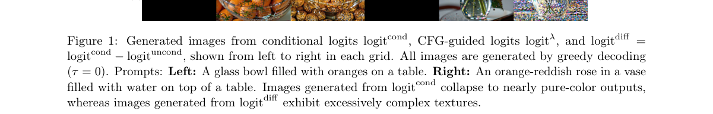

*Result - Texture complexity of images generated from logitcond, logitλ, and logitdiff = logitcond −logituncond*

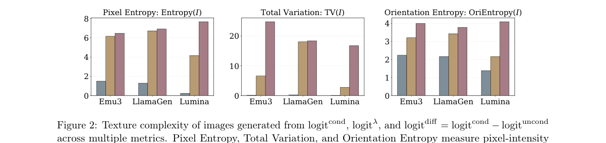

**Why this ranks #6**: 把 CFG 的条件与无条件 logit 拆开分析后指出：纹理只存在于二者之差里，而两者共同的主导语义是重复上一 token；据此提出的 AttnReuse 复用条件前向的注意力计算，少约 25% 的注意力算力而性能几乎不掉。

---

### 7. Hindsight Forcing: Learning Better History from the Future in Autoregressive Video Diffusion

**arXiv**: [2611.27074](https://arxiv.org/abs/2611.27074) | **Score**: 8.0 (relevance 8 x 0.7 + quality 8 x 0.3) | **Direction**: `aigc_generation` | **Tags**: AIGC-visual, autoregressive-video, gradient-credit, straight-through, streaming-generation, City University of Hong Kong | **Categories**: cs.CV | **Pages**: 17

**Authors**: Haonan An; Yihang Tao; Yu Guo; Renlong Chen; Jiasheng Zhang; Yuguang Fang

**Affiliation**: City University of Hong Kong; Philo AI

**Abstract**

> Few-step autoregressive video diffusion enables real-time streaming generation, with each generated chunk serving as historical context for subsequent generation. To avoid the memory explosion of backpropagation through time, previous self-rollout methods typically truncate cross-chunk gradients or detach historical latents. As a result, earlier denoising computations receive no downstream feedback through the generated history on how to synthesize frames that facilitate subsequent generation, leading to visual drift and structural collapse as rollouts extend. To address this limitation, we propose Hindsight Forcing, which allows historical chunks to learn directly from future outcomes by decoupling forward generation from backward credit assignment via a latent straight-through bridge. In the forward pass, each chunk completes a full multi-step rollout to update the KV cache. In the backward pass, the bridge routes gradients from future losses back to a single selected denoising step per historical chunk, training both the context writer and historical denoiser on shared parameters without retaining the full trajectory graph. Remarkably, Hindsight Forcing requires no additional model parameters, architecture modifications, or separate trajectory replay. Extensive experiments on VBench demonstrate that Hindsight Forcing outperforms existing baselines in overall visual quality and dynamic motion, while ablation studies validate the benefit of supervising historical denoising. Code is available at https://github.com/haonanAN309/Hindsight-Forcing.

**Key findings**

- **Finding**: Hindsight Forcing 用 latent straight-through 桥把未来损失回传到每个历史 chunk 的单个去噪步，VBench Total 85.74、Quality 86.89、Dynamic Degree 92.22；作为对比的 Causal Forcing Total 仅 84.08、Dynamic Degree 73.33。
- **Inference**: 消融显示仅恢复上下文写入梯度反而把 Total 降到 84.04，说明收益来自对未来监督历史去噪，而不是单纯打通更多梯度路径。
- **Recommendation**: 做流式自回归视频扩散时不要把历史 latent 直接 detach 了事；桥接的梯度尺度 α 需调，α 降到 0.25 时 Dynamic Degree 只剩 51.67，升到 1.5 也会同时损失画质与动态性。

**Key figures**

*Framework - Overview of Hindsight Forcing. (a,b) In the illustrated training pipelines, downstream gradients stop at the historical KV cache or latent inputs, respectively. (c) Hindsight Forcing extends*

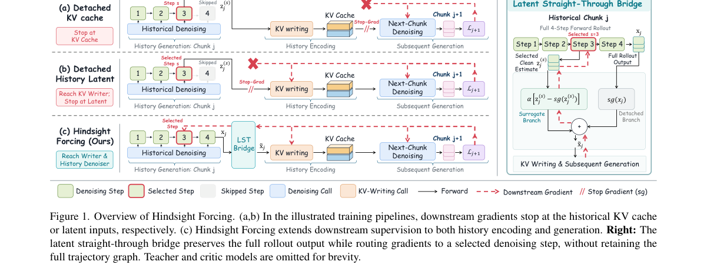

*Result - Qualitative comparison with existing methods. Frames sampled at 0.5, 2.5, and 4.5 seconds illustrate differences in motion plausibility, appearance consistency, and structural coherence. Add*

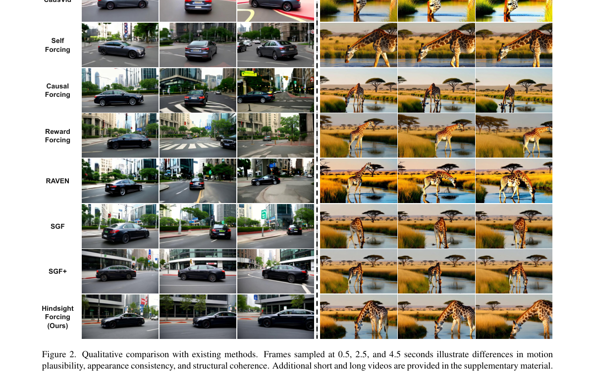

**Why this ranks #7**: 让历史 chunk 经一条 latent 直通桥直接接收未来 chunk 的梯度，不加参数也不改架构：VBench 总分 85.74、Quality 86.89，Dynamic Degree 从 Causal Forcing 的 73.33 提到 92.22。

---

### 8. Beyond Prompt Imitation: Capability-Aware Video Generation with Smaller Models

**arXiv**: [2611.27252](https://arxiv.org/abs/2611.27252) | **Score**: 8.0 (relevance 8 x 0.7 + quality 8 x 0.3) | **Direction**: `aigc_generation` | **Tags**: AIGC-visual, control-ladder, headroom-analysis, video-generation, budgeted-selection, University of New South Wales | **Categories**: cs.CV | **Pages**: 21

**Authors**: Ziqi Ding; Yuxin Cao; Kai Ye; Yaobo Yang; Wei Song

**Affiliation**: University of New South Wales; National University of Singapore; The University of Hong Kong; Griffith University

**Abstract**

> Inference-time methods that lift a small open video generator toward a proprietary one are compared through preference scores, which never say how much of the gap to a target video they close. We introduce the oracle control ladder, which hands a fixed student progressively richer information from a target clip and reads the closure of each fidelity metric at each rung as an empirical headroom reference for the methods that must synthesize that information. On 954 clips of the principal student, a dense caption reproduces little of the appearance and almost none of the motion of a target, a first frame closes half of the appearance gap and a tenth of the motion gap, a depth video closes three quarters of the motion gap and leaves color untouched, and the two together close 64 to 94% of every fidelity gap across four teachers, while a second student agrees on the rungs that it accepts. An item response model forecasts which rung closes which clip with held-out AUC of 0.76 to 0.95 on the fidelity criteria and serves as the prior of a budgeted selection policy. When controls are free, a fixed dense-control rung is hard to improve upon, and once controls are priced the policy lies above the fixed-rung frontier at matched cost and survives critics that ruin critic-driven search.

**Key findings**

- **Finding**: 954 个参考片段上，稠密描述几乎复现不了外观与运动，首帧闭合约一半外观差距和十分之一运动差距，深度视频闭合约四分之三运动差距，两者合用则在四个教师上闭合 64–94% 的保真度差距。
- **Inference**: 偏好分数从不回答离目标还差多少，而逐级控制阶梯给出的闭合比例才是这些推理期方法真正可争取的 headroom。
- **Recommendation**: 评估小模型追平大模型的推理期方法时，先跑一遍阶梯拿到上限，再用 item response 模型（保真度判据上留出 AUC 0.76–0.95）作先验做预算化控制选择。

**Key figures**

*Framework - The oracle control ladder on one target clip. Each rung hands the student the control in the second column, and the bars give the share of the gap to the target that the rung closes on four*

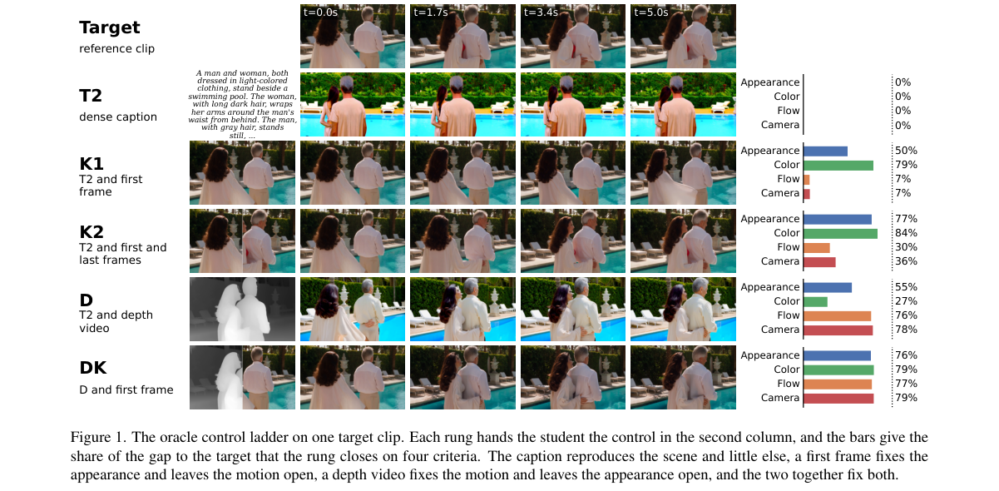

*Result - Overview. The ladder (a) reads the gap closure of each rung of reference information, the capability model (b) predicts it from clip features, and budgeted selection (c) opens rungs by their*

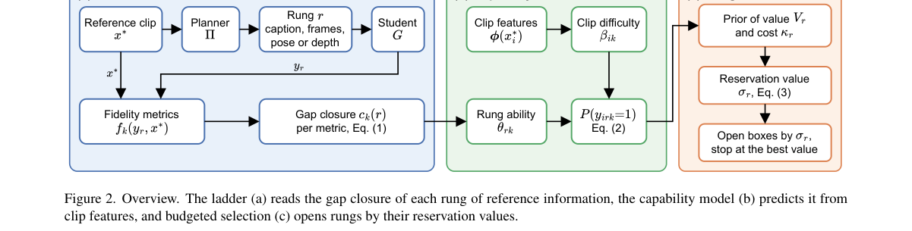

**Why this ranks #8**: 用神谕控制阶梯给固定学生模型逐级喂信息，量出每级控制能闭合多少保真度差距：954 个片段上首帧闭合约一半外观差距、深度视频闭合约四分之三运动差距，两者合用则在四个教师上闭合 64–94% 的差距。

---

### 9. Budgeted Safety Verification for Streaming Video Generation

**arXiv**: [2611.27268](https://arxiv.org/abs/2611.27268) | **Score**: 8.0 (relevance 8 x 0.7 + quality 8 x 0.3) | **Direction**: `aigc_generation` | **Tags**: AIGC-visual, streaming-video, safety-verification, cascade-filter, exposure-metric, National University of Singapore | **Categories**: cs.CV | **Pages**: 19

**Authors**: Yuxin Cao; Ziqi Ding; Jiayu Zhang; Xianglin Yang; Wei Song; Jin Song Dong

**Affiliation**: National University of Singapore; University of New South Wales; The University of Hong Kong; Griffith University

**Abstract**

> A streamed video generator releases each chunk the moment that it is produced, so a safety decision that waits for the finished clip arrives after the harm has been seen. We measure a guardrail by exposure, the harmful frames a viewer is shown, and ask where a fixed moderation budget should be spent. The accurate detector reads decoded frames with a video language model and is too expensive for every chunk, so our guard reads hidden states the generator has computed already and spends a cheap score on deciding when to call it. On 599 streams from a distilled causal generator the undefended model shows 46.25 harmful frames of 81. The video model on every chunk leaves 0.91 frames at 80.1 scored per benign stream, and the same model triggered by our guard leaves 2.35 at 5.3. Spending that budget at random leaves 37.20 frames, so the gain is in the ordering, and a frame detector in the same role gives up almost six, so the judging stage must read the chunk as a clip. The ordering is worth more as the stream lengthens, and the guard carries to a second system. An independent guardrail model agrees with our oracle at $κ=0.74$, and a blinded audit by 50 participants puts its precision at 96.1% and recall at 82.8%. Warning. This paper contains examples of generated content that some readers may find disturbing or offensive in nature.

**Key findings**

- **Finding**: 599 条流上未防护模型释放 46.25 个有害帧（95% 置信区间 42.81–49.59）；每块都调视频模型留 0.91 帧却要给 80.1 帧打分，本文的级联守卫留 2.35 帧而只打 5.3 帧，同预算随机触发留 37.20 帧。
- **Inference**: 增益几乎全部来自排序而不是预算本身——同样预算随机花掉几乎无效，所以守卫必须读生成器已算出的隐状态来决定何时升级到昂贵判定。
- **Recommendation**: 做流式生成的安全拦截时，先用暴露帧数而不是整片攻击成功率作指标，并让判定阶段读整块 clip；用单帧检测器顶替会多放近 6 帧，50 人盲审显示该守卫精确率 96.1%、召回率 82.8%。

**Key figures**

*Framework - Budgeted safety verification of a streamed video generator. Only a chunk that the guard flags is shown to the verifier.*

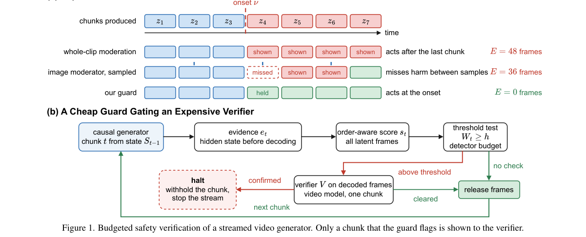

*Result - One late-onset stream of each harm category, with the harmful chunks bordered and obscured.*

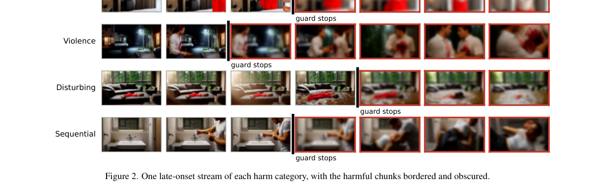

**Why this ranks #9**: 把流式视频的安全决策改成按预算排序的停止问题：在 599 条流上未防护模型放出 46.25 个有害帧，逐块调用视频模型只留 0.91 帧，本文的级联守卫留 2.35 帧且每条良性流只打分 5.3 帧。

---

### 10. Scalable Beckmann Maps Improve One-step Generation

**arXiv**: [2611.28286](https://arxiv.org/abs/2611.28286) | **Score**: 8.0 (relevance 8 x 0.7 + quality 8 x 0.3) | **Direction**: `aigc_generation` | **Tags**: AIGC-visual, one-step-generation, beckmann-transport, classifier-free-guidance, autonomous-flow, Harvard University | **Categories**: cs.LG | **Pages**: 40

**Authors**: Ulrik Unneberg; Shiyi Wang; Lee Cheuk-Kit; Felix Berg; Boris Kozinsky; Yilun Du; Michael S. Albergo; Eric Vanden-Eijnden

**Affiliation**: Harvard University; Imperial College London; New York University; Capital Fund Management

**Abstract**

> Beckmann Transport Models (BTM) learn one-step generative maps end-to-end from data, without a teacher, a distillation stage, or pretrained features. We introduce Scalable Beckmann Maps (SBM), which bring to BTM the two ingredients behind the quality of modern multistep generators: classifier-free guidance (CFG) and a training recipe that scales, while keeping sampling at a single network evaluation. CFG combines conditional and unconditional velocity or score predictions, which a Beckmann map does not have. Our guidance rests on one observation: the BTM current is a positive multiple of an autonomous denoising field, to which CFG applies as it does to a velocity. With exact denoisers this gives guided BTM. In practice we substitute the map's own conditional and null predictions for the denoisers, which requires no additional network and introduces a bias that we characterize. We show that the guided update is consistent with a guided conservation equation, and that guidance can move the boundaries between basins, sending more noise to the modes a condition favors. Trained from scratch in the latent of a representation autoencoder, SBM reaches a one-step FID of 1.6 on ImageNet 256x256 without a teacher or a feature loss, outperforming the Improved-MeanFlow baseline with 3.2x fewer FLOPs. In text-to-image generation it reaches a GenEval score of 0.86 with one network evaluation. As a world model, where we train without guidance, the recipe alone outperforms DriftWorld on all five metrics of two robot-manipulation benchmarks, with 1.9-2.8x less training compute and no pretrained auxiliary feature encoder.

**Key findings**

- **Finding**: SBM 从零训练、不用老师也不加特征损失，在表示自编码器潜空间里达到 ImageNet 256×256 一步 FID 1.6，比 Improved-MeanFlow 少 3.2 倍 FLOPs；文本生成一步一次网络评估得 GenEval 0.86。
- **Inference**: BTM 的电流是正的自治去噪场的倍数，因此 CFG 可以像作用在速度场上那样作用其上，但用映射自身的条件与空预测替代去噪器会引入可刻画的偏差。
- **Recommendation**: 想做无蒸馏的一步生成时，可先复用自治流 + guidance 这套配方；去掉 guidance 后仅靠训练配方，作为世界模型在两个机器人操作基准的五项指标上仍全面超过 DriftWorld，训练算力少 1.9–2.8 倍。

**Key figures**

*Framework - Text-to-image samples of Scalable Beckmann Maps (SBM). Selected samples of SBM-XL, a one-step map trained from scratch on the MiniT2I data: one network evaluation per image, 256 × 256 pixels.*

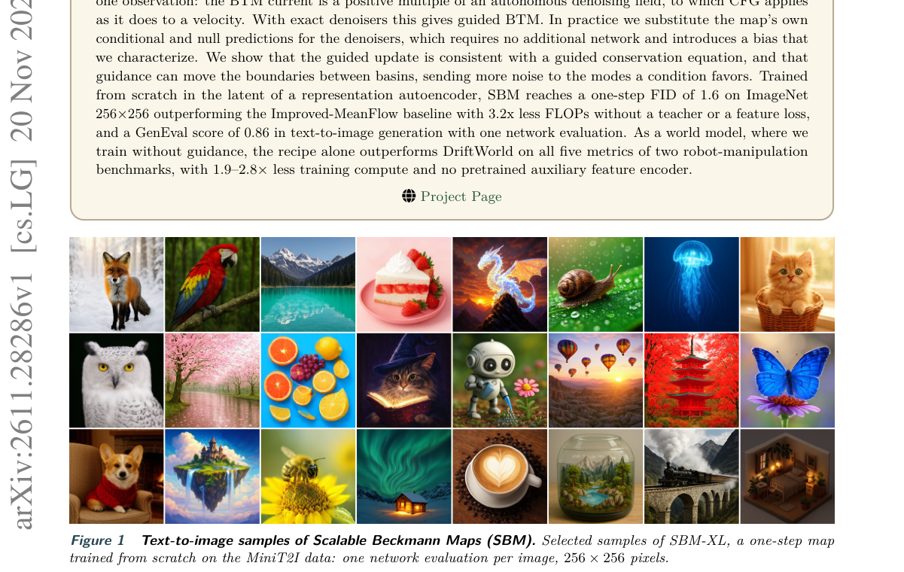

**Why this ranks #10**: 把现代多步生成器的两个关键配方补进 Beckmann 传输模型，同时采样仍只做一次网络前向：ImageNet 256×256 上一步 FID 1.6、比 Improved-MeanFlow 少 3.2 倍 FLOPs，文本生成一步网络评估就拿到 GenEval 0.86。

---

## AIGC 编辑（指令编辑 / 修补 / 个性化） · `aigc_editing` (4 papers)

4 篇里两篇是「图像编辑器的算力直接换成视频编辑器」和「把虚拟试穿压进消费级显卡」：TOGO 把 Qwen-Image-Edit 在指令与中性 prompt 下的速度场作差得到 edit velocity，注入 Wan2.1 采样器后 FiVE-Bench 编辑成功率从 47.0% 升到 65.6%（此前最好 59.2%）且完全免训练；LiveMirror 在单张 16 GB 显卡上做到 720p/25 FPS，用 24.9k 自监督电商图、3.2 GPU 小时微调把民族服饰 LPIPS 从 0.137 降到 0.077，推理成本比 FASHN VTON 1.5 低约 20 倍。另两篇分别处理风格参考的「借风格不借内容」（ProStyle 平均排名 1.86、用户选择率 84.36%）与事件引导去雨中内容/噪声两条路径的可靠性门控（ReCoRain 32.09 dB、形变误差降 33.0%）。

### 11. TOGO: Take One Image Editor, Get One Video Editor for Free

**arXiv**: [2611.28397](https://arxiv.org/abs/2611.28397) | **Score**: 8.7 (relevance 9 x 0.7 + quality 8 x 0.3) | **Direction**: `aigc_editing` | **Tags**: AIGC-visual, training-free, video-editing, velocity-guidance, image-editor-transfer, University of Chicago | **Categories**: cs.CV | **Pages**: 10

**Authors**: Yixuan Luo; Jose Caballero; Yanjing Li

**Affiliation**: University of Chicago; Epic Games; Northeastern University

**Abstract**

> Instruction-based image editors are trained on millions of edit pairs and follow instructions far more reliably than current video editors. We show that this ability can be transferred to video editing without any training. Our key observation is that a growing number of image editors and video generators share the same latent space. Their velocity fields can therefore be combined at sampling time: the difference between the editor's velocity under the instruction and under a neutral prompt, which we call the \emph{edit velocity}, can be added to the sampler of a video model. Added naively, however, it blurs the video, alters the background and flickers. An analysis of the edit velocity explains why. It is small and reliable only at coarse scales and high noise levels, not concentrated on the edited object, and uncorrelated across frames. From these properties, we derive a simple guidance operator that amplifies the edit velocity and restricts it in noise level, space, and time. The video model then turns the incoherent per-frame signal into a temporally coherent edit. Our method, TOGO, combines Qwen-Image-Edit with the Wan2.1 video model without training or fine-tuning. On FiVE-Bench, it raises the edit success rate from 47.0\% (the same video model without the editor) to 65.6\%, above the best published method (59.2\%). At the same time, it maintains the background PSNR and obtains the best LPIPS and SSIM of all methods. Because the video editor is assembled at inference time, it can be upgraded to any newer image editor that shares the latent space with no cost.

**Key findings**

- **Finding**: TOGO 把 Qwen-Image-Edit 的编辑速度（指令下与中性提示下的速度差）加到 Wan2.1 的采样器上，FiVE-Acc 达 65.6%，比用视频数据训练的 VACE 高 6.4 个点、比最佳免训练基线 FlowDirector 高 9.2 个点，同一视频模型不加编辑器只有 47.0%。
- **Inference**: 编辑速度只在粗尺度与高噪声下小而可靠、且不集中在被编辑物体上、跨帧也不相关，因此必须按噪声级、空间与时间三重限制后，再交给视频模型补出时间一致性。
- **Recommendation**: 若图像编辑器与视频模型同潜空间，可先零训练试 TOGO 式速度叠加，再按噪声级裁剪编辑速度幅度并用交叉淡入抑制闪烁；背景 PSNR 25.0 已接近 Wan-Edit 的 25.6。

**Key figures**

*Framework - TOGO turns an image editor into a video editor guide without any training. We add the edit velocity of an off-the-shelf image editor (Qwen-Image-Edit) to the sampler of a video model (Wan2.1*

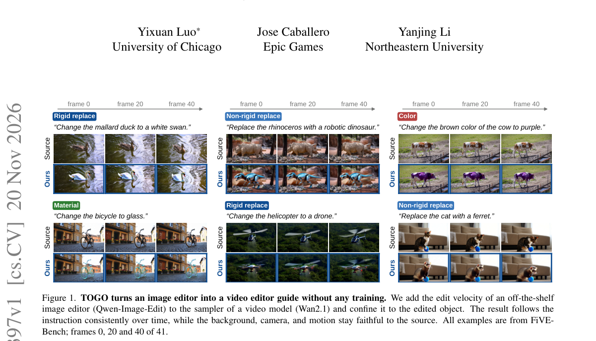

*Result - Overview of TOGO. Two frozen models that share a latent space are combined at sampling time. At every step, the video model provides the FlowEdit velocity ∆σ, and the image editor provides,*

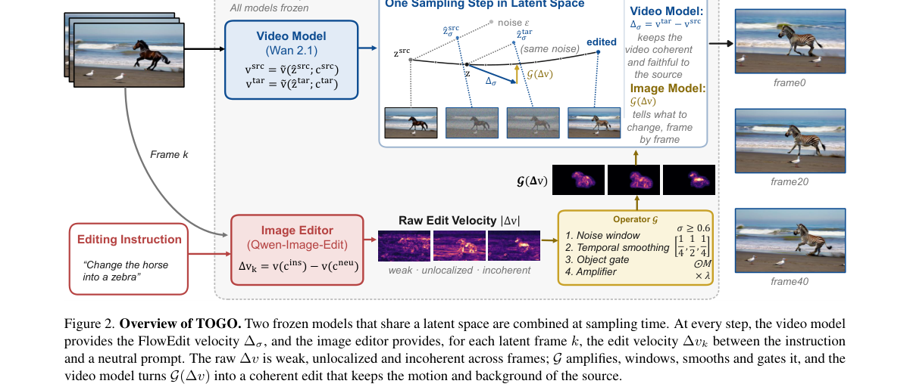

**Why this ranks #11**: 当图像编辑器与视频模型共享潜空间时，编辑器在指令与中性提示下的速度差可直接加到视频采样器上，无需任何训练：FiVE-Bench 编辑成功率从 47.0% 提到 65.6%，比最强已发表方法高 6.4 个点，并拿到最好的 LPIPS 与 SSIM。

---

### 12. LiveMirror: Real-Time Diffusion Virtual Try-On on a Consumer GPU and Its Self-Supervised Adaptation to Indian Ethnic Wear

**arXiv**: [2611.30461](https://arxiv.org/abs/2611.30461) | **Score**: 8.7 (relevance 9 x 0.7 + quality 8 x 0.3) | **Direction**: `aigc_editing` | **Tags**: AIGC-visual, virtual-try-on, real-time-diffusion, consumer-gpu, self-supervised-adaptation, School of Electronics Engineering | **Categories**: cs.CV, cs.LG | **Pages**: 12

**Authors**: Jigyansha Jeevan Rout; Sukanta Kumar Sabut

**Affiliation**: School of Electronics Engineering, KIIT Deemed to be University

**Abstract**

> Diffusion virtual try-on (VTO) models produce convincing garment transfers from a single product photograph, but at hundreds of milliseconds to seconds per image every deployment today is offline or falls back to AR mirrors that need a rigged 3D asset per product. We present LiveMirror, a live-camera try-on mirror that renders a flat garment photograph onto a moving person with a diffusion model on one 16 GB consumer GPU. Its core is asynchronous keyframe try-on: generation never blocks the display, every displayed frame is an optical-flow warp of the latest generated keyframe, and keyframes are replaced only through a cross-fade. The display runs at camera rate (25 FPS at 720p) while a new try-on arrives every 370-490 ms; we measure the residual flicker, give a stage-by-stage latency budget, and report which accelerations (step count, consistency LoRA, tiny decoder, compilation) keep garment prints intact. We then show that the same GPU fixes the model's biggest cultural blind spot: try-on models trained on VITON-HD and DressCode render a knee-length kurta or sherwani as a torso-length top or a dress over bare legs. A thigh-covering mask, self-supervised pairs built automatically from 24.9k on-model e-commerce photographs, and 3.2 GPU-hours of attention-only fine-tuning of CatVTON halve the perceptual error on ethnic wear (LPIPS 0.137 to 0.077 on IndoFashion, 0.135 to 0.073 on Atlas; 200 held-out pairs per source) with no regression on Western tops. A two-pass hem-aware mask then removes the remaining failure, recoloured trousers below the hem, on all but 3-4% of pairs at no training cost; in the mirror the hem comes from the previous keyframe for free. The adapted model beats FASHN VTON 1.5 on every aggregate ethnic-wear metric at about $20\times$ lower inference cost, and its weights drop straight into the mirror.

**Key findings**

- **Finding**: 显示循环每帧输出光流 warp 后的画面、新关键帧只经交叉淡入替换，RTX 4080 上 720p 稳定 25 FPS、生成每 370–490 ms 产出一个关键帧；24.9k 自监督电商照片加 3.2 GPU 小时仅注意力微调，使民族服装 LPIPS 由 0.137 降到 0.077（IndoFashion）、由 0.135 降到 0.073（Atlas），每个来源留 200 对测试。
- **Inference**: 生成延迟只决定屏幕上的衣服有多旧，而不是镜子的流畅度，因此把显示与生成解耦比一味压低单帧延迟更划算。
- **Recommendation**: 做实时试穿时优先上异步关键帧加光流 warp 的显示方案，并把预算花在长裤长袍掩码上——两遍 hem 感知掩码可在除 3–4% 的配对上零训练消除下摆染色错误。

**Key figures**

*Framework - Why inference-time fixes fail on ethnic wear. Person, kurta, and CatVTON (VITON-HD weights) outputs with the upper mask (kurta becomes a shirt), the overall mask (dress prior: bare legs), an*

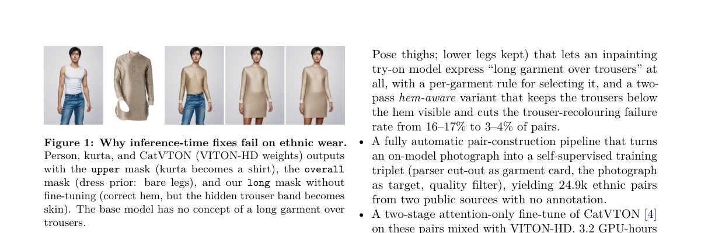

*Result - asynchronous keyframe try-on on a time axis. Orange: the display loop emits a frame every 33 ms; each is an optical-flow warp of the latest keyframe, and a new keyframe enters only through a*

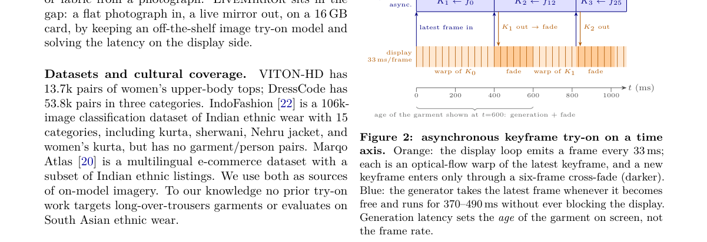

**Why this ranks #12**: 在单张 16GB 消费级 GPU 上用异步关键帧试穿把显示帧率与生成延迟解耦：720p 下稳定 25 FPS、新试穿每 370–490 ms 一次；再用 24.9k 自监督电商照片做 3.2 GPU 小时仅注意力微调，民族服装 LPIPS 从 0.137 降到 0.077。

---

### 13. Borrow the Style, Follow the Prompt: Progressive Reference-Guided Stylization

**arXiv**: [2611.27360](https://arxiv.org/abs/2611.27360) | **Score**: 8.0 (relevance 8 x 0.7 + quality 8 x 0.3) | **Direction**: `aigc_editing` | **Tags**: AIGC-visual, style-transfer, reference-conditioning, content-suppression, progressive-training, Sun Yat-sen University | **Categories**: cs.CV | **Pages**: 25

**Authors**: Yu Lin; Zi-Jun Wang; Zhilin Zhao

**Affiliation**: Sun Yat-sen University

**Abstract**

> Reference-guided text-to-image stylization transfers visual appearance to content specified by text, but the reference subjects and backgrounds can interfere with what the generated image depicts. Suppressing this unwanted information can also discard transferable texture and material cues, creating a tension between content control and faithful preservation of the reference style. Accordingly, we propose ProStyle, which learns a content-suppressed style prior through cross-content supervision on same-style pairs with different subjects and backgrounds and injects it with weak conditioning at auxiliary layers to strengthen style expression. Building on this prior, a complementary pathway learns residual corrections from full reference patch features with the content-suppressed style pathway frozen, before both pathways undergo joint refinement under the same objective. For cross-content learning and evaluation, we introduce ReConStyle, which provides 134K training pairs, two test settings, and object-level measures of target-content fidelity and reference-object overlap alongside style similarity and text alignment. ProStyle outperforms all compared SD1.5-based baselines and achieves the best average rank of 1.86 across four automatic and three human-evaluation criteria on ReConStyle-Full. In the user study, it substantially outperforms the baselines in text alignment and combined suitability, with selection rates of 84.36% and 50.90%, respectively. On the external Style-Rank benchmark, it also achieves the highest CLIP-Text and ImageReward scores.

**Key findings**

- **Finding**: ReConStyle 提供 134K 跨内容训练对与两种测试设置；ProStyle 在其 Full 集上七项标准的平均排名为 1.86，用户研究中文本对齐与综合适用性的选择率达 84.36% 与 50.90%，分别超过次优方法 30.64 与 36.03 个百分点。
- **Inference**: 增强参考条件强度会同时把参考主体带进结果（IP-Adapter 把参考里的狗带进来），所以风格通路与内容通路必须在架构上分开，而不是靠调条件强度折中。
- **Recommendation**: 做参考引导风格化时先构造同风格不同主体的配对数据，再用弱条件把风格 token 注入辅助层，最后冻结风格通路单独拟合全参考残差、再两者联合精修。

**Key figures**

*Framework - Given a reference image and diverse target prompts, ProStyle transfers the reference style across different target contents while faithfully following the target prompts.*

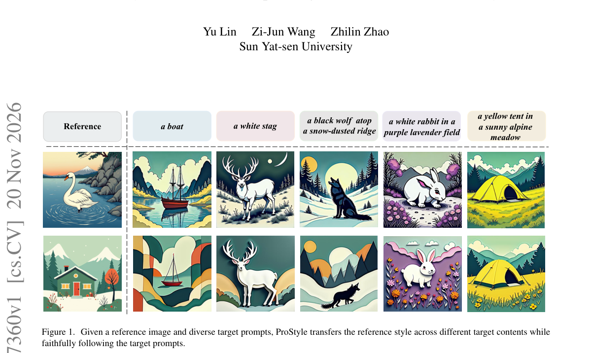

*Result - Effect of reference-conditioning strength α on IP- Adapter and InstantStyle. Stronger conditioning introduces the reference dog in IP-Adapter and shifts the requested red train to- ward yell*

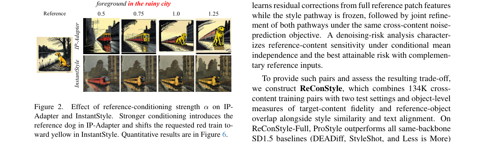

**Why this ranks #13**: 参考图会连带引入主体与背景，靠同风格不同主体的 134K 跨内容配对学一个内容抑制的风格先验，再渐进拟合全参考残差；在 ReConStyle-Full 上四项自动加三项人工标准的平均排名最好为 1.86。

---

### 14. ReCoRain: Reliability-Coupled Content and Noise Conditioning for Event-Guided Video Deraining

**arXiv**: [2611.28717](https://arxiv.org/abs/2611.28717) | **Score**: 8.0 (relevance 8 x 0.7 + quality 8 x 0.3) | **Direction**: `aigc_editing` | **Tags**: AIGC-visual, video-restoration, event-guided, flow-matching, reliability-gating, Harbin Institute of Technology | **Categories**: cs.CV | **Pages**: 10

**Authors**: Runzhe Li; Zhaocheng Yu; Binbin Song; Kui Jiang; Junjun Jiang; Xianming Liu

**Affiliation**: Harbin Institute of Technology

**Abstract**

> Event-guided video deraining depends on reliable cross-frame correspondences, yet events generated by scene motion, rain, and sensor noise can provide ambiguous matching evidence. In diffusion-based restoration, an incorrect match can transfer unrelated content and correlate initial noise between unrelated scene locations. We propose ReCoRain, an event-guided residual video diffusion framework that couples temporal content transfer and noise correlation through a common assessment of correspondence reliability. This assessment combines RGB appearance, interval-event evidence, and forward-backward motion consistency. The content path aggregates neighboring features according to alignment reliability, while the noise path uses composed backward motion fields and their associated reliability estimates to regulate initial-noise sharing across the latent sequence. We use the same conditional noise construction during residual flow-matching training and inference, incorporating temporal noise coordination into the learned restoration process. Temporal supervision matches motion-compensated inter-frame differences in restored and clean videos under the same teacher-estimated flow and visibility mask, accommodating legitimate appearance changes. ReCoRain achieves 32.09 dB PSNR on NTURain-Syn and 28.73 dB on RainSynLight25. Enabling reliability gates in both paths reduces warping error by 33.0% relative to disabling both gates.

**Key findings**

- **Finding**: ReCoRain 在 NTURain-Syn、RainSynLight25、RainSyn-Complex25 上分别达到 32.09、28.73、18.96 dB PSNR，比各数据集最强基线高 1.61、1.04、0.33 dB；同时开启两条路径的可靠性门控可把 warp 误差降低 33.0%。
- **Inference**: 错误匹配会同时搬运无关内容并把初始噪声关联到无关场景位置，因此内容搬运与噪声共享必须共用同一份可靠性估计，不能各自设阈值。
- **Recommendation**: 做事件引导的视频恢复时，事件活跃度不能单独作为对应依据，必须补上前后向运动一致性，并让训练与推理共用同一套条件噪声构造以保持一致。

**Key figures**

*Framework - Reliability-coupled content and noise conditioning. (a) Events can arise from scene motion, rain, and sensor noise, so event activity alone does not establish correspondence reliability. (b)*

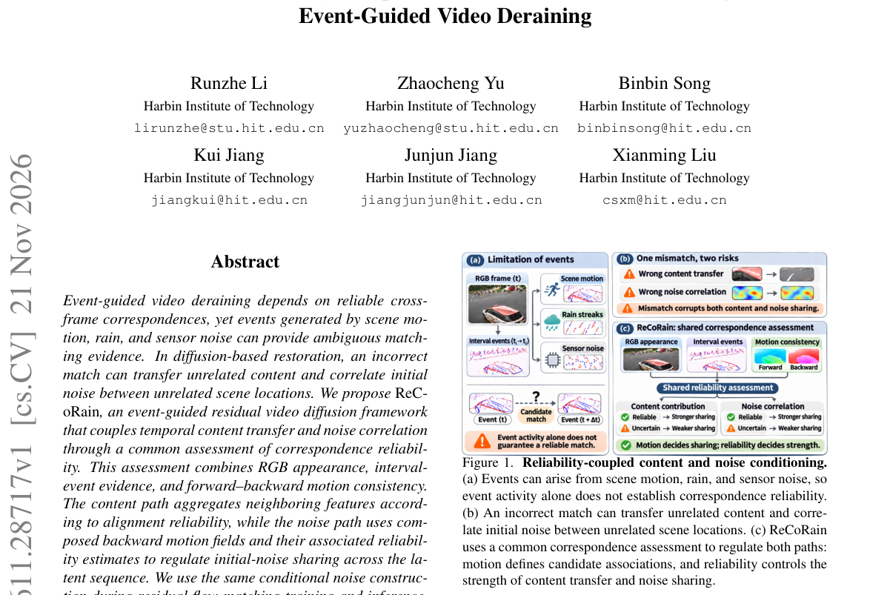

*Result - Overview of ReCoRain. RECA provides bidirectional motion and directional reliability estimates, which regulate content transfer and initial-noise correlation. Residual flow matching refines*

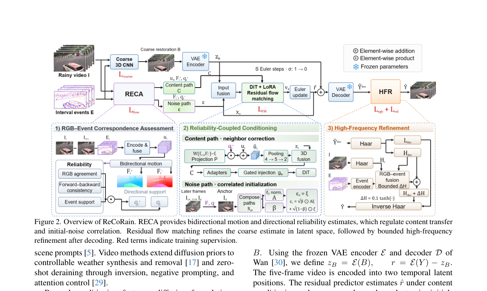

**Why this ranks #14**: 事件信号来自场景运动、雨滴与传感器噪声，不能只凭事件活跃度判断对应可靠性；ReCoRain 用 RGB 外观、事件证据与前后向运动一致性共同评估，NTURain-Syn 上 32.09 dB，比最强基线高 1.61 dB。

---

## 面向视觉生成的 RL 与奖励模型 · `aigc_rl` (3 papers)

3 篇都在回答「RL 到底改了什么」。DeFlowCritic 干脆不评终图，而是从扩散模型自己的特征里取内部 critic，在噪声隐空间给稠密奖励，把稀疏终图奖励变成沿去噪轨迹的早期引导；iTDM 指出 CFG rollout 下 RWR 的基线减法会引入 baseline-induced gradient drift，改用即时轨迹分布匹配来保证基线不变，GenEval2 上收敛快近 3 倍；第三篇把 CFG 与 RL 统一成预测空间里的修正向量，用 Conditional Contrast Regularization 保住预训练 CFG 结构以缓解 reward hacking。共同点是这一轮没人再默认「加个 reward model 就行」。

### 15. DeFlowCritic: Dense Latent Reward Alignment for Text-to-Image Flow Matching Models

**arXiv**: [2611.28265](https://arxiv.org/abs/2611.28265) | **Score**: 8.7 (relevance 9 x 0.7 + quality 8 x 0.3) | **Direction**: `aigc_rl` | **Tags**: AIGC-visual, dense-reward, latent-critic, flow-matching, geneval, Inria | **Categories**: cs.CV | **Pages**: 19

**Authors**: Zeeshan Khan; Xin Yu; Shizhe Chen; Cordelia Schmid

**Affiliation**: Inria; École normale supérieure; CNRS; PSL Research University

**Abstract**

> Online reinforcement learning (RL) has emerged as a powerful paradigm for aligning text-to-image flow matching models with complex user intent. However, existing methods typically rely on sparse rewards computed only from final decoded images. This delays credit assignment across the denoising trajectory and makes training computationally expensive. Moreover, simply combining multiple rewards does not reliably produce a Pareto trade-off, where gains in compositional accuracy often degrade aesthetic quality. In this work, we propose DeFlowCritic, an efficient online RL framework based on Dense Latent Reward Alignment. Unlike prior work, our method provides dense supervision on intermediate latents, enabling early-stage guidance for the denoising trajectory. To achieve this, we introduce an internal critic that evaluates noisy latents using features extracted directly from the diffusion model, a representation inherently better suited for latent-space reward estimation than standard image encoders. We construct a high-quality reward-modeling dataset with continuous scores for critic training, capturing compositional correctness on high-quality reference images. The resulting dense reward enables efficient online RL training and inference-time scaling. Experiments show that our method achieves a superior balance between prompt faithfulness and visual quality on GenEval2 and T2I-CompBench++ benchmarks. The approach also generalizes across text-to-image flow matching models, including SD3.5-Medium, SD3.5-Large, and FLUX.1-dev.

**Key findings**

- **Finding**: 内部 critic 用生成器骨干特征评估带噪潜变量，在 t=465、602、707、780 上的排序准确率为 97.08%、96.67%、95.83%、91.03%，而零样本 Qwen-3-VL 从 58.41% 掉到 5.23%；相比 Flow-GRPO，GenEval2 的 HPSv3 由 7.13 提到 8.07，T2I-CompBench++ 上由 9.26 提到 10.34。
- **Inference**: 用标准图像编码器衡量带噪潜变量本质是特征域错配，只有与去噪状态共享表征空间的 critic 才能在整条轨迹上给出可用的信用分配。
- **Recommendation**: 把 Flow-GRPO 换成密集潜变量奖励时，critic 必须带 LoRA 一起训——去掉 LoRA 后下游 GenEval2 掉到 3.33，远低于基座模型的 18.10。

**Key figures**

*Framework - Samples from our GPT-IMAGE-COMPOSITION dataset and its training-set statistics. Four negatives are shown per image, with corrupted words in red and “...” marking unchanged words.*

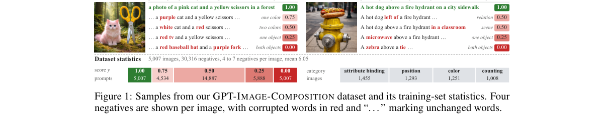

**Why this ranks #15**: 在线 RL 的稀疏奖励把信用分配拖到轨迹末尾；DeFlowCritic 用扩散模型自身特征训一个内部 critic 给中间潜变量打分，GenEval2 上 HPSv3 从 Flow-GRPO 的 7.13 提到 8.07，训练还快约 10 倍。

---

### 16. Reinforcing Diffusion Models by Instantaneous Trajectory Distribution Matching

**arXiv**: [2611.30986](https://arxiv.org/abs/2611.30986) | **Score**: 8.7 (relevance 9 x 0.7 + quality 8 x 0.3) | **Direction**: `aigc_rl` | **Tags**: AIGC-visual, forward-diffusion-rl, baseline-invariance, trajectory-matching, geneval, Hong Kong University of Science and | **Categories**: cs.AI, cs.CV, cs.LG | **Pages**: 20

**Authors**: Yihong Luo

**Affiliation**: Hong Kong University of Science and Technology

**Abstract**

> Forward diffusion reinforcement learning (RL)---enabling deterministic ODE sampling without trajectory backpropagation---has grown increasingly popular for efficiently aligning diffusion models. However, we reveal that existing methods essentially rely on signed reward-weighted regression (RWR), regressing the \emph{trainable policy} velocity onto rollouts from a \emph{behavior distribution}. Unbiased baseline subtraction implicitly assumes that the policy velocity equals the behavior marginal velocity---an idealized assumption violated under classifier-free guidance (CFG) rollouts, offline/off-policy updates, and imperfect online self-consistency. This \emph{behavior--policy mismatch} breaks baseline invariance and injects \emph{baseline-induced gradient drift}, destabilizing training. To resolve this issue, we propose \textbf{I}nstantaneous \textbf{T}rajectory \textbf{D}istribution \textbf{M}atching (\textbf{iTDM}), taking the infinitesimal limit of Trajectory Distribution Matching toward a time-local reward-guided target via the posterior-score identity to yield a sample-level gradient anchored at the behavior velocity without learning an additional reward-tilted target score. Tracking this velocity with an online auxiliary denoiser guarantees exact baseline invariance at the auxiliary optimum, effectively suppressing baseline drift across both online and offline RL. Extensive experiments across compositional generation, text rendering, and preference alignment show that iTDM achieves state-of-the-art in-domain and out-of-domain performance. Notably, on the challenging GenEval2 benchmark, iTDM converges nearly $3\times$ faster than competing methods while scaling smoothly to $0.87$ without collapse. Code is available at https://github.com/Luo-Yihong/iTDM

**Key findings**

- **Finding**: iTDM 用后验 score 恒等式构造锚定在行为速度上的样本级梯度，在 SD3.5-M 上 GenEval2 近乎 3 倍更快收敛并稳定涨到 0.87 而不崩溃；CFG=4.5 的在线策略下 GenEval 0.97、OCR 0.96、PickScore 24.08，均不落后于基座 SD3.5-M。
- **Inference**: 基线漂移是行为-策略不匹配的直接后果，因此把梯度锚在行为速度上、再用在线辅助去噪器跟踪该速度，才能在辅助最优处保证基线不变性并抑制漂移。
- **Recommendation**: 使用前向扩散 RL 前先确认策略与 rollout 采样器是否共享速度假设，一旦偏离就换成 iTDM 这类锚定在行为分布上的目标，并在训练全程监控基线漂移。

**Key figures**

*Framework - GenEval2 performance on SD3.5-M. Our iTDM is nearly 3× faster than DGPO, Diffusion- NFT, and AWM, while continuously scaling to 0.87 without training collapse.*

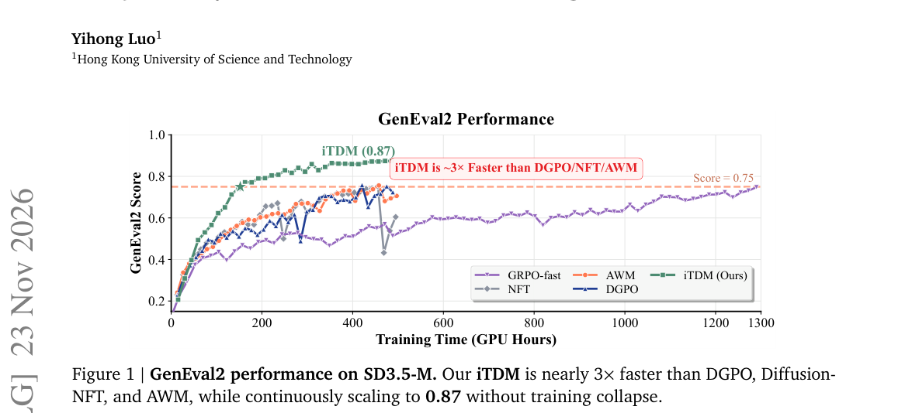

*Result - Qualitative comparisons on human preference alignment (PickScore) with SD3.5-M. All models are trained and evaluated under CFG = 1.0. Compared with competing forward diffusion RL baselines,*

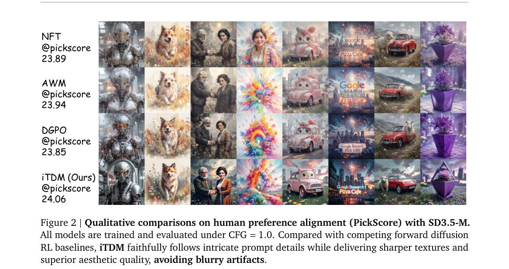

**Why this ranks #16**: 指出前向扩散 RL 本质是带符号的奖励加权回归，其无偏基线假设「策略速度等于行为边缘速度」在 CFG rollout、离线更新与在线自洽误差下都不成立；iTDM 取轨迹分布匹配的瞬时极限，GenEval2 上收敛近 3 倍更快且能稳定涨到 0.87。

---

### 17. Preserving Pretrained CFG Structure in RL for Diffusion Models with Conditional Contrast Regularization

**arXiv**: [2611.27288](https://arxiv.org/abs/2611.27288) | **Score**: 8.0 (relevance 8 x 0.7 + quality 8 x 0.3) | **Direction**: `aigc_rl` | **Tags**: AIGC-visual, reward-hacking, cfg-prior, diffusion-rl, quality-tradeoff, Huazhong University of Science and | **Categories**: cs.AI, cs.CV, cs.LG | **Pages**: 16

**Authors**: Yunfei Zheng; Xiaolong Wang; Dandan Zheng; Xianjun Deng; Shenghao Liu; Wei Xiang; Yuqian Li; Laurence Tianruo Yang

**Affiliation**: Huazhong University of Science and Technology; Ant Group; Central China Normal University

**Abstract**

> Reinforcement Learning (RL) has become an important component in the post-training of diffusion models. In practice, however, standard RL often improves the target reward without reliably preserving holistic generation quality, leading to unstable reward-quality trade-offs that we view as a form of reward hacking. Since Classifier-Free Guidance (CFG) is known to improve visual clarity, prompt alignment, and perceptual quality in generation, we investigate whether its underlying structure can serve as a useful prior during RL. We present a unified geometric view that interprets both CFG and RL as correction vectors in a common prediction space, and identify the projection of the RL-induced correction onto the pretrained CFG correction as a useful diagnostic of quality-related structural preservation. Geometric analysis and rotation intervention further show that the pretrained CFG direction carries information useful for generation quality that reward-driven RL updates do not necessarily preserve. Based on this insight, we propose Conditional Contrast Regularization (CCR), which uses the frozen reference model's conditional contrast as a local structural prior during RL. Experiments across multiple reward settings and backbones show that CCR more consistently preserves generation quality while maintaining competitive reward, yielding a better reward-quality trade-off than standard RL and generic regularization methods.

**Key findings**

- **Finding**: 标准 RL 后的修正向量与预训练 CFG 修正的平均夹角约 93.5 度，已落在反 CFG 一侧；在 Z-Image 上以 GenEval 为奖励时，CCR 把 Laplacian 方差从 Default KL 的 208 提到 841、CLIP-IQA 从 0.75 提到 0.96，GenEval 奖励 0.960 对 0.938。
- **Inference**: 奖励最优方向与保质量方向并不重合，加大 KL 或改用数据正则都无法把 RL 拉回 CFG 结构附近，需要一个显式的结构先验而不是更强的分布约束。
- **Recommendation**: 给扩散 RL 加质量正则时可直接复用冻结参考模型的条件与无条件对比作局部目标，并按旋转干预结果调强度；该试验显示把修正转回 CFG 方向能同时改善清晰度与文本对齐。

**Key figures**

*Framework - Conceptual illustration of CCR. (a) RL may produce a correction that deviates from the CFG correction direction, while CCR helps preserve the CFG-aligned component. (b) Represen- tative imag*

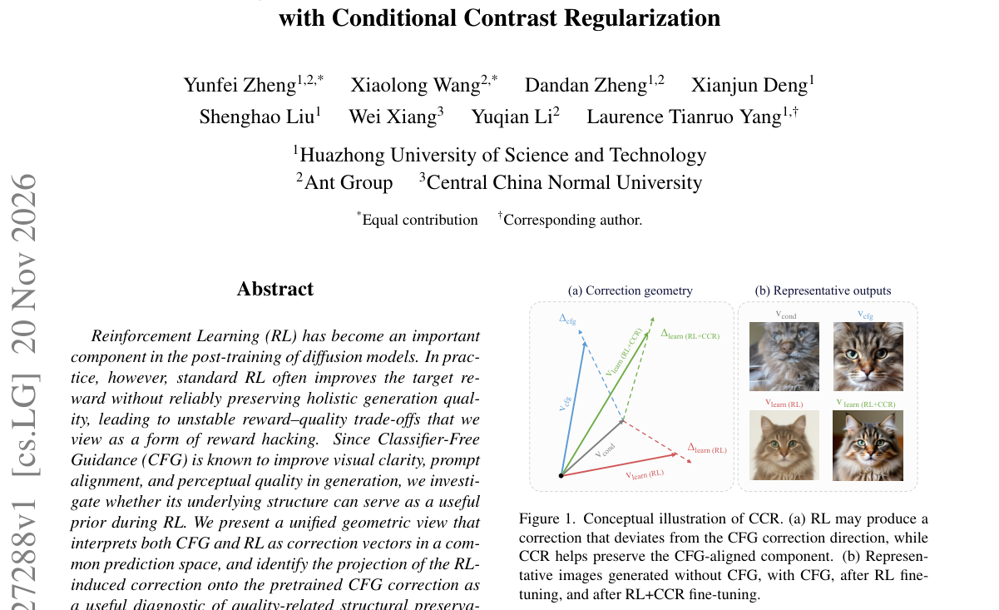

*Result - Effect of rotating the learned correction after RL with GenEval reward. (a) Visual clarity. (b) Prompt alignment. (c) GenEval reward. Dashed lines mark pretrained and RL baselines.*

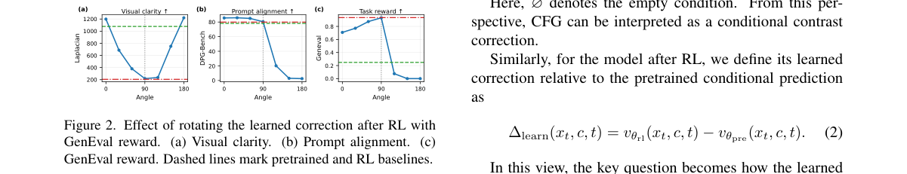

**Why this ranks #17**: 把 CFG 与 RL 统一看成同一预测空间里的修正向量，发现 RL 学到的修正与预训练 CFG 修正平均夹角约 93.5 度、几乎正交；用冻结参考模型的条件对比作局部结构先验，GenEval 奖励设定下 Laplacian 方差从 208 提到 841。

---

## Footer

- Total papers reviewed across all 4 axes: 60
- aigc_visual axis final count: 17
- Wild-cards in this axis: 0
- Figure assets: 2026-11-25/res/

Generated by `mine-arxiv-daily-digest` skill. Sister file: `2026-11-25_aigc_visual_entry.md`.
