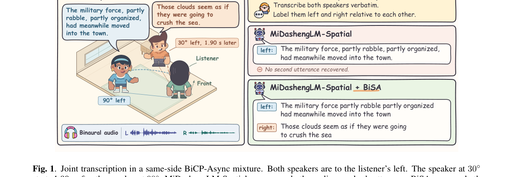
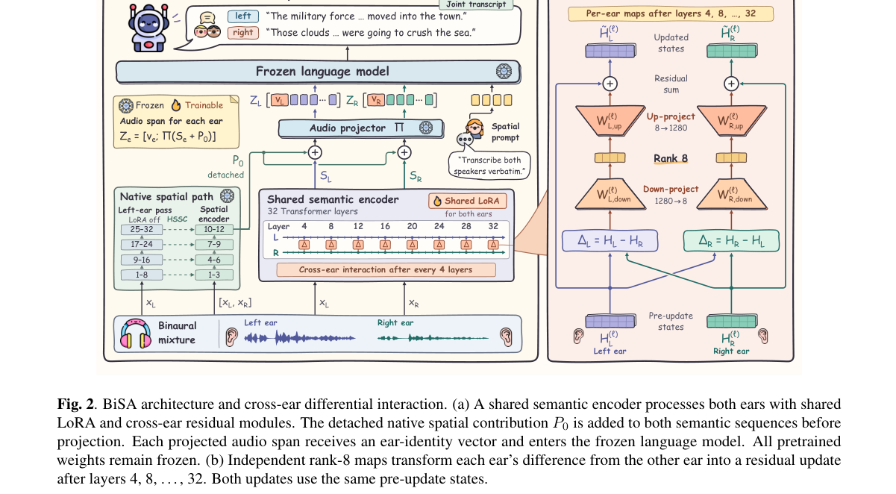
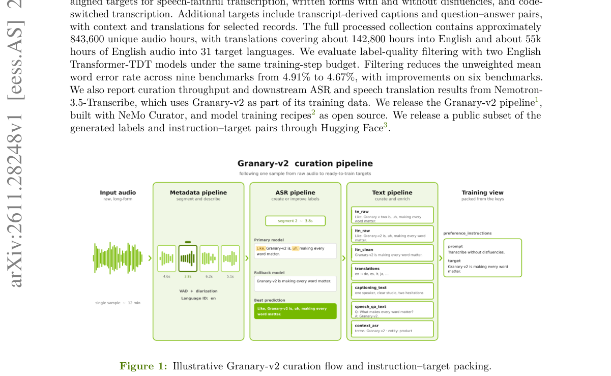
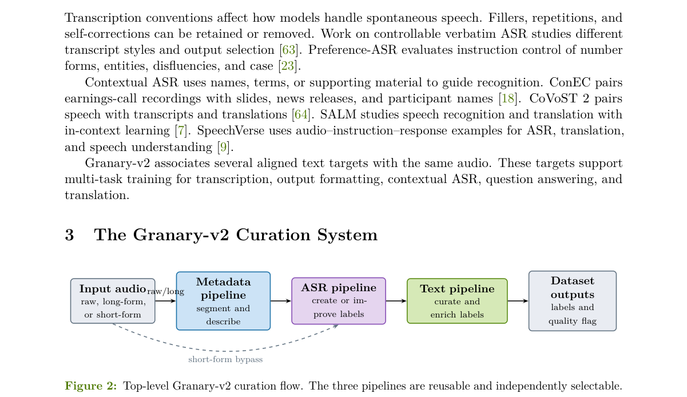
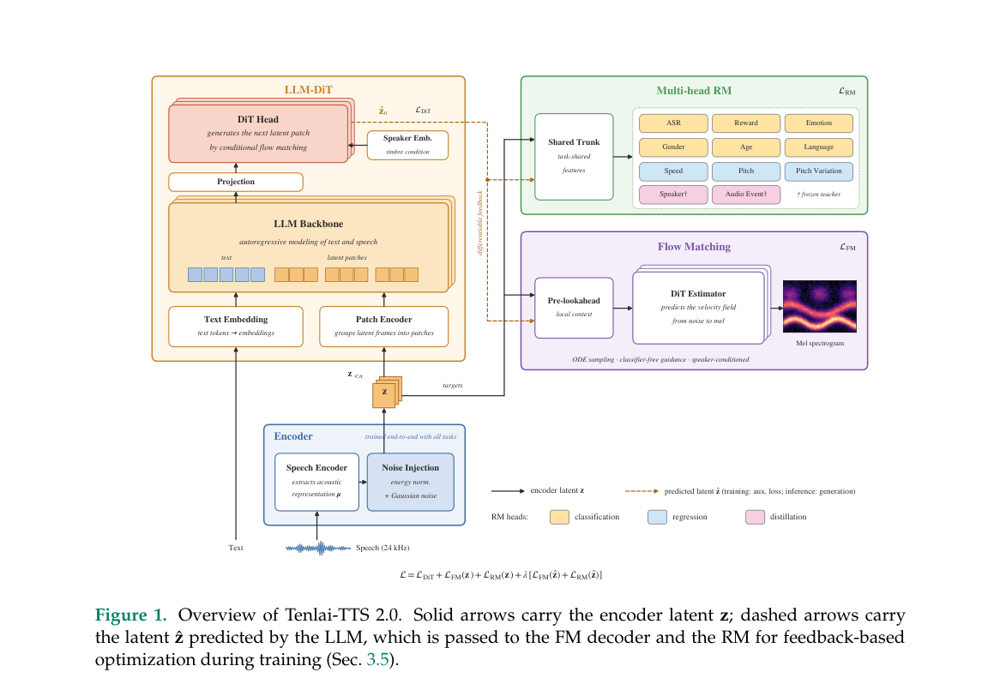
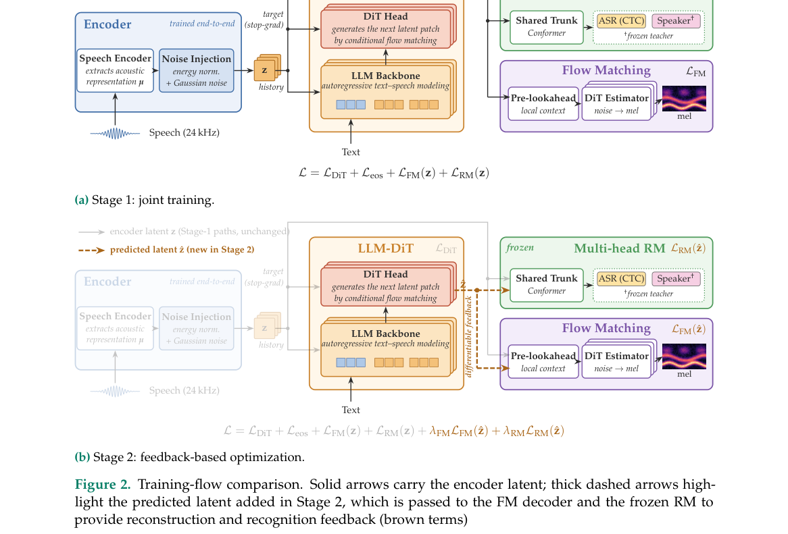

# Mine Arxiv Daily Digest - 2026-11-25 (全双工语音与语音 LM Axis, 3 papers)

**Generated**: 2026-11-25 02:02 CST

**Source**: arXiv cs.CV, cs.SD, eess.AS, cs.CL, cs.AI, cs.RO, cs.LG, cs.IR submissions, listing day 2026-11-20,2026-11-21,2026-11-22,2026-11-23 (announced listing 11-20 于 2026-11-23 01:00 UTC、listing 11-21/11-22/11-23 于 2026-11-24 01:00 UTC 公告)

**Batch window**: 2026-11-19T19:00:00Z .. 2026-11-23T19:00:00Z（arXiv 公告批次窗口按 listing 日逐段相接：每段的起点是前一日的美东 14:00 截止时刻（EDT 为 18:00Z，EST 为 19:00Z），终点是当日同一时刻）

**Axis**: duplex_speech (3 papers, base 12, cap 20)

**Directions**: duplex_speech_core (2), speech_rl (1)

**Selection**: 3 papers ranked by relevance x quality, with 0 wild-card slots

**Day total**: 60 papers across 4 axes (target 60)

**Scope**: 全双工 / 实时 / 流式语音语言模型、speech-to-speech 语音助手、TTS / 语音克隆 / 语音转换，以及语音大模型的 RL 与奖励模型

**Wild-card**: 0 篇 —— 本轴只拿到 3 个席位，语音侧 43 篇够格候选里 rel≥8 只有 10 篇，整体分数压不过其他轴；缺的 9 个名额按「让出」口径流向别的轴，没有拿邻接选题充数。

本轴是四个轴里最短的一格：3 篇对基准 12，缺 9 个名额。duplex_speech_core 有 41 篇 rel≥5 的够格候选、其中 rel≥8 只有 8 篇，speech_rl 更是只有 2 篇；这批语音论文的整体分数压不过同批 world_embodied 与 llm_vlm 的 rel≥9 队列，名额按「让出而不是被填充」的口径流向其他轴，没有一篇靠邻接选题补位。

---

## 全双工语音与语音 LM · `duplex_speech_core` (2 papers)

只有 2 篇，且都不是全双工对话本体。BiSA 解决的是空间归属：冻结骨干只训 0.027% 参数做双耳共享编码与跨耳差分交互，把同起点双说话人的空间归属联合转写成功率从 0% 提到 57.81%，错峰起点后的说话人 WER 从 109.47% 降到 29.58%，MMAU-Pro 空间推理提升 9.54 点。Granary-v2 是数据侧的：用 NeMo Curator 整理 25 到 48 语种、约 843,600 小时音频的指令-目标对数据集，标签过滤把九个基准的非加权平均 WER 从 4.91% 降到 4.67%。

### 1. From Spatial Perception to Speech Recovery: Binaural Semantic Adaptation for Spatially Grounded Multi-Talker Transcription

**arXiv**: [2611.29012](https://arxiv.org/abs/2611.29012) | **Score**: 8.7 (relevance 9 x 0.7 + quality 8 x 0.3) | **Direction**: `duplex_speech_core` | **Tags**: duplex-speech, binaural-audio, multi-talker-asr, spatial-attribution, cross-ear-interaction, parameter-efficient-adaptation, Xi’an Jiaotong-Liverpool University | **Categories**: cs.SD | **Pages**: 15

**Authors**: Wenxuan He; Shan Liang

**Affiliation**: Xi’an Jiaotong-Liverpool University; University of Liverpool

**Abstract**

> Spatial audio large language models increasingly combine general audio understanding with spatial perception. Yet overlapping conversations require more than locating speakers. A model must also recover what each person says and match the words to their positions. We examine this challenge in MiDashengLM-Spatial, a binaural model designed for both spatial reasoning and general audio understanding. To test these abilities, we introduce BiCP-Bench, a benchmark of overlapping two-speaker binaural recordings that contrasts candidate-based recognition, position-guided transcription, and joint transcription with spatial attribution. The model can identify a target utterance among candidates but struggles to transcribe it without them. Its semantic encoder uses only one ear. Changing that ear shifts which side's speech is recovered more accurately, despite unchanged binaural input to the spatial branch. We therefore propose Binaural Semantic Adaptation (BiSA), which combines shared encoding of both ears with cross-ear differential interactions. With the backbone frozen and 0.027% trainable parameters, BiSA raises correctly attributed joint transcription success from 0% to 57.81% for simultaneous onsets. For staggered onsets, later-speaker word error rate falls from 109.47% to 29.58%. On full-length Clarity CEC1 mixtures, word error rate falls from 59.33% to 39.60%. Spatial reasoning on MMAU-Pro improves by 9.54 percentage points without updating the spatial encoder, and general audio performance remains largely intact.

**Key findings**

- **Finding**: 诊断实验显示，语义参考耳从左换到右后，左侧话语恢复从 162/200（81%）跌到 4/200（2%），右侧话语从 4/200 升到 172/200（86%）；双耳表示（66/200、65/200）远优于重复单耳（2/200、3/200）。
- **Inference**: 空间定位与语音内容恢复是两条解耦通路，瓶颈在语义侧的单耳编码，而不是空间分支的分辨率或位置编码能力。
- **Recommendation**: 做空间音频模型先跑参考耳切换与左右耳互补两组消融，确认语义通路是否用满双耳信息，再决定是否动空间分支；改动优先走 LoRA 加冻结骨干的低成本路线。

**Key figures**

*Framework - Joint transcription in a same-side BiCP-Async mixture. Both speakers are to the listener’s left. The speaker at 30◦*

*Result - BiSA architecture and cross-ear differential interaction. (a) A shared semantic encoder processes both ears with shared LoRA and cross-ear residual modules. The detached native spatial contrib*

**Why this ranks #1**: 它把「空间音频大模型能定位、却听不懂重叠语音」这一缺口定位到具体环节：MiDashengLM-Spatial 的语义编码器只吃固定的一只耳朵。在骨干冻结、仅训练 2,300,928 个参数（占基座 0.027%）的条件下，BiSA 把同时起音场景下带正确空间归属的联合转写成功率从 0% 拉到 57.81%，错开起音的后说话人 WER 从 109.47% 降到 29.58%，Clarity CEC1 全长混合上的 WER 从 59.33% 降到 39.60%，MMAU-Pro 空间推理还涨了 9.54 个百分点。

---

### 2. Granary-v2: Scalable Multilingual Speech Data Curation for Predictable and Controllable Model Outputs

**arXiv**: [2611.28248](https://arxiv.org/abs/2611.28248) | **Score**: 8.0 (relevance 8 x 0.7 + quality 8 x 0.3) | **Direction**: `duplex_speech_core` | **Tags**: duplex-speech, speech-data-curation, multilingual-asr, instruction-tuning, contextual-asr, speech-translation, NVIDIA | **Categories**: eess.AS | **Pages**: 49

**Authors**: Nithin Rao Koluguri; Meline Mkrtchyan; Nune Tadevosyan; Aaftab V; Sushmitha Deva; Fan Qian; Davit Karamyan; Kunal Dhawan; Taejin Park; Piotr Zelasko; Arushi Dhingra; Viraj Karandikar

**Affiliation**: NVIDIA

**Abstract**

> Speech-language models that follow instructions need training data that connects the same recording to different output forms and tasks. We present Granary-v2, a multilingual speech dataset and reusable curation system that provides a data foundation for these models. Granary-v2 extends Granary-v1 with aligned transcript variants and instruction-target pairs for multi-task speech-language training. Language coverage increases from 25 to 48 languages. Built with NeMo Curator, the system combines language-dependent ASR labeling, transcript improvement, and text label generation. It produces aligned targets for speech-faithful transcription, written forms with and without disfluencies, and code-switched transcription. Additional targets include transcript-derived captions and question-answer pairs, with context and translations for selected records. The full processed collection contains approximately 843,600 unique audio hours, with translations covering about 142,800 hours into English and about 55k hours of English audio into 31 target languages. We evaluate label-quality filtering with two English Transformer-TDT models under the same training-step budget. Filtering reduces the unweighted mean word error rate across nine benchmarks from 4.91% to 4.67%, with improvements on six benchmarks. We also report curation throughput and downstream ASR and speech translation results from Nemotron-3.5-Transcribe, which uses Granary-v2 as part of its training data. We release the Granary-v2 pipeline, built with NeMo Curator, and model training recipes as open source. We release a public subset of the generated labels and instruction-target pairs through Hugging Face.

**Key findings**

- **Finding**: ASR 标注按语言走 A–G 共 48 种语言的路由（Qwen3-Omni 覆盖 15 种、Whisper 9 种、Parakeet v3 8 种），元数据流水线用 VAD 切 0.5–40 秒片段，文档工作负载下吞吐约 23 音频小时每 GPU 小时。
- **Inference**: 指令跟随语音模型的瓶颈常在数据而非模型——语料只有一条参考转写时，模型无从学会「听指令决定输出形式」，所以多目标对齐与标签质检必须先于训练。
- **Recommendation**: 训指令跟随语音模型前先做标签质检消融，同一训练步数比较高质量子集与全量数据的 WER 再决定清洗强度；Granary-v2 的 NeMo Curator 流水线与训练配方可直接复用。

**Key figures**

*Framework - Illustrative Granary-v2 curation flow and instruction–target packing.*

*Result - Top-level Granary-v2 curation flow. The three pipelines are reusable and independently selectable.*

**Why this ranks #2**: 这是把同一段录音对齐成多种文本目标的可复用 curation 系统：处理后 843,579.22 小时去重音频覆盖 48 个语种、19 个语料条目，其中 142,778.43 小时带英译标签，语种数从 Granary-v1 的 25 种扩到 48 种。它还量化了标签质量的影响：同等训练步数下，高质量子集让九个基准的非加权平均 WER 从 4.91% 降到 4.67%，其中六个基准有提升。

---

## 语音 LM 的 RL 与偏好优化 · `speech_rl` (1 papers)

只有 1 篇：Tenlai-TTS 2.0。连续语音表征端到端训练（容量可控 Gaussian bottleneck + AR-DiT + flow-matching mel 解码 + 识别模型）之后，再用强化学习把 test-hard-zh 的 CER 从 8.32% 经 7.08% 进一步压到 6.29%，test-en 的 WER 从 1.32% 降到 1.08%，说话人相似度 0.811/0.766/0.784。按 v0.8.1 的训练方法判据，它归 `speech_rl` 而不是 `duplex_speech_core`——RL 确实作用在语音模型上，哪怕只是多阶段配方里的后一段。

### 3. Tenlai-TTS 2.0: Continuous-Representation LLM-Based TTS System with End-to-End Training

**arXiv**: [2611.29226](https://arxiv.org/abs/2611.29226) | **Score**: 8.7 (relevance 9 x 0.7 + quality 8 x 0.3) | **Direction**: `speech_rl` | **Tags**: duplex-speech, continuous-latent-tts, flow-matching, autoregressive-diffusion, reinforcement-learning, reward-weighted-training, Tencent Yuanbao | **Categories**: cs.AI, cs.SD | **Pages**: 19

**Authors**: Changfeng Gao; Yong Ren; Jun Yuan; Zhengkun Tian; Ye Bai; Zhao You; Shidong Shang

**Affiliation**: Tencent Yuanbao; Tencent Ethereal Audio Lab

**Abstract**

> Autoregressive text-to-speech (TTS) with continuous speech latents avoids quantization-induced information loss, but typically relies on a latent space that is learned separately and then frozen before language-model training. Such a space must satisfy two competing requirements: it must retain enough acoustic detail for high-fidelity reconstruction, yet be sufficiently structured and regularized to support autoregressive prediction by a language model. We present Tenlai-TTS 2.0, which learns continuous speech representations through end-to-end training to balance acoustic detail with autoregressive predictability. The model comprises a speech encoder with a capacity-controlled Gaussian bottleneck, a large language model (LLM) with an autoregressive diffusion transformer (AR-DiT) head, a flow-matching (FM) mel-spectrogram decoder, and a multi-task recognition model (RM). With energy normalization and fixed-variance Gaussian noise, the bottleneck has a closed-form upper bound on its information rate. Through joint optimization with reconstruction, recognition, and next-patch prediction objectives, we learn continuous speech representations that suit all three tasks and train the LLM and AR-DiT for autoregressive generation. The LLM and AR-DiT are further optimized using differentiable reconstruction and recognition feedback on their predicted latents through the FM decoder and RM. On Seed-TTS-eval, this feedback-based optimization reduces character error rate (CER) from 0.82% to 0.74% on test-zh and from 8.32% to 7.08% on test-hard-zh, and word error rate (WER) from 1.32% to 1.27% on test-en, compared with joint training alone. Subsequent reinforcement learning further reduces CER to 6.29% on test-hard-zh and WER to 1.08% on test-en, with speaker similarity scores of 0.811, 0.766, and 0.784 on test-zh, test-en, and test-hard-zh, respectively.

**Key findings**

- **Finding**: 在 Seed-TTS-eval 上，反馈式优化把 test-zh 的 CER 从 0.82% 降到 0.74%、test-hard-zh 从 8.32% 降到 7.08%、test-en 的 WER 从 1.32% 降到 1.27%；随后的 RL 阶段再把 test-hard-zh 的 CER 压到 6.29%、test-en 的 WER 压到 1.08%。
- **Inference**: 把重建与识别损失经可微 FM 解码器和冻结识别模型回传给 LLM，等于告诉生成器哪种潜变量误差会改词或改音色；RL 再用奖励加权分支纠正输出质量偏好，两段优化补的是不同缺口。
- **Recommendation**: 做连续表征 TTS 时把瓶颈噪声 σ 当一等超参来调，论文实测 σ 变小虽提升识别与重建，却拖垮 LLM 的潜变量预测、最终合成更差；容量上界可用闭式公式 C = D/2·log2(1+1/σ²) 在训练前算出，σ=0.5 时 11.1 kbps、σ=0.2 时 22.6 kbps。

**Key figures**

*Framework - Overview of Tenlai-TTS 2.0. Solid arrows carry the encoder latent z; dashed arrows carry the latent ˆz predicted by the LLM, which is passed to the FM decoder and the RM for feedback-based o*

*Result - Training-flow comparison. Solid arrows carry the encoder latent; thick dashed arrows high- light the predicted latent added in Stage 2, which is passed to the FM decoder and the frozen RM to*

**Why this ranks #3**: 它入选 speech_rl 的理由在第 4.3 节：把 DiffusionNFT 迁到自回归语音生成，奖励在组内标准化后映射成权重，用正负两条流匹配分支做奖励加权更新，既不需要显式似然，也不用穿透 rollout 的波形梯度。RL 阶段把 test-hard-zh 的 CER 从反馈式优化后的 7.08% 再压到 6.29%、test-en 的 WER 从 1.27% 降到 1.08%，三个测试集的说话人相似度分别为 0.811、0.766、0.784。

---

## Footer

- Total papers reviewed across all 4 axes: 60
- duplex_speech axis final count: 3
- Wild-cards in this axis: 0
- Figure assets: 2026-11-25/res/

Generated by `mine-arxiv-daily-digest` skill. Sister file: `2026-11-25_duplex_speech_entry.md`.
