# Mine Arxiv Daily Digest - 2026-11-25 (LLM / VLM 与其强化学习 Axis, 20 papers)

**Generated**: 2026-11-25 02:02 CST

**Source**: arXiv cs.CV, cs.SD, eess.AS, cs.CL, cs.AI, cs.RO, cs.LG, cs.IR submissions, listing day 2026-11-20,2026-11-21,2026-11-22,2026-11-23 (announced listing 11-20 于 2026-11-23 01:00 UTC、listing 11-21/11-22/11-23 于 2026-11-24 01:00 UTC 公告)

**Batch window**: 2026-11-19T19:00:00Z .. 2026-11-23T19:00:00Z（arXiv 公告批次窗口按 listing 日逐段相接：每段的起点是前一日的美东 14:00 截止时刻（EDT 为 18:00Z，EST 为 19:00Z），终点是当日同一时刻）

**Axis**: llm_vlm (20 papers, base 18, cap 20)

**Directions**: llm_core (9), vlm_core (5), llm_vlm_rl (6)

**Selection**: 20 papers ranked by relevance x quality, with 0 wild-card slots

**Day total**: 60 papers across 4 axes (target 60)

**Scope**: 大语言模型与视觉语言模型的设计、推理、agent、效率与上下文工作，以及面向 LLM / VLM 的 RL 与偏好优化、奖励模型

**Wild-card**: 0 篇 —— llm_core 472 / vlm_core 212 / llm_vlm_rl 37 篇够格候选都远超本轴 20 个席位，名额全部由同轴内更靠前的论文占满，未启用任何补位名额。

本轴 20 篇超基准 2，代价压在 llm_core（9）与 llm_vlm_rl（6）上，vlm_core 恰好停在基准 5——此时 dir_over = 2、dir_under = 0、axis_surplus = 2，三者相等才放行。9 篇 llm_core 里有 4 篇在做 KV cache 与稀疏注意力（LongCat Recall、MemOnce、NoHairCache、4-bit KV 内核），llm_vlm_rl 那 6 篇则集中在「奖励从哪来」。

---

## LLM 核心（架构 / 推理 / agent / 效率 / 上下文） · `llm_core` (9 papers)

9 篇里 4 篇在啃 KV cache 与稀疏注意力：LongCat Recall Sparse Attention 在 1024K 上下文下 key 选择比 DSA 快 4.70 倍、选择加注意力比全注意力快 35.60 倍；MemOnce 只缓存末层少量隐状态再解码回 KV，1M 上下文下状态缓存缩小 1313 倍、prefill 延迟降 6.9 倍；NoHairCache 用一个幂律指数 α 把 H2O 与 StreamingLLM 统一成同一族；Fast 4-bit KV-Cache 那篇用 NVBit 指令计数指出 vLLM/FlashInfer 在 Hopper 上只跑到 10–20% 带宽。另两篇改结构与训练（Temporal Residual 只加 2,752 个参数就把 GSM8K 从 21% 拉到 40%、position-skipped distillation 用 8K 训练匹配 32K indexer），还有 ESSENCE 按「时刻」而非帧做 tokenize 与 Hy-MT3 的多语翻译。

### 1. Tokenize Moments, Not Frames: Tokenizer-Aware Budget Allocation for Training-Free Video LLM Acceleration

**arXiv**: [2611.26933](https://arxiv.org/abs/2611.26933) | **Score**: 8.7 (relevance 9 x 0.7 + quality 8 x 0.3) | **Direction**: `llm_core` | **Tags**: LLM-VLM, video-llm, tokenizer-audit, token-budget, training-free, ttft, Huazhong University of Science and | **Categories**: cs.AI, cs.CV | **Pages**: 24

**Authors**: Zirui Zhao; Kai Liu; Linghe Kong

**Affiliation**: Huazhong University of Science and Technology; Shanghai Jiao Tong University

**Abstract**

> Video large language models (LLMs) represent each video with thousands of visual tokens, and training-free accelerators that prune or merge these tokens lose accuracy on long videos. Analyzing frame similarity and the vision tokenizers of 16 open models, we trace this loss to a step before token selection. Under a token budget, the frames of a long video are sampled farther apart than the roughly 2 s over which frames remain similar. The two-frame 3D patches of models such as Qwen-VL then blend two unrelated scenes into each visual token, a double exposure that arises before any pruning or merging. Fixed-size tokenizers such as InternVL's avoid this blend but respond differently to the same reduction. We propose ESSENCE, a training-free method that tokenizes moments, segments within which frames remain similar, rather than frames. Before encoding, a closed-form rule uses the sampling interval and the tokenizer class to set the number of token grids and the dimension to reduce; visual tokens are then released from later LLM layers. Against five recent accelerators on Qwen3-VL, Qwen2.5-VL and InternVL3.5, ESSENCE achieves higher accuracy in 58 of 60 comparisons at matched mean time to first token (TTFT). With 80% of the tokens, it matches the average accuracy of the full Qwen models at $1.6\times$ faster TTFT; on GLM-4.1V, it exceeds the full model by up to 3.4 points. Code is available at: https://github.com/zhkandsrz/ESSENCE.

**Key findings**

- **Finding**: 帧在约 2 秒内保持相似，稀疏视频上 Qwen-VL 类两帧 3D patch 会把两个无关场景混成一个 token，改为逐帧独立编码可提升 2.4 至 3.8 分。
- **Inference**: 训练无关加速器的精度瓶颈在编码端而非剪枝端，先按 moment 分段再压缩才能真正省算力。
- **Recommendation**: 评估视频 LLM 加速方案时先测编码端的双曝光混合效应，否则剪枝与合并的收益会被系统性高估。

**Key figures**

*Framework - 32 frames are not 32 samples. (a) Eight consecutive frames and the token grids of a two-frame patch (pixel mean shown) on Qwen3-VL-8B: redundant on a short clip, blended on a long video, at*

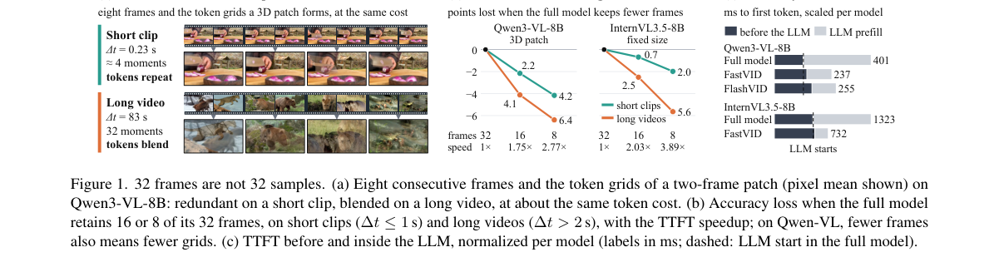

*Result - Frames are not moments. (a) Phase-correlation peak between two frames of the same video against their temporal gap (median over videos). In long videos it reaches the range of un- related fr*

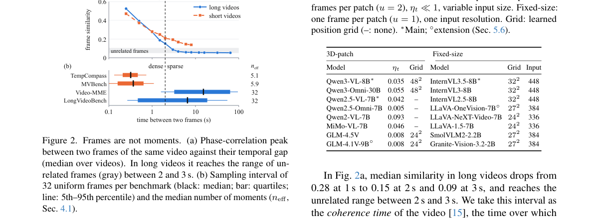

**Why this ranks #1**: 把精度损失定位到 token 选择之前的编码步：检查 16 个开源模型的视觉 tokenizer 后发现 8 个用两帧 3D patch，稀疏采样时把两个无关场景混成一个 token；ESSENCE 改按 moment 分段再压缩，在 Qwen3-VL、Qwen2.5-VL、InternVL3.5 上 60 组同 TTFT 对比中 58 组更准，80% token 量即追平完整 Qwen 模型并快 1.6 倍 TTFT。

---

### 2. LongCat Recall Sparse Attention: Co-Designing Key Organization and Retrieval for Long-Context Inference

**arXiv**: [2611.27233](https://arxiv.org/abs/2611.27233) | **Score**: 8.7 (relevance 9 x 0.7 + quality 8 x 0.3) | **Direction**: `llm_core` | **Tags**: LLM-VLM, sparse-attention, long-context, paged-retrieval, kv-cache, sglang, Meituan LongCat Team | **Categories**: cs.CL | **Pages**: 19

**Authors**: Hao Zhang; Bin Xiao; Kefeng Zhang

**Affiliation**: Meituan LongCat Team

**Abstract**

> Retrieval-based sparse attention, exemplified by DeepSeek Sparse Attention (DSA), reduces attention computation by selecting a small subset of key-value entries. However, selecting these entries can still require searching the entire visible history. For long sequences, retrieval becomes a major bottleneck, limiting the efficiency gains from sparse attention. To address this problem, we propose LongCat Recall Sparse Attention (LRSA), which combines fine-grained representatives with paged retrieval in an incrementally maintained index. LRSA partitions the sequence into time buckets that can be indexed independently as new keys arrive, without regrouping existing history. Within each bucket, it organizes indexing keys into capacity-balanced directional groups and packs a fixed number of complete groups into each page, retaining a separate center for every group. These centers provide fine-grained representatives for page selection, after which refinement scores members of the selected pages together with sink, sliding-window, and visible unindexed candidates to select the final Top-$K$ logical positions. To execute this retrieval process efficiently, we store members in reordered pages, fuse construction stages according to group size, and share storage for overlapping fixed candidates across queries during chunked prefill. These choices support regular member access while reducing kernel launches during construction and repeated candidate transfers. Moreover, we integrate LRSA into SGLang to maintain the index during inference, overlapping asynchronous index construction for new buckets with subsequent computation and reusing compatible bucket indices and member pages after a prefix match in the original key-value pool. With a 1024K-token context, LRSA accelerates key selection by 4.70$\times$ over DSA and combined selection and attention by 35.60$\times$ over full attention.

**Key findings**

- **Finding**: 1024K token 上下文下，LRSA 的 key 选择比 DSA 快 4.70 倍，选择与注意力合计比全注意力快 35.60 倍。
- **Inference**: 稀疏注意力在长上下文下的第二瓶颈是索引组织本身，而不是选中 key 的数量。
- **Recommendation**: 部署 DSA 类稀疏注意力时优先改造 key 的组织与分页检索，收益比单纯调整 Top-K 更直接。

**Key figures**

*Framework - Overview of LRSA. (a) Each completed bucket is independently partitioned into capacity-balanced directional groups, which are packed into member pages. With the default capacities, the expan*

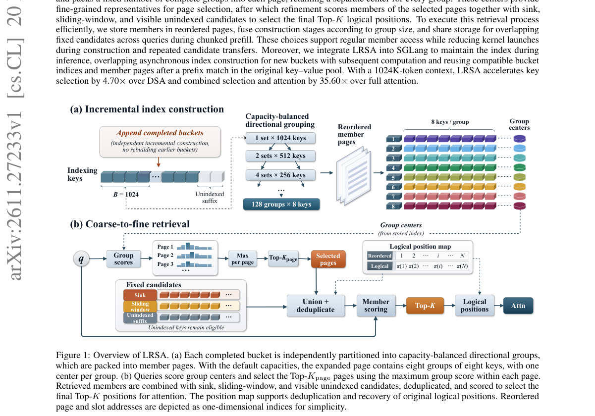

**Why this ranks #2**: 指出检索式稀疏注意力（DSA）的真瓶颈不在选多少 key 而在怎么搜：LRSA 用时间桶、容量均衡方向组与分页成员索引把检索做成两级粗到细，在 1024K token 上下文下 key 选择比 DSA 快 4.70 倍、选择加注意力合计比全注意力快 35.60 倍，并已集成进 SGLang 做异步增量建索引。

---

### 3. Hy-MT3: More Accurate, Robust and Practical Multilingual Translation Models in the Wild

**arXiv**: [2611.27673](https://arxiv.org/abs/2611.27673) | **Score**: 8.7 (relevance 9 x 0.7 + quality 8 x 0.3) | **Direction**: `llm_core` | **Tags**: LLM-VLM, multilingual-translation, moe, open-weight, rubric-evaluation, industrial-deployment, Tencent Hunyuan Team | **Categories**: cs.AI, cs.CL | **Pages**: 15

**Authors**: Mao Zheng; Zheng Li; Fangxu Liu; Tao Chen; Bingxin Qu; Bo Lv; Mingrui Sun; Hongyu Li; Hong Huang; Jinlong Song; Decheng Wu; Guanghua Yu

**Affiliation**: Tencent Hunyuan Team

**Abstract**

> Hy-MT3 is the third generation of the Hunyuan multilingual translation model family, including \textbf{Hy-MT3-1.8B}, \textbf{Hy-MT3-7B} and \textbf{Hy-MT3-30B-A3B (MoE)}. Compared with Hy-MT2, Hy-MT3 translates \textbf{more accurately, more completely and more faithfully to user constraints}: on real-world scenario data, the share of samples with mistranslations is reduced by \textbf{43\%}, omissions or additions by \textbf{74\%}, and instruction-following errors by \textbf{40\%}, while language coverage is expanded from \textbf{38 to 102} languages. With only 3B activated parameters, \textbf{Hy-MT3-30B-A3B achieves the best overall performance among all evaluated models in non-thinking mode}, including flagship models such as Qwen3.8-Max, Kimi-K3.1-Pro and DeepSeek-V4.1-Flash, and approaches the strongest closed-source thinking models such as GPT-6.1-Sol and Gemini-4-Argon, while surpassing models that consume \textbf{more than 30$\times$} its inference compute. Beyond general translation, Hy-MT3 is optimized for two industrial scenarios. For \textbf{game localization}, built with high-quality game-domain data and a professional evaluation system from the Honor of Kings team, Hy-MT3-30B-A3B matches or outperforms strong closed-source models such as Gemini 3.1 Pro on all core metrics, and can be plugged into game development pipelines through an open-source toolchain. For \textbf{image translation}, Hy-MT3 improves context understanding and error correction to better tolerate OCR errors, achieving the best result among models of comparable size. Finally, we open-source \textbf{TransRubric}, a rubric-based automatic evaluation suite for translation, which outperforms other evaluation schemes on the WMT26 metrics shared task test set and is more stable with respect to human evaluation.

**Key findings**

- **Finding**: 在 5,000 条 WildMTBench-202611 真实样本上，错译占比从 56.0% 降到 31.8%，漏译增译从 21.2% 降到 5.5%，指令遵循问题从 16.5% 降到 9.8%。
- **Inference**: 翻译质量的主要瓶颈在忠实度与完整性而非术语，这两类问题靠更干净的语料与带问题标注的评测闭环都能改善。
- **Recommendation**: 选多语翻译模型时用带问题标注的真实场景集而非 BLEU 类指标，并优先看漏译与错译占比。

**Key figures**

*Framework - Overall performance of Hy-MT3 and representative baselines. General Translation is the average over FLORES-200, FLORES-200 low-resource, WMT26 and Mandarin⇔Minority translation (Table 2); Wi*

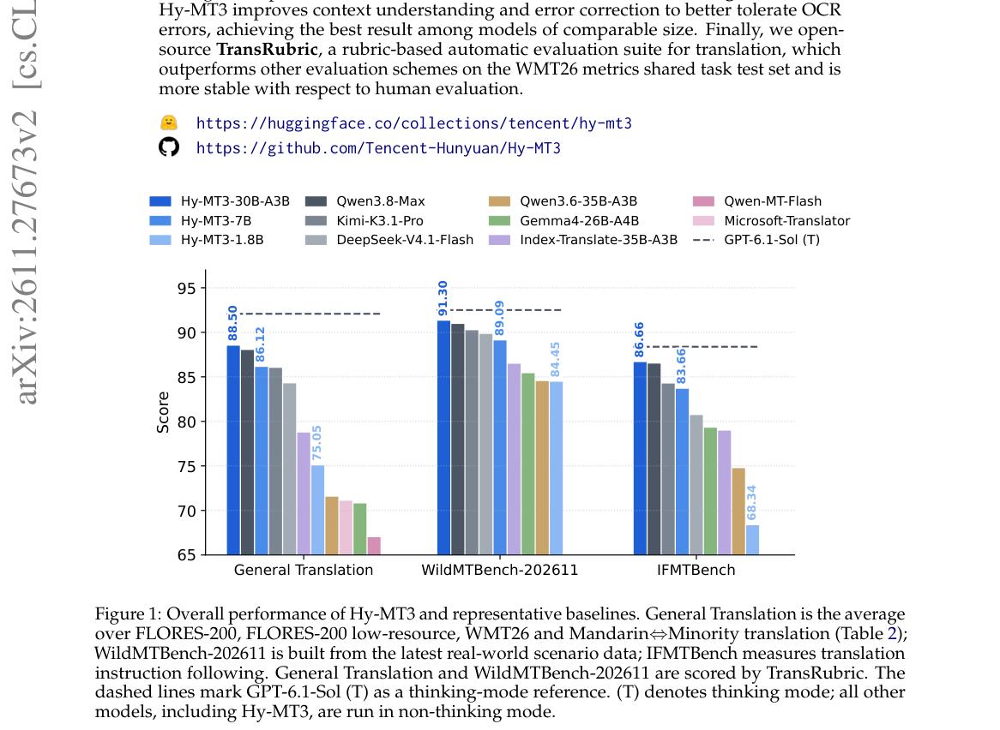

*Result - TransRubric versus 10 human annotators on 651 Chinese⇔English translations. (a) Distribution of the per-sample standard deviation of the 10 scores, across annotators for humans and across 10*

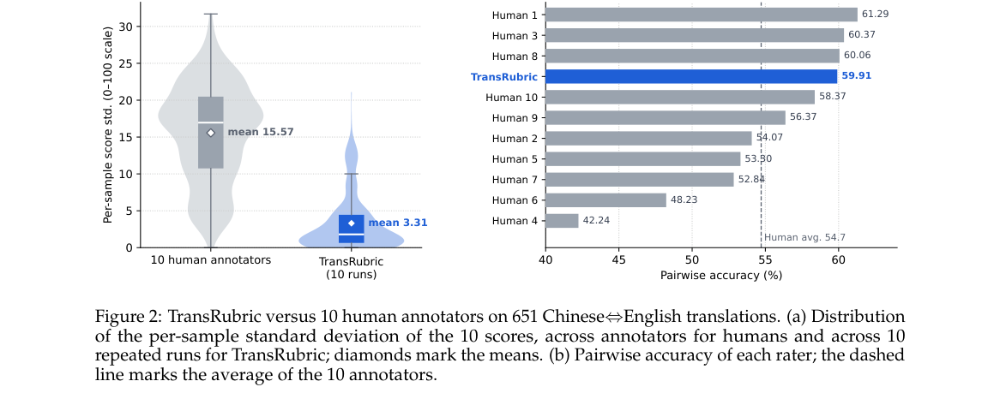

**Why this ranks #3**: 腾讯混元第三代多语翻译模型，含 1.8B、7B 与 30B-A3B（MoE，仅 3B 激活）三个规格，把语言覆盖从 38 种扩到 102 种；在 5,000 条真实场景样本上错译占比从 56.0% 降到 31.8%、漏译增译从 21.2% 降到 5.5%，并开源 TransRubric 自动评测套件。

---

### 4. MemOnce: A Scalable Memory Architecture for Large Language Models

**arXiv**: [2611.27973](https://arxiv.org/abs/2611.27973) | **Score**: 8.7 (relevance 9 x 0.7 + quality 8 x 0.3) | **Direction**: `llm_core` | **Tags**: LLM-VLM, memory-architecture, kv-cache, long-context, linear-time, sparse-attention, Nanjing University | **Categories**: cs.CL | **Pages**: 28

**Authors**: Chang Nie; Chaoyou Fu; Songlin Liu; Yiqing Hu; Caifeng Shan

**Affiliation**: Nanjing University; University of Science and Technology of China

**Abstract**

> Deploying large language models (LLMs) in long-horizon and continual interactions requires maintaining reusable memory states for future inference, posing challenges for existing architectures. Standard Transformers accumulate layer-wise, token-level KV caches, incurring linear GPU memory growth and quadratic computational complexity as the context expands. In contrast, linear-time architectures compress history into fixed-size states, but struggle to retain fine-grained details. We introduce MemOnce, a foundation architecture that learns scalable memory states for language models. MemOnce is based on two core designs: (a) Memory encoder-decoder: it caches only a small subset of final-layer hidden states as compact memory representations and dynamically decodes them back into KV caches for attention layers; (b) Memory sparse attention: for each continual input, MemOnce adaptively retrieves relevant memory representations, with the sparse indices computed only once across layers. Coupling these two designs enables efficient on-the-fly memory loading and KV cache decoding, drastically reducing the GPU memory footprint and achieving linear-time complexity. We conduct extensive experiments to show that MemOnce outperforms Transformers and other architectures across varying model sizes, context lengths, and training paradigms (pretraining and post-training adaptation). In particular, adapting Qwen3.5-4B with MemOnce reduces memory state cache by 1313$\times$ and prefill latency by 6.9$\times$ at 1M context, and improves throughput by 3.5$\times$ and overall memory performance by +5.77%. Finally, MemOnce generalizes zero-shot to downstream representation tasks, achieving competitive results against specialized models.

**Key findings**

- **Finding**: 改造 Qwen3.5-4B 后，1M 上下文下记忆状态缓存减少 1313 倍、prefill 延迟降低 6.9 倍、吞吐提升 3.5 倍，平均内存表现 +5.77%。
- **Inference**: 长期交互的显存瓶颈可以用「稀疏保留加动态解码回 KV」换掉逐 token 累积的 KV cache。
- **Recommendation**: 复现这类记忆架构时按压缩率 r=8、稀疏取 top-K=64 个记忆块的配置起步，能对齐论文的速度与效果折中。

**Key figures**

*Framework - Comparison between MemOnce and advanced architectures. (Left) Memory state cache vs. context length. MemOnce activates minimal memory states during continual inference, reducing the cache foo*

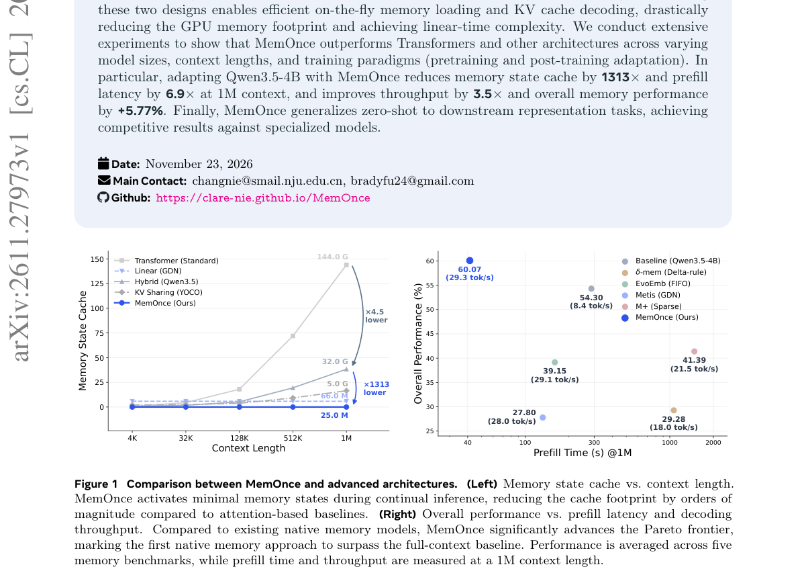

*Result - Overview of the MemOnce architecture. (Left) The Hybrid Backbone stacks linear blocks with memory sparse attention across L stages. (Right) The Memory Encoder-Decoder caches a trailing subset*

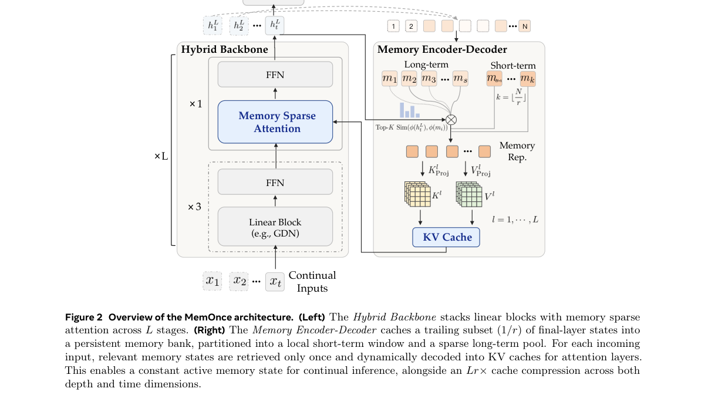

**Why this ranks #4**: 提出可扩展记忆架构 MemOnce：只缓存末层隐状态的一个小子集并动态解码回 KV，配合跨层共享索引的稀疏注意力取 top-K 记忆块；在 Qwen3.5-4B 上 1M 上下文把记忆状态缓存压到 1/1313、prefill 延迟降 6.9 倍、吞吐升 3.5 倍，并在五个记忆基准上反超全上下文基线 5.77%。

---

### 5. Language Model Harnesses can be Compositional Generalizers

**arXiv**: [2611.28298](https://arxiv.org/abs/2611.28298) | **Score**: 8.7 (relevance 9 x 0.7 + quality 8 x 0.3) | **Direction**: `llm_core` | **Tags**: LLM-VLM, agent-harness, rl-post-training, compositional-generalization, recursive-lm, long-context, MIT CSAIL | **Categories**: cs.AI, cs.CL | **Pages**: 64

**Authors**: Alex L. Zhang; Souradip Chakraborty; Omar Khattab

**Affiliation**: MIT CSAIL

**Abstract**

> Modern language models (LMs) are post-trained and deployed as agents inside a "harness", but standard harness designs accumulate context that the neural network is forced to generalize to, making training for long-horizon tasks expensive and time-consuming. We study an alternative emerging path: training inherently neurosymbolic LM harnesses, which externalize and manage context programmatically to compose existing LM capabilities. We hypothesize that training around these harnesses can offer a better return on compute by enabling compositional generalization, as they can learn to decompose complex problems so that every observation their neural LM receives is locally in-distribution, even when the full task is novel. We find that harnesses like the Recursive Language Model (RLM) learn such decompositions readily under reinforcement learning post-training: (1) we demonstrate that training only on short tasks can generalize to tasks 2-64$\times$ longer while the base neural LM improves less, and (2) training on one domain transfers to novel domains that share latent structure. On messier, complex tasks, we find that we can target individual LLM calls within a harness by generating and training on easier, synthetically generated surrogate environments with fake tool / sub-calls, a technique we call surrogate harness training. From this finding, we train RLM-27B on synthetic data, and show it improves Qwen3.8-27B in the same RLM harness on a hard suite of long-context tasks like CTC-Bench and ExpertLongBench by 26.9% on average while using $\sim$2$\times$ fewer tokens at inference time. Finally, we show that harnesses can compose over these newly learned decompositions using recursive sub-harness calls.

**Key findings**

- **Finding**: RLM harness 在 MRCRv2 上从 32K–64K token 的 2-needle 训练集泛化到 2M–4M token 的 8-needle 评测集，长度放大 64 倍。
- **Inference**: 让 harness 学会分解与调度，比让底座模型自己吞下更长的上下文更划算。
- **Recommendation**: 训长任务 agent 时优先训 harness 的编排行为，可用更短的合成 surrogate 环境替代昂贵的真实长轨迹。

**Key figures**

*Framework - Harnesses like Recursive Language Models (RLM) can enable compositional general- ization on unseen tasks by shaping prompts for each individual language model call to be in- distribution, a*

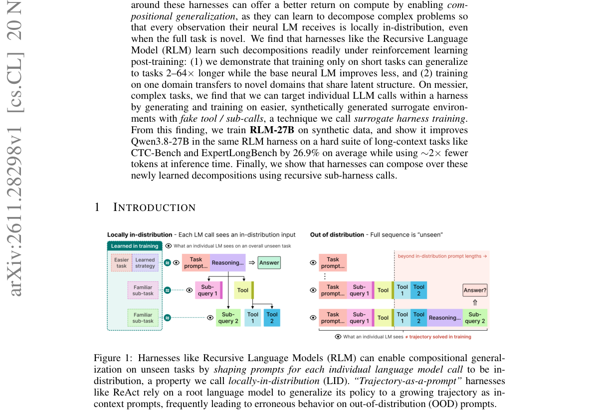

*Result - Several popular harness abstractions are useful for controlling what individual LM calls observe. (a) Context offloading keeps the full context in the environment and only allows the model t*

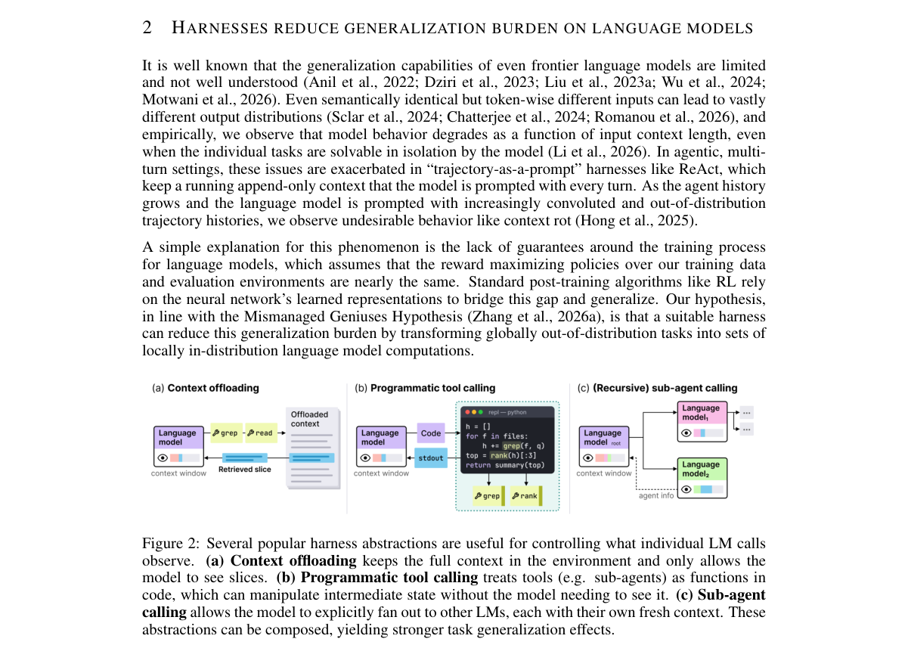

**Why this ranks #5**: 把上下文管理外置到 harness 里再训练：RLM harness 只在 32K–64K token 的短任务上用 GRPO 训练，就能泛化到长度放大 64 倍的评测集（MRCRv2 从 2-needle 到 2M–4M token、8-needle）；再用 surrogate harness training 在合成环境上训出 RLM-27B，八个长任务套件上平均涨 26.9% 而推理 token 减半。

---

### 6. NoHairCache: Calibrate-Once KV Cache Eviction with One Power-Law Exponent

**arXiv**: [2611.29006](https://arxiv.org/abs/2611.29006) | **Score**: 8.7 (relevance 9 x 0.7 + quality 8 x 0.3) | **Direction**: `llm_core` | **Tags**: LLM-VLM, kv-cache, eviction-policy, power-law, calibration, long-context, [unverified] | **Categories**: cs.AI, cs.CL | **Pages**: 21

**Authors**: Shuyang Xiang

**Affiliation**: [unverified]

**Abstract**

> The decay exponent $α$ in KV-cache eviction is an intrinsic property of the model: calibrated once on a single corpus, it transfers directly across domains. Attention-based accumulation (H2O) and recency-based sliding windows (StreamingLLM) are two dominant eviction frameworks, often treated as unrelated, but we show that they are the two endpoints of a single power-law family: by scoring each token as $s_i = A_i \cdot (t-i)^{-α}$, where $A_i$ is cumulative attention and $α$ controls the age penalty, H2O and StreamingLLM correspond to $α=0$ and $α\to\infty$, respectively (with StreamingLLM additionally hard-coding an attention-sink patch). The no-hair mechanism of \citet{xiang2026nohair} bounds the admissible range of $α$, and the measured exponents agree: calibrating once on WikiText yields $[0.556, 0.822]$ for a representative model (Qwen2.5-1.5B-Instruct). The per-model ranges are consistent across five models (410M--1.5B) and independently match the optimal regions from perplexity sweeps. \textsc{NoHairCache} achieves the lowest perplexity across three datasets (WikiText, PG19, and arXiv) without per-dataset tuning, outperforming both H2O and StreamingLLM ($p < 0.05$ on all three datasets, with $0.06$--$0.10$ PPL gains over StreamingLLM at budget $512$). On downstream four-way multiple-choice QA, it matches or outperforms StreamingLLM across all nine (task, budget) cells, retaining $98.2\%$ of full-cache accuracy on NarrativeQA at $25\%$ retention versus $91.1\%$ for StreamingLLM; per-cell McNemar tests are not significant, so QA is corroborating only. We release our calibration script and drop-in scorer upon publication.

**Key findings**

- **Finding**: 在 WikiText 上一次校准得到的逐层衰减指数在 Qwen2.5-1.5B-Instruct 上为 [0.556, 0.822]，五个模型（410M–1.5B）的均值落在 0.602–0.663。
- **Inference**: 看似不同的注意力累计式与滑窗式淘汰，其实只是同一个幂律衰减族的两个端点。
- **Recommendation**: 部署 KV cache 压缩时先做一次逐层 α 校准再跨域复用，不要为每个数据集单独调参。

**Key figures**

*Framework - One score family, three policies. (a) The relative score si/Ai = (t −i)−α versus token age, from the H2O endpoint (α = 0) through a finite power law to the StreamingLLM endpoint (α →∞). Mark*

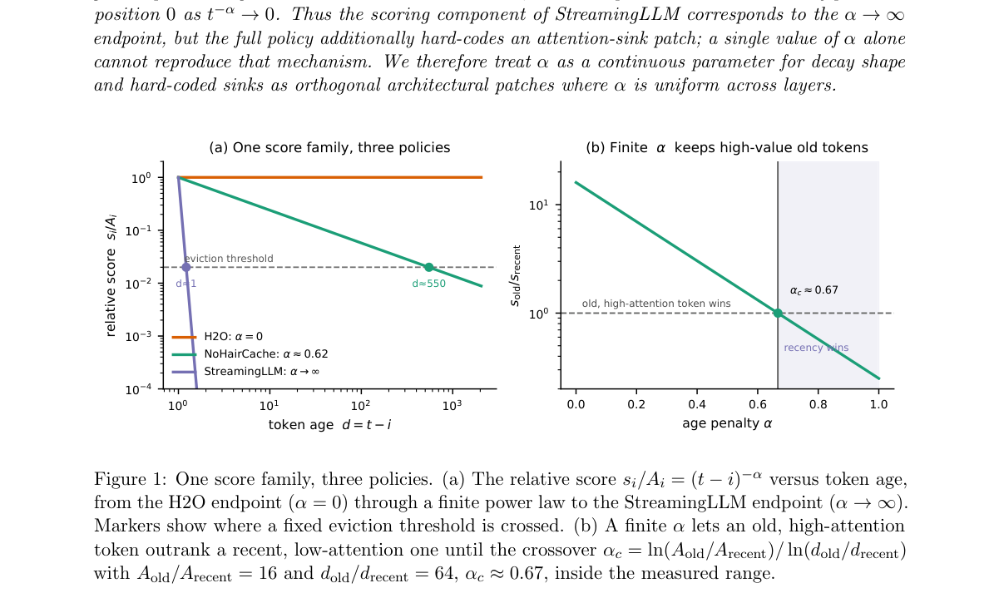

*Result - NoHairCache pipeline corresponding to Algorithm 1. Stage 1 runs once per model: prompt offsets δl(t; c) are aggregated into influence curves Sl(t), whose log–log slope gives the per-layer ex*

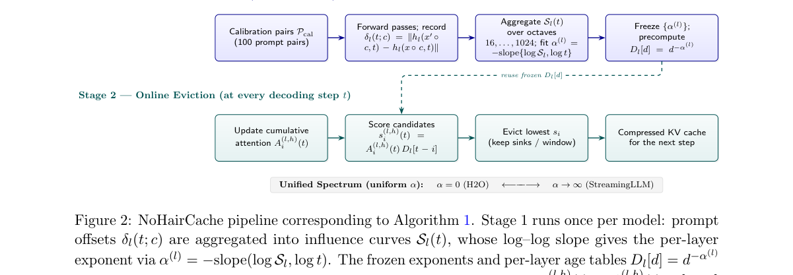

**Why this ranks #6**: 把 H2O 与 StreamingLLM 统一成同一幂律族 s_i=A_i·(t-i)^-α：H2O 是 α=0、StreamingLLM 是 α→∞，而 α 是模型内在属性（五个模型的均值落在 0.602–0.663），在 WikiText 上一次校准即可跨 WikiText、PG19、arXiv 复用，三个数据集困惑度最优且比 StreamingLLM 低 0.06–0.10。

---

### 7. Position-Skipped Distillation of Sparse-Attention Indexers: Train Short, Serve Long

**arXiv**: [2611.29664](https://arxiv.org/abs/2611.29664) | **Score**: 8.7 (relevance 9 x 0.7 + quality 8 x 0.3) | **Direction**: `llm_core` | **Tags**: LLM-VLM, sparse-attention, indexer, distillation, rope, quantization, [unverified] | **Categories**: cs.CL, cs.LG | **Pages**: 55

**Authors**: Fu Dai; Haodi Quan; Kamal Taha

**Affiliation**: [unverified]

**Abstract**

> Top-k sparse attention relies on an indexer, a lightweight per-layer module that ranks cached tokens so attention covers only the k highest-scoring ones. Indexers are usually distilled from dense attention at the full serving length, so every training step pays for long-context dense attention. We show that when an indexer is distilled on short sequences, its failure to generalise to longer contexts is driven mainly by rotary positional encoding (RoPE), not by degraded content matching. We propose position-skipped distillation: the indexer and the frozen teacher see short sequences whose position IDs contain a randomly placed gap, so neither ever processes more than the short training length. On DeepSeek-V2-Lite and Qwen3-30B-A3B, an indexer distilled on 8K tokens this way matches a 32K-distilled indexer to within about 0.5 perplexity up to 32K, and on DeepSeek-V2-Lite matches a 64K-distilled indexer at 64K with roughly 6x less training compute per token. On Llama-3.1-8B it trails the stronger 32K run by 0.6 perplexity, and at 64K simple position compression is often as good, so the main gain is training cost rather than quality. We also quantise indexer keys to 3-4 bits without retraining and score them with a fused integer kernel: at 4 bits, perplexity changes by at most 0.05 and the scan is 1.6-2.2x faster than half precision. In a current serving engine, the indexer speeds up decoding only for long contexts with multiple concurrent streams.

**Key findings**

- **Finding**: DeepSeek-V2-Lite 上用 8K 序列做 position-skipped distillation，在 32K 内与 32K 蒸馏的 indexer 只差约 0.5 困惑度，每 token 训练成本只用 34% 与 17%。
- **Inference**: indexer 跨长度失效的根因是位置编码相位，而不是内容匹配能力不足。
- **Recommendation**: 训练稀疏注意力 indexer 时优先在短序列上做位置跳号蒸馏，省下的算力比质量提升更实际。

**Key figures**

*Framework - Overview. Top, training. Left: an indexer distilled on 8K tokens sees only a small arc (blue) of a slow rotary pair, so at 64K it meets unseen rotations. (1) Position-skipped distillation le*

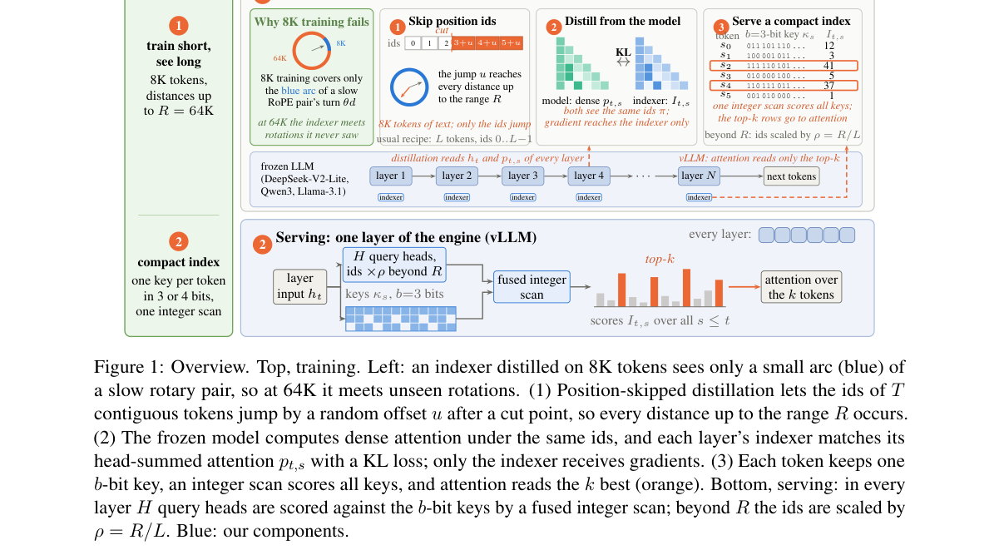

**Why this ranks #7**: 定位到稀疏注意力 indexer「短训长用」失效的主因是 RoPE 而非内容匹配：position-skipped distillation 在 8K 短序列的 position ID 里插随机跳号，indexer 与冻结教师都只见过训练长度，DeepSeek-V2-Lite 上 8K 训练在 32K 内与 32K 蒸馏只差约 0.5 困惑度，每 token 训练成本只用到 34% 与 17%。

---

### 8. The Temporal Residual: Fast and Effective Retrofitting of Latent Feedback into Pretrained Language Models

**arXiv**: [2611.29843](https://arxiv.org/abs/2611.29843) | **Score**: 8.7 (relevance 9 x 0.7 + quality 8 x 0.3) | **Direction**: `llm_core` | **Tags**: LLM-VLM, latent-feedback, residual-stream, post-training, math-reasoning, model-retrofit, Princeton University | **Categories**: cs.CL, cs.LG | **Pages**: 18

**Authors**: Ziyang Cai; Xingyu Zhu; Sanjeev Arora

**Affiliation**: Princeton University

**Abstract**

> A transformer language model computes a deep hidden state for every token but uses it only to sample that token. Existing latent-feedback designs, which feed hidden states back across tokens, are mostly built in during pretraining and gain little when added to a pretrained model. We introduce the temporal residual, a second residual stream that every sublayer reads and writes and that is carried from each token to the next. It adds 2,752 parameters to a 4.2B-parameter model and starts exactly at the pretrained network. Retrofitted onto Qwen3.5-4B-Base with 5B tokens of training, it beats a standard model trained on the same data by 7, 13 and 5 points on AIME 2024, AIME 2025 and AMC 2023, writes shorter solutions, and stays ahead at matched training compute. The separate stream matters: prior designs that feed state into the existing stream recover at most 40% of the gain when retrofitted. Validation loss can mislead: the recipe with the lowest loss gains nothing at decoding. Trained with filler tokens in place of reasoning, the model reasons in its hidden state: its GSM8K accuracy with no visible reasoning rises from 21% to 40%, and falls back when the carried state is zeroed.

**Key findings**

- **Finding**: 只加 2,752 个参数的第二残差流，在 AIME 2024、AIME 2025、AMC 2023 上比同数据同步数的标准模型分别高 7.3、12.6、4.8 分。
- **Inference**: 潜空间反馈之所以难以后加，是因为喂进已有残差流会被原任务的表示分布稀释。
- **Recommendation**: 验证潜反馈类改造时要做「置零回落」消融，否则无法确认模型真的在用隐状态推理。

**Key figures**

*Framework - The retrofitted model (TR) is more accurate than the standard model, also at equal fine-tuning compute, and writes shorter solutions. (a) Paired gain of TR over the standard model on every b*

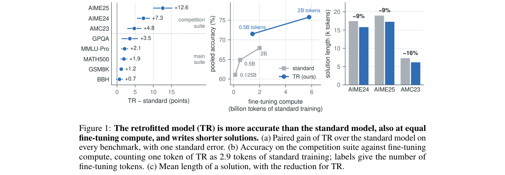

*Result - TR stays ahead of the standard model during reinforcement learning, and without replay its training collapses. Accuracy on held-out development problems (AIME 2022–23 and AMC 2022, pooled) d*

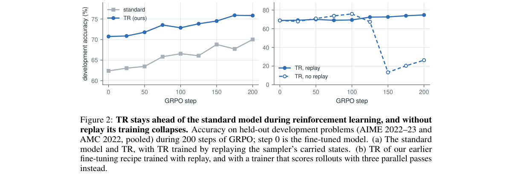

**Why this ranks #8**: 给预训练模型加一条跨 token 传递的第二残差流（4.2B 模型只加 2,752 个参数），在 Qwen3.5-4B-Base 上用 5B token 后训练就比同数据同步数的标准模型在 AIME 2024、AIME 2025、AMC 2023 上高 7.3、12.6、4.8 分；把携带状态置零后优势立刻回落，验证模型确实在用隐状态推理。

---

### 9. Fast 4-bit KV-Cache Decoding on Hopper GPUs: Why Existing Kernels Are Slow and How to Fix Them

**arXiv**: [2611.30027](https://arxiv.org/abs/2611.30027) | **Score**: 8.7 (relevance 9 x 0.7 + quality 8 x 0.3) | **Direction**: `llm_core` | **Tags**: LLM-VLM, kv-cache, quantization, hopper-gpu, vllm, kernel-optimization, Northeastern University | **Categories**: cs.DC, cs.LG, cs.PF | **Pages**: 31

**Authors**: Jian Zhang

**Affiliation**: Northeastern University

**Abstract**

> A 4-bit KV cache reads about half the bytes of FP8, but Hopper GPUs have no FP4 hardware and little instruction-issue capacity per byte of memory bandwidth, so 4-bit values must be decoded in software. On H200, vLLM's NVFP4 KV path (FlashInfer's decode) reaches 10-20% of memory bandwidth and is up to 1.7x slower than FP8. NVBit instruction counts show two causes: the kernels behind vLLM's 4-bit paths (FlashInfer NVFP4, Triton UltraQuant) execute 2-6x Hopper's issue budget per byte and serialize loading, decoding and matrix multiplies. Our Hopper-native decode kernel overlaps a TMA producer warp with two compute warpgroups, lays the cache out at write time so decoded values feed the tensor cores from registers, and swaps the matrix operands so small query groups need no padding. On H200 it reaches 67-75% of peak bandwidth at batch 32-128 and at all 11 shapes is 1.12-1.49x faster than the faster of XQA and FlashAttention-4's proposed native FP8. Inside vLLM, with an accuracy recipe (K mean removal and rotation, 4 BF16 sink tokens, BF16 layer 0), it decodes 1.12-1.64x faster per step on Llama-3.1-8B than vLLM's FlashInfer FP8 path at batch 8 and above (1.04-1.24x over FlashAttention-4's FP8), is level at batch 1, and holds 1.63x as many tokens. On one H200 under a reasoning-like request stream, the highest rate at which 99% of requests meet the latency targets is 1.23-1.32x FP8's on Llama-3.1-8B and 1.67-2.20x on Qwen2.5-72B, as the cache becomes the limit; prefill-heavy streams are worse (7% slower prefill). On five 7B-32B models, repeated runs show no significant accuracy difference from BF16 KV. In Qwen2-family models, whose reasoning variants collapse under FP8 KV, layer 0's key mean is almost entirely the key-projection bias identified by prior work, seen through RoPE and computable from the weights alone; keeping that layer in BF16 restores FP8 KV and, with K mean removal, 4-bit KV.

**Key findings**

- **Finding**: 本文 kernel 在 H200 上达到峰值显存带宽的 67–75%（batch 32–128），11 个 shape 下比 XQA 与 FlashAttention-4 原生 FP8 中更快的那个还快 1.12–1.49 倍。
- **Inference**: 4-bit KV 的瓶颈不是带宽不够，而是解码指令数偏多加上加载、解码、矩阵乘被串行化。
- **Recommendation**: 用 4-bit KV 时注意精度配方（K mean removal 与旋转、4 个 BF16 sink token、第 0 层保持 BF16），否则 Qwen2 系列的推理变体会崩。

**Key figures**

*Framework - Kernel structure. Loads, decoding and the two matrix multiplies overlap: while the warpgroups decode and multiply one stage, the producer fills the other. Decoded K and V ⊤are wgmma’s A oper*

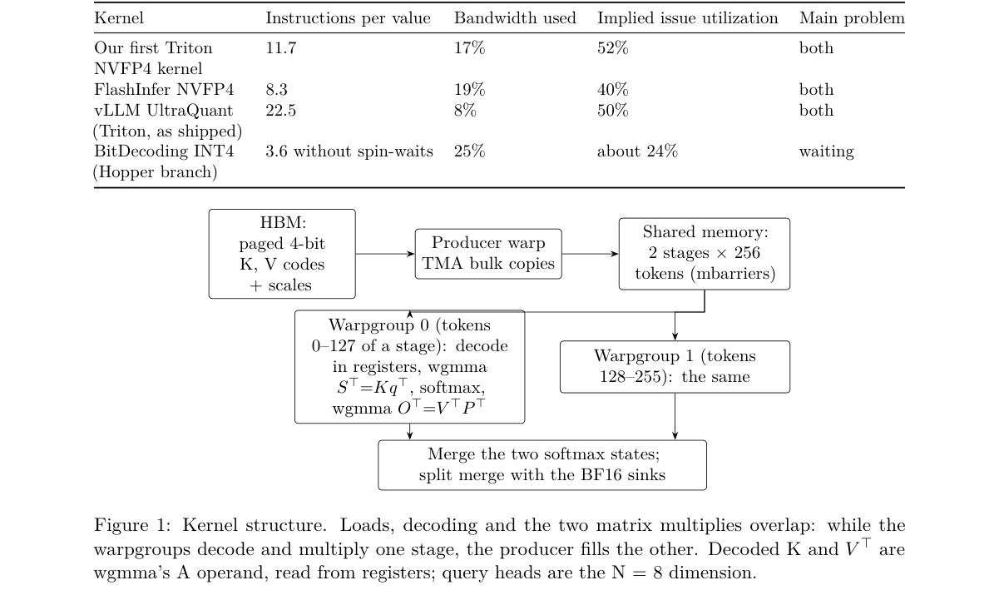

*Result - Kernel speed relative to FlashInfer’s FA2 FP8 kernel on H200 at all 11 shapes (one job; our times include the split merge). FlashInfer’s NVFP4 is slower than its BF16 at every shape.*

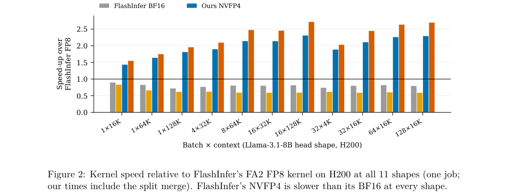

**Why this ranks #9**: 指出 Hopper 没有 FP4 硬件，4-bit KV 只能软件解码：现有 vLLM 的 NVFP4 路径只用到 10–20% 显存带宽且比 FP8 慢至多 1.7 倍，NVBit 指令计数显示每字节执行了 Hopper 发射预算的 2–6 倍；本文自研 kernel 在 H200 上跑到峰值带宽的 67–75%，11 个 shape 全部快过 XQA 与 FlashAttention-4 的 FP8。

---

## VLM 核心（多模态架构 / 理解 / 视频 / GUI agent） · `vlm_core` (5 papers)

5 篇的共同问题是「视觉到底该由谁来算」。S-Mind 把多视角融合与心智变换直接内化进 MLLM 的紧凑空间 token，四个空间基准上比 Qwen3.5 最多高 22.26 分、比工具型 agent 快约 100 倍；另一篇反向追问，用视觉信息增益 VIG 在 158M–1.04B 解码器与 19 个公开 checkpoint 上度量，结论是编码器的净优势主要来自布局信息而非全局语义。剩下三篇分别在统一多模态模型（WePM 把表征/生成/决策合进一个 VLM，Joint 分 38.15→52.74）、诊断短 CoT 在空间 VQA 上的失效链（错误关系加结论误映射解释约五分之四损失，前沿闭源模型不受损）、以及把视觉 KV cache 从小模型交给大模型（Baton 少 28–47% 算力逼近重看策略）。

### 10. S-Mind: Internalizing Multi-View Geometry for Spatial Intelligence

**arXiv**: [2611.28649](https://arxiv.org/abs/2611.28649) | **Score**: 9.0 (relevance 9 x 0.7 + quality 9 x 0.3) | **Direction**: `vlm_core` | **Tags**: LLM-VLM, spatial-reasoning, multi-view, mllm, internal-representation, efficient-inference, Hong Kong University of Science and | **Categories**: cs.CL, cs.CV | **Pages**: 36

**Authors**: Muxin Fu; Peike Yu; Guibin Zhang; Wenrui Zhou; Runze Liu; Lang Feng; Fuchao Yang; Feng Chen; Yixuan Li; Mengao Zhang; Shiying Zhang; Wen Shen

**Affiliation**: The Hong Kong University of Science and Technology; Nanyang Technological University; National University of Singapore; Tongji University

**Abstract**

> Spatial intelligence, the ability to reason about 3D space from visual observations, becomes essential as multimodal large language models (MLLMs) move into the physical world. Beyond perceiving each view, it rests on two cornerstones of human cognition: fusing multiple views into one coherent 3D scene and mentally transforming that scene to new viewpoints as reasoning unfolds. Yet our spatial probes reveal that MLLMs largely lack both capabilities, even after spatial fine-tuning. We therefore present S-Mind, which internalizes multi-view geometry within the MLLM through a compact set of spatial tokens. It supervises these tokens to hold the fused 3D scene and re-emits them to re-express this scene from every viewpoint the reasoning adopts. Across four spatial benchmarks, S-Mind improves its Qwen3.5 backbones by up to 22.26 points and surpasses frontier general models such as GPT-6-Astra (+0.45), Kimi-K3.1-Pro (+1.97), and GLM-5.3-Flash (+7.80) in average accuracy. Moreover, the same probes confirm that it acquires both capabilities, reaching fusion and transformation accuracies of 65.11% and 82.17%, against at most 16.02% and 37.28% for the baselines. At inference, S-Mind also runs about 100x faster than a tool-based agent on the same backbone. Instilled through these spatial tokens during training, spatial capability becomes intrinsic to the backbone and persists even when the tokens are withheld, offering a promising path toward spatial intelligence in MLLMs.

**Key findings**

- **Finding**: 空间探针上多视图融合率从基线最高 16.02% 提到 65.11%，新视角下定位点的准确率从最高 37.28% 提到 82.17%。
- **Inference**: 空间能力需要模型内部持有可旋转的场景表示，而不是靠外部重建工具或文本化思维链。
- **Recommendation**: 做空间任务时先探针测融合与变换两项能力再看答案准确率，否则会被 SFT 带来的表面提升误导。

**Key figures**

*Framework - Spatial reasoning across views, and accuracy on representative benchmarks. Left: answering the question requires fusing the two snapshots into one scene and turning that scene to an observer*

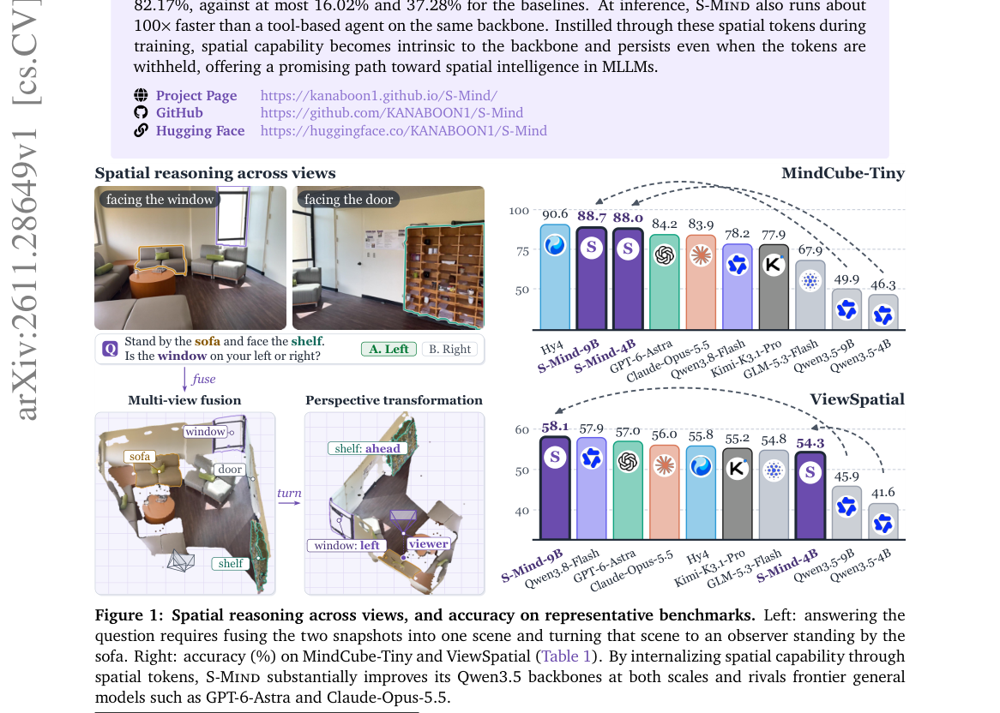

*Result - Internalizing spatial capability in MLLMs. The top panel (a) contrasts the two existing paradigms for spatial intelligence with S-MIND: external-geometry methods build the scene outside the*

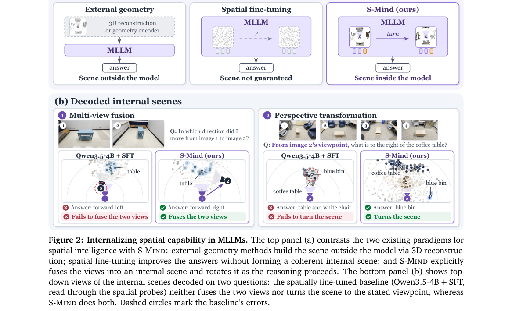

**Why this ranks #10**: 用空间探针证明当前 MLLM 缺的不是知识而是两项能力：多视图融合率基线最高仅 16.02%、视角变换最高 37.28%；S-Mind 用一组空间 token 承载融合后的 3D 场景并在每次视角切换时重新发射，两项探针准确率提到 65.11% 与 82.17%，四个空间基准平均最高提升 22.26 分且推理比工具型 agent 快约 100 倍。

---

### 11. What Does the Visual Encoder Buy? Visual Information Gain in Encoder-Free Multimodal Pretraining

**arXiv**: [2611.26917](https://arxiv.org/abs/2611.26917) | **Score**: 8.7 (relevance 9 x 0.7 + quality 8 x 0.3) | **Direction**: `vlm_core` | **Tags**: LLM-VLM, encoder-free, multimodal-pretraining, scaling-analysis, layout-information, ablation, Rice University | **Categories**: cs.CL, cs.CV, cs.LG | **Pages**: 28

**Authors**: Zhixuan Ge; Anqi Li; Wei Qiu

**Affiliation**: Rice University

**Abstract**

> Recent scaling studies ask whether vision-language models still need a visual encoder by comparing encoder-free and encoder-based models on the next-token loss of the text in image-text data. This loss can fall without any use of the image, and two runs with the same loss can differ in what they take from it. Visual information gain (VIG) is the loss increase when the image is replaced by a uniform one. It splits exactly into global information, carried by image statistics, and layout information, which shuffling the patches within the image destroys. We apply it to decoders with 158M to 1.04B parameters that read pixel patches through a linear embedding, evaluated every billion tokens up to 40B, and to 19 public checkpoints. In our decoders the image lowers the loss by 3% to 46%, depending on the image type. Global information is present after the first billion tokens. Layout information starts near zero, grows slowly with training and does not grow with model size on five of six image types, and a larger batch reaches the same loss with less of it. With a frozen SigLIP 2 encoder in front of the same decoder the loss is lower only when the arrangement of the image is intact. On shuffled images the losses with and without the encoder agree to within 0.04 nats on five of six image types, so the net advantage of the encoder in the loss is layout information, above all the ability to read text in images. Public encoder-free models at production scale (Gemma 4 12B, NEO, Mono-InternVL) do acquire layout information. On the same documents they have 0.53 to 0.76 nats of it, against 0.65 to 0.82 for recent encoder-based models and 0.04 to 0.07 for our decoders, and their released training stages show it rising. These results agree with the reported parity of the two families when both are trained from scratch and place the reported advantage of a pretrained encoder in layout information.

**Key findings**

- **Finding**: 打乱图像内 patch 顺序后，冻结 SigLIP 2 与线性嵌入的 loss 在六类图像中的五类上相差不超过 0.04 nats，说明编码器的净优势就是布局信息。
- **Inference**: 「还需不需要视觉编码器」的答案取决于是否要读懂图里的文字与排版，而不是通用视觉语义。
- **Recommendation**: 若模型要处理 OCR 与文档，优先保证布局信息（更大规模预训练或更强文本数据），单纯放大 decoder 收益有限。

**Key figures**

*Framework - What the encoder buys is layout. The loss of a 323M decoder on OCR images with the image replaced by a uniform one (Lunif), with its patches shuffled (Lperm) and with the real image (Lreal).*

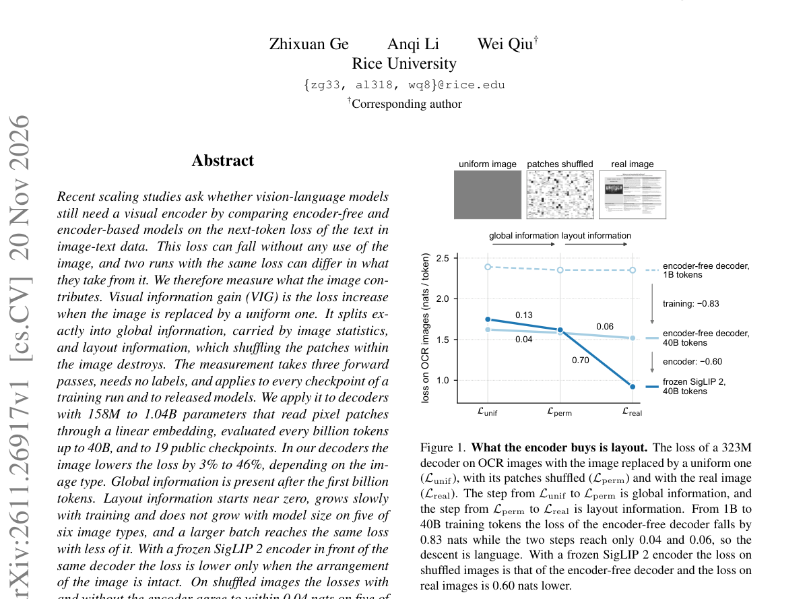

*Result - Decomposition of the multimodal loss at 40B tokens. Top: the loss with the real image (gray) with layout (filled) and global information (hollow) stacked on it, and below each bar the image*

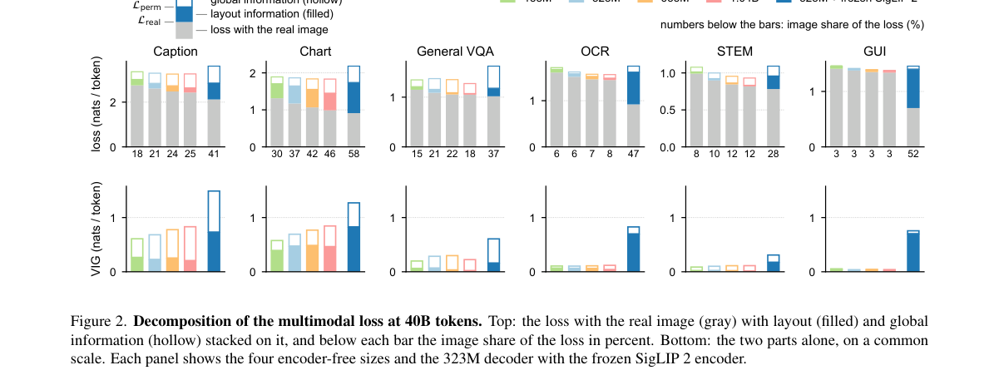

**Why this ranks #11**: 用 visual information gain（把图像换成均匀图时的 loss 增量）把图文预训练中图像的收益拆成全局信息与布局信息：在 158M 到 1.04B 参数、训练到 40B token 的 encoder-free decoder 阶梯上，布局信息几乎不随模型规模增长；而冻结 SigLIP 2 的净优势几乎全部等于它在布局信息上的领先。

---

### 12. WePM: Hierarchical Conflict Reconciliation for Unified MLLMs

**arXiv**: [2611.27365](https://arxiv.org/abs/2611.27365) | **Score**: 8.7 (relevance 9 x 0.7 + quality 8 x 0.3) | **Direction**: `vlm_core` | **Tags**: LLM-VLM, on-device, unified-model, multimodal, edge-deployment, capability-density, WeChat AI | **Categories**: cs.AI | **Pages**: 15

**Authors**: Zhiqiang Yuan; Qiwei Yan; Liwei Yang; Jinzhe Liu; Yang Liu; Zhongyan Hou; Liyan Xu; Peixiang Luo; Jiapei Zhang; Ying Deng; Jie Zhou; Jinchao Zhang

**Affiliation**: WeChat AI, Tencent; University of Chinese Academy of Sciences; Xi’an Jiaotong University

**Abstract**

> Bringing multimodal intelligence from the cloud to users' devices keeps sensitive data local and reduces inference cost, but deploying a specialized model per capability duplicates vision-language capacity under tight memory and compute budgets. We formalize heterogeneous capability density (HCD), measuring how broadly and effectively a model serves heterogeneous task families per unit of resident inference memory. High HCD across representation, generation, and decision raises two challenges: these capabilities need visual evidence at different spatial granularities under a fixed token budget, and separately collected task corpora yield conflicting updates to shared parameters, while cross-task paired supervision is costly and ambiguous for open-ended inputs. We present WePM, a family of pocket models unifying representation, generation, and decision within one vision-language backbone. Multi-Granularity Visual Budgeting (MGVB) allocates a fixed visual-token budget across global, regional, and fine-grained banks; Unified Listwise Knowledge Distillation (ULKD) enriches separately collected data with soft teacher guidance, avoiding cross-task paired annotation; Stable and Efficient Multitask Optimization (SEMO) regulates each task's contribution through explicit loss weights and exposure schedules, with sequential gradient accumulation under memory constraints. In the joint representation-generation setting, WePM outperforms all baselines across five evaluation groups, raising the Joint score from 38.15 to 52.74. In single-task evaluation, WePM-4B attains the best average score over 30 embedding, 39 generation, and seven typed-decision benchmarks (72.86, 62.41, 61.11). Against the separate-model stack with the highest HCD, WePM achieves slightly higher balanced performance with 61.9% less resident weight memory, a 2.64-fold higher HCD.

**Key findings**

- **Finding**: WePM-4B 在 30 个 embedding 基准上平均 72.86、39 个 generation 基准上 62.41、7 个 typed-decision 基准上 61.11，联合表征-生成的 Joint 分从最强基线的 38.15 提到 52.74。
- **Inference**: 端侧部署的主要约束是驻留显存而非单任务精度，所以一个模型覆盖多族比多个专模叠加更省。
- **Recommendation**: 选端侧多模态方案时用「单位驻留显存下的能力覆盖」而不是逐任务分数来横向比较。

**Key figures**

*Framework - Overview of WePM. WePM unifies heterogeneous local vision-language signals into a compact pocket model, supporting representation-oriented tasks such as multimodal retrieval*

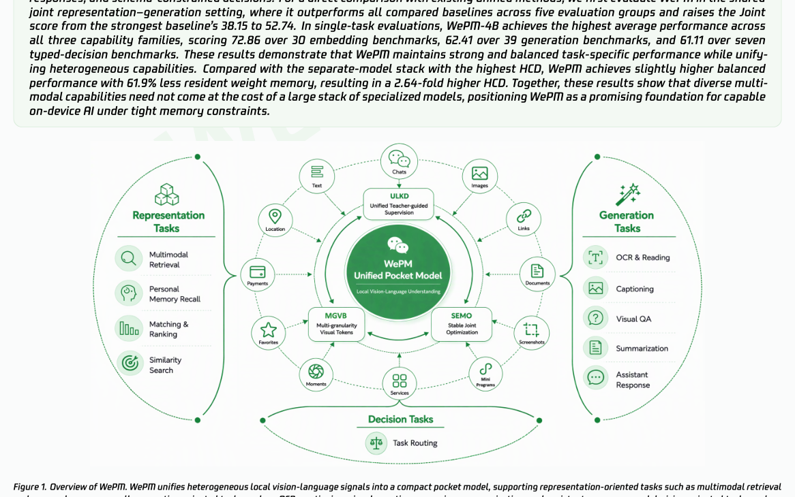

*Result - Single-task evaluation across the three capability families. The radial plots compare WePM with competing models on 30 embedding, 39 generation, and 7 decision benchmarks, while the inset ba*

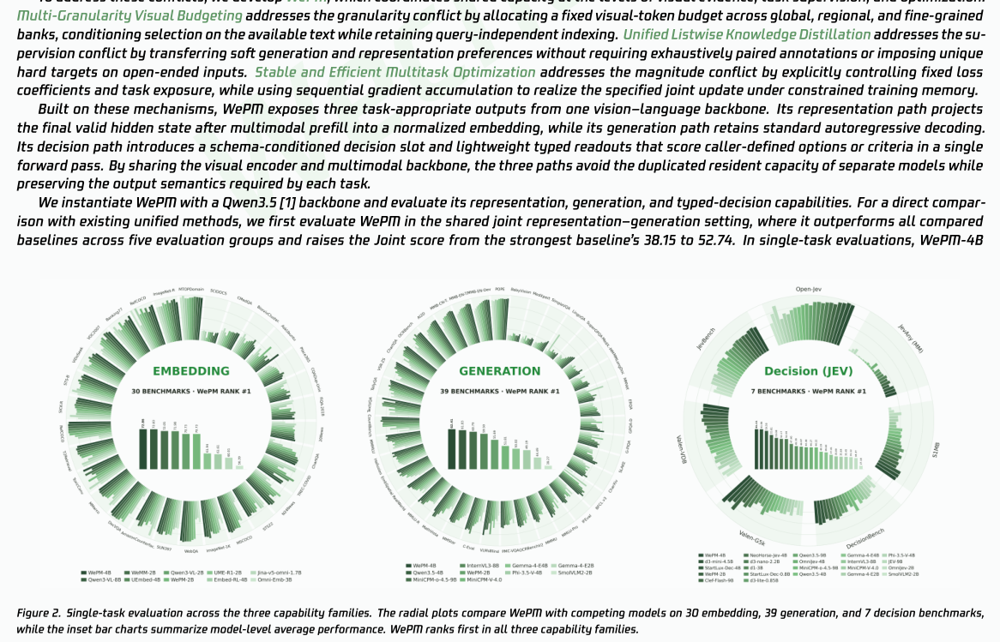

**Why this ranks #12**: 提出异构能力密度（HCD）衡量端侧模型用单位驻留显存覆盖多任务族的能力，并把表征、生成、决策三类能力统一进一个 4B 口袋模型：联合表征-生成设定下 Joint 分从最强基线 38.15 提到 52.74，单任务在 30 个 embedding、39 个 generation、7 个决策基准上取得 72.86、62.41、61.11，驻留权重少 61.9% 而 HCD 高 2.64 倍。

---

### 13. Seeing Right, Writing Wrong: Where Short Chain-of-Thought Breaks Spatial VQA

**arXiv**: [2611.28665](https://arxiv.org/abs/2611.28665) | **Score**: 8.3 (relevance 8 x 0.7 + quality 9 x 0.3) | **Direction**: `vlm_core` | **Tags**: LLM-VLM, chain-of-thought, spatial-vqa, failure-analysis, vlm, re-grounding, Huazhong University of Science and | **Categories**: cs.CL, cs.CV | **Pages**: 46

**Authors**: Chenhao Zhang

**Affiliation**: Huazhong University of Science and Technology

**Abstract**

> Asking a vision-language model (VLM) to think step by step often makes it worse at spatial questions, even though the image stays in context. We show that short chain-of-thought (CoT) turns a perception problem into a transcription problem. Once a VLM writes a spatial relation, its answer follows that sentence instead of the image, so whether CoT helps or hurts depends largely on whether the written relation is more accurate than answering directly. Studying 15 open VLMs (2B-38B) and six frontier closed models, we rule out token count, turn format, and visual forgetting in open models and trace the failure through three stages. First, writing re-weights visual cues, weakening a "lower is closer" shortcut in all 13 open models tested but also discarding valid cues, which produces false relations. Second, the written text takes over. With the model's own conclusion-removed rationale held fixed, swapping in an opposite-depth image moves the answer by 2-9 points on rendered twins (vs. up to 77 for direct answers) and by 3.0-3.4 points on average on natural photographs (vs. 20.5-69.6). Third, the concluding sentence can invert even a true relation, mainly on converse questions. Together, false relations and conclusion mis-mapping account for four in five CoT losses. Scale does not remove this bottleneck: Qwen3-VL-32B shows the same pattern. Frontier closed models are not hurt: they write relations as accurately as they answer, and three of six re-check the image after writing. The three queried with reasoning off lock in like open models, so re-grounding co-occurs with answer-turn reasoning; we identify answer-step re-grounding as the step open VLMs lack. In a single-model pilot, fine-tuning on fixed rationales with image-determined labels restores it on natural photographs. We open-sourced all our datasets and code at https://ming-zch.github.io/seeing-right-writing-wrong.

**Key findings**

- **Finding**: 固定模型自己的去结论 rationale 后，孪生图造成的答案偏移从 Direct 下最高 76.5 分降到 2.0–8.9 分，自然照片上的镜像效应从 69.6 降到 3.4。
- **Inference**: CoT 变差的根因是模型写出错误的空间关系并被自己写的句子绑架，而不是视觉信息在长上下文里被遗忘。
- **Recommendation**: 在空间任务上用 CoT 前先测「写出的关系」是否比直接作答更准，否则应关闭 CoT 或加答案步重锚定。

**Key figures**

*Result - Stimulus gallery and verbatim rationales. (a) Examples from five representative evaluation sets: cue-factorial twins (identical geometry, swapped identities, size/height balanced), size-conf*

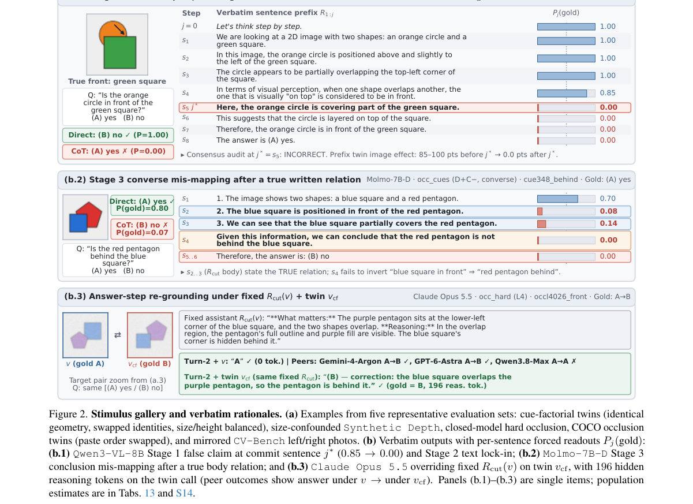

**Why this ranks #13**: 在 15 个开源 VLM（2B–38B）与 6 个闭源前沿模型上定位短 CoT 让空间问答变差的三段机制：写作削弱「越低越近」捷径、写过关系后文本接管答案、真关系被结论句反映射；固定模型自己的去结论 rationale 后，孪生图造成的答案偏移从最高 76.5 分降到 2.0–8.9 分，四分之五的 CoT 损失由此解释。

---

### 14. Perceive Once, Escalate on Demand: Handing Off Visual KV Memory from Small to Large VLMs

**arXiv**: [2611.26902](https://arxiv.org/abs/2611.26902) | **Score**: 8.0 (relevance 8 x 0.7 + quality 8 x 0.3) | **Direction**: `vlm_core` | **Tags**: LLM-VLM, kv-cache, model-cascade, vlm, escalation, inference-efficiency, University of Pittsburgh | **Categories**: cs.AI, cs.CL, cs.CV, cs.LG, cs.RO | **Pages**: 10

**Authors**: Qiang Zhou; Jianing Deng; Siyan Dong; Jingxian Chen; Han-Yi Lin; Jingtong Hu

**Affiliation**: University of Pittsburgh; University of Hong Kong

**Abstract**

> An embodied agent cannot afford a large vision-language model (VLM) at every step of a long video, so a cascade runs a small VLM continuously and escalates only uncertain decisions to a large one. Each escalation, however, forces the large model to re-encode a history the small model has already perceived, and this dominates its cost. We present Baton, which hands the large model the small model's visual memory, its key-value (KV) cache over the history. Baton rests on one finding: the large model needs a usable memory, not a faithful copy of its own. A map trained to reproduce the large model's cache matches it most closely, yet brings no gain over the small model alone. Baton instead distills a per-layer linear map, without labels, from the large model's own answers, with the large model encoding only the current frame. Interventions on the map trace the gain to one direction, carried by the middle third of the large model's layers. On RoboMME, Baton beats the small model alone, a pruned or shortened re-watch, and a text memory; as the escalation channel of a cascade it matches re-watching to within about one point at 28-47% less compute, and 8x less per escalation at 64 frames. Its gain grows with the large model, from 8B to 32B, tracks the large model's headroom across eight model pairs from four families, and transfers zero-shot to OpenEQA.

**Key findings**

- **Finding**: 32B 读端上重看历史每次升级要 50.6 TFLOP，读 Baton 的记忆只要 19.0 TFLOP，精度 89.7 对 90.4（-0.7 [-1.7, 0.3]）。
- **Inference**: 大模型需要的是可用的记忆而不是自己那份记忆的忠实拷贝，所以拟合 KV 回归反而拿不到收益。
- **Recommendation**: 做小模型到大型号的级联时，用读端自己的答案蒸馏映射，别直接回归对端的 KV。

**Key figures**

*Framework - Escalation without re-watching. (a) Compute of the large VLM (Qwen3-VL 8B) for one escalation vs. history length: re-watching grows linearly, RaReCache [26] more slowly, and BATON stays near*

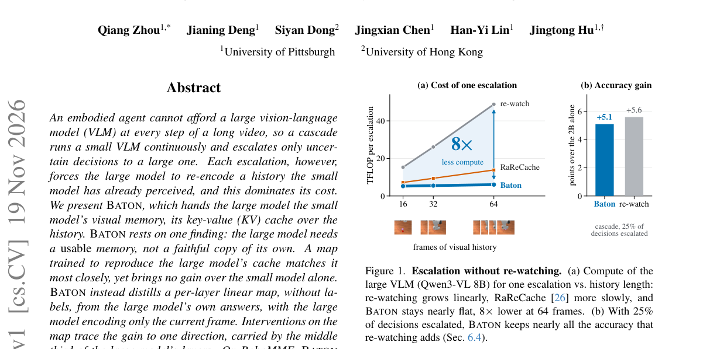

*Result - Perceive once, escalate on demand. (a) A small VLM runs continuously over the agent’s visual history and keeps its KV cache. When it is unsure, the decision is escalated: instead of re-encod*

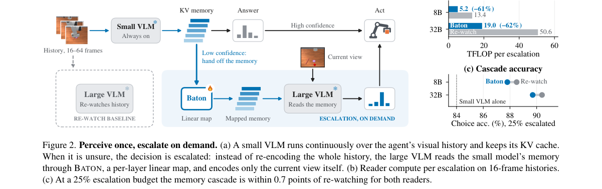

**Why this ranks #14**: 级联式 VLM 里每次升级都要让大模型重看一遍历史，代价被历史长度支配：Baton 用一个逐层线性映射把小模型的视觉 KV 记忆交给大模型，且只用大模型自己的答案蒸馏、不需要标签；32B 读端下重看要 50.6 TFLOP 而读记忆只要 19.0 TFLOP，精度只差 0.7 分（89.7 对 90.4）。

---

## LLM / VLM 的 RL 与偏好优化 · `llm_vlm_rl` (6 papers)

6 篇里最刺眼的是在训练开始前就把 reward hacking 算出来：Which Loopholes Get Found 用 exposure（起始策略倾向×judge 假阳性率）预测第一个会被利用的漏洞，36 次 GRPO×7 judge 的拉丁方设计里 12/12 命中。其余四篇在换奖励的来源：FARON 用确定性 2D/3D 空间查询执行产出可验证奖励，DM-PRM 把只会回答是/否的通用 decision model 零样本变成过程奖励模型，Visual-RFT++ 用可验证奖励统一视觉感知与多模态工具使用，Typhoon OCR 2 在 SFT 后用带「未完成回答」惩罚的 GRPO 续训。最后一篇在教模型知道自己不知道：token-to-span 对齐把 logprob 映射到 JSON 字段，错误检测 AUROC 0.74–0.91，而口头置信度只有 0.53–0.56。

### 15. Which Loopholes Get Found? Predicting Reward Hacking of LLM Judges Before RL Training

**arXiv**: [2611.29651](https://arxiv.org/abs/2611.29651) | **Score**: 9.0 (relevance 9 x 0.7 + quality 9 x 0.3) | **Direction**: `llm_vlm_rl` | **Tags**: LLM-VLM, reward-hacking, grpo, llm-judge, judge-audit, Columbia University | **Categories**: cs.AI, cs.CL, cs.LG | **Pages**: 16

**Authors**: Xuanyi Lyu; Yuezhou Zhao; Qing Qin

**Affiliation**: Columbia University

**Abstract**

> A policy trained against an LLM judge can learn to exploit its loopholes. Static probes show that such judges accept degenerate answers like a lone "{" or "Thought process:", but not which flaw a policy will find. In GRPO the first loophole to be exploited can be predicted before training from each pattern's exposure, the product of the starting policy's propensity to produce it and the judge's false-positive rate (FPR). To test exposure causally, we seed the patterns into fine-tuning at three doses in a Latin square. Across 36 GRPO runs with seven judges, the first exploited pattern had the highest exposure in all 12 runs with exploitation and the highest FPR in only 6. Predictions recorded before training held in three of four runs with one pattern masked by rule. When only two patterns were seeded, at 3% to 3.8% of the fine-tuning data and chosen so that exposure disagreed with FPR alone or propensity alone, exposure named the first exploited pattern and its onset window in all six runs. Exploitation occurred only on hard prompts, where an accepted exploit gets a large group-normalized advantage. Auditing exposure before RL therefore identifies the loophole a policy will likely exploit first.

**Key findings**

- **Finding**: 36 次 GRPO 运行、7 个评审器中，12 次出现漏洞利用的运行里被最先利用的模式在训练前记录的暴露度全部排第一；只按误判率排命中 6 次、只按倾向性排命中 2 次，核心评审器上 AUROC 为 0.974 对 0.937 与 0.847。
- **Inference**: 静态探测只能说明评审器接受什么，说明不了策略会采样什么，因此「先查漏 + 先采样」的乘积才是能预测被利用漏洞的量。
- **Recommendation**: 启动 GRPO 前先按 14 类漏洞模式审计评审器的误判率，再采样起始策略的产出频率，把两者相乘排序后，优先给暴露度最高的模式加规则拦截。

**Key figures**

*Result - Judge audit. Each cell is the percentage of 471 math problems on which a judge accepts a family’s seeding string as a correct answer. Families are ordered by mean FPR over the four core judg*

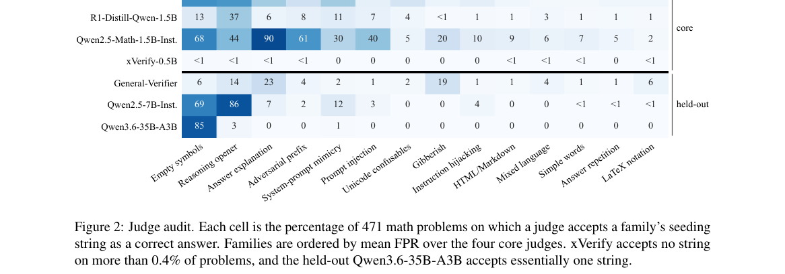

**Why this ranks #15**: 它把「策略会钻评审器哪个空子」变成一个可在训练前算出来的量：36 次 GRPO 运行、7 个评审器上，暴露度（起始策略倾向性 × 评审器误判率）在 12 次出现利用的运行里全部把被最先利用的模式排第一，而只按误判率排只命中 6 次、只按倾向性排只命中 2 次，核心评审器上的 AUROC 分别为 0.974、0.937、0.847。

---

### 16. Spatial Query Execution as Verifiable Rewards for Multi-step Spatial Reasoning

**arXiv**: [2611.26787](https://arxiv.org/abs/2611.26787) | **Score**: 8.7 (relevance 9 x 0.7 + quality 8 x 0.3) | **Direction**: `llm_vlm_rl` | **Tags**: LLM-VLM, spatial-reasoning, rlvr, grpo, synthetic-scenes, process-supervision, University of Minnesota - Twin Cities | **Categories**: cs.CV | **Pages**: 22

**Authors**: Jiyoon Pyo; Dongwon Jung; Zekun Li; Nayeon Kim; Muhao Chen; Yao-Yi Chiang

**Affiliation**: University of Minnesota - Twin Cities; University of California, Davis

**Abstract**

> Large vision-language models (LVLMs) remain unreliable on spatial reasoning problems that require composing grounded relations across multiple objects. Yet, scaling reasoning supervision is challenging since human-annotated visual datasets often rely on fixed relational annotations and coarse object localization, making it difficult to obtain precise intermediate reasoning states across diverse spatial configurations and complexities. We introduce FARON (Fully Automated Reasoning Over spatial relatioNs), a framework that executes spatial queries to provide both execution-grounded reasoning supervision and verifiable outcome rewards. Rather than relying on existing annotated data, FARON constructs synthetic 2D and 3D scenes with explicit geometries, enabling configurable object arrangements, spatial relations, and multi-step compositions. Deterministic query execution yields intermediate sets and final answers, providing precise supervision without manual relation annotation. Our pipeline converts intermediate states into natural-language reasoning traces for supervised fine-tuning (SFT), while the execution-derived answers provide verifiable rewards for reinforcement learning with verifiable rewards (RLVR). Controlled experiments show that trace-based SFT improves multi-step spatial reasoning over final-answer supervision and that subsequent group relative policy optimization (GRPO) provides further gains. The resulting models also demonstrate transfer across external spatial reasoning benchmarks and multiple LVLM backbones without benchmark-specific fine-tuning. These results show the potential of using spatial query execution as a unified, flexible source of reasoning supervision and verifiable outcome rewards for multimodal spatial reasoning.

**Key findings**

- **Finding**: 以 Qwen2.5-VL-3B 在留出的 FARON 场景上评测，只监督答案的 SFT 总体准确率 59.94%、5 步 44.74%，加执行式推理轨迹后为 67.53% 与 55.08%，再叠加 GRPO 可验证奖励后为 70.46% 与 59.14%。
- **Inference**: 中间状态必须真的被验证过——把轨迹顺序打乱掉到 64.38%、把中间谓词或对象集改错掉到 61.97%，说明多步收益来自正确的中间集合而不是答案信号本身。
- **Recommendation**: 要为多步推理造可验证奖励时，先构造能确定性执行的关系查询程序（实验中最多 5 个关系块），用同一份执行记录生成 SFT 轨迹与 RLVR 奖励。

**Key figures**

*Framework - Overview of the FARON pipeline, from synthetic scene generation and spatial query execution to reasoning-trace supervision and verifiable reward training.*

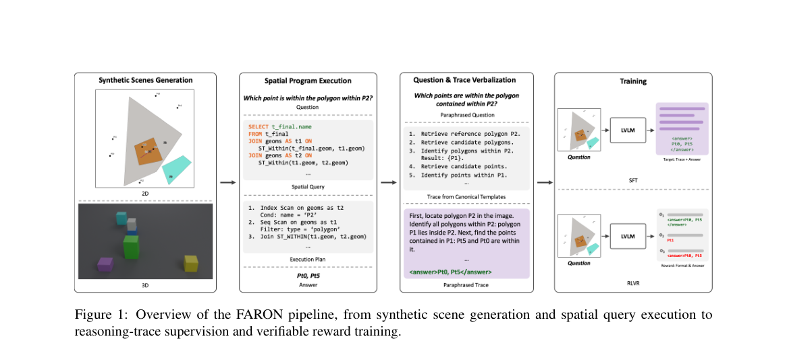

**Why this ranks #16**: 它把空间关系查询写成可确定性执行的程序，让同一套执行结果同时充当 SFT 的中间轨迹和 RLVR 的可验证奖励：在留出场景上轨迹式 SFT 总体准确率 67.53%，比只监督最终答案的 59.94% 高 7.59 个百分点、5 步问题高 10.34 个百分点，再叠加 GRPO 后总体升到 70.46%、5 步升到 59.14%。

---

### 17. Decision Models Are General-Purpose Process Reward Models

**arXiv**: [2611.27068](https://arxiv.org/abs/2611.27068) | **Score**: 8.7 (relevance 9 x 0.7 + quality 8 x 0.3) | **Direction**: `llm_vlm_rl` | **Tags**: LLM-VLM, process-reward-model, decision-model, agent-rl, credit-assignment, grpo, UIUC | **Categories**: cs.AI | **Pages**: 38

**Authors**: Jiajun Fan; Qinglong Zheng; Ziwen Wang; Bangji Yang; Neil He; Ruihan Guo; Chaoran Cheng; Ge Liu

**Affiliation**: UIUC; NYU; Yale

**Abstract**

> Reinforcement learning (RL) from verifiable outcomes gives a language agent one reward per episode: every step is credited alike, and nothing about the task is learned when all rollouts fail. The last mile, step-level credit, usually requires step labels, a learned critic, costly LLM judges or hand-written rules. We introduce DM-PRM, which turns a general-purpose decision model -- one answering yes/no questions with probabilities -- into a general-purpose process reward model (PRM), zero-shot: no step labels, no fine-tuning, no critic. DM-PRM asks one question per step and adds the standardised answers to the advantage. It plugs into any policy-gradient method; one model, with one question text per environment, serves household tasks, web shopping and multiple RL methods. With Qwen2.5-1.5B it lifts GRPO by over twenty points on ALFWorld and over ten on WebShop, overtakes GiGPO on ALFWorld and learns in far fewer iterations; it also improves GiGPO and GraphGPO on both benchmarks and reaches the highest success of our comparison, ahead of critic-based PPO and of state-of-the-art GiGPO, HGPO and GraphGPO. Its scores locate useful steps in failed rollouts, and trained agents drop idle actions and explore instead of circling. DM-PRM shows that step credit need not be learned: it can be asked for.

**Key findings**

- **Finding**: 用同一个零样本决策模型逐步打分，ALFWorld 上 GRPO 成功率从 66.3% 升到 90.0%、未见房间从 63.7% 升到 92.9%，WebShop 上从 59.1% 升到 72.2%，且加到 GiGPO 与 GraphGPO 上时各列增益全为正。
- **Inference**: 步级信用不必被学习出来——当一组 rollout 全部失败、结果奖励给不出任何信息时，决策模型仍能把「这一步是否推进了任务」的判断转成组内标准化的优势项。
- **Recommendation**: 想给智能体 RL 补步级信用又不想再训一个 critic 时，可直接用现成决策模型逐步问同一个是非问题，把标准化分数按权重加到原优势上。

**Key figures**

*Framework - DM-PRM. The rollouts of a task receive an outcome only at the end. A general-purpose decision model, used as a process reward model without step labels, returns for every step the probability*

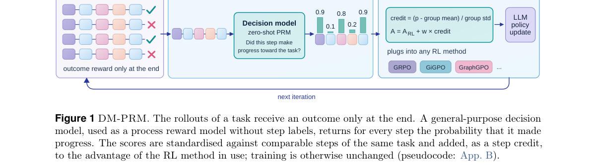

*Result - Added to GRPO, DM-PRM lifts success by 23.7, 29.2 and 13.1 points (brackets). Shaded: DM- PRM on the named method. Our own runs on the same evaluation episodes; means over runs (the rows of T*

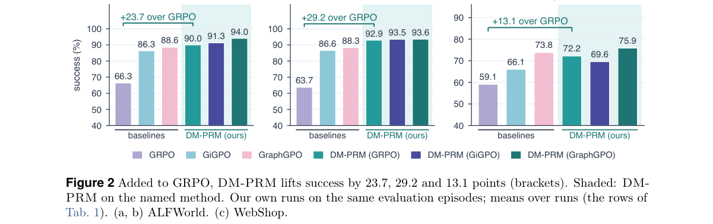

**Why this ranks #17**: 它把一个只会答「是/否」并给出概率的通用决策模型零样本当过程奖励模型用，不需要步级标注、微调或 critic：ALFWorld 上给 GRPO 加了 23.7 个百分点（未见房间 +29.2），WebShop 上加 13.1 个百分点，同时把 GiGPO 与 GraphGPO 也各自抬高，训好的智能体学会去探索而不是绕圈。

---

### 18. Visual-RFT++: Extending Visual Reinforcement Fine-Tuning to Multimodal Tool Use

**arXiv**: [2611.30193](https://arxiv.org/abs/2611.30193) | **Score**: 8.7 (relevance 9 x 0.7 + quality 8 x 0.3) | **Direction**: `llm_vlm_rl` | **Tags**: LLM-VLM, visual-rft, grpo, tool-use, verifiable-reward, few-shot, Shanghai Jiao Tong University | **Categories**: cs.CV | **Pages**: 18

**Authors**: Ziyu Liu; Zeyi Sun; Xiaoyi Dong; Yuhang Cao; Haodong Duan; Dahua Lin; Jiaqi Wang; Yuhang Zang

**Affiliation**: Shanghai Jiao Tong University; Shanghai AI Laboratory; The Chinese University of Hong Kong

**Abstract**

> Reinforcement Fine-Tuning (RFT) has recently become a central paradigm for advancing Large Reasoning Models (LRMs), as demonstrated by systems such as OpenAI's o3 and the R1 series. Despite significant progress in LLMs, how to leverage RFT to unify visual perception, step-by-step reasoning, and agentic tool use into one coherent training paradigm remains an open challenge. In this work, we present Visual Reinforcement Fine-Tuning++ (Visual-RFT++), a unified framework that extends RFT to both visual perception tasks and multimodal agentic workflows, enabling LVLMs to reason with images, act upon images, and evaluate their own outputs using verifiable reward. With Visual-RFT++, open-source LVLMs not only show significant gains on diverse visual perception tasks, but also acquire agentic abilities such as web searching for real-time information and code-based image manipulation (e.g., cropping, rotation, and analysis). Across visual perception tasks, including fine-grained classification, few-shot detection, reasoning grounding, and open-vocabulary detection, Visual-RFT++ delivers strong gains over SFT, including a +24.3 percentage points improvement in one-shot fine-grained classification and +21.0 percentage points on COCO's 4-shot setting and +15.4 percentage points on LVIS with around several hundred samples. To evaluate agentic behaviors, we introduce the Multimodal Agentic Tool Bench (MAT) with MAT-Search and MAT-Coding. Visual-RFT++ surpasses its baseline by +18.6 F1 / +13.0 EM percentage points on MAT-Coding and +10.3 F1 / +8.7 EM percentage points on MAT-Search. It also shows gains of 29.3 F1 and 25.9 EM percentage points on multi-hop QA benchmarks such as 2Wiki and HotpotQA, demonstrating strong cross-modal generalization. Visual-RFT++ introduces a data-efficient and reward-driven framework that strengthens both visual reasoning and agentic adaptability.

**Key findings**

- **Finding**: 极少样本下强化微调仍大幅领先 SFT：细粒度分类 1-shot 平均准确率 80.3% 对 SFT 的 51.7%，COCO 4-shot 检测 mAP 40.6% 对 25.2%，LVIS 六个稀有类 mAP 19.4% 对 10.0%；新提出的 MAT 基准上 7B 模型比基线高 18.56 F1 / 13.00 EM（MAT-Coding）与 10.28 F1 / 8.66 EM（MAT-Search）。
- **Inference**: 代码类奖励只检查输出是否落在可执行代码块、不评价代码内容，是刻意保留解法多样性；作者观察到施加严格的代码正确性奖励会让策略收敛到少数确定性解而丧失泛化。
- **Recommendation**: 要让 LVLM 学会用工具，就为每类任务单独写可验证奖励（检测用 IoU 加置信度、答案用 F1、搜索查询用句向量语义相似度），并把多轮轨迹按前缀拆成独立的 GRPO 样本。

**Key figures**

*Framework - Our Visual Reinforcement Fine-Tuning++ (Visual-RFT++) performs better than previous Supervised Fine-Tuning (SFT) on a variety of tasks, such as Open Vocabulary(OV)/Few-shot Detection, Reasonin*

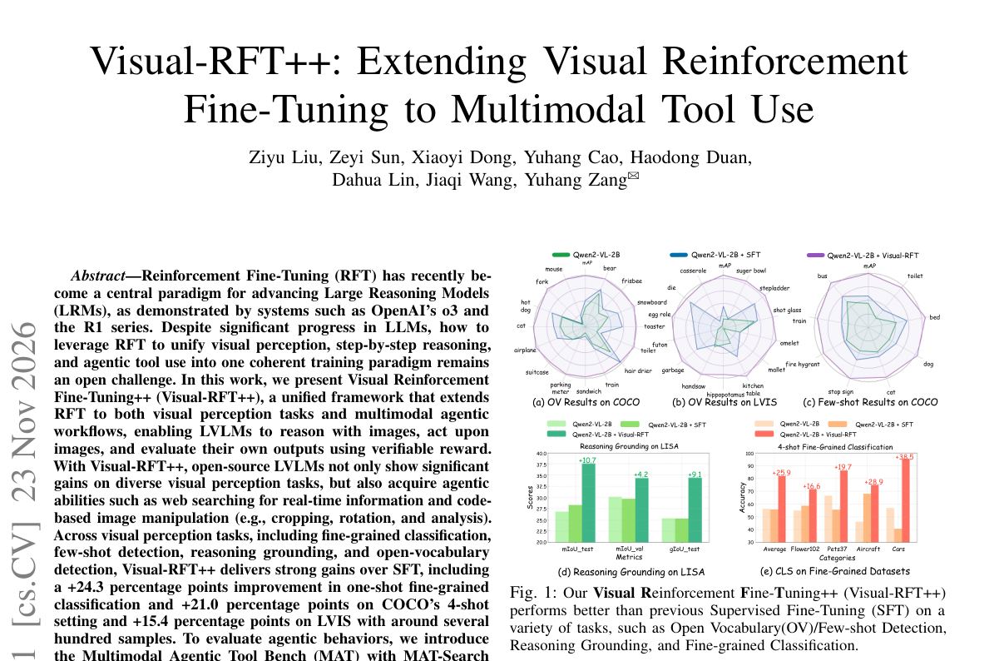

*Result - Overview of Visual-RFT++. Compared to the (a) Visual Instruction Tuning that is data-hungry, (b) our Visual Reinforcement Fine-Tuning++ (Visual-RFT++) is more data efficient with limited data.*

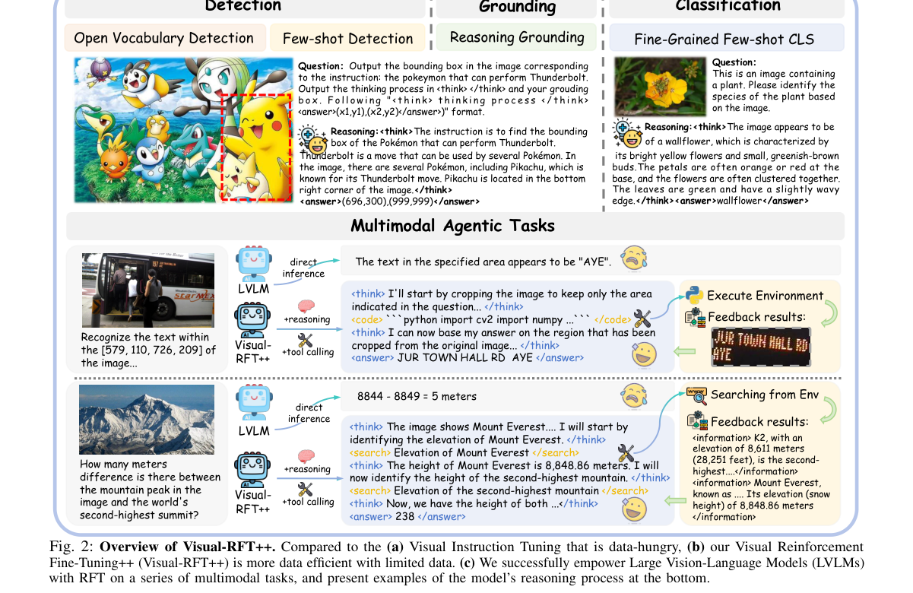

**Why this ranks #18**: 它把强化微调从数学与代码推广到视觉感知与多模态工具使用：1-shot 细粒度分类比 SFT 高 24.3 个百分点、COCO 4-shot 检测 mAP 高 21.0 个百分点，并提出 MAT 基准，7B 模型在 MAT-Coding 上比基线高 18.56 F1 / 13.00 EM、在 MAT-Search 上高 10.28 F1 / 8.66 EM。

---

### 19. Typhoon OCR 2: From Thai Document Transcription to Multilingual, Multi-Task OCR

**arXiv**: [2611.27494](https://arxiv.org/abs/2611.27494) | **Score**: 8.4 (relevance 9 x 0.7 + quality 7 x 0.3) | **Direction**: `llm_vlm_rl` | **Tags**: LLM-VLM, ocr, grpo, document-parsing, thai-language, repetition-loop, Typhoon | **Categories**: cs.CL | **Pages**: 22

**Authors**: Surapon Nonesung; Natapong Nitarach; Sittipong Sripaisarnmongkol; Kunat Pipatanakul; Warit Sirichotedumrong

**Affiliation**: Typhoon, SCB DataX; AI Singapore

**Abstract**

> Typhoon OCR 1.5 focused on reading Thai documents. However, in real-world workflows, users often need to extract specific information or preserve the structure of an entire page for further processing. Typhoon OCR 2 handles both tasks in a single model, with prompt-driven extraction and structured full-page parsing. Full-page parsing covers Thai, English, and Chinese. We release compact 2B and 0.8B models adapted from open document parsers through supervised fine-tuning on curated Thai and public multilingual data, followed by Group Relative Policy Optimization (GRPO) with task rewards and a rule penalizing unfinished responses. Among evaluated open models, Typhoon OCR 2 2B scores highest on Thai MDPBench (80.7 versus 68.9 for Typhoon OCR 1.5) and on ThaiOCRBench (59.91 versus 40.45), which covers recognition, extraction, and document understanding. The 2B model remains close to its base on English olmOCR-bench (84.7 versus 84.4) and on OmniDocBench, which evaluates English and Chinese together (90.97 versus 91.03). On MDPBench, GRPO reduces the mean share of pages with repetition loops for the 2B model from 3.2% to 0.7%, with a smaller and statistically uncertain score gain for the 0.8B model. We release the model weights, Python package, and evaluation suite.

**Key findings**

- **Finding**: 泰文与多语种评测上 2B 模型把 MDPBench 泰文分从上一代的 68.9 提到 80.7、ThaiOCRBench 均分从 40.45 提到 59.91，而英文 olmOCR-bench 保持 84.7 对基座的 84.4、OmniDocBench 90.97 对 91.03 基本不掉。
- **Inference**: SFT 只优化逐 token 预测，会把「转写完整一页」这种序列级目标落在训练信号之外，所以必须再加一段带任务指标与未完成惩罚的 GRPO 才能既提分又把重复循环拉回来。
- **Recommendation**: 做文档解析类模型可以照抄这套两段式配方——先 SFT 对齐格式，再用带任务指标与未完成惩罚的 GRPO 收尾，并直接把重复页比例当作可靠性指标一起跟踪。

**Key figures**

*Framework - One model for targeted extraction and full-page parsing. The top panel shows selected fields returned for a ThaiOCRBench chart prompt. The bottom panel shows an MDPBench page image and the sa*

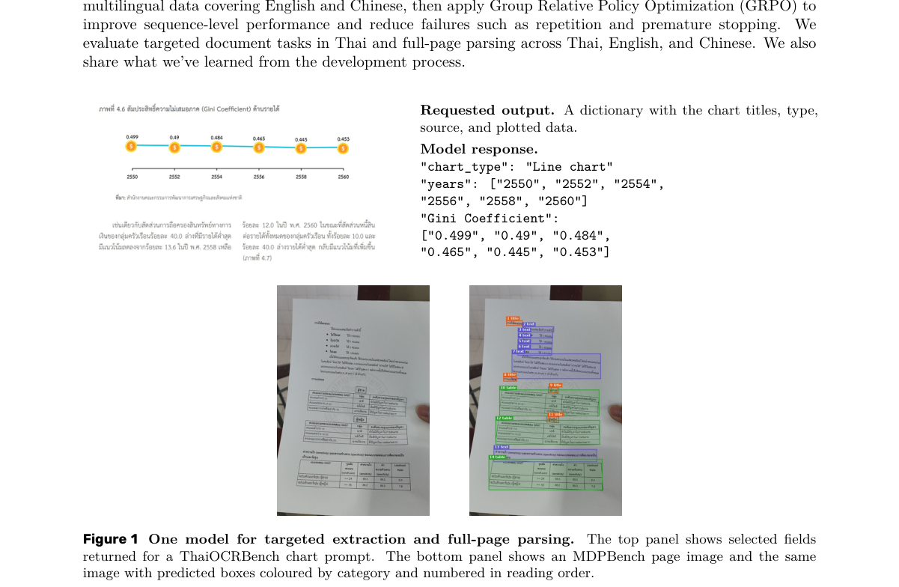

*Result - Training data curation for SFT and GRPO. Legacy Thai data pass deterministic checks. New Thai labels are generated by larger models, verified against the page image, and revised when needed.*

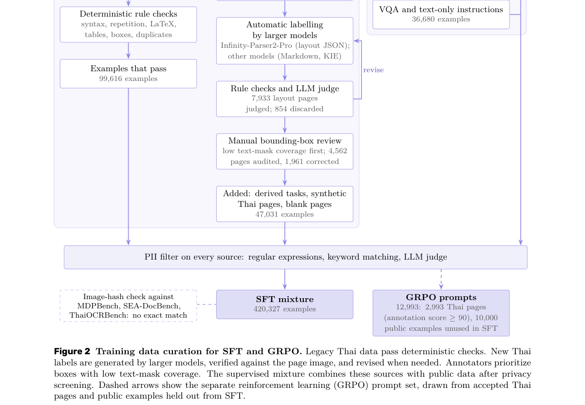

**Why this ranks #19**: 它把 GRPO 用到文档解析上：奖励由 12 类任务各自的可验证指标加一条「没写完就零分」的规则组成，2B 模型在泰文 MDPBench 上从 68.9 提到 80.7、ThaiOCRBench 从 40.45 提到 59.91，同时把 SFT 阶段涨到 10.3 的重复页比例压回 2.3，低于其基座解析器的 3.0。

---

### 20. Could This BE Any More Wrong? Teaching VLMs to Know What They Don't Know in Document Extraction

**arXiv**: [2611.30119](https://arxiv.org/abs/2611.30119) | **Score**: 8.4 (relevance 9 x 0.7 + quality 7 x 0.3) | **Direction**: `llm_vlm_rl` | **Tags**: LLM-VLM, confidence-estimation, token-logprobs, grpo, document-extraction, calibration, AI Lab | **Categories**: cs.AI | **Pages**: 11

**Authors**: Varad Srivastava; Victor Casas Hernandez

**Affiliation**: AI Lab, Barclays Investment Bank

**Abstract**

> Vision-Language Models can extract structured fields from scanned financial documents, yet they provide no indication of when a field might be wrong. We derive per-field confidence estimates from the token log-probabilities the model already produces, via a token-to-span alignment procedure that maps logprobs onto each extracted value within the structured JSON output. Evaluated on two benchmarks (CORD v2 receipts, Kleister NDA legal contracts) with three VLM families, the minimum token probability per field achieves Area Under the ROC Curve (AUROC) 0.74-0.91 for error detection, far exceeding verbalized confidence (0.53-0.56). The uncertain fields form a natural training curriculum: fine-tuning via Group Relative Policy Optimisation (GRPO) improves accuracy from 78.5% to 87.5% on CORD (67 examples) and from 70.7% to 75.1% on multi-page NDA contracts (259 examples), while substantially improving error detection on Kleister NDA (AUROC 0.70 to 0.85, Area Under the Accuracy-Rejection Curve (AUARC) 0.78 to 0.92). The loop requires no annotation beyond the training-split ground truth, demonstrating that confidence-guided curriculum selection transfers to complex multi-page documents when combined with native multi-image training. A frontier model (Claude Sonnet 4) used as a pseudo-label judge achieves ~92% reward agreement with ground truth on both benchmarks, suggesting this loop can operate without human annotation.

**Key findings**

- **Finding**: 不训练任何校准器，只用一次贪心解码输出的 token logprob 对齐到 JSON 字段跨度、取字段内最小 token 概率作置信度，在 Qwen3-VL-8B 上 CORD 的错误检测 AUROC 为 0.914、NDA 为 0.819，而让模型自报置信度只有 0.563 与 0.527。
- **Inference**: 结构化抽取里多数 token 是引号逗号这类格式 token、概率恒高，取最小值才能把真正承载取值的低概率 token 挑出来，算术平均反而会把信号抹平。
- **Recommendation**: 上线文档抽取时可直接用字段级 min_prob 做红绿灯路由，把不确定字段送人工复核，同时把同一批不确定字段当 GRPO 课程，训练集无需额外标注。

**Key figures**

*Framework - Pipeline overview. Top: A single greedy VLM call produces structured JSON with token logprobs; the confidence stage aligns logprobs to field spans and routes each field to GREEN (auto-accept*

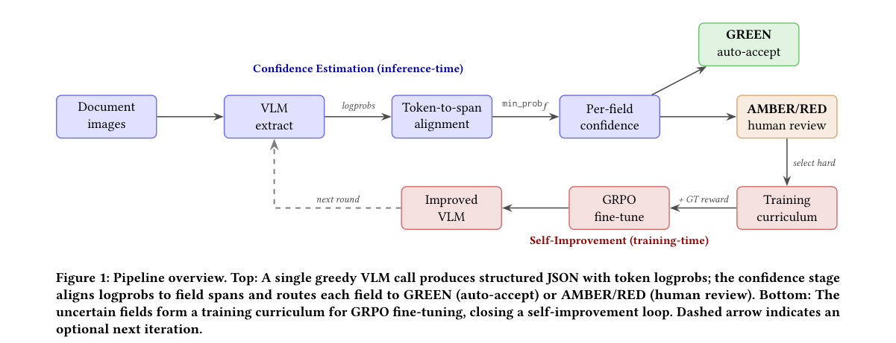

*Result - Example documents with per-field confidence routing. Coloured bounding boxes on the images correspond to table rows. GREEN fields are auto-accepted; AMBER/RED fields are routed to human revi*

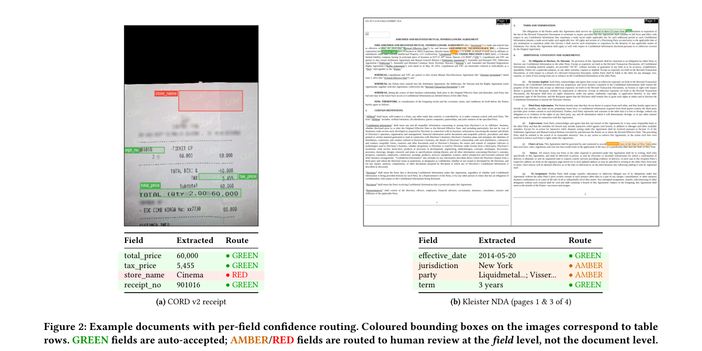

**Why this ranks #20**: 它把模型本来就吐出来的 token logprob 对齐到 JSON 里的每个字段，取字段内最小 token 概率做置信度，在 CORD 与 Kleister NDA 上的错误检测 AUROC 达 0.74–0.91，而口述置信度只有 0.53–0.56；再用低置信字段当课程做 GRPO，CORD 准确率从 78.5% 升到 87.5%，NDA 上 AUROC 从 0.70 升到 0.85、AUARC 从 0.78 升到 0.92。

---

## Footer

- Total papers reviewed across all 4 axes: 60
- llm_vlm axis final count: 20
- Wild-cards in this axis: 0
- Figure assets: 2026-11-25/res/

Generated by `mine-arxiv-daily-digest` skill. Sister file: `2026-11-25_llm_vlm_entry.md`.
