# Mine Arxiv Daily Digest - 2026-11-25 (具身智能与世界模型 Axis, 20 papers)

**Generated**: 2026-11-25 02:02 CST

**Source**: arXiv cs.CV, cs.SD, eess.AS, cs.CL, cs.AI, cs.RO, cs.LG, cs.IR submissions, listing day 2026-11-20,2026-11-21,2026-11-22,2026-11-23 (announced listing 11-20 于 2026-11-23 01:00 UTC、listing 11-21/11-22/11-23 于 2026-11-24 01:00 UTC 公告)

**Batch window**: 2026-11-19T19:00:00Z .. 2026-11-23T19:00:00Z（arXiv 公告批次窗口按 listing 日逐段相接：每段的起点是前一日的美东 14:00 截止时刻（EDT 为 18:00Z，EST 为 19:00Z），终点是当日同一时刻）

**Axis**: world_embodied (20 papers, base 15, cap 20)

**Directions**: world_model (11), embodied_ai (9)

**Selection**: 20 papers ranked by relevance x quality, with 0 wild-card slots

**Day total**: 60 papers across 4 axes (target 60)

**Scope**: 世界模型、学习型模拟器与具身智能，含移动操作、人形控制、触觉反射、VLA 策略与面向具身任务的强化学习

**Wild-card**: 0 篇 —— world_model 77 / embodied_ai 219 篇够格候选足以填满并顶到轴上限 20，本轮未启用任何 wild-card 补位名额；rel≥9 的落选是配额冲突而非选题不足。

本轴 20 篇撞到轴上限，结构与上一轮相反：这次是 world_model 自己就有 15 篇 rel≥9、embodied_ai 也有 15 篇，两个方向抢 20 个席位，最后落成 11 篇与 9 篇。代价是 10 篇 rel≥9 落选（world_model 4 篇、embodied_ai 6 篇），全部因为 AXIS_CAP = 20 是硬约束——这是最近几轮里 rel≥9 落选最多的一次。

---

## 世界模型与学习型模拟器 · `world_model` (11 papers)

11 篇的共同线索是「世界模型到底在建模什么」。Test-Time Training 把预测误差拆成共享偏移与动作相关项，发现 AdaJEPA 主要追共享偏移（单靠它就恢复 91% 规划增益）、跨回合携带校正有害，于是用快学习器加慢 LoRA 学习器拿到最高平均成功率；Fork-JEPA 从同一状态 fork 两个动作消去状态项以识别动作响应；Non-penetrating World Models 用冻结 DiT 隐状态上的小头判定候选动作会不会穿模，六个视频世界模型的物理违规率从 74% 降到 16%。另一半在改规划：SMC 隐空间规划比梯度规划高 29/50 个百分点，PACE-WM 并行预测未来表征在四个视觉规划任务平均 98%，MotionPort 用身体轨迹表示搜索空间，目标到达率从 37.9% 提到 87.8%。

### 1. What Test-Time Training Corrects in Latent World Models? A Slow-Fast Approach

**arXiv**: [2611.29453](https://arxiv.org/abs/2611.29453) | **Score**: 9.0 (relevance 9 x 0.7 + quality 9 x 0.3) | **Direction**: `world_model` | **Tags**: embodied, test-time-training, latent-world-model, jepa, planning-with-world-model, lora, Nanyang Technological University | **Categories**: cs.LG, cs.RO | **Pages**: 29

**Authors**: Shuaicheng Niu; Guohao Chen; Kevin Z. Shen; Yunbei Zhang; Peilin Zhao; Yinan Zhang; Cyril Leung

**Affiliation**: Nanyang Technological University; University of British Columbia; Tulane University; Shanghai Jiao Tong University

**Abstract**

> Latent world models plan toward a goal by predicting the outcomes of candidate actions, but under the distribution shift, prediction errors can lead the planner astray. Test-time training using executed actions helps, yet what it corrects and whether its updates should persist across episodes remains unclear. We address both by analyzing the world model's prediction error. On PushObj, an object-pushing task, we probe multiple actions from the same state and decompose the error into an offset shared across actions and an action-dependent component. The offset effectively shifts the planner's goal, and AdaJEPA mainly tracks it: the common shift alone recovers 91% of its planning gain. Part of the offset is episode-specific, so carrying its correction into the next episode does not help and may even hurt. The remaining offset recurs across episodes and action-dependent error can be or needs to be learned and retained from many episodes. Our sft-JEPA therefore uses two learners on different timescales: a fast learner that tracks the offset and resets each episode, and a slow LoRA learner that accumulates recurring knowledge across episodes. Across PushObj, PointMaze, zero-shot planning on RoboCasa (with DINO-WM), and OGBench (with LeWAM), sft-JEPA leads all benchmark averages, improving planning success over AdaJEPA by up to 22 points.

**Key findings**

- **Finding**: 在 PushObj 未见过的形状 I 上，冻结模型规划成功率 24.7%，AdaJEPA 提到 52.0%，只加 offset 的快学习器 48.7%，在 100 个回合上训过的 LoRA 慢学习器 55.3%，两者结合的 sft-JEPA@100 达到 77.3%；而沿用上一回合的 offset 会把成功率压到 16.0%。
- **Inference**: AdaJEPA 把 offset 能量压到冻结模型的 0.46 倍、动作相关项只降到 0.93 倍，说明它修正的是「目标整体偏移」而非「不同动作的效果差异」，这正是它能在分布偏移下稳住规划器的原因。
- **Recommendation**: 部署世界模型做在线适应时，先用「同一状态多动作」探针把误差拆成共享 offset 与动作相关项再决定要不要更新；只更新跨回合会复现的部分（用 LoRA 慢学习器），每回合特有的部分要用在线拟合的快学习器并在回合开始时重置，否则会把上一回合的偏移带进下一回合。

**Key figures**

*Framework - Two kinds of test-time prediction error. (a) Illustration with four action chunks from the current latent zt. Each prediction (dot) differs from the true outcome (ring) by an offset b shared*

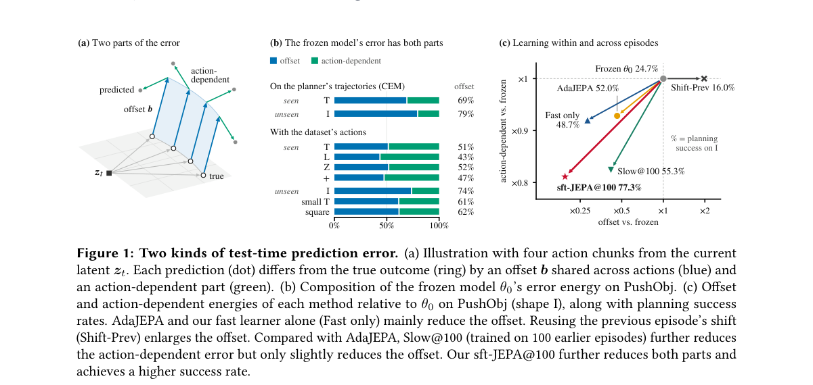

*Result - What each method fixes. Each dot is a probe state visited on the unseen PushObj shape I. Left/Down means a smaller offset/action-dependent error. Light gray dots show the frozen model θ0, th*

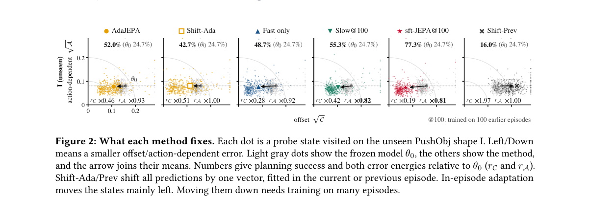

**Why this ranks #1**: 它入选 world_model 的理由是把「测试时训练到底修正了什么」拆成可测的误差分解：在 PushObj 上用同一状态探测多个动作，把潜空间预测误差拆成跨动作共享的 offset 与动作相关项，发现 AdaJEPA 主要在追 offset——把这个 offset 单独加回冻结模型就恢复了它 91% 的规划增益（28.3 点里的 25.7 点）；据此提出的 sft-JEPA 用「每回合重置的快学习器 + 累积跨回合知识的 LoRA 慢学习器」双时间尺度，在 PushObj、PointMaze、RoboCasa（DINO-WM）与 OGBench（LeWAM）四个基准上平均成功率都最高，比 AdaJEPA 高出 4 到 22 点。

---

### 2. Latent Space Planning with Sequential Monte Carlo

**arXiv**: [2611.26706](https://arxiv.org/abs/2611.26706) | **Score**: 8.7 (relevance 9 x 0.7 + quality 8 x 0.3) | **Direction**: `world_model` | **Tags**: embodied, sequential-monte-carlo, latent-planning, pde-cost-to-go, world-model-planning, mppi, Computer Science | **Categories**: cs.RO | **Pages**: 28

**Authors**: Hrishikesh Viswanath; Anindita Ghosh; Uttaran Bhattacharya; Aniket Bera

**Affiliation**: Department of Computer Science, Purdue University; Saarland University; Adobe Systems

**Abstract**

> Planning with learned world models amounts to finding action sequences whose predicted rollouts reach a goal. Sampling-based planners often struggle at longer horizons, while gradient-based methods can become trapped in local minima. Meanwhile, model predictive path integral control (MPPI), a complementary approach, alternates between estimating an expectation under a cost-weighted distribution from samples and updating the plan from this estimate. Its samples, however, are drawn afresh at every iteration from a Gaussian proposal and reach the target distribution only through importance weights. Moreover, a target distribution favoring goal-reaching trajectories can be difficult to define directly, motivating a sequence of intermediate distributions. Sequential Monte Carlo (SMC) provides a natural mechanism for evolving such a sequence through importance weighting and resampling. Motivated by this, we formulate latent-space planning as optimization guided by SMC, which moves a population of action sequences while a gradient-based optimizer updates the plan. Inspired by classical planning, we further introduce a PDE-derived cost-to-go that guides the evolution of the sample distribution using the structure of the latent state space. On navigation and manipulation tasks with visual and proprioceptive world models, our formulation outperforms gradient-based planners by $29$ and $50$, sampling-based planners by $35$ and MPPI by $7$ percentage points in average success rate, while succeeding in fewer iterations than gradient-based planners and within 4\% of MPPI.

**Key findings**

- **Finding**: 在十二个导航与操作设置上，该规划器平均成功率 79.8%，在 150 次迭代的固定预算下比 GD、GRASP、CEM、MPPI 分别高 28.8、49.8、34.5、7.4 个百分点。
- **Inference**: MPPI 每轮都从高斯提议重新采样、只靠重要性权重逼近目标，长时域上容易失焦；SMC 用重采样把权重集中到好粒子上、把目标分布写成中间分布序列，正好补上这个缺口。
- **Recommendation**: 用潜空间规划时先测两个对照：把成本换成 PDE 导出的 cost-to-go（本论文十二个设置里七个更好，其余五个差距在 8 个百分点以内），以及把「每轮重新采样」改成粒子跨迭代携带；确认收益来自哪一半再上系统。

**Key figures**

*Framework - Planning as sequential Monte Carlo over action sequences. Top: latents of DINO-WM (proprioceptive) and LeWM (visual), and a Point maze cost-to-go (star: goal). Bottom (schematic): at each it*

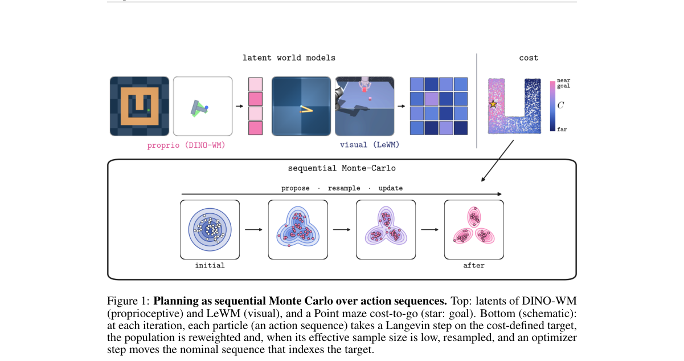

*Result - Point maze rollouts (H=10, seed 88) of our planner with 12 particles and of GD with 12 candidates. The run shown uses the estimator of Equation (26) and solves in 16 iterations; the planner*

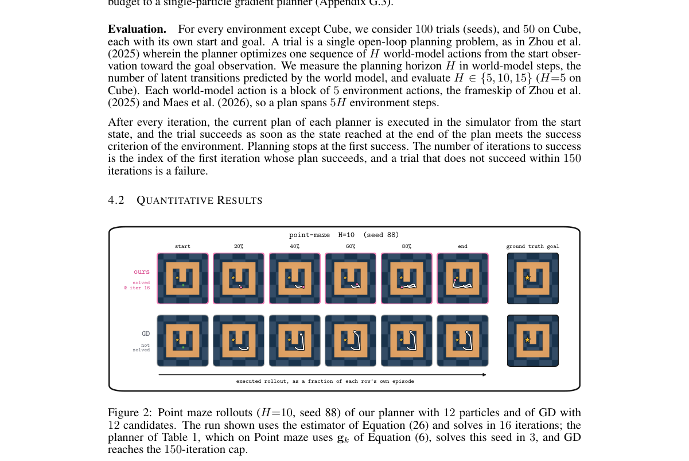

**Why this ranks #2**: 它在 world_model 里之所以排前面，是因为它把「潜空间规划」重写成 SMC 引导的优化，并用 PDE 导出的 cost-to-go 补上潜空间连通性结构：在十二个设置上平均成功率 79.8%，在 150 次迭代的固定预算下分别比梯度规划 GD、采样规划 GRASP、CEM 和 MPPI 高 28.8、49.8、34.5 和 7.4 个百分点，而且收敛所需迭代次数少于梯度法、与 MPPI 相差在 4% 以内。

---

### 3. SonoAtlasWorld: Anatomy-Grounded Ultrasound World Models for Wide-Range Scanning

**arXiv**: [2611.26867](https://arxiv.org/abs/2611.26867) | **Score**: 8.7 (relevance 9 x 0.7 + quality 8 x 0.3) | **Direction**: `world_model` | **Tags**: embodied, ultrasound-world-model, anatomy-grounded, causal-generator, long-rollout-alignment, policy-training-data, United Imaging Intelligence | **Categories**: cs.CV | **Pages**: 10

**Authors**: Zheyuan Zhang; Boris Mailhe; Hang Yu; Yikang Liu; Xiao Chen; Ankush Mukherjee; Terrence Chen; Shanhui Sun

**Affiliation**: United Imaging Intelligence

**Abstract**

> Learning robotic ultrasound policies requires interactive environments for scalable data generation and repeatable evaluation, while exploration on real patients is limited by acquisition costs and safety constraints. Generative world models offer an alternative, but image history and probe actions alone do not ensure anatomical consistency across wide-range scans and changing acoustic windows. We introduce SonoAtlasWorld, an ultrasound world model built on anatomy as state. A persistent 3D anatomical asset extracted from computed tomography (CT) anchors each scan to a specific anatomy. Probe actions determine anatomical and acoustic visibility conditions for a causal ultrasound generator trained on clinical videos. Our three-stage pipeline combines anatomy-conditioned pretraining, causal conversion and long-rollout alignment. Inference optimizations achieve pose-to-ultrasound throughput of 81.2 FPS. To evaluate anatomical control beyond image similarity, we introduce the Action-Following Index (AFI), which measures normalized reconstruction gain over a static-prefix baseline. On 40 held-out 3D volumes, SonoAtlasWorld achieves liver and macro-organ AFI of 0.428 and 0.262, compared with at most 0.117 and 0.038 for the tested action- and geometry-conditioned methods. Long-rollout alignment reduces brightness drift by 3.46x at the end of 40 repeated scan cycles. SonoAtlasWorld also generates offline policy-training demonstrations and supports anatomically grounded closed-loop evaluation. Scaling the generated training data improves key-plane acquisition success from 48.2% to 81.2% on unseen anatomies in simulation, demonstrating its utility for robotic ultrasound policy learning.

**Key findings**

- **Finding**: 在 40 个留出的 3D 体数据上，SonoAtlasWorld 的肝脏 AFI 为 0.428、宏观器官 AFI 为 0.262，而受测的动作条件与几何条件方法最高只有 0.117 和 0.038；长滚动对齐把 40 次重复扫查末端的亮度漂移压低 3.46 倍。
- **Inference**: 单纯的图像相似度指标无法区分「模型真的跟随探头动作改变解剖视角」和「模型只是重复了前缀图像」，所以必须用相对静态前缀基线的归一化增益来评价世界模型的可交互性。
- **Recommendation**: 给世界模型做动作跟随能力评测时，先定义一个静态前缀基线再报告归一化增益，而不是只报 PSNR/SSIM；这类医疗影像世界模型尤其要报多次重复扫查后的亮度漂移，否则短程指标会掩盖长程崩坏。

**Key figures**

*Framework - From probe motion to evolving ultrasound views. SonoAtlasWorld supports probe-controlled exploration of persistent 3D anatomy. Each row pairs rendered probe positions (left) with generated u*

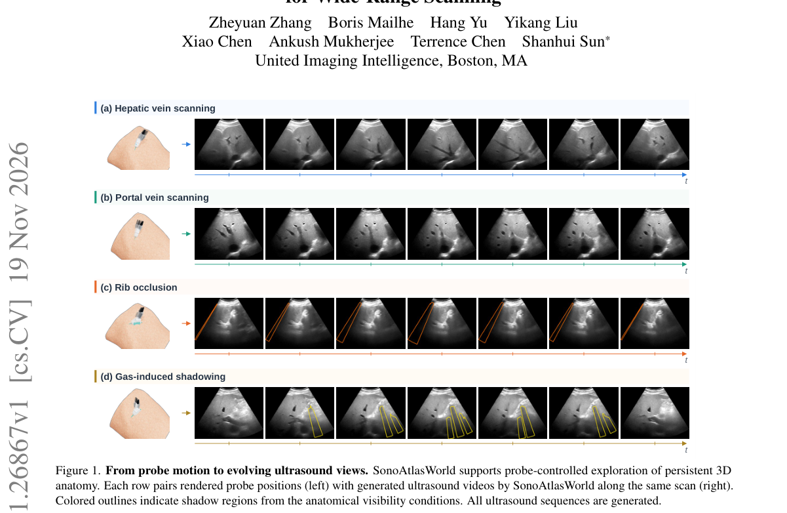

*Result - Overview of SonoAtlasWorld. (a) Five rendered poses illustrate interaction with one persistent scene. The final pose, anatomical rendering and generated observation share the same saved time*

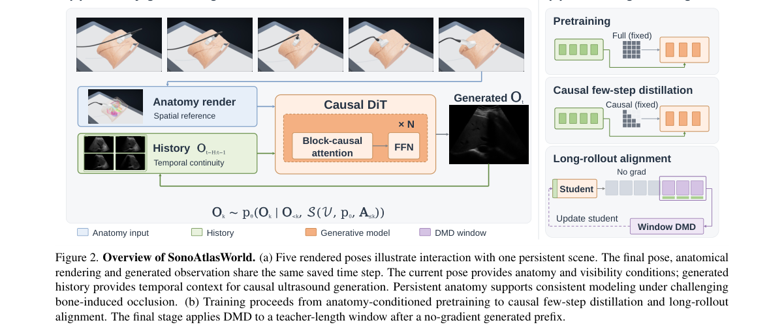

**Why this ranks #3**: 它是 world_model 里少见的非视觉域世界模型：把从 CT 提取的持久 3D 解剖结构当作世界状态，探头动作只决定解剖与声学可见性，从而在宽范围扫查中保持解剖一致性。为此提出 Action-Following Index 来衡量「动作是否真的改变了观测」：在 40 个留出体数据上，肝脏与宏观器官 AFI 分别为 0.428 和 0.262，而受测的动作条件与几何条件方法最高只有 0.117 和 0.038；长滚动对齐把 40 次重复扫查末端的亮度漂移压低 3.46 倍，生成数据还能把未见解剖上的关键切面获取成功率从 48.2% 提到 81.2%。

---

### 4. PACE-WM: Parallel World Modeling with Action History for Visual Planning

**arXiv**: [2611.27173](https://arxiv.org/abs/2611.27173) | **Score**: 8.7 (relevance 9 x 0.7 + quality 8 x 0.3) | **Direction**: `world_model` | **Tags**: embodied, parallel-world-model, action-memory, visual-planning, ramp-action-selection, jeepa, Nanjing University | **Categories**: cs.RO | **Pages**: 14

**Authors**: Haishan Liu; Shijie Lian; Bin Yu; Yao Zhang; Changti Wu; Fanping Liu; Jianzheng Liu; Lei Xie; Cong Huang; Kai Chen

**Affiliation**: Nanjing University; Zhongguancun Academy; Huazhong University of Science and Technology; Harbin Institute of Technology; Wuhan University

**Abstract**

> JEPA-style world models support visual planning by predicting future representations conditioned on future actions. However, similar observations can conceal different motion states, making temporal context essential for interpreting future action effects. We propose PACE-WM, a parallel world model that uses executed-action history to contextualize future prediction and planning. Specifically, PACE-WM maintains a recurrent memory of executed actions and uses this memory to condition a causal Transformer. PACE-WM predicts multiple future representations in parallel without recursive predicted-state feedback within each prediction window. We further introduce Reference-Anchored Minimum Progress (RAMP) for action selection during planning. RAMP scores candidate actions by their predicted goal improvement along direct and split paths relative to a shared reference. Across four visual planning tasks, PACE-WM with RAMP achieves an average success rate of $98\%$ and plans approximately $7$-$9\times$ faster than autoregressive LeWM under matched CEM settings. We also construct four controlled benchmarks to evaluate PACE-WM's capabilities in motion disambiguation, goal-relative motion, and goal adaptation. Project page is available at https://github.com/LHS180/PACE-WM.

**Key findings**

- **Finding**: 四个视觉规划任务上 PACE-WM 平均成功率 95.83%，加 RAMP 选动作后升到 98.00%；在匹配的 CEM 设置下规划速度约为自回归 LeWM 的 7 到 9 倍。
- **Inference**: 并行预测避免了自回归展开带来的串行前向开销，而已执行动作记忆补上了「同一画面、不同运动状态」所缺的时间上下文——两者分别对应规划的速度与正确性。
- **Recommendation**: 给 JEPA 式世界模型做视觉规划时，先确认规划器是否需要动作历史：当任务存在外观相同但运动状态不同的情形时，循环动作记忆比换更大的骨干更值得先加；选动作再叠加 RAMP 这类相对参考的最小进展打分，比单纯按预测距离到目标排序更稳。

**Key figures**

*Framework - Action history for parallel visual planning. Left: similar appearances conceal different motion directions or speeds. PACE- WM succeeds in both states of each pair, while each baseline fails*

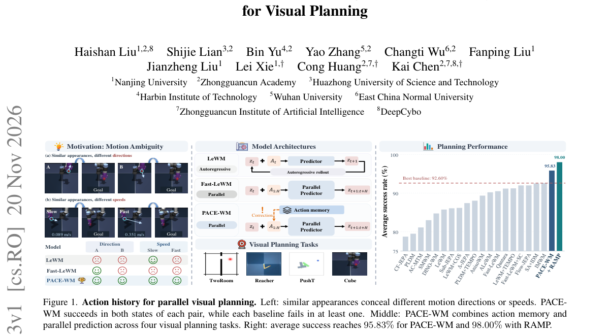

*Result - PACE-WM architecture. Recurrent action memory ad- justs the first future action block. A causal Transformer propagates this context across action tokens and uses the current visual repre- se*

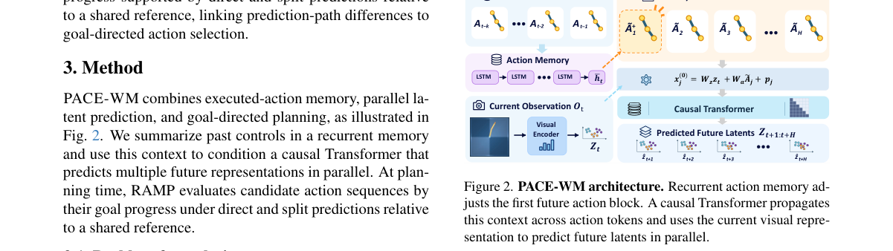

**Why this ranks #4**: 它在 world_model 里的价值是把「相似观测掩盖不同运动状态」这一 JEPA 规划盲区落到具体机制上：用循环编码器维护已执行动作的记忆，用它条件化因果 Transformer 一次并行预测多个未来表征（预测窗口内不做递归状态回传），并用 RAMP 按相对共同参考的最小目标进展给候选动作打分。四个视觉规划任务上 PACE-WM 平均成功率 95.83%，加 RAMP 后 98.00%，在匹配的 CEM 设置下比自回归的 LeWM 快约 7 到 9 倍。

---

### 5. Non-penetrating World Models

**arXiv**: [2611.27963](https://arxiv.org/abs/2611.27963) | **Score**: 8.7 (relevance 9 x 0.7 + quality 8 x 0.3) | **Direction**: `world_model` | **Tags**: embodied, non-penetration, video-world-model, diffusion-transformer, safety-projection, zero-shot-transfer, Learning & Generation Lab | **Categories**: cs.AI, cs.CV | **Pages**: 20

**Authors**: Yuhang Dai; Yinwei Wu; Ziyue Lin; Han Ji; Xingyi Yang

**Affiliation**: Learning & Generation Lab, The Hong Kong Polytechnic University

**Abstract**

> We study a new problem of preventing object penetration in interactive video world models. To understand how existing models handle this, we introduce NoPeBench, a benchmark that evaluates how world models respond to physical obstacles. Our evaluation reveals that none of the open-source models can reliably prevent such failures. Surprisingly, however, these models already encode the information needed to predict such violations. We find that the hidden states of diffusion transformers (DiTs) can predict whether a candidate action will penetrate an obstacle. Building on this, we introduce NoPeWorld, a lightweight framework that detects and prevents penetration. Specifically, we train a small prediction head on top of a frozen DiT's hidden states to read out if a candidate action is safe or not. Unsafe actions are then replaced with safe ones that best preserve the original intent. Despite its simplicity, NoPeWorld substantially reduces the physical violation rate, averaged over six video world models, from 74% to 16%. Remarkably, our method shows zero-shot generalization to open-domain imagery, third-person viewpoints, and moving obstacles. We publicly release our code, the NoPeBench benchmark, and model weights. Project Page: https://nopeworld.github.io .

**Key findings**

- **Finding**: 在六个视频世界模型上平均物理违规率从 74% 降到 16%；NoPeBench 的前两级任务共用 UnrealZoo 的 32 个留出场景里的 100 条路线，另有 50 条无障碍路线用于检查是否会误停。
- **Inference**: 既然冻结 DiT 的隐状态已能预测穿透，说明模型并非「不知道会穿模」，只是没有把这份知识接进动作选择——安全可以被做成读头而不是重训。
- **Recommendation**: 用视频世界模型做交互时不必先重训模型：先训一个读冻结 DiT 隐状态的二分类头预测穿模概率，再把不安全动作投影到安全集合并保留原意图；同时务必配一组无障碍路线，防止安全机制退化成「到处都停」。

**Key figures**

*Framework - Video world models walk through walls. LingBot-World 2.0, W held at the pillar between platforms 9 and 10: Original walks through; + NoPeWorld stops at the bricks. Six models on a NoPeBench*

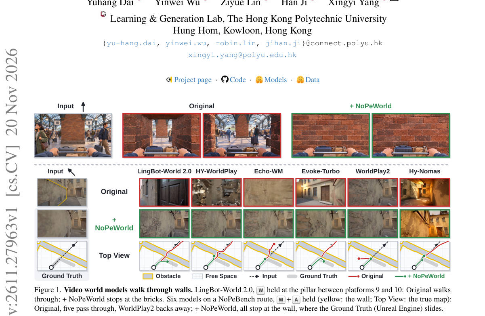

*Result - NoPeWorld. Training: every candidate motion is swept through Unreal’s true geometry (top view) and labelled; the head predicts the labels from the frozen DiT’s states (outlined: keeping the*

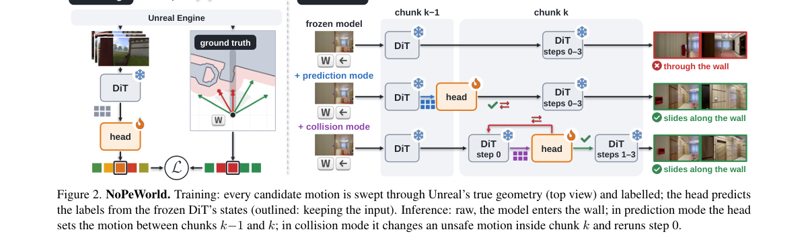

**Why this ranks #5**: 它给 world_model 补了一个此前没人量化的失效模式：交互式视频世界模型会让物体穿墙。作者先做 NoPeBench，发现开源模型无一能可靠避免穿透，但 DiT 的隐状态本身已经编码了「这个候选动作会不会穿模」的信息——于是在冻结 DiT 上训一个轻量预测头读出安全性，再把不安全动作投影到尽量保留原意图的安全动作上：在六个视频世界模型上平均物理违规率从 74% 降到 16%，且零样本迁移到开放域图像、第三人称视角和移动障碍物。

---

### 6. Two Actions from One State: Fork Futures Teach JEPA World Models to Compare

**arXiv**: [2611.28350](https://arxiv.org/abs/2611.28350) | **Score**: 8.7 (relevance 9 x 0.7 + quality 8 x 0.3) | **Direction**: `world_model` | **Tags**: embodied, counterfactual-action-data, action-response, jeepa, planning-success, data-efficiency, Purdue University | **Categories**: cs.AI, cs.CV | **Pages**: 25

**Authors**: Yihao Wu; Runjia Zeng; Tongyan Wang; Renzhong Huang; Chongzhou Fang; Qifan Wang; Fan Heng; Dongfang Liu

**Affiliation**: Purdue University; Rochester Institute of Technology; Meta AI; University of North Texas

**Abstract**

> JEPA world models are trained to predict logged transitions but used to compare counterfactual actions from one state. The logged behavior data show one action per state, and under a local linear approximation we prove the action response is unidentified along any direction the policy never varies within a state. We therefore supplement behavior data with measured outcomes of alternative actions from the same state. Our fork futures execute two actions from one restored state, and their outcome difference cancels the state term, identifying the action response on the sampled span. The resulting model, Fork-JEPA, matches predicted to measured differences, anchors the logged successor with behavior prediction, and adds a lookback head that keeps the predecessor recoverable, all at training time, leaving planning unchanged. On three visual control tasks, behavior-only training leaves the predicted action effect no better than a constant guess. Fork-JEPA makes it readable and raises planning success by up to 14\% over LeWM, its base model. Where the action response changes across hidden zones, it nearly doubles cross-zone success, and 1,024 fork pairs beat 1.2M extra behavior steps. Our project is available at https://fork-jepa.github.io/.

**Key findings**

- **Finding**: 三个视觉控制任务上 Fork-JEPA 把规划成功率比基座 LeWM 最多提高 14%；在动作响应随隐藏区变化的设置上跨区成功率接近翻倍，而 1,024 对 fork 数据只占行为数据约 0.5%，效果抵得过 1.2M 步额外行为数据。
- **Inference**: JEPA 的动作响应在行为数据未变化的方向上本就不可辨识，因此「换一个更好的损失」解决不了问题，必须在数据里显式制造同一状态下的动作对比。
- **Recommendation**: 训练用于比较动作的世界模型时，优先补「同一状态执行两个动作」的 fork 对并配一个 lookback 头保住前驱，而不是加大行为数据量；论文实测 fork 对约占 0.5% 数据即可替代上百万步行为数据。

**Key figures**

*Framework - The gap is in the data. and are measured, and predicted. (a) Training fits logged action a at each state (left), leaving a′ unconstrained when planning compares their goal distances (right).*

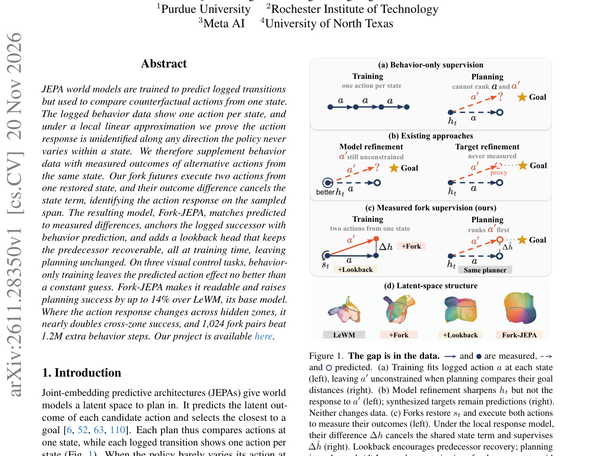

*Result - Fork-JEPA. Each loss compares an encoded target with its prediction. Left: behavior prediction. The logged clip supervises successor prediction by F. Middle: fork future. A fork executes the*

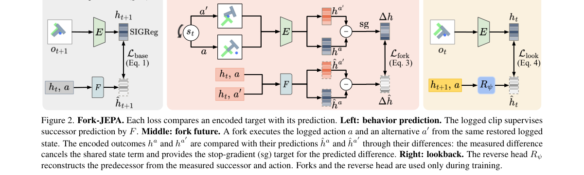

**Why this ranks #6**: 它给出 world_model 方向里少见的理论加数据处方：JEPA 只用行为数据训练却被要求比较同一状态下不同反事实动作，而在局部线性近似下，只要策略在同一状态不变化，动作响应沿该方向就不可辨识。Fork-JEPA 用「从同一恢复状态执行两个动作」的 fork future 抵消掉状态项来识别动作响应，再加一个 lookback 头保住前驱状态，三个视觉控制任务上把相对基座 LeWM 的规划成功率最多提高 14%，而 1,024 对 fork 数据只占行为数据的约 0.5%，却抵得过 1.2M 步额外行为数据。

---

### 7. RecallWorld: Episodic Memory for Persistent Embodied Video World Models

**arXiv**: [2611.28666](https://arxiv.org/abs/2611.28666) | **Score**: 8.7 (relevance 9 x 0.7 + quality 8 x 0.3) | **Direction**: `world_model` | **Tags**: embodied, persistent-memory, scene-identity, episodic-memory, ray-lifting, fisheye-perspective, Amazon | **Categories**: cs.CV | **Pages**: 12

**Authors**: Sarosij Bose; Gitika Karumuri; Chenqi Li; Allen Tu; Srikumar Sastry; Mellon Zhang; Avinash Ravichandran; Alexander Schwing; Konstantinos Karydis; Amit K. Roy Chowdhury

**Affiliation**: Amazon; University of California, Riverside; University of Oxford; University of Maryland, College Park; Washington University in St. Louis

**Abstract**

> Video world models generate plausible novel views but often lack persistent memory, failing to preserve a place's geometry and appearance when an agent revisits a scene. A central challenge is how previous views should be effectively used for creating memory. Reconstructing them independently underutilizes geometric constraints between nearby views, while repeatedly reconstructing a growing history can propagate later prediction errors into earlier geometry. We introduce RecallWorld, a persistent embodied video world model that jointly reconstructs short multi-view episodes into Scenelets while keeping geometry independent across episodes. Starting from a single source image, camera-aware ray lifting places perspective and native fisheye images in a common world frame, retaining wide-field content for perspective generation. Each generated segment extends the Scenelet memory and conditions subsequent generation. Coverage-based retrieval selects complementary Scenelets from the full history, while target-view visibility is resolved geometrically before appearance fusion, providing consistent memory conditioning for guiding subsequent generation. Across four datasets, RecallWorld improves revisit PSNR over the strongest evaluated baseline by 2.6 dB on partial revisits and 3.9 dB on full cycles, demonstrating substantially stronger preservation of scene identity across exploration and return.

**Key findings**

- **Finding**: 四个数据集上，回到旧址的 PSNR 相对各指标最强基线在部分回访提升 2.6 dB、完整环路提升 3.9 dB，对应 LPIPS 下降 43.2% 与 46.3%；消融显示仅把近邻视角联合重建就比全局记忆在部分回访上高 3.7 dB、完整环路高 2.5 dB。
- **Inference**: 场景记忆的错误会随历史长度累积，因此必须把记忆切成分集单元、让各集几何彼此独立，检索时再按覆盖率挑互补子集，而不是把全部历史反复重建。
- **Recommendation**: 给视频世界模型做持久记忆时，先试「近邻多视角联合重建 + 固定检索预算 + 融合前做几何可见性判定」这条低成本路线，再考虑把整段历史塞进全局记忆；评测要单独报告部分回访与完整环路两种口径。

**Key figures**

*Framework - RecallWorld consolidates perspective and fisheye views into episodic Scenelets that condition the world model to generate faithful revisits along the target camera trajectory. Retrieving rel*

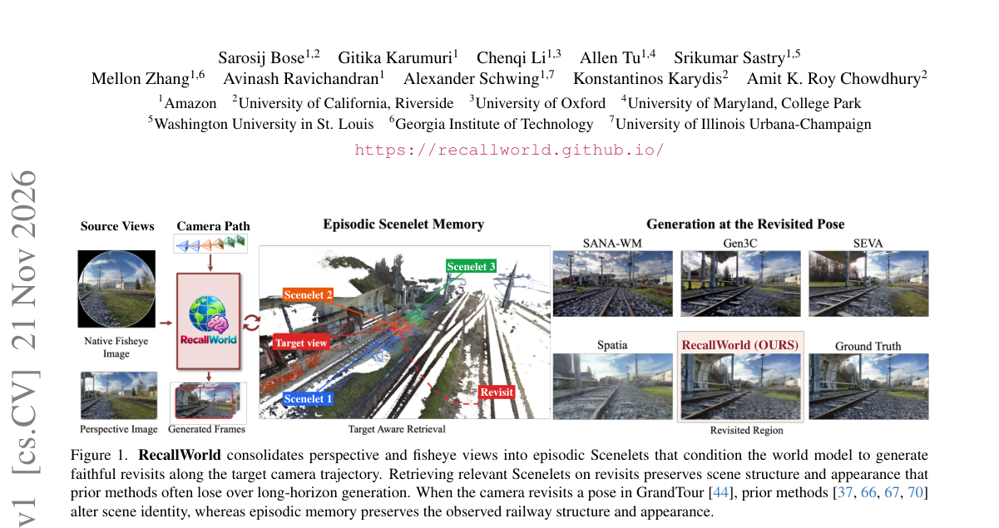

*Result - Overview of RecallWorld. Ray lifting unifies perspective and native fisheye inputs in 3D; consolidation forms episodic Scenelet memory Mk. Complementary retrieval, target-view projection and*

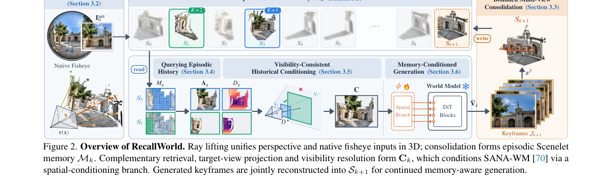

**Why this ranks #7**: 它针对的是视频世界模型「回到旧地却认不出」的记忆缺失：RecallWorld 把短多视角片段联合重建为 Scenelet 作为分集记忆，用射线提升把透视与鱼眼图统一到同一世界坐标系，再按覆盖率检索互补 Scenelet 并在融合前先做几何可见性判定。四个数据集上，回到旧址的 PSNR 相对最强基线在部分回访提升 2.6 dB、完整环路提升 3.9 dB，LPIPS 分别下降 43.2% 和 46.3%。

---

### 8. Learning How a Body Moves: Few-Shot Body Inference for Visual World Models of Animated Characters

**arXiv**: [2611.28842](https://arxiv.org/abs/2611.28842) | **Score**: 8.7 (relevance 9 x 0.7 + quality 8 x 0.3) | **Direction**: `world_model` | **Tags**: embodied, body-dynamics, in-context-world-model, contrastive-loss, benchmark, look-alike-characters, Information Technology | **Categories**: cs.CV, cs.GR, cs.LG | **Pages**: 28

**Authors**: Amarnath R

**Affiliation**: Department of Information Technology, United Institute of Technology

**Abstract**

> Two visually identical animated characters can respond differently to the same action command because their body dynamics differ. For example, a stiff blob and its bouncy twin reach different heights when both receive the jump command. Given only the first frame and the action command, a visual world model has no information to distinguish these twins, because their initial appearances are identical. We therefore propose an in-context world model that encodes clips of a character's other actions into a body representation, using a contrastive loss to separate look-alike characters. We introduce ToonTwins, a benchmark of 144 2D cartoon characters that run, jump, fall, turn and crouch. Its characters form look-alike groups of four that differ only in their dynamics profile, and we also evaluate the model on 32 animated animals from DeformingThings4D. Even with a body code from these clips, the latent pixel world model we tested recovered at most 25 percent of the twins' jump height difference. On new shapes, our model identified the correct twin in 85.9 percent of cases, compared with 76.7 percent for a transformer baseline that reads the same clips without a body summary, and in a controlled ablation the contrastive loss gave more than half of this gain. On the animated animals, it reduced the mean path prediction error by 8.5 percent against a model without body information.

**Key findings**

- **Finding**: ToonTwins 含 144 个 2D 卡通角色，由 6 种体型方案和 36 组四胞胎式外观组构成；新形状上模型识别正确孪生的比例为 85.9%，读同样片段但不做身体摘要的 Transformer 基线为 76.7%，对比损失贡献了增益的一半以上。
- **Inference**: 连所测试的潜空间像素世界模型，在拿到身体编码后也只能恢复孪生角色跳跃高度差的至多 25%，说明「外观到动力学」的映射本身就极难拟合，身体表征必须被显式建模而不是指望从像素里涌现。
- **Recommendation**: 评估角色或物体的世界模型时，先构造外观相同但动力学不同的成对样本做诊断；同时把身体摘要与对比损失分开消融，确认增益来自表征设计而非数据量。

**Key figures**

*Framework - Look-alike stiff and bouncy blobs. (a) Under the same jump command, the bouncy twin rises higher. (b) Their fall and run clips show the same difference, and the dashed line marks the start o*

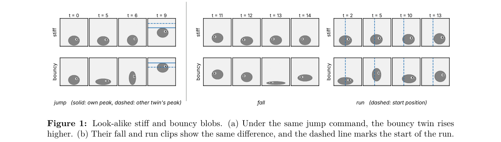

*Result - ToonTwins. Characters are shown in color for display, and all models receive the same frames in gray.*

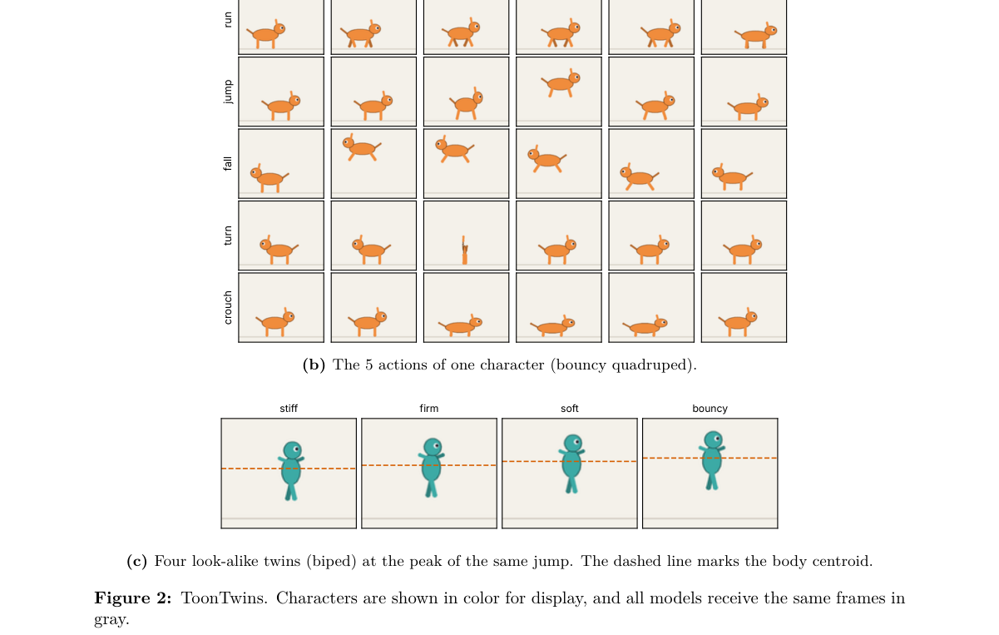

**Why this ranks #8**: 它把世界模型一个被忽视的歧义摆到台面：视觉上完全相同的角色可以因为身体动力学不同而对同一动作指令反应不同，只给首帧和指令的模型根本没有区分信息。作者提出在上下文世界模型里把角色其他动作片段编码成身体表征，并用对比损失把「长得像」的角色分开，同时给出 ToonTwins 基准——144 个 2D 卡通角色、6 种体型方案、36 组外观组；新形状上正确孪生识别率 85.9%，对比读同样片段但不做身体摘要的 Transformer 基线 76.7%，对比损失贡献了其中一半以上的增益。

---

### 9. SilentWAM: Planning in the Masked State of a Diffusion World Model

**arXiv**: [2611.29125](https://arxiv.org/abs/2611.29125) | **Score**: 8.7 (relevance 9 x 0.7 + quality 8 x 0.3) | **Direction**: `world_model` | **Tags**: embodied, masked-diffusion, autonomous-driving, end-to-end-planning, latency, world-action-model, Zoox | **Categories**: cs.CV | **Pages**: 11

**Authors**: Ziyu Zhao; Casey Sun; Zeyu Wang; Shicong Ma; Emily T Zhang; Cheng Lu

**Affiliation**: Zoox

**Abstract**

> World-action models learn from future prediction, but accessing their future representations directly at test time can require costly frame generation. Methods that generate future frames before planning incur additional forward passes, while future co-training methods omit explicit future predictions at inference. We introduce \method, a planner that reads the hidden states of masked future tokens without decoding future frames. We pretrain MMaDA-Parallel-M on driving video using frame-level masked world modeling, which predicts a masked suffix of future frames and explicitly includes inputs with all future frames masked. Learned planning queries attend to these masked positions and the observed context, and a continuous head predicts the trajectory in the same forward pass. With a single front camera, \method reaches 92.0 PDMS on NAVSIM v1 and 89.3 EPDMS on NAVSIM v2, with an end-to-end latency of 60.3\,ms.

**Key findings**

- **Finding**: 单前视相机下 SilentWAM 在 NAVSIM v1 达 92.0 PDMS、NAVSIM v2 达 89.3 EPDMS，端到端延迟 60.3 ms；消融显示保留掩码未来把 nuScenes 碰撞率从 0.18% 降到 0.06%，而解码未来帧只带来边际的 PDMS 提升。
- **Inference**: 未来帧的价值在于其隐状态携带的「下一步会发生什么」，而不是像素本身；把掩码位置的隐状态直接喂给规划器，就能在不加额外前向、不增推理次数的前提下拿到预测式规划的收益。
- **Recommendation**: 做世界动作模型时优先把未来表示做成「训练期监督、推理期不解码」的形式，并在预训练里显式包含全部未来都被掩码的极端输入，否则规划头学不会如何读被掩码位置的隐状态。

**Key figures**

*Framework - How a world-action model uses the predicted future at test time. (a) Future frames are generated before planning, requiring additional forward passes. (b) Future prediction is used only duri*

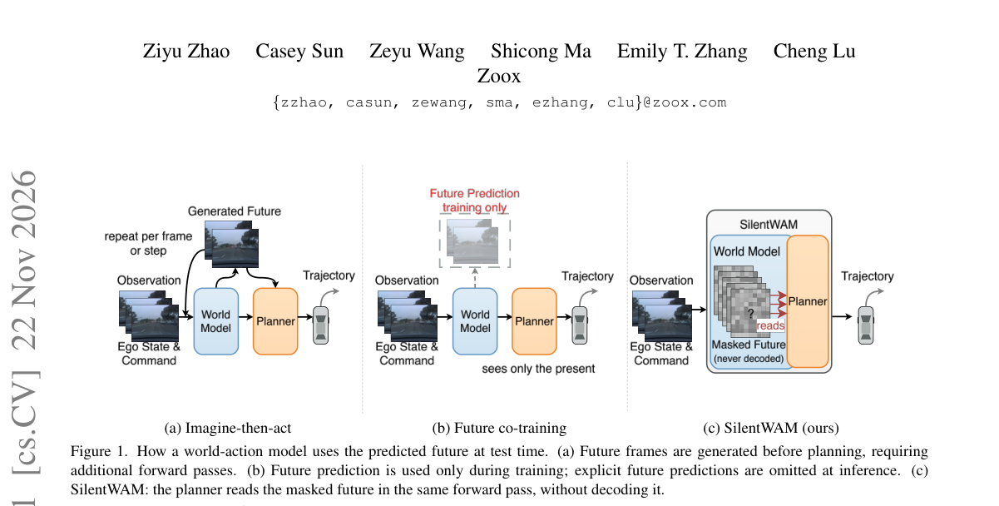

*Result - Training of SilentWAM. (a) Frame-level masking replaces the last n future frames with [M] (all of them at t = 1), and LWM is computed only there. (b) Masked-state imitation uses the same inp*

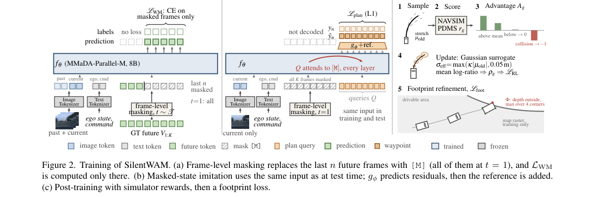

**Why this ranks #9**: 它回答了世界动作模型落地时最实际的矛盾：规划器要读未来预测，但生成未来帧意味着额外前向开销。SilentWAM 直接读被掩码未来 token 的隐状态而不解码未来帧，用帧级掩码世界建模预训练（显式包含全部未来帧都被掩码的输入），在同一次前向里由连续头回归轨迹。单个前视相机下，NAVSIM v1 拿到 92.0 PDMS、v2 拿到 89.3 EPDMS，端到端延迟 60.3 ms；消融里保留掩码未来把 nuScenes 碰撞率从 0.18% 压到 0.06%，而解码未来帧只带来边际的 PDMS 提升。

---

### 10. What Should World Models Plan Over? Learning Geometry-Aligned Representations of Body Motion

**arXiv**: [2611.29759](https://arxiv.org/abs/2611.29759) | **Score**: 8.7 (relevance 9 x 0.7 + quality 8 x 0.3) | **Direction**: `world_model` | **Tags**: embodied, latent-motion-space, goal-reaching, body-trajectory, world-model-planning, geometry-prior, University of Massachusetts | **Categories**: cs.LG | **Pages**: 25

**Authors**: Renhao Zhang; Abhranil Chandra; Bruno Castro da Silva

**Affiliation**: University of Massachusetts

**Abstract**

> We introduce MotionPort, which learns low-dimensional latent representations of body motion for accurate dynamics prediction and effective long-horizon planning. Existing world-model planners often search over action representations learned for prediction, yet we show that predictive accuracy alone does not ensure that optimization can discover successful trajectories. MotionPort addresses this mismatch by representing body trajectories rather than action chunks and organizing the search space by motion similarity, helping predicted improvements translate into successful execution. Without fine-tuning state encoders, MotionPort raises average goal-reaching success from 37.9% to 87.8% across three backbones and seven settings in four domains. On the evaluated AntMaze-OGBench tasks, it achieves 72% success, compared with 4% for the strongest baseline.

**Key findings**

- **Finding**: 不微调状态编码器时，MotionPort 把三个骨干、七个设置、四个域上的平均到达成功率从 37.9% 提到 87.8%，21 组对比全部提升、平均涨 50 个百分点；AntMaze-OGBench 上为 72%，最强基线只有 4%。
- **Inference**: 规划器能否找到成功轨迹取决于搜索空间的几何结构，而不是世界模型的预测误差大小；把表征从动作块换成身体轨迹后，预测出的「进展」才真正对应可执行的动作。
- **Recommendation**: 用世界模型做长时域规划时，先诊断「预测更准但规划更差」这一失配，再考虑换搜索空间而不是加大预测模型；给动作块表征做规划时，可引入按相似性组织的低维轨迹空间并配合学习到的先验初始化。

**Key figures**

*Framework - Body motion connects prediction and planning. (a) MotionPort explicitly represents body motion as an intermediate step between actions and their effects on the environment, rather than encod*

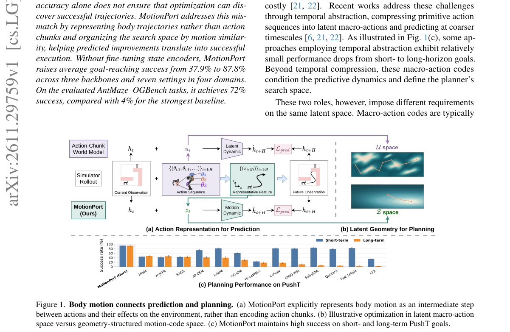

*Result - Learning and planning with MotionPort. (a) Representative body trajectories are encoded into geometry-structured motion codes, which condition an action decoder and a dynamics model, while t*

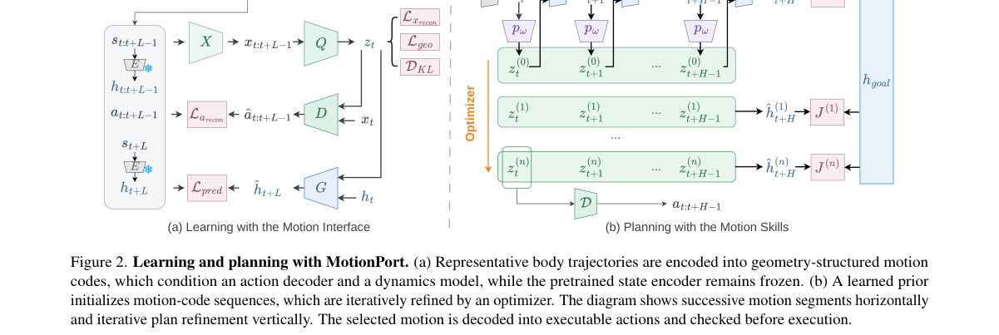

**Why this ranks #10**: 它指出了世界模型规划里一个反直觉的失配：预测精度高不等于优化能找到成功轨迹，因为规划器搜的是为预测而学的动作表征。MotionPort 改为表征身体轨迹本身而不是动作块，并按运动相似性组织搜索空间；不改状态编码器的前提下，三个骨干、七个设置、四个域上的平均到达成功率从 37.9% 提到 87.8%，在 AntMaze-OGBench 上 72% 对最强基线的 4%，另有 21 组对比全部提升、平均涨 50 个百分点。

---

### 11. One Latent World for Heterogeneous LiDARs: A Scan Pattern Agnostic 4D World Model via Direct Ray Decoding

**arXiv**: [2611.30007](https://arxiv.org/abs/2611.30007) | **Score**: 8.7 (relevance 9 x 0.7 + quality 8 x 0.3) | **Direction**: `world_model` | **Tags**: embodied, lidar-world-model, direct-ray-decoding, scan-pattern-agnostic, 4d-prediction, diffusion-transformer, Seoul National University | **Categories**: cs.RO | **Pages**: 35

**Authors**: Minwoo Jung; Dongjae Lee; DongGuw Lee; Yeong Sang Park; Maurice Fallon; Ayoung Kim

**Affiliation**: Seoul National University; Korea Institute of Machinery & Materials; Oxford Robotics Institute, University of Oxford

**Abstract**

> LiDAR world models generate and predict metric 3D observations in the form of LiDAR scans. They typically synthesize scans following the scan pattern of their training sensor or render them from an intermediate 3D surface or field. However, following one scan pattern limits transfer to LiDARs with other patterns, and rendering from intermediate geometry can cause incorrect depths and false returns. In this paper, we propose a scan pattern agnostic 4D LiDAR world model that decouples the scene from sensor observation, so one spatial latent can be observed by heterogeneous LiDARs at the same mounting position without regeneration. Our decoder predicts the hit probability and depth of each ray directly from the latent, combining global scene context with local features retrieved at a preliminary depth. Without an intermediate surface or field, it reduces incorrect depths and false returns, and as each ray is decoded independently from one latent, LiDARs that share a ray receive the same return and observe one consistent scene. Finally, a diffusion transformer generates scenes in this latent and predicts 4D sequences from observed latents warped by the given ego and object motion. On KITTI-360 and nuScenes, our model generates realistic scenes and reduces the registration error between predicted frames by about 70% relative to the best compared world model. Its decoder yields 19 to 28% lower depth error than the rendering used by other world models, and generated scans benefit several downstream tasks. Our code will be open-sourced. More details are available at https://minwoo0611.github.io/OneLatentWorld.

**Key findings**

- **Finding**: 在 KITTI-360 与 nuScenes 上，模型把预测帧之间的配准误差相对对比世界模型降低 66% 到 72%，解码器的深度误差比它们使用的渲染方式低 19% 到 28%；nuScenes 上 FPVD 从 48.43 降到 10.57。
- **Inference**: 每条射线独立从同一个潜变量解码，意味着共享同一条射线的异构 LiDAR 必然得到一致回波，场景一致性由「先重建再渲染」的链路改成「一次解码」的结构性保证。
- **Recommendation**: 做 LiDAR 世界模型时优先把扫描模式与场景表示解耦，并直接解码射线命中与深度而非渲染中间表面；评测除了生成质量，还要单独报告换传感器后的一致性与深度误差。

**Key figures**

*Framework - One latent world for heterogeneous LiDARs. (a)–(c) Scans produced on a measured KITTI-360 scene for training rays R0 or target rays Rs. Measured points are black. Produced points are blue, or*

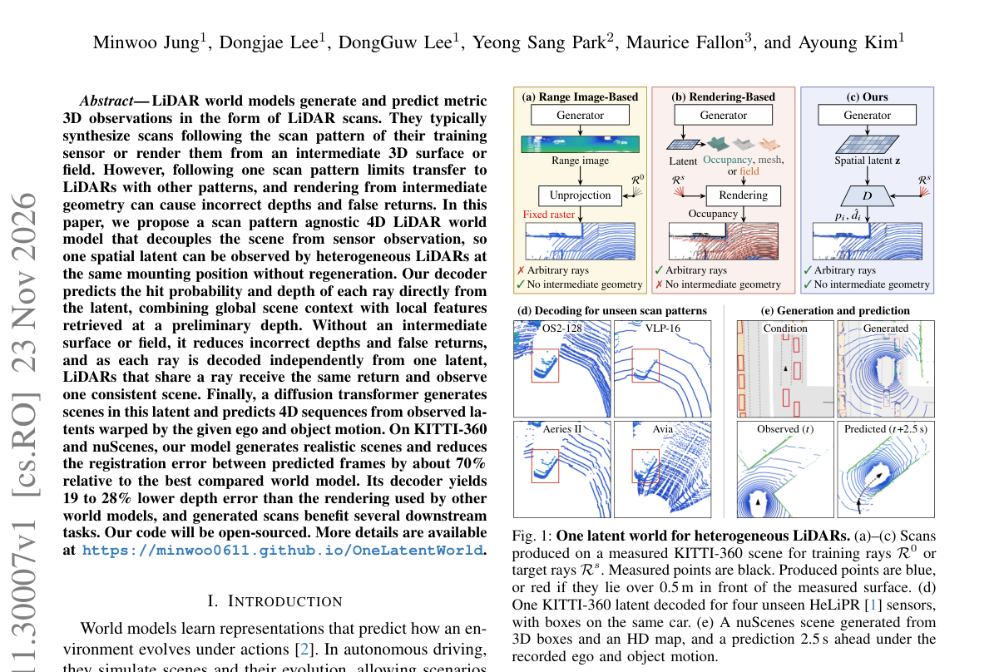

*Result - Overview. (a) E maps a scan on the HCS grid to a latent on the (ρ, θ) plane. (b) The DiT Fψ receives layouts and, for prediction, reference latents warped by the given motion. Ticks mark the o*

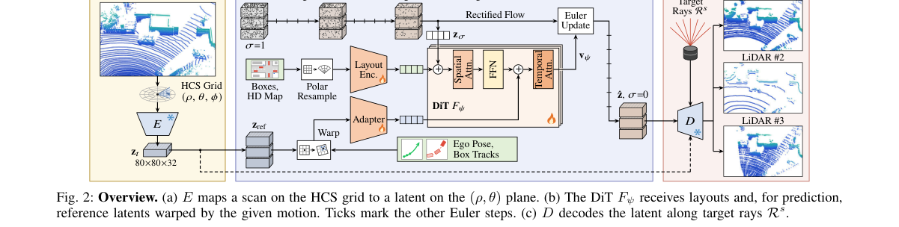

**Why this ranks #11**: 它解决的是 LiDAR 世界模型的一个结构性限制：按训练传感器的扫描线合成点云，换个传感器就迁移不了；经中间 3D 表面或场渲染还会产生错误深度和虚假回波。OneLatentWorld 把场景与传感器观测解耦，解码器直接从空间潜变量预测每条射线的命中概率与深度，每条射线独立解码，于是一个 KITTI-360 潜变量可被多个异构 LiDAR 在同一位置共享；预测帧间的配准误差相对最优对比世界模型降低 66% 到 72%，深度误差低 19% 到 28%。

---

## 具身智能与机器人学习 · `embodied_ai` (9 papers)

9 篇里最显眼的是让大模型直接当机器人策略。RoboThink 把思考交给 agent、执行交给策略：指令通道允许中途改目标并自我撤销，反馈通道用 agent 标注的 DAgger 教策略怎么动，LIBERO 上未知恒定漂移下成功率从 0.09 提到 0.87、RoboTwin 2.0 双臂从 0.12 到 0.74，而 agent 单独做每成功需 2.1 分钟与逾百万 token，RoboThink 只要 55 秒与 8k token。数据侧最重的是 RoboUniverse-10K：用 Real2Sim 流水线造出 10,807 个可重置可验证的物理环境与 500 个专家验证任务，17K 轨迹 SFT 后零样本成功率从 0.8% 提到 21.2%。另有 SANA-Robot 用混合记忆把 4.5B 世界-动作模型压到每个动作块 135 ms 并在 RTX 5090 上做 30Hz 闭环，FunGrasp-Zero 在五只未见手上零微调平均 86%。

### 12. SANA-Robot: Efficient World Action Model with Hybrid Memory

**arXiv**: [2611.28943](https://arxiv.org/abs/2611.28943) | **Score**: 9.0 (relevance 9 x 0.7 + quality 9 x 0.3) | **Direction**: `embodied_ai` | **Tags**: embodied, world-action-model, hybrid-memory, edge-deployment, asynchronous-control, unified-policy-simulator, NVIDIA | **Categories**: cs.CV, cs.RO | **Pages**: 24

**Authors**: Yuyang Zhao; Zekai Li; Yicheng Pan; Jiaming Tang; Zhuoyang Zhang; Jiaxu Xing; Moritz Reuss; Quanquan Peng; Junsong Chen; Enze Xie; Zhijian Liu; Song Han

**Affiliation**: NVIDIA; UCSD; THU; MIT; HKU

**Abstract**

> World action models (WAMs) leverage the world knowledge of video generation models to improve action generation by aligning visual prediction with action prediction. However, their prediction overhead prevents real-time deployment on edge devices, and they usually lack an effective long-term memory. We introduce SANA-Robot, a 4.5B WAM with minute-level memory that runs in real time on edge devices, built on the following core designs: (1) hybrid memory at constant cost: our WAM relies on linear attention to maintain a global memory with a fixed-size state, and on sliding window softmax attention layers that propagate previous information, enabling high success rates on tasks requiring whole-episode memory while keeping an efficient and constant inference speed; (2) a unified model: by dynamically applying different noise levels to action and video tokens, SANA-Robot can serve not only as a policy but also as a world simulator; (3) a full-stack infrastructure for both memory training and inference, including efficient data packing and shuffling as well as memory-phase-based asynchronous execution. SANA-Robot achieves the best performance on the memory dimension of RoboDojo among models of medium size (about 5B) and the highest success rates on LIBERO-Plus, LIBERO-Pro and LIBERO-Max. In real-world deployment, SANA-Robot takes 135 ms per action chunk on an RTX 5090 with FP8 GEMMs and 115 ms with NVFP4 GEMMs, and achieves closed-loop, real-time asynchronous robot control at 30 Hz on edge devices, demonstrating both the efficiency and the effectiveness of SANA-Robot. Project page: https://nvlabs.github.io/Sana/Robot/

**Key findings**

- **Finding**: SANA-Robot 是 4.5B 的世界动作模型，RoboDojo 记忆维度得分 52.73，明显高于 InternW0-Δ 的 34.67、OpenWAM-α 的 10.41、Fast-WAM 的 6.32 与 X-WAM 的 3.55；真机上每个动作块在 RTX 5090 上 FP8 为 135 ms、NVFP4 为 115 ms，边缘设备闭环异步控制达 30 Hz。
- **Inference**: 定长全局记忆加滑动窗口传播让每个动作块的推理成本与历史长度无关，这正是它能在边缘端实时跑起来的前提；把未来生成与动作预测统一到同一去噪框架，还能省掉一套独立的世界模拟器。
- **Recommendation**: 部署世界动作模型时先量化「记忆长度对单块延迟」的影响，并按任务需要挑定长线性注意力加滑动窗口的组合；同一模型要兼做策略与模拟器时，可通过对不同模态施加不同噪声级别复用同一去噪过程，而不必维护两套模型。

**Key figures**

*Framework - SANA-Robot at a glance. (a) Real-world rollouts. (b) Success rate on LIBERO-Plus and RoboTwin 2.0, and score on the precision and long-horizon dimensions of RoboDojo and its average over th*

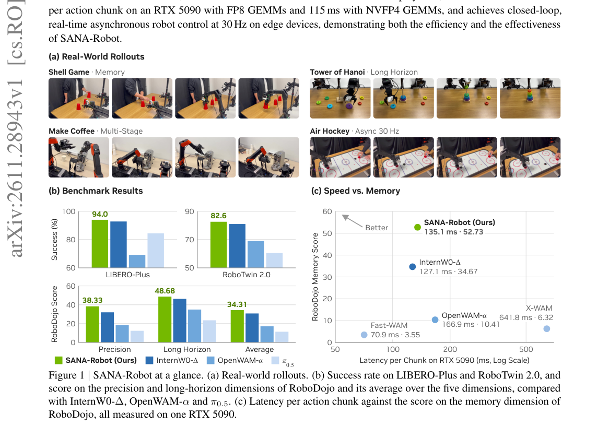

*Result - Overview of SANA-Robot, a unified world action model for FDM, IDM and policy. The video VAE encodes each camera view separately into the observation latent 𝑜and the future video latent 𝑧, w*

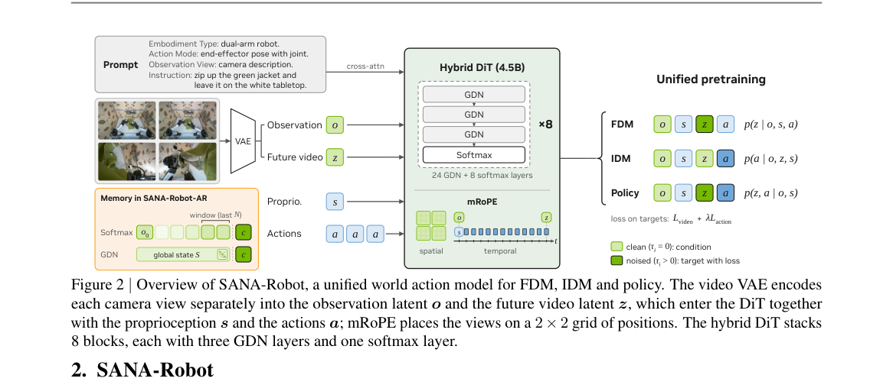

**Why this ranks #12**: 它入选 embodied_ai 的理由是把世界动作模型的「预测开销」和「长时记忆」两个落地障碍同时解决：4.5B 的 SANA-Robot 用线性注意力维护定长全局记忆、用滑动窗口 softmax 注意力传播历史，把记忆覆盖到 RoboDojo 上约一分钟的完整回合，同时每个动作块的成本恒定；再对动作与视频 token 施加不同噪声级别，让同一模型既能当策略也能当世界模拟器。真机上 RTX 5090 上 FP8 GEMM 每个动作块 135 ms、NVFP4 115 ms，边缘设备闭环异步控制跑在 30 Hz，RoboDojo 记忆维度得分 52.73，是同规模模型里最高。

---

### 13. Foresight Forcing: Learning Spatial Foresight for Robotic Manipulation

**arXiv**: [2611.30963](https://arxiv.org/abs/2611.30963) | **Score**: 9.0 (relevance 9 x 0.7 + quality 9 x 0.3) | **Direction**: `embodied_ai` | **Tags**: embodied, world-action-model, 3d-foundation-model, transition-supervision, manipulation, distillation, Shanghai Jiao Tong University | **Categories**: cs.CV, cs.RO | **Pages**: 22

**Authors**: Mishuo Han; Zhixuan Liang; Zhaoyuan Wan; Wendi Chen; Jiarui Chen; Xinkai Wang; Yue Ma; Yu Zhou; Junting Chen; Yao Mu; Jun Lv; Chuan Wen

**Affiliation**: Shanghai Jiao Tong University; The University of Hong Kong; Shanghai Innovation Institute; Noematrix; Fudan University

**Abstract**

> Robotic manipulation policies can improve action prediction by anticipating how objects move and how their spatial relationships change. World Action Models (WAMs) learn to predict future visual observations, but their training objectives typically leave the underlying 3D geometric transitions implicit. To alleviate this problem, we introduce Foresight Forcing ($\mathcal{F}^{2}$), a WAM that learns a spatial transition representation from changes in a pretrained 3D feature space. During training, a frozen 3D foundation model extracts patch-wise feature differences from aligned current and future observations that provide dense supervision for geometry-aware feature transitions. We distill these targets into spatial transition queries, which are progressively refined from the current observation, language instruction, and proprioceptive state, and use them alongside current visual features to generate actions. At deployment, the policy predicts the queries without future observations or the 3D teacher. Experiments on LIBERO, LIBERO-Plus, and RoboTwin2.0 demonstrate strong manipulation performance and improved robustness, including 95.01% average success on RoboTwin2.0 Full. On six real-world manipulation tasks, $\mathcal{F}^{2}$ achieves a mean task score of 85.8%.

**Key findings**

- **Finding**: RoboTwin 2.0 Full 上 F² 平均成功率 95.01%，高于 ImageWAM 的 93.38 与 Flex-π 的 94.55%；六个真机任务平均任务分 85.8%，比 ImageWAM 的 70.2% 高 15.6 个百分点，比 π0.5 的 83.5% 高 2.3 个百分点。
- **Inference**: 用冻结 3D 基础模型的特征差做监督，等于把「几何会怎么变」压缩成策略能消费的转移 query，而不必让策略直接预测显式 3D 运动；教师只在训练期出现，推理期零额外开销。
- **Recommendation**: 训练世界动作模型时可先接一个冻结的 3D 基础模型当几何教师，用对齐后的前后帧特征差做稠密监督，再蒸馏成策略侧的 query；教师与未来观测都只在训练期使用，避免推理期引入额外算力。

**Key figures**

*Framework - Foresight Forcing (F2) at a glance. F2 learns spatial transition queries from correspondence-aligned changes in 3D teacher features. During training, a frozen VGGT extracts features from pair*

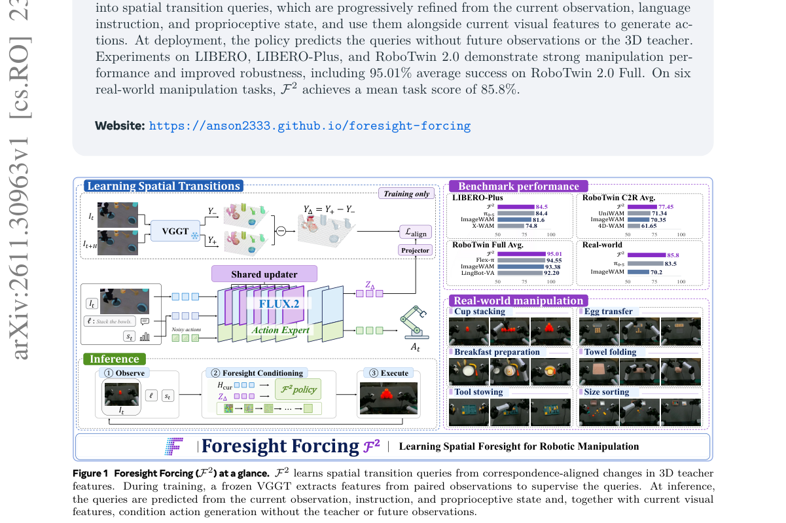

*Result - F 2 architecture. A frozen VGGT provides feature transition targets on the student grid for spatial queries that condition the Action Expert. Insets show the shared updater and spatial query*

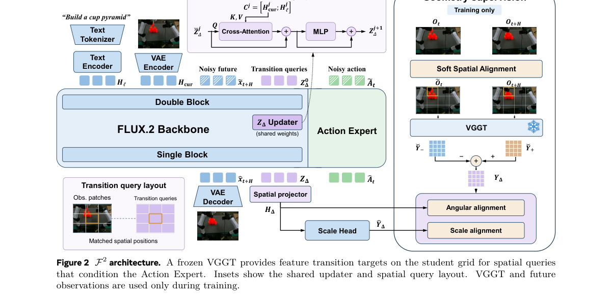

**Why this ranks #13**: 它给世界动作模型补上了「3D 几何变化该怎么监督」这一环：训练时用冻结的 3D 基础模型 VGGT 从对齐的当前与未来观测里抽 patch 特征差，作为稠密的几何转移目标，再蒸馏进由当前观测、语言指令和本体状态逐步细化的空间转移 query，推理时完全不需要未来观测和 3D 教师。RoboTwin 2.0 Full 上平均成功率 95.01%，对比 ImageWAM 的 93.38 与 Flex-π 的 94.55%；六个真机任务平均任务分 85.8%，比 ImageWAM 的 70.2% 高 15.6 个百分点、比 π0.5 的 83.5% 高 2.3 个百分点。

---

### 14. RoboUniverse-10K: Toward the Scaling Era of Agentic Robotics via Real-to-Sim Environments

**arXiv**: [2611.31002](https://arxiv.org/abs/2611.31002) | **Score**: 9.0 (relevance 9 x 0.7 + quality 9 x 0.3) | **Direction**: `embodied_ai` | **Tags**: embodied, real-to-sim, agentic-robotics, verifiable-environments, coding-agent, scaling, THU | **Categories**: cs.CL, cs.RO | **Pages**: 29

**Authors**: Jinkun Liu; Yingze Wang; Situ Wang; Deyao Hong; Mingju Gao; Wenyi Li; Yizhe Chi; Youjie Zheng; Kaisen Yang; Xiangyang Wang; Bingxiang He; Yuxin Zuo

**Affiliation**: THU; Einsia.AI; PKU; UIUC; HKU

**Abstract**

> Agentic Robotics, in which foundation models act as coding agents to control robots through executable programs, has emerged as a compelling paradigm for embodied intelligence. Yet unlike software engineering, where massive executable environments power post-training, robotics remains constrained by small, manual benchmarks and in-distribution evaluation. To bridge this gap, we introduce RoboUniverse-10K, 10,807 interactive, resettable, and verifiable physics environments built from real-world videos via an automated Real2Sim and quality assurance pipeline. Each runs in an isolated, Harbor-compatible harness that hides privileged states and grading logic to mirror real-world sensing. From the same pipeline, we hold out 500 unseen tasks to establish RoboUniverse-Verified, an expert-verified zero-shot benchmark. Evaluating 11 closed- and open-source models reveals a huge gap: frontier models reach 85.8\% success, while open-source baselines lag at 2.6\% to 10.0\%, bottlenecked by low-level grasping, deformable-object manipulation, and post-contact physical control. Finally, we collect about 17K multi-turn trajectories totaling 0.79B tokens with GPT-6 Astra and perform full-parameter supervised fine-tuning on Qwen3.6-35B-A3B, yielding RoboUniverse-35B-A3B. Our model achieves substantial zero-shot gains on RoboUniverse-Verified, lifting the success rate from 0.8\% to 21.2\%, while achieving zero-shot task completions across LIBERO-MAX, RoboCasa, RoboTwin 2.0, and a real Franka arm. We open-source the RL-ready environments and model to lay the foundation for large-scale reinforcement learning in Agentic Robotics.

**Key findings**

- **Finding**: RoboUniverse-10K 含 10,807 个自动验证的 Isaac Sim 环境（4,132 个单臂 Franka、6,675 个双臂 AgileX），另留出 500 个专家校验的未见任务；评测 11 个模型时前沿模型最高 85.8%，开源基线只有 2.6% 到 10.0%。
- **Inference**: 差距的瓶颈在低层抓取、可变形物操作与接触后的物理控制，说明当前 agentic 机器人的短板主要在物理执行而不在任务理解；因此环境数量与自动验证能力比换更大模型更缺。
- **Recommendation**: 想复现 agentic 机器人的后训练，先按软件工程的「挖掘可执行任务 + 隐藏特权状态」思路建可重置、可自动验证的环境，并单独留出未见任务做零样本评测；用 17K 条多轮轨迹做全参微调后成功率从 0.8% 提到 21.2%，是这条路线可参考的量级。

**Key figures**

*Framework - Overview of RoboUniverse-10K. (a) An agentic Real2Sim pipeline turns real robot videos into verifiable simulation environments spanning eight task families. (b) RoboUniverse-10K is far larger*

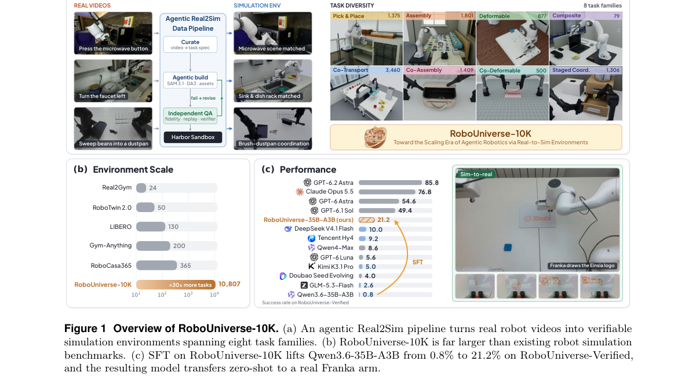

*Result - A RoboUniverse-10K environment. Each Harbor task packages the instruction, configuration, simulation environment, verifier, and reference solution. The coding agent acts only through the harn*

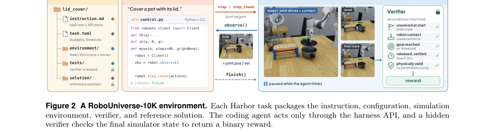

**Why this ranks #14**: 它给 Agentic Robotics 补的是软件工程里的那套「海量可验证执行环境」：通过自动 Real2Sim 与质检流水线，从真实机器人视频造出 10,807 个可交互、可重置、可自动验证的 Isaac Sim 环境（4,132 个单臂 Franka 加 6,675 个双臂 AgileX），每个装在隐藏特权状态与判分逻辑的 Harbor 兼容 harness 里；另留出 500 个专家校验的未见任务做零样本基准。评测 11 个闭源与开源模型差距巨大：前沿模型最高 85.8%，开源只有 2.6% 到 10.0%；用 17K 条多轮轨迹共 0.79B token 对 Qwen3.6-35B-A3B 全参微调后，零样本成功率从 0.8% 提到 21.2%。

---

### 15. Entangle: Scaling Human-Video In-Context World-Action Models across Unseen Tasks and Contexts

**arXiv**: [2611.28732](https://arxiv.org/abs/2611.28732) | **Score**: 8.7 (relevance 9 x 0.7 + quality 8 x 0.3) | **Direction**: `embodied_ai` | **Tags**: embodied, in-context-learning, human-video, world-action-model, contrastive-loss, task-ood, Tsinghua University | **Categories**: cs.AI, cs.RO | **Pages**: 26

**Authors**: Chendong Xiang; Chengwen Zhang; Ruowen Zhao; Zeyuan Wang; Shuhe Huang; Rongxu Cui; Min Zhao; Fan Bao; Hengkai Tan; Jun Zhu

**Affiliation**: Tsinghua University; GensPI Technology; Motubrain

**Abstract**

> In-context learning (ICL) enables foundation models to perform unseen tasks from context without parameter updates. In robotic manipulation, a human video provides the context that specifies how a task should be performed. However, scaling human-video ICL on world-action models (WAMs) faces two challenges: task-level human-robot pairs are not temporally aligned with robot actions, and standard action losses allow policies to rely on initial-scene or task-identity shortcuts rather than tracking the context. We present Entangle, an in-context world-action model that maps a single human video and current robot observations to future visual states and executable actions. To scale temporally aligned training data, we convert recorded robot videos into matched human contexts via video-to-video generation, supplemented by real paired recordings. For model training, we combine variable-length video windows with an intra-task contrastive objective that distinguishes the paired action trajectory from other executions of the same task, preventing task-identity shortcuts. Without task-specific fine-tuning, Entangle improves steadily as aligned training data scales, reaching an average score of 83.5/100 across six unseen tasks on an Astribot S1 robot, and achieves a 69.5% average success rate on seven unseen RoboTwin tasks, outperforming Zero-WAM by 22.6 percentage points. Under Context-OOD, although trained only on scene-aligned pairs, Entangle transfers context-specified behaviors across rearranged layouts and substituted tools.

**Key findings**

- **Finding**: 不做任务专门微调，Entangle 在 Astribot S1 的六个未见任务上平均得分 83.5/100，在 RoboTwin 七个未见任务上平均成功率 69.5%，比 Zero-WAM 高 22.6 个百分点；训练时联合 SFT 用了 43 个 RoboTwin 训练任务。
- **Inference**: 如果损失只看动作而不管上下文，模型可以靠认场景或认任务来取巧；任务内对比目标把「哪条执行对应这个上下文」显式区分开，才逼出真正的上下文读取能力。
- **Recommendation**: 做人类视频上下文的机器人学习时，先把时序对齐的数据构造（视频到视频生成加真人同步录制）和任务内对比损失一起上，再看未见任务上的分数随数据量的变化曲线，否则很容易把任务身份捷径误读成上下文学习能力。

**Key figures**

*Framework - Executing an unseen task. The input context (top) shows a human using a brush (1) to sweep a plastic block (2) into a dustpan (3), a task absent from training. Task-OOD (middle): conditioned*

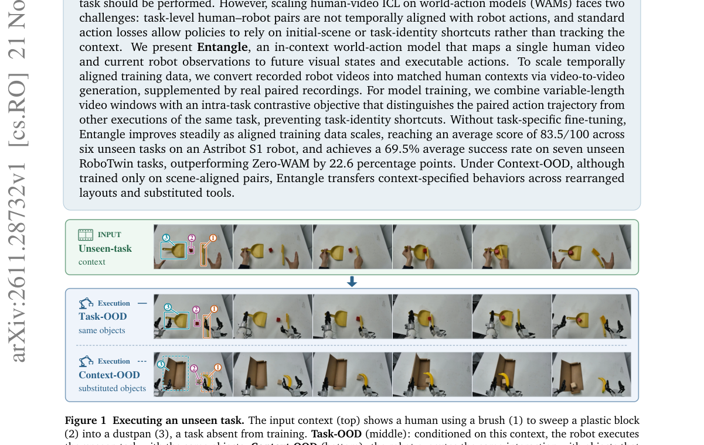

*Result - Overview of the Ent-Dataset. (a) Ent-Syn pipeline: source robot trajectories undergo (1) keyframe hand editing, (2) motion-guided video generation, and (3) VLM verification for visual quality*

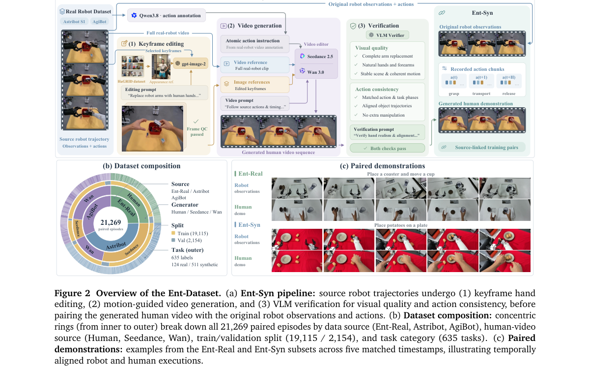

**Why this ranks #15**: 它处理的是人类视频作为上下文时的两个具体障碍：人机视频只在任务层面对齐而动作时序不对齐，以及标准动作损失让策略走初始场景或任务身份的捷径。Entangle 用视频到视频生成把机器人轨迹转成配对的人类上下文再配合真人同步录制扩充，并加任务内对比目标把配对轨迹与其他同任务执行区分开。不做任务专门微调的情况下，六个未见任务上平均得分 83.5/100，RoboTwin 七个未见任务上平均成功率 69.5%，比 Zero-WAM 高 22.6 个百分点。

---

### 16. FunGrasp-Zero: Field-Conditioned Graph Attention Policy for Zero-Shot Cross-Embodiment Dexterous Functional Grasping

**arXiv**: [2611.29195](https://arxiv.org/abs/2611.29195) | **Score**: 8.7 (relevance 9 x 0.7 + quality 8 x 0.3) | **Direction**: `embodied_ai` | **Tags**: embodied, dexterous-grasping, cross-embodiment, contact-map, graph-attention-policy, zero-shot, Sun Yat-sen University | **Categories**: cs.RO | **Pages**: 9

**Authors**: Yanhan Lin; Yuliang Wu; Yihao Guo; Wei-Jin Huang; Jianwen Li; Jiawei Tang; Xiaolong Huang; Yuquan Wang; Ancong Wu; Wei-Shi Zheng

**Affiliation**: Sun Yat-sen University; X SQUARE ROBOT; Shenzhen Loop Area Institute

**Abstract**

> Dexterous functional grasping is critical for robotic tool use, yet current dexterous hands exhibit substantial morphological diversity. This hardware heterogeneity makes cross-embodiment functional grasping a fundamental but largely unexplored problem. Existing functional grasping methods use retargeted hand poses as guidance, tying task representation to a specific embodiment and failing to explicitly capture object-centric functional contact intent, limiting generalization across hands. To address this, we propose FunGrasp-Zero, a reinforcement learning framework for zero-shot cross-embodiment functional grasping. Instead of relying on embodiment-specific joint configuration, FunGrasp-Zero captures functional intent via an object-centric, cross-embodiment-consistent contact map, adapted to heterogeneous hands through morphological mapping. We construct a hand-object potential field from mapped contact regions, yielding attractive and repulsive guidance vectors. A Field-Conditioned Graph Attention Network (FC-GAT) leverages these vectors to coordinate multi-finger motion across hands, while a potential field reward guides fingers toward target regions and penalizes non-target collisions to enforce functional alignment and stability. We further establish X-FunBench for cross-embodiment functional grasping, evaluating both physical grasp success and functional intent preservation across hands. Evaluated on X-FunBench, our unified policy, co-trained on four embodiments, achieves 86% average grasp success rate across five unseen hands on novel objects. Deployed on four unseen physical hands (Leap, Inspire, Sharpa, Wuji) for novel object grasping, the policy achieves 80% average success rate without fine-tuning. To our knowledge, FunGrasp-Zero is the first RL-based framework to achieve zero-shot cross-embodiment functional grasping across unseen hands in both simulation and the real world.

**Key findings**

- **Finding**: 策略在 Shadow、Ability、Schunk 和 Brainco 四种手上联合训练，在 Inspire、Sharpa、Wuji、Leap 和 PaXini 五只未见手上零样本评测：新物体上平均抓取成功率 86%，已见手上是 94% 且平均功能接触距离 1.70 厘米；部署到 Leap、Inspire、Sharpa、Wuji 四只未见真机手平均成功率 80%。
- **Inference**: 功能抓取要表达的是「哪个部位以什么姿态接触才有功能」，而不是某一双手的关节角度；把接口换成物体中心的接触图，才能在形态差异很大的手之间迁移。
- **Recommendation**: 做跨形态灵巧抓取时，先把任务接口从关节姿态换成以物体为中心的接触或功能区域，再用形态映射把同一接触意图落到不同手上；评测要同时报物理抓取成功率与功能意图保持度，零样本时每个物体-手组合建议至少 20 次随机试验。

**Key figures**

*Framework - Overview of FunGrasp-Zero. (a) Multi-embodiment co-training of an FC-GAT policy conditioned on functional potential field guidance. (b) Zero-shot deployment on unseen hands and novel tools wit*

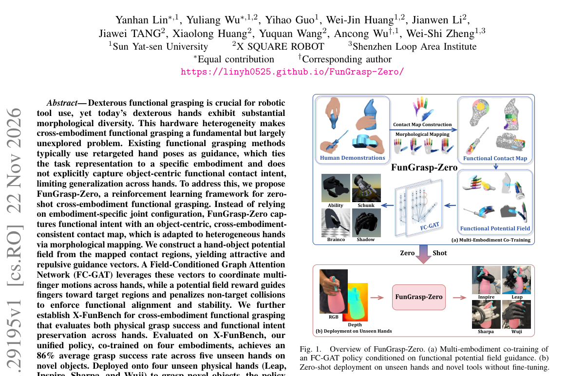

*Result - Architecture of FunGrasp-Zero. (a) Field-conditioned graph attention policy: the demonstrated hand–object pair (MMANO, o) and environment states are processed by the feature extraction operato*

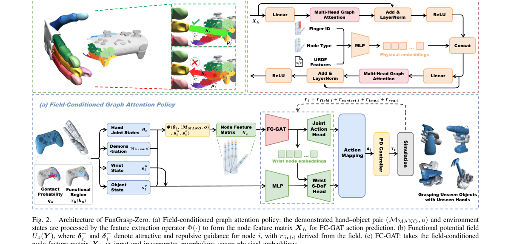

**Why this ranks #16**: 它针对灵巧手形态差异大导致的功能性抓取难跨手泛化：不再用重定向后的关节姿态做指引，而是捕捉以物体为中心、跨形态一致的接触图，再经形态映射适配到异构手，构建手-物势场给出吸引与排斥的引导向量，由势场条件化的图注意力网络协调多指运动，并用势场奖励惩罚非目标碰撞。在 X-FunBench 上，四种手联合训练的策略在五只未见手上、新物体上平均抓取成功率 86%，部署到四只未见真机手（Leap、Inspire、Sharpa、Wuji）上不做微调平均成功率 80%。

---

### 17. SparQ4D: Learning to Act through Sparse 4D Queries

**arXiv**: [2611.29682](https://arxiv.org/abs/2611.29682) | **Score**: 8.7 (relevance 9 x 0.7 + quality 8 x 0.3) | **Direction**: `embodied_ai` | **Tags**: embodied, sparse-supervision, 4d-queries, vla-policy, geometry-supervision, efficiency, ShanghaiTech University | **Categories**: cs.RO | **Pages**: 15

**Authors**: Siyuan Xie; Jinxi Xiao; Ran Ji; Yikai Liu; Mingxi Li; Xuebing Li; Ye Shi; Yuxiang Gao; Jiayuan Gu

**Affiliation**: ShanghaiTech University; COCOMatrix

**Abstract**

> Successful manipulation requires a policy to understand where things are and how they will move, yet action demonstrations leave this spatiotemporal structure implicit. While explicit 4D supervision has proven effective, reducing the cost of dense 4D prediction remains challenging. This paper introduces \method, a lightweight yet expressive decoder that efficiently injects holistic 4D scene understanding into policies and improves success rates. At its core is a query-based decoder attached to a pretrained policy, which casts many spatialtemporal tasks into one unified interface (e.g. depth, 2D/3D point motion, multi-view correspondence, and hand-eye relations). This design enables efficient training and inference without sacrificing expressivity: the policy learns rich 4D structure from a small number of sampled queries during training, while the decoder can be removed at inference with zero additional overhead. Across multiple backbones, simulated environments, and real-world settings, \method achieves state-of-the-art manipulation performance, outperforming competing methods while training up to $5\times$ faster. Probing analyses further reveal that this 4D structure is recoverable from the policy.

**Key findings**

- **Finding**: 以 π0.5 为底座的 SparQ4D 相比两个 WAM 基线训练快 3 到 5 倍、推理快 1.7 到 6.6 倍，参数约为其四分之一、训练显存占 24% 到 41%，且推理时可把解码器整体摘掉而不增加开销；摘要另称训练最多快 5 倍。
- **Inference**: 4D 几何知识其实可以被策略隐式编码，探测分析表明它能从策略表示里读回来；既然如此，监督就不必是稠密重建，用少量查询把几何问出来即可。
- **Recommendation**: 想给 VLA 策略加几何先验又担心训练成本时，先试「统一查询接口 + 稀疏采样 + 推理期摘掉解码器」这条路线，并按查询类型（深度、点运动、多视角对应、手眼）分别做消融，确认哪种监督真正被策略用上。

**Key figures**

*Framework - Overview of SparQ4D. (a) To inject spatial-temporal understanding efficiently, we supervise a policy with sparse 4D queries, decoded by a lightweight decoder attached to its intermediate rep*

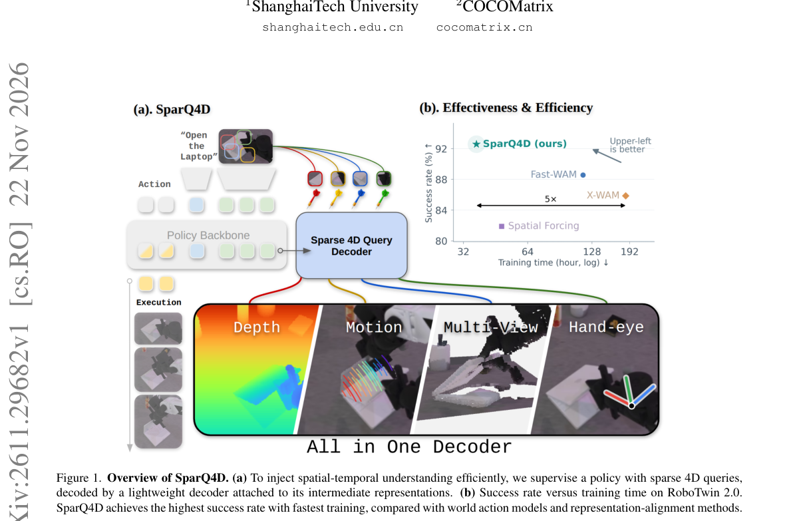

*Result - Overview of SparQ4D (based on π0.5). Alongside action prediction, the policy backbone is trained to answer sparse 4D queries q = (u, v, c, ∆t, f): where the point at pixel (u, v) of camera c*

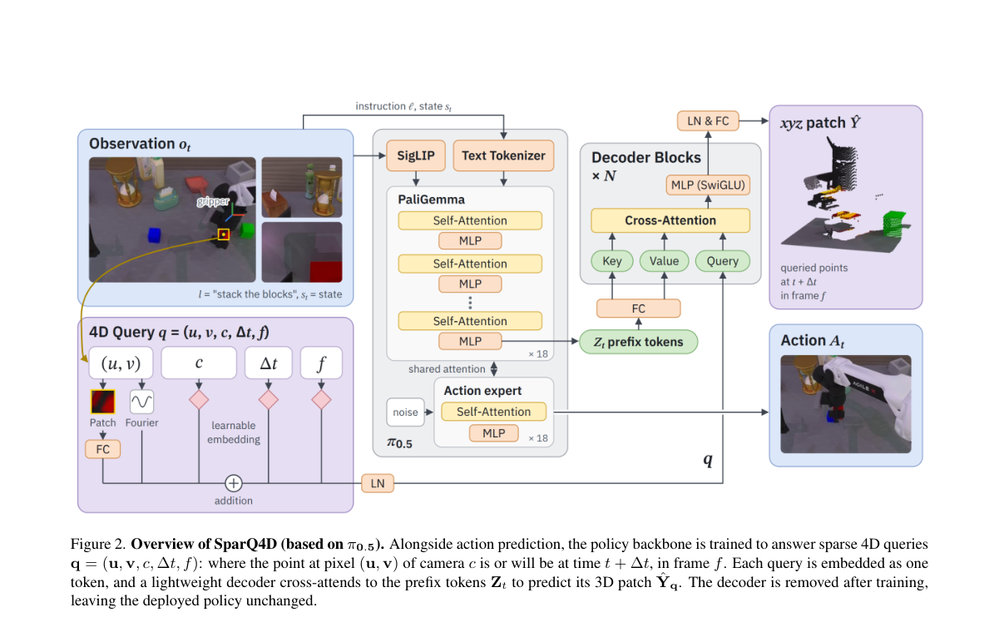

**Why this ranks #17**: 它把「给策略注入 4D 几何」这件事的成本压了下来：稠密预测整个未来会让训练开销大幅上升，SparQ4D 改为在预训练策略的中间表示上挂一个轻量 query 解码器，用统一查询接口把深度、二维/三维点运动、多视角对应和手眼关系都变成「回答一个问题」，训练时只采样少量查询，推理时整个解码器可以直接摘掉、零额外开销。相比两个 WAM 基线，以 π0.5 为底座的版本训练快 3 到 5 倍、推理快 1.7 到 6.6 倍，参数约为其四分之一，训练显存只用 24% 到 41%。

---

### 18. Into My Arms: Structured reinforcement learning for autonomous transport of objects and humans

**arXiv**: [2611.29771](https://arxiv.org/abs/2611.29771) | **Score**: 8.7 (relevance 9 x 0.7 + quality 8 x 0.3) | **Direction**: `embodied_ai` | **Tags**: embodied, humanoid-manipulation, reinforcement-learning, sparse-interaction-edges, assistive-robotics, sim-to-real, University of Edinburgh | **Categories**: cs.AI, cs.RO | **Pages**: 14

**Authors**: Elle Miller; Reem Almheiri; Takuma Tsukakoshi; Ben Sanati; Tamon Miyake; Yushi Wang; Namiko Saito; Shigeki Sugano; Tetsuya Ogata; Rika Antonova; Oisin Mac Aodha; Sethu Vijayakumar

**Affiliation**: University of Edinburgh; Waseda University; Technology Innovation Institute; Microsoft Research Asia; University of Cambridge

**Abstract**

> Whole-body humanoid manipulation remains bottlenecked by high-dimensional state-action spaces, contact-rich environments, and long task horizons. This trilemma is a challenge that state-of-the-art reinforcement learning (RL) methods are yet to resolve reliably. We address it with three contributions that add just enough structure to guide exploration: Sparse Interaction Edges (SIE) for whole-body manipulation, Interaction Gated Transport (IGT) for sustained transport over long horizons, and a Hinted Object Path (HOP) that resolves collision and search complexity bottlenecks. Across all three, the policy remains free to discover its own manipulation strategy. The method generalises from rigid object to human transport. As a flagship demonstration, we show, to our knowledge, the first bed-to-wheelchair transfer of a medical mannequin by a humanoid robot completed with no human intervention during execution. In the domain of human transfer, we show that a single policy can adapt across substantial variations in body mass, size, and random force perturbations, all while training on a single GPU in under an hour. Our approach offers a pathway to fully RL-driven humanoid manipulation, enabling assistive robots that can help humans. Website: https://elle-miller.github.io/into_my_arms

**Key findings**

- **Finding**: 机器人在执行阶段无人干预地把高 155 厘米、重 15 千克的医疗人偶从床上转移到轮椅；训练用单张消费级 GPU 上 2048 个并行环境、不到一小时，并覆盖身高 115 到 180 厘米、体重 11 到 33 千克的人体差异与随机外力扰动，结果取 5 个随机种子的平均。
- **Inference**: 全身操作之所以难，是状态-动作空间高维、接触密集、时程又长；SIE、IGT 与 HOP 三件套的共同点是只给稀疏的「该往哪碰、该靠近多久」的结构，而不规定具体动作，策略仍保留发现操作策略的自由。
- **Recommendation**: 做人形全身 RL 时，先从稀疏结构化奖励入手而不是加大网络：把机器人与物体的关键点对应写进观测与奖励、把持续搬运奖励用交互门控软化、再用显式物体路径解决碰撞与搜索，往往比换算法更省算力。

**Key figures**

*Framework - Autonomous human bed-to-wheelchair transfer on AIREC. Trajectories from a policy trained entirely in simulation are deployed zero-shot on the physical robot, lifting a medical mannequin (155 cm*

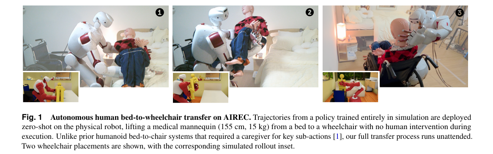

*Result - Mean evaluation returns and characteristic strategies across 5 seeds. Top: normalised mean evaluation return with the guidance reward component shaded during training for Ball, Human (near) and*

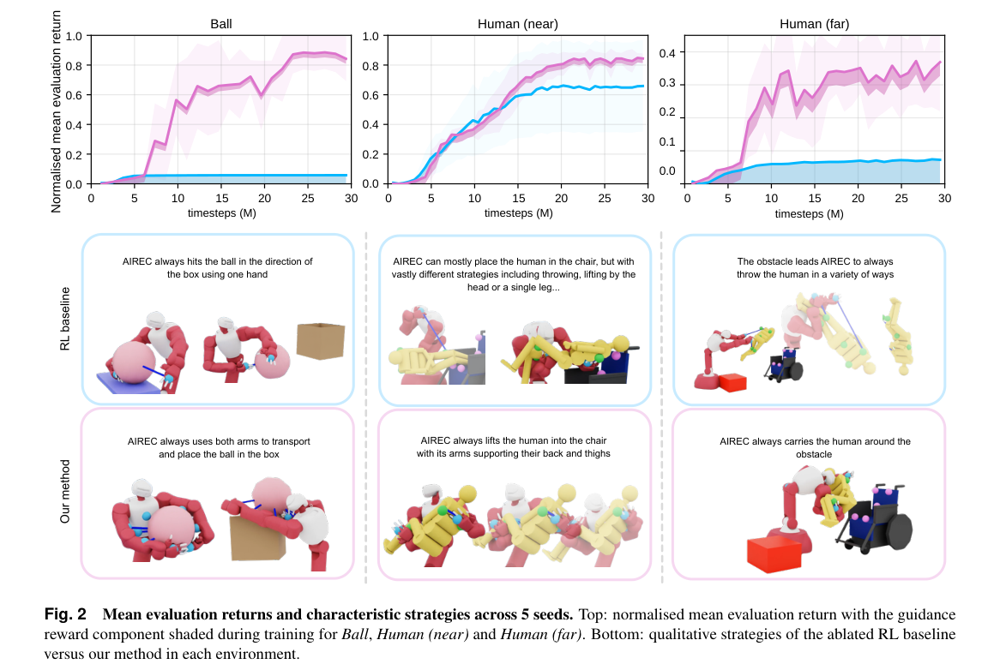

**Why this ranks #18**: 它是 embodied_ai 里少见以「帮助人」为目标的全身人形 RL 工作：用稀疏交互边 SIE 统一机器人与物体的关键点对应，交互门控传输 IGT 让持续搬运奖励只在需要靠近时生效，提示物体路径 HOP 用显式路径化解碰撞与搜索的高维瓶颈，而策略本身仍可自由探索。核心展示是首个由人形机器人在执行中无人干预地把医疗人偶从床上转移到轮椅；人偶高 155 厘米、重 15 千克，训练在单张消费级 GPU 上 2048 个并行环境、不到一小时完成，并能适应身高 115 到 180 厘米、体重 11 到 33 千克的人体差异与随机外力扰动。

---

### 19. Hierarchical Reasoning Action Head for Tiny Vision-Language-Action Models

**arXiv**: [2611.29813](https://arxiv.org/abs/2611.29813) | **Score**: 8.7 (relevance 9 x 0.7 + quality 8 x 0.3) | **Direction**: `embodied_ai` | **Tags**: embodied, tiny-vla, recurrent-action-head, hierarchical-reasoning, latency, libero, Computer Science | **Categories**: cs.CV, cs.LG, cs.RO | **Pages**: 10

**Authors**: Aditya Makineni; Amitesh Sahoo; Qing Tian

**Affiliation**: Department of Computer Science, University of Alabama at Birmingham

**Abstract**

> Real-time onboard robot control calls for a lightweight vision-language-action (VLA) model, yet shrinking the backbone leaves less capacity for deliberation at inference time. Chain-of-thought decoding, dual-system architectures, and larger backbones can restore deliberation but reintroduce the latency and memory costs that motivated going small. Recurrent action heads offer a lighter alternative by iterating in latent space before committing to an action, but existing designs refine a single undifferentiated state that must simultaneously encode slowly evolving task context and rapidly changing motor commands. We propose the Hierarchical Reasoning Action Head (HR-AH), which maintains two latent states updated at different frequencies: a low-level state that updates fast, grounded in action tokens and proprioception, and a high-level state that updates slowly, grounded in visual understanding and the instruction-informed low-level state. The two states exchange information through nested reasoning cycles. Because all iteration occurs in the compact head after a single backbone pass, HR-AH adds hierarchical reasoning without increasing the backbone size. With a 22.5M-parameter head, 3-4.3x smaller than those of RD-VLA and VLA-Adapter on the same backbone, HR-AH reaches 97.0% success rate on LIBERO and a 4.40 average chain length on CALVIN ABC->D, at the lowest latency among compared methods. We show that this hierarchy improves performance over a parameter-matched single-state head, and that routing distinct modalities to each level yields further gains in both accuracy and inference cost.

**Key findings**

- **Finding**: 22.5M 参数的 HR-AH 动作头比同骨干的 RD-VLA 与 VLA-Adapter 小 3 到 4.3 倍，在 LIBERO 四个套件上平均成功率 97.0%（Spatial 98.0%、Object 99.6%、Goal 97.4%），CALVIN ABC 到 D 平均推理链长 4.40，真机 Kinova Gen3 Lite 上成功率 78.8%。
- **Inference**: 单状态循环头必须同时编码慢变的任务上下文和快变的电机指令，两者时间尺度冲突；把两者拆成高低层并各自按对应模态更新，等于用结构代替堆参数。
- **Recommendation**: 做端侧小 VLA 时，优先在动作头里引入多频率潜状态而不是换更大的骨干或加链式思维解码——论文显示 22.5M 的分层头能拿到 97.0% 的 LIBERO 成功率且延迟是同类中最低；改造时应分别把动作 token 与本体感觉路由到低层、视觉与指令路由到高层。

**Key figures**

*Framework - Attention maps over reasoning steps for RD-VLA (top row) and our HR-AH (bottom row). The dashed ellipse highlights the task-relevant region. HR-AH halts after only 3 steps with attention sha*

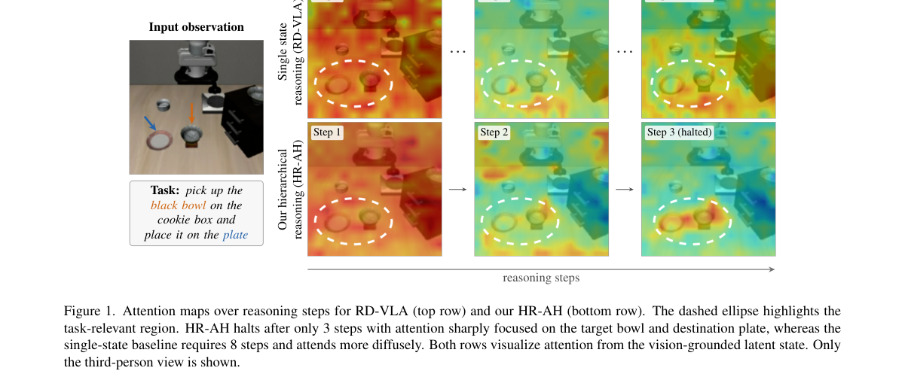

*Result - Overview of the Hierarchical Reasoning Action Head (HR-AH). The VLM backbone extracts multimodal features from a deep layer (hviz, ha) and the embedding layer (hemb*

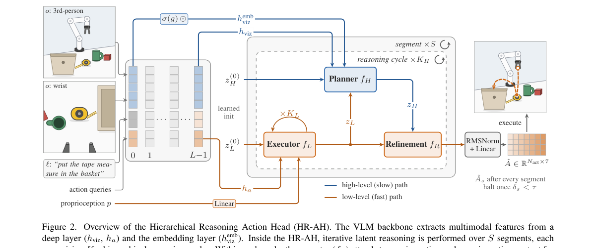

**Why this ranks #19**: 它解决的是「为了实时把 VLA 做小，结果没时间思考」的矛盾：链式思维解码、双系统架构和更大的骨干都能补回推理能力，但会把当初想省掉的延迟与显存又加回来。HR-AH 在紧凑的动作头里维护两个不同频率更新的潜状态——由动作 token 与本体感觉驱动的高频低层状态、由视觉理解与指令驱动的低层状态慢速更新的高层状态——二者通过嵌套推理循环交换信息。所有迭代都发生在单次骨干前向之后的动作头里，因此不增大骨干就得到分层推理：22.5M 参数的头比同骨干的 RD-VLA 与 VLA-Adapter 小 3 到 4.3 倍，LIBERO 成功率 97.0%，CALVIN ABC 到 D 平均推理链长 4.40。

---

### 20. RoboThink: Let the Agent Think, Let the Policy Act

**arXiv**: [2611.30111](https://arxiv.org/abs/2611.30111) | **Score**: 8.7 (relevance 9 x 0.7 + quality 8 x 0.3) | **Direction**: `embodied_ai` | **Tags**: embodied, reasoning-agent, robot-policy, dazzger, instruction-feedback, drift-robustness, Tulane University | **Categories**: cs.AI, cs.RO | **Pages**: 15

**Authors**: Yunbei Zhang; Zijian Jin; Janet Wang; Xingchen Zhao; Zhenyu Zhang; Weirui Ye; Yilun Du

**Affiliation**: Tulane University; NYU; Northeastern University; Stanford University; MIT

**Abstract**

> Robot policies act in real time but fail without knowing why, whereas a reasoning agent that watches the robot can often tell what went wrong. Existing systems either hand the agent control, which takes minutes per episode, or let it send instructions. Yet a policy follows a new instruction only from a fresh start, since a half-finished task leaves it in states outside its training data. Nor can an instruction fix how the robot moves. If a drift keeps pulling the hand to the left, "push right, slightly" is not a task the policy has learned. We propose RoboThink, in which the agent thinks and the policy learns to act on the agent's guidance. An instruction channel tells the policy what to do. When the user says "the milk, not the butter" after the robot has started, the agent rewrites the instruction and the robot undoes its own motion, with no training. A feedback channel tells it how to move. It is taught from the agent alone with agent-labelled DAgger, role tokens and counterfactual feedback, and is read only by the policy's action module. On LIBERO, RoboThink with Claude Opus 5.5 raises success from 0.09 to 0.87 under an unknown constant drift and from 0.42 to 0.84 under a random one. It also completes misheard and changed requests in 0.91 to 1.00 of the episodes. Acting alone, GPT-6 Astra needs 2.1 min per success and over a million tokens per episode, whereas RoboThink needs 55 s and 8k tokens. The same recipe works across policies, for both vision-language-action models and world action models, and across robots, from one arm to two arms and a mobile manipulator. On all 50 RoboTwin 2.0 tasks with two arms, success rises from 0.12 to 0.74 under the constant drift and from 0.31 to 0.56 under the random one. Finally, the agent is a plug-in. A policy taught by one agent works with other agents, including open-weight ones, and grows stronger with a stronger agent, without retraining.

**Key findings**

- **Finding**: LIBERO 上 RoboThink 配 Claude Opus 5.5，未知恒定漂移下成功率从 0.09 升到 0.87、随机漂移下从 0.42 升到 0.84，听错或改口的请求有 0.91 到 1.00 的回合能完成；两个手臂的 50 个 RoboTwin 2.0 任务上从 0.12 升到 0.74、随机漂移下从 0.31 升到 0.56。
- **Inference**: 智能体擅长的是「说出该做什么、错在哪」，不擅长实时控制；把它的高层判断通过只被动作模块读取的反馈通道压进策略，就能在保持策略实时性的同时拿到语义纠错能力。
- **Recommendation**: 给机器人策略接推理智能体时优先分成指令通道与反馈通道两条，并只用智能体标注的 DAgger 加角色 token 与反事实反馈训练反馈通道、且只让动作模块读取它；同时保留一个「智能体单独行动」的基线，用每成功所需时间与 token 数衡量是否真的省算力。

**Key figures**

*Framework - RoboThink lets the reasoning agent think and the robot policy act. Left: three ways to combine a robot policy with a reasoning agent. (a) The agent controls the robot itself, which is genera*

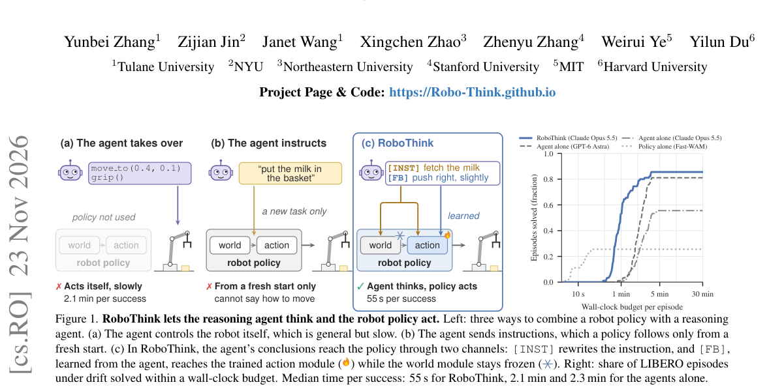

*Result - Teaching the feedback channel from the reasoning agent. (1) On training tasks under training drifts, the robot executes the policy’s plan corrected by the agent’s estimate. (2) Each state yi*

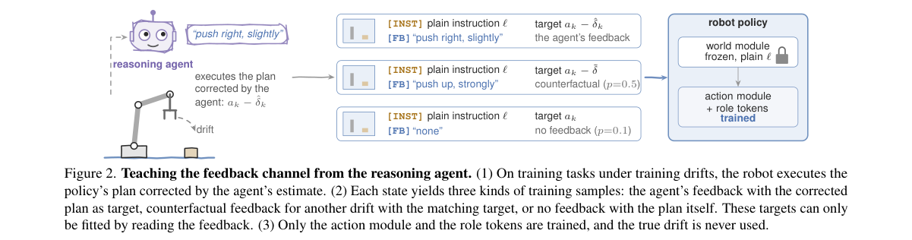

**Why this ranks #20**: 它指出「让推理智能体直接控制机器人」和「让它发指令」两种做法都不够：前者每个回合要几分钟，后者只能从头执行且无法纠正机器人「怎么动」。RoboThink 把两者拆成指令通道与反馈通道——指令通道让策略撤销自己的动作去改目标，反馈通道用智能体标注的 DAgger、角色 token 和反事实反馈教会策略怎么动，且只被动作模块读取。LIBERO 上换成 Claude Opus 5.5 后，未知恒定漂移下成功率从 0.09 升到 0.87、随机漂移下从 0.42 升到 0.84；智能体单独行动时 GPT-6 Astra 每个成功要 2.1 分钟、每回合超过一百万 token，而 RoboThink 只要 55 秒和 8k token。

---

## Footer

- Total papers reviewed across all 4 axes: 60
- world_embodied axis final count: 20
- Wild-cards in this axis: 0
- Figure assets: 2026-11-25/res/

Generated by `mine-arxiv-daily-digest` skill. Sister file: `2026-11-25_world_embodied_entry.md`.
