# Mine Arxiv Daily Digest - 2026-11-26 (AIGC 视觉生成与编辑 Axis, 17 papers)

**Generated**: 2026-11-26 01:25 CST

**Source**: arXiv cs.CV, cs.SD, eess.AS, cs.CL, cs.AI, cs.RO, cs.LG, cs.IR submissions, listing day 2026-11-24 (announced listing 11-24 于 2026-11-25 01:00 UTC 公告)

**Batch window**: 2026-11-23T19:00:00Z .. 2026-11-24T19:00:00Z（arXiv 公告批次窗口按 listing 日逐段相接：每段的起点是前一日的美东 14:00 截止时刻（EDT 为 18:00Z，EST 为 19:00Z），终点是当日同一时刻）

**Axis**: aigc_visual (17 papers, base 15, cap 20)

**Directions**: aigc_generation (10), aigc_editing (4), aigc_rl (3)

**Selection**: 17 papers ranked by relevance x quality, with 0 wild-card slots

**Day total**: 60 papers across 4 axes (target 60)

**Scope**: 图像 / 视频 / 3D / 4D 内容的生成与编辑，以及面向视觉生成的 RL / 偏好优化与奖励模型

**Wild-card**: 0 篇 —— aigc_generation 103 篇、aigc_editing 42 篇、aigc_rl 8 篇够格候选都远超本轴 17 个席位，名额全部由同轴内更靠前的论文占满，未启用任何补位名额。

本轴 17 篇超出基准 2 个名额，压力压在 aigc_generation（10 篇，基准 8）上，另两个 direction 恰好停在基准（aigc_editing 4 / aigc_rl 3），此时 dir_over = 2、dir_under = 0、axis_surplus = 2，三者相等才放行。值得注意的是 aigc_rl 的 3 篇都指向同一个瓶颈：视频生成太贵、没法直接上 RL，所以 Loupe 干脆不渲染视频就做 GRPO。

---

## AIGC 生成（图像 / 视频 / 3D / 4D） · `aigc_generation` (10 papers)

10 篇里三条主线清楚：把长视频与分支叙事交给 agent 与持久记忆（CineAct 分支成功率 +30.8 点、Lyris 单张照片生成 3 分钟 50 米漫游、Ego2Wrist 用 940 小时头戴-腕部配对数据合成腕部视角）；把生成搬进程序与代码空间（Nemotron 用 Pixel as Code 把 tokenizer 重建 PSNR 从 26.08 提到 29.57 dB、MAGPIE 用可执行 Blender 程序比原骨干高 28.21 点）；以及把算力压下去（LRQ-Cache 把 109–346 GiB 特征缓存压到 2.3–4.9 GiB 而 VBench 只掉 0.25 pp、生成快 2.7–5.9 倍，Draft Forcing 用 on-policy verifier 做到 DiT 1.63 倍，Motion Mamba 2.0 把人形动作中位延迟从 1685 ms 压到 276 ms）。

### 1. Draft Forcing: Target-guided Speculative Drafting and Learned Verifier for Autoregressive Video Generation

**arXiv**: [2611.30328](https://arxiv.org/abs/2611.30328) | **Score**: 8.7 (relevance 9 x 0.7 + quality 8 x 0.3) | **Direction**: `aigc_generation` | **Tags**: AIGC-visual, speculative-decoding, video-diffusion, learned-verifier, autoregressive-video, Shanghai Jiao Tong University | **Categories**: cs.CV | **Pages**: 18

**Authors**: Chenkai Xu; Yuji Ren; Zihui Liu; Yijie Jin; Yuhao Shen; Xin Wang; Yajing Chen; Keyang Luo; Shengju Qian; Litong Gong; Tiezheng Ge; Zhijie Deng

**Affiliation**: Shanghai Jiao Tong University; Zhejiang University; LIGHTSPEED; Alibaba Group

**Abstract**

> Autoregressive video diffusion models enable streaming synthesis chunk by chunk, yet invoking the large model for every chunk remains costly. While chunk-level speculative decoding can offload chunks to a lightweight draft model, existing approaches suffer from two limitations: (1) an off-the-shelf draft diverges from the target's trajectory, compounding errors in history; and (2) they either omit verification or rely on costly post-decode aesthetic scores rather than verifying consistency against the target. We address both with Draft Forcing, a framework coupling target-guided drafting with an on-policy trained verifier. Specifically, to align the draft for high acceptance, we opt for feature-level drafting, conditioning it on multi-layer target hidden states persisted from committed chunks, whose outputs are pushed to match target trajectories with multi-aspect losses. For verification, we propose an on-policy trained feature-space verifier predicting CDF-calibrated frame-wise relative RMSE against the target. It is trained on speculative rollouts as contexts anneal from random to inference-aligned mixtures, and gates proposals without VAE decoding. On the 14B Self-Forcing target, Draft Forcing achieves $1.63\times$ DiT and $1.57\times$ end-to-end speedups on VBench with minimal quality loss, and up to $1.93\times$ DiT ($1.82\times$ end-to-end) when combined with orthogonal KV compression. It generalizes to accelerate a streaming variant of MiniMax-H3, generating over $50\%$ draft frames with competitive quality.

**Key findings**

- **Finding**: 在 14B 的 Self-Forcing 目标上，Draft Forcing 取得 1.63× 的 DiT 加速与 1.57× 的端到端加速，VBench 质量仅轻微下降；与正交 KV 压缩组合后 DiT 加速达 1.93×。
- **Inference**: 草稿能被高比例接受的关键是它在特征层面对齐目标模型的多层隐藏状态轨迹，而不是作为独立像素模型去猜下一段。
- **Recommendation**: 跑长视频流式生成时优先复现「目标引导草稿 + 免 VAE 解码的特征空间验证器」这一组合，而不是直接套用现成的轻量草稿模型。

**Key figures**

*Framework - Draft Forcing overview and qualitative comparison on accelerating the 14B Self-Forcing target. Top: chunk-wise speculation couples a target-guided draft D with an on-policy trained feature-s*

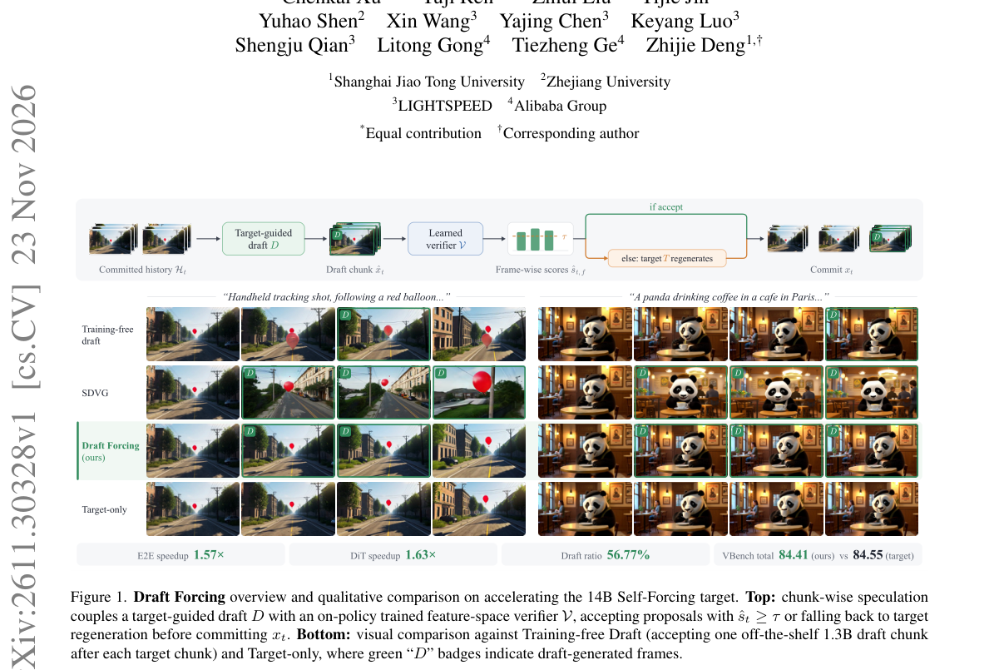

*Result - Training of Draft Forcing. (1) Target-guided draft training fuses cached target hidden states persisted from committed historical chunks and combines flow matching, temporal difference, and*

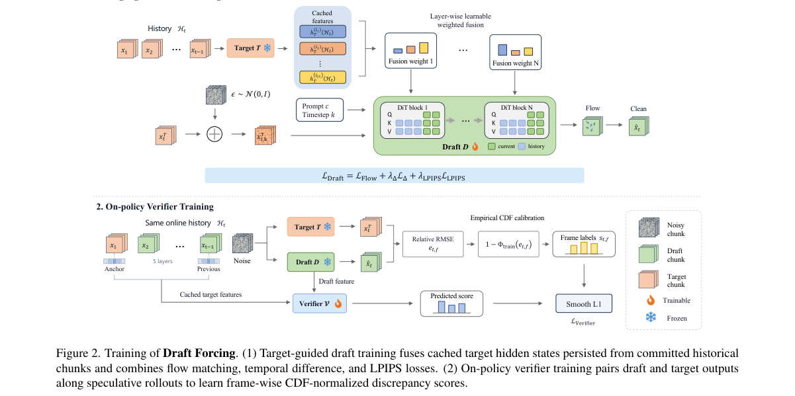

**Why this ranks #1**: 面向自回归视频扩散的块级投机解码：14B 的 Self-Forcing 目标上取得 1.63× 的 DiT 加速与 1.57× 的端到端加速，叠加正交 KV 压缩后 DiT 最高 1.93×（端到端 1.82×），特征空间验证器无需 VAE 解码即可判定接受。

---

### 2. CineAct: Interaction-State Agents for Playable, Branching Film Generation

**arXiv**: [2611.30613](https://arxiv.org/abs/2611.30613) | **Score**: 8.7 (relevance 9 x 0.7 + quality 8 x 0.3) | **Direction**: `aigc_generation` | **Tags**: AIGC-visual, world-state, agentic-video, branching-narrative, scene-graph, fl2v, Hong Kong Polytechnic University | **Categories**: cs.CV | **Pages**: 21

**Authors**: Junyan Lin; Jianqi Ma; Shujie Duan; Hanxin Zhu; Zhihao Hu; Jinming Liu; Shuai Li; Jun Zhang; Xin Jin; Chang Wen Chen; Weidong Zhang

**Affiliation**: Hong Kong Polytechnic University; Tencent; Xiamen University Malaysia; University of Science and Technology of China; Shanghai Jiao Tong University

**Abstract**

> Open video generators such as MiniMax-H3 produce short clips of only several to a dozen seconds per run. To synthesize longer sequences, existing methods either rely on agentic systems following preset scripts, or roll out autoregressively from the previous clip's last frame, losing off-screen states and accumulating hallucinations across turns. Consequently, users still cannot take an explicit goal, choose how to accomplish it, and see that choice persist across subsequent clips. We study goal-grounded interactive video generation, where one goal admits multiple valid approaches, the user's chosen approach must be executed on screen, and its consequences must persist across clips. To this end, we propose CineAct, a state-first agentic framework in which language-model agents handle reasoning while frozen image and video generators serve purely as renderers. Before interaction, the Architect initializes the world as a spatial layout with cameras, an asset library, and a scene graph; at each turn, the system deduces the planned state change, generates a target end frame with an image generator and rigorously verifies it, and synthesizes intermediate motion with an FL2V model. We further introduce a multi-space benchmark covering two suites: long-horizon step execution and open-intent branching admissibility. Experiments show that explicit world-state modeling boosts multi-step rollout consistency over the pixel-only baseline (+11.4 automated, +23.1 human points) and raises paired branching success toward a shared goal by +30.8 points.

**Key findings**

- **Finding**: 显式世界状态建模让多步 rollout 一致性比纯像素基线高 11.4 分（自动评测）与 23.1 分（人工评测），共享目标下的配对分支成功率提升 30.8 分。
- **Inference**: 长视频的瓶颈不在单段画质而在离屏状态丢失，把状态从像素里剥出来交给场景图管理，比单纯延长上下文更有效。
- **Recommendation**: 做可交互长视频时先把状态推理与渲染器拆成两套模型，再用自动评测与人工评测两套一致性指标同时验收。

**Key figures**

*Framework - Goal-grounded branching with CineAct. Given a shared goal (“I want to watch TV”), CineAct initializes a spatial layout (L), an asset library (A), and a scene graph (G) to govern route select*

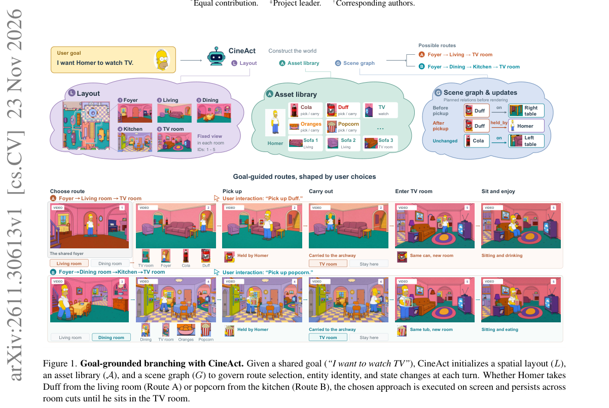

*Result - CineAct framework. Top (World construction): From a story goal, Architect initializes a spatial layout with fixed cameras (L), an asset library of instance and scene references (A), and a mu*

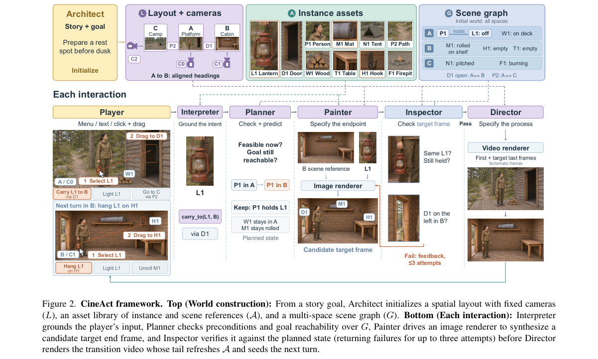

**Why this ranks #2**: 把长视频生成从像素续写改成显式世界状态驱动：Architect 先建相机布局、资产库与场景图，再逐步生成并校验目标帧、用 FL2V 合成中间运动；量化上多步一致性比纯像素基线高 11.4 分（自动）与 23.1 分（人工），共享目标下的分支成功率提升 30.8 分。

---

### 3. Lyris: Layout-Guided Long Video Generation with Persistent 3D Memory

**arXiv**: [2611.31239](https://arxiv.org/abs/2611.31239) | **Score**: 8.7 (relevance 9 x 0.7 + quality 8 x 0.3) | **Direction**: `aigc_generation` | **Tags**: AIGC-visual, long-video, point-cloud-memory, layout-conditioned, camera-control, vlm-planning, NVIDIA | **Categories**: cs.CV | **Pages**: 21

**Authors**: Chen Wang; Jiahui Huang; Riccardo de Lutio; Alex Trevithick; Bryan Chu; Jiawei Ren; Laura Leal-Taixé; Shengyu Huang; Lingjie Liu; Haithem Turki

**Affiliation**: NVIDIA; University of Pennsylvania

**Abstract**

> Exploring a scene from as little as a single photo requires generating a long, camera-controlled walkthrough that extends far beyond what was captured, yet remains consistent upon return. Memory-based video generation methods preserve what they have already seen, but have no anchor beyond it, where the camera drifts from its path and a text prompt can name objects but not place them. Layout-conditioned methods provide such an anchor and precise control over what appears where, but rely on layouts that are typically authored by hand. Both limitations arise because, beyond what was captured, nothing anchors the video model unless a human authors one. To overcome both, we propose Lyris, a long video generation framework that never leaves the video model without an anchor: a persistent point-cloud memory where the scene has been observed or generated, and a 3D layout that a vision-language model authors where it has not. Our key insight is that the interface between the two models can be surprisingly coarse. A layout of one labeled 3D box per object is simple enough for a vision-language model to author (and for a user to edit), yet expressive enough for a video model to follow once rendered along the camera path. We demonstrate walkthroughs of over three minutes and 50 meters from a single photo, passing through doorways into rooms it never shows. When evaluated on minute-long round trips across four datasets, Lyris outperforms state-of-the-art methods by a wide margin, reducing camera error by 3.8x and improving consistency upon return by 22% on average.

**Key findings**

- **Finding**: Lyris 从单张照片生成超过三分钟、50 米的漫游镜头，并在四个数据集的分钟级往返评测中把相机误差降低 3.8 倍、把回访一致性平均提升 22%。
- **Inference**: 每个对象一个带标签的 3D 框就足以同时被 VLM 编写、被用户编辑、被视频模型跟随，说明两个模型之间的接口可以粗到结构级。
- **Recommendation**: 做长镜头漫游时，把「已看到的区域」冻结成点云记忆，只让 VLM 负责规划看不见的部分，可显著减少返程时的漂移。

**Key figures**

*Framework - From a single photo, Lyris generates long, camera-controlled walkthroughs that extend far beyond it. A vision-language model authors a 3D layout of labeled object bounding boxes for the vide*

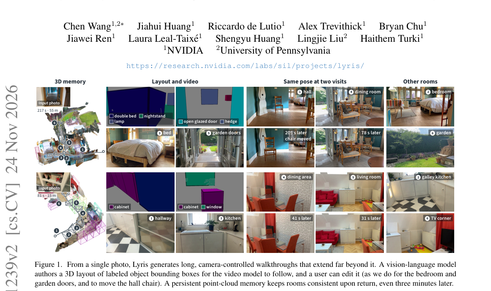

*Result - Overview of Lyris. To decide what lies beyond the input views, we use a vision-language model to plan a 3D layout B of labeled object boxes before each chunk k. We then render this layout an*

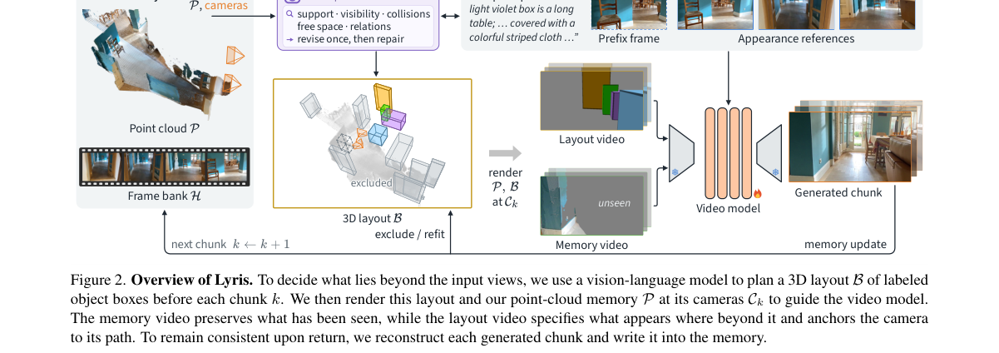

**Why this ranks #3**: 让视频模型始终有锚点：已观测或已生成区域用持久点云记忆，未观测区域由视觉语言模型写 3D 框布局；单张照片可生成超过三分钟、50 米的可控漫游，四个数据集上的分钟级往返评测中相机误差降低 3.8 倍、回访一致性平均提升 22%。

---

### 4. Nemotron-Labs-VisualCreation: Pixel as Code for Agentic Visual Creation

**arXiv**: [2611.31358](https://arxiv.org/abs/2611.31358) | **Score**: 8.7 (relevance 9 x 0.7 + quality 8 x 0.3) | **Direction**: `aigc_generation` | **Tags**: AIGC-visual, autoregressive-image, discrete-tokenizer, code-generation, agentic-rendering, vision-code, NVIDIA | **Categories**: cs.AI, cs.CV | **Pages**: 51

**Authors**: Guo Chen; Fuxiao Liu; Haoqin Tu; Yiyang Zhou; Andrew Tao; Bryan Catanzaro; Cihang Xie; Yuyin Zhou; Huaxiu Yao; Didong Lu; Zongxia Li; Guilin Liu

**Affiliation**: NVIDIA

**Abstract**

> Visual creation demands expressive imagery together with precise control over text, layout, and structure. We introduce Nemotron-Labs-VisualCreation, an agentic framework that connects these capabilities through Pixel as Code. Raster images are represented by learned discrete visual tokens, while structured artifacts use explicit programs. A shared generation-and-rendering interface connects these representations to visual feedback across images, vector graphics, webpages, and documents. A Nemotron-native harness coordinates planning and raster candidate selection, with targeted repair for editable structured and hybrid artifacts. To support this interface, we develop Nemotron-Labs-Image-Tokenizer, the autoregressive raster generator Nemotron-Labs-Image-30B-A3B, and the structured-code model family Nemotron-Labs-VisionCode. On approximately 178K images spanning six visual domains, our tokenizer improves reconstruction PSNR from 26.08 to 29.57 dB over Emu3.5 IBQ. It also provides 7.13x faster encoding and 10.93x faster decoding at batch size one on A100. In standalone evaluation, one Nemotron-Labs-VisionCode variant surpasses Kimi K3.1 Pro on the aggregate across Chart2Code, MMSVG, Design2Code, and Image2Struct. At the system level, the Nemotron-native configuration raises GenEval2 Soft-TIFA GM from 31.71 to 52.56 using the same raster generator. With our best setting, Nemotron-Labs-VisualCreation achieves performance competitive with GPT Image 2 and Nano Banana Pro across most benchmarks with available comparisons.

**Key findings**

- **Finding**: Nemotron-Labs-Image-Tokenizer 在约 178K 张、覆盖六个视觉域的图上把重建 PSNR 从 Emu3.5 IBQ 的 26.08 dB 提升到 29.57 dB，并在 A100 批次 1 下编码快 7.13×、解码快 10.93×。
- **Inference**: 可编辑产物必须保留参数化表示，纯像素生成器再强也做不到生成后继续精修，因此两类产物要分开建模再统一编排。
- **Recommendation**: 需要同时产出海报与可改网页时，搭「视觉 token + 结构化代码」双表示的 harness，不要指望单一端到端模型两头兼顾。

**Key figures**

*Framework - Pixel as Code at a glance. Learned visual tokens and explicit programs provide complementary representations for raster images and editable structured artifacts. Their renderers connect both*

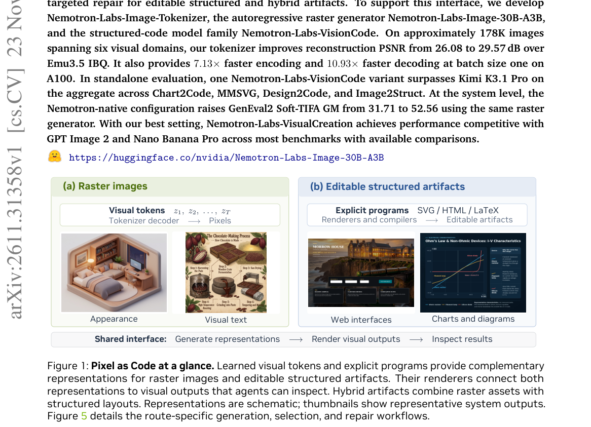

*Result - Raster image generation examples from Nemotron-Labs-VisualCreation. The examples span illustrated infographics, text-rich compositions, portraits, stylized typography, and product imagery, i*

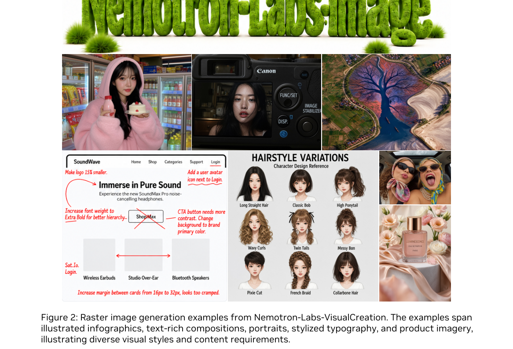

**Why this ranks #4**: Pixel as Code 把栅格图像交给学到的离散视觉 token、结构化图表网页文档交给显式程序，再用统一的生成与渲染接口接视觉反馈；tokenizer 在约 178K 张、覆盖六个视觉域的图上把重建 PSNR 从 Emu3.5 IBQ 的 26.08 提到 29.57 dB，A100 上编码快 7.13×、解码快 10.93×。

---

### 5. BodyWeave: Native Body-Conditioned 3D Garment Generation

**arXiv**: [2611.32034](https://arxiv.org/abs/2611.32034) | **Score**: 8.7 (relevance 9 x 0.7 + quality 8 x 0.3) | **Direction**: `aigc_generation` | **Tags**: AIGC-visual, garment-generation, 3d-body-conditioning, garment-fitting, penetration-loss, diffusion-3d, Zhejiang University | **Categories**: cs.CV | **Pages**: 24

**Authors**: Junyi Zhang; Yuanchuan Wang; Qichao Wang; Wenzhe Qian; Shizhuo Cheng; Min Zhang

**Affiliation**: Zhejiang University

**Abstract**

> Generating 3D garments for digital characters requires preserving a reference design while adapting the garment to the target body's shape and pose. Sewing-pattern methods can struggle to reproduce unfamiliar designs and fine details, while image-to-3D generators offer rich shape priors but typically lack explicit 3D body context. We present \textbf{BodyWeave}, a framework that unifies garment generation and fitting through native 3D body conditioning. Building on 3D generative priors, BodyWeave uses the body as a spatial reference throughout geometry generation: a \textbf{Global Body Adapter} guides garment placement and extent in the shared coordinate frame, while \textbf{Local Body Attention} guides surface refinement using nearby body geometry. A \textbf{Surface Penetration Loss} supervises decoded surfaces to reduce body intersections, and the resulting geometry conditions material synthesis to produce garments with physically based rendering attributes. To support learning across designs and wearers, we construct \textbf{GarmentWeave3D} with 293K aligned garment--body observations, including 114K same-design cross-body pairs. Evaluations on out-of-domain \textbf{Artist-Created Garments} demonstrate high geometric fidelity and low body penetration. Cross-body evaluations demonstrate accurate adaptation to new wearers with consistent garment--body spacing, while appearance comparisons show faithful fabric reproduction. Additional results and resources are available at https://gavin-jy.github.io/bodyweave-page/

**Key findings**

- **Finding**: GarmentWeave3D 数据集包含 293K 条对齐的服装-身体观测，其中 114K 条是同款设计的跨身体配对，支撑了同时学习生成与试穿的数据条件。
- **Inference**: 缝合版型方法难以复现陌生设计，说明设计保真必须靠图像先验，而版型适配必须靠 3D 身体上下文，二者得分开建模再合并。
- **Recommendation**: 做数字角色服装时把身体坐标系的先验直接注入几何生成流程，比生成后再做形变拟合更省事且穿模更少。

**Key figures**

*Framework - BodyWeave generates garments with native 3D body conditioning. Given reference images and a target body, our method generates garment geometry directly in the body’s coordinate frame togethe*

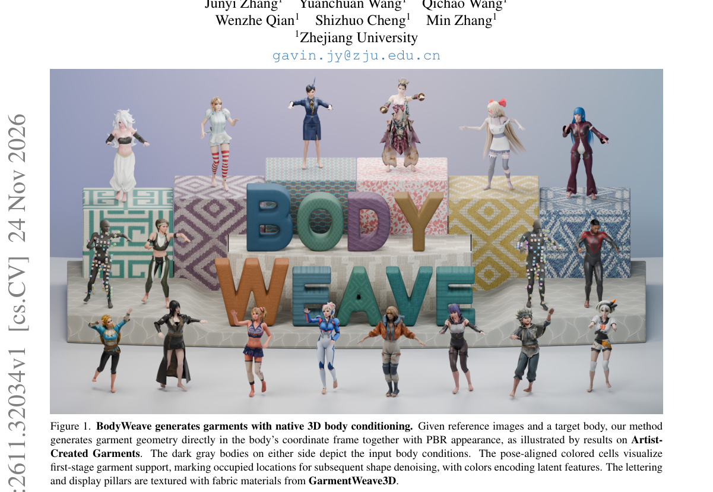

*Result - BodyWeave pipeline. Given three garment views and a target body, BodyWeave generates garment geometry in the body’s coordinate frame. GBA predicts body-aligned sparse support to establish gl*

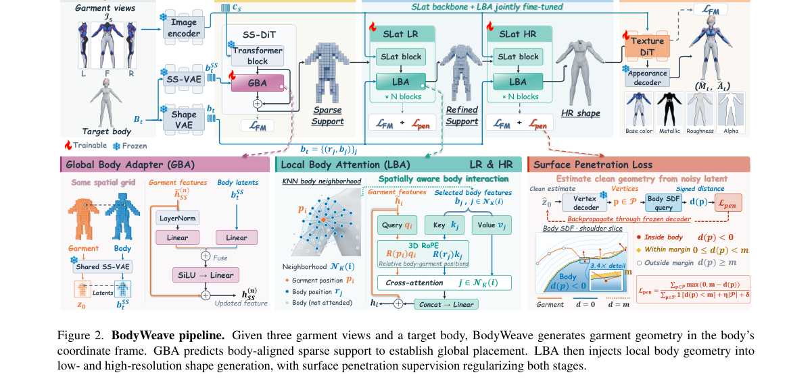

**Why this ranks #5**: 把人体当作几何生成过程中的空间参考：全局身体适配器决定服装位置与范围，局部身体注意力用邻近身体几何细化表面，表面穿透损失抑制穿模；配套 GarmentWeave3D 含 293K 条对齐的衣-人观测，其中 114K 条是同款设计跨身体配对。

---

### 6. LRQ-Cache: Compressing Feature Caches in Video Diffusion via Low-Rank Approximation and Quantization

**arXiv**: [2611.32345](https://arxiv.org/abs/2611.32345) | **Score**: 8.7 (relevance 9 x 0.7 + quality 8 x 0.3) | **Direction**: `aigc_generation` | **Tags**: AIGC-visual, feature-cache, low-rank-approximation, int8-quantization, video-diffusion, training-free, Harbin Institute of Technology | **Categories**: cs.CV | **Pages**: 19

**Authors**: Ruizhe Yao; Zhen Huang; Songpan Gao; Danyi Liu; Zijian Cao; Weijie Zheng; Haohuan Fu

**Affiliation**: Harbin Institute of Technology, Shenzhen; Tsinghua University; Peng Cheng Laboratory; Northeastern University

**Abstract**

> Video diffusion transformers (DiTs) achieve high-fidelity generation, but inference is expensive because every denoising step evaluates a large transformer over all spatiotemporal tokens of the video. Temporal caching accelerates them by reusing intermediate features across denoising steps. However, retaining dense feature tensors introduces a persistent storage cost that grows with video length, resolution, and cache coverage, reaching 109-346 GiB per video for the predictive caches we evaluate. Such states exceed the memory of a single GPU, so native caches must either be offloaded to the CPU, which slows generation, or be sharded across several GPUs, e.g., with sequence parallelism, so that the cache rather than the compute sets the number of GPUs. We instead shrink the cached state itself, exploiting its redundancy: a few channel patterns shared across tokens capture much of the energy of each cached feature. Based on this observation, we propose LRQ-Cache, a training-free method that combines low-rank approximation and quantization for feature-cache compression. LRQ-Cache represents each cached feature with a small set of factors, quantizes them before storage, and reconstructs the feature at reuse time, leaving cache mechanisms unchanged. Across three caching mechanisms on HunyuanVideo and Wan2.1, LRQ-Cache reduces the persistent state of predictive caches by 42-71x, to 2.3-4.9 GiB per video. VBench stays within 0.25 pp of the native cache for TeaCache, and the larger drops of the Wan2.1 predictive caches, up to 3.5 pp, shrink at higher ranks. As a result, predictive caches that exceed the memory of a single 80 GB H100 GPU fit on it with LRQ-Cache, making generation 2.7-5.9x faster than with CPU-offloaded native caches.

**Key findings**

- **Finding**: 论文评估的预测型特征缓存常驻状态达每段视频 109-346 GiB，LRQ-Cache 把它压到 2.3-4.9 GiB，缩小 42-71 倍，TeaCache 的 VBench 只比原生缓存低 0.25 个百分点。
- **Inference**: 缓存冗余主要来自跨 token 共享的少数通道模式，所以低秩分解能同时压体积与保质量，而单纯量化更快掉分。
- **Recommendation**: 用缓存加速视频扩散时先量常驻缓存体积，若超过单卡显存就优先加一层低秩加 INT8 的存储层，而不是加卡或卸载到 CPU。

**Key figures**

*Framework - Overview of LRQ-Cache. (a) Feature caching computes the network at refresh steps and reuses the stored state at the steps in between: the caching rule decides when to refresh, and the predic*

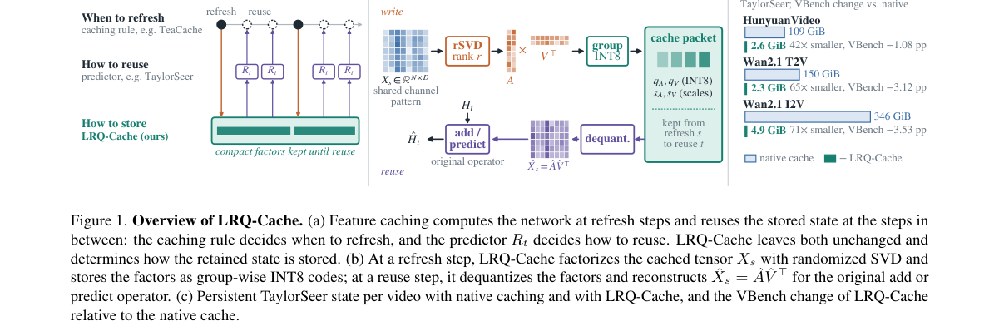

*Result - How well cached features of HunyuanVideo compress. Relative error of the best rank-r approximation; lower means more compressible. (a) TeaCache residual. (b) TaylorSeer MLP fea- tures of thr*

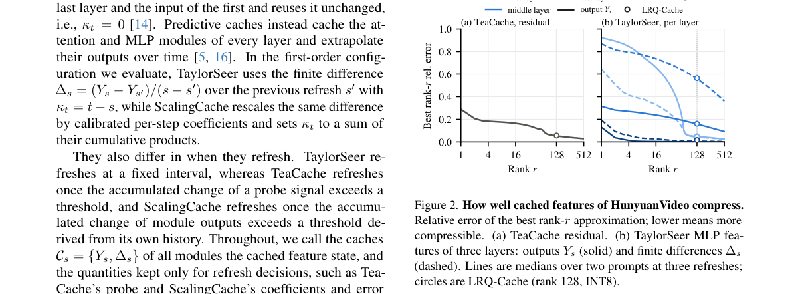

**Why this ranks #6**: 视频扩散的时序缓存常驻状态可达每段视频 109-346 GiB；LRQ-Cache 用训练无关的低秩近似加量化把预测型缓存压到 2.3-4.9 GiB（缩小 42-71×），TeaCache 上 VBench 仅落后原生缓存 0.25 个百分点，并让超显存缓存装进单张 80 GB H100，比 CPU 卸载快 2.7-5.9×。

---

### 7. MAGPIE: Agentic Multi-Reference Image Generation via Executable Scene Construction

**arXiv**: [2611.32462](https://arxiv.org/abs/2611.32462) | **Score**: 8.7 (relevance 9 x 0.7 + quality 8 x 0.3) | **Direction**: `aigc_generation` | **Tags**: AIGC-visual, multi-reference, blender-program, coding-agent, scene-verification, reference-preservation, School of Artificial Intelligence | **Categories**: cs.CL, cs.CV | **Pages**: 20

**Authors**: Yifan Dai; Daili Hua; Bohan Zeng; Yuran Wang; Jialing Liu; Bozhou Li; Chengzhuo Tong; Yang Shi; Kai Zeng; Liu Yang; Xinyu Liu; Shujie Li

**Affiliation**: School of Artificial Intelligence, Shanghai Jiao Tong University; Peking University; KlingAI Research; Renmin University of China; SJTU

**Abstract**

> Multi-reference image generation requires a model to preserve the appearance of selected subjects while arranging them according to an instruction. Despite recent progress in reference-based generation and compositional control, reliably organizing selected subjects into the intended scene remains challenging. Although existing methods provide various forms of compositional guidance, the planned relationships are not always explicitly instantiated for inspection and refinement before image synthesis. To address this limitation, we introduce MAGPIE, which represents the intended composition as a simplified 3D scene defined by an executable Blender program. A coding agent links each scene instance to its reference, checks the geometry and rendered view against the instruction, and revises the program to correct discrepancies. The final proxy rendering serves as a visual plan for the image generator. Using MAGPIE-Instruct-3K, we train the generator to follow this plan while drawing each subject's appearance from its reference. MAGPIE improves both Qwen and FLUX on DreamOmni2 and SconeEval. With FLUX, it improves overall success on DreamOmni2 by 28.21 percentage points over the original backbone and achieves the highest overall score among the models evaluated on SconeEval.

**Key findings**

- **Finding**: 用 FLUX 骨干时 MAGPIE 在 DreamOmni2 上的总成功率比原始骨干高 28.21 个百分点，并在 SconeEval 上取得被评测模型中的最高总分；Qwen 上同样有提升。
- **Inference**: 参考外观与空间关系互相牵制时，瓶颈不在生成器而在构图没有被显式实例化，先落成可执行场景再渲染更可靠。
- **Recommendation**: 做多主体参考生成时先让 agent 产出一份可执行 3D 代理场景并校验，再把它当作条件喂给图像生成器，而不是直接堆叠参考图。

**Key figures**

*Framework - Comparison of representative existing methods and MAGPIE. (a) Existing methods provide semantic or spatial guid- ance without necessarily exposing an explicit scene for verifica- tion. (b) I*

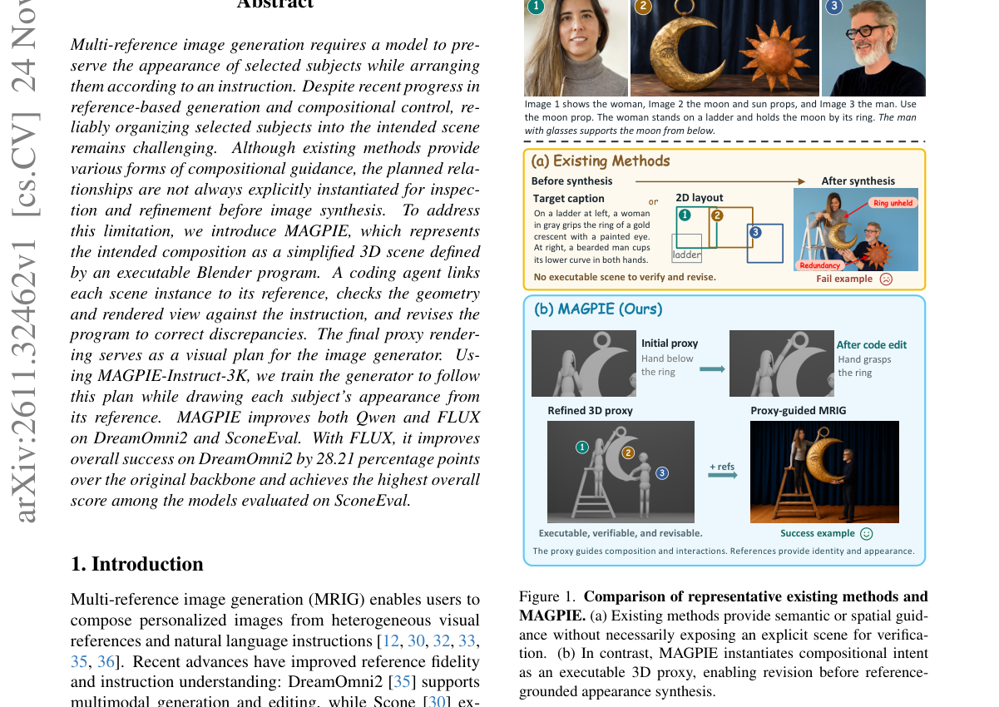

*Result - Overview of MAGPIE. The coding harness converts reference images and an instruction into an executable proxy scene through planning, procedural construction, and geometric and visual refinem*

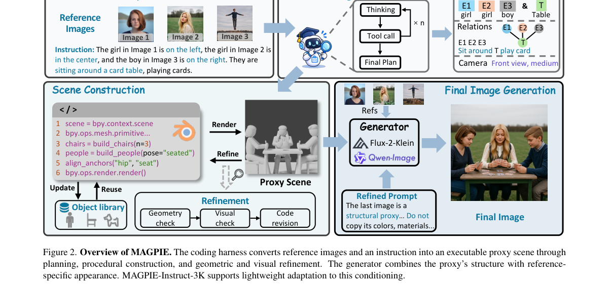

**Why this ranks #7**: 把多参考图构图显式化成一段可执行的 Blender 程序：编码 agent 把每个场景实例绑到其参考图，按指令校验几何与渲染视角并改写程序，再用 MAGPIE-Instruct-3K 训练生成器照此蓝图作画；FLUX 上 DreamOmni2 总成功率比原始骨干高 28.21 个百分点。

---

### 8. One Take, Many Cameras: Audio-Grounded Shot Synthesis for Dialogue Re-Cinematography

**arXiv**: [2611.33147](https://arxiv.org/abs/2611.33147) | **Score**: 8.7 (relevance 9 x 0.7 + quality 8 x 0.3) | **Direction**: `aigc_generation` | **Tags**: AIGC-visual, re-cinematography, audio-driven-lip, speaker-gating, paired-view, dialogue-scene, Stanford University | **Categories**: cs.CV | **Pages**: 15

**Authors**: Anthony Chen; Naomi Ken Korem; Matan Ben-Yosef; Tavi Halperin; Urska Jelercic; Ofir Bibi; Daniel Cohen-Or; Or Patashnik; Maneesh Agrawala

**Affiliation**: Stanford University; LTX; Tel Aviv University

**Abstract**

> Creating a dialogue scene typically requires cutting between multiple views (e.g., close-ups, medium shots, and over-the-shoulder shots) of the actors. Yet capturing such coverage is costly and in many settings unavailable. We study dialogue re-cinematography: synthesizing additional shots from a single wide-angle dialogue video. Existing video generators can synthesize new shots, but rely on visual cues alone, so when the source video barely shows the lips, the generated lip motion fails to match the speech. Our key observation is that the speech audio is view-invariant: it constrains lip motion in any target view. Building on this insight, we adapt a pretrained audio-visual diffusion model to generate the new shot from a target frame that specifies the view, a source video that contains the performance, and the speech audio that drives lip motion. In multi-person scenes, however, pretrained audio-visual models drive every visible face with the same speech, causing speech leakage, where silent listeners mouth the speaker's words. We therefore introduce speaker-aware audio gating, a training-free module that lets the audio drive only the faces that speak in the target shot. On a cinematic paired-view benchmark spanning diverse viewpoints and framings, our method lowers perceptual error by 59%, landmark error by 56%, and speech leakage by 97% relative to the strongest baseline, Wan 3.0. Our method also remains robust on in-the-wild scenes, highlighting its potential for film post-production.

**Key findings**

- **Finding**: 在覆盖多样视角与景别的电影级配对视角基准上，相对最强基线 Wan 3.0，本方法把感知误差降低 59%、关键点误差降低 56%、语音泄漏降低 97%。
- **Inference**: 语音泄漏的根因是预训练音视频模型默认「画面里每张脸都跟着同一段音频走」，所以需要显式说话人门控而不是换更强的生成器。
- **Recommendation**: 用现成音视频模型补拍多人对话时，先加免训练的说话人感知门控把音频只送给真正说话的脸，再谈画质与分辨率。

**Key figures**

*Framework - From a single wide-shot dialogue video and its audio (upper left), our model synthesizes new cinematic shots of the same take, such as medium close-ups (MCU) and over-the-shoulder (OTS) views*

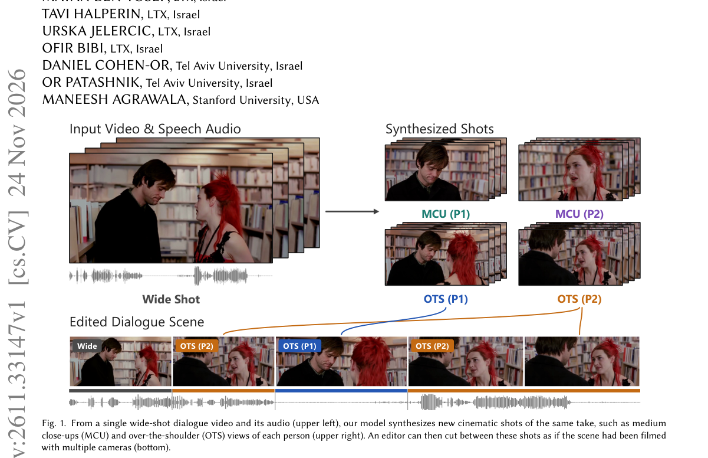

*Result - Illustration of common cinematic vocabulary used in dialogue scenes.*

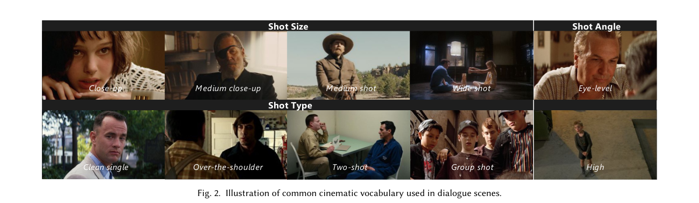

**Why this ranks #8**: 对话场景补拍正反打的思路：语音在任何视角都约束唇形，于是以目标帧、源视频与音频为条件驱动预训练音视频扩散模型；再用免训练的说话人感知音频门控避免「替别人说话」，相对最强基线 Wan 3.0 感知误差降 59%、唇形关键点误差降 56%、语音泄漏降 97%。

---

### 9. Ego2Wrist: Bootstrapping Wrist-View Synthesis from Egocentric Video

**arXiv**: [2611.29850](https://arxiv.org/abs/2611.29850) | **Score**: 8.0 (relevance 8 x 0.7 + quality 8 x 0.3) | **Direction**: `aigc_generation` | **Tags**: AIGC-visual, wrist-camera, egocentric-video, cross-view-consistency, self-improvement, robot-data, Yale University | **Categories**: cs.CV | **Pages**: 27

**Authors**: Ziyao Zeng; Xiatao Sun; Hao Wang; Ziyu Guo; Youheng Yao; Jingcheng Ni; Shenyuan Gao; Fengyu Yang; Renrui Zhang; Bangya Liu; Daniel Rakita

**Affiliation**: Yale University; Google DeepMind; Brown University; NVIDIA; Independent Researcher

**Abstract**

> Wrist cameras provide an action-centric view that is directly relevant to robot manipulation. However, collecting human wrist-camera videos at scale is challenging due to cumbersome setups that can interfere with natural hand movements. In contrast, head-mounted human egocentric videos are much easier to scale. We introduce Ego2Wrist, which synthesizes synchronized wrist-camera views from human egocentric videos and task descriptions. Trained on approximately 940 hours of paired head- and wrist-camera recordings, Ego2Wrist jointly generates three views. To evaluate generated wrist views without ground truth, we propose hand-centric cross-view consistency (HCC), which measures consistency between generated wrist views and corresponding hand regions in the input head view. HCC ranks model checkpoints comparably to ground-truth-based LPIPS, and human evaluators prefer HCC-selected generations in 77% of responses. Evaluated on four datasets, Ego2Wrist outperforms fine-tuned WorldWander, reducing LPIPS by 28% and receiving human preference in 76% of responses. More importantly, HCC facilitates recursive self-improvement on in-the-wild egocentric videos by selecting generated wrist views for further training. Generation quality progressively improves over three rounds. These results demonstrate a scalable approach to generating real-world wrist-view human manipulation videos for robot policy training.

**Key findings**

- **Finding**: Ego2Wrist 在约 940 小时头戴与腕部相机配对录像上训练，提出免真值的手部中心跨视角一致性 HCC，其排序结果与基于真值的 LPIPS 可比，人工评测有 77% 的回答偏好 HCC 选出的生成结果。
- **Inference**: 生成的合成数据要能被自身评估，指标就必须能在没有腕部真值的野外视频上计算，这是递归自我改进能成立的前提。
- **Recommendation**: 想用生成数据喂机器人策略时，先建一个免真值的一致性指标，用它挑选样本再回灌训练，而不是盲目全量回灌。

**Key figures**

*Framework - Ego2Wrist turns head-camera video into wrist-camera video and improves itself on video that has no wrist cameras. (1) The model is trained on recordings with head and wrist cameras. (2) It t*

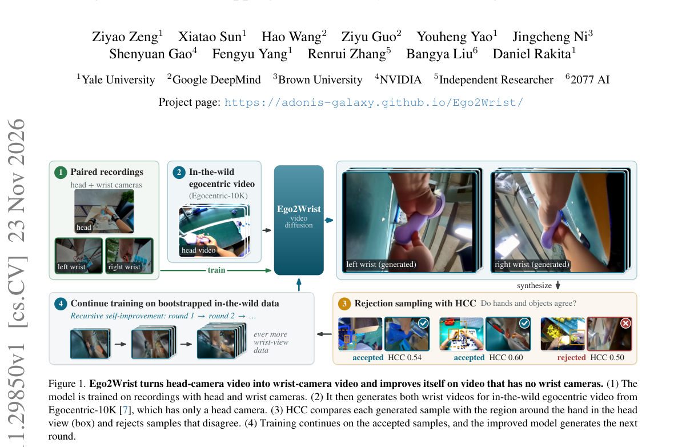

**Why this ranks #9**: 从人类第一视角视频合成同步腕部视角，用来给机器人策略造数据：在约 940 小时头戴与腕部相机配对录像上训练，提出免真值的手部中心跨视角一致性 HCC；四个数据集上 LPIPS 比微调后的 WorldWander 低 28%，人工偏好率 76%。

---

### 10. Motion Mamba 2.0: Autoregressive Diffusion Mamba for Long-Horizon Humanoid Control

**arXiv**: [2611.29897](https://arxiv.org/abs/2611.29897) | **Score**: 8.0 (relevance 8 x 0.7 + quality 8 x 0.3) | **Direction**: `aigc_generation` | **Tags**: AIGC-visual, mamba, root-body-diffusion, persistent-content-memory, cuda-graph, humanoid-control, School of Computer Science | **Categories**: cs.CV, cs.RO | **Pages**: 22

**Authors**: Yue Huang; Tianshan Zhang; Zeyu Zhang; Jayeon Kang; Akide Liu; Sungjoon Choi; Dacheng Tao; Hao Tang

**Affiliation**: School of Computer Science, Peking University; Department of Artificial Intelligence, Korea University; Department of Data Science and AI, Monash University; College of Computing and Data Science, Nanyang Technological University

**Abstract**

> Long-horizon, real-time controllable motion generation is essential for interactive animation and humanoid robotics, where an agent must respond to changing instructions and spatial goals while moving. Existing autoregressive diffusion methods generate motion incrementally, but bounded attention caches limit access to distant history, while repeated denoising introduces substantial inference overhead. We present Motion Mamba 2.0, a Mamba-based root-body diffusion architecture that integrates local attention, resumable recurrent states, and persistent content memory (PCM) for long-horizon controllable motion generation. PCM transforms compressed motion history from Mamba recurrent states, together with state changes and text-conditioned features, into dynamically updated content slots accessible to local attention. To enable efficient inference, we further develop an execution scheme tailored to this architecture, combining CUDA Graph replay, fused kernels, and execution-flow simplification while preserving the canonical history update. Evaluations on retargeted HiPHI demonstrate accurate terminal control over rollouts of up to 39.52 s, while short-horizon comparisons on BONES Seed and retargeted HumanML3D show that the model also retains strong spatial control and text-motion matching. On an RTX 4090, the optimized execution reduces median complete-window latency from 1685.35 to 276.14 ms, achieving a median paired speedup of 6.138$\times$ while preserving identical outputs and committed states in the tested rollouts. Moreover, we conduct extensive real-world evaluation on the Unitree G1, demonstrating sequential text-guided action composition, expressive motion, and interactive locomotion through keyboard and mouse control.

**Key findings**

- **Finding**: 在 RTX 4090 上，执行方案优化把完整窗口的中位延迟从 1685.35 ms 降到 276.14 ms，中位配对加速 6.138 倍，同时在测试 rollout 中保持输出一致与已提交状态一致。
- **Inference**: 自回归动作生成的开销集中在重复去噪与执行流程，而非模型容量，所以状态保存式优化能在不改变数值结果的前提下拿回实时性。
- **Recommendation**: 做长程人形实时控制时把 CUDA Graph 回放与融合算子当作架构的一部分来设计，并保留可恢复循环状态与仅接受历史的更新机制。

**Key figures**

*Framework - Motion Mamba 2.0. Continuous text-guided motion generation for long-horizon humanoid control on the Unitree G1.*

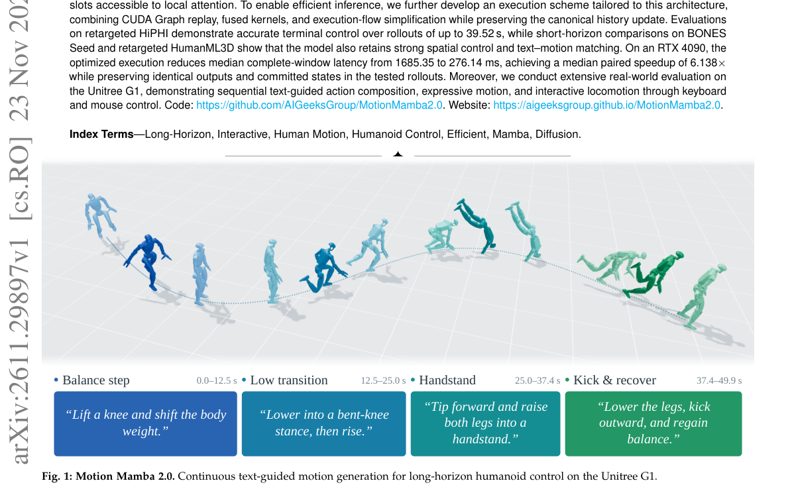

*Result - Interactive motion generation with Motion Mamba 2.0. Text instructions specify the requested actions, while spatial controls constrain root motion and selected joint positions. From left to ri*

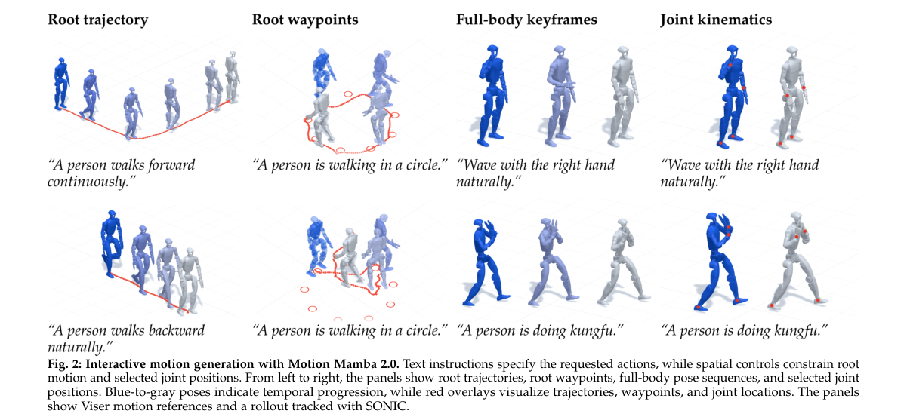

**Why this ranks #10**: Mamba 式根-身体扩散骨架，把局部注意力、可恢复循环状态与持久内容记忆（PCM）结合用于长程可控动作生成；重定向 HiPHI 上 rollout 可达 39.52 秒，RTX 4090 上完整窗口的中位延迟从 1685.35 毫秒降到 276.14 毫秒，中位配对加速 6.138×。

---

## AIGC 编辑（指令编辑 / 修补 / 个性化） · `aigc_editing` (4 papers)

4 篇都盯着一件事：编辑到底有没有真的发生、有没有伤到不该伤的地方。BEND 用谱 Bregman 散度拟合遗忘损失，单模型抹除 SD 上 48 张记忆图（SSCD 0.084 对 ReTrack 0.094–0.120）而 CLIP-IQA 仍有 0.81；TIDE 用不平衡最优传输按每条指令的漂移阈值冻结 token，FLUX.2 Klein 上快 4.81–4.89 倍且在 MICE-Bench 少丢 48% 编辑；FireDesmoke 把真实火灾烟场迁移成训练对，密烟与中烟各提 3.73 与 2.63 dB；而 SAE 探针那篇反过来提醒：输出被抑制不等于概念在模型内被移除。

### 11. BEND: Spectral Bregman Losses for Multi-Image Unlearning in Diffusion Models

**arXiv**: [2611.30532](https://arxiv.org/abs/2611.30532) | **Score**: 8.7 (relevance 9 x 0.7 + quality 8 x 0.3) | **Direction**: `aigc_editing` | **Tags**: AIGC-visual, concept-erasure, bregman-divergence, bilevel-optimization, diffusion-unlearning, memorization, Computer Science | **Categories**: cs.CV, cs.LG | **Pages**: 25

**Authors**: Mohamed-Hicham Leghettas; Markus Püschel

**Affiliation**: Department of Computer Science, ETH Zurich

**Abstract**

> Diffusion models memorize training images and reproduce them almost verbatim when prompted, creating copyright and privacy liabilities. Data unlearning erases the influence of specific training samples from a trained model without retraining, and is two-sided: it must forget the targets while preserving generation quality on everything else. Prior methods use the squared-L2 diffusion loss, at most with a hand-set frequency mask; however, it is known that every Bregman divergence is a mathematically valid choice and the squared-L2 is only the simplest example. BEND is the first to search this family: it fits a spectral Bregman divergence to the unlearning task through a bilevel loop, so the loss itself is shaped to forget thoroughly while protecting quality. It also redirects a memorized image to the mean of its retain images, where ReTrack, the state of the art, redirects it to a single near-copy. On Stable Diffusion, a single BEND model erases all 48 verifiably memorized benchmark images at once. It forgets at least as much as per-target, sequential, and jointly trained ReTrack (SSCD 0.084 versus 0.094-0.120), at the quality of the model before unlearning (CLIP-IQA 0.81 versus 0.64-0.69). BEND also outperforms the state of the art on CelebA-HQ in all three measures of the benchmark, and matches or exceeds it on MNIST and CIFAR-10.

**Key findings**

- **Finding**: 在 Stable Diffusion 上单个 BEND 模型一次性擦除全部 48 张可验证记忆图，SSCD 为 0.084（ReTrack 逐目标、顺序与联合训练为 0.094-0.120），CLIP-IQA 为 0.81（0.64-0.69），保持到遗忘前的生成质量。
- **Inference**: 遗忘强度主要由损失函数的形状决定，平方 L2 只是这一族里最简单的一种，因此优化损失本身比调权重更值得投入。
- **Recommendation**: 做扩散模型遗忘时先把损失函数当成可学习对象在双层循环里拟合，再比较遗忘强度与保真度，而不是直接套用现成方法。

**Key figures**

*Framework - BEND at a glance. Left: where unlearning redirects a noisy sample xt of a memorized prompt (images of one Stable Diffusion target): ReTrack to the nearest retain image, here a near-copy of t*

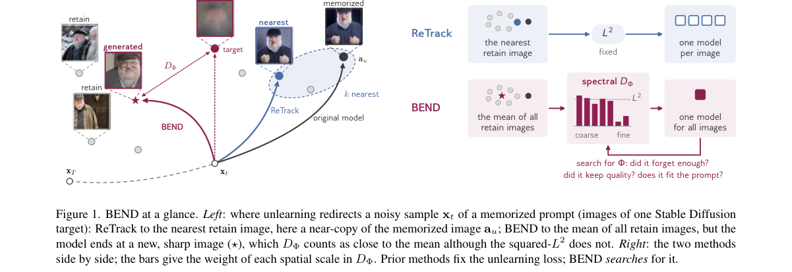

*Result - What ReTrack redirects to, on the 48 memorized Stable Diffusion images. (a) Effective number of retain images behind the redirect image, by timestep (band: range over targets). (b) SSCD to t*

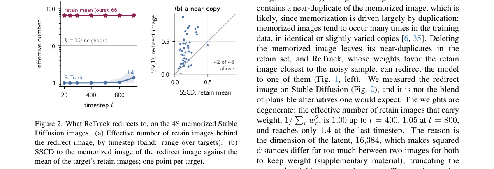

**Why this ranks #11**: 把扩散遗忘的损失函数从固定平方 L2 换成在 Bregman 散度族里双层拟合出来的谱 Bregman 损失；在 Stable Diffusion 上单个 BEND 模型一次抹掉全部 48 张可验证记忆图，SSCD 0.084 优于 ReTrack 的 0.094-0.120，CLIP-IQA 0.81 也高于 ReTrack 的 0.64-0.69。

---

### 12. Every Edit Its Own Budget: Per-Instruction Token Freezing for Training-Free Acceleration of Multi-Edit Image Editing

**arXiv**: [2611.32407](https://arxiv.org/abs/2611.32407) | **Score**: 8.7 (relevance 9 x 0.7 + quality 8 x 0.3) | **Direction**: `aigc_editing` | **Tags**: AIGC-visual, training-free, token-freezing, optimal-transport, edit-budget, flow-matching, Indian Institute of Technology Delhi | **Categories**: cs.CV | **Pages**: 33

**Authors**: Jyotirmoy Nath; Neeraj Kumar; Brejesh Lall

**Affiliation**: Indian Institute of Technology Delhi; Adobe Inc.

**Abstract**

> Accelerating instruction-based image editing when one instruction requests several edits is challenging. Many training-free accelerators for flow-matching image editors skip tokens whose prediction has stopped changing, but decide this with a single threshold for the whole image. With several edits, such a threshold, tuned for speed, freezes small and slowly settling edits first, and requested edits disappear. We propose TIDE (Training-free Instruction-aware Drift-based Editing), which gives every instruction part its own compute budget. First, TIDE finds the region of each part in the editor's own attention by unbalanced optimal transport, without masks or external models. Second, it freezes a token once its drift is small relative to its own part and moves it along the straight path to its endpoint estimate. Third, a sparse engine computes only the remaining tokens. We prove that part-agnostic rules cannot guarantee per-part error budgets, characterize the optimal per-part threshold policy up to one tie class per part, and derive when our rule attains it. On FLUX.2 Klein, one global threshold breaks at least one edit's budget in 89% of MICE-Bench images, and TIDE drops up to 77% fewer edits at matched or higher speed (48% on MICE-Bench), a gap human raters confirm. On the many-step Klein Base, TIDE is the fastest compared method on six benchmarks (4.81-4.89x) and needs 5.3x fewer TFLOPs than vanilla, the largest saving we measure. With the same settings, it is also the fastest compared method on Qwen-Image-Edit-2511, a second model family (3.46-3.52x), and drops the fewest edits on all six benchmarks. Code will be made publicly available.

**Key findings**

- **Finding**: 在 FLUX.2 Klein 上，单一全局阈值在 89% 的 MICE-Bench 图像上至少破坏一个编辑的误差预算，而 TIDE 在相同或更高速度下少丢 77% 的编辑（MICE-Bench 上为 48%），人工评测确认了这一差距。
- **Inference**: 指令片段共用一个阈值时，小改动会先被冻住，所以跳过策略必须按片段归一化漂移量，而不是按整图归一化。
- **Recommendation**: 做多指令编辑加速时先按指令切分注意力归属再设每段独立阈值，否则提速会以丢编辑为代价，且该代价在人工评测中才明显。

**Key figures**

*Framework - One global threshold drops edits; per-instruction budgets keep them. A single skipping threshold freezes some edits before they are done (red boxes). TIDE finds each instruction part’s regio*

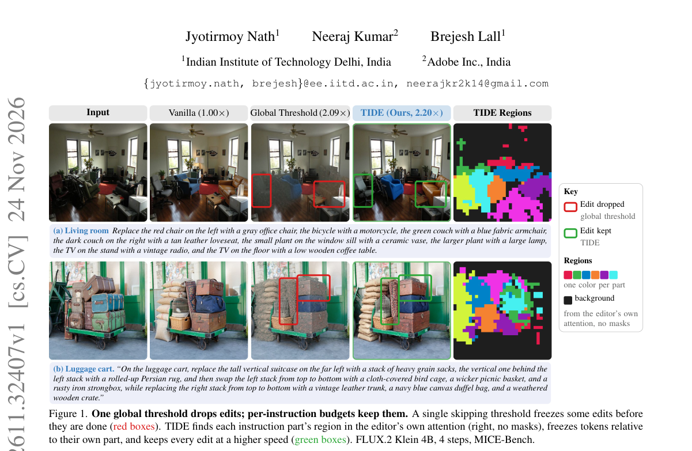

*Result - Overview of TIDE. ①Dense steps record keys/values, word attention and drift. ②Unbalanced OT assigns every token to an instruction part (a); a token is frozen when its drift is below τ times*

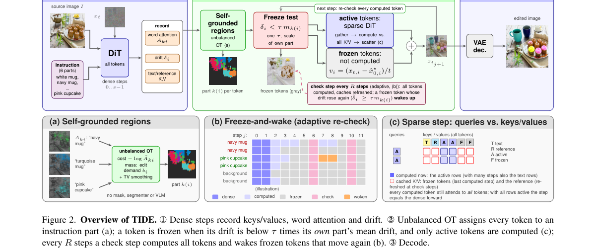

**Why this ranks #12**: 多编辑指令编辑里，全局跳过阈值会先把小而慢的编辑冻掉：TIDE 用无平衡最优传输在编辑器自身注意力里定位每个指令片段，各给一份算力预算；FLUX.2 Klein 上全局阈值在 89% 的 MICE-Bench 图像上至少破坏一个编辑的预算，TIDE 在同等或更高速度下少丢 77% 的编辑，Klein Base 上以 4.81-4.89× 成为六个基准中最快。

---

### 13. FireDesmoke: Fire Smoke Removal via Real Smoke Transfer and Semantic Rectification

**arXiv**: [2611.30057](https://arxiv.org/abs/2611.30057) | **Score**: 8.0 (relevance 8 x 0.7 + quality 8 x 0.3) | **Direction**: `aigc_editing` | **Tags**: AIGC-visual, smoke-removal, image-restoration, real-smoke-transfer, semantic-rectification, mask-free, National Yang Ming Chiao Tung University | **Categories**: cs.CV | **Pages**: 12

**Authors**: Chih-Chung Hsu; Rong-Lin Jian

**Affiliation**: National Yang Ming Chiao Tung University

**Abstract**

> Fire smoke removal must restore dense and medium smoke regions while preserving the clear (smoke-free) content. Existing methods either leave the smoke or alter the visible content, and generative models may hallucinate people or remove flames. Real fire smoke is spatially local: the degradation and its corruption of semantic features are both concentrated in the smoke regions. We propose FireDesmoke, built on this locality: Real Smoke Transfer calibrates smoke fields on real-fire recordings and transfers their spatial layout onto clean images to synthesize training pairs, and Semantic Rectification uses pixel features to rectify the tokens of a frozen foundation encoder where smoke corrupts them. With matched training budgets, replacing the transferred pairs with SmokeBench pairs lowers dense-smoke PSNR by 0.74 dB, and removing Semantic Rectification leaves clear regions 1.31 dB below the input. On what is, to the best of our knowledge, the first paired dataset of real fire smoke for image restoration, with 1,500 test frames from a held-out viewpoint, FireDesmoke improves dense- and medium-smoke PSNR by 3.73 and 2.63 dB while keeping clear regions at the input level (+0.41 dB); no other compared method gains at least 1 dB in dense smoke without lowering clear-region PSNR, and no hallucinated person is found in its outputs. It achieves state-of-the-art overall results on this benchmark and, trained on SmokeBench, the highest PSNR with the second-best SSIM and LPIPS.

**Key findings**

- **Finding**: 在首个真实火烟配对修复数据集上（1500 帧留出视角），FireDesmoke 把浓烟与中烟 PSNR 分别提升 3.73 dB 与 2.63 dB，干净区域仍保持在输入水平（+0.41 dB），输出中未发现虚构人物。
- **Inference**: 退化与其对语义的污染都集中在烟区，因此训练数据合成与语义先验都应跟随烟的真实空间分布，而不是全图均匀加噪。
- **Recommendation**: 做真实退化（烟、雾、雨）复原时优先用真实录制的退化场做迁移合成，再考虑用生成式退化数据替代，并单独监控干净区是否被改坏。

**Key figures**

*Framework - Reliability of fire smoke removal on our test set (held- out viewpoint, zero-shot for all methods). (a, b) In selected default-setting outputs, RealRestorer [79] and DiffDehaze [72] hallucin*

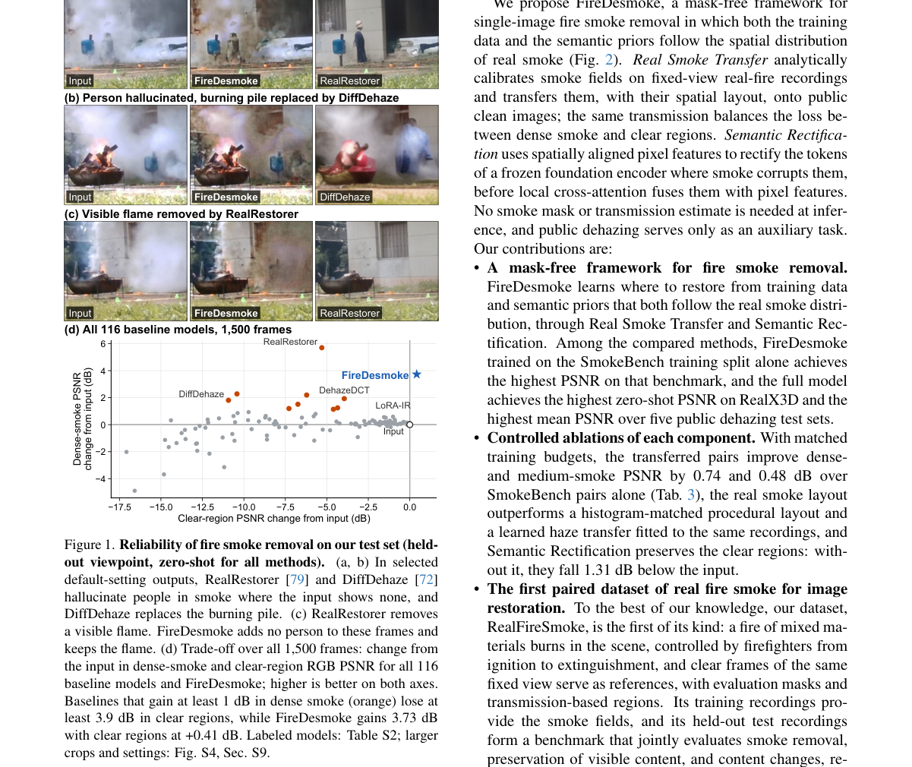

*Result - Overview of FireDesmoke. (A) Training recordings and their same-view clear references provide only the smoke fields T (effective transmission), A (atmospheric light), and g (RGB exposure gai*

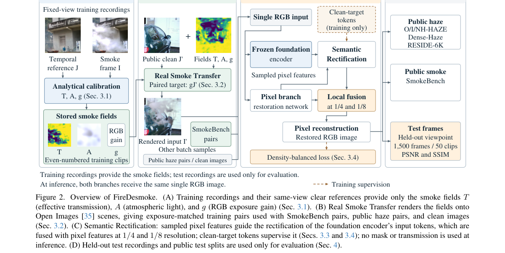

**Why this ranks #13**: 真实火烟的空间局部性是建模前提：Real Smoke Transfer 把真实火场录像的烟场搬到干净图上合成训练对，Semantic Rectification 用像素特征修正被烟污染的冻结编码器 token；在首个真实火烟配对数据集上（1500 帧留出视角），浓烟与中烟 PSNR 各提升 3.73 与 2.63 dB，干净区保持输入水平（+0.41 dB）。

---

### 14. What Remains After Concept Erasure? Sparse Autoencoder Probes for Auditing Diffusion Models

**arXiv**: [2611.30117](https://arxiv.org/abs/2611.30117) | **Score**: 8.0 (relevance 8 x 0.7 + quality 8 x 0.3) | **Direction**: `aigc_editing` | **Tags**: AIGC-visual, concept-erasure, sparse-autoencoder, white-box-audit, activation-intervention, detector-score, Shanghai Artificial Intelligence | **Categories**: cs.CV | **Pages**: 40

**Authors**: Zhuan Shi; Lu Wei; Yuta Nakashima; Noa Garcia; Golnoosh Farnadi

**Affiliation**: Shanghai Artificial Intelligence Laboratory; Mila – Quebec Artificial Intelligence Institute; McGill University; Osaka University

**Abstract**

> Concept erasure aims to remove selected visual concepts from text-to-image diffusion models while preserving the generation of non-target concepts. Evaluation typically measures target suppression and non-target preservation in generated images, but a concept's absence from these outputs does not establish its removal from the model. We introduce SAE-Audit, a white-box audit using sparse autoencoder (SAE) probes to test whether activation interventions can restore target-concept generation without changing model weights or test prompts. After verifying target suppression, we compare the original and edited models using a shared SAE representation learned from original-model activations, identifying features whose target-related responses weaken after erasure. We inject sparse directions derived from the original-model responses into the edited model, keeping these directions fixed across test prompts, and evaluate recovery on held-out scene families. Experiments span six erasure methods and four domains: objects, artistic styles, copyrighted content, and nudity. Interventions using a few dozen selected SAE features yield higher average recovery rates than matched random-feature interventions, with recovery concentrated in objects and nudity following cross-attention edits. Most styles and copyrighted concepts show limited recovery under the tested intervention settings. These findings show that output suppression can coexist with responsiveness to sparse concept directions supplied from the original model.

**Key findings**

- **Finding**: SAE-Audit 覆盖 6 种概念擦除方法、13 个概念与 4 个领域（物体、艺术风格、版权内容、裸体），由几十个稀疏自编码特征构造的干预方向比等量随机特征得到更高的平均恢复率。
- **Inference**: 只要少数稀疏方向就能唤回被擦除的概念，说明擦除多半表现为把该方向的响应压低而非彻底移除，因此输出抑制不等于模型内清除。
- **Recommendation**: 评估概念擦除时不要只看生成图里有没有目标物，应补一套稀疏自编码特征注入的恢复测试，否则会高估擦除的彻底程度。

**Key figures**

*Result - Recovered held-out test units under the original model, the erased model, rand and ours (same prompt and seed down each column; numbers are detector scores); rel and contrast mark two hookpo*

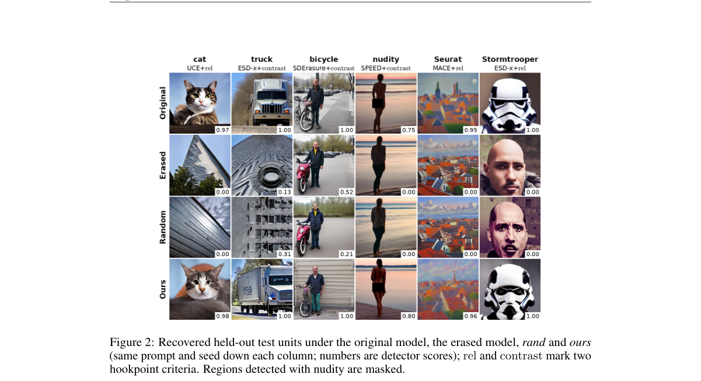

**Why this ranks #14**: 输出里看不到概念不等于模型里没有概念：SAE-Audit 用共享于原模型的 SAE 表示找被擦除削弱的特征，再把这些稀疏方向注回被编辑模型检验能否恢复；实验跨 6 种擦除方法、13 个概念与 4 个领域，几十个 SAE 特征构造的方向恢复率高于等量随机特征，恢复集中在物体与裸体。

---

## 面向视觉生成的 RL 与奖励模型 · `aigc_rl` (3 papers)

3 篇解决的是同一个卡点——视频生成太贵，没法直接上 RL。Loupe 用 Rubric-Based Credit 给检索与规划的中间决策打 credit，并提出 RBC-GRPO 不渲染视频就能做 RL，MiniMax-H3 总体分从 32.80 提到 70.67，比 SFT 后接轨迹级 GRPO 高 5.27 分；JarvisAura 用 Reference-Aligned GRPO 与多维奖励做摄影级调色，Ref-Bench 人评任务成功 74%、超 GPT-Image-2.5 九个百分点；SPROUT 则用纯文本模型预测 DGPO 的目标梯度范数当 prompt 效用，约 44% 的迭代就追平平均匀采样的最终分数。

### 15. Loupe: Reinforcing Knowledge-Intensive Video Generation Agents

**arXiv**: [2611.31895](https://arxiv.org/abs/2611.31895) | **Score**: 8.7 (relevance 9 x 0.7 + quality 8 x 0.3) | **Direction**: `aigc_rl` | **Tags**: AIGC-visual, rubric-credit, grpo, step-level-reward, search-agent, video-prompt, DP Technology | **Categories**: cs.AI, cs.CV | **Pages**: 39

**Authors**: Kai Zeng; Ruichuan An; Zhen Fang; Xi Fang; Han Lyu; Moran Li; Yingchen Yu; Yifan Dai; Bohan Zeng; Quanqing Xu; Zhengzhou Zhu; Wentao Zhang

**Affiliation**: DP Technology; PKU; USTC; HUST; NTU

**Abstract**

> Knowledge-intensive video generation remains challenging because prompts often omit the facts, appearances, and temporal relationships required for accurate generation. While search-based workflows can retrieve missing evidence, manually designed strategies limit adaptive planning, and conventional training suffers from costly video-level feedback and coarse trajectory-level credit assignment. In this paper, we present Loupe, a video generation agent that retrieves and verifies textual and visual evidence to construct evidence-grounded temporal video prompts with reference images. We further introduce Rubric-Based Credit (RBC), which leverages prompt-specific factual, visual, and temporal requirements to evaluate intermediate search and planning decisions before video rendering. Building on RBC, RBC-SFT reweights assistant-token learning by step quality, while RBC-GRPO incorporates step-level credits alongside a final planning reward, without rendering videos during RL. To address the lack of dedicated search-oriented evaluation, we construct Search-VBench, which contains 150 held-out prompts across seven categories. Experiments show that Loupe improves all four evaluation dimensions across three video generators, raising the overall score of MiniMax-H3 from 32.80 to 70.67 and outperforming an untrained search workflow. Ablation experiments show that full RBC training outperforms standard SFT followed by trajectory-level GRPO by 5.27 points. Human evaluations and results on Sci-VBench and KIVI-Bench further demonstrate improved generation quality, scientific grounding, factual precision, and helpfulness. Our project page is available at https://zengkaiya.github.io/Loupe/.

**Key findings**

- **Finding**: Loupe 在含 150 条留出 prompt、7 个类别的 Search-VBench 上把 MiniMax-H3 的总分从 32.80 提升到 70.67，并在 Sci-VBench 与 KIVI-Bench 上同样提升生成质量与事实精确度。
- **Inference**: 把奖励拆到搜索与规划步骤而非渲染后的视频，可以让 RL 不再被视频生成成本卡住，也让信用分配更细更准。
- **Recommendation**: 面向视频生成的强化学习，先把请求本身变成可打分的 rubric 序列，用步骤级 credit 做强化，再用最终规划奖励兜底。

**Key figures**

*Framework - Loupe helps multiple backbones address knowledge-intensive video generation. Top: direct generation is prone to hallucinated content because of knowledge gaps, whereas Loupe’s multi-hop sear*

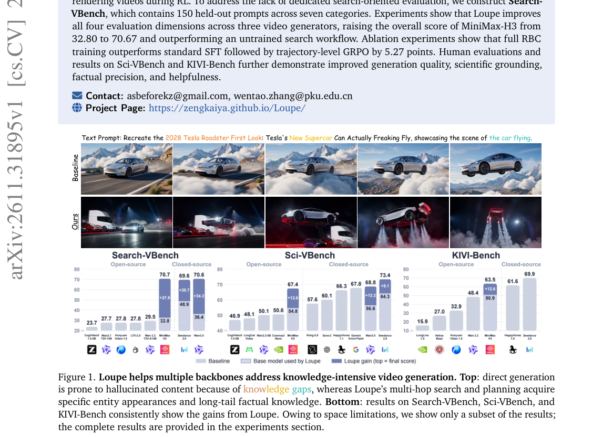

*Result - Overview of Loupe. (A) The agent retrieves evidence and produces a temporal video prompt with reference images. (B) Prompt, rubric, and teacher trajectory construction enables (C) Rubric-Bas*

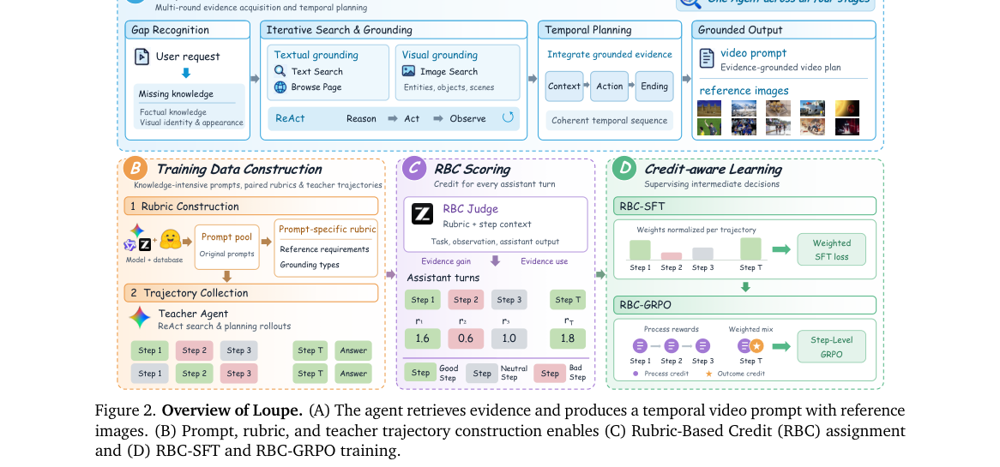

**Why this ranks #15**: 知识密集型视频生成的 RL 难点是视频级反馈太贵：Loupe 把请求派生的事实、视觉与时序需求做成 rubric，在渲染视频之前就给中间的搜索与规划步骤打 credit；RBC-GRPO 不渲染视频即完成强化，MiniMax-H3 总分从 32.80 提升到 70.67，完整 RBC 比「SFT 后接轨迹级 GRPO」高 5.27 分。

---

### 16. Towards a Multimodal Aesthetic Agent for Photographic Reference Grading

**arXiv**: [2611.32299](https://arxiv.org/abs/2611.32299) | **Score**: 8.7 (relevance 9 x 0.7 + quality 8 x 0.3) | **Direction**: `aigc_rl` | **Tags**: AIGC-visual, reference-grading, group-relative-policy-optimization, editable-parameters, multidimensional-reward, aesthetic-agent, Xiamen University | **Categories**: cs.CV | **Pages**: 39

**Authors**: Kunjie Lin; Haitao Zhang; Bosheng Chen; Lanhui Xu; Gaofeng Pan; Yuxin Lin; Tianjiao Liu; Yi Yang; Yue Huang; Xinghao Ding; Zixu Lin; Yunlong Lin

**Affiliation**: Xiamen University; Central Media Technology Institute, Huawei

**Abstract**

> Reference-guided photographic color grading helps users realize their aesthetic intent by selectively drawing on the color and tonal characteristics of a reference photograph. Doing so requires understanding which characteristics users wish to adopt and translating these preferences into controllable edits. However, image-only reference methods align overall appearance without instruction-grounded selection, while pixel-space generative editors typically produce flattened images without editable parameters, limiting subsequent refinement. To address these challenges, we introduce JarvisAura, a multimodal aesthetic agent that formulates photographic color grading as structured decision-making in an editable parameter space. JarvisAura offers three key advantages: (1) an aesthetic agent paradigm that integrates visual attribute perception, strategy-level reasoning, and parameterized execution for interpretable and controllable photographic color grading; (2) a unified reasoning-to-execution pipeline that connects aesthetic planning with backend rendering and editable parameter refinement; and (3) a three-stage training strategy comprising Parameter-Grounded Continual Pre-Training for parameter-appearance grounding, Reference-Grounded Supervised Fine-Tuning for reference-guided reasoning and parameter decisions, and Reference-Aligned Group Relative Policy Optimization for rendered-outcome refinement with multidimensional rewards and dynamic data derivation. On Ref-Bench, JarvisAura achieves the best scores among methods with results across reported automatic metrics and a 74% human-rated task-success rate, exceeding GPT-Image-2.5 by 9 percentage points.

**Key findings**

- **Finding**: 在 Ref-Bench 上 JarvisAura 的全部自动指标都取得被评测方法中的最好成绩，人工任务成功率达 74%，比 GPT-Image-2.5 高 9 个百分点。
- **Inference**: 输出可编辑参数比输出扁平像素更关键，因为调色的用户意图本身就是一组参数选择，只有参数化中间态才能被渲染奖励直接优化。
- **Recommendation**: 做参考引导的调色或修图时让模型输出参数而非像素，再用渲染结果构造奖励回传，这样既可解释也能被后续精修复用。

**Key figures**

*Framework - JarvisAura takes a source image, a reference image, and a user instruction, and produces a reference-driven color-grading result with an editable parameter representation. It identifies inst*

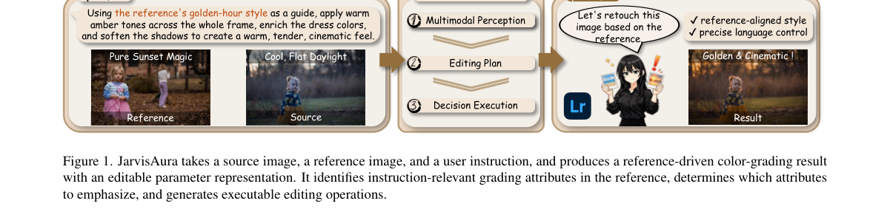

*Result - Ref-CPT construction. The pipeline collects community edit pairs with configurations, renders results under original and perturbed settings, and generates parameter-anchored state-change cap*

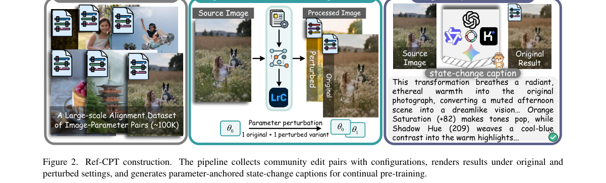

**Why this ranks #16**: 把摄影参考调色做成可编辑参数空间里的结构化决策：JarvisAura 经参数锚定持续预训练、参考锚定监督微调、参考对齐 GRPO 三阶段训练，用渲染结果的多维奖励反向优化调色参数；Ref-Bench 上人工任务成功率达 74%，比 GPT-Image-2.5 高 9 个百分点。

---

### 17. SPROUT: Predicting Objective-Grounded Prompt Utility for Efficient Text-to-Image Preference Tuning

**arXiv**: [2611.31163](https://arxiv.org/abs/2611.31163) | **Score**: 8.0 (relevance 8 x 0.7 + quality 8 x 0.3) | **Direction**: `aigc_rl` | **Tags**: AIGC-visual, prompt-selection, preference-tuning, rejection-sampling, compute-efficiency, dgpo, Georgia Institute of Technology | **Categories**: cs.CV, cs.LG | **Pages**: 24

**Authors**: Kangping Hu; Akshay Mehra; Stephen Mussmann

**Affiliation**: Georgia Institute of Technology; Dolby

**Abstract**

> Preference tuning of text-to-image diffusion models spends most of its compute generating candidate images, yet training prompts are typically sampled uniformly at random, wasting compute generating images that provide too little signal for model alignment. To best utilize the available compute, we study prompt selection, where at each iteration we identify the most useful prompts for preference tuning. We separate prompt selection into a utility score, an estimator of that utility score, and batch selection. Within this framework, we propose Selection by PRedicting Objective-grounded UTility (SPROUT). The utility score is predicted on every prompt in the pool, including unseen prompts, by a text-only model, refit after every iteration on all utilities observed so far. A randomized acceptance rule then turns these predictions into a batch, so no images are generated beyond those used for training. For direct group preference optimization (DGPO), the objective-grounded utility is the norm of the gradient that the objective produces from a prompt's group of images. Fine-tuning Stable Diffusion 1.5 with DGPO on GenEval, SPROUT matches the final score of uniform sampling in about 44% of the iterations and improves the area under the learning curve with respect to both uniform sampling and CGPO, a recent variance-based prompt sampler. The efficiency gains hold under four held-out reward models never used in training, and the ranking of methods carries over to DPG-Bench and T2I-CompBench++. Our code is available at https://github.com/ADDAPT-ML/SPROUT.

**Key findings**

- **Finding**: 在 GenEval 上用 DGPO 微调 Stable Diffusion 1.5 时，SPROUT 约 44% 的迭代即可追平均匀采样的最终分数，并相对均匀采样与 CGPO 都提升了学习曲线下面积，优势在 4 个训练中未用过的留出奖励模型下依然成立。
- **Inference**: 偏好微调的成本瓶颈在候选图生成而不是打分，因此能提前判定某个 prompt 值不值得生成，就能直接把算力省下来。
- **Recommendation**: 做文本到图像偏好微调时，先训一个轻量文本效用预测器做 prompt 预筛，被拒的 prompt 直接不生成图，而不是均匀随机采样。

**Key figures**

*Framework - Left. SPROUT accepts each prompt at random with a probability scaled from its predicted utility, the update norm, so a rejected prompt generates no images (details in Figure 2). Right. The r*

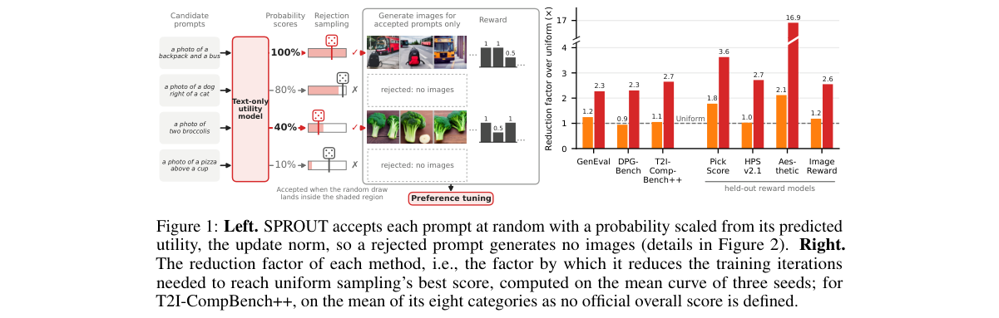

**Why this ranks #17**: 偏好微调的大部分算力花在生成候选图上，而训练 prompt 多半被均匀随机采样：SPROUT 用纯文本模型预测每个 prompt 的目标梯度范数效用，并按随机接受规则组批，被拒的 prompt 完全不生成图；在 Stable Diffusion 1.5 + DGPO + GenEval 上约 44% 的迭代就追平均匀采样的最终分数。

---

## Footer

- Total papers reviewed across all 4 axes: 60
- aigc_visual axis final count: 17
- Wild-cards in this axis: 0
- Figure assets: 2026-11-26/res/

Generated by `mine-arxiv-daily-digest` skill. Sister file: `2026-11-26_aigc_visual_entry.md`.
