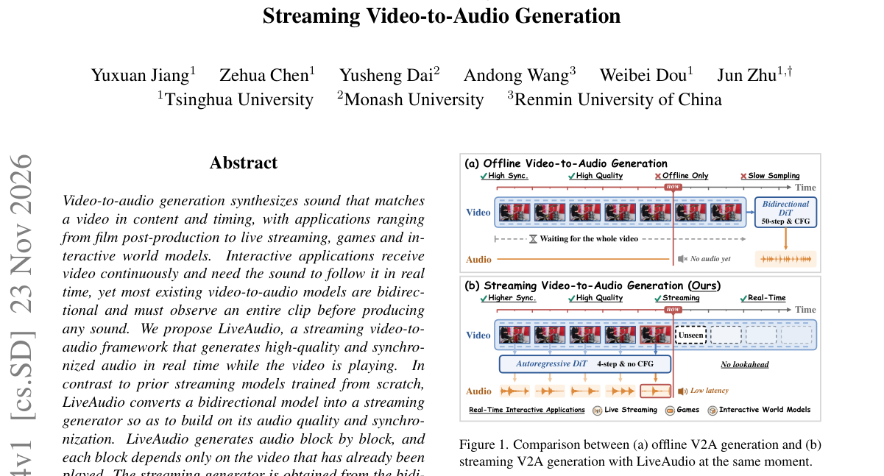
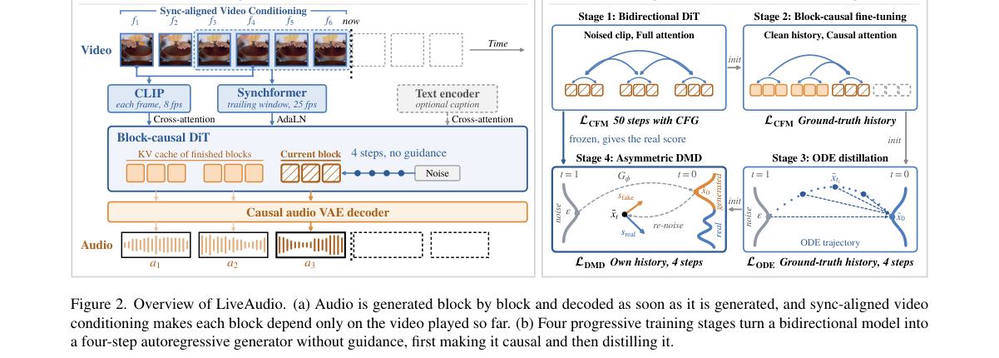
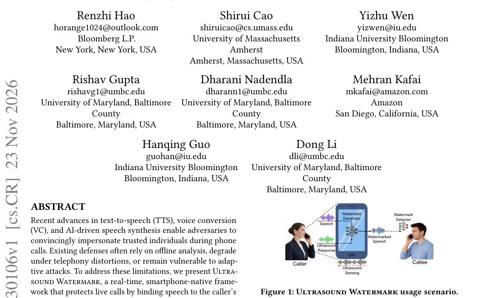
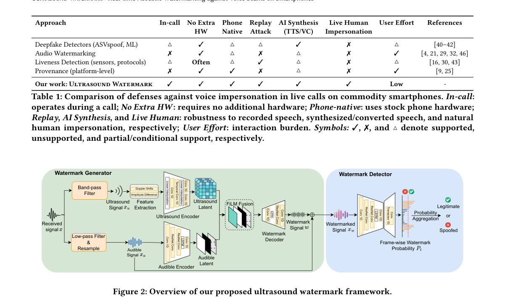

# Mine Arxiv Daily Digest - 2026-11-26 (全双工语音与语音 LM Axis, 3 papers)

**Generated**: 2026-11-26 01:25 CST

**Source**: arXiv cs.CV, cs.SD, eess.AS, cs.CL, cs.AI, cs.RO, cs.LG, cs.IR submissions, listing day 2026-11-24 (announced listing 11-24 于 2026-11-25 01:00 UTC 公告)

**Batch window**: 2026-11-23T19:00:00Z .. 2026-11-24T19:00:00Z（arXiv 公告批次窗口按 listing 日逐段相接：每段的起点是前一日的美东 14:00 截止时刻（EDT 为 18:00Z，EST 为 19:00Z），终点是当日同一时刻）

**Axis**: duplex_speech (3 papers, base 12, cap 20)

**Directions**: duplex_speech_core (3), speech_rl (0)

**Selection**: 3 papers ranked by relevance x quality, with 0 wild-card slots

**Day total**: 60 papers across 4 axes (target 60)

**Scope**: 全双工 / 实时 / 流式语音语言模型、speech-to-speech 语音助手、TTS / 语音克隆 / 语音转换，以及语音大模型的 RL 与奖励模型

**Wild-card**: 0 篇 —— duplex_speech_core 只有 33 篇够格候选（rel≥8 仅 10 篇）、speech_rl 够格候选为 0，供给本身就不足；按「让出而不是被填充」的口径，缺的 9 个名额让给其他轴，没有一篇靠邻接选题补位。

本轴只有 3 篇 vs 基准 12，缺 9 个名额，是最近几轮里最大的结构性缺口。证据链完整：候选池 1367 篇里 primary 落在 duplex_speech_core 的有 33 篇（够格 rel≥5 的 32 篇、rel≥8 仅 10 篇），而 speech_rl 的够格候选是 0 篇——这一批 arXiv 里根本没有出现带 RL 的语音 / 音频 / 全双工模型论文，不是归类漏了，是供给本身断档。缺的 9 个名额按规则流向 aigc_visual、llm_vlm 与 world_embodied。

---

## 全双工语音与语音 LM · `duplex_speech_core` (3 papers)

3 篇分处语音栈的三层：生成侧的实时化、表示侧的 tokenizer、以及部署侧的反诈骗。LiveAudio 把双向视频转音频模型经渐进因果微调与蒸馏改成流式生成器，逐块只依赖已播放视频，VGGSound 上音质与同步性超既有流式模型、同步性还超过原双向模型，A100 上 RTF 0.79、首帧延迟 143 ms；BiSAT 让声学与语义分支各带编码器与码本、以共享索引最小化联合量化误差，零样本 TTS 以更少数据匹配或超过 speech LM 类基线；超声水印那篇则把附加延迟压在 200 ms 内，并在 22 名说话者、8 款手机上验证。

### 1. LiveAudio: From Bidirectional to Autoregressive Diffusion for Real-Time Streaming Video-to-Audio Generation

**arXiv**: [2611.30714](https://arxiv.org/abs/2611.30714) | **Score**: 8.7 (relevance 9 x 0.7 + quality 8 x 0.3) | **Direction**: `duplex_speech_core` | **Tags**: duplex-speech, streaming-video-to-audio, block-causal-diffusion, flow-matching, distribution-matching-distillation, real-time-synthesis, Tsinghua University | **Categories**: cs.CV, cs.MM, cs.SD, eess.AS | **Pages**: 23

**Authors**: Yuxuan Jiang; Zehua Chen; Yusheng Dai; Andong Wang; Weibei Dou; Jun Zhu

**Affiliation**: Tsinghua University; Monash University; Renmin University of China

**Abstract**

> Video-to-audio generation synthesizes sound that matches a video in content and timing, with applications ranging from film post-production to live streaming, games and interactive world models. Interactive applications receive video continuously and need the sound to follow it in real time, yet most existing video-to-audio models are bidirectional and must observe an entire clip before producing any sound. We propose LiveAudio, a streaming video-to-audio framework that generates high-quality and synchronized audio in real time while the video is playing. In contrast to prior streaming models trained from scratch, LiveAudio converts a bidirectional model into a streaming generator so as to build on its audio quality and synchronization. LiveAudio generates audio block by block, and each block depends only on the video that has already been played. The streaming generator is obtained from the bidirectional model through progressive causal fine-tuning and distillation, so that each block needs only a few sampling steps. Experiments on VGGSound show that LiveAudio outperforms existing streaming models in audio quality and synchronization, and surpasses the bidirectional model it starts from in synchronization. On a single A100 GPU, it runs in real time with a real-time factor of 0.79 and a time to first frame of 143 ms. Audio samples are available at https://streamaudio.github.io.

**Key findings**

- **Finding**: LiveAudio 在 VGGSound 测试集上 DeSync 为 0.395，低于自己的双向教师（0.484）、LiveFoley（0.480）与 MMAudio（0.457）；单卡 A100 上 RTF 0.79、TTFF 0.143 秒，MOS-T 4.06±0.27 为全部对比模型最高，MOS-Q 3.66±0.19 为流式模型中最高。
- **Inference**: 双向模型经分块因果微调 → ODE 蒸馏 → 非对称 DMD 四阶段转换后，同步性反而超过教师，说明因果化带来的同步损失可以由双向教师在分布层面补回来，而不必牺牲实时性；消融中 Stage 4 把 DeSync 从 0.544 拉回 0.395，验证了这一判断。
- **Recommendation**: 做实时音视频生成可直接复用「双向模型转流式」路线：先把视频条件改成同步对齐的因果条件，再分块因果微调、蒸馏到 4 步免 CFG（教师为 50 步、CFG 4.5），并用 KV cache 让每块计算不超其 0.1 秒时长。

**Key figures**

*Framework - Comparison between (a) offline V2A generation and (b) streaming V2A generation with LiveAudio at the same moment.*

*Result - Overview of LiveAudio. (a) Audio is generated block by block and decoded as soon as it is generated, and sync-aligned video conditioning makes each block depend only on the video played so f*

**Why this ranks #1**: VGGSound 测试集上 DeSync 仅 0.395，为全部对比模型最低（其双向教师 0.484、LiveFoley 0.480、MMAudio 0.457）；单张 A100 上 RTF 0.79、TTFF 0.143 秒，主观 MOS-T 4.06 也是全场最高，因此排在本 direction 前列。

---

### 2. BiSAT: Bidirectionally Aligned Semantic-Acoustic Tokenization for Speech Language Models

**arXiv**: [2611.30723](https://arxiv.org/abs/2611.30723) | **Score**: 8.7 (relevance 9 x 0.7 + quality 8 x 0.3) | **Direction**: `duplex_speech_core` | **Tags**: duplex-speech, speech-tokenization, shared-index-quantization, zero-shot-tts, flow-matching-decoder, ctc-supervision, Japan Advanced Institute of Science and | **Categories**: eess.AS | **Pages**: 13

**Authors**: Y. Lu; L. Wang; S. Okada

**Affiliation**: Japan Advanced Institute of Science and Technology

**Abstract**

> Speech language models (LMs) generate speech as sequences of discrete tokens, requiring tokenizers that preserve both acoustic detail and linguistic content at a low bitrate. Semanticenhanced tokenizers may discard acoustic detail, whereas acousticoriented tokenizers retain acoustic variation that hinders language modeling. Unified tokenizers combine both, but encoding them within a single feature space can cause interference, and existing methods typically align acoustic features to fixed targets from a frozen semantic teacher. We propose Bidirectionally Aligned Semantic-Acoustic Tokenization (BiSAT), a unified framework with separate acoustic and semantic branches coupled by a shared-index mechanism. During training, each branch has its own encoder, codebook, and decoder, and at every frame a shared index minimizes the combined quantization error across both branches. BiSAT thus learns acoustic and semantic representations in separate continuous spaces while producing a single discrete code stream, jointly optimizing both encoders without fixed semantic teachers. Built on BiSAT, BiSAT-TTS pairs an autoregressive text-speech LM with a conditional flow-matching acoustic decoder for zero-shot text-to-speech. Reconstruction, frozen-code understanding, and diagnostic analyses show that BiSAT preserves accessible linguistic and acoustic structure in a low-bitrate single stream, generalizes strongly to in-thewild and out-of-domain speech, and learns complementary paired codebooks. BiSAT-TTS matches or surpasses state-of-the-art speech LM-based TTS baselines with less training data, demonstrating that accessible code structure, not reconstruction quality alone, benefits autoregressive speech modeling. The audio demos are available at https://seekmind-lab.github.io/bisat-demo.

**Key findings**

- **Finding**: BiSAT-32k 以 25 Hz、375 bps 单码流在 LibriSpeech-PC 上取得重建 WER 2.15、SIM 0.976、UTMOSv2 3.26；冻结码探针的英文 ASR WER 为 37.71（CosyVoice 3 为 74.17、X-Codec2 为 89.67），SID 40.4%、ASV EER 1.92、LID 95.5%，训练数据 12.2 万小时，而 CosyVoice 3 用了 53 万小时。
- **Inference**: 声学与语义各自留在独立连续空间、只用共享索引向量量化器耦合，可以避免单空间融合造成的互相干扰；只训 12.2 万小时仍领先，说明代码里「可访问的结构」比重建质量更决定自回归 speech LM 的建模难度。
- **Recommendation**: 选 speech LM 分词器时优先试「双分支 + 共享索引 + 共享向量量化器」，并用冻结码探针（ASR/PR/SID/ASV/LID/ER）而不是只看重建指标来定型，同时把帧率与码率一起压到 25 Hz / 400 bps 量级。

**Why this ranks #2**: 以 25 Hz 单码流、375 bps 在 LibriSpeech-PC 上取得重建 WER 2.15、SIM 0.976，冻结码探针英文 ASR WER 37.71（CosyVoice 3 为 74.17），且训练数据仅 12.2 万小时、不到 CosyVoice 3 的四分之一，是本轮 speech LM 分词方向最完整的一篇。

---

### 3. Ultrasound Watermark: Real-time Acoustic Watermarking against Voice Scams on Smartphones

**arXiv**: [2611.30106](https://arxiv.org/abs/2611.30106) | **Score**: 8.0 (relevance 8 x 0.7 + quality 8 x 0.3) | **Direction**: `duplex_speech_core` | **Tags**: duplex-speech, acoustic-watermarking, ultrasound-sensing, anti-spoofing, real-time-detection, mobile-deployment, Bloomberg L.P. | **Categories**: cs.AI, cs.CR, cs.SD | **Pages**: 15

**Authors**: Renzhi Hao; Shirui Cao; Yizhu Wen; Rishav Gupta; Dharani Nadendla; Mehran Kafai; Hanqing Guo; Dong Li

**Affiliation**: Bloomberg L.P.; University of Massachusetts; Indiana University Bloomington; University of Maryland, Baltimore County; Amazon

**Abstract**

> Recent advances in text-to-speech (TTS), voice conversion (VC), and AI-driven speech synthesis enable adversaries to convincingly impersonate trusted individuals during phone calls. Existing defenses often rely on offline analysis, degrade under telephony distortions, or remain vulnerable to adaptive attacks. To address these limitations, we present Ultrasound Watermark, a real-time, smartphone-native framework that protects live calls by binding speech to the caller's physical articulatory motion through acoustic watermarking. During a call, the smartphone emits ultrasonic signals and captures reflections from facial articulatory movements using only its built-in speaker and microphone. Ultrasound Watermark extracts motion features from these reflections and fuses them with outgoing speech to generate a dynamic watermark. Because the ultrasonic measurements are physically and temporally coupled with speech production, they are difficult to spoof without the underlying articulatory motion. A synchronized generator-detector architecture enforces cross-modal speech-motion consistency against replay, synthesized speech, and articulation-mimicking attacks. Ultrasound Watermark operates continuously with less than 200 ms latency overhead and requires no additional hardware. We implement Ultrasound Watermark on iOS and Android and evaluate it using over 2.5 hours of synchronized speech-ultrasound recordings from 22 speakers across eight smartphones and four real-world environments. Results demonstrate robustness to diverse attacks and telephony distortions while preserving perceptual audio quality.

**Key findings**

- **Finding**: 六路超声载波（基频 20 kHz、间隔 300 Hz、48 kHz 采样）经 I/Q 解调后取相位与幅度差，得到 12 通道运动特征并以 FiLM 注入音频潜变量；检测器在音频-only 攻击下 AUC 1.00 / FPR 0.01、随机超声攻击下 AUC 1.00 / FPR 0.00，同步伪造成攻击下降至 AUC 0.84 / FPR 0.37（合成 0.88 / 0.30），六类平均 AUC 0.95、FPR 0.12，训练中 TPR 0.93、TNR 0.99。
- **Inference**: 把水印绑定到说话人口部的物理运动而不是音频内容，重放与合成攻击就会失效；同步伪造成攻击最难，是因为攻击者能对齐时间轴却无法复现同一套发音器官运动细节，此时残余的不一致仍可被检测到。
- **Recommendation**: 防电话语音诈骗可参考「手机超声 + 跨模态 FiLM 融合 + 生成器-检测器联合训练」的组合，并把水印强度 α 从 0.2 提到 0.8 以上再上线；同时注意其最强攻击下 FPR 仍有 0.37，不能当作唯一身份判定依据。

**Key figures**

*Framework - Ultrasound Watermark usage scenario.*

*Result - Overview of our proposed ultrasound watermark framework.*

**Why this ranks #3**: 六类攻击平均 AUC 0.95、FPR 0.12，音频-only 攻击下 AUC 1.00 / FPR 0.01、随机超声攻击下 AUC 1.00 / FPR 0.00，最强的同步伪造成攻击下 AUC 仍为 0.84；基于 2.5 小时、22 人、8 台手机、4 种环境的自采数据做出 iOS/Android 端侧原型，延迟开销 <200 毫秒，补上了本 direction 的实时语音安全空位。

---

## Footer

- Total papers reviewed across all 4 axes: 60
- duplex_speech axis final count: 3
- Wild-cards in this axis: 0
- Figure assets: 2026-11-26/res/

Generated by `mine-arxiv-daily-digest` skill. Sister file: `2026-11-26_duplex_speech_entry.md`.
