# Mine Arxiv Daily Digest - 2026-11-26 (LLM / VLM 与其强化学习 Axis, 20 papers)

**Generated**: 2026-11-26 01:25 CST

**Source**: arXiv cs.CV, cs.SD, eess.AS, cs.CL, cs.AI, cs.RO, cs.LG, cs.IR submissions, listing day 2026-11-24 (announced listing 11-24 于 2026-11-25 01:00 UTC 公告)

**Batch window**: 2026-11-23T19:00:00Z .. 2026-11-24T19:00:00Z（arXiv 公告批次窗口按 listing 日逐段相接：每段的起点是前一日的美东 14:00 截止时刻（EDT 为 18:00Z，EST 为 19:00Z），终点是当日同一时刻）

**Axis**: llm_vlm (20 papers, base 18, cap 20)

**Directions**: llm_core (8), vlm_core (5), llm_vlm_rl (7)

**Selection**: 20 papers ranked by relevance x quality, with 0 wild-card slots

**Day total**: 60 papers across 4 axes (target 60)

**Scope**: 大语言模型与视觉语言模型的设计、推理、agent、效率与上下文工作，以及面向 LLM / VLM 的 RL 与偏好优化、奖励模型

**Wild-card**: 0 篇 —— llm_core 310 篇、vlm_core 167 篇、llm_vlm_rl 49 篇够格候选远超本轴 20 个席位；本轴已撞到 axis 上限 20，连常规名额都排满，没有启用任何补位名额。

本轴 20 篇正好撞到 axis 上限，结构上是 llm_core 8（基准 8）、vlm_core 5（基准 5）、llm_vlm_rl 7（基准 5）——多出的 2 个名额全给了 RL，代价是 llm_vlm_rl 有 5 篇 rel≥9 落选。三个 direction 的共同指向是「让模型多看一遍、多想一步，但把代价算清楚」：投机解码、稀疏注意力、KV 压缩、递归调用、奖励可信度审计，全都在这一层。

---

## LLM 核心（架构 / 推理 / agent / 效率 / 上下文） · `llm_core` (8 papers)

8 篇几乎都在改「怎么算」而不是「算什么」。投机解码三连：PackLoop 只在被读取的 row 内投机解码、161/164 个负载点更快、中位 1.25 倍；CPA 让并行候选互相注意前缀，Qwen3-4B/8B 平均加速 3.35×与 3.37×；上下文与缓存：Near-Far Attention 在 Qwen3-8B 512K 下整模型解码快 2.97×，LoomKV 把 BF16 KV 压到 0.71 倍且 bit-exact、goodput 2.7–3.6 倍。另有 ModernELECTRA 用 31M/61M 小模型在 4096 token 快 10 倍、LoopRes 把预训练 LLM 改成循环结构后 2 倍算力提升 29.1%、DECAL 处理扩散 LLM 并行解码的 W4A4 量化。

### 1. PackLoop: Row-Packed Self-Speculative Decoding for Looped Language Models under Concurrency

**arXiv**: [2611.30205](https://arxiv.org/abs/2611.30205) | **Score**: 9.0 (relevance 9 x 0.7 + quality 9 x 0.3) | **Direction**: `llm_core` | **Tags**: LLM-VLM, self-speculative-decoding, looped-language-model, kv-cache, concurrency-scheduling, exact-decoding, University of Illinois Urbana-Champaign | **Categories**: cs.CL, cs.LG | **Pages**: 20

**Authors**: Runguo Li; Dezhen Lu

**Affiliation**: University of Illinois Urbana-Champaign; University of Tübingen

**Abstract**

> Looped language models reuse one block of weights T times per token, trading parameters for test-time depth, but autoregressive decoding then pays T sequential passes per token. Self-speculative decoders recover 2-10x for a single request, yet their gains fade as requests share a GPU, and current practice is to speculate less as load grows. We show that what fails under load is the layout of speculative work, not speculation. In concurrent decoding the unit of cost is the row, one request advancing on one loop, which reads that loop's key-value (KV) cache once; additional positions inside a row are nearly free. Pipelined schedules such as the wavefront place every speculative position on a different loop, hence in a row of its own, so each token is still read T times. We present PackLoop, built on one principle: speculate only inside rows that are read anyway. Deep loops accumulate positions and advance them as a block in one row, context-copy proposals join the row that the first loop already reads, and a closed-form admission rule, the economic order quantity of inventory theory, sets how long to accumulate from a cost model calibrated once per engine. PackLoop is exact: in FP32 its output is token-for-token identical to autoregressive decoding, also under sampling and early exit. Across 164 load points spanning three GPUs, four Ouro models, six benchmarks, and contexts up to 32K tokens, one PackLoop configuration is faster than the best existing schedule, chosen per point, at 161 points (median 1.25x, up to 1.76x) and never significantly slower. Its lead grows with concurrency and context length, the regime in which existing self-speculation gains least.

**Key findings**

- **Finding**: 在三块 GPU、四个 Ouro 模型、六个基准、最长 32K 上下文的 164 个负载点上，PackLoop 用同一套配置在 161 个点快于逐点取最优的既有调度，中位加速 1.25 倍、最高 1.76 倍。
- **Inference**: 并发下自推测收益衰减的根因是推测工作的排布方式——流水线式调度把每个推测位置放到不同 loop 上、各占一行，导致同一 token 仍被读 T 次，而不是推测本身无效。
- **Recommendation**: 部署 looped 语言模型时把推测位置压进本来就会被读取的行，并按每引擎一次标定的成本模型设定累积长度，再在并发场景评估收益。

**Key figures**

*Framework - Speculate only inside rows that are read anyway. The first eight tokens of a GSM8K answer from Ouro-1.4B (T=4 loops)*

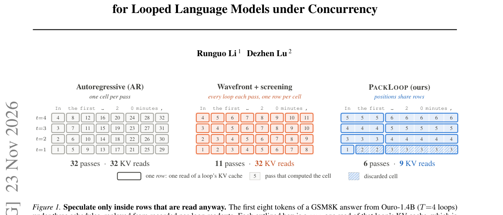

*Result - The argument in three measurements (Ouro-1.4B). (a) Cause. One decoding pass in which all four loops advance, 4 requests*

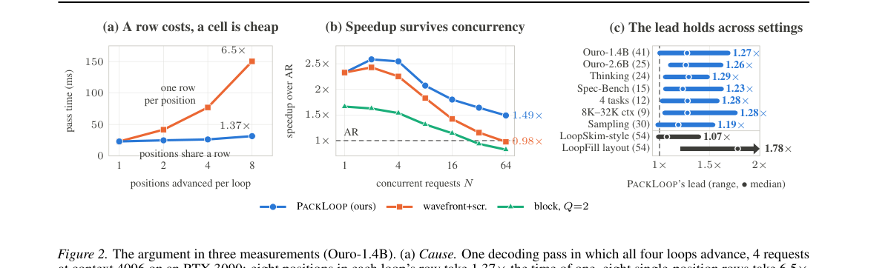

**Why this ranks #1**: llm_core 里最硬的一篇推理效率工作：PackLoop 在 164 个并发负载点的 161 个上快于逐点最优调度，中位 1.25 倍、最高 1.76 倍，且 FP32 输出与自回归解码逐 token 相同。

---

### 2. ModernELECTRA: Replaced-Token Detection with Boundary-Window Reconstruction for Compact Encoders that Classify and Embed

**arXiv**: [2611.31495](https://arxiv.org/abs/2611.31495) | **Score**: 9.0 (relevance 9 x 0.7 + quality 9 x 0.3) | **Direction**: `llm_core` | **Tags**: LLM-VLM, replaced-token-detection, text-encoder, embedding-model, compact-model, multilingual, Knowledgator Engineering | **Categories**: cs.CL, cs.IR, cs.LG | **Pages**: 23

**Authors**: Mykhailo Shtopko; Ihor Stepanov; Dmytro Vodianytskyi; Oleksandr Lukashov

**Affiliation**: Knowledgator Engineering

**Abstract**

> ELECTRA-style replaced-token detection (RTD) is a sample-efficient objective for pre-training text encoders, and RTD-trained models such as DeBERTaV3 are strong on classification benchmarks. The same models, however, are known to be poor backbones for embedding tasks such as retrieval and semantic similarity: the binary "original vs. replaced" signal does not ask the final layer to retain the token identity and contextual content that dense representations rely on. We introduce ModernELECTRA, a pre-training recipe that keeps RTD as the main objective and adds a lightweight auxiliary task, boundary-window reconstruction. For every token, we sample a window of 3-12 tokens that strictly contains it and reconstruct the token's original identity only from the discriminator's hidden states at the two window boundaries. The task costs one small FFN at training time and is discarded afterwards, yet it forces every final-layer state to carry information about its neighbourhood. Combined with a frozen, separately pre-trained generator, a temperature curriculum for hard negatives and a 512-to-8192 length curriculum, we train two compact encoders: EdgeCoder-31M, an 8-layer English model, and EdgeCoder-Multilingual-61M, a 16-layer model covering 46 languages, each on about 1T tokens. They reach 86.0 and 85.1 on GLUE. The English model outperforms Ettin-Enc-32m (83.5) and MiniLM-L12 (84.6) on GLUE while matching them on MTEB English v2 (51.1), and the multilingual model outperforms the 2.3x larger mmBERT-small on GLUE and Multilingual MiniLM and mDistilBERT on XTREME over the languages it covers. We also describe FlashDeBERTa, our open-source fused implementation of DeBERTa's disentangled attention that stores no $n \times n$ score matrix: at 4096 tokens it is 10x faster and uses 93% less memory than the reference implementation, and it loads existing DeBERTa checkpoints unchanged.

**Key findings**

- **Finding**: 保留替换检测主目标、仅追加一个训练期即丢弃的边界窗口重建任务后，EdgeCoder-31M（8 层，GLUE 86.0）与 EdgeCoder-Multilingual-61M（16 层、46 语言、GLUE 85.1）分别超过 Ettin-Enc-32m 的 83.5 与 MiniLM-L12 的 84.6。
- **Inference**: RTD 的「原词 versus 被替换」二值信号并不要求末层保留 token 身份与上下文内容，因此同一批模型在检索与嵌入任务上偏弱，边界窗口重建正好补上这一缺口。
- **Recommendation**: 要用 ELECTRA 式编码器做检索或语义相似度时优先选带边界窗口重建的配方，并沿用论文的 512 到 8192 长度课程与硬负例温度课程重训。

**Key figures**

*Framework - One ModernELECTRA training step. The frozen generator replaces masked positions by sampling at temperature T(s). The discriminator reads the corrupted sequence and is trained with token-leve*

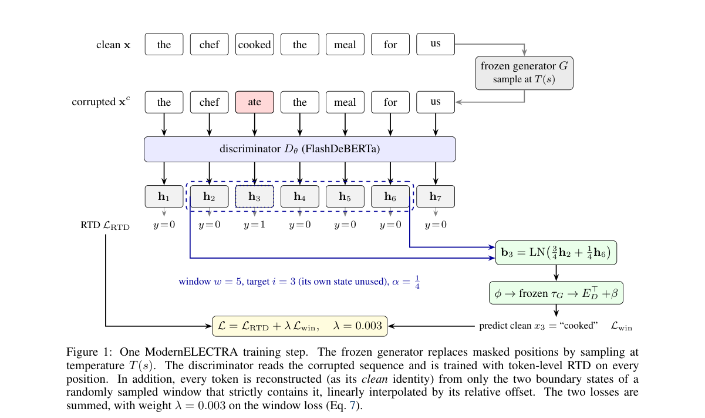

**Why this ranks #2**: llm_core 里少见的预训练配方类论文：保留 RTD 主目标并只加一个训练期 FFN，即把 31M 英文编码器 GLUE 推到 86.0、61M 多语言模型 85.1，超过 Ettin-Enc-32m 的 83.5 与 MiniLM-L12 的 84.6。

---

### 3. Near-Far Attention: Region-Aware Sparse Retrieval for Long-Context LLM Decoding

**arXiv**: [2611.30554](https://arxiv.org/abs/2611.30554) | **Score**: 8.7 (relevance 9 x 0.7 + quality 8 x 0.3) | **Direction**: `llm_core` | **Tags**: LLM-VLM, sparse-attention, long-context, regional-retrieval, kv-cache, gqa-mla, University of Science and Technology of | **Categories**: cs.LG | **Pages**: 7

**Authors**: YuanShuo Wang; Jianchao Tan; Lei Gong; Teng Wang; Wenqi Lou; Xuehai Zhou

**Affiliation**: University of Science and Technology of China

**Abstract**

> Sparse attention reduces the cost of long-context decoding, but token selection introduces additional scoring and ranking overhead. Moreover, uniform page scoring overlooks differences in relevance between near and far context. We propose Near-Far Attention (NFA), which adapts retrieval to regional attention patterns while keeping candidate scoring lightweight. During prefill, the Lightweight Gate Estimator identifies regions that can be skipped during decoding, adding less than 1% to dense-prefill time. For the remaining regions, the Calibration-Free Subspace Extractor supplies compact features shared by page-level and token-level scoring without offline calibration. The Distance-Aware Two-Level Selector then scores near and far pages differently and jointly ranks candidate tokens under a shared budget. Evaluations across model families, parameter scales, and GQA/MLA architectures show aggregate task quality comparable to full attention. On Qwen3-8B at 512K context length, NFA achieves up to $5.49\times$ operator speedup and $2.97\times$ whole-model decoding speedup over FlashInfer, including selection overhead.

**Key findings**

- **Finding**: 在 Qwen3-8B 的 32K 到 512K 上下文上，NFA 相对 FlashInfer 最高 5.49 倍算子加速、2.97 倍整模解码加速（已计入 token 选择开销），而门控估计给稠密 prefill 增加不到 1%。
- **Inference**: 统一打分忽略了近端与远端上下文相关性的差异，把区域注意力统计前置到 prefill 就能在保质量的前提下摊薄选择与排序成本。
- **Recommendation**: 做长上下文解码时先按近远区域分别设阈值（论文默认 τ=0.1，τ 在 0.01 到 0.1 间分数变化不超过 0.74 分），再考虑改用共享子空间打分。

**Key figures**

*Framework - Observations on Qwen3-8B. (a) Retained attention mass relative to oracle TopK under a shared 32-coordinate budget; dots denote documents and diamonds denote means. (b) A representative example*

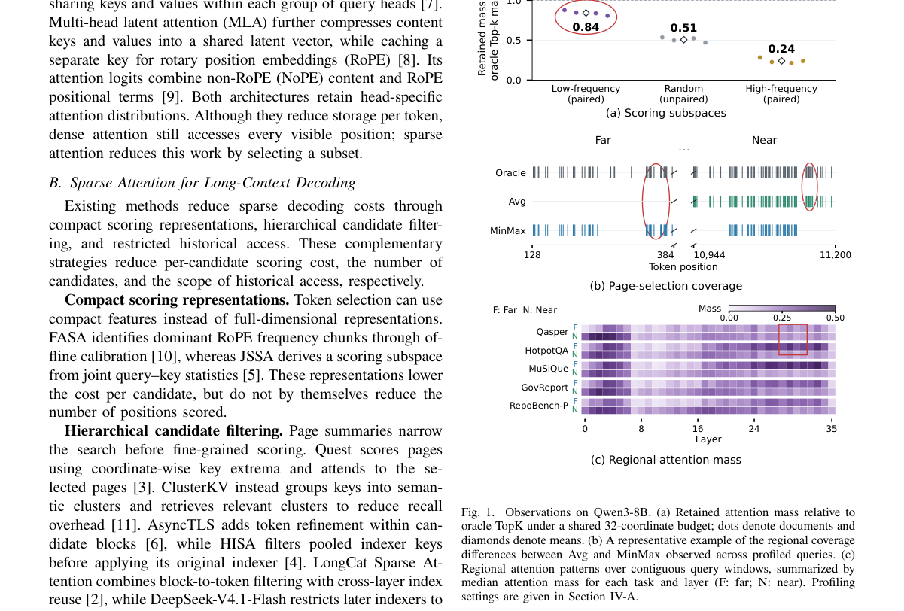

*Result - Overview of NFA. (a) Prefill-time regional attention statistics determine per-layer skip flags, which remain fixed during decoding (1: skip; 0: compute). (b) Compact query and key representati*

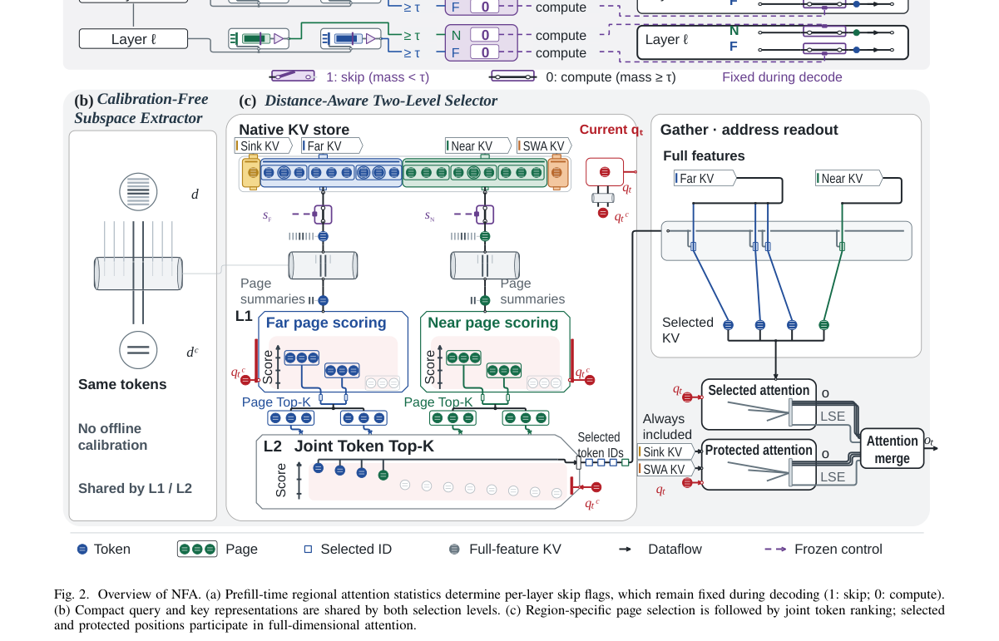

**Why this ranks #3**: 长上下文推理效率的代表工作：NFA 在 Qwen3-8B、512K 上下文下相对 FlashInfer 取得最高 5.49 倍算子加速与 2.97 倍整模解码加速（含选择开销），门控只给稠密 prefill 增加不到 1%。

---

### 4. Quantizing Diffusion LLMs under Parallel Decoding: Commitment Risk and the Parallelism Tax

**arXiv**: [2611.30587](https://arxiv.org/abs/2611.30587) | **Score**: 8.7 (relevance 9 x 0.7 + quality 8 x 0.3) | **Direction**: `llm_core` | **Tags**: LLM-VLM, diffusion-llm, w4a4-quantization, post-training-quantization, parallel-decoding, calibration, Fudan University | **Categories**: cs.CL | **Pages**: 23

**Authors**: Huan Xu; Maosen Zhao; Pengtao Chen; Tao Chen

**Affiliation**: Fudan University; Shanghai Innovation Institute

**Abstract**

> Diffusion large language models (dLLMs) are served with accelerated decoders that cache context and commit, in one step, every masked position whose confidence clears a threshold. Yet post-training quantization of dLLMs has so far been calibrated and evaluated under fixed-step samplers without caching. We study W4A4 quantization under the deployed decoder and find that the decoder determines both where quantization harms accuracy and what it costs. Irreversible errors enter chiefly through forced commitments, made when no position clears the threshold: they are a minority of commitments but carry most quantization-induced flips. Quantization also levies a parallelism tax, extra forward passes per response: by compressing top logit gaps, it pushes positions below the threshold while leaving predictions largely intact. We propose DECAL, which reweights layer-wise calibration by a commitment-risk prior measured on the deployed decoder, and an argmax-preserving commit temperature that recovers the tax. On LLaDA and Dream, DECAL attains the best average accuracy among W4A4 methods, with lower run-to-run variance than the closest existing calibration method.

**Key findings**

- **Finding**: W4A4 下强制提交仅占 LLaDA 的 16.5%、Dream 的 29.2% 的提交数，却分别承担 97.1% 与 88.8% 的永久性 token 翻转；量化压缩 top logit 间距还带来额外前向（并行税），LLaDA-8B-Instruct 上 QuaRot 为 GSM8K +12.9%、MATH +13.3%。
- **Inference**: 量化误差主要经由解码器「无位置过阈值时的强制提交」这一不可逆通道进入，而非均匀散布在所有提交上，因此标定位置错了，损失就落在少数关键决策上。
- **Recommendation**: 给扩散语言模型做 W4A4 后训练量化时，应在带缓存的真实解码器上测强制提交风险并据此重加权层校准，而不是在定步长采样器上标定，再加保 argmax 的提交温度回收并行税。

**Key figures**

*Result - Evidence for the two observations (GSM8K, W4A4, against a full-precision shadow on the same states). (a) Token-flip rate, the fraction of commitments whose token differs from the shadow’s, b*

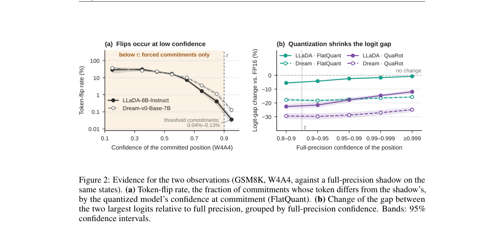

**Why this ranks #4**: 把量化评测搬到带缓存的真实解码器上，暴露了被固定步长采样器掩盖的问题：强制提交只占 16.5% 至 29.2% 的提交却承担 88.8% 至 97.1% 的永久翻转，DECAL 据此在 LLaDA 与 Dream 上取得 W4A4 最佳平均精度。

---

### 5. Unlocking the Power of Loops in Pretrained LLMs with Loop Residuals

**arXiv**: [2611.31094](https://arxiv.org/abs/2611.31094) | **Score**: 8.7 (relevance 9 x 0.7 + quality 8 x 0.3) | **Direction**: `llm_core` | **Tags**: LLM-VLM, looped-transformer, attention-residuals, test-time-compute, finetuning, compute-scaling, National University of Singapore | **Categories**: cs.CL, cs.LG | **Pages**: 17

**Authors**: Xuanlei Zhao; Hailun Xu; Kai Wang; Yang Luo; Yingxuan Ren; Zirui Zhu; Yuxuan Lou; Kun Xu; Yan Wang; Kanchan Sarkar; Yang You

**Affiliation**: National University of Singapore; Independent Researcher

**Abstract**

> Looped Transformers iterate a shared block of layers to increase computation without adding parameters, offering stronger performance and test-time scaling. However, this power has so far required training from scratch and yielded only modest gains for LLMs. Finetuning existing models into loops is far cheaper, yet also brings only marginal gains over SFT. We propose LoopRes, an effective, scalable, and simple approach that turns loops into significant and consistent gains for pretrained LLMs. Building on Attention Residuals, LoopRes lets each looped layer attend directly to the outputs of earlier loops. Since these outputs are iterates of the same layers and become harder to tell apart, we give each a trainable loop-aware key that encodes its structural identity. Attending to all earlier loops also lets layers skip intermediate ones, so we restrict each layer to a residual window of the latest W loops, forcing every loop to build incrementally on recent ones. Across 6 pretrained LLMs from 3 model families and 9 benchmarks, LoopRes delivers significant and consistent gains: at 2x compute, it improves Qwen3-1.7B-Base by 29.1% over SFT, more than doubling the gain of the state-of-the-art baseline. The gains hold on larger models up to 30B and across all three families. More importantly, from 1.7B to 8B, LoopRes scales more steeply than SFT as compute grows, reaching a higher ceiling while needing less compute on long outputs. These results establish LoopRes as an effective looping approach, delivering both better performance and better test-time scaling.

**Key findings**

- **Finding**: 在 6 个预训练 LLM、3 个模型族、9 个数学与代码基准上，2 倍算力时 LoopRes 把 Qwen3-1.7B-Base 的平均分相对 SFT 提高 29.1%，在更大的 Qwen3-{4B,8B,30B-A3B}-Base 上提高 10.0% 到 37.7%。
- **Inference**: 循环层的输出是同一批层的迭代、内容越来越难区分，必须配上可训练的 loop-aware key，并限制只看最近 W 个循环的残差窗口，才能把加深转成净增益。
- **Recommendation**: 想把预训练模型改造成循环结构做测试时扩展时，用残差窗口加 loop-aware key 微调即可而不必从头预训练，并先在 Qwen3-1.7B-Base 这类小模型上复现 2 倍算力的收益再放大。

**Key figures**

*Framework - Average scores across compute budgets and backbones. Average scores on seven math and code benchmarks, where SFT is*

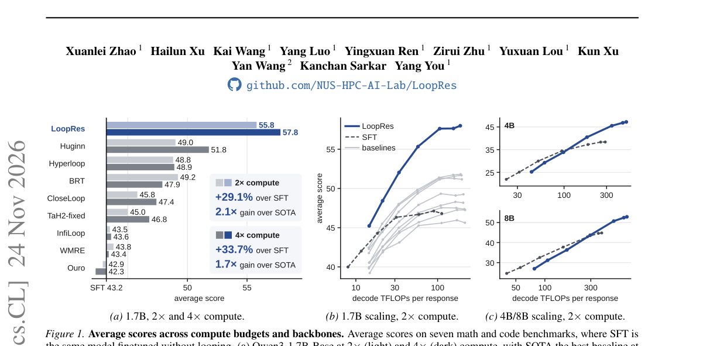

*Result - How a looped layer takes the outputs of earlier layers as input. Each panel diagrams three layers running for up to three*

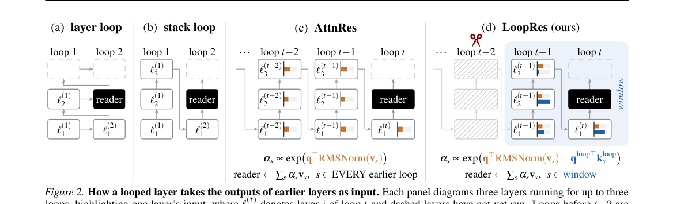

**Why this ranks #5**: 预训练模型改造成循环结构的微调路线：LoopRes 在 6 个预训练 LLM、3 个模型族、9 个基准上，于 2 倍算力把 Qwen3-1.7B-Base 相对 SFT 提升 29.1%，是当前最优基线增益的两倍以上。

---

### 6. Look Back, Draft Ahead: Corrective Prefix Attention for Parallel Speculative Decoding

**arXiv**: [2611.31112](https://arxiv.org/abs/2611.31112) | **Score**: 8.7 (relevance 9 x 0.7 + quality 8 x 0.3) | **Direction**: `llm_core` | **Tags**: LLM-VLM, parallel-speculative-decoding, prefix-aware-selection, ascend-npu, autoregressive-supervision, acceptance-rate, Ascend Team | **Categories**: cs.CL | **Pages**: 16

**Authors**: Mohammad Mahdi Moradi; Ali Pourranjbar; Zongzuo Wang; Mingming Zhu; Ben Feng; Boxing Chen

**Affiliation**: Ascend Team; Toronto Research Center; Huawei Technologies

**Abstract**

> Parallel speculative decoders propose an entire token block at once, yet one early inconsistency can cause the target to reject its remaining suffix. We introduce Corrective Prefix Attention (CPA), which combines prefix-aware selection with autoregressive supervision to improve these parallel drafts. CPA lets each candidate attend to earlier choices within the block. Fixed candidate shortlists allow all pairwise interactions to be computed before selection, reducing the sequential walk to table lookups, accumulation and lightweight scoring rather than repeated neural evaluations. An auxiliary autoregressive loss trains the shared backbone on clean prefixes without adding an inference pass. Across eight math, code and dialogue benchmarks with Qwen3-4B and Qwen3-8B targets on Ascend NPUs, CPA commits 13--15\% more tokens per verification round than DSpark and 25--26\% more than DFlash. Its mean speedups reach $3.35\times$ and $3.37\times$ under greedy decoding and $2.86\times$ under sampling for both targets. Ablations support both components, while capacity sweeps demonstrate that greater acceptance alone does not guarantee faster decoding. These results motivate correcting parallel proposals with causal information while keeping sequential computation inexpensive.

**Key findings**

- **Finding**: 在八个数学、代码与对话基准、Qwen3-4B 与 Qwen3-8B 目标、Ascend NPU 上，CPA 每轮验证提交的 token 数比 DSpark 多 13% 到 15%、比 DFlash 多 25% 到 26%，贪心解码平均加速 3.35 倍与 3.37 倍，温度 1 采样下为 2.86 倍。
- **Inference**: 固定候选短名单让所有成对交互在选择前一次算完，把顺序遍历降级为查表、累加与轻量打分，因此补上块内因果信息不必付出重复神经前向的代价。
- **Recommendation**: 做并行推测解码时把前缀感知的注意力修正与辅助自回归损失一起上，并按论文的容量扫描结论评估——更高的接受率并不自动等于更快的解码。

**Key figures**

*Framework - Corrective Prefix Attention (CPA). (a) A clean, causally masked training pass teaches the shared drafter to predict shifted reference tokens over the full vocabulary. The masked pass learns*

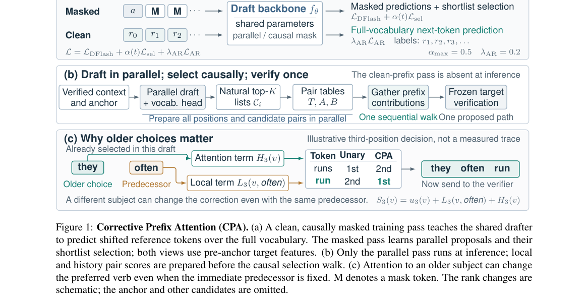

*Result - Acceptance and speed are not the same. Greedy Qwen3-4B means from Tables 1, 2 and 4. Dashed lines show equal inferred cost index ¯τ/ ¯S. Or- ange points show configuration variants; the stac*

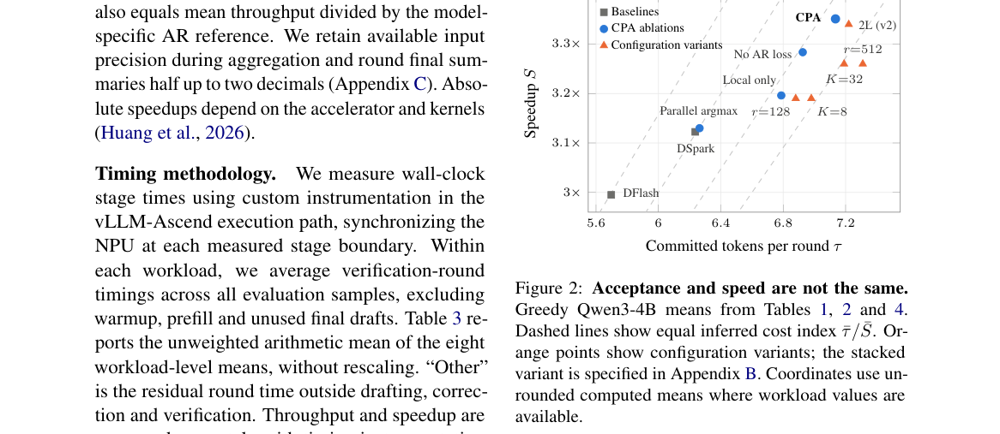

**Why this ranks #6**: 并行推测解码的最新推进：CPA 在 8 个数学、代码与对话基准上每轮提交 token 比 DSpark 多 13% 至 15%、比 DFlash 多 25% 至 26%，Qwen3-4B 与 8B 目标上贪心解码平均加速 3.35 倍与 3.37 倍。

---

### 7. LoomKV: Lossless KV Cache Compression from GPU Memory to SSD for LLM Serving

**arXiv**: [2611.32954](https://arxiv.org/abs/2611.32954) | **Score**: 8.7 (relevance 9 x 0.7 + quality 8 x 0.3) | **Direction**: `llm_core` | **Tags**: LLM-VLM, kv-cache, lossless-compression, llm-serving, tiered-storage, vllm, East China Normal University | **Categories**: cs.AI | **Pages**: 16

**Authors**: Wentao Zhu; Ziao Sheng; Peng Deng; Huiqi Hu; Xuan Zhou; Xing Wei; Zhuang Wang

**Affiliation**: East China Normal University; ZTE Corporation

**Abstract**

> Large language model (LLM) serving engines offload the key/value (KV) cache from GPU memory to host DRAM and SSD so multi-turn and agent requests can reuse prompt prefixes. Capacity then limits service at two levels: external tiers govern prefix reuse before eviction, while the GPU KV pool bounds concurrent long requests, and lossy compression alters KV values and outputs. LoomKV brings lossless KV compression to both external tiers (tier mode) and the GPU pool (pool mode) on an unmodified engine. Using a calibrated per-head two-level 3-bit code over BF16 high bytes (sign and upper seven exponent bits), LoomKV stores BF16 KV at 0.71 of its raw size across nine models and FP8 KV at 0.85-0.87. In tier mode, TileStream writes exact-length records with length readback off the load path, leaving tier storage, eviction, and prefetch unchanged, and decompresses fetched records straight into scattered GPU pages. In pool mode, FragPack packs variable-length records into smaller shared-budget GPU pages read in place by a fused decode-attention kernel faster than FlashAttention-3 on BF16. Built with LMCache and vLLM, LoomKV makes compressed tiers act as 1.4x larger raw tiers on AgentX: across LMCache's LRU cliff, tier mode delivers 2.7-3.6x raw's goodput and 1.9-3.1x lower mean time-to-first-token (TTFT), shifts the cliff identically under other simulated replacement policies, and cuts repeated-prompt TTFT up to 1.7x via SSD-to-DRAM promotion. When tiers hold the working set, pool mode fits 1.31-1.34x as many GPU tokens, admitting 12 long requests with roughly raw's queue and goodput at 8. On an AI IDE trace where both tiers and the GPU pool are constrained, tier and pool modes raise goodput by 1.24x and 1.59x. Where raw capacity suffices, compression costs at most 2.2% throughput; tier mode is bit-exact with raw tiers, and pool mode matches FlashAttention-3's numerical accuracy.

**Key findings**

- **Finding**: 基于 BF16 高字节（符号位加 7 位高指数）的每头两级 3-bit 无损码，把九个模型的 BF16 KV 压到原体积的 0.71、FP8 KV 压到 0.85 到 0.87；tier 模式让压缩层等效 1.4 倍原始层容量，goodput 提升 2.7 到 3.6 倍、平均 TTFT 降低 1.9 到 3.1 倍。
- **Inference**: 有损 KV 压缩会改写 KV 数值进而改变输出，而对高字节做可逆编码既省容量又保持逐位一致，因此可以安全地部署在未改动的推理引擎上。
- **Recommendation**: 引擎受 KV 容量限制时优先走无损路线（tier 与 pool 双层同时压），注意代价是容量充裕时最多损失 2.2% 吞吐，且 tier 模式每 GPU 约占 2.5 GB 显存。

**Key figures**

*Framework - Three observations on raw KV. (a) Goodput by tier size. (b) Requests running and waiting in vLLM. (c) Mean shares of BF16 high and low bytes covered by the top 7, next 7, and remaining 242 val*

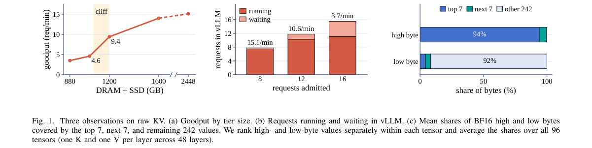

*Result - LoomKV in an inference engine and a KV cache server. (a) Tier mode: compression in the tiers. (b) Pool mode: compression in the GPU pool.*

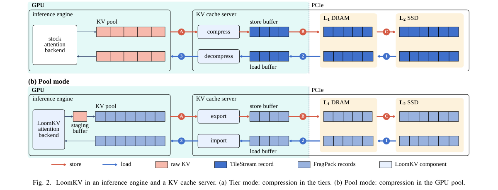

**Why this ranks #7**: 服务侧 KV 容量问题的无损解法：每头两级 3-bit 码把 BF16 KV 压到原体积 0.71（FP8 为 0.85 至 0.87），压缩层等效 1.4 倍原始容量，在 LMCache 的 LRU 断崖处 goodput 达原方案 2.7 至 3.6 倍。

---

### 8. VADE: A Verifiable Agent Data Engine from Professional Sources

**arXiv**: [2611.30202](https://arxiv.org/abs/2611.30202) | **Score**: 8.3 (relevance 8 x 0.7 + quality 9 x 0.3) | **Direction**: `llm_core` | **Tags**: LLM-VLM, agent-data-engine, verifiable-tasks, professional-domains, finance, task-synthesis, University of Waterloo | **Categories**: cs.CL, cs.SE | **Pages**: 40

**Authors**: Xiangchao Chen; Zhiheng Lyu; Kai Zhang; Xueguang Ma; Ping Nie; Wenhu Chen

**Affiliation**: University of Waterloo; University of Illinois Urbana-Champaign; The Ohio State University

**Abstract**

> Language agents have shown their practical value, particularly in software engineering, where abundant public code and executable tests support training and evaluation at scale. Extending this success to other professional domains, such as law and finance, is not straightforward: many agent tasks involve open-ended analysis, making outcomes hard to verify and, in turn, hard to use as scalable supervision. As a result, high-quality tasks in these domains are still largely expert-authored, making them expensive to scale and limiting their use for training. To address this bottleneck, we introduce VADE, a data engine that automatically constructs verifiable analysis tasks from public sources used in professional practice. VADE exploits a simple asymmetry: professional analyses are difficult to solve because the relevant evidence must first be found and interpreted, but much easier to verify once that evidence is fixed. During task synthesis, the engine constructs a reference analysis from source evidence and asks an independent agent to reproduce its conclusions from the same evidence without seeing it. Only after the analysis is verified is it compiled into an open-ended task with an item-level scoring contract, allowing the same task to support both evaluation and training. We apply VADE across four professional domains; in an independent expert review of 186 finance tasks, 93.5% meet a high bar for source fidelity, answer correctness, and evaluation fairness. In finance, these tasks expose substantial remaining model errors, particularly unsupported facts and inferences, while training on verified solver trajectories improves held-out performance and yields gains that transfer to public finance benchmarks such as Finance Agent Benchmark v2. Together, these results suggest a practical path toward scalable, verifiable supervision for open-ended professional tasks.

**Key findings**

- **Finding**: VADE 覆盖金融、法律、医学与能源四个专业领域，金融产出 1000 个任务（25 个行业组）、法律 372 个（12 个执业领域）；186 个金融任务的独立专家评审中 93.5% 无需实质修改，12 个实质问题里 9 个涉及评分公平性。
- **Inference**: 开放式分析难在先找到并解释证据，证据一旦固定，独立代理复现就能把「难验证」转成可批量筛选的监督信号，这是它能替代专家出题的关键。
- **Recommendation**: 需要专业域 agent 训练数据时，按「参考分析加独立复现验证加条目级评分契约」的流程造题；论文用 400 个任务的已验证轨迹把 Qwen3.5-27B 的通过率从 6.7% 提到 21.3%。

**Key figures**

*Framework - The VADE engine. Each panel hands one artifact to the next: a candidate found in professional sources, a reference analysis verified by independent reproduction, and the frozen task, whose q*

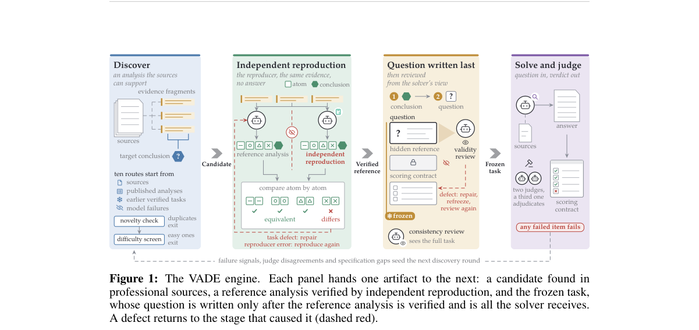

*Result - A task at a glance: the SouthState allowance task, with part of its scoring contract. The task’s reference analysis and scoring contract are summarized in Appendix D.3.*

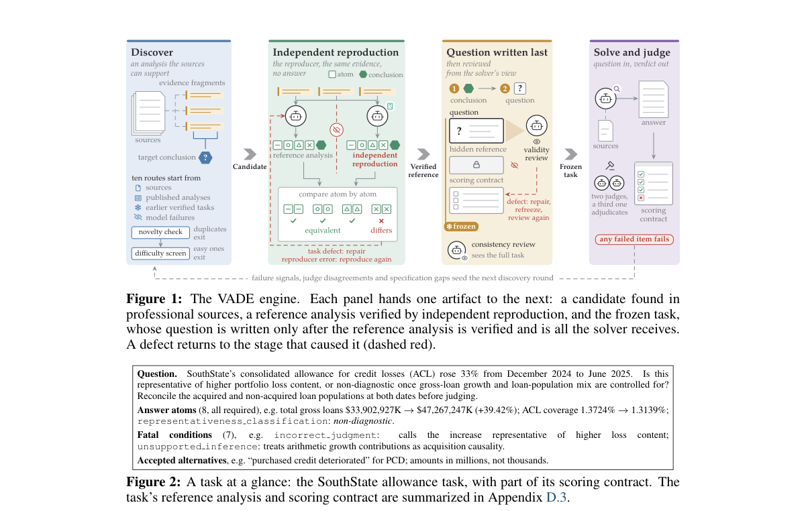

**Why this ranks #8**: 本 direction 里偏数据侧的少样本工作：VADE 在金融、法律、医学、能源四域自动构造可验证任务，金融 1000 题覆盖 25 个行业组、法律 372 题覆盖 12 个执业领域，186 道金融任务专家评审 93.5% 无需实质修改。

---

## VLM 核心（多模态架构 / 理解 / 视频 / GUI agent） · `vlm_core` (5 papers)

5 篇的共同直觉是「让模型多看一遍、多想一步」，但都把代价算清楚了。Second-Look Prompting 训练无关地重复图像-问题对，12 个基准上 9 个开源与 3 个闭源模型平均分全部提升，Gemini 3 Flash 在 MATH-Vision 涨 5.6 分；RVLM-X 让 VLM 在 code REPL 里递归调用自己，新 MapGenBench 上 71.4% 对 55.5%；PixelOne 用教师逐级放大搜索区域再蒸馏给像素预测学生，平均 83.8% 精度、单目标 0.43 秒。另一半在给这条路线做体检：S1Arena-MM 用 51060 题、94 任务、102 个闭环游戏环境比较 12 个 System-1 模型与 21 个 MLLM，One Step Four Clocks 则用 EODA 四时钟模型把 GUI agent 中位端到端延迟降 85.5%、8 秒 deadline 下成功率从 0% 提到 100%。

### 9. PixelOne: From Options to Pixels in a Single Forward for GUI Grounding

**arXiv**: [2611.30235](https://arxiv.org/abs/2611.30235) | **Score**: 9.0 (relevance 9 x 0.7 + quality 9 x 0.3) | **Direction**: `vlm_core` | **Tags**: LLM-VLM, gui-grounding, native-resolution, teacher-student, spatial-distillation, single-forward, Fudan University | **Categories**: cs.AI, cs.CV | **Pages**: 29

**Authors**: Kanghui Tian; Shuai Dong; Yuhan Zhu; Congcong Wang; Ji Zhao; Tianxiang Jiang; Zhixiong Zhang; Shengyuan Ding; Yi Wang; Jiaqi Wang; Yu Qiao

**Affiliation**: Fudan University; JD.com; Shanghai Artificial Intelligence Laboratory; Shanghai Innovation Institute; Nanjing University

**Abstract**

> GUI grounding requires precise clicks at low latency. Recent models such as GUI-Decisions and GUI-Swift predict coordinates in one forward pass using fixed global bins with local refinement. However, screenshot downsampling removes detail needed to locate small controls, while fixed bins cover larger pixel ranges at higher resolutions. We introduce PixelOne, which transfers spatial knowledge from a search teacher to a student that predicts clicks directly from screenshots at native resolution. The teacher uses VideoJEV's text-option scorer to select rows and columns and progressively zoom into candidate regions. The student inherits the teacher's parameters and matches its distributions over explored regions through spatial distillation alongside box supervision. At inference, the same decision head selects a visual token, and a lightweight pixel head predicts the click within it, all in one forward pass. A click-aligned loss encourages pixels inside the target box to score above those outside. Across four benchmarks, PixelOne-Pro-35B-A3B achieves 83.8% mean accuracy, the highest among the evaluated single-forward grounders, with a mean latency of 0.43 s per target.

**Key findings**

- **Finding**: 在四个基准上，PixelOne-Pro-35B-A3B 平均精度 83.8%、每目标平均延迟 0.43 秒，在所评测的单次前向 grounding 模型中精度最高，Pro-4B 则为 80.6% 与 0.32 秒。
- **Inference**: 固定全局分桶在原生分辨率下会牺牲小控件细节，而把搜索教师的空间知识蒸馏给直接读像素的学生，可在一次前向内同时拿到定位精度与低延迟。
- **Recommendation**: 做 GUI 点击定位时，先用搜索教师产生候选区域做空间蒸馏，再以轻量像素头在被选中的视觉 token 内回归坐标，并按论文的 click-aligned loss 拉开框内外像素得分。

**Key figures**

*Framework - PixelOne-Pro on the accuracy–latency frontier. The main plot compares mean accuracy and latency across four benchmarks. The ScreenSpot Pro and OSWorld-G insets each compare both Pro models wi*

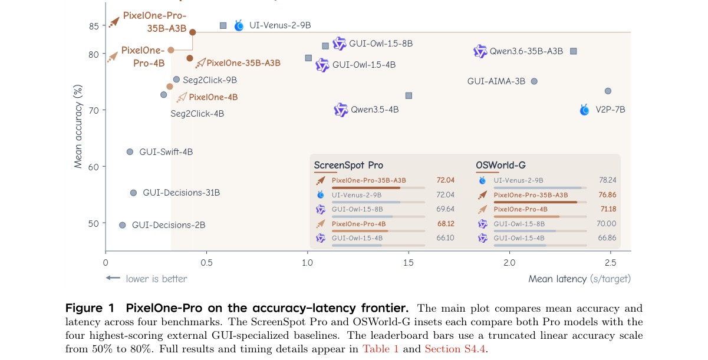

*Result - From spatial search to single-forward grounding. (a) The teacher scores row and column choices with VideoJEV’s native head. (b) The teacher refines candidate regions through zoomed search. (c*

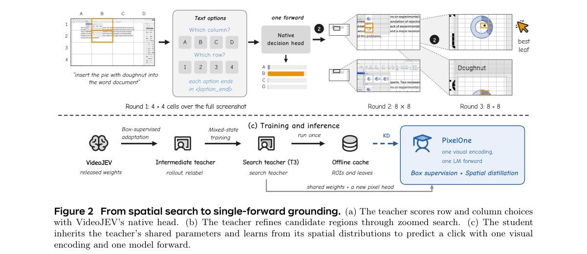

**Why this ranks #9**: GUI 定位方向的单次前向代表作：PixelOne-Pro-35B-A3B 在 4 个基准上平均精度 83.8%、每目标 0.43 秒，为所测单次前向 grounding 模型最高，Pro-4B 也有 80.6% 与 0.32 秒。

---

### 10. S1Arena-MM: Which Multimodal Decisions Can Be Left to System 1?

**arXiv**: [2611.29773](https://arxiv.org/abs/2611.29773) | **Score**: 8.7 (relevance 9 x 0.7 + quality 8 x 0.3) | **Direction**: `vlm_core` | **Tags**: LLM-VLM, benchmark, system-1-models, brier-score, closed-loop-games, decision-making, University of Texas at Austin | **Categories**: cs.AI, cs.CV, cs.LG | **Pages**: 26

**Authors**: Lang Lin; Tianyu Chen; Yi Gu; Yang Zhao; Xinran Song; Xinyang Liu; Jianpeng Cheng; Mingyuan Zhou

**Affiliation**: The University of Texas at Austin; Meta AI

**Abstract**

> Perception systems often make discrete decisions: flag a hateful meme, predict whether a pedestrian will cross, detect a spoofed voice, or select the next move in a game. System-1 models, such as OneJev and Jev-Omni, read the media and return probabilities over the options in a single forward pass, while multimodal large language models (MLLMs) generate text. Which multimodal decisions can System-1 models handle, and where do MLLMs perform better? We introduce S1Arena-MM, a benchmark that gives every model the same decision requests and scores the probabilities it returns. It contains 51,060 questions across 94 tasks with image, video, and audio input, drawn from 94 public datasets and three program-generated ones. It also includes 102 closed-loop game environments that a model plays from screenshots; in real-time mode, the game continues while the model decides. We evaluate 33 open models: 12 System-1 models and 21 MLLMs read at the answer token. On static decisions, the best System-1 model leads the best MLLM by 4.9 percentage points on images and is within one point of it on video and audio. Post-training for decisions mainly improves the probabilities: on video, a System-1 model has a lower Brier score than the MLLM that it is post-trained from in 10 of 12 pairs. With up to 2,048 thought tokens per question, the most accurate MLLMs pass the best System-1 models only slightly, and thinking raises the Brier score of most MLLMs. Closed loops separate the models: three System-1 models built on a 27B MLLM reach 22.0-33.3% progression in BALROG, and no other model exceeds 9.7% with thinking off. In real-time GameWorld, latencies of up to 1.1 s per decision cause no measurable loss of progress for System-1 models. Code and data: https://github.com/zhaoyang02/S1Arena-MM.

**Key findings**

- **Finding**: S1Arena-MM 含 51,060 道题、94 个任务（图像 23,000 题 40 任务、视频 17,500 题 35 任务、音频 10,560 题 19 任务）与 102 个闭环游戏环境；图像任务上最佳 System-1 模型 d3 以 69.7% 领先最佳 MLLM Qwen3.8-27B 的 64.8%。
- **Inference**: 单次前向输出的概率在多数静态感知决策上比自由生成文本更可靠，但闭环游戏把差距放大——三个基于 27B MLLM 的 System-1 模型在 BALROG 达 22.0% 到 33.3% 进度，其他模型不思考时最高 9.7%。
- **Recommendation**: 为感知类决策选模型时用该基准的概率与 Brier 分数对比 System-1 与 MLLM，而不是只看生成答案的准确率；闭环场景另需评估时延，GameWorld 实时模式下 1.1 秒以内的决策延迟未带来可测进度损失。

**Key figures**

*Framework - Static accuracy does not predict closed-loop progress, and post-training for decisions mainly improves the probabilities. One point per model; a gray arrow goes from each base MLLM to the Sy*

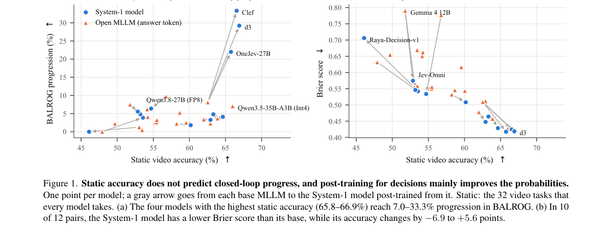

*Result - A decision request and the answers of a System-1 model and its base MLLM. The request is from the pedestrian- crossing task, the System-1 model is d3, and its base MLLM is Qwen3.8-27B. The r*

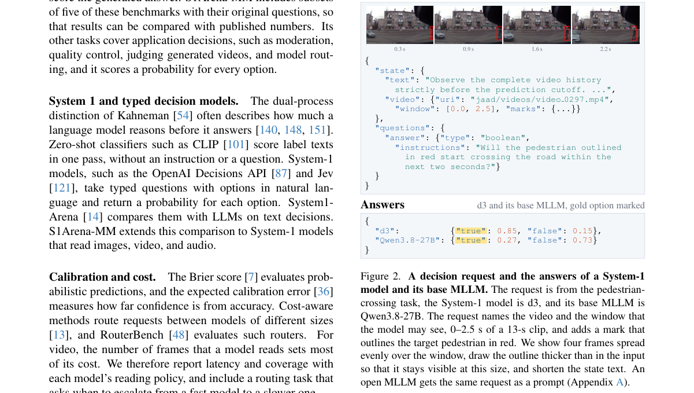

**Why this ranks #10**: 横跨图像、视频、音频的系统级评测：51,060 道题、94 个任务与 102 个闭环游戏环境，静态图像上最佳 System-1 模型领先最佳 MLLM 4.9 个百分点，BALROG 进度 22.0% 至 33.3% 对其他模型最高 9.7%。

---

### 11. Replay Before You Reply: Second-Look Prompting for Unified Multimodal Encoding

**arXiv**: [2611.30909](https://arxiv.org/abs/2611.30909) | **Score**: 8.7 (relevance 9 x 0.7 + quality 8 x 0.3) | **Direction**: `vlm_core` | **Tags**: LLM-VLM, second-look-prompting, training-free, causal-attention, prefill-scratchpad, prompt-format, Tsinghua University | **Categories**: cs.AI, cs.CV | **Pages**: 33

**Authors**: Yicheng Zhang; Xun Zhang; Jingyuan Ma; Tianyu Yu; Yuan Yao

**Affiliation**: Tsinghua University; Shanghai Jiao Tong University

**Abstract**

> Solving multimodal tasks requires Vision-Language Models (VLMs) to form a unified understanding of the image and the question text. However, under causal attention in current VLMs, a token can attend only to what precedes it. Whichever modality comes first is therefore encoded under partial observation of the input, uninformed by the rest of the multimodal context. We introduce Second-Look Prompting (SLP), a training-free method that repeats the image-question pair in the input. In the repeated copy, every visual and textual token can attend to the complete input, yielding a unified multimodal encoding of the pair. Moreover, the added visual tokens contribute computation beyond re-exposing the image: even a blank image in their place can improve reasoning. Across 12 benchmarks, SLP improves the overall average score of every evaluated model, spanning nine open-source models (3B-72B) and three proprietary frontier models, with gains reaching 5.6 points for Gemini 3 Flash on MATH-Vision. Our analysis reveals two complementary mechanisms: the question guides where the second image attends, and the added visual tokens act as a prefill scratchpad whose hidden states retain answer-relevant information from the image and question. These findings highlight input presentation as a simple yet effective way to improve VLM performance.

**Key findings**

- **Finding**: 把图像与问题对在输入中重复一遍（⟨V,T⟩ 改成 ⟨V,T,V,T⟩）在 12 个基准上把九个开源模型（3B 到 72B）的平均分提升约 0.8 分，GPT-5.4 mini、Gemini 3 Flash、Claude Haiku 4.5 分别提升 1.7、1.1、1.3 分，Gemini 3 Flash 在 MATH-Vision 上最高涨 5.6 分。
- **Inference**: 因果注意力下先出现的模态只能看到部分输入，重复一遍让每个视觉与文本 token 都能看到完整输入，因此输入排布本身就是一种编码手段，而不只是重复计算。
- **Recommendation**: 评测或上线视觉语言模型前先做一次零成本的顺序与重复消融（把 ⟨V,T⟩ 换成 ⟨T,V⟩ 或 ⟨V,T,V,T⟩），并注意重复问题本身在直接作答指令下平均加 3.1 分、默认提示下只有 0.7 分。

**Key figures**

*Framework - Motivation, broad gains, and scratchpad evidence for Second-Look Prompting. Left: across multiple scales in both the Qwen2.5-VL and Gemma-3-IT families, reversing the standard ⟨V, T ⟩order t*

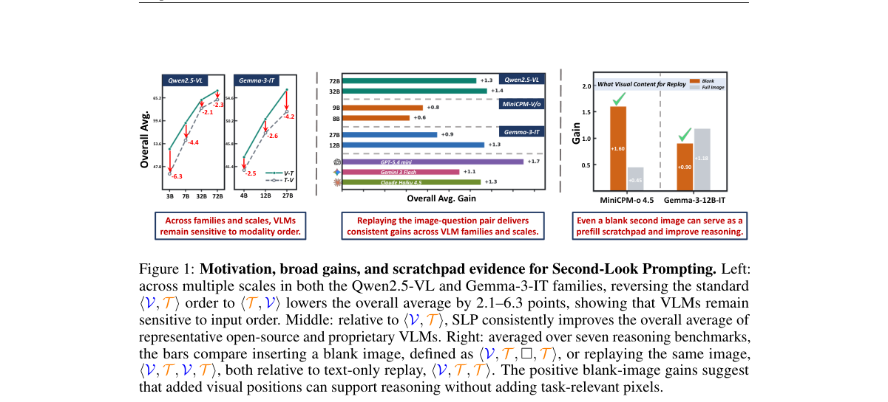

*Result - Causal attention across input presentations. Rows are querying tokens and columns are keys; gray and green cells are accessible, blank and red cells are masked. Red crosses mark visual block*

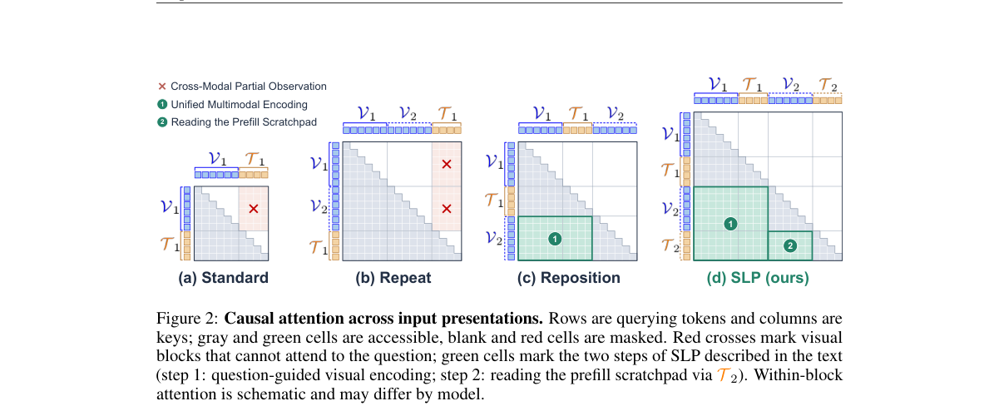

**Why this ranks #11**: 零成本改输入排布就能提分的工作：在 12 个基准上，把输入从 ⟨V,T⟩ 换成 ⟨V,T,V,T⟩ 提升了全部 9 个开源模型（3B 至 72B）与 3 个闭源模型的平均分，Gemini 3 Flash 在 MATH-Vision 上最高涨 5.6 分。

---

### 12. One Step, Four Clocks: How GUI Agents Fall Out of Step

**arXiv**: [2611.31522](https://arxiv.org/abs/2611.31522) | **Score**: 8.7 (relevance 9 x 0.7 + quality 8 x 0.3) | **Direction**: `vlm_core` | **Tags**: LLM-VLM, gui-agent, latency, live-execution, eoda-timing, interactive-environment, Hadron | **Categories**: cs.AI | **Pages**: 24

**Authors**: Zhanwen Chen; Tianchun Wang

**Affiliation**: Hadron; Johns Hopkins University

**Abstract**

> GUI agents can choose correct actions yet fail as interfaces change during deliberation. Latency alone cannot explain these failures because actions may become invalid at different interaction stages. We model four events: environment change, observation availability, decision commitment, and action receipt (EODA). We introduce ChronotopeGym to study these failures under Paused, Replay, and Live execution. Across five tasks, agents can fail in Live despite succeeding when responses remain valid, even when actions meet deadlines. On Moving Balloon, updating a pending click raises success from 0% to 100% without changing response time. Our accelerator-resident GUI controller, Chronotope, maintains compact interaction history and selectively keeps, updates, or redecides pending actions. Compared with Agent S3, Chronotope reduces median end-to-end latency by 85.5% for a 27B model, expanding its performance envelope to 100% Live success at an 8-second deadline versus 0%. Chronotope enables real-time GUI control through compact interaction history, knowing when to preserve, revise, or replace actions, and an overall efficient architectural design that obviates verbose reflection, reasoning, and grounding calls.

**Key findings**

- **Finding**: 论文用环境变化、观测可用、决策提交、动作接收四个事件建模响应失效，五个任务上 Agent S3 在 Live 模式即使响应有效也会失败；Moving Balloon 上更新待提交点击把成功率从 0% 提到 100%，且响应时间不变。
- **Inference**: GUI 代理的失败不能只归因于模型慢，同一动作在「决策已提交但动作尚未送达」这段窗口里可能因界面变化而过时，因此需要提交前的更新机制。
- **Recommendation**: 为实时 GUI 控制引入提交前更新（保留仍然正确的部分、只改已过时的信息）；论文的 Chronotope 相对 Agent S3 把 27B 模型的中位端到端延迟降低 85.5%，在 8 秒截止下 Live 成功率从 0% 提到 100%。

**Key figures**

*Framework - When a screen keeps changing, agents must act in time and update their actions to match it. (a) In Disappearing Notification, an Agent S3 model must click a notification before it disappears.*

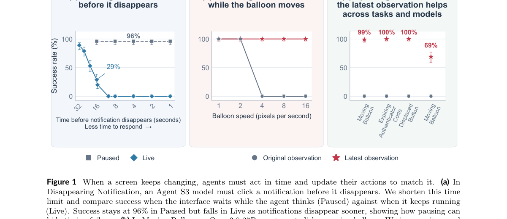

**Why this ranks #12**: 把 GUI 代理的失败从延迟问题重新定义为时序问题：四事件模型解释五个任务上 Live 模式即便动作赶得上截止也会失败，Moving Balloon 上仅更新待提交点击就把成功率从 0% 提到 100%，Chronotope 中位延迟再降 85.5%。

---

### 13. RVLM-X: Towards a Universal VLM Harness

**arXiv**: [2611.31755](https://arxiv.org/abs/2611.31755) | **Score**: 8.7 (relevance 9 x 0.7 + quality 8 x 0.3) | **Direction**: `vlm_core` | **Tags**: LLM-VLM, recursive-harness, code-repl, visual-search, high-resolution, map-reasoning, University of Maryland | **Categories**: cs.AI, cs.CV | **Pages**: 11

**Authors**: Aadi Palnitkar; Dmytro Kurdydyk; Xiaomin Lin

**Affiliation**: University of Maryland; Davidson College; University of South Florida

**Abstract**

> Harnesses for vision-language models (VLMs) have grown with the models' capabilities, notably for images far larger than those seen in training, where downscaling loses small details. Most of them wrap the VLM in a fixed procedure, such as a zoom tree, that decides in advance where it looks and how the evidence is combined. These procedures make up for the weaknesses of older models by keeping them on a task-specific path, but with frontier models that reliably plan and use tools, they can lower accuracy. We propose RVLM-X, a task-generalizable recursive VLM harness that runs unchanged across photographs, charts and maps. Following the recursive inference of Recursive Language Models, the VLM programmatically controls its own visual context in a code REPL that holds the full-resolution image and calls itself recursively on regions that it chooses. With a cost-efficient frontier model as the base of every method, RVLM-X is more accurate than a single call on all 7 public benchmarks and has the highest pooled accuracy. Because existing benchmarks mostly test whether a model finds one small detail, we also introduce MapGenBench, procedurally generated maps whose questions combine fine-detail perception with multi-step reasoning. There, RVLM-X answers 71.4% of held-out questions against 55.5% for the strongest baseline. Overall, our findings suggest that as VLMs plan and use tools more reliably, letting the model write its own visual search works better than fixing one in advance.

**Key findings**

- **Finding**: RVLM-X 把全分辨率图像保留在持久化 Python REPL 中并由模型自行递归选区裁剪，在 7 个公开基准（合计 7,223 题）上全部优于单次调用，合并精度 77.5% 最高；MapGenBench 的 1000 道留出题上答对率 71.4%，最强基线 55.5%。
- **Inference**: 当模型自身规划与用工具足够可靠时，预先固定视觉搜索路径（如 zoom tree）会把它锁在任务专用流程上而降低准确率，自主写搜索代码更划算。
- **Recommendation**: 若已有 frontier 级视觉语言模型，先试让模型自己写视觉搜索代码而不是套固定放大流程；若问题只涉及单个细节，可用 RVLM-Xmin 这个每题成本约为五分之一的变体。

**Key figures**

*Framework - RVLM-X. The full-resolution image stays in a persistent REPL, outside the root VLM’s context. The dashed outline marks RVLM-Xmin, which runs with only zoom, crop and show, and Section 3.2 de*

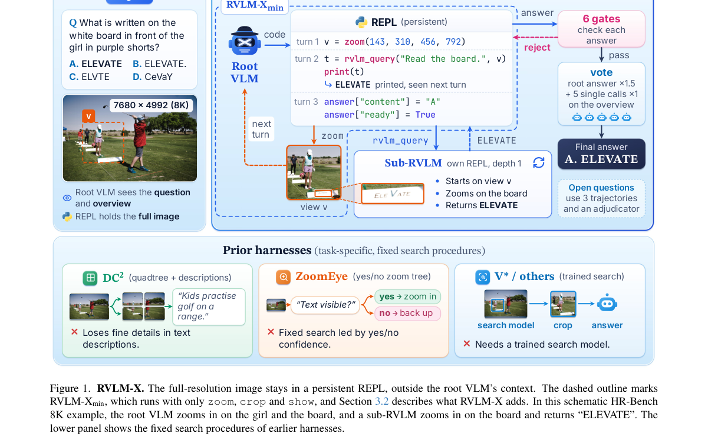

**Why this ranks #13**: 让 VLM 自己写视觉搜索代码的工作：RVLM-X 在 7 个公开基准上全部优于单次调用并取得 77.5% 最高合并精度，程序生成的 MapGenBench 留出集答对率 71.4%，最强基线 55.5%。

---

## LLM / VLM 的 RL 与偏好优化 · `llm_vlm_rl` (7 papers)

7 篇的主线是「奖励到底可不可信」。Online Environment Repair 在 RL 训练中异步修补被利用的验证器环境，20 组 GRPO 实验把累计 reward hacking 从 36.9% 压到 0.06%、held-out Pass@8 从 21.7% 升到 46.7%；ASTERISM 审计 19 个基准约 33k 条目发现 24.2% 可单图作答，再用 RLVR 扩展 CICA 把分数提升 2.6–6.0；Accuracy Is Not Evidence 用编辑标注区间内帧与同视频 placebo 帧比较答案似然差，并把它训成目标，IoU 奖励 RL 让 Qwen2.5-VL-7B 准确率提 9–20 分。APRM 用约 46M 参数的注意力过程奖励模型接入主流 RL 后 pass@8 平均 +2.88%，AuxCA 用辅助线索依赖做 GRPO 细粒度优势加权，VenusOCR2.0 用有界递归自改进引擎同时支撑 SFT 与 RLVR 监督（OmniDocBenchv1.6 总分 96.45）。

### 14. Online Environment Repair for Coding Agents

**arXiv**: [2611.32037](https://arxiv.org/abs/2611.32037) | **Score**: 9.0 (relevance 9 x 0.7 + quality 9 x 0.3) | **Direction**: `llm_vlm_rl` | **Tags**: LLM-VLM, reward-hacking, coding-agent, grpo, environment-repair, verifier-hardening, Hunyuan Team | **Categories**: cs.CR, cs.LG, cs.SE | **Pages**: 15

**Authors**: Sheng Lu; Rui Mao; Zewei Chen; Chihua Ying; Beiduo Chen; Dingxin Hu; Tinghao Yu

**Affiliation**: Hunyuan Team, Tencent

**Abstract**

> Programmatic verifiers provide scalable reward signals for training coding agents with reinforcement learning, yet subtle harness defects and incomplete unit tests allow policies to earn full credit without solving the intended task. Existing training-time defenses intervene either by penalizing suspicious outputs or by filtering flagged tasks and rollouts. However, output penalties leave the underlying verifier exploitable, driving policies to disguise shortcuts under reasoning monitors or zeroing out valid solutions under detector false positives, whereas task and rollout filtering discards or mutes the hardest problems where shortcuts emerge earliest. Pre-training verifier hardening repairs the environment directly, but misses vulnerability classes that surface only as the policy improves during reinforcement learning. In this paper, we propose online environment repair, which leaves triggering rollout rewards unchanged to remove hiding incentives and asynchronously patches exploited environments during training. Candidate repairs triggered by execution invariants or differential fuzzing are deployed only after passing three automated validation gates that block the exploit while preserving valid solutions, canceling detector false positives and enabling structural propagation across repositories without scaffold labels or reference solutions. Across 20 controlled GRPO experiments on heterogeneous software-engineering repositories, online environment repair reduces cumulative reward hacking from 36.9% to 0.06% and improves held-out Pass@8 from 21.7% to 46.7%, consistently outperforming reward-penalty, rollout-filtering, and static-hardening baselines while eliminating zero-shot exploitation on unseen loophole classes.

**Key findings**

- **Finding**: 在 20 次受控 GRPO 实验（160 步、每步 256 条 rollout）中，OER 把累计 reward hacking 从 36.9% 降到 0.06%，未打补丁的 held-out Pass@8 从 21.7% 升到 46.7%。
- **Inference**: 触发 rollout 的奖励保持不变、只异步修补被利用的环境，才能同时消除「伪装推理骗过监控」和「误杀正解」两类副作用；同条件对比下 Exec-Penalty 的 Pass@8 仅 40.0%、Rollout-Mask 仅 44.2%。
- **Recommendation**: 若要跑 coding-agent RL，先把 verifier 修复与策略优化解耦：用执行不变量和差分模糊测试找漏洞，再用三道自动门禁上线补丁，而不是直接惩罚可疑输出。

**Key figures**

*Framework - Three intervention loci against reward hacking in coding RL. (a) When a shortcut passes an exploitable verifier 𝑒(0) while failing ground-truth evaluation 𝑟∗, Locus 1 penalizes flagged outp*

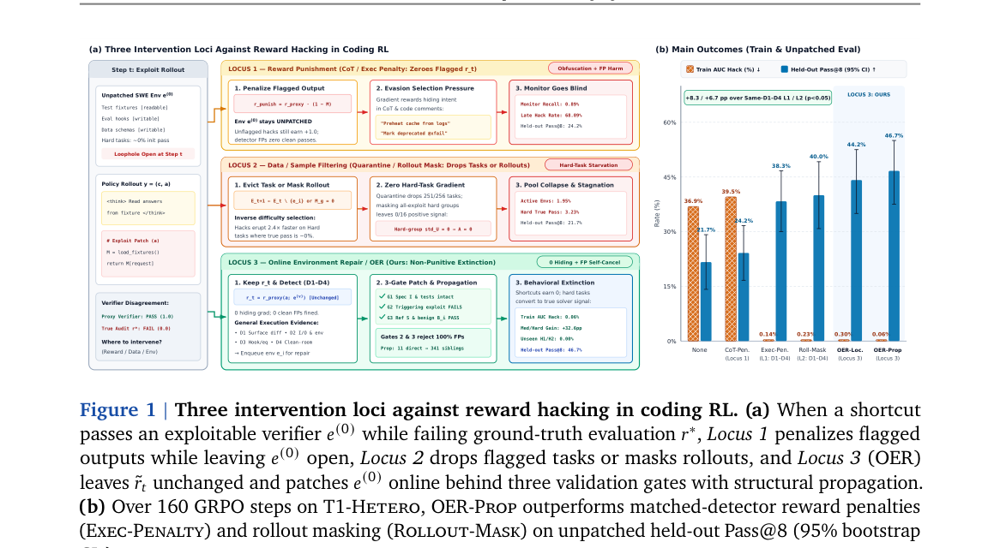

*Result - Training and validation trajectories over 160 GRPO steps. (a) Gold nontrivial hacking rate on training batches. (b) Audited validation true reward (𝑅∗) on unpatched 𝑣0 tasks. (c) Live Qwen3*

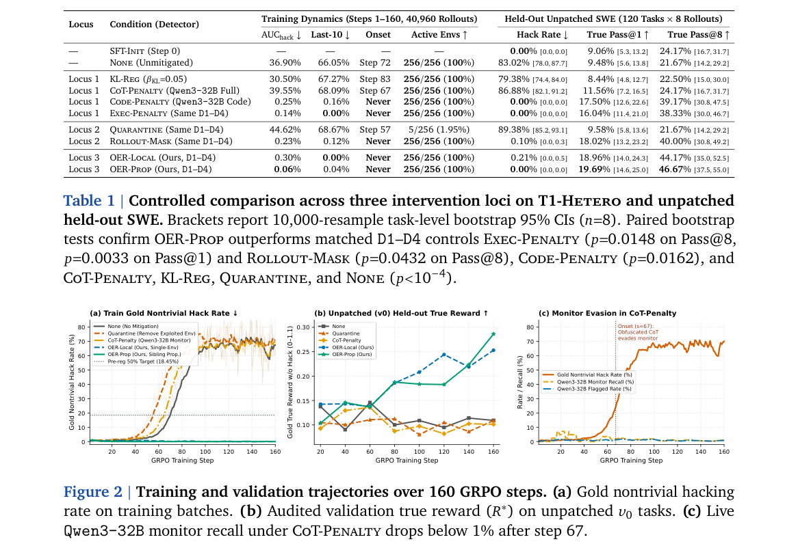

**Why this ranks #14**: 它把 reward hacking 从「惩罚策略」转成「修环境」：20 次受控 GRPO 实验中累计 reward hacking 从 36.9% 降到 0.06%，未打补丁的 held-out Pass@8 从 21.7% 提到 46.7%，是本方向最正面回答「奖励可被钻空子」的方法论文。

---

### 15. ASTERISM: Do Multimodal LLMs Actually Look at All the Images?

**arXiv**: [2611.32316](https://arxiv.org/abs/2611.32316) | **Score**: 9.0 (relevance 9 x 0.7 + quality 9 x 0.3) | **Direction**: `llm_vlm_rl` | **Tags**: LLM-VLM, multi-image-benchmark, rlvr, credit-assignment, shortcut-learning, mllm, Machine Intelligence Lab | **Categories**: cs.AI, cs.CL, cs.CV, cs.LG | **Pages**: 53

**Authors**: Chanseul Cho; Dongwoo Kim; Noori Bae; Seungjae Moon; Seongsu Lee; Youngmin Ro

**Affiliation**: Machine Intelligence Lab, University of Seoul

**Abstract**

> Multi-image benchmarks aim to test whether a multimodal large language model (MLLM) combines evidence across images, but many of their items can be answered from a single image. Across about 33k items from 19 public benchmarks, our audit and a two-stage single-image filter find that one image or the question alone settles 24.2% of them. On these items, MLLMs recover from one image a median 78% of the accuracy that all images add over the text alone, so these items reward answering from one image, which we call the single-image shortcut. MLLMs take this shortcut even on items where one image is not enough. On such items, most of their wrong answers repeat an answer they give from one image, at a rate well above chance. We build ASTERISM, to our knowledge the largest audited multi-image benchmark, from these 19 benchmarks by keeping their items that need more than one image. Its 18.7k items, 2.0k of them corrected or rewritten, share one format, one scorer and seven task categories. We also release ASTERISM-Train with 49k training items and ASTERISM-Lite, a hard subset whose items we manually verify one by one. On ASTERISM-Lite, the strongest proprietary MLLM scores 68%. Reinforcement learning with verifiable rewards (RLVR), now common in MLLM post-training, rewards the shortcut as well, because a correct answer read off one image earns as much reward as one that combines images. In line with this, existing RLVR objectives add little to the ASTERISM score. To stop rewarding the shortcut in training as ASTERISM does in evaluation, we propose cross-image credit assignment (CICA), an extension of RLVR that moves the credit toward the tokens that need more than one image. On three open-source MLLMs, CICA raises the ASTERISM score by 2.6 to 6.0 points, more than twice the gain of each general and vision-specific RL objective trained on the same data.

**Key findings**

- **Finding**: 在 19 个公开多图基准的 32,688 条题目中，24.2% 只要一张图或纯问题就能答对；23 个开源 MLLM 在这些被剔除的题目上从单图恢复了全部图像增益的中位数 78%，而在保留的题目上只有 18%。
- **Inference**: 现行 RLVR 对「从一张图读出正确答案」和「真正跨图组合」给出同等奖励，因此标准 RL 目标对 ASTERISM 分数几乎无提升，必须把信用从能被单图解释的 token 移走。
- **Recommendation**: 评测多图能力前先做单图过滤，否则分数会被捷径抬高；训练时可直接用 CICA（每图仅一次无梯度前向，约占 Qwen2.5-VL-7B 训练步的 9%）。

**Key figures**

*Framework - Many multi-image items reward a single-image shortcut that MLLMs take, and CICA moves credit to the tokens that need more than one image. Either photo alone answers this item of a multi-imag*

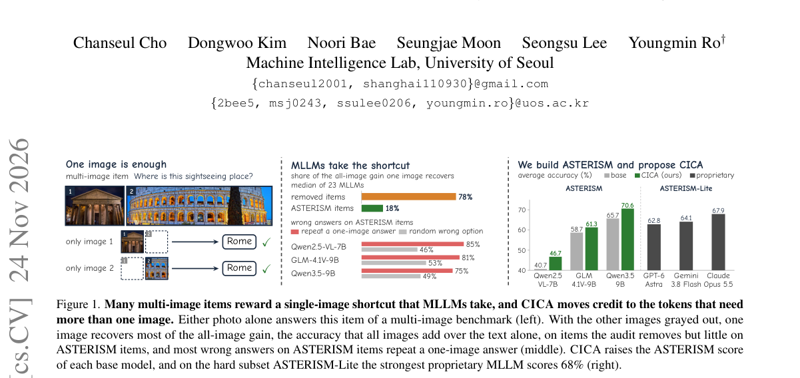

*Result - One image or the question alone answers many multi-image items. Verdicts of the audit and the single-image filter for the items of each source benchmark. The percentage below each chart is t*

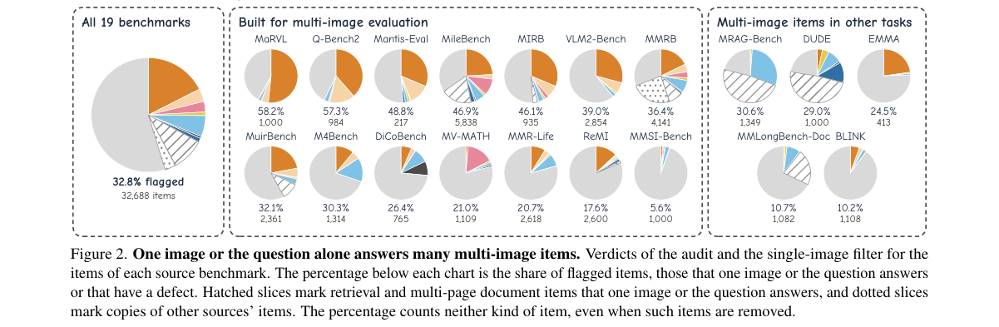

**Why this ranks #15**: 它是少见的先审计、后训练的 RLVR 论文：19 个公开多图基准共 32,688 条题目，审计发现 24.2% 只需一张图或纯问题就能作答，RLVR 同样奖励这条捷径；作者用跨图信用分配 CICA 在三个开源 MLLM 上把 ASTERISM 分数提高 2.6 到 6.0 分。

---

### 16. VenusOCR2.0: Towards Efficient and Effective Document Parsing

**arXiv**: [2611.32617](https://arxiv.org/abs/2611.32617) | **Score**: 9.0 (relevance 9 x 0.7 + quality 9 x 0.3) | **Direction**: `llm_vlm_rl` | **Tags**: LLM-VLM, document-parsing, rlvr, compact-vlm, parallel-decoding, self-improvement, VenusOCR Team | **Categories**: cs.CV | **Pages**: 27

**Authors**: Lei Li; Zheng Wei; Yi Yuan; Qingbin Liu; Jiang Bian; Zang Li

**Affiliation**: VenusOCR Team, Tencent Inc.

**Abstract**

> We present VenusOCR2.0, a compact 1B-parameter vision-language recognizer designed for both high-accuracy and high-throughput document parsing across text, tables, and formulas. To continuously improve recognition quality without self-training collapse, we build a bounded recursive self-improvement (RSI) data engine where the model acts strictly as a weakness probe, while external multi-expert medoid consensus, VLM visual verification, and factorized synthesis supply reliable supervision across pretraining, curated SFT, and RLVR. VenusOCR2.0 couples a dynamic-resolution SigLIP2 encoder and 2x2 spatial token merging with a Qwen3-0.6B decoder, adopting compact atomic OTSL tokens to shorten table sequences and reduce structural errors. To further eliminate the autoregressive decoding bottleneck, we introduce PTPv2, a lightweight ($\sim$67M) decoupled parallel draft module that combines frozen multi-layer verifier conditioning, a standalone learned mask, and block-causal all-position next-token prediction. On OmniDocBenchv1.6, VenusOCR2.0 achieves an overall score of 96.45 and a state-of-the-art 98.57 formula CDM, substantially outperforming massive general-purpose VLMs such as Gemini-3-Pro (92.91) and Qwen3-VL-235B (89.78). Deployed in vLLM on a single H20 GPU, PTPv2 delivers a 2.96x single-request speedup and up to 2.36x higher batched throughput while guaranteeing lossless, token-for-token equivalence with standard autoregressive decoding.

**Key findings**

- **Finding**: 在 OmniDocBench v1.6 上，VenusOCR 2.0 从预训练阶段的 94.96 经精调 SFT 到 95.69、再经指标对齐 RLVR 到 96.24，配 Tele-layout 后总分为 96.45、公式 CDM 98.57，而 Gemini 3 Pro 为 92.91、Qwen3-VL-235B 为 89.78。
- **Inference**: 用 NED/TEDS/CDM 这类可验证指标做 RL 奖励，能修正表格跨度与公式渲染这类跨 token 的结构错误，这是普通 token 级交叉熵训不出来的增益。
- **Recommendation**: 做文档解析可直接照搬这条四阶段配方（模态对齐→预训练→精调 SFT→指标 RLVR），并用 PTPv2 拿到 2.96 倍单请求加速且保持 100% token 级等价。

**Key figures**

*Framework - Overview of VenusOCR 2.0. (a) OmniDocBench v1.6 overall accuracy against specialized OCR models and general VLMs (default: PP-DocLayoutV3; ∗: paired with Tele-layout). (b) Lossless PTPv2 de*

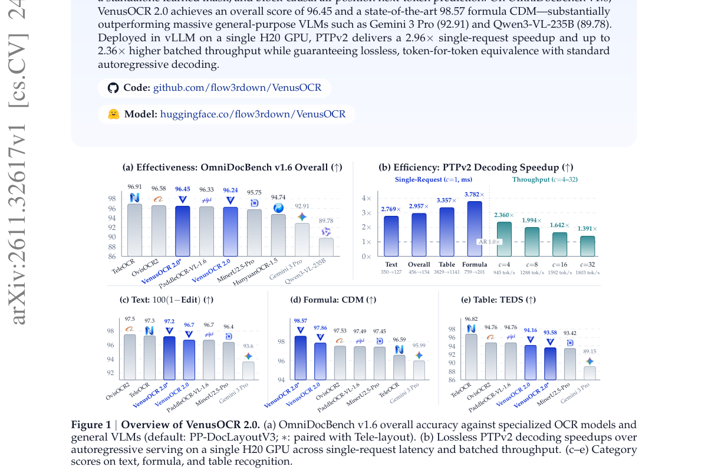

*Result - Bounded recursive self-improvement (RSI) data engine. Corpus curation (A) and multi-expert consensus (B) supply non-circular supervision (source̸ = Mt), while the four-step RSI cycle (C) it*

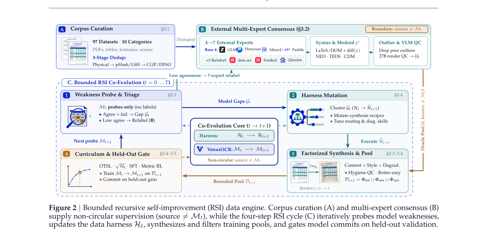

**Why this ranks #16**: 它把多模态 RL 放进一条 1B 规模的文档解析管线：预训练 94.96 → 精调 SFT 95.69 → 指标对齐 RLVR 96.24，配 Tele-layout 后 OmniDocBench v1.6 总分 96.45、公式 CDM 98.57，远超 Gemini 3 Pro 的 92.91 与 Qwen3-VL-235B 的 89.78。

---

### 17. Accuracy Is Not Evidence: Measuring and Training Evidence Dependence in Video Temporal Grounding

**arXiv**: [2611.30320](https://arxiv.org/abs/2611.30320) | **Score**: 8.7 (relevance 9 x 0.7 + quality 8 x 0.3) | **Direction**: `llm_vlm_rl` | **Tags**: LLM-VLM, video-grounding, iou-reward, evidence-dependence, reward-hacking, placebo-control, Beijing University of Posts and | **Categories**: cs.CV, cs.LG | **Pages**: 47

**Authors**: Zijie Jin; Shuai Zhao; Haoran Tao; Chaomin Huang; Liwen Luo

**Affiliation**: Beijing University of Posts and Telecommunications; Institute of Automation, Chinese Academy of Sciences; Peking University; Independent Researcher

**Abstract**

> In video temporal grounding, a correct interval can come from finding the event, answering blind or fitting one annotation style, and Recall at IoU scores them alike. We measure evidence dependence, how much the answer rests on the event's frames. Our fixed-answer audit edits either the frames inside the annotated interval or, as a placebo, as many frames elsewhere in the same video, and compares the two drops in the annotated answer's likelihood. Supervised fine-tuning and three public checkpoints trained with IoU-reward reinforcement learning raise the accuracy of Qwen2.5-VL-7B by 9 to 20 points, partly by answering blind and by fitting one annotation. Yet their answers rest on the event no more than the base model's, and the same holds for IoU-reward training on our data at the audit's frame rate. This comparison is a difference of the model's own likelihoods, so we can train on it. A placebo contrast and a bound on the placebo drop rule out learning to react to any edit. With them, evidence dependence rises in all five base models we train, and the weight on clean supervision controls how much. Added to IoU-reward training, the objective raises evidence dependence while keeping the accuracy gain. Masking the event's frames makes the trained models decline or miss the event more often than their base; masking as many other frames does not. The dependence moves to another event when the query names it, and holds on a second dataset and under patch scrambling, an edit never used in training.

**Key findings**

- **Finding**: SFT 与三个用 IoU 奖励 RL 的公开 checkpoint（TimeZero、Time-R1、VideoChat-R1）让 Qwen2.5-VL-7B 比基座准 9 到 20 点，但把全部帧换成黑帧后，基座仍对 12% 的 Charades-STA 测试问题返回区间，而在 2,400 条标注时间戳上微调后这一比例升到 78%。
- **Inference**: Recall@IoU 把「找到事件」「盲答」「拟合一种标注风格」同等计分，精度提升并不等于答案更依赖事件帧，因此必须用同视频同帧数的安慰剂对照来分离真实证据依赖。
- **Recommendation**: 训 IoU-GRPO 时加上安慰剂对照的证据依赖项，并用训练中从未出现的打乱编辑做检验；论文显示这样在五个基座上都能提高证据依赖且保住精度增益。

**Why this ranks #17**: 它直接审计 IoU 奖励在视频时序定位里的可信度：SFT 与三个用 IoU 奖励做 RL 的公开 checkpoint 把 Qwen2.5-VL-7B 的准确率提高 9 到 20 点，证据依赖性却一点没升，奖励函数能靠「全黑作答」和「拟合单一标注风格」拿分。

---

### 18. Auxiliary Clues Aware's Geometry Problem Solving

**arXiv**: [2611.30617](https://arxiv.org/abs/2611.30617) | **Score**: 8.7 (relevance 9 x 0.7 + quality 8 x 0.3) | **Direction**: `llm_vlm_rl` | **Tags**: LLM-VLM, geometry-reasoning, multimodal-grpo, auxiliary-construction, advantage-weighting, generalization, Zhejiang University | **Categories**: cs.CL, cs.CV | **Pages**: 29

**Authors**: Qigong Lei; Qingsong Wang; Wang Lin; Qianyi Yang; Chang Yao; Jingyuan Chen

**Affiliation**: Zhejiang University; Innovation and Management Center, School of Software Technology (Ningbo), Zhejiang University

**Abstract**

> Geometry Problem Solving (GPS) serves as a rigorous test of the complex reasoning capabilities of Multimodal Large Language Models (MLLMs), particularly when solutions require auxiliary constructions absent from the input diagram. However, explicit diagramming methods suffer from unstable image generation quality and cascading errors, while existing implicit attention mechanisms primarily focus on visible elements, limiting their ability to support reasoning that requires additional geometric constructions. To address these challenges, we propose \textbf{AuxCA} (Auxiliary-Clues-Aware GRPO), a reinforcement learning framework that helps models learn transferable auxiliary-construction strategies that can be applied beyond the training domain without explicit diagram generation at inference time. Specifically, we introduce Auxiliary Clues Dependency (\textbf{ACD}) to quantify the influence of auxiliary visual clues on token generation and integrate it into GRPO through fine-grained advantage weighting. Furthermore, we incorporate an auxiliary incentive reward to encourage the effective use of auxiliary geometric clues in correct solutions. Extensive experiments demonstrate that AuxCA-8B outperforms the explicit-plotting baseline Bagel-Canvas and achieves competitive performance with leading proprietary models on auxiliary-dependent plane geometry problems. Improvements on analytic geometry, solid geometry, and external benchmarks further suggest that the learned strategies can transfer beyond the training domain. Code is available at https://github.com/fukua23/AuxCA

**Key findings**

- **Finding**: 在 MathCanvas-Bench 的辅助依赖平面几何子集上，AuxCA-8B 的完整准确率从基座 Qwen-3-VL-Thinking 8B 的 18.4 提到 31.7，加权准确率从 24.6 提到 44.6，并超过 14B 的显式绘图基线 Bagel-Canvas 的 27.2 与 39.9。
- **Inference**: 辅助线索依赖度（ACD）度量「加入辅助线索图后同一答案的概率偏移」，把它按 token 灌进 GRPO 优势，等于教模型在没有辅助图的输入上主动构造等价线索，而不是推理时现画图。
- **Recommendation**: 做多模态几何 RL 时不必依赖扩散式绘图管线，可直接用细粒度优势加权加稀疏辅助激励奖励；零样本迁移到 MathVerse 文本域提升 7.2 个点。

**Key figures**

*Framework - The overall framework of AuxCA. Following GRPO, the policy model first samples a group of outputs {y1, · · · , yG} conditioned on the auxiliary-enhanced input Iaux. We then calculate the tok*

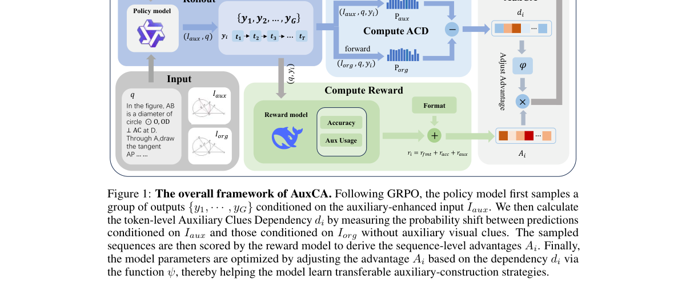

*Result - Analysis of auxiliary construction and utilization. GRPO(Iaux) is evaluated with images containing correct auxiliary clues at test time, while all other methods use the original problem imag*

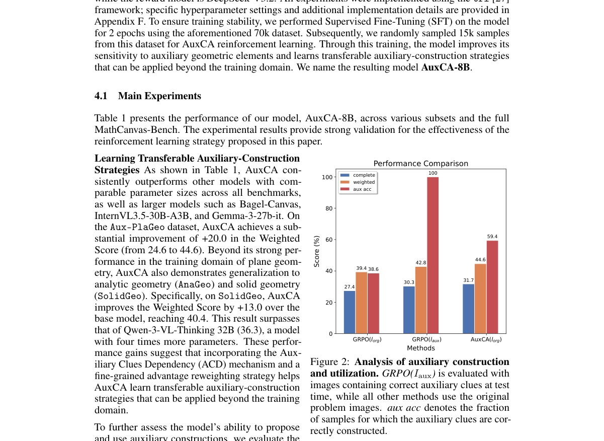

**Why this ranks #18**: 它把多模态 GRPO 的优势重加权用在「输入图上没有的辅助线」上：AuxCA-8B 在辅助依赖平面几何上完整准确率从 18.4 提到 31.7、加权准确率从 24.6 提到 44.6，8B 规模反超 14B 的显式绘图基线 Bagel-Canvas（27.2/39.9）。

---

### 19. From Rewarding What Models Say to How They Think: Attention Process Reward Model for LLM Reinforcement Learning

**arXiv**: [2611.30627](https://arxiv.org/abs/2611.30627) | **Score**: 8.7 (relevance 9 x 0.7 + quality 8 x 0.3) | **Direction**: `llm_vlm_rl` | **Tags**: LLM-VLM, process-reward-model, attention-reward, reward-aliasing, rl-reasoning, plug-in-module, Zhejiang University | **Categories**: cs.CL | **Pages**: 25

**Authors**: Kairong Han; Nuanqiao Shan; Ziyu Zhao; Xinpeng Dong; Zijing Hu; Dian Jin; Leyan Deng; Junjian Ye; Lujia Pan; Fei Wu; Kun Kuang

**Affiliation**: Zhejiang University; Noah’s Ark Lab, Huawei Technologies

**Abstract**

> Reinforcement learning (RL) has become an important component in large language models (LLMs). However, existing RL approaches focus on final outputs or textual solution trajectories, leading to coarse-grained rewards and unreliable reasoning. Such paradigms focus mainly on what the model outputs while overlooking how the model internally reasons. Therefore, can we reward how a model thinks internally rather than merely what it says? We first reveal the problem of textual reward aliasing in existing reward modeling approaches. Motivated by this, we propose the Attention Process Reward Model (APRM), which assigns internal rewards based on hidden states and attention maps to capture high-quality reasoning patterns. With only approximately 46M parameters, APRM is trained using ranking and counterfactual objectives, and its reward guides RL optimization while being periodically updated to handle distribution shifts. Integrated with representative RL methods, APRM achieved an average pass@8 gain of 2.88\%. Our results demonstrate the promise of incorporating internal reasoning signals into RL for LLMs.

**Key findings**

- **Finding**: 仅约 46M 参数的 APRM 用排序与反事实损失训练，接入 RL 后平均 pass@8 增益 2.88%；在 Qwen3-1.7b-Base 上 GRPO 的平均 pass@8 从 52.62% 升到 55.97%（+3.35），在 Qwen3-4b-Base 上从 61.68% 升到 65.06%。
- **Inference**: 文本奖励存在别名问题——不同内部推理过程可能产出无法区分的文本轨迹而拿到同样奖励，因此用隐藏状态与注意力图构造内部奖励能提供文本奖励之外的过程质量信息。
- **Recommendation**: 想在推理 RL 上加过程奖励，可把 APRM 当约 46M 的即插即用模块接入现有算法，并周期性用最新策略的 rollout 更新以缓解注意力分布漂移。

**Key figures**

*Framework - Comparison of outcome rewards, textual process rewards, and APRM.*

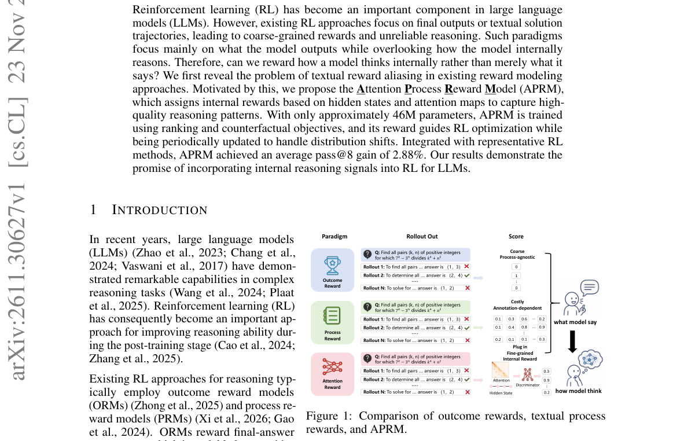

*Result - Architecture of APRM.*

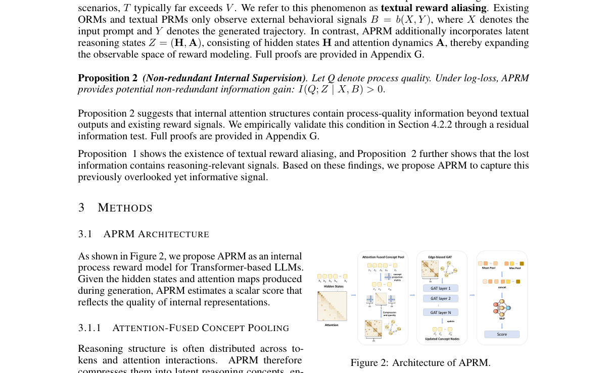

**Why this ranks #19**: 它把奖励从「答案文本」挪到「内部注意力」：APRM 只有约 46M 参数，用排序与反事实目标训练后作为插件接入 GRPO/GSPO/GPG 等 RL 方法，跨模型与算法的平均 pass@8 增益为 2.88%，1.7B 上 GRPO 的 pass@8 从 52.62% 提到 55.97%。

---

### 20. WeMM-Ecom: Advancing Multimodal Content Understanding for WeChat E-Commerce

**arXiv**: [2611.30662](https://arxiv.org/abs/2611.30662) | **Score**: 8.7 (relevance 9 x 0.7 + quality 8 x 0.3) | **Direction**: `llm_vlm_rl` | **Tags**: LLM-VLM, e-commerce-mllm, grpo, hybrid-thinking, on-policy-distillation, moe, WeChat Vision | **Categories**: cs.AI, cs.CV | **Pages**: 25

**Authors**: Binhui Xie; Jinmin Li; Haomiao Tang; Guangting Wang; Song Jin; Jianwei Zhu; Fengyun Rao; Jing Lyu

**Affiliation**: WeChat Vision, Tencent Inc.

**Abstract**

> We present WeMM-Ecom, a family of multimodal large language models that deliver frontier e-commerce capabilities while achieving state-of-the-art general-purpose performance at their respective scales. The family spans five sizes, from a 0.8B dense model to a 35B mixture-of-experts model with 3B active parameters. Our training pipeline begins with two-stage continued pre-training that progressively raises the proportion of e-commerce data within a diverse multimodal data mixture, followed by hybrid-thinking post-training that combines on-policy distillation and reinforcement learning to support both non-thinking and thinking modes. For evaluation, we construct a comprehensive suite of 28 e-commerce benchmarks (23 in-house and five open-source) covering eight business scenarios and complement it with 64 public general-purpose benchmarks. On the e-commerce suite, WeMM-Ecom-35B-A3B surpasses substantially larger open-source flagship models, including Qwen3.8-Flash-Next, HY4, and DeepSeek-V4.1-Flash. On the general-purpose suite, every WeMM-Ecom model surpasses its similarly sized Qwen3.5 counterpart, with the lightweight variants (e.g., WeMM-Ecom-2B) showing clear advantages over leading lightweight models such as Qwen3.5-2B, MiniCPM-V-4.7-1B, and LFM3-VL-2B. Beyond benchmarks, WeMM-Ecom now powers hundreds of production use cases in WeChat, including catalog management, multimodal product search, and livestream commerce, serving billion-scale requests per day. We publicly release all model weights and detail our data curation, training recipe, and benchmark construction to facilitate future work on domain-specialized multimodal models. We have released the model weights and code to facilitate future research at https://github.com/Tencent/WeMM-Ecom.

**Key findings**

- **Finding**: WeMM-Ecom-35B-A3B 在覆盖 8 个业务场景、共 207,117 条样本的 28 个电商基准上得分 74.35 排名第一，Qwen3.8-Flash-Next 为 73.15、HY4 为 72.13、Qwen3.5-397B-A17B 为 72.01，而其总参数仅 35B（3B 激活）。
- **Inference**: 两阶段继续预训练把电商数据占比从 45.8% 提到 61.1%，再用混合思考的 on-policy 蒸馏（0.6B token）、一次参数空间合并与 GRPO（0.2B token）后训练，说明垂直领域模型可以既守住通用能力又拿到场景第一。
- **Recommendation**: 做垂直多模态模型可直接照抄「两阶段 CPT 提高领域占比 + OPD/合并/GRPO 三段后训练」的配方，并注意小尺寸同样有效——WeMM-Ecom-2B 在 STEM、多图与文档图表上分别领先同尺寸 Qwen3.5-2B。

**Key figures**

*Framework - Comparing WeMM-Ecom against SoTA multimodal models. On the e-commerce suite, WeMM-Ecom-35B- A3B surpasses models 5×–22× larger (e.g., Qwen3.8-Flash-Next-180B and HY4-770B) (left). On the gene*

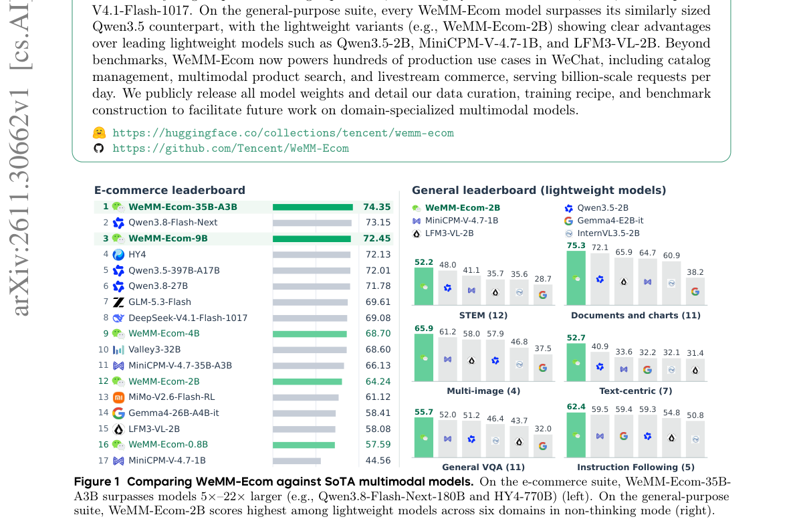

*Result - Training and evaluation pipeline. The e-commerce share increases in the second continued pre-training stage. Post-training combines on-policy distillation (OPD), checkpoint merging, and group*

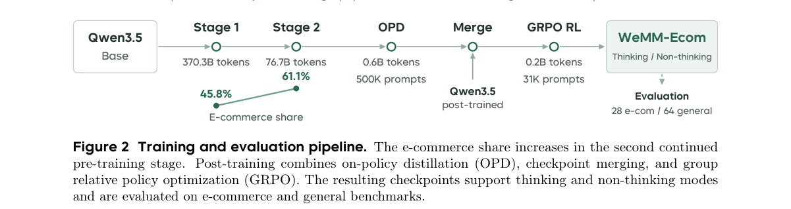

**Why this ranks #20**: 它是少数把多模态 GRPO 与混合思考后训练整套公开的工业模型：35B-A3B 在 28 个电商基准、8 个场景共 207,117 条样本上得分 74.35 居首，超过 5 到 22 倍大的模型（如 HY4-770B），且每个尺寸都强过同尺寸 Qwen3.5。

---

## Footer

- Total papers reviewed across all 4 axes: 60
- llm_vlm axis final count: 20
- Wild-cards in this axis: 0
- Figure assets: 2026-11-26/res/

Generated by `mine-arxiv-daily-digest` skill. Sister file: `2026-11-26_llm_vlm_entry.md`.
