# Mine Arxiv Daily Digest - 2026-11-26 (具身智能与世界模型 Axis, 20 papers)

**Generated**: 2026-11-26 01:25 CST

**Source**: arXiv cs.CV, cs.SD, eess.AS, cs.CL, cs.AI, cs.RO, cs.LG, cs.IR submissions, listing day 2026-11-24 (announced listing 11-24 于 2026-11-25 01:00 UTC 公告)

**Batch window**: 2026-11-23T19:00:00Z .. 2026-11-24T19:00:00Z（arXiv 公告批次窗口按 listing 日逐段相接：每段的起点是前一日的美东 14:00 截止时刻（EDT 为 18:00Z，EST 为 19:00Z），终点是当日同一时刻）

**Axis**: world_embodied (20 papers, base 15, cap 20)

**Directions**: world_model (7), embodied_ai (13)

**Selection**: 20 papers ranked by relevance x quality, with 0 wild-card slots

**Day total**: 60 papers across 4 axes (target 60)

**Scope**: 世界模型、学习型模拟器与具身智能，含移动操作、人形控制、触觉反射、VLA 策略与面向具身任务的强化学习

**Wild-card**: 0 篇 —— world_model 58 篇、embodied_ai 201 篇够格候选远超本轴 20 个席位，本轴已撞到 axis 上限 20，且有 8 篇 rel≥9 因上限落选，没有启用任何补位名额。

本轴 20 篇撞到上限，world_model 停在基准 7，embodied_ai 吃到 13（基准 8）——多出的 5 个名额全部由 embodied_ai 吸收，因此该 direction 有 8 篇 rel≥9 落选。本轮这一轴的主线是「世界模型变成动作先验」：FoveaWAM、LeanWAM、Zhengrong、DexLatentWorld、Native LAM 都在把预测模型折成策略的先验，而 embodied_ai 侧则用 Mirror Test、RoboLiveMem、FabricBench 三个基准给这条路做体检。

---

## 世界模型与学习型模拟器 · `world_model` (7 papers)

7 篇把世界模型从「预测画面」改造成「提供动作先验」。FoveaWAM 把目标位姿建成 SE(3) 轨迹、周边建成稀疏 3D 流，单张 RTX 5090 上 15.1 ms 决策、OnTimeBench 成功率 82.1% 领先基线 20.8 分；LeanWAM 把冻结视频生成器先验经 32 个预测 token 蒸馏进 1.4B 策略，A100 上 25.1 ms、快 12.3–41.5 倍；Zhengrong 用共享共轭极点分解潜轨迹，四基准宏平均 90.83%±0.47%、比自回归 LeWM 快 7.1×；DexLatentWorld 跨形态学连续潜动作，reaching/grasping/placing 成功率 90%/92%/60%（DexWM 为 72%/58%/28%）；JEPA-ICL 与 MOVER 则分别从进度对齐与残差路由两端修规划。

### 1. FoveaWAM: Role-Aware 4D World-Action Modeling for Dynamic Manipulation

**arXiv**: [2611.31705](https://arxiv.org/abs/2611.31705) | **Score**: 9.0 (relevance 9 x 0.7 + quality 9 x 0.3) | **Direction**: `world_model` | **Tags**: embodied, world-action-model, 4d-dynamic-prediction, latency-aware-planning, se3-trajectory, Beijing Zhongguancun Academy | **Categories**: cs.AI, cs.RO | **Pages**: 19

**Authors**: Jiaqi Yin; Baoyue Zhang; Jiyuan Zhang; Wenxuan Liu; Zhaofei Yu; Yue Deng; Tiejun Huang

**Affiliation**: Beijing Zhongguancun Academy; Peking University; Beijing Academy of Artificial Intelligence

**Abstract**

> To manipulate a moving object, a policy must predict the scene at the moment its action executes, yet every millisecond spent predicting pushes that moment further away. Scene-level forecasts are computationally expensive, whereas target-centric forecasts can omit nearby objects that affect contact. Our key insight is that what a policy must predict decouples by role: only the target's pose, which determines contact, requires millimeter precision, while the surroundings matter primarily through the clearance they leave and the motion they impart. We present FoveaWAM, a native 4D world-action model that allocates precision according to these roles. Specifically, it models the target's past and future motion as a metric SE(3) trajectory, the surroundings as sparse 3D flow, and relies on the current frame for everything static. This compact representation lets FoveaWAM act in 15.1 ms on one RTX 5090, about 10 times faster than video world-action baselines, leaving substantially less time for the scene to evolve before action execution. To evaluate each policy under its own latency, we introduce OnTimeBench, a dynamic manipulation benchmark in which the scene keeps moving while the policy computes. FoveaWAM reaches 82.1% success on OnTimeBench, 20.8 points above the strongest baseline, and also leads on DOMINO and real-robot tasks. Project page: https://foveawam.github.io/

**Key findings**

- **Finding**: FoveaWAM 在 OnTimeBench（14 个动态任务、5 个家族、1400 个留出场景）上成功率 82.1%，比最强基线高 20.8 个百分点；p95 动作生成延迟 15.1 ms（单张 RTX 5090），OpenWAM-α 为 151.7 ms。
- **Inference**: 把'预测谁'与'预测多大范围'按角色解耦（目标走 SE(3) 轨迹、环境走稀疏 3D 流、静态沿用当前帧），才是延迟下降约一个数量级的主因，单纯加速整场景视频预测收益有限。
- **Recommendation**: 评测动态操作策略时必须把推理延迟计入场景演化时间，用不停世界的 OnTimeBench 替换会在推理期间暂停世界的评测器，否则会系统性高估视频世界动作模型。

**Key figures**

*Framework - FoveaWAM allocates prediction precision by role. (a) Illustrative target SE(3) poses and sparse 3D flow. The inset shows a staged grasp. (b) FoveaWAM leads in native SR on OnTimeBench at abo*

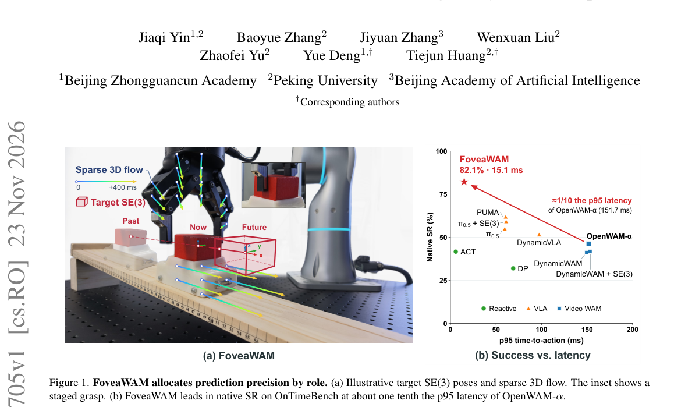

*Result - Where prediction precision goes. (a) Full-scene meth- ods, such as video world–action models, predict future frames of the whole scene and leave the target pose implicit [45, 53]. (b) Target*

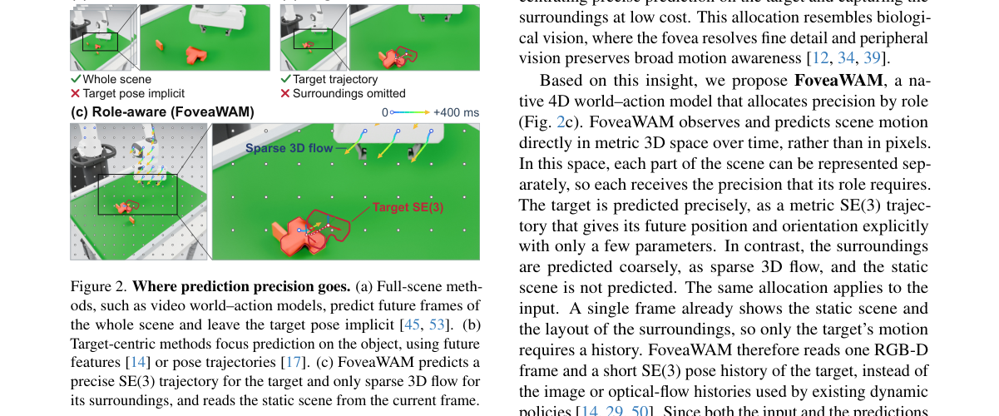

**Why this ranks #1**: 按角色分配预测精度：目标物体用 SE(3) 轨迹、环境用稀疏 3D 流、静态部分用当前帧，在 OnTimeBench 的 14 个动态任务、1400 个留出场景上取得 82.1% 成功率，比最强基线高 20.8 个百分点，且 p95 动作延迟仅 15.1 ms（OpenWAM-α 为 151.7 ms）。

---

### 2. LeanWAM: Learning Latent World Action Models from Frozen Video Models

**arXiv**: [2611.31740](https://arxiv.org/abs/2611.31740) | **Score**: 9.0 (relevance 9 x 0.7 + quality 9 x 0.3) | **Direction**: `world_model` | **Tags**: embodied, world-action-model, latent-token-compression, video-prior-transfer, policy-distillation, University of Michigan | **Categories**: cs.CV, cs.RO | **Pages**: 23

**Authors**: Shaolong Li; Hongze Fu; Joyce Chai; Yinpei Dai

**Affiliation**: University of Michigan

**Abstract**

> World action models (WAMs) typically adapt large pretrained video generators to jointly predict future observations and robot actions, incurring substantial training and deployment costs. However, it remains unclear which future representations a policy actually needs and how compactly they can be represented. Our probing study shows that complementary future representations can be compressed into a few tokens while retaining most of their action-decoding performance. Motivated by this finding, we introduce LeanWAM, a latent WAM that transfers video priors from a frozen video generator to a lightweight policy via two-stage training. In the first stage, a Future Extractor compresses observed transitions into 32 predictive tokens. These tokens condition the frozen generator and are jointly shaped by action, RGB, semantic, and geometric supervision, while a compact readout of the generator's hidden states supplies complementary world tokens. The second stage distills both representations into the policy, which learns to predict them from current observations while generating actions. With 1.4B parameters and no large-scale embodied pretraining, LeanWAM outperforms strong vision-language-action (VLA) and WAM baselines on LIBERO, LIBERO-Plus, and RoboTwin~2.0. It predicts an action chunk in 25.1\,ms on an A100 GPU, 12.3--41.5$\times$ faster than representative WAMs. These results demonstrate that compact predictive supervision can transfer video priors to robust and efficient control.

**Key findings**

- **Finding**: 探针实验显示单个聚合 token 的动作解码 R² 达 0.68，已接近 32 token 的 0.72；最终模型用 1.4B 参数、无大规模具身预训练，单个动作块预测耗时 25.1 ms（A100），比代表性 WAM 快 12.3–41.5 倍。
- **Inference**: 策略真正需要的不是未来帧的保真度而是未来信息的动作可解码性，因此可以先在冻结视频生成器上把先验压进少量 token，再蒸馏给不需要生成视频的部署策略。
- **Recommendation**: 做世界动作模型时应先做 token 预算探针（1/8/32 token 对动作解码 R² 的曲线），确认 32 个 token 是否已饱和，再决定要不要保留整帧视频预测分支。

**Key figures**

*Framework - Success rate versus inference latency on LIBERO- Plus. Latency per action chunk is shown on a log scale, and bubble size denotes model size.*

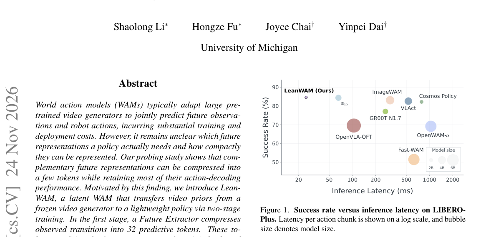

*Result - Overview of LeanWAM. Stage 1: A Future Extractor produces a predictive code z that conditions a frozen video model G. Semantic, geometric, RGB, and action losses jointly shape the code. An a*

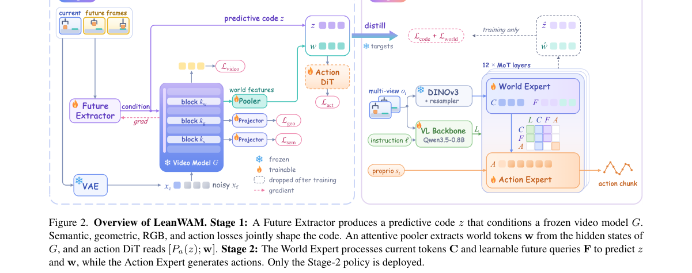

**Why this ranks #2**: 先用 32 个预测 token 承载未来表征，再蒸馏给 1.4B 参数的轻量策略：在 LIBERO、LIBERO-Plus、RoboTwin 2.0 上超过强 VLA 与 WAM 基线，单个动作块在 A100 上只需 25.1 ms，比代表性 WAM 快 12.3–41.5 倍。

---

### 3. MOVER: Planning Beyond Motion

**arXiv**: [2611.30022](https://arxiv.org/abs/2611.30022) | **Score**: 8.7 (relevance 9 x 0.7 + quality 8 x 0.3) | **Direction**: `world_model` | **Tags**: embodied, residual-world-model, event-routing, driving-planning, nuscenes, University of Texas at Austin | **Categories**: cs.CV, cs.RO | **Pages**: 21

**Authors**: Xiangyu Li; Yu Jiang; Tianyi Wang; Liang He; Qixing Huang; Zhaomiao Guo

**Affiliation**: University of Texas at Austin; ETH Zurich

**Abstract**

> Residual world models forecast a driving scene through its temporal change, so feature components that stay constant over time vanish from the residual pathway. We ask whether evidence with weak temporal change, such as a waiting pedestrian or a stopped vehicle, can be used more effectively for planning, and introduce MOVER, a complementary event-routing mechanism. A training-time teacher measures how each spatially grounded event query responds when a past frame is removed from shared history and contrasts that sensitivity with the event's pooled temporal residual, prioritizing events that depend on history but receive weak residual evidence. A student predicts the resulting priorities from unperturbed history, so the teacher adds no inference cost. Under fixed total routing mass, one distribution scales a low-rank future bird's-eye-view update and biases trajectory-conditioned event reading. On nuScenes, MOVER reduces ResWorld's UniAD-style average L2 from 0.65 to 0.55 m and its collision rate from 0.23% to 0.12% without direct planner ego status (0.50 m and 0.09% with it), adding 4.1 ms per frame. Matched controls show that the complementary teacher outperforms either signal alone and that the allocation acts mainly during training. Adapted to BridgeDrive-LEAD, MOVER reaches a 96.52 +/- 0.65 driving score over three seeds on the 220-route Bench2Drive closed-loop benchmark, exceeding matched controls in each paired seed by a margin within seed variation.

**Key findings**

- **Finding**: nuScenes 规划评测中 MOVER 把 UniAD 式平均 L2 从 0.65 m 降到 0.55 m（-19%）、碰撞率从 0.23% 降到 0.12%（18 次端点碰撞/15357 个观测-时域），VAD 式 L2 从 0.35 m 降到 0.28 m；额外开销为每帧 12.1 GFLOPs 与 4.1 ms。
- **Inference**: 残差通路用时间差分建模，恒定目标的证据会被差分抹掉；训练期用'移除某帧历史'的敏感性做互补路由，可在推理时零成本地把这类证据补回来。
- **Recommendation**: 自建驾驶世界模型时应单独监控'低时间残差但高历史依赖'的事件对规划的贡献，而不是只盯全局 L2，否则会漏掉最常见的等待类场景。

**Key figures**

*Framework - Persistent traffic context and complementary routing. (a) Recorded CARLA examples show a waiting pedestrian and a stopped congested vehicle. (b) A training-only teacher supervises a shared a*

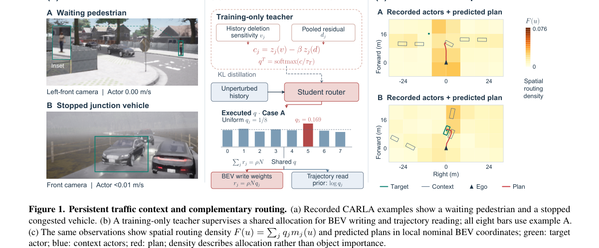

*Result - Overview of MOVER. A residual driving world model predicts future BEV features from ego-aligned history, and MOVER adds a complementary event-routing branch. We discover current-frame events*

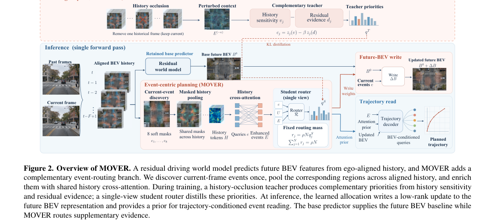

**Why this ranks #3**: 补上残差世界模型看不到的'弱时间变化'证据（等待的行人、停住的车）：nuScenes 上把 ResWorld 的 UniAD 式平均 L2 从 0.65 m 降到 0.55 m、碰撞率从 0.23% 降到 0.12%，而每帧只增加 4.1 ms 与 12.1 GFLOPs，推理零额外成本。

---

### 4. JEPA-ICL: Progress-Aligned Latent Plans for In-Context Robotic Manipulation

**arXiv**: [2611.30516](https://arxiv.org/abs/2611.30516) | **Score**: 8.7 (relevance 9 x 0.7 + quality 8 x 0.3) | **Direction**: `world_model` | **Tags**: embodied, jepa-latent-plan, in-context-learning, demonstration-retrieval, vla-policy, University of Technology Sydney | **Categories**: cs.AI, cs.RO | **Pages**: 13

**Authors**: Tingjun Dai; Jianxiang He; Mingfei Han; Qihao Yu; Longtao Jiang; Changlin Li; Minghao Jin; Zhihui Li; Xiaojun Chang

**Affiliation**: University of Technology Sydney; Mohamed bin Zayed University of Artificial Intelligence; Nanchang University; Stanford University; University of Science and Technology of China

**Abstract**

> Demonstrations show how a task can be completed, but differences in embodiment, appearance, and execution speed make it difficult to identify the guidance relevant to the robot's current progress. We introduce JEPA-ICL, a vision-language-action framework that couples predictive planning with demonstration learning. The policy learns to plan by predicting ordered future states in JEPA feature space up to subtask completion, capturing what remains to be accomplished. These plans guide action generation and locate relevant stages in demonstrations, whose JEPA-supervised content features provide progress-aligned context. Learning from this context, in turn, updates the shared policy that produces the plans and actions. This coupling connects anticipating the robot's own execution with reusing demonstrated experience. On the Imitator Game, JEPA-ICL achieves 80.0% seen-task success under C15 pretraining, outperforming Zero-WAM by 12.0 percentage points. Without contextual demonstrations, JEPA-ICL outperforms the VLA-JEPA variant without human-video pretraining, improving success rates from 96.1% to 97.6% on LIBERO and from 62.9% to 73.2% on LIBERO-Plus. With demonstration-based training and contextual guidance at inference, LIBERO-Plus success further increases from 73.2% to 75.2%.

**Key findings**

- **Finding**: JEPA-ICL 的计划在 JEPA 特征空间预测当前子任务剩余的 4 个有序检查点；Imitator Game 已见任务成功率 80.0%（Zero-WAM 68.0%），C45 预训练下未见任务 85.5%（π0.5 基线 40.0%）。
- **Inference**: 用'还剩什么'而非'做什么'来对齐演示阶段，可以让不同本体、外观与执行速度的示教自动对齐到当前进度，从而充当跨场景复用的通用接口。
- **Recommendation**: 复用人类演示时应设计基于进度（剩余检查点特征）的检索键，而不是按时间步或整体视觉相似度取片段，否则演示会被用错阶段。

**Key figures**

*Framework - A progress-aligned latent plan guides execution and reads demonstrations. Top: from the current observation, the plan Zt predicts the JEPA features of the checkpoints that remain in the curr*

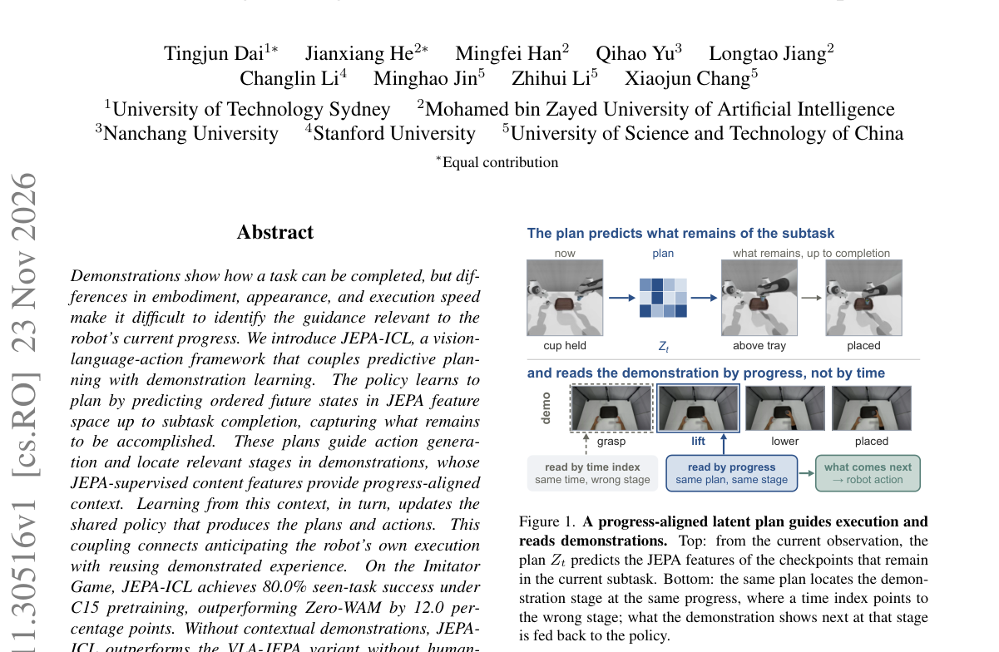

*Result - One backbone plans, predicts the remaining subtask and reads demonstrations. (a) Plan, memory, future and action queries share the VLA backbone; plan tokens Z are blue, content features E gr*

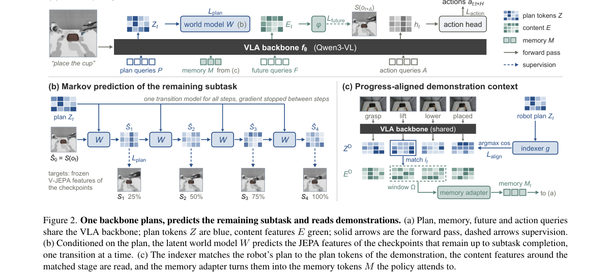

**Why this ranks #4**: 用 JEPA 特征空间中'子任务完成前还剩什么'的有序检查点作为隐式计划：Imitator Game 已见任务成功率 80.0%，比 Zero-WAM 高 12.0 个百分点；LIBERO 从 96.1% 提到 97.6%，LIBERO-Plus 从 62.9% 提到 73.2%、再借助上下文示范提到 75.2%。

---

### 5. Zhengrong: World Models with Pole-Based Action-Response Factorization for Direct Visual Planning

**arXiv**: [2611.30666](https://arxiv.org/abs/2611.30666) | **Score**: 8.7 (relevance 9 x 0.7 + quality 8 x 0.3) | **Direction**: `world_model` | **Tags**: embodied, direct-visual-planning, action-response-factorization, conjugate-pole-basis, control-latent-dynamics, Beijing Freedo Technology Co. | **Categories**: cs.CV | **Pages**: 16

**Authors**: Yu Zhang; Jingrui Li; Congyu Wang; Yuhang Cheng; Wenbo Chen; Xiaobo Zhang; Jing Zou; Yuxi Dai

**Affiliation**: Beijing Freedo Technology Co., Ltd.

**Abstract**

> Direct visual world models predict the effects of candidate action sequences without recursive latent rollout, yet they leave the temporal structure of action effects unspecified. We introduce Zhengrong (Zhengrong-PoleWM), a world model that decomposes a latent trajectory into an initial-condition anchor, a free response, and delayed responses to action innovations. Nonlinear networks map visual history and causal action prefixes to response coefficients. A shared bank of stable conjugate poles determines how each response evolves with elapsed time. This factorization preserves nonlinear interactions across actions, anchors predictions exactly at the initial state, prevents future actions from affecting earlier predictions, and yields bounded responses to finite control plans. We derive an exact re-anchoring identity that identifies the additional basis direction $Ψ_κ(s)$ needed to represent shifted trajectory tails. Across four offline image-goal control benchmarks (Cube, TwoRoom, PushT, and Reacher), Zhengrong-PoleWM achieves $90.83\% \pm 0.47\%$ macro-average success over two training seeds at epoch 20, exceeding the strongest baseline (QQWorld) by 6.08 percentage points. Selecting checkpoints by validation loss yields $91.21\% \pm 1.00\%$. In a controlled first-epoch Cube study without restart regularization, neural and pole response heads outperform a generic direct predictor by 20.67 and 23.34 percentage points, respectively. On an NVIDIA A100 GPU, median latency for a full 30-iteration cross-entropy method search ranges from 74 to 87 ms across the four tasks. The mean of these medians is 77.5 ms, a 15.8% latency reduction relative to Fast-LeWM and a $7.1\times$ speedup over autoregressive LeWM.

**Key findings**

- **Finding**: 四个离线图像目标控制基准上 Zhengrong-PoleWM 在第 20 epoch 的宏平均成功率为 90.83%±0.47%（两个训练种子），超过最强基线 QQWorld 6.08 个百分点；按验证损失选点可达 91.21%±1.00%。
- **Inference**: 固定共轭极点同时给出三条硬保证——初始状态精确锚定、过去动作不影响更早的预测、有限控制序列下响应有界，这是直接视觉规划能替代自回归 rollout 的前提。
- **Recommendation**: 做直接视觉规划时可用'锚点 + 自由响应 + 延迟响应'的分解作消融基线，先测极点数量带来的收益，再决定是否换更重的响应网络。

**Key figures**

*Framework - Architecture of Zhengrong-PoleWM separating response content generation from temporal evolution. Visual history determines the free response cf(q0); causal action prefixes and bias-free inno*

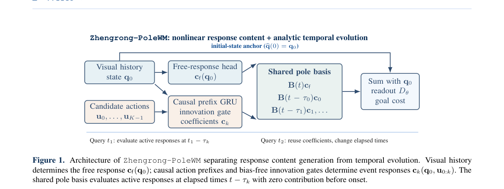

*Result - Deterministic basis diagnostic verifying Eq. (19) (κ = 1, p = −0.35 + 2i, r = 0.6). Fitting on even grid points and evaluating on odd grid points over s ∈[0, 2] yields a relative ℓ2 error of*

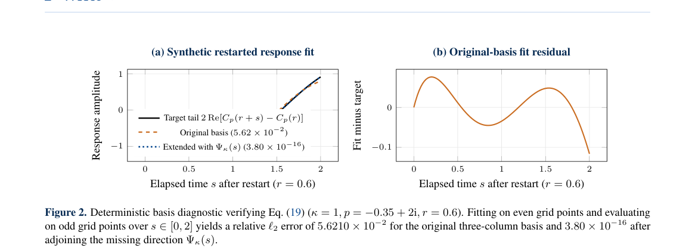

**Why this ranks #5**: 用共享的稳定共轭极点决定响应的时间演化，把隐式轨迹分解为初始锚点、自由响应与动作创新的延迟响应：Cube、TwoRoom、PushT、Reacher 四个基准宏平均成功率 90.83%±0.47%，比最强基线 QQWorld 高 6.08 个百分点，30 步 CEM 搜索的中位延迟均值 77.5 ms。

---

### 6. World Models as Native Latent Action Models

**arXiv**: [2611.30898](https://arxiv.org/abs/2611.30898) | **Score**: 8.7 (relevance 9 x 0.7 + quality 8 x 0.3) | **Direction**: `world_model` | **Tags**: embodied, latent-action-model, video-world-model, dynamics-registers, vla-pretraining, SenseTime Research | **Categories**: cs.CV, cs.LG, cs.RO | **Pages**: 19

**Authors**: Qinyue Li; Weijie Qiao; Qingyi Tao; Zerui Gong; Zhe Yang; Quanzhou Li; Taolin Zhang; Jinglin He; Zhonghua Wu; Chen Change Loy

**Affiliation**: SenseTime Research; S-Lab, Nanyang Technological University; ACE Robotics

**Abstract**

> Large and diverse video sources, such as egocentric human video and heterogeneous robot recordings, carry rich dynamics but come either without actions or without a shared action space. Latent action models (LAMs) can recover these dynamics, but they train their inverse- and forward-dynamics models (IDM, FDM) from scratch, trading off pixel reconstruction against latent capacity and accuracy. Pretrained video world models natively generate high-fidelity dynamics, yet represent them densely, entangled across all layers. Viewing the world model as a LAM, we show that these dynamics can be extracted with minimal changes to the model. Native LAM operates one pretrained video diffusion transformer as both IDM and FDM, with learnable dynamics registers as the only causal bridge between the two, and trains on counterfactual temporal pairs that differ in motion alone, so that the registers distill a video's dynamics into a compact native latent action. We further propose a pretraining paradigm for vision-language-action (VLA) policies, Pretraining Actions from World models (PAWlicy), in which Native LAM serves as a dynamics teacher on large-scale video; unlike world action models, it never generates video. Native latent actions outperform existing LAMs on the LARY benchmark in both action classification and control regression, and replay the same motion on new robots, in new scenes, and from human hands to robots, although no transfer objective is used in training. With a 3.8B model, PAWlicy reaches a 93.6% average success rate on RoboTwin 2.0 trained with domain-randomized demonstrations, the highest among VLAs. On RoboDojo, it is competitive on every dimension we evaluate, and its Precision, evaluated by us, is on par with the leading leaderboard entries. On real robots, it improves over the pi_0.5 baseline on both tasks. Both stages use only public data and a publicly released world model.

**Key findings**

- **Finding**: Native LAM 只用一个预训练视频扩散 transformer 同时承担 IDM 与 FDM，中间仅靠可学习动力学寄存器传递因果信息，并用'仅运动不同'的反事实时间对训练；PAWlicy（3.8B）在 RoboTwin 2.0 上平均成功率 93.6%。
- **Inference**: 预训练视频生成器本已具备高质量前向动力学，只要用反事实配对把动作自由度逼进少量寄存器，就能免去从零训练潜动作模型的像素重建与潜容量权衡。
- **Recommendation**: 只有公开视频模型时，可先按反事实时间对抽取动作，再用冻结教师为 VLA 标注潜变量来替代大规模真机采集，与世界动作模型路线相比还能省掉推理期的视频生成。

**Key figures**

*Framework - World models as native latent action models. (a) Existing LAMs learn an IDM and an FDM from scratch. (b) A pretrained video world model is already an FDM. (c) Native LAM runs one world model*

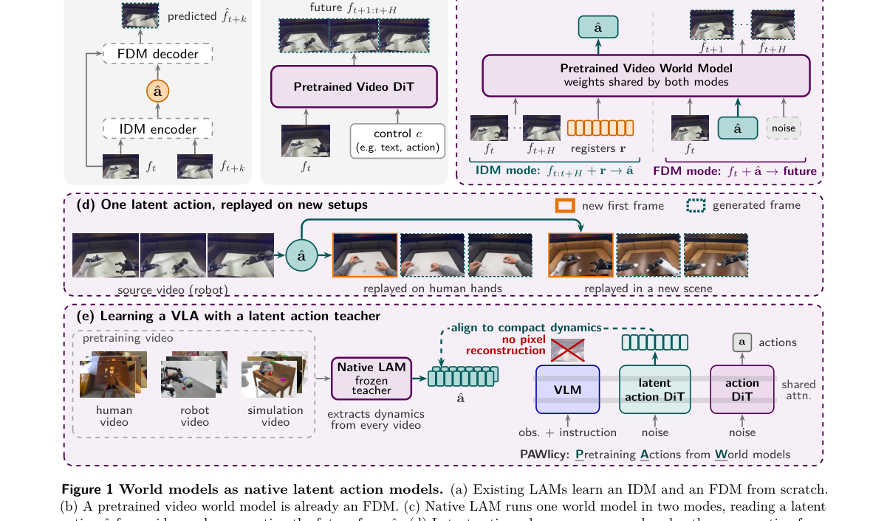

*Result - Training Native LAM. (a) Each video x is paired with a retimed copy x′ = x ◦ϕ of the same footage that shares the first frame but not the motion. (b) In IDM mode, dynamics registers read the*

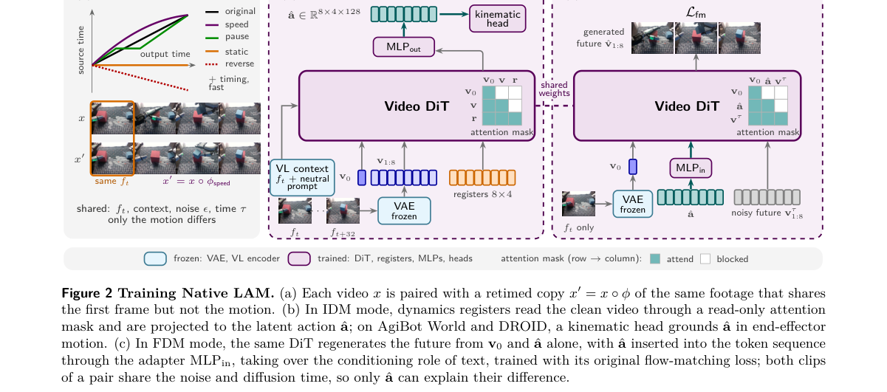

**Why this ranks #6**: 把预训练视频扩散 transformer 同时当作逆动力学与前向动力学模型，只用可学习动力学寄存器做因果桥接；由此得到的 PAWlicy 用 3.8B 模型在 RoboTwin 2.0 上取得 93.6% 平均成功率，是同类 VLA 中最高，且两阶段都只用公开数据与公开发布的世界模型。

---

### 7. DexLatentWorld: 3D Cross-Embodiment Latent Action World Models for Zero-Shot Robotic Manipulation

**arXiv**: [2611.30907](https://arxiv.org/abs/2611.30907) | **Score**: 8.7 (relevance 9 x 0.7 + quality 8 x 0.3) | **Direction**: `world_model` | **Tags**: embodied, latent-action, cross-embodiment, point-cloud-world-model, model-predictive-control, Embodied Dexterity Lab (DexLab) | **Categories**: cs.CV, cs.LG, cs.RO | **Pages**: 15

**Authors**: Vinay Udit Mohan; Xuchuan Huang; Rolandos Alexandros Potamias

**Affiliation**: Embodied Dexterity Lab (DexLab); Imperial College London

**Abstract**

> World models facilitate planning and control in robotic manipulation by enabling agents to anticipate the consequences of their actions. However, they typically rely on action-labelled interaction data that is costly to acquire and difficult to scale. These models are also often tied to the specific embodiment they were trained on, limiting transferability to previously unseen robot morphologies. We introduce a 3D latent-action world model that learns continuous action representations directly from point-cloud observations of retargeted human manipulation demonstrations. A contrastive objective is used to encourage consistent representations of motion across embodiments. The resulting unified latent action space serves directly as the search space for model-predictive control, where sampled latent actions condition particle-based future predictions. Executable robot commands are then recovered from the predicted geometric motion without requiring an embodiment-specific action decoder. Through extensive evaluations, we demonstrate that the learned latent actions exhibit controllable and compositional motion, transfer to unseen robot embodiments, and support zero-shot manipulation with unseen gripper geometries. Following task-agnostic adaptation, our model achieves 90%, 92%, and 60% success on reaching, grasping, and placing, respectively, compared with DexWM's reported 72%, 58%, and 28%. Finally, we demonstrate zero-shot real-world manipulation with an unseen dexterous hand, achieving an 86% success rate across 50 trials on five diverse tasks involving pushing, grasping, and lifting everyday objects. These results highlight the potential of geometry-grounded latent actions as a unified, transferable interface for world-model-based robotic manipulation. Project materials, including demonstration videos and source code, are available at https://vinaymohan0409.github.io/DexLatentWorld/.

**Key findings**

- **Finding**: DexLatentWorld 在任务无关适配后 reaching、grasping、placing 分别取得 90%、92%、60% 成功率，DexWM 报告值为 72%、58%、28%；未知灵巧手真实操作在 5 个任务共 50 次试验中成功率 86%。
- **Inference**: 不依赖本体专属动作解码器、让几何运动直接反解为可执行命令，是跨形态零样本迁移的关键；点云表示使这一反解可以交给解析求解完成。
- **Recommendation**: 面向新机器人形态时，优先用几何潜动作加 MPC 搜索并把命令反解交给几何求解器，而不是再训练一个本体专属的动作头。

**Key figures**

*Framework - We introduce a jointly trained 3D latent-action world model that predicts full-scene point evolution conditioned on cross- embodiment latent actions learned from action-unlabelled manipulati*

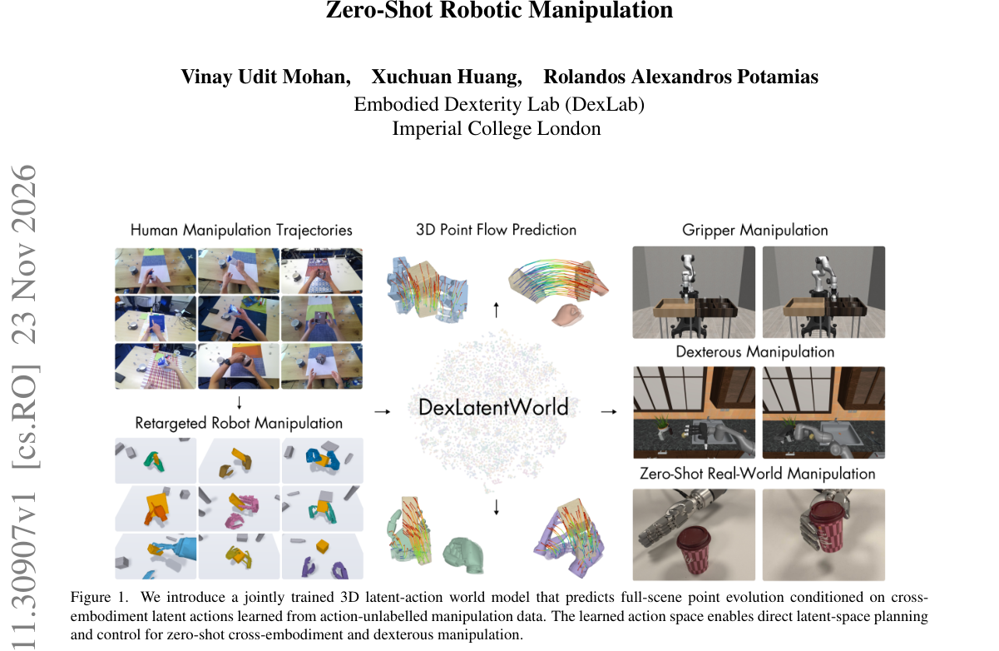

*Result - Overview of DexLatentWorld. An inverse dynamics model encodes scene transitions into compact latent actions, which are aligned across embodiments through contrastive learning. Here, Ei denot*

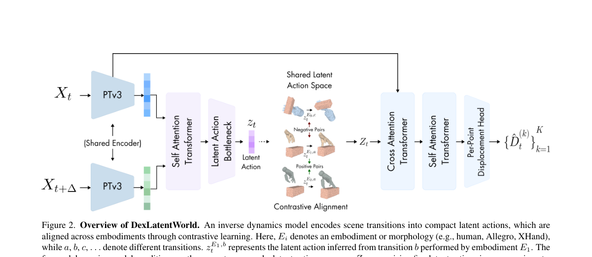

**Why this ranks #7**: 直接从重定向人类演示的点云观测学习连续潜动作，用对比目标跨本体对齐，并以潜动作作为 MPC 搜索空间：任务无关适配后抓取 92%、放置 60%（DexWM 为 58% 与 28%），在未知灵巧手上 50 次真实试验取得 86% 成功率。

---

## 具身智能与机器人学习 · `embodied_ai` (13 papers)

13 篇里有 4 篇在给具身做体检、5 篇在把规模推上去、4 篇在修记忆与延迟。体检侧最刺眼的是 Mirror Test：单镜/双镜/镜面桌面让五类策略平均成功率掉 10.8–56.7 个点、镜面桌面掉 62.5 点，真机 pi0.5 与 FastWAM 都能复现；RoboLiveMem 把同一批任务跑两遍，发现 Claude 与 GPT 家族世界暂停时平均成功 97%、世界照常只剩 50%；FabricBench 用 Newton 求解器拿到 45/45 次抓取成功而基线 0 次；RoboAda 用逆动力学把机器人自身运动转成免费标签，5 个冻结策略平均成功率 27.8%→62.9%。规模化一侧 OmniAct 程序化生成 100 万个可行本体、留出回合成功率 63.0%（pi 0.5 为 17.8%），PyRUA-Dex 用 coding agent 无示教写出灵巧策略。

### 8. RoboAda: Adapting Frozen Robot Policies at Test Time to Physics They Cannot See

**arXiv**: [2611.30209](https://arxiv.org/abs/2611.30209) | **Score**: 9.0 (relevance 9 x 0.7 + quality 9 x 0.3) | **Direction**: `embodied_ai` | **Tags**: embodied, test-time-adaptation, inverse-dynamics, frozen-policy, physics-shift, Tulane University | **Categories**: cs.AI, cs.RO | **Pages**: 16

**Authors**: Yunbei Zhang; Zijian Jin; Shuaicheng Niu; Baian Chen; Weirui Ye; Jihun Hamm; Yilun Du

**Affiliation**: Tulane University; New York University; Nanyang Technological University; MIT; Harvard University

**Abstract**

> Pretrained robot policies decide what to do from camera images, yet some of the physics that decides whether their plans succeed is not visible. An object may look light but be 100 times heavier, and a weakened joint or a lagging controller leaves no trace in the image. When the physics at deployment differs from training, the plan is often still right but is executed as if nothing had changed. Training on such variations in advance cannot handle unseen changes, while adapting once deployed either changes the plan, leaving the miscalibrated commands in place, or updates a robot model by gradient steps that do not know how reliable they are and can make the robot worse even when nothing has changed. We propose RoboAda, which keeps the policy and its plan unchanged and corrects the commands that carry it out by inferring at test time how the robot turns commands into motion. The key observation is that the robot's own motion reveals the change: after each action chunk, an inverse-dynamics model of the original robot converts the observed motion into the commands it would have needed, yielding free labels at every step. Competing hypotheses of how the robot responds, including that nothing has changed, are weighted by how well they predict these labels, and the next chunk is sent with the commands that best realize the plan under them. RoboAda needs no reward, no gradient step and no data from the changed robot. We evaluate RoboAda with five frozen policies on LIBERO, two world action models and three vision-language-action models. Under eleven physical shifts, it more than doubles their average success, from 27.8% to 62.9%. It beats the best of seven test-time adaptation methods by 17.3 points on Cosmos Policy, and largely preserves the policies' success when nothing has changed. On bimanual RoboTwin 2.0 in joint space, it raises success under joint-target offsets from 24.9% to 78.8%.

**Key findings**

- **Finding**: 在 LIBERO 的 11 种物理偏移下，RoboAda 让 5 个冻结策略（2 个世界动作模型加 3 个 VLA）的平均成功率从 27.8% 提升到 62.9%；在 Cosmos Policy 上比 7 种测试时自适应方法中的最佳者高 17.3 个百分点，双臂 RoboTwin 2.0 关节目标偏移下从 24.9% 提升到 78.8%。
- **Inference**: 每个动作块结束后机器人自身的运动就是免费标签，因此'身体变化'可以被直接反推并用假设按预测质量加权，从而选出下一块该发的命令，不必更新策略本体。
- **Recommendation**: 部署到负载变化或关节衰减的真实机器人时，优先加一层逆动力学重标定模块去修正命令，而不是改动策略输出或用梯度步更新机器人模型。

**Key figures**

*Framework - RoboAda infers the body that executes a frozen policy’s plan. Under a 35 N load that is not visually apparent, the frozen policy executes its plan as trained, and the cream cheese falls shor*

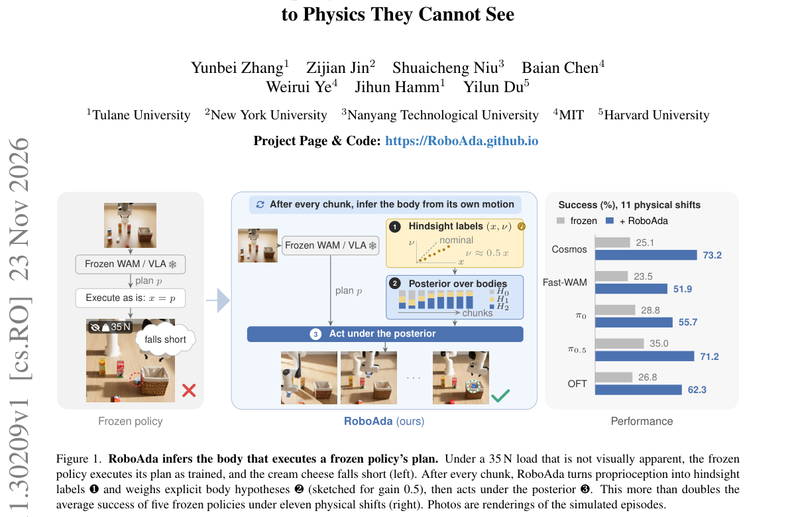

*Result - RoboAda recovers the hidden body within a few chunks. Fitted body per chunk on Cosmos Policy (median and interquartile range over 40 held-out episodes per condition). (a) The fitted gain rea*

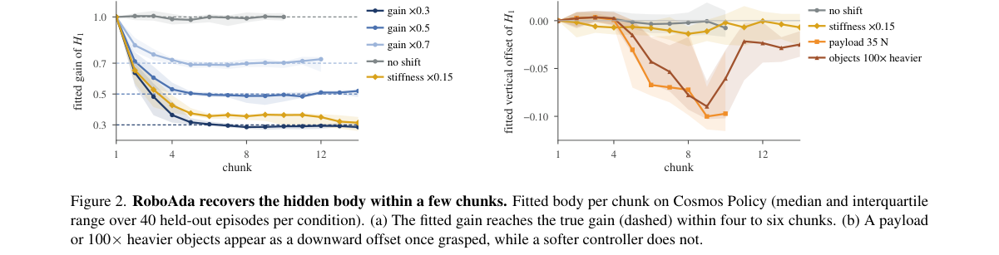

**Why this ranks #8**: 在不动策略与计划的前提下，用逆动力学模型从机器人自身运动反推'身体'如何变化：11 种物理偏移下把 5 个冻结策略的平均成功率从 27.8% 提到 62.9%，在 Cosmos Policy 上比最好的 7 种测试时自适应方法高 17.3 个百分点，且不需要奖励、梯度步或改动机器人的数据。

---

### 9. Hi3R-VLA: Grounding Semantics and Actions in 3D

**arXiv**: [2611.31535](https://arxiv.org/abs/2611.31535) | **Score**: 9.0 (relevance 9 x 0.7 + quality 9 x 0.3) | **Direction**: `embodied_ai` | **Tags**: embodied, 3d-policy, point-cloud-grounding, 3d-rope, spatial-anchor, Inria | **Categories**: cs.CV, cs.RO | **Pages**: 27

**Authors**: Shizhe Chen; Paul Pacaud; Cordelia Schmid

**Affiliation**: Inria; École normale supérieure; CNRS; PSL Research University

**Abstract**

> While recent vision-language-action (VLA) models increasingly incorporate 3D geometry, how to effectively exploit it for precise and generalizable action prediction remains a central challenge. We introduce Hi3R-VLA, a 3D policy that grounds heterogeneous modalities - vision, language, and action - in explicit 3D geometry for robotic manipulation. Our model integrates spatially-aligned visual features and language conditioning into point cloud representations, enriching scene geometry with fine-grained, task-relevant semantics. It then anchors low-level control commands in the same 3D coordinate frame and uses 3D-RoPE enhanced action-to-point attention over coarse-to-fine point features to model geometric relationships between action targets and observed points. Our analysis demonstrates the importance of semantic fusion within 3D and spatial alignment between observations and actions. With fewer than 250M trainable parameters, Hi3R-VLA achieves state-of-the-art performance on RoboCasa, RLBench, RoboTwin2, DexJoCo and DexSuite across diverse manipulation tasks and embodiments, from single-arm and dual-arm grippers to dexterous hands. Real-robot evaluations further demonstrate its effectiveness in the physical world. The model, code and dataset are publicly released at https://cshizhe.github.io/projects/hi3r_vla.html.

**Key findings**

- **Finding**: Hi3R-VLA 用少于 250M 可训练参数在 DexJoCo（10 任务、Allegro 手）取得 77.3% 平均成功率、DexSuite 取得 86%、RoboTwin2 平均成功率超过 90%；消融显示空间锚点比无锚点变体高 9.2 个百分点。
- **Inference**: 只有把低层控制命令与观测点放进同一 3D 坐标系，3D-RoPE 注意力才能显式建模动作目标与场景点的几何关系；同理语义融合必须发生在 3D 内部而非特征拼接阶段。
- **Recommendation**: 预算有限时优先把多视角特征投影到点云并加空间锚点，而不是扩宽 VLA 骨干或增加相机数量，前者在本论文中带来 9.2 个百分点的收益。

**Key figures**

*Framework - Hi3R-VLA grounds heterogeneous modalities - vision, language, and action - in explicit 3D geometry. Multi-view visual features are spatially aligned and fused into point representations, whi*

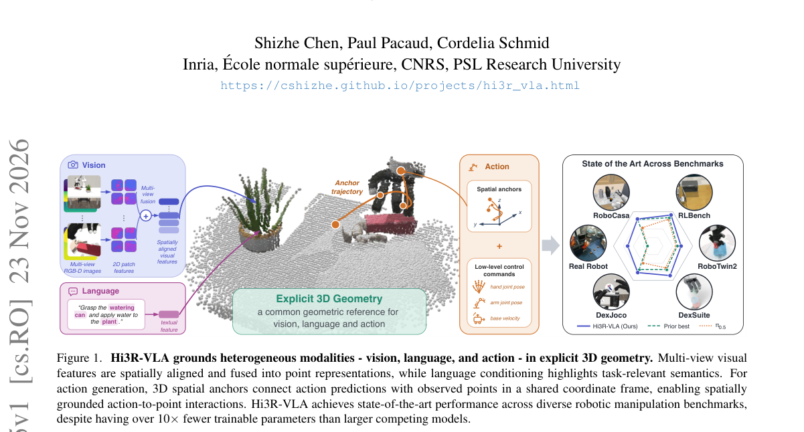

*Result - Hi3R-VLA architecture. Multi-view image features are spatially aligned and fused with hierarchical point representations, while language features provide semantic conditioning through adapti*

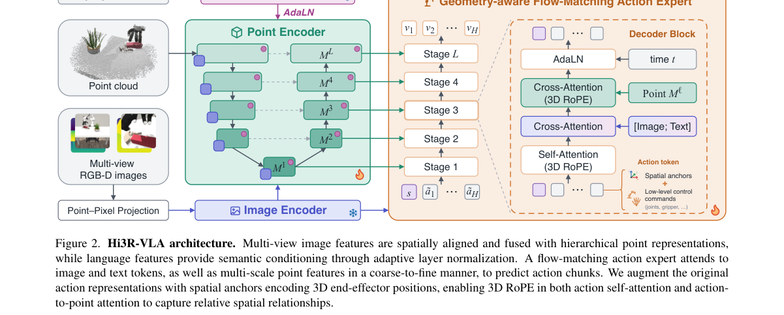

**Why this ranks #9**: 把视觉、语言、动作统一锚定到显式 3D 点云，训练参数少于 250M（约为更大竞品的十分之一），在 RoboCasa24、RLBench-10、RoboTwin2、DexJoCo、DexSuite 上取得最好结果：DexJoCo 10 任务平均 77.3%、DexSuite 86%、RoboTwin2 超 90%，空间锚点比无锚点变体高 9.2 个百分点。

---

### 10. FabricBench: A Standardized Policy Benchmark for Bimanual Fabric Manipulation with a Contact-Driven Deformable Simulator

**arXiv**: [2611.31577](https://arxiv.org/abs/2611.31577) | **Score**: 9.0 (relevance 9 x 0.7 + quality 9 x 0.3) | **Direction**: `embodied_ai` | **Tags**: embodied, fabric-manipulation, bimanual-benchmark, cloth-solver, generalization-gap, Shanghai Jiao Tong University | **Categories**: cs.RO | **Pages**: 24

**Authors**: Wenkang Hu; Haoran Wang; Liu Liu; Wenchao Huang; Yiji Chen; Mengao Zhao; Xincheng Tang; Zhengjie Shu; Lai Jiang; Wei Li; Zhendong Wang; Zhizhong Su

**Affiliation**: Shanghai Jiao Tong University; Horizon Robotics; Style3D Research

**Abstract**

> Fabric manipulation challenges robot policies with changing geometry, self-occlusion, and contact, yet standardized evaluation remains focused on rigid objects. We introduce FabricBench, a benchmark for bimanual fabric manipulation with six tasks spanning garments, silk, and bags, 10,000 simulation-ready assets, and controlled tests of configuration and appearance generalization. Built on an open-source solver in Newton, our simulator enables stable bimanual grasping, holding, and release through contact forces, without artificial attachment. Redesigned cloth-rigid contact and bidirectional force coupling support interactions among robot arms, fabric, and free rigid objects, allowing a bag to support its contents and transmit their weight to the grippers. In a controlled grasp-hold-release evaluation, our solver succeeds in all 45 trials, compared with none for the tested baseline configurations. Evaluating six representative policies, including vision-language-action models and world action models, reveals substantial remaining challenges: the best policy achieves 77% average success, while no policy exceeds 36% on long-horizon T-shirt folding. Under the most deformed initial T-shirt configurations, success falls to 6-14% across policies, with larger drops than under the evaluated appearance shifts. Zero-shot deployment of $π_{0.5}$ on a real robot largely preserves task difficulty ordering across six tasks (Spearman $ρ=0.94$). These results establish FabricBench as a reproducible testbed for measuring fabric-manipulation capabilities and exposing limitations in configuration generalization. The project website is available at https://fabricbench.github.io/.

**Key findings**

- **Finding**: 在受控的抓取-保持-释放评测中改良求解器 45 次试验全部成功，被测对照配置 0 次成功；基准含 6 个覆盖服装、丝绸与包的任务和 10000 个可直接仿真的资产。
- **Inference**: 布料操作的主要瓶颈是求解器稳定性与构型泛化而非策略容量——最好的策略平均只有 77%，且构型偏移造成的跌幅（6–14%）明显大于外观偏移。
- **Recommendation**: 评估布料或可变形操作前必须先确认仿真器在接触与释放环节稳定，否则结论会被求解器伪影而不是策略能力主导。

**Key figures**

*Framework - Overview of FabricBench. Assets (top left): garments, silk, and bags with geometry, appearance, and physical properties. Simulator (bottom left): contact detection, penetration han- dling, f*

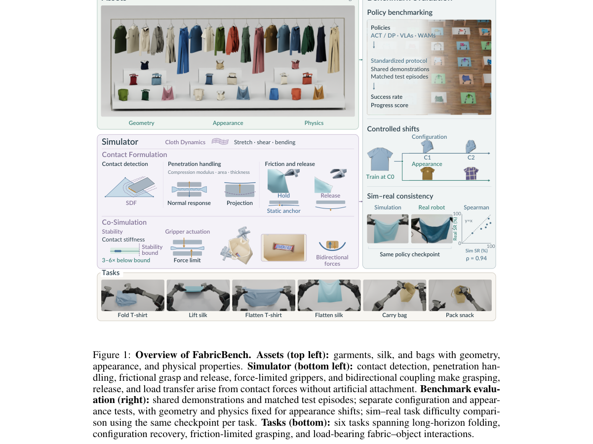

*Result - The FabricBench task suite. Each panel shows five stages of one successful episode, progressing from left to right. The suite covers (a) quasi-static, long-horizon folding with self- contact*

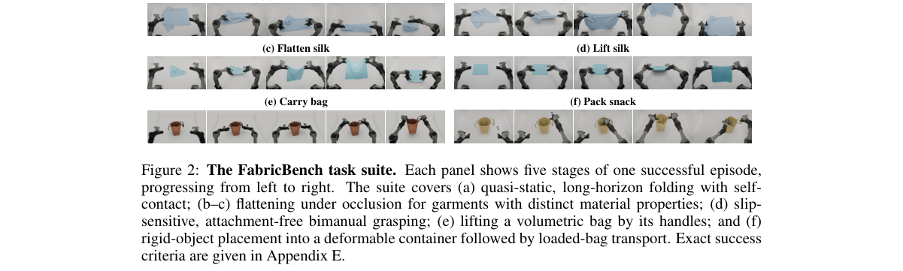

**Why this ranks #10**: 配套基于 Newton 引擎 Style3D 布料求解器的改良接触求解：受控的抓取-保持-释放评测 45 次全部成功（被测对照基线 0 次），但 6 个代表性策略最好平均成功率仅 77%、长时程 T 恤折叠无一超过 36%，构型偏移下成功率跌到 6–14%。

---

### 11. One Phase Is Enough: Sim-to-Real Transfer with Direct Visual Reinforcement Learning

**arXiv**: [2611.31588](https://arxiv.org/abs/2611.31588) | **Score**: 9.0 (relevance 9 x 0.7 + quality 9 x 0.3) | **Direction**: `embodied_ai` | **Tags**: embodied, one-phase-rl, frozen-vision-encoder, real-world-transfer, visual-policy, Massachusetts Institute of Technology | **Categories**: cs.LG, cs.RO | **Pages**: 10

**Authors**: John Marangola; Antonia Bronars; Younghyo Park; Stephen Andrews; Kushal Kedia; Pulkit Agrawal

**Affiliation**: Massachusetts Institute of Technology; Improbable AI Lab

**Abstract**

> Sim-to-real reinforcement learning (RL) has enabled impressive robotic behaviors, yet deploying policies directly from vision remains challenging. A common approach first trains a teacher policy with RL using privileged state observations, then distills its behavior into a vision-based student via imitation. However, the resulting student can substantially underperform its teacher. Directly training visual policies with RL offers a promising alternative, but learning task-relevant visual representations from scratch can be sample-inefficient, making one-phase visual RL intractable. We propose DRIFT, a simple recipe for efficient one-phase visual RL using image observations available at test time. Our key insight is to use frozen, pretrained foundation vision encoders, allowing RL to focus on learning control from existing visual representations. Freezing the encoder avoids costly backpropagation through the vision backbone, while its pretrained representations enable real-world transfer from fast, rasterized simulation rendering. Under matched architectures, observations, and compute budgets, DRIFT outperforms two-phase distillation and achieves a 58.8% relative improvement in average real-world success rate across three manipulation tasks. Controlled simulation evaluations demonstrate that DRIFT's relative advantage grows from roughly 9% in-distribution to over 61% under out-of-distribution shifts, suggesting that stronger generalization contributes to superior real-world transfer. Project website: https://jmarangola.github.io/one-phase-visual-rl/

**Key findings**

- **Finding**: DRIFT 在三个真机操作任务上取得 58.8% 的平均相对成功率提升（真机每个策略 30 次试验），仿真中分布内相对优势约 9%、分布外超过 61%；冻结编码器后训练不再需要反传视觉骨干。
- **Inference**: 两阶段方案的学生上限受制于教师在特权状态下的行为，而冻结基础编码器提供的视觉表征已足够让 RL 直接在测试时观测上学习控制，因此可实现性差距才是真机迁移的瓶颈。
- **Recommendation**: 预算有限时优先冻结一个基础视觉编码器再跑单阶段视觉 RL，而不是先训练特权状态教师再做蒸馏，以免学生继承教师的实现差距。

**Key figures**

*Framework - One-phase visual RL closes the realizability gap, generalizes bet- ter outside of the training distribution and exhibits superior transfers to the real-world over two-phase approaches. Policy*

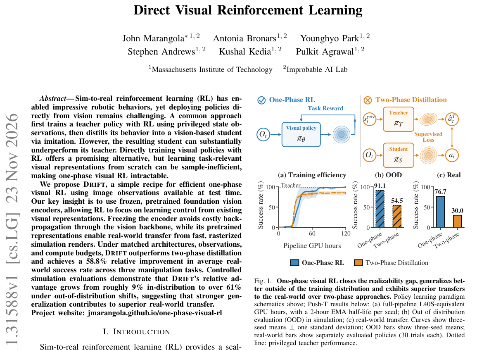

*Result - DRIFT learns visual policies directly from task rewards. Simulation provides privileged state information, such as object poses and velocities, that is not directly available at deployment. Tw*

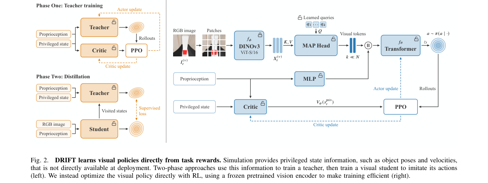

**Why this ranks #11**: 冻结预训练基础视觉编码器，直接在测试时可见的图像上做单阶段视觉 RL：在架构、观测与算力对齐的条件下，三个真机操作任务的平均成功率相对两阶段蒸馏提升 58.8%，相对优势在分布内约 9%、分布外扩大到 61% 以上。

---

### 12. G0.7: Scaling Up a Fast World Action Model with Long Context

**arXiv**: [2611.31822](https://arxiv.org/abs/2611.31822) | **Score**: 9.0 (relevance 9 x 0.7 + quality 9 x 0.3) | **Direction**: `embodied_ai` | **Tags**: embodied, world-action-model, long-context, fast-inference, generalist-policy, [unverified] | **Categories**: cs.CV, cs.RO | **Pages**: 13

**Authors**: Tianyuan Yuan; Baijun Ye; Shicheng Cao; Xing Nie; Xiaopeng Yu; Ke Dong; Zijie Zhao; Shenling Qiu; Yizhao Xu; Feiyang Xue; Haonan Liu; Haoyu Zhang

**Affiliation**: [unverified]

**Abstract**

> World action models (WAMs) adapt pretrained video generators for robot control by jointly predicting future camera frames and actions, transferring physical priors learned from video into manipulation policies. However, generating future frames before every action makes test-time inference too slow for closed-loop control, while most existing policies remain restricted to short observation histories. Building on Fast-WAM, which showed that video prediction shapes policy representations during training so that future frame synthesis can be skipped at deployment, we present G0.7, a generalist world action model scaled along two axes: extending the context window from a single observation to up to five minutes of history, and scaling pretraining to a large-scale corpus of robot teleoperation and human egocentric (ego) video. Across public simulation suites and real-robot deployments, direct action decoding (Fast mode) matches imagine-then-act (IDM) inference from the same checkpoint while running in 60 ms per 16-step action chunk on a single RTX 5090 (7.6x faster than IDM) and supporting pause-free real-time chunking. Performance scales consistently with pretraining data, with human ego video driving the largest gains in out-of-distribution generalization: G0.7 achieves a 70.8 mean score across five simulation benchmark suites, 48% and 54% zero-shot pick-and-place success on Galaxea R1 Pro and R1 Lite, 96.7% in-distribution and 93.3% out-of-distribution success on video-conditioned in-context learning tasks, and 86.9% mean task progress across seven real-world post-training tasks including multi-minute box folding, drink preparation, and product bagging.

**Key findings**

- **Finding**: G0.7 的 Fast 模式在单张 RTX 5090 上每 16 步动作块耗时 60 ms（FP8），比同权重的 IDM 快 7.6 倍；五个仿真套件平均 70.8 分，RMBench 达 86.2% 而单帧基线不足 12%，RoboTwin 2.0 为 79.4% 对 OpenWAM 的 69.0%。
- **Inference**: 视频预测的价值主要发生在训练期塑造策略表征，部署时可以直接跳过成帧生成，把省下的推理预算全部转移到更长的上下文长度上。
- **Recommendation**: 搭建通用机器人策略时应优先扩上下文长度与预训练数据量（人类第一视角视频贡献了最大的分布外增益），并保留一条训练期预测、部署直出动作的快速通道。

**Key figures**

*Framework - G0.7 architecture and control loop. The context caches up to five minutes of real camera observations, combining the robot’s own history with an optional demonstration video. Conditioned at*

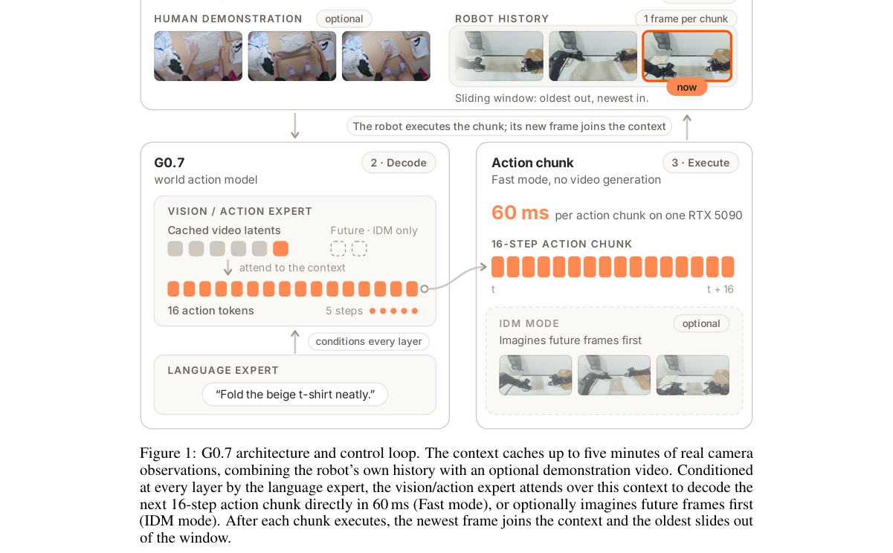

*Result - In-context task specification on sorting by example. From the current observation alone, the robot would have to guess both which of the seven objects to pick and which bin to put it in; att*

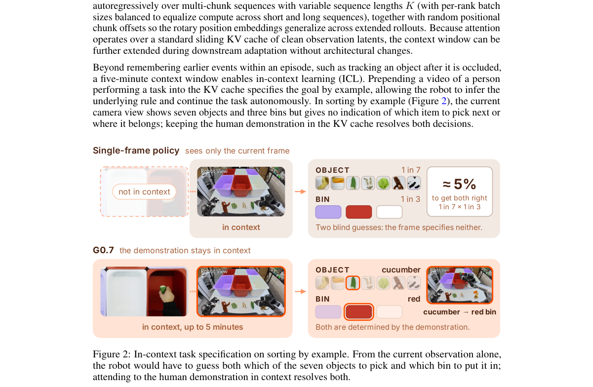

**Why this ranks #12**: 把世界动作模型的上下文从单帧扩到最长 5 分钟并大规模预训练机器人遥操作与人类第一视角视频：Fast 模式在单张 RTX 5090 上 60 ms 输出 16 步动作块（比先想象再行动快 7.6 倍），五个仿真套件平均 70.8 分，RMBench 上 86.2% 而单帧基线不足 12%。

---

### 13. ReFocus: Progress-Guided Adaptive Practice for Long-Horizon Robotic Manipulation Reinforcement Learning

**arXiv**: [2611.32639](https://arxiv.org/abs/2611.32639) | **Score**: 9.0 (relevance 9 x 0.7 + quality 9 x 0.3) | **Direction**: `embodied_ai` | **Tags**: embodied, reinforcement-learning, progress-reward, bottleneck-diagnosis, vla-policy, Zhejiang University | **Categories**: cs.AI, cs.CV, cs.RO | **Pages**: 27

**Authors**: Haoyuan Li; Wei Huang; Jiehong Lin; Shengrong Zhang; Chenzhi Liu; Shengchao Zhou; Hehe Fan; Xiaojuan Qi; Yi Yang

**Affiliation**: Zhejiang University; The University of Hong Kong

**Abstract**

> Online reinforcement learning (RL) enables vision-language-action policies to improve through environmental interaction. However, in long-horizon manipulation, sparse success/failure feedback provides little information about where policies encounter bottlenecks. Moreover, repeated full-task rollouts also leave these bottlenecks weakly analyzed and insufficiently practiced. To this end, we introduce ReFocus, a progress-guided multi-round RL framework that alternates between Global and Local RL to identify task-specific bottlenecks and allocate additional practice to them. Specifically, during Global RL, we decompose each task into a Directed Acyclic Graph (DAG) of subtasks. Then a DAG-based Progress Reward is leveraged for both policy training and bottleneck diagnosis. Based on the identified bottlenecks, ReFocus selects Adaptive Practice Windows, defining task segments from an entry stage to a target stage. It allocates additional interaction to these segments during Local RL while updating the entire policy. After that, it evaluates the policy to perform the full task for the next round of RL, forming an iteration between Global and Local RL. Experiments on LIBERO-Long and RoboCasa365 show that ReFocus achieves success rates of 97.8% and 51.3%, respectively, compared with 90.6% and 39.3% for the $π_{0.5}$ baseline. Furthermore, we evaluate a real-world adaptation on three long-horizon tasks. On BreadBaker, ReFocus achieves 95% success, compared with 30% for the $π_{0.5}$. Project page: https://refocus-robotics.github.io.

**Key findings**

- **Finding**: ReFocus 在 LIBERO-Long 与 RoboCasa365 上分别取得 97.8% 与 51.3% 成功率，π0.5 基线为 90.6% 与 39.3%；真机 BreadBaker 达 95% 对 30%，StackBowl 与 PickFruit 均达 100%（RECAP 为 90% 与 85%）。
- **Inference**: 稀疏的成败奖励无法定位长时程瓶颈，而 DAG 拆解出的子任务进度奖励既能提供稠密训练信号，又能在评估前直接圈出需要加练的任务片段。
- **Recommendation**: 训练长时程操作策略应先把任务拆成子任务 DAG，否则稀疏奖励下的瓶颈定位与定向加练都无从谈起，整轮 rollout 也只是低效地重复失败。

**Key figures**

*Framework - Motivation and overview of ReFocus. (a) Sparse terminal rewards reveal little about partial progress or task-specific bottlenecks. (b) ReFocus uses progress feedback to guide targeted practi*

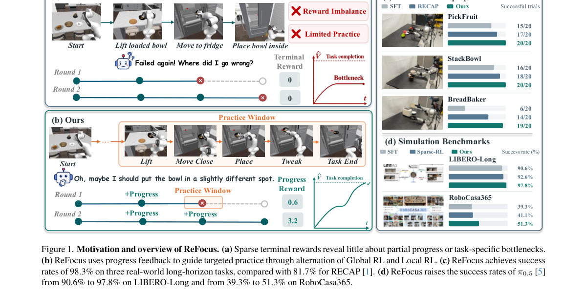

*Result - Illustration of ReFocus. (a) Global RL uses task DAGs to assign progress rewards and track subtask completion. (b) The Scheduler selects Adaptive Practice Windows for bottleneck practice. Th*

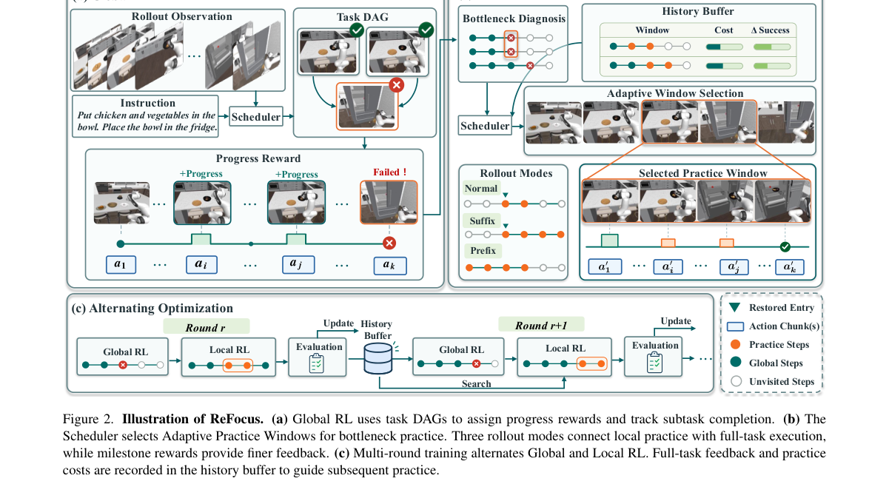

**Why this ranks #13**: 用任务 DAG 的进度奖励在 Global RL 中定位瓶颈子任务，再在 Local RL 里把额外交互投给自适应练习窗口：LIBERO-Long 与 RoboCasa365 上分别取得 97.8% 与 51.3%（π0.5 为 90.6% 与 39.3%），真机 BreadBaker 上 95% 对 π0.5 的 30%。

---

### 14. DexWAC: A Unified World-Actor-Critic Model for Dexterous Robot Manipulation

**arXiv**: [2611.32654](https://arxiv.org/abs/2611.32654) | **Score**: 9.0 (relevance 9 x 0.7 + quality 9 x 0.3) | **Direction**: `embodied_ai` | **Tags**: embodied, world-actor-critic, imagination-rollout, best-of-n, dexterous-manipulation, University of California | **Categories**: cs.AI, cs.RO | **Pages**: 15

**Authors**: Hongjia Liu; Dacheng Zhou; Minghao Fu; Chuanjun Guo; Tianze Wang; Qingtao Liu; He Wang; Li Yi

**Affiliation**: University of California, San Diego; École Polytechnique Fédérale de Lausanne (EPFL); Galbot; Peking University; Tsinghua University

**Abstract**

> Robot demonstrations provide more than actions to imitate: they reveal how actions change the world and how those changes contribute to task success. Recent world-action models (WAMs) extend vision-language-action (VLA) models with the first signal by jointly predicting actions and future observations, yet this predictive ability serves only as an auxiliary loss for policy learning. Meanwhile, most policy improvement methods learn dynamics and values in separate models, increasing training overhead and limiting representation sharing between these complementary objectives. We introduce DexWAC, a unified world-actor-critic model that jointly learns an actor, an action-conditioned world model, and a bootstrapped critic in a single robot pretraining stage. Our key insight is that visual prediction encourages control-relevant features, while value supervision promotes task-relevant representations; together, they shape a representation suited to policy learning. Built on an image-editing backbone, DexWAC predicts, for each action chunk, the visual latent and proprioception at its endpoint together with its reward and continuation, so the world model alone efficiently yields complete imagined transitions without generating intermediate video frames. After adapting the world model and critic on real rollouts, we improve the pretrained actor through either PPO on imagined rollouts or critic-guided best-of-$N$ selection. DexWAC surpasses the large-scale pretrained VLA and WAM baselines in simulation and achieves 75% average success on two real-world tasks, compared with 45% for $π_{0.5}$. Its world model is more accurate and faster than video-based baselines, and ablations confirm that learning dynamics and value together improves the policy.

**Key findings**

- **Finding**: DexWAC 联合预训练在 DexJoCo（8 任务、3 个种子、每任务每种子 50 回合）达 65.50±2.2%，超过 π0.5 的 57.92±5.8%；RoboTwin 2.0（50 任务）随机化 88.2%、平均 88.1%；真机两个接触任务 50% 与 100% 对 π0.5 的 20% 与 70%。
- **Inference**: 视觉预测与价值监督分别塑造控制相关和任务相关的表征，二者合并到同一骨干后，想象 rollout 的质量与效率才能同时支撑 PPO 与 critic 引导的 best-of-N 两种策略改进方式。
- **Recommendation**: 想用世界模型改进已有策略时，优先只预测动作块终点的潜变量而不是逐帧渲染，imagined rollout 的速度直接决定 best-of-N 能承受的采样预算。

**Key figures**

*Framework - Overview of DexWAC. (I) Unified world–actor–critic pretraining on existing robotic datasets, optionally incorporating non- expert trajectories for dynamic and value learning. (II) After the*

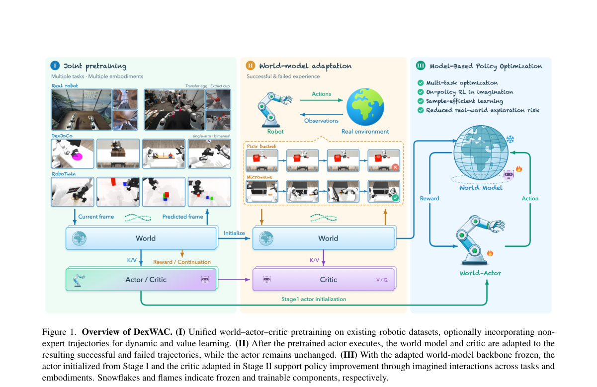

*Result - DexWAC architecture. (a) Actor/critic. The actor–critic expert ϕ reads contextual keys and values from the world backbone to generate action chunks and estimate state values. Attention masks*

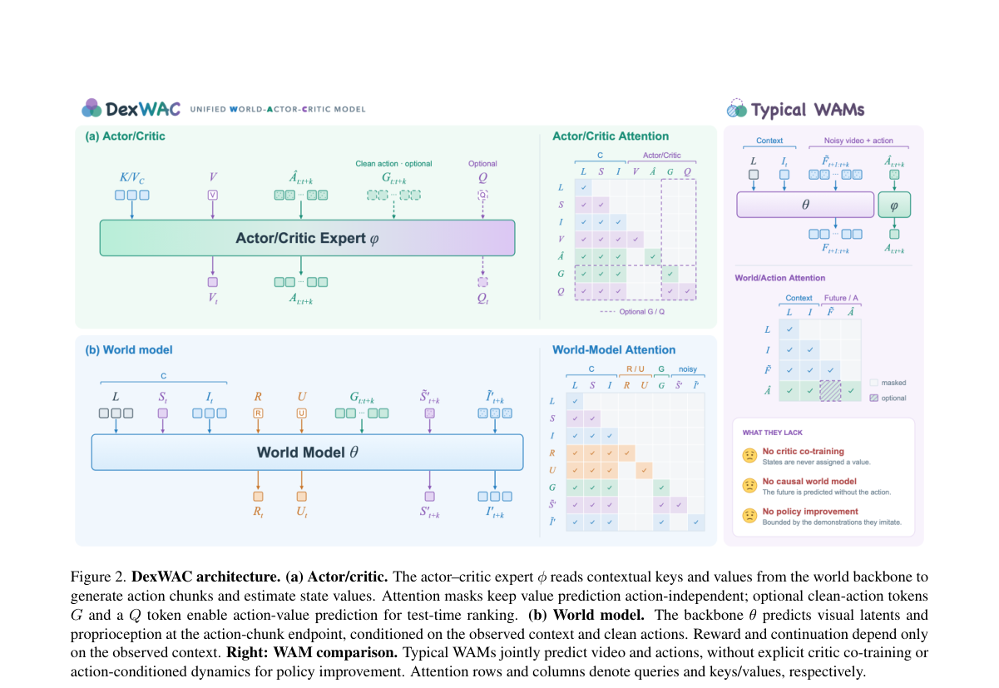

**Why this ranks #14**: 一次机器人预训练同时学出 actor、动作条件世界模型与 bootstrapped critic，世界模型只预测动作块终点的视觉潜变量与本体感知而不生成中间帧：联合预训练在 DexJoCo 达 65.50±2.2%（π0.5 为 57.92±5.8%），RoboTwin 2.0 平均 88.1%，两个真机任务平均 75% 对 π0.5 的 45%。

---

### 15. Embodied AI Fails the Mirror Test: How a Simple Mirror Breaks Robot Policies

**arXiv**: [2611.33010](https://arxiv.org/abs/2611.33010) | **Score**: 9.0 (relevance 9 x 0.7 + quality 9 x 0.3) | **Direction**: `embodied_ai` | **Tags**: embodied, reflection-robustness, policy-evaluation, benchmark, phantom-targeting, Peking University | **Categories**: cs.AI, cs.CV, cs.RO | **Pages**: 23

**Authors**: Xuanchen Liu; Hejun Zhang; Boxuan Dong; Ying Wu; Heshuai Li; Wen Gao; Yonghong Tian; Weihao Yu

**Affiliation**: Peking University

**Abstract**

> Can a simple mirror expose the limitations of today's robotic manipulation policies? Inspired by the mirror self-recognition test in animal cognition, we investigate whether robot policies can reliably manipulate physical objects in scenes containing their reflections. We introduce RoboDojo-Mirror, a benchmark built on RoboDojo that preserves task objectives, success criteria, and policy checkpoints while comparing a mirror-free baseline with single-mirror, dual-mirror, and mirrored-tabletop conditions. Across five policies spanning Vision-Language-Action models, World Action Models, and agentic policies, every mirror condition reduces aggregate success rates: averaged over the three conditions, the drop ranges from 10.8 to 56.7 percentage points across policies, and it reaches 62.5 points on the mirrored tabletop. Because a mirror is also a physical obstacle, we compare it against geometrically matched non-reflective panels; 50--88\% of mirror-specific failures occur without recorded robot--panel contact, so direct collisions alone do not explain the degradation. Trajectory and contact analyses instead reveal recurring behaviors consistent with phantom targeting of reflected objects and spatial mislocalization of real ones. Targeted diagnostics further characterize grasping near reflections, policy-dependent pushing progress, and physical-target interaction under main-camera occlusion. Real-robot experiments with $π_{0.5}$ and FastWAM also show lower overall success rates under the upright-mirror and mirrored-tabletop conditions. These findings reveal a shared vulnerability to reflective environments across diverse robot policies and motivate reflection-aware evaluation of embodied intelligence. Code is available at https://github.com/iPPLab/robodojo-mirror.

**Key findings**

- **Finding**: 三种镜像条件平均后，5 个策略的聚合成功率下降 10.8–56.7 个百分点，镜面桌面条件下最多下降 62.5 点；50–88% 的镜面特有失败没有记录到机器人与面板的接触，真机上 π0.5 从 77.5% 降到 52.5%（立式镜）与 27.5%（镜面桌面）。
- **Inference**: 退化并非来自镜子作为物理障碍的碰撞，而是策略把反射像当成了真实目标（phantom targeting）并错误定位了真实物体，属于感知层面的系统性偏差。
- **Recommendation**: 评估机器人策略时必须在场景中加入几何匹配的非反射面板作为对照，否则无法区分'碰撞导致'与'反射感知失败'这两类完全不同的失效。

**Key figures**

*Framework - Overview of the mirror benchmark. (a) The animal mirror test motivates studying how robots act in the presence of reflections. (b) Four experimental configurations: no mirror, a single mirro*

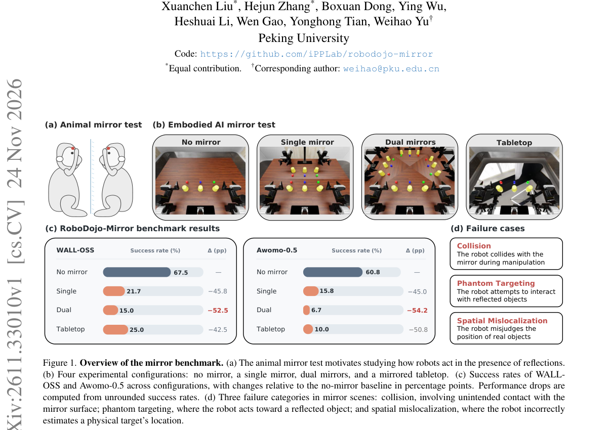

*Result - Overview of the evaluation protocol in RoboDojo-Mirror. Policies are evaluated on matched task layouts under four scene conditions, with additional non-reflective panel controls for selected*

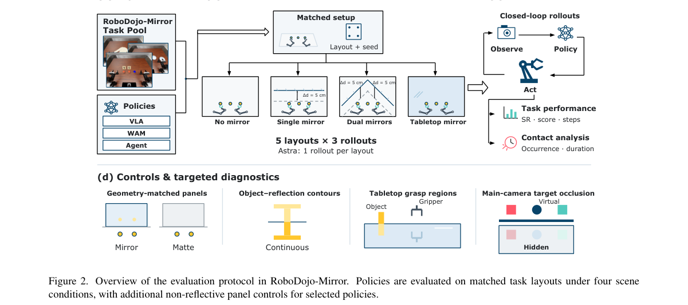

**Why this ranks #15**: 保持任务目标、判定标准与策略权重不变，只加入单镜、双镜与镜面桌面三种条件：5 个策略的聚合成功率平均下降 10.8–56.7 个百分点（镜面桌面最多降 62.5 点），且 50–88% 的镜面特有失败并没有记录到机器人与面板的接触。

---

### 16. PyRUA-Dex: Learning Programmatic Policies for Dexterous Bimanual Manipulation with Coding Agents

**arXiv**: [2611.33144](https://arxiv.org/abs/2611.33144) | **Score**: 9.0 (relevance 9 x 0.7 + quality 9 x 0.3) | **Direction**: `embodied_ai` | **Tags**: embodied, coding-agent, programmatic-policy, dexterous-manipulation, demonstration-free, Peking University | **Categories**: cs.RO | **Pages**: 23

**Authors**: Feixiang Ruan; Guodong Lv; Kewei Zhang; Wenbo Huang; Yintianrun Zhang; Qiang Wang; Ruiyang Si; Shunyu Yang; Shulong Jiang; Weicheng Duan; Rui Ni; Jianxin Bi

**Affiliation**: Peking University; National University of Singapore; NVIDIA; Tongji University; University of Chicago

**Abstract**

> Learning for dexterous manipulation is limited by the scarcity of high-quality demonstrations: retargeting from human video is imprecise, teleoperation gives no force feedback to the operator, and exoskeleton-based collection is hard to scale up. We present PyRUA-Dex, a framework that enables coding agents to develop dexterous manipulation through programmatic policy, without the need of demonstrations. The programmatic policy is developed in two stages: during exploration, multiple agents explore in parallel for task skills and ways to compose them, and a distilling agent condenses the successful attempts into a task library and one program. During refinement, this program is improved through randomized layouts for enhanced robustness and execution efficiency. In simulated environments, PyRUA-Dex achieves SOTA on Bench2Dex with a score of 72.9 and reaches 81.0% success on DexJoCo under full randomization, ahead of every trained policy on both benchmarks. In real world experiments on a bimanual platform with two 22-DoF hands, PyRUA-Dex learns to play piano, write calligraphy, and other tasks efficiently: learning a new piece from sheet music takes as little as 30 minutes. These results suggest that PyRUA-Dex is an effective framework for developing dexterous manipulation policies with coding agents in the absence of high quality dexterous manipulation demonstrations.

**Key findings**

- **Finding**: PyRUA-Dex 在 Bench2Dex 上得分 72.9（刷新 SOTA，超过所有训练策略），全随机化的 DexJoCo 上成功率 81.0%，最强训练策略仅 40.3%；真机双平台两只 22-DoF 手从乐谱学新曲约 30 分钟。
- **Inference**: 程序化策略的鲁棒性来自'写代码—运行—调试'闭环而非单次尝试：若只有 5 个阶段且每段成功 80%，总体成功率也只有 33%，因此必须靠随机化布局反复蒸馏才能成立。
- **Recommendation**: 缺乏高质量灵巧示教时，可用多个编码 agent 并行在各自布局上探索再蒸馏成一个程序，而不是用行为克隆硬凑数据集或把演示当作唯一监督来源。

**Key figures**

*Result - Overview of PyRUA-Dex. All learning takes place in simulation. Stage 1 (exploration): eight agents (one is drawn) explore the task, each on a training layout of its own with state resets, and*

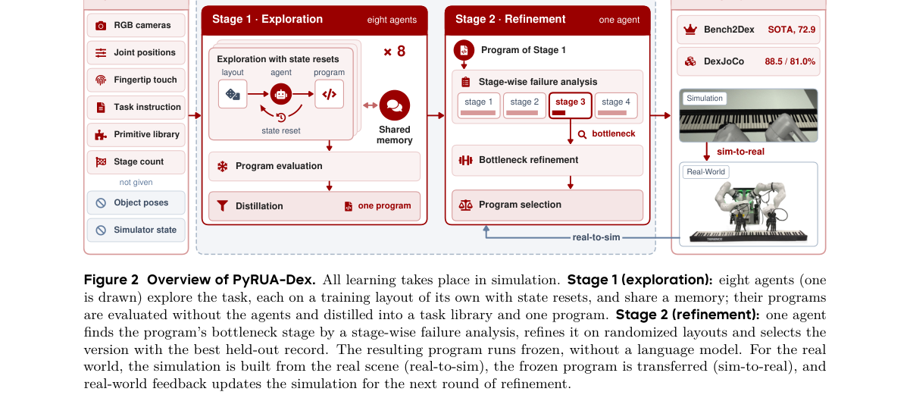

**Why this ranks #16**: 让编码 agent 在仿真里并行探索技能并把成功尝试蒸馏成一个程序，全程不需要专家演示：Bench2Dex 上以 72.9 分刷新 SOTA，全随机化 DexJoCo 上取得 81.0% 成功率（最强训练策略为 40.3%），真机两只 22-DoF 手学一首新曲只需约 30 分钟。

---

### 17. OmniAct: One Policy, One Million Embodiments

**arXiv**: [2611.33158](https://arxiv.org/abs/2611.33158) | **Score**: 9.0 (relevance 9 x 0.7 + quality 9 x 0.3) | **Direction**: `embodied_ai` | **Tags**: embodied, cross-embodiment, flow-matching-policy, kinematic-graph, procedural-data, University of Washington | **Categories**: cs.AI, cs.CV, cs.LG, cs.RO | **Pages**: 11

**Authors**: Xiang Fan; Yuheng Wang; Jiayuan Yan; Bohan Fang; Wisdom Oluchi Ikezogwo; Ainaz Eftekhar; Max Argus; Jason Ren; Jiafei Duan; Ranjay Krishna

**Affiliation**: University of Washington; University of North Carolina at Chapel Hill; Allen Institute for Artificial Intelligence; National University of Singapore

**Abstract**

> A single policy that controls diverse robots must not only transfer task knowledge across embodiments, but also adapt its behavior to each robot's capabilities. Existing approaches facilitate transfer through shared action representations, but these representations do not necessarily capture how differences in robot morphology should shape manipulation strategies. We introduce OmniAct, a cross-embodiment manipulation policy that conditions directly on each robot's kinematics in a specific scene to produce embodiment-specific behavior. This kinematic graph represents the robot's joint positions, motion axes, and connectivity to its visual observation, allowing the policy to account for how its embodiment related to objects and surfaces in the scene. A flow-matching policy predicts relative joint motions for each node, enabling control across robots with different degrees of freedom and kinematic configurations. To learn how physical structure shapes behavior at scale, we procedurally design and filter one million physically feasible robot embodiments; next, we develop algorithms to generate robot trajectories in simulation for all embodiments; finally, we train across diverse simulated manipulation tasks. On 2,000 embodiment-scene-held-out evaluation episodes, OmniAct achieves 63.0% success, compared to 17.8% for pi 0.5 and 57.9% for the strongest baseline; on the task families GPT-6 Astra was evaluated on, it achieves 64.7% against GPT-6 Astra's 41.1%. On a previously unseen real-world robot, it achieves nearly twice the success rate of the next best method, MolmoAct2. Beyond task success, we observe that OmniAct learns distinct manipulation strategies that exploit the capabilities and accommodate the limitations of different morphologies. Project: https://omniact.github.io/

**Key findings**

- **Finding**: OmniAct 在 2000 个留出回合（500 步预算）内取得 63.0% 成功率，最强基线 57.9%、π0.5 为 17.8%；候选形态筛选中 84.4% 因自碰撞被淘汰，存活形态里仍有 97.5% 未通过后续筛选。
- **Inference**: 共享动作表示无法表达'不同形态应采用不同操作策略'，把关节位置、运动轴与视觉连接的图结构显式作为条件后，策略才能在跨形态迁移时保留任务知识同时调整行为方式。
- **Recommendation**: 做跨本体泛化时应先用逆运动学筛选保证形态物理可行，再把关节几何图结构作为策略条件，而不是强行统一各机器人的动作空间。

**Key figures**

*Framework - OMNIACT is an embodiment-native policy designed to employ robot-specific motion strategies without embodiment-agnostic planning. We generate (1) diverse embodiments procedurally and (2) vari*

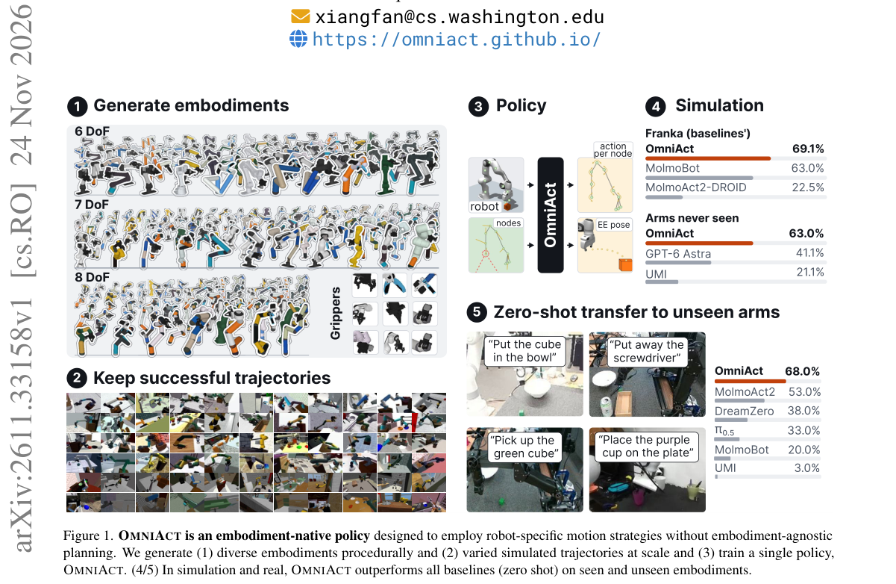

*Result - OMNIACT architecture. Multi-view RGB observations, language instructions, and camera-frame scene-grounded kinematic graph condition a shared flow-matching Transformer. Each node represents a*

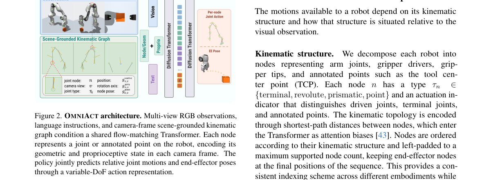

**Why this ranks #17**: 用场景坐标下的运动学图直接条件化策略，并程序化生成与筛选 100 万个物理可行的机器人形态：2000 个'未见形态-未见场景'留出回合上成功率 63.0%（最强基线 57.9%、π0.5 仅 17.8%），在 GPT-6 Astra 评测过的任务族上达 64.7% 对其 41.1%。

---

### 18. FlexWAM: Learning Flexible Visual Routing for World Action Models

**arXiv**: [2611.30024](https://arxiv.org/abs/2611.30024) | **Score**: 8.7 (relevance 9 x 0.7 + quality 8 x 0.3) | **Direction**: `embodied_ai` | **Tags**: embodied, world-action-model, multi-view-routing, counterfactual-credit, real-robot, Zhejiang University | **Categories**: cs.RO | **Pages**: 19

**Authors**: Mingyu Mei; Haojie Xu; Zibo Dai; Hongjie Fang; Shirun Tang; Zhengrui Lv; Yang Liu; Chen Guang; Xingyue Zhao; Huiliang Shen; Zaixing He

**Affiliation**: Zhejiang University; Shanghai Jiao Tong University; Noematrix; University of Minnesota; EndlessAI

**Abstract**

> Humans dynamically adjust their reliance on sensory modalities across manipulation stages. Although existing World Action Models (WAMs) fuse multi-camera observations, they struggle to adapt their reliance on individual views based on the current observations. This raises a central question: how can the action expert integrate complementary visual evidence while prioritizing the views most relevant to the current action? FlexWAM addresses this challenge through three modules. First, we alternate within-view and cross-view attention to capture view-specific dynamics and complementary cues. For action prediction, View-Routed Action Attention uses an observation-conditioned router to prioritize relevant views. To calibrate routing, we train a critic using counterfactual view credit, estimated from action loss sensitivity upon suppressing each view's contribution to action attention. We evaluate FlexWAM with two video backbones on five challenging real-world manipulation tasks across two robot platforms. The two variants improve mean task success by 16.4 and 23.0 percentage points over the strongest baseline. Project website: https://flexwam.github.io/.

**Key findings**

- **Finding**: FlexWAM 在两个真实机器人平台、5 个真实任务上的平均成功率为 77.2%（Wan 骨干）与 83.8%（LingBot 骨干），分别超过最强基线 16.4 与 23.0 个百分点。
- **Inference**: 多相机固定拼图融合无法表达'当前这一步最该看哪个视角'，用反事实视角信用（抑制某视角后动作损失的变化）训练路由器，可在推理时把注意力动态压到关键视角。
- **Recommendation**: 评测多相机操作策略时，除最终成功率外还应单独统计各视角的动作损失敏感度，否则关键视角被稀释的问题会被平均指标掩盖。

**Key figures**

*Framework - Overview of FlexWAM. (a) Existing WAMs fuse views in a fixed canvas and underutilize critical placement cues. (b) FlexWAM combines within-view and cross-view world modeling and uses counterf*

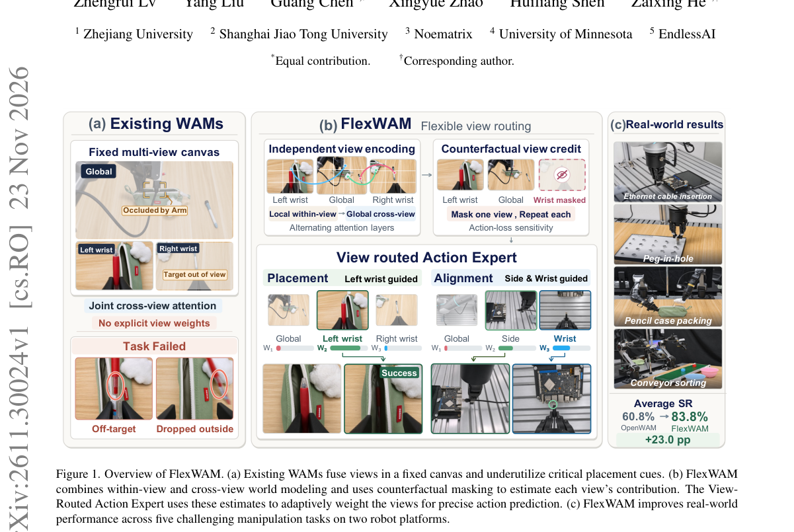

*Result - Framework of FlexWAM. (a) Alternating within-view and cross-view attention captures view-specific dynamics and integrates cross-view context. (b) The critic calibrates the router through cou*

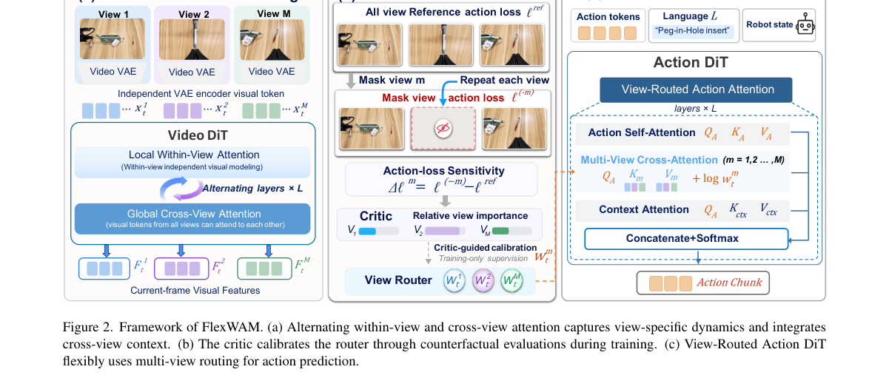

**Why this ranks #18**: 用观测条件化路由器在动作注意力中动态挑选关键视角，并以抑制单个视角后动作损失的敏感度作为反事实信用训练 critic：两个真实机器人平台的 5 个任务上，两个变体的平均成功率分别比最强基线高 16.4 与 23.0 个百分点（77.2% 与 83.8%）。

---

### 19. RoboLiveMem: Is Robot Memory Solved When the World Does Not Wait?

**arXiv**: [2611.30047](https://arxiv.org/abs/2611.30047) | **Score**: 8.7 (relevance 9 x 0.7 + quality 8 x 0.3) | **Direction**: `embodied_ai` | **Tags**: embodied, robot-memory, live-world-benchmark, temporal-grounding, frontier-vlm, Tulane | **Categories**: cs.AI, cs.RO | **Pages**: 15

**Authors**: Yunbei Zhang; Yuyou Zhang; Janet Wang; Ming Liu; Yijiang Li; Yikai Wang; Weirui Ye; Ding Zhao; Jihun Hamm

**Affiliation**: Tulane; CMU; Amazon; UCSD; MIT

**Abstract**

> Robot agents built on frontier vision-language models now solve most robot memory benchmarks. Does this mean they can remember what they need in a home, where people and machines keep moving things? Existing memory benchmarks cannot answer this question, because they pause the simulator while the model thinks: nothing can change during a decision, so whatever the robot remembers is still true when it acts. We introduce RoboLiveMem, a benchmark that runs the same memory tasks twice, once with the world paused while the model thinks and once with the world running. It contains 29 task families in three tiers, from 16 realistic BEHAVIOR-1K scenes of homes, workshops and a restaurant to controlled ManiSkill tasks. Every task mixes real changes with harmless look-alikes and runs without any change, so that no fixed strategy succeeds, and most tasks have a twin that keeps the change in view, which separates forgetting from acting too late. Testing 16 models on 34,176 episodes, we find three surprises. (1) Paused results hide the problem: when a remembered object changes in a realistic scene, the 8 Claude and GPT models succeed in 97% of episodes on average with the world paused, but in only 50% with the world running, and their ranking changes: Claude Opus 5.5, which never fails when paused, succeeds in 44%. (2) Speed is not the fix: slower models do no worse, and models given only 2 s per decision still fall at least 36 points below their paused success. (3) Models see the change but act on camera frames from before it ended. Looking again just before acting closes most of the realistic gap, yet when identical objects are swapped several times, all nine models we test still lose points to memory.

**Key findings**

- **Finding**: 在 16 个模型、8 家厂商、34176 个回合的评测中，8 个 Claude 与 GPT 模型在'暂停时钟'下平均成功率 97%，在'实时钟'下只有 50%；Claude Opus 5.5 从不失败降到 44%，Fable 5.1 则从并列最低升到 86%。
- **Inference**: 记忆基准暂停世界等于替模型把'记错'与'行动太晚'两类失效混为一谈；给足 2 秒决策时间仍至少掉 36 个点，说明瓶颈是使用了过期帧而非推理速度。
- **Recommendation**: 评测机器人记忆必须在世界持续运动的条件下进行，并在动作执行前重新看一眼，否则记忆基准给出的分数会系统性高估。

**Key figures**

*Framework - Robot memory benchmarks pause the world, and ROBOLIVEMEM does not. Left: one recorded episode of Grandpa’s mug (BEHAVIOR-1K, Claude Opus 5.5). Grandpa’s mug stands at mark 1 among identical*

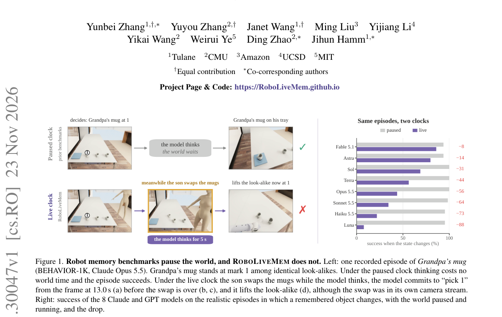

*Result - Examples from the three tiers. The 16 realistic BEHAVIOR-1K scenes, shown as the agent’s first view with the numbered marks its skills act on, followed by three semi-realistic MuJoCo kitchen*

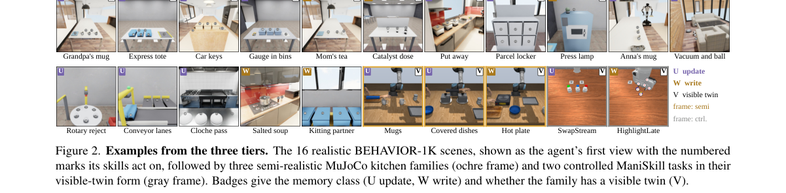

**Why this ranks #19**: 让同一批记忆任务分别在'世界暂停'与'世界继续走'两种时钟下运行，29 个任务族覆盖 16 个 BEHAVIOR-1K 真实场景：8 个 Claude 与 GPT 模型在暂停时平均成功率 97%，世界继续走时只剩 50%，而从不失败的 Claude Opus 5.5 也只有 44%。

---

### 20. RMR-VLA: Recurrent Memory Reasoning for Vision-Language-Action Models

**arXiv**: [2611.30145](https://arxiv.org/abs/2611.30145) | **Score**: 8.7 (relevance 9 x 0.7 + quality 8 x 0.3) | **Direction**: `embodied_ai` | **Tags**: embodied, recurrent-memory, vla-reasoning, grpo-memory-token, long-horizon-manipulation, Peking University | **Categories**: cs.CV, cs.RO | **Pages**: 27

**Authors**: Yiheng Du; Jingqi Tian; Xu Jiang; Jiexuan Zhang; Shuyu Wang; Zecheng Tang; Jian Zhang

**Affiliation**: Peking University; Tsinghua University

**Abstract**

> Long-horizon, history-dependent robotic manipulation often requires acting on visual cues that have disappeared, such as an object indicated earlier or a target hidden under a moving cup. The key challenge is to maintain what past evidence means for the next action as the scene changes. We introduce Recurrent Memory Reasoning (RMR), an explicit reasoning step that connects memory to action inside a vision-language-action model (VLA), with no external reasoning model. At each update, the VLA first infers an event from visual evidence, then revises the task state and grounds a subgoal in the current scene to guide action generation. Carrying the state and subgoal across updates lets remembered identities and task progress determine the current target, doubling RoboMME success over an otherwise identical model without recurrence. Joint training lets one VLA both reason and act; because its memory decisions are text tokens with exact likelihoods, GRPO refines them from rollout rewards without making action generation stochastic. Among the compared methods, RMR-VLA achieves the best results on RoboMME (66.46% overall, 79.83% on the Reference category) and LIBERO-Mem (90.08%).

**Key findings**

- **Finding**: RMR-VLA + GRPO 在 RoboMME（16 任务、4 类、每任务 50 回合）总体成功率为 66.46%，Reference 类 79.83% 为最高；VideoPlaceOrder 上 90.67% 对最强无外部推理模型方案的 39.56%，LIBERO-Mem 上 90.08%（监督版 89.17%）。
- **Inference**: 记忆决策以文本 token 表达、拥有精确似然，因此可以直接用 GRPO 从 rollout 奖励里优化而不必让动作生成随机化，记忆与控制可以在一个 VLA 内联合训练。
- **Recommendation**: 需要长时程历史依赖的操作时，应把记忆更新实现为 VLA 内部的显式文本推理步骤，这样既能保留可解释的子目标，又能复用 GRPO 做后训练。

**Key figures**

*Framework - Tracking hidden targets guides action. In this example from RoboMME’s ButtonUnmaskSwap task [7], red’s updated location grounds the lifting subgoal after a cup swap. G/R/B markers follow cub*

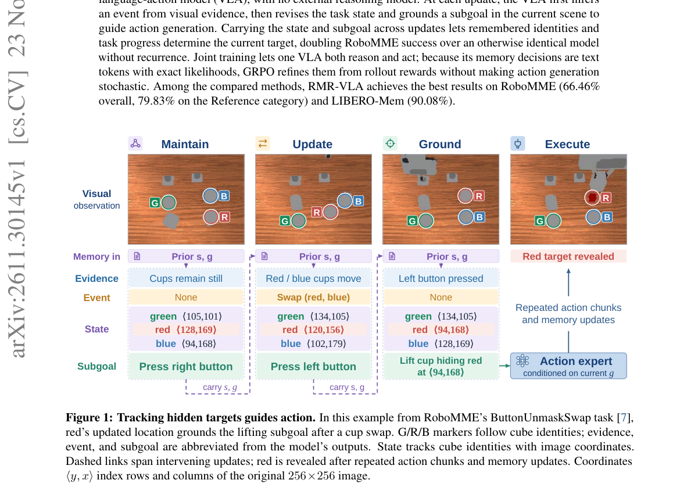

*Result - Subgoals connect recurrent memory to action. (a) In the write pass, the VLM writes the four-field trace; in the act pass, the same VLM encodes the current inputs with the grounded subgoal fo*

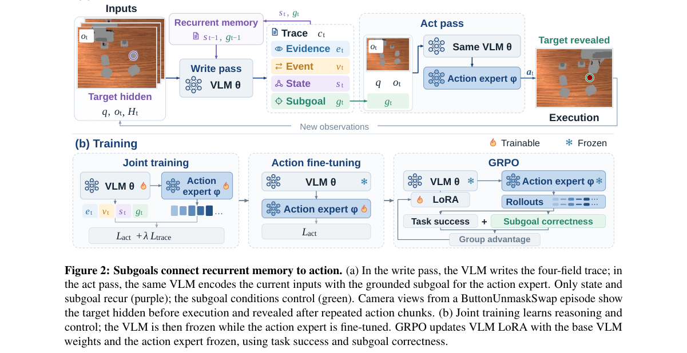

**Why this ranks #20**: 在 VLA 内部加一步显式记忆推理，把记忆更新写成事件、修正任务状态并在当前场景中落地子目标：RoboMME 16 个任务总体 66.46%（Reference 类 79.83%），LIBERO-Mem 90.08%，同架构无循环版本的成功率被直接翻倍。

---

## Footer

- Total papers reviewed across all 4 axes: 60
- world_embodied axis final count: 20
- Wild-cards in this axis: 0
- Figure assets: 2026-11-26/res/

Generated by `mine-arxiv-daily-digest` skill. Sister file: `2026-11-26_world_embodied_entry.md`.
