# Mine Arxiv Daily Digest - 2026-11-27 (AIGC 视觉生成与编辑 Axis, 18 papers)

**Generated**: 2026-11-27 01:51:48 CST

**Source**: arXiv cs.CV, cs.SD, eess.AS, cs.CL, cs.AI, cs.RO, cs.LG, cs.IR submissions, listing day 2026-11-25 (announced listing 11-25 于 2026-11-26 01:00 UTC 公告)

**Batch window**: 2026-11-24T19:00:00Z .. 2026-11-25T19:00:00Z（arXiv 公告批次窗口按 listing 日逐段相接：每段的起点是前一日的美东 14:00 截止时刻（EDT 为 18:00Z，EST 为 19:00Z），终点是当日同一时刻）

**Axis**: aigc_visual (18 papers, base 15, cap 20)

**Directions**: aigc_generation (10), aigc_editing (4), aigc_rl (4)

**Selection**: 18 papers ranked by relevance x quality, with 0 wild-card slots

**Day total**: 60 papers across 4 axes (target 60)

**Scope**: 图像 / 视频 / 3D / 4D 内容的生成与编辑，以及面向视觉生成的 RL / 偏好优化与奖励模型

**Wild-card**: 0 篇 —— aigc_generation 135 篇、aigc_editing 43 篇、aigc_rl 12 篇够格候选都远超本轴 18 个席位，名额全部由同轴内更靠前的论文占满，未启用任何补位名额。

本轴 18 篇超出基准 3 个名额，全部压在 aigc_generation（10 篇，基准 8）上，aigc_editing 与 aigc_rl 各停在 4 与 4（基准 4 / 3，aigc_rl 多 1）。按判据 dir_over = 3、dir_under = 0、axis_surplus = 3，三者相等才放行；剩余名额流向 llm_vlm 与 world_embodied。值得注意的是 aigc_generation 的 10 篇里有 4 篇在砍算力（ScanAR、JetDiffusion、Dooop、DexOPD），这一批的主线不是「更大更花」而是「更省更并行」。

---

## AIGC 生成（图像 / 视频 / 3D / 4D） · `aigc_generation` (10 papers)

10 篇沿三条线走：把生成压缩到更少算力——ScanAR 只重定义视觉 token 的前驱关系，视觉解码深度从 HW 降到 H+W，Emu3.5-Image-34B 上 GenEval 82.36、512×512 生成快 13.8 倍；JetDiffusion 用可训练的 NVFP4 稀疏注意力在 RTX 5090 上做到 273 倍端到端加速；Dooop 把预训练扩散 Transformer 蒸馏成可调深度循环模型，37% 参数追平教师、两环只用 58% 算力。把生成搬进结构化空间——CoRe 用 383M 参数在 CC12M 从零训练，推理不用 VAE 与预训练语言模型，COCO-30K FID 10.10；EiT 的像素空间扩散在 ImageNet 256 上 FID 1.61，优于 JiT 的 1.85。以及把多个专家的长板并进一个学生——DexOPD 的统一学生在 GenEval/OCR/DrawBench 上达 0.9736/0.9515/6.4875，GenEval 上超过各专家教师与多任务 RL 基线。

### 1. CoRe: Jointly Learning Contextual Representations for Understanding and Generation

**arXiv**: [2611.31397](https://arxiv.org/abs/2611.31397) | **Score**: 8.7 (relevance 9 x 0.7 + quality 8 x 0.3) | **Direction**: `aigc_generation` | **Tags**: AIGC-visual, unified-representation, bidirectional-generation, from-scratch, coco-fid, few-shot-probe, Apple | **Categories**: cs.CL, cs.CV, cs.LG | **Pages**: 45

**Authors**: Hangke Sui; Chang Li; Yuyan Li; Mohammad Haris Baig; Daniel Ulbricht

**Affiliation**: Apple; UIUC

**Abstract**

> We introduce CoRe, in which understanding and generation jointly shape one contextual representation for images and one for text, trained from scratch. Each representation is read for understanding, conditions the other modality, and is the space in which that modality is generated by a continuous flow from Gaussian noise. With 383M parameters trained on CC12M and no pretrained language model, text encoder, or VAE at inference, CoRe matches a same-data contrastive-only baseline in global understanding and reaches COCO-30K FID 10.10, comparable to much larger generators built on pretrained components. In controlled comparisons at equal data and architecture, CoRe generates better in both directions (text to image and image to text) than a representation shaped by understanding alone and then frozen, and follows prompts better than generating in a space that understanding does not shape. In the other direction, with an attentive segmentation probe, on monocular depth, and when read by a frozen language model, CoRe surpasses the contrastive-only baseline: generation adds information that stronger readouts reach. Because generation runs inside the understanding representation, frozen real-image probes read and steer intermediate states and the model ranks its own samples without extra training. Because both modalities use continuous flows, both also distill to a few steps. Our controls indicate why one representation suffices: understanding organizes the representation semantically, while generation makes it retain more information.

**Key findings**

- **Finding**: CoRe 用 383M 参数在 CC12M 上从零训练，不依赖预训练语言模型、文本编码器或 VAE，COCO-30K FID 达 10.10。
- **Inference**: 理解与生成共享同一表示能同时提升可读出的信息量，因此单个表示就足以支撑文生图与图生文两类任务。
- **Recommendation**: 评估新的视觉表示时不要只看生成 FID，应同时检查深度、分割探针与冻结语言模型的读出效果。

**Key figures**

*Framework - CoRe: one representation per modality, shaped by understanding and generation together. Left: when generation runs in a learned representation space, that space is usually trained beforehand,*

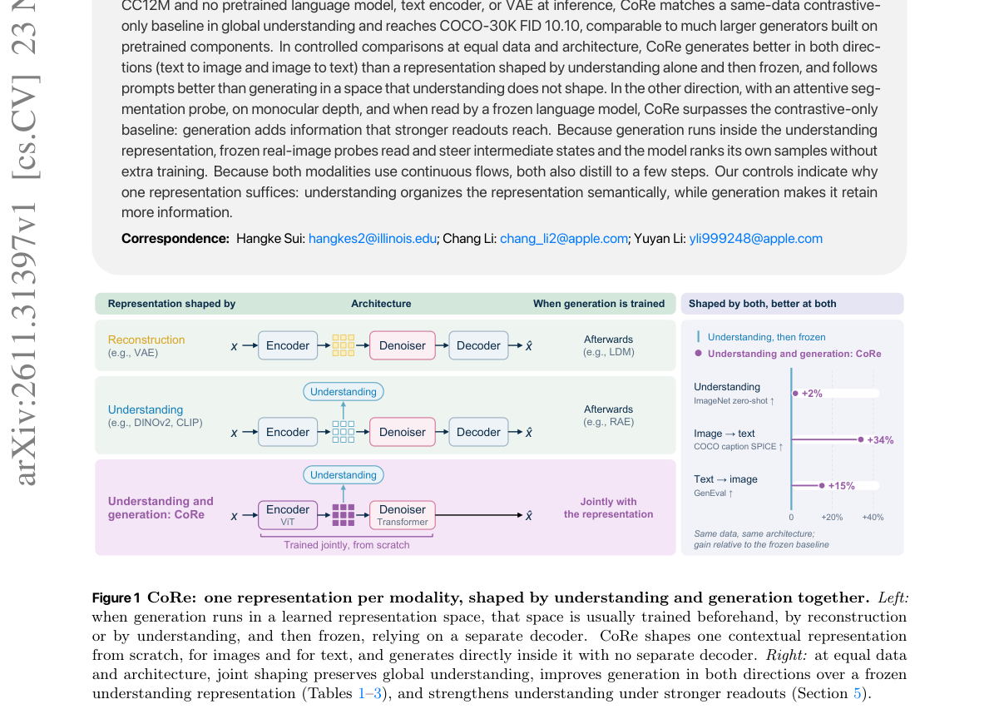

*Result - One contextual representation per modality, in three roles. The encoder Em (m ∈{v, t}) maps an image or a caption to a contextual representation Zm and its pooled readout gm. Understanding re*

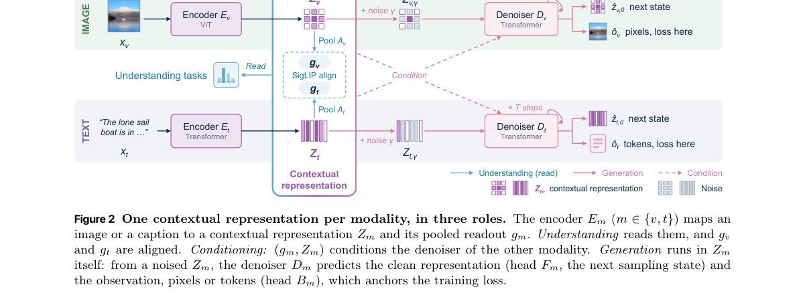

**Why this ranks #1**: 理解与生成共同塑形同一套上下文表示：383M 参数、仅用 CC12M 训练，推理时不依赖预训练语言模型、文本编码器或 VAE，COCO-30K 上 FID 10.10。

---

### 2. DexOPD: Dual-Extrapolation On-Policy Distillation for Diffusion Models

**arXiv**: [2611.31969](https://arxiv.org/abs/2611.31969) | **Score**: 8.7 (relevance 9 x 0.7 + quality 8 x 0.3) | **Direction**: `aigc_generation` | **Tags**: AIGC-visual, on-policy-distillation, multi-teacher, self-extrapolation, geneval, unified-student, Shanghai Jiao Tong University | **Categories**: cs.AI | **Pages**: 35

**Authors**: Yunchao Ke; Yanzhe Hu; Yi Yang; Jiachun Jin; Zhihong Liu; Zhijie Deng

**Affiliation**: Shanghai Jiao Tong University; Nankai University

**Abstract**

> Flow-based diffusion models have become a mainstream paradigm for text-to-image generation, where task-specific post-training produces specialist models with complementary strengths. Multi-teacher on-policy distillation (OPD) offers an efficient way to consolidate these specialists into a single unified student. Recent methods strengthen supervision through teacher extrapolation, constructing stronger proxy teachers that allow distilled students to surpass the original specialists. However, their extrapolation directions remain defined solely by frozen teacher and reference models, leaving the student's own training progress unexploited. To address this limitation, we introduce DexOPD, a dual-extrapolation on-policy distillation method for diffusion models. DexOPD retains extrapolated teacher supervision while leveraging a lagging historical student as the reference for student self-extrapolation. Sampling across multiple self-extrapolation gains from shared initial noise broadens exploration along the student's evolving trajectory, and task rewards convert pairwise differences in candidate quality into a normalized auxiliary regression direction. Empirically, we evaluate DexOPD on GenEval, OCR, and DrawBench. The resulting unified SD3.5-Medium student achieves a GenEval reward of 0.9736, an OCR score of 0.9515, and a DrawBench Aesthetic score of 6.4875, surpassing the corresponding specialist teachers as well as all evaluated OPD and multi-task reinforcement learning baselines across these three benchmarks while preserving standard single-model inference.

**Key findings**

- **Finding**: 统一的 SD3.5-Medium 学生在 GenEval 达 0.9736、OCR 达 0.9515、DrawBench Aesthetic 达 6.4875，三项均超过对应的专家教师。
- **Inference**: 用滞后的历史学生做参考再叠加教师外推，能把学生自身的训练进度纳入蒸馏方向，比只用冻结的教师与参考模型更有效。
- **Recommendation**: 合并多个专家模型时优先尝试 on-policy 蒸馏而非权重合并，它保留标准单模型推理，不带来额外推理开销。

**Key figures**

*Framework - Qualitative highlights and multi-task benchmark performance. Top: representative images generated by our unified DexOPD student across compositional, text-rendering, and aesthetic prompts. Bo*

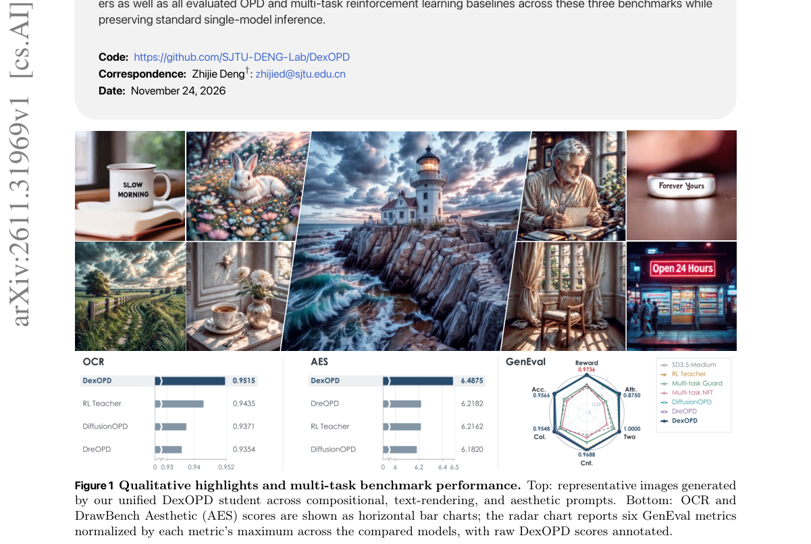

*Result - The student need not trail the proxy teacher. GenEval learning curves for three multi-teacher OPD methods over 1,000 optimizer updates. The inset magnifies the highlighted late-training inter*

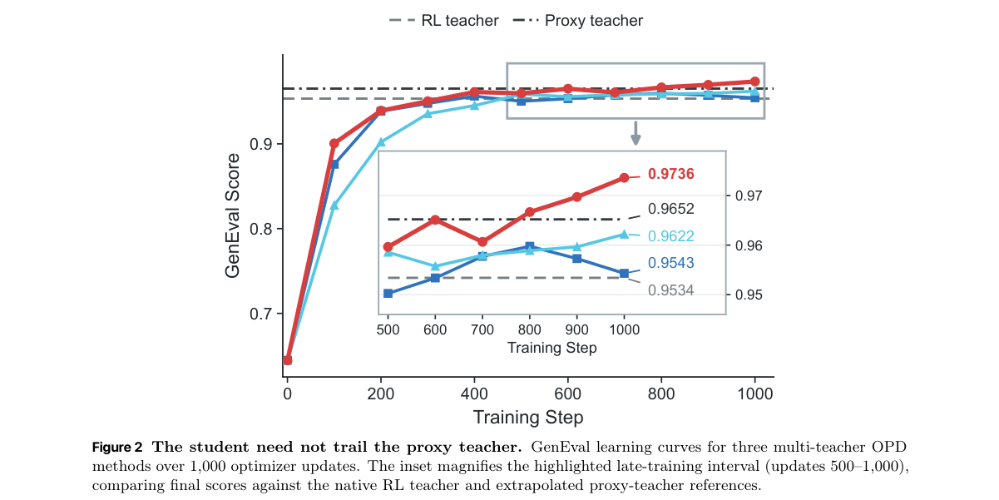

**Why this ranks #2**: 把多个专家蒸馏成一个统一学生：SD3.5-Medium 学生同时拿到 GenEval 0.9736、OCR 0.9515、DrawBench 美学分 6.4875，反超各自对应的专家教师。

---

### 3. Distill to Loop: Turning Pretrained Diffusion Transformers into Looped Models with Adjustable Depth

**arXiv**: [2611.31977](https://arxiv.org/abs/2611.31977) | **Score**: 8.7 (relevance 9 x 0.7 + quality 8 x 0.3) | **Direction**: `aigc_generation` | **Tags**: AIGC-visual, looped-transformer, depth-distillation, ode-solver, loop-guidance, few-step, Virginia Tech | **Categories**: cs.AI, cs.CV | **Pages**: 23

**Authors**: Chenru Wang; Shengwei An

**Affiliation**: Virginia Tech

**Abstract**

> Looped transformers reuse one block of shared weights along the depth of the network. Recent looped diffusion transformers are trained from scratch, which repeats the full pretraining cost although strong pretrained non-looped diffusion transformers exist. We propose Distill to Loop (Dooop), which distills a pretrained non-looped diffusion transformer into a looped student whose blocks are initialized from the teacher's. We cast distillation as a fixed-point iteration toward the teacher, in which the output after every loop is trained toward the teacher, and each loop is one step of an ordinary differential equation in depth. As a result, one model runs any number of loops at test time without retraining, and the higher-order ODE solvers of diffusion model sampling can be applied along the depth dimension for better results. Meanwhile, because a looped model produces an output after every loop, we also construct loop guidance between the outputs of different loop counts, which improves the generated samples at little extra compute. On SD3-medium, a looped student with about 37% of the teacher's parameters matches the teacher on average over GenEval, ImageReward, PickScore and HPSv2.1 with two to four loops, and with two loops it uses about 58% of the teacher's compute. And on a four-step SD3-medium, loop guidance raises the average of the four metrics from 88.2 to 99.2.

**Key findings**

- **Finding**: 循环学生 0.756B 参数、约为教师的 37%，两次循环就在 GenEval、ImageReward、PickScore 与 HPSv2.1 上以 100.7 的均值超过教师的 100。
- **Inference**: 把蒸馏看成沿网络深度的定点迭代后，循环次数就成了推理期可调的深度旋钮，同一份权重可跑任意次数而无需重训。
- **Recommendation**: 需要同时压参数量与算力时，可先取两次循环的循环学生，再用 loop guidance 以很小额外开销补回指标。

**Key figures**

*Framework - Samples of the Dooop student distilled from Z-Image.*

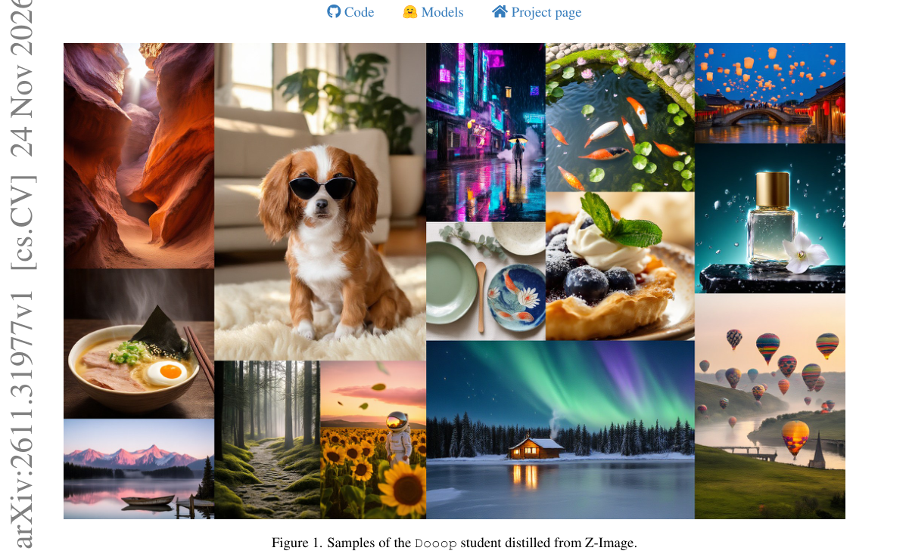

*Result - Training pipeline of Dooop. (a) The looped student is initialized from the frozen non-looped teacher. (b) Each training batch mixes noisy data states with rollout states, which are sampled w*

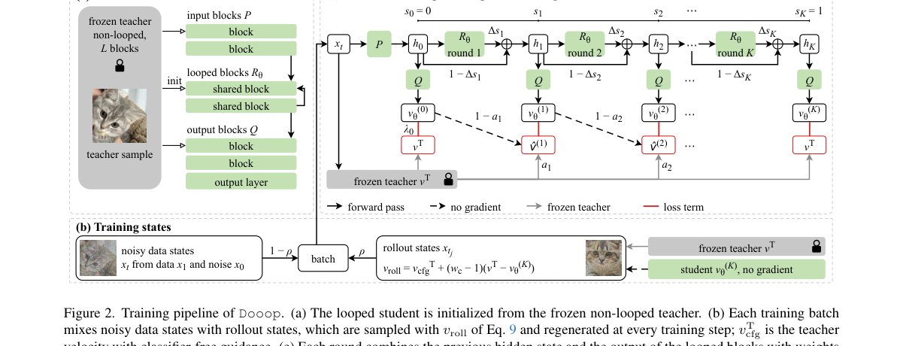

**Why this ranks #3**: 把预训练非循环 DiT 蒸馏成深度可调的循环模型：SD3-medium 上学生仅 0.756B 参数（约教师的 37%），两到四次循环即可追平教师，两次循环只用约 58% 计算量。

---

### 4. Qwen-Image-HD: Autoregressive Diffusion for High Definition Image Generation

**arXiv**: [2611.32736](https://arxiv.org/abs/2611.32736) | **Score**: 8.7 (relevance 9 x 0.7 + quality 8 x 0.3) | **Direction**: `aigc_generation` | **Tags**: AIGC-visual, high-resolution, tile-autoregressive, neighbor-conditioning, multi-gpu-scheduling, 4k-generation, [unverified] | **Categories**: cs.CV | **Pages**: 19

**Authors**: Zihao Liu; Zekai Zhang; Shengming Yin; Zikai Zhou; Donghao Zhou; Chenyang Zhu; Lihan Jiang; Ningyuan Tang; Bingxuan Zhao; Yanran Zhang; Yan Shu; Zhening Liu

**Affiliation**: [unverified]

**Abstract**

> Fine-tuning a generator on a complete high-resolution canvas requires long image sequences and substantial computation, yet local regions can still exhibit unnatural repetitive stripes when training resources are limited. We introduce Qwen-Image-HD, which adapts Qwen-Image 2.0 to high-resolution synthesis through local training and blockwise autoregressive generation. Each prediction covers a target tile at 1K scale, conditioned on high-resolution upper and left neighbors and a compressed historical thumbnail. These conditions provide adjacent fine-scale structures and an overview of the scene generated so far. To integrate these complementary cues, we map both forms of history and the target to a shared canvas coordinate system to express their spatial relationships and scale differences. On Qwen-Image-Bench at 4K, Qwen-Image-HD achieves stronger overall evaluation performance than direct 4K generation with FLUX-3-Image-Klein. Compared with full-image 4K supervised fine-tuning of the same backbone, it achieves better generation quality with lower training compute and higher inference efficiency, while exhibiting fewer unnatural repetitive stripes in original-resolution comparisons. We further introduce a Wavefront-AutoRegressive inference schedule that generates tiles on the same anti-diagonal concurrently across GPUs to reduce single-image latency.

**Key findings**

- **Finding**: Qwen-Image-HD 在 Qwen-Image-Bench 4K 上整体评测强于 FLUX-3-Image-Klein 的直接 4K 生成，并支持单张 16K 图像。
- **Inference**: 把高分辨率问题拆成 1K 瓦片的局部预测后，训练序列长度与显存压力下降，局部区域也更容易摆脱重复条纹。
- **Recommendation**: 部署 4K 以上生成时优先考虑分块自回归方案，并用反斜线波前调度让同一条反对角线上的瓦片跨 GPU 并行以压低单图延迟。

**Key figures**

*Framework - Images generated by Qwen-Image-HD. Left: multiple 4K examples. Right: a single 16K image with enlarged details.*

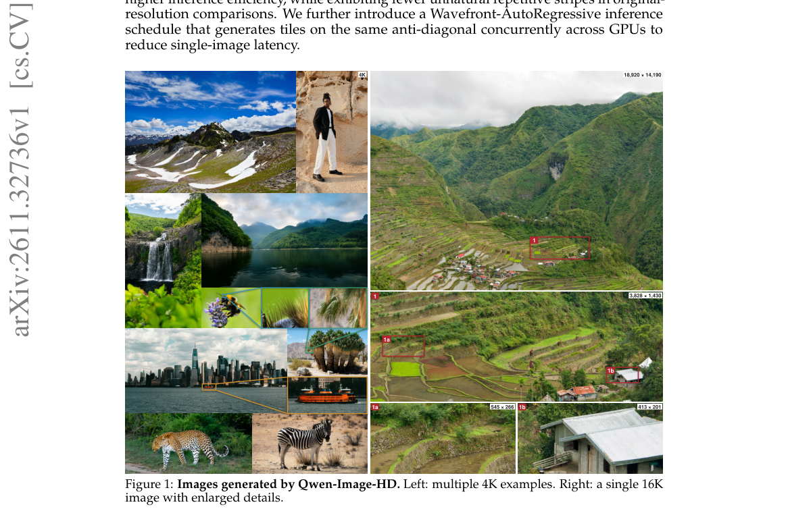

*Result - Architecture and spatial alignment of Qwen-Image-HD. Left: the historical thumbnail, upper/left neighbors, and noisy target tile serve as inputs, with separate paths for the training loss an*

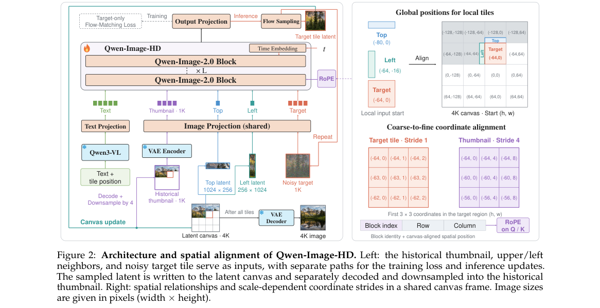

**Why this ranks #4**: 整图高分辨率微调算力受限：改用局部训练与分块自回归，每次预测 1K 尺度瓦片并条件化上、左邻块与压缩历史缩略图，Qwen-Image-Bench 4K 上整体表现优于 FLUX-3-Image-Klein 的直接 4K 生成。

---

### 5. JetDiffusion: Pushing the Speed Limits of Video Generation with NVFP4 Sparse Attention

**arXiv**: [2611.33268](https://arxiv.org/abs/2611.33268) | **Score**: 8.7 (relevance 9 x 0.7 + quality 8 x 0.3) | **Direction**: `aigc_generation` | **Tags**: AIGC-visual, sparse-attention, nvfp4-quantization, step-distillation, custom-kernel, video-generation, University of California | **Categories**: cs.CV, cs.LG | **Pages**: 37

**Authors**: Yulun Wu; Zihan Min; Minshen Zhang; Kaiqin Kong; Ji Xie; Will Lin; Junda Chen; Wenxuan Tan; Aryan Kumar; Loay Rashid; Qingyu Yin; Hao Zhang

**Affiliation**: University of California, San Diego; Carnegie Mellon University; University of Wisconsin–Madison; National University of Singapore

**Abstract**

> Attention over long sequences is a major computational bottleneck in video generation, which can be alleviated through sparsity and low-bit quantization. We propose JetDiffusion, a video generation system built on trainable Video Sparse Quantized Attention (VSQA), with custom inference kernels that combine native NVFP4 computation and kernel fusion. At 90% sparsity, VSQA accelerates attention by 8-29x compared with FlashAttention on different hardwares. To further accelerate video generation, we combine VSQA with NVFP4 linear quantization and step distillation. Although each technique can individually preserve generation quality, jointly adapting to all three remains challenging, particularly under aggressive NVFP4 quantization. Through empirical studies, we develop an effective staged training recipe that enables stable adaptation to quantization, sparsity, and few-step denoising. On Wan2.1-14B, the resulting model achieves 273x end-to-end video generation speedup on the RTX 5090 while maintaining comparable video quality.

**Key findings**

- **Finding**: 90% 稀疏度下 VSQA 在 Wan2.1-14B 上对 GB300 的 FlashAttention-4 加速 8.0 倍、对 RTX 5090 的 FlashAttention-2 加速 28.5 倍，端到端在 RTX 5090 达 273 倍提速。
- **Inference**: 高稀疏叠加 4 位量化的误差会复利，必须先用逐层重建预热压住量化误差，再打开稀疏与少步去噪。
- **Recommendation**: 复用该方案时按分层重建、ODE 初始化、DMD 精调的顺序推进，不要一次性同时打开稀疏、量化与少步三个改动。

**Key figures**

*Framework - Accelerating video generation with JetDiffusion. Top: frames generated by JetDiffusion from Wan2.1-14B. Bottom: end-to-end latency (s) of one Wan2.1-14B 720p generation on an RTX 5090 and a*

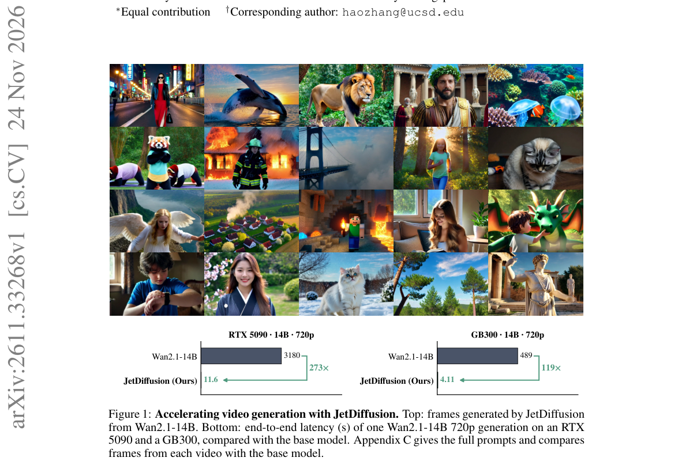

*Result - The NVFP4 gap and its warmup. Left: VBench scores on Wan2.1-1.3B under different training recipes. Right: subsequent training loss at 90% sparsity with different warmup objectives or no warm*

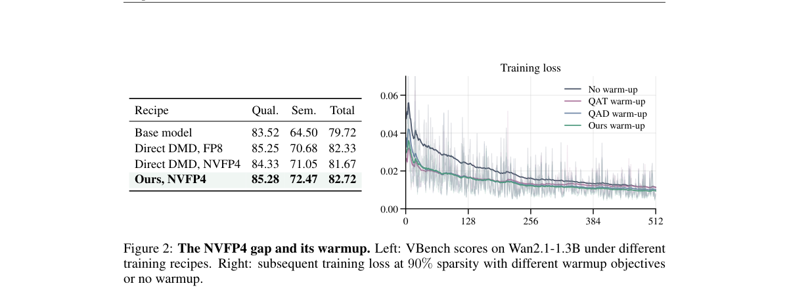

**Why this ranks #5**: 长序列注意力是视频生成主瓶颈：VSQA 在 90% 稀疏度下把注意力加速 8 到 29 倍，再叠加 NVFP4 线性量化与步数蒸馏，Wan2.1-14B 在 RTX 5090 上端到端提速 273 倍而质量相当。

---

### 6. ScanAR: Parallel Row-Scan Decoding for Efficient Image Generation in Unified Autoregressive Models

**arXiv**: [2611.33761](https://arxiv.org/abs/2611.33761) | **Score**: 8.7 (relevance 9 x 0.7 + quality 8 x 0.3) | **Direction**: `aigc_generation` | **Tags**: AIGC-visual, autoregressive-decoding, parallel-decoding, row-scan, unified-multimodal, throughput, Xiaomi Robotics | **Categories**: cs.AI, cs.CV | **Pages**: 27

**Authors**: Jingen Qu; Xi Chen; Yingbo Tang; Xinghang Li; Tao Kong

**Affiliation**: Xiaomi Robotics

**Abstract**

> Unified multimodal autoregressive (AR) models represent text and images in one token sequence and generate all modalities with a shared next-token prediction head. Their image generation, however, decodes an $H\times W$ visual grid token by token in raster order, which takes $HW$ sequential steps and dominates inference time. Existing acceleration methods for visual AR generation either change the tokenizer, the prediction head, or the model interface, or keep the model but cannot reach high parallelism without losing quality, so they do not carry over to unified AR models. We propose ScanAR, a row-scan parallel decoding method that only redefines the predecessors of visual tokens. The first visual row is generated from left to right as usual, and each later row is generated in a single parallel step, with every token predicted from the vertically aligned token of the previous row. Nonvisual tokens keep the standard autoregressive rule. ScanAR reduces the visual decoding depth from $HW$ to $H+W$ without changing the backbone, vocabulary, or output head and without adding parameters, and it supports both training from scratch and lightweight post-training. On Emu3.5-Image-34B, ScanAR post-training reaches a GenEval score of 82.36, the best among post-training acceleration methods trained on the same data, and generates $512\times512$ images $13.8\times$ faster than raster decoding under the same inference setting. On ImageNet, ScanAR trained from scratch has the highest throughput at every model size with FID comparable to raster LlamaGen. On the 34B Xiaomi-Robotics-U0 model, ScanAR preserves the overall quality of embodied scene generation, interleaved image-text generation, and video generation.

**Key findings**

- **Finding**: ScanAR 把视觉解码深度从 HW 降到 H+W，Emu3.5-Image-34B 后训练 GenEval 达 82.36，生成 512×512 图像比光栅解码快 13.8 倍，且不改主干、词表与输出头。
- **Inference**: 同一行内各 token 的预测在给定前驱后基本独立，因此按行并行不需要新增可学习模块，天然兼容统一多模态自回归模型。
- **Recommendation**: 加速统一多模态模型时优先尝试只改解码顺序的轻量后训练，保持主干与输出头不变以便与原模型直接对齐比较。

**Key figures**

*Framework - Qualitative results of ScanAR across diverse generation tasks, including text-to-image generation, image editing, interleaved image-text generation, and video generation.*

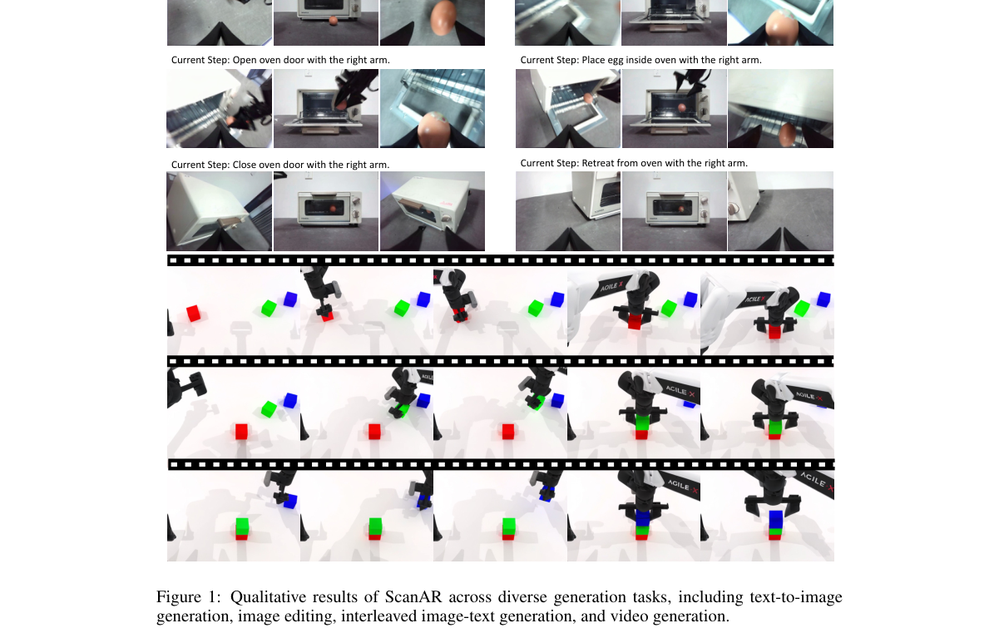

*Result - Comparison of five different AR decoding methods. ScanAR uses a concise row-scan design that remains compatible with multimodal AR generation.*

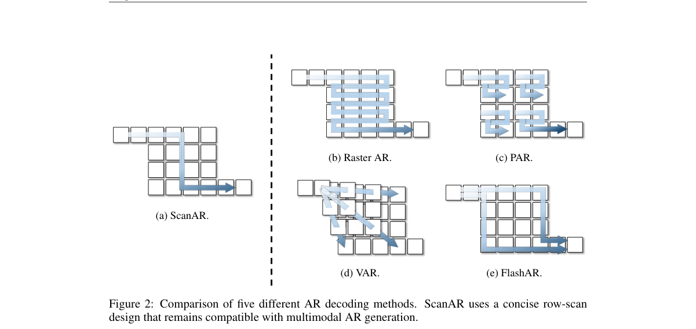

**Why this ranks #6**: 统一自回归模型逐 token 光栅解码吃掉了大部分推理时间：ScanAR 只重定义视觉 token 的前驱关系，把视觉解码深度从 HW 降到 H+W，Emu3.5-Image-34B 上后训练 GenEval 达 82.36，出 512×512 图快 13.8 倍。

---

### 7. Exploring the Design Factors of Pixel-space Diffusion

**arXiv**: [2611.34093](https://arxiv.org/abs/2611.34093) | **Score**: 8.7 (relevance 9 x 0.7 + quality 8 x 0.3) | **Direction**: `aigc_generation` | **Tags**: AIGC-visual, pixel-space, channel-bottleneck, u-shaped-architecture, representation-dynamics, frequency-equivalence, Utrecht University | **Categories**: cs.CV, cs.LG | **Pages**: 20

**Authors**: Mang Ning; Le Zhang; Albert Ali Salah; Itir Onal Ertugrul; Jintao Zhang

**Affiliation**: Utrecht University; Mila - Quebec AI Institute; Tsinghua University

**Abstract**

> In this paper, we introduce EiT by exploring the key design factors of pixel-space diffusion from three perspectives: model architecture, representation, and frequency domain. Inspired by Denoising Autoencoders (DAE) which perform denoising through a bottleneck, we construct a U-shaped pixel diffusion transformer that performs explicit compression along the channel dimension. In terms of representation, we find that both pixel and latent diffusion transformers exhibit a three-stage representation dynamics across layers and timesteps: denoising/local feature expansion, basis lift-up, and posterior projection. Moreover, earlier denoising and a longer basis lift-up stage are associated with better generation, which EiT naturally achieves through its channel bottleneck and increased network depth. From the frequency perspective, we establish the equivalence between pixel-space and frequency-space diffusion when keeping the network operating in pixel space. On ImageNet $256\times256$ and $512\times512$, EiT consistently outperforms JiT (Just image Transformers) in generation quality. Specifically, our EiT achieves better FID than JiT: 1.61 vs. 1.85 at $256\times256$, and 1.73 vs. 1.99 at $512\times512$. Remarkably, EiT can be seamlessly applied to video pixel diffusion by simply extending the patch size to temporal dimension and outperforms video latent diffusion in FVD evaluated on Kinetics-600 (resolution 256), under comparable total network parameters. Code is available at https://github.com/forever208/EiT

**Key findings**

- **Finding**: EiT 在 ImageNet 256×256 上 FID 为 1.61 优于 JiT 的 1.85，512×512 上 1.73 对 1.99，并在可比参数量下让视频像素扩散的 FVD 优于视频隐扩散。
- **Inference**: 像素与隐空间扩散都呈现去噪、基提升、后验投影三阶段表示动力学，说明瓶颈结构而非单纯数据表示决定最终生成质量。
- **Recommendation**: 设计像素扩散时应保证更早的去噪阶段与更长的基提升阶段，并把加深加宽的通道瓶颈作为首选结构。

**Key figures**

*Framework - Comparison of pixel diffusion Transformer architectures. JiT keeps both the token count N and hidden dimension D fixed. PixelU constructs a spatial bottleneck by merging and splitting tokens*

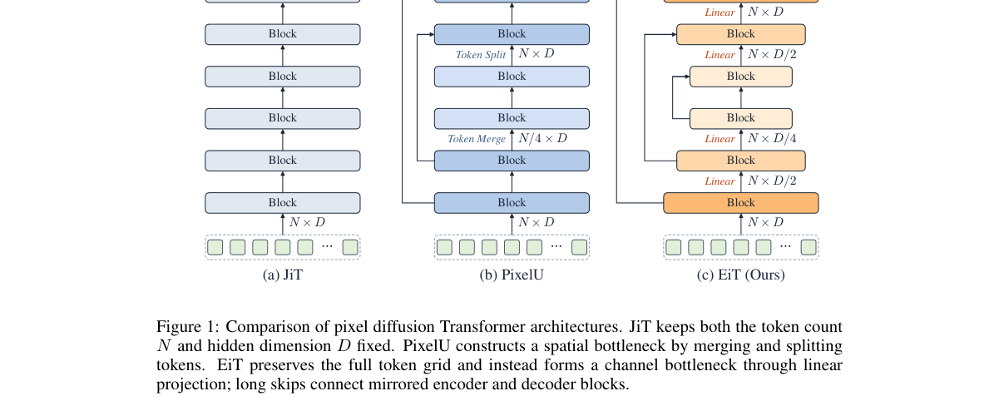

*Result - SPR and Noise Fraction of JiT-B (left) and JiT-L (right) on ImageNet 256×256. Columns follow the network: noisy input (Image), patch embedding (Embed), each Transformer block (L0, L1, . ..),*

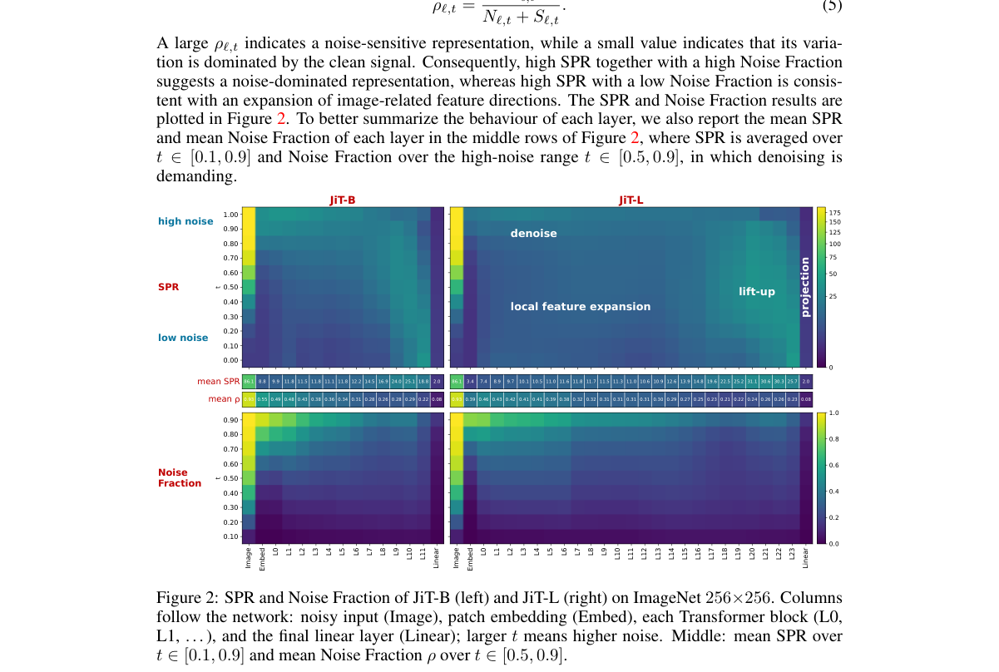

**Why this ranks #7**: 从架构、表示与频域三个角度拆解像素空间扩散：EiT 用 U 形通道瓶颈做显式压缩，ImageNet 256×256 上 FID 1.61 对 JiT 的 1.85，512×512 上 1.73 对 1.99。

---

### 8. Spe3DUp: Faithful Trajectory Distillation for Fast Image-to-3D Generation

**arXiv**: [2611.34141](https://arxiv.org/abs/2611.34141) | **Score**: 8.7 (relevance 9 x 0.7 + quality 8 x 0.3) | **Direction**: `aigc_generation` | **Tags**: AIGC-visual, image-to-3d, trajectory-distillation, coarse-to-fine, mesh-decoding, speedup, Nanjing University | **Categories**: cs.CV | **Pages**: 11

**Authors**: Liangchao Xu; Jiaye Fu; Youtian Lin; Feihu Zhang; Yao Yao

**Affiliation**: Nanjing University; Peking University; Envision

**Abstract**

> Recent 3D generative models can produce high-quality meshes with complex structures and fine geometric details, with broad applications in games, film, and digital design. However, high-quality generation typically relies on long multi-step sampling processes that repeatedly evaluate large networks, leading to long inference times. At the same time, reference-driven tasks such as game-asset reconstruction and product digitization demand close correspondence to the input image: generated geometry must faithfully reconstruct the specific reference object. Acceleration must therefore reduce sampling computation while preserving the model's ability to reconstruct that object. To enable fast and faithful 3D generation, we introduce Spe3DUp, a coarse-to-fine framework based on Faithful Trajectory Distillation (FTD). FTD directly supervises few-step students with the teacher's input-conditioned denoising trajectories to preserve its generation behavior. We apply FTD separately to coarse geometry generation and geometric refinement, compressing both sampling processes while maintaining correspondence to the reference input. We further accelerate the complete mesh-generation pipeline with efficient geometry decoding and parallel remeshing. Experiments show that Spe3DUp maintains geometric quality and input correspondence close to those of the teacher, accelerates the coarse and refinement DiTs by 10.0x and 19.9x, respectively, and achieves a 7.7x end-to-end speedup over the original teacher pipeline.

**Key findings**

- **Finding**: Spe3DUp 把粗几何 DiT 与几何细化 DiT 分别加速 10.0 倍与 19.9 倍，整条网格生成流水线相对教师实现 7.7 倍端到端提速。
- **Inference**: 直接蒸馏教师的输入条件去噪轨迹而不是蒸馏终点样本，才能同时保住参考物体的对应关系与几何质量。
- **Recommendation**: 需要图生 3D 线上加速时优先压缩采样步数，再补高效几何解码与并行重网格化，避免牺牲与参考图的一致性。

**Key figures**

*Framework - Spe3DUp: Faithful Trajectory Distillation for Fast Image-to-3D Generation.*

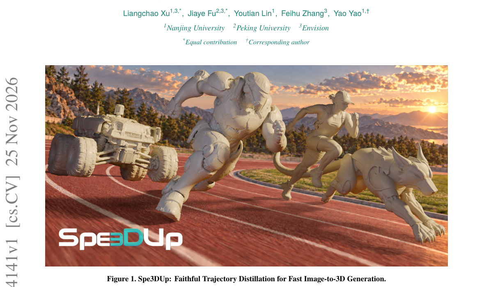

*Result - System acceleration. (a) End-to-end latency breakdown. (b) Mesh simplification time. (c) Coarse and refinement decoding time.*

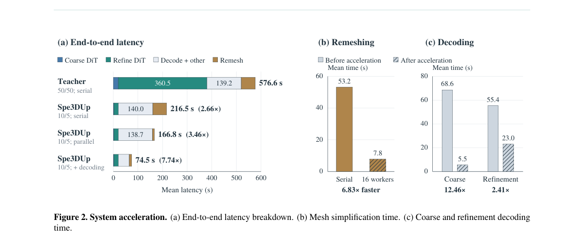

**Why this ranks #8**: 参考驱动的图生 3D 既要快又要忠实：FTD 用教师的输入条件去噪轨迹直接监督少步学生，粗几何 DiT 加速 10.0 倍、几何细化 DiT 加速 19.9 倍，整条网格流水线端到端提速 7.7 倍。

---

### 9. Generation as Reverse Encoding

**arXiv**: [2611.34782](https://arxiv.org/abs/2611.34782) | **Score**: 8.7 (relevance 9 x 0.7 + quality 8 x 0.3) | **Direction**: `aigc_generation` | **Tags**: AIGC-visual, reverse-encoding, frozen-encoder, multi-stage, few-step, imagenet, University of Hong Kong | **Categories**: cs.CV | **Pages**: 14

**Authors**: Cheng Shi; Sibei Yang; Hanzhong Guo; Yipeng Qin; Pietro Lio; Yizhou Yu

**Affiliation**: University of Hong Kong; Sun Yat-sen University; Cardiff University; University of Cambridge

**Abstract**

> Pretrained visual representations accelerate generative learning by abstracting away appearance and spatial detail. Yet the same abstraction makes the return to pixels far harder, shifting much of the burden onto a larger decoder. We ask why the representation-to-pixel path should be learned independently when the encoder already provides a learned pixel-to-semantics path (the semantic encoding path). We introduce RevFlow, based on the principle of generation as reverse encoding. RevFlow uses intermediate representations of a frozen encoder as successive generative targets, first generating deep semantic representations, then shallow representations that retain appearance and spatial detail, before decoding to pixels. To learn these transitions without training a separate generator for each stage, we develop HyC-DiT, a unified generative model with a standard DiT backbone shared across stages and stage-specific condition injection. We further show that native matching in semantic representation space enables few-step generation. RevFlow accelerates both learning and sampling. On ImageNet $256 \times 256$, RevFlow reaches 1.96 FID at 690M and 1.74 FID at 1.55B after only 5 training epochs. It also achieves 30.25 dB reconstruction PSNR with an 89M decoder. After a short native-matching adaptation phase, RevFlow-XL achieves 2.85 FID using a single sampling step in each stage. Our code repository is at https://github.com/ChengShiest/RevFlow

**Key findings**

- **Finding**: RevFlow 在 ImageNet 256×256 上仅 5 个训练 epoch 就达到 690M 的 1.96 FID 与 1.55B 的 1.74 FID，89M 解码器下重建 PSNR 为 30.25 dB。
- **Inference**: 既然编码器已提供像素到语义的现成路径，生成端就不必独立学习整条表示到像素的映射，深到浅逐级生成能显著加速收敛。
- **Recommendation**: 复用预训练视觉表征做生成时，可沿编码器中间层排布多阶段生成目标，再用原生匹配把每个阶段压到一步采样。

**Key figures**

*Framework - RevFlow samples on ImageNet 256×256. Left: learn faster. After only 5 training epochs, RevFlow-H reaches 1.74 FID with 25 sampling steps per stage. Right: generate faster. After native repre*

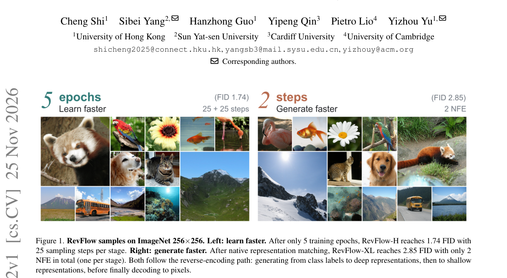

*Result - Reconstruction fidelity, few-step generation, fast convergence, and reverse encoding. Left: ImageNet validation reconstructions from SD-VAE, RAE, and RevFlow, with PSNR in parentheses and de*

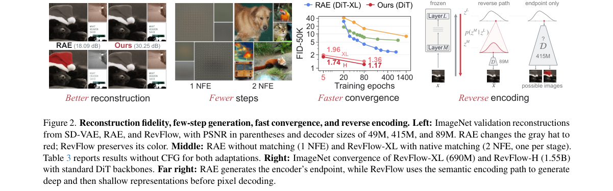

**Why this ranks #9**: 把生成当成编码的逆过程：RevFlow 用冻结编码器的中间表示逐级充当生成目标，ImageNet 256×256 上 690M 模型训 5 个 epoch 即达 FID 1.96、1.55B 达 1.74，原生匹配适配后每阶段单步可达 2.85。

---

### 10. Guidance as Variance Matching

**arXiv**: [2611.34801](https://arxiv.org/abs/2611.34801) | **Score**: 8.3 (relevance 8 x 0.7 + quality 9 x 0.3) | **Direction**: `aigc_generation` | **Tags**: AIGC-visual, guidance-scale, variance-matching, closed-form, posterior-mean, cross-modal, Massachusetts Institute of Technology | **Categories**: cs.CV, cs.LG | **Pages**: 41

**Authors**: Ali Backour; Artem Lukoianov; Frank Permenter; Tommi Jaakkola; Justin Solomon; Vincent Sitzmann

**Affiliation**: Massachusetts Institute of Technology; Toyota Research Institute

**Abstract**

> Guidance repels the prediction of a diffusion model away from a weaker reference prediction. It substantially improves sample quality, but its mechanism remains poorly understood. We first find that, at the scales used in practice, guidance does not improve the prediction of the posterior mean (the model's training target); it makes the prediction worse, while samples improve. Second, posterior-mean predictions have less variance than the data, and we find that guidance restores it. We introduce variance-matched guidance: a closed-form rule that picks the guidance scale by matching the variance of the guided predictions to that of the data. Without tuning, it recovers the hand-picked scales of eleven widely used models across image, video, audio, motion, and world generation; to our knowledge, no previous explanation of guidance predicts them. Applied per noise level, it yields a schedule without tuned hyperparameters that users prefer to hand-crafted ones on SD 3.5 Medium. Third, we offer an interpretation of the mechanism behind guidance: each model makes a random error in predicting the posterior mean, and guidance rescales the difference of these errors into a sample with the posterior's covariance, which improves sampling. This view also suggests two new hypotheses that our experiments support: guidance can work with negative scales, and guiding a model with its own checkpoint needs a larger scale than guiding it with an independently trained model.

**Key findings**

- **Finding**: 方差匹配规则无需调参即可复现十一个常用模型在图像、视频、音频、动作与世界生成上的手调引导尺度，Spearman 相关为 0.96。
- **Inference**: 引导真正的作用是把模型预测后验均值时的随机误差重新缩放到后验协方差上，所以受益的是采样而不是预测精度本身。
- **Recommendation**: 调 CFG 尺度时先试方差匹配给出的闭式值与逐噪声级调度，而不是盲目沿用经验值，并留意负尺度同样可能奏效。

**Key figures**

*Result - Guidance as variance matching, on a two-dimensional example with real trained models. Left: the data, a mixture of ten Gaussians, and one noisy input xt at σ=0.4. (a) The posterior p(x0|xt)*

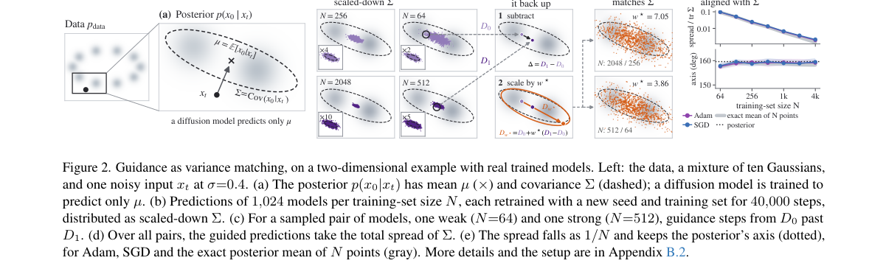

**Why this ranks #10**: 重新解释 CFG：论文发现实际使用的引导尺度会让后验均值预测更差，改成匹配引导后预测与数据的方差即可闭式复现十一个常用模型的手调尺度，Spearman 相关达到 0.96。

---

## AIGC 编辑（指令编辑 / 修补 / 个性化） · `aigc_editing` (4 papers)

4 篇盯的是同一件事：编辑到底有没有真的发生、有没有伤到不该伤的地方。EditText 用双条件 Fill 输入（掩码图 + 源字形风格参考）加 Attention Transport 做细粒度文字编辑，非编辑区 SSIM 0.9769、全图 LPIPS 0.0460；Déjà-VAE 把预训练 VAE 改造成伪可逆网络，使 E'(D'(z))=z 构造性成立，再用自适应小波回投影抑制编辑漂移，全程免训练且重复重建幂等；MYSTIQUE 用随机块掩码、表情自增广与换人三路输入解耦抑制身份泄漏；配对基准用 6500 张照片生成 47747 条三元组，9 个定位器在 27 组比较中有 26 组在语义合理编辑上 IoU 更低，暴露了「看起来合理」这条捷径。

### 11. EditText: Structure-Aware Generation and Selective Visual Transport for Fine-Grained Text Editing

**arXiv**: [2611.32134](https://arxiv.org/abs/2611.32134) | **Score**: 8.0 (relevance 8 x 0.7 + quality 8 x 0.3) | **Direction**: `aigc_editing` | **Tags**: AIGC-visual, text-editing, attention-transport, dual-condition, glyph-loss, tbench, University of Science and Technology of | **Categories**: cs.CV | **Pages**: 26

**Authors**: Zhaobin Chu; Guandong Li; Xin Lv; Zhiwei Zeng

**Affiliation**: University of Science and Technology of China; iFlytek

**Abstract**

> Fine-grained text editing aims to accurately replace text in a specified region while preserving the source text's font, color, and texture, as well as visual consistency in unedited regions. We present EditText, a unified framework for fine-grained text editing that combines target character generation with visual transport from the source image. The model uses dual-condition Fill inputs: a masked image and a source text style reference, both sharing a spatial reference with the target image. The masked image hides the original text and retains unedited content as a source canvas; the style reference supplies appearance cues that guide new character generation together with the target text. We introduce an Attention Transport framework in which Source Weight describes the attention allocated to a condition and the Spatial Aggregation Kernel describes its internal spatial attention distribution. Accurate transfer of source details depends on attention strength, the retention of details in condition features, and spatially accurate aggregation. For selected non-edit queries, we therefore preserve the total attention weight assigned to the masked image while redistributing its attention toward spatially corresponding neighborhoods, enabling selective visual transport. Multi-stage training, combined with a Glyph-aware Structural Loss on local target character structure, teaches the model to generate accurate text, preserve source text appearance, and retain unedited details. We also introduce TBench, a fine-grained text editing benchmark covering Alphabetic, Logographic, and Arabic numerals, to evaluate character updates, appearance preservation, and the preservation of unedited details. On TBench, EditText achieves state-of-the-art non-edit-region SSIM (0.9769) and full-image LPIPS (0.0460).

**Key findings**

- **Finding**: EditText 在 TBench 上取得非编辑区域 SSIM 0.9769 与整图 LPIPS 0.0460，两项均为最好水平。
- **Inference**: 把源图细节通过注意力权重重定向到空间对应的邻域，比整体搬运条件特征更能保持未编辑区域的一致性。
- **Recommendation**: 做局部文字替换时先约束分配给掩码图的注意力总量并只重定向到空间对应邻域，再用字形结构损失单独兜住新字符形状。

**Key figures**

*Framework - Fine-grained text editing across three text categories. From top to bottom, two rows each present Alphabetic, Logographic, and Arabic numerals, for a total of 17 examples. Each pair shows th*

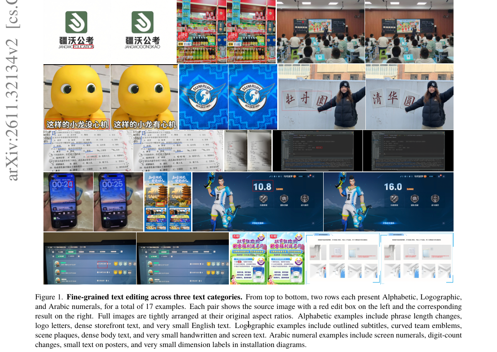

*Result - Text Editing through Generation and Visual Trans- port. Inside the orange dashed box, the model replaces “0000” with “699” in the original lettering style. The green boxes high- light roof a*

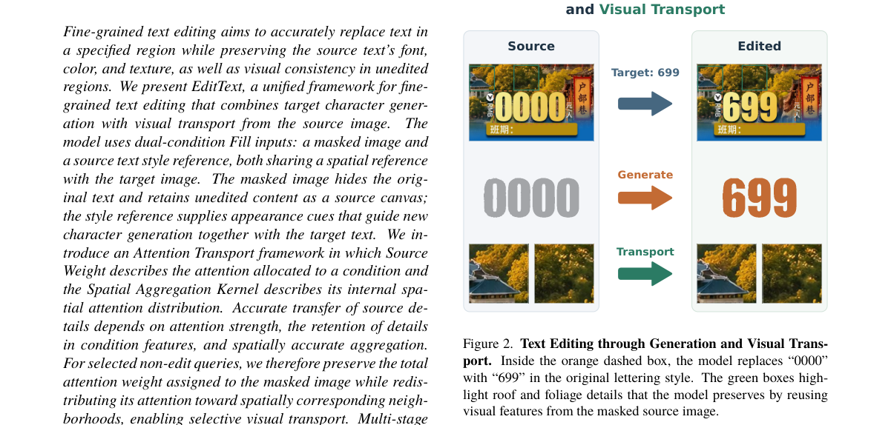

**Why this ranks #11**: 细粒度文字替换要同时保住字体、颜色与未编辑区域：EditText 用双条件 Fill 输入配合注意力迁移框架，在覆盖字母、文字与阿拉伯数字的 TBench 上取得非编辑区 SSIM 0.9769、整图 LPIPS 0.0460。

---

### 12. MYSTIQUE: Few-Shot Facial Identity Transfer with Performance Preservation

**arXiv**: [2611.32232](https://arxiv.org/abs/2611.32232) | **Score**: 8.0 (relevance 8 x 0.7 + quality 8 x 0.3) | **Direction**: `aigc_editing` | **Tags**: AIGC-visual, identity-transfer, few-shot, disentanglement, face-shape, leakage, Vanderbilt University | **Categories**: cs.CV, cs.GR, cs.LG | **Pages**: 43

**Authors**: Shihan Cheng; David Hyde; Junting Deng; Michael Bao; Paul Debevec; Roshni Cooper; Soshi Shimada

**Affiliation**: Vanderbilt University; Carnegie Mellon University; Netflix

**Abstract**

> In visual effects, identity transfer replaces the identity in a driving image with that of a target person, while preserving the expression, lighting, pose and scene of that image. Paired ground truth is rarely available, so many methods are trained by self-reconstruction, where the model can learn a shortcut by copying identity cues from the driving image. This shortcut causes identity leakage at inference, where the driving image shows a different person. Our key observation is that leakage can enter through any input that reads the driving image. We therefore present MYSTIQUE, a diffusion-based identity transfer method that takes identity from a set of the target's photos and reads expression, lighting and scene through separate streams. It learns to disentangle identity from the other streams through multi-stage training, with disentanglement strategies at their inputs: a random block mask whose boundaries do not follow the face outline, self-augmentation, which randomly changes the face shape in the expression input and keeps its expression, and face randomization, which replaces the person in the expression and lighting inputs while the ground truth stays the driving image. At inference, we also warp the lighting input onto the face shape of a first pass, which reduces face-shape leakage through the lighting stream. Since face-recognition scores and human judgments each have limits, we evaluate identity with both, together with face-shape metrics on rendered faces of known shape. In a user study, raters judge MYSTIQUE's results more like the target than those of each compared method. Among these methods, MYSTIQUE also recovers the target's face shape most accurately, and its recognition score gains the most as more photos of the target are given.

**Key findings**

- **Finding**: MYSTIQUE 在 240 对身份基准上 ArcFace 得分 0.601（真人照片为 0.677），348 对形状基准上下颌线距离 0.083、泄漏率 0.34、3D 误差 1.35，三项均为最好。
- **Inference**: 身份泄漏会经任何读取驱动图的输入回流，因此必须同时切断形状掩码、表情流与光照流，而不是只改其中一路。
- **Recommendation**: 评估少样本换脸时把脸型指标与人评一起看，ArcFace 单项会偏爱那些保留了驱动图下颌线的结果。

**Key figures**

*Framework - Identity transfer with MYSTIQUE. MYSTIQUE takes the identity from the target’s photos and keeps the expression, lighting and occluders of the driving image. Users can also edit the image dur*

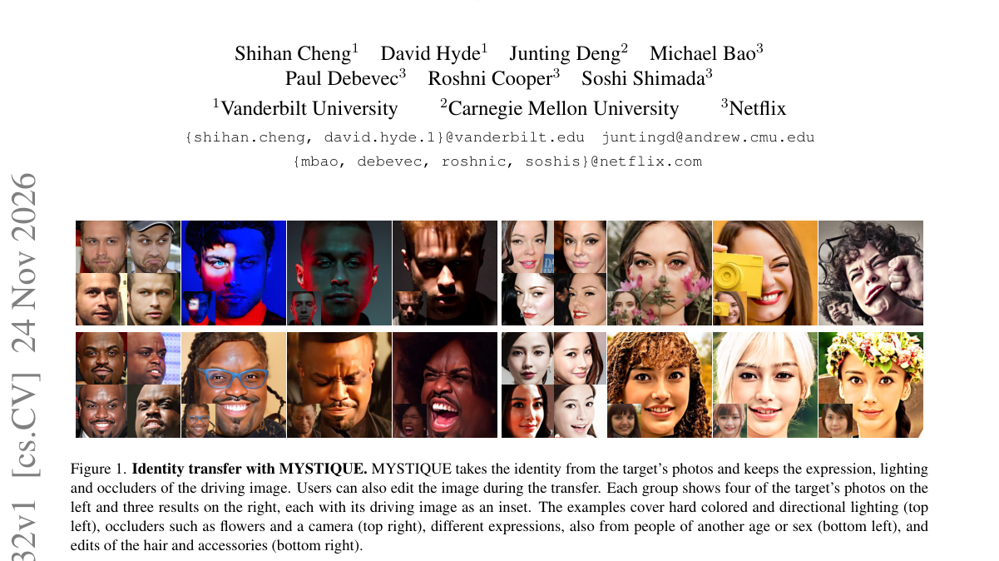

*Result - Training in three stages. Stage 1 learns an identity representation from photos of a person; its second step, through the frozen transformer, is not drawn. Stage 2 learns identity transfer w*

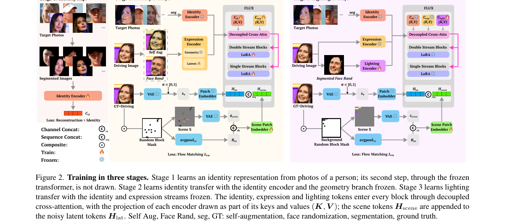

**Why this ranks #12**: 自重建训练会让模型从驱动图偷拷身份线索：MYSTIQUE 把身份、表情与光照拆成独立流，配三阶段训练与两遍推理，ArcFace 达 0.601、下颌线距离 0.083、泄漏率 0.34，各项均优于对比方法。

---

### 13. Can You Find the Edit When Nothing Looks Wrong? A Paired Benchmark for Text-Driven Image Manipulation Localization Beyond Semantic Abnormality

**arXiv**: [2611.32242](https://arxiv.org/abs/2611.32242) | **Score**: 8.0 (relevance 8 x 0.7 + quality 8 x 0.3) | **Direction**: `aigc_editing` | **Tags**: AIGC-visual, localization-benchmark, semantic-plausibility, bilingual, paired-data, shortcut, Shenzhen Campus of Sun Yat-sen University | **Categories**: cs.CV | **Pages**: 21

**Authors**: Peiyu Zhuang; Jianquan Yang; Zhuoying Cai; Yi Jiang; Yingquan Chen; Xinle Wang; Zeqin Yu; Dongdong Lin; Ruitao Xie; Kaige Li; Xiaochun Cao

**Affiliation**: Shenzhen Campus of Sun Yat-sen University; Huaqiao University; Shenzhen University of Advanced Technology

**Abstract**

> Instruction-driven image editing can alter a photograph while keeping the result coherent with the scene. Existing benchmarks lack matched plausible and anomalous edits of the same target, making it difficult to measure how localization performance changes with semantic plausibility. We construct a paired benchmark by generating semantically plausible and anomalous replacements of the same target in each source photograph. Both edits use the same editor, language, and generation settings. We estimate a separate mask for each output and retain pairs with sufficient mask overlap, enabling direct comparison of localization performance under the two semantic conditions. The release contains 47,747 bilingual triplets from 6,500 photographs, spanning four editors, three source domains, and six intended violation types. Across nine public localizers, editor-averaged IoU is lower on plausible edits in 26 of 27 model-dataset comparisons. This gap persists under pixel-change controls and region-size analyses. These findings reveal a semantic-plausibility shortcut: localization often weakens when an edited result looks ordinary. The benchmark provides a controlled setting for measuring this gap and developing localizers that remain effective on plausible edits.

**Key findings**

- **Finding**: PAPE 含 6500 张照片与 47747 条双语三元组，覆盖四个编辑器、三类来源域与六种违规类型；九个定位器在 27 组对比中有 26 组在语义合理编辑上 IoU 更低。
- **Inference**: 当编辑结果看起来普通时定位器更容易失效，说明模型走的是语义合理性捷径而不是真正定位被改动的像素。
- **Recommendation**: 评估编辑定位能力时必须把合理与异常两类条件拆开分别报告，否则聚合准确率会掩盖捷径带来的风险。

**Key figures**

*Result - Two-stage pair construction. Stage A generates bilingual replacements of a shared target and checks instruction structure. Stage B applies each language’s unchanged prompt pair to all four e*

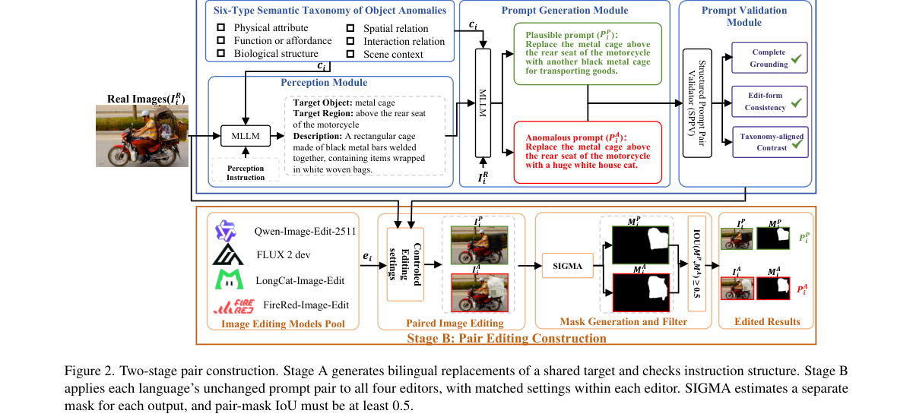

**Why this ranks #13**: 现有基准缺少同一目标的看似合理与明显异常的配对编辑：PAPE 用 6500 张照片构造 47747 条双语三元组，九个公开定位器在 27 组模型与数据集对比中有 26 组在合理编辑上 IoU 更低。

---

### 14. Déjà-VAE: Training-Free Consistent Editing with Pseudo-Invertible Encoders and Latent Back-Projection

**arXiv**: [2611.32501](https://arxiv.org/abs/2611.32501) | **Score**: 8.0 (relevance 8 x 0.7 + quality 8 x 0.3) | **Direction**: `aigc_editing` | **Tags**: AIGC-visual, training-free, consistency, wavelet-back-projection, vae-codec, multi-turn, Technion – Israel Institute of Technology | **Categories**: cs.CV | **Pages**: 24

**Authors**: Ron Libman; Yamit Ehrlich; Ohad Fried; Assaf Shocher

**Affiliation**: Technion – Israel Institute of Technology; Reichman University

**Abstract**

> Consistency is essential to generative workflows: repeated processing should preserve information beyond the changes explicitly requested. In latent diffusion models, this requires stability both when moving between latent and pixel spaces and when applying successive edits. Autoencoding errors and unintended changes from the editing model can accumulate across these operations, progressively altering image structure, texture, and color. We introduce Déjà-VAE, a framework that combines exact autoencoding consistency with calibrated editing stabilization, without training or fine-tuning. Its autoencoding component converts a pretrained variational autoencoder into a surjective pseudo-invertible neural network, with a fixed gain balancing deviations from the pretrained encoder and decoder. The modified decoder $D'$ is an explicit nonlinear right inverse of the encoder $E'$, satisfying $E'(D'(z))=z$ by construction. Consequently, $D'$ is a reflexive generalized inverse: latent round trips preserve their input, up to numerical precision, and repeated image reconstruction is idempotent. To suppress editing drift, adaptive wavelet back-projection finds the closest latent to the editor's output in $\ell_2$, subject to matching the previous latent on wavelet coefficients whose changes fall below calibrated thresholds. This correction is applied once per turn, with no additional network evaluations after calibration. Together, these components support workflows that remain in latent space or interleave generation with pixel-space operations and constraints. Tests across models and editing benchmarks show less drift than stock pipelines and dedicated consistency methods.

**Key findings**

- **Finding**: 该编解码器相对预训练编解码器的编码偏差为 1.3 到 5.9%、解码输出在 42 到 46 dB PSNR 上一致，25 轮 8-bit 往返后仍达 28.34 dB 与 0.07 LPIPS，原始 VAE 只有 20.93 dB 与 0.25。
- **Inference**: 精确往返只能消除自编码误差，编辑器自身的漂移必须靠意图编辑强而局部、漂移弱而弥散的差异在频域上分离来抑制。
- **Recommendation**: 需要多轮一致性时，先把预训练 VAE 换成伪可逆包装，再按各频带标定阈值做每轮一次反投影，无需重训编辑器。

**Key figures**

*Framework - Stable repeated processing without training. Top, left to right: one edit/undo chain (each edit and the final undo shown), encode–decode cycles, and no-op edits. Bottom left: PasteBench with*

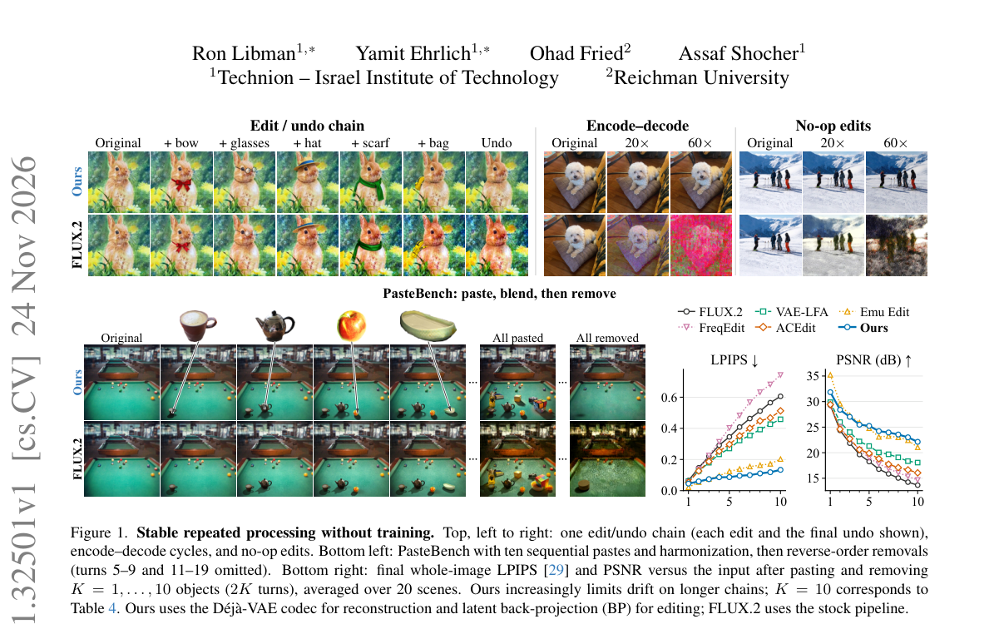

*Result - The Déjà-VAE codec. PCA separates reserved and retained coordinates. Zero-filling and inverse PCA recover the retained image. Decoding keeps the retained coordinates ˆx1 of D(z) and replaces*

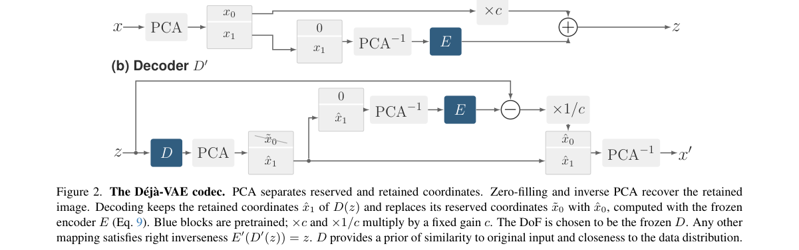

**Why this ranks #14**: 多轮编辑会把自编码误差与编辑器漂移叠加：Déjà-VAE 用伪可逆编解码器实现精确潜变量往返，相对编码偏差仅 1.3 到 5.9%，再用自适应小波反投影每轮纠偏一次，全程不训练不微调。

---

## 面向视觉生成的 RL 与奖励模型 · `aigc_rl` (4 papers)

4 篇里两篇在追问「RL 到底值不值」，两篇在解决「视频太贵没法直接上 RL」。Best-of-N 对比那篇在 398 条 GenEval 风格提示上量化兑换率：位置类提示一个人看 8 张基座图只有 52% 正确，而一张 RL 图就达 92%，整体 best-of-16 仍落后 9.3 分；Flow-GRPO 技能拆解那篇把 SD3.5-M 的 GenEval 从 0.63 提到 0.95，但按技能看，四类属锐化（一个 RL 样本只值 4 到 10 个基座样本），空间关系才是解锁，128 个基座样本仍不及一个 RL 样本；Agentic LongLive 用异步 agent 记忆配经 RL 训练的小语言模型决定记什么，主角一致性与重访地点一致性分别涨 44.9 与 40.4 点，8 卡 B200 上跑到 34.3 FPS；PromptSMC 则用 LLM 动态改写提示做 SMC 粒子探索，再用预训练奖励模型打分重采样。

### 15. How Many Samples Is RL Worth? Best-of-N versus RL Post-Training for Text-to-Image Models

**arXiv**: [2611.33232](https://arxiv.org/abs/2611.33232) | **Score**: 9.0 (relevance 9 x 0.7 + quality 9 x 0.3) | **Direction**: `aigc_rl` | **Tags**: AIGC-visual, best-of-n, flow-grpo, human-evaluation, exchange-rate, reward-hacking, Bosch Research India | **Categories**: cs.AI, cs.CV, cs.LG | **Pages**: 38

**Authors**: Salil Bhatnagar

**Affiliation**: Bosch Research India

**Abstract**

> Reinforcement learning (RL) on a reward that can be checked automatically has become a common last step in the training of text-to-image models. A simpler way to get more correct images is best-of-N: draw N images from the base model and keep the one that a picker prefers. We ask how many base model samples one RL sample is worth, and call this number the exchange rate. We measure it for Stable Diffusion 3.5 Medium and its public Flow-GRPO checkpoint on 398 new prompts in the style of GenEval, the benchmark behind the RL reward, with human labels on every prompt and two automatic judges other than the reward. The answer depends on the prompt. Four fifths of the prompts do not ask for a position (for example, one object left of another). On these, the base model catches up: best-of-16 with an off-the-shelf vision-language model (VLM) as the picker is about as good as one RL image. A person who looks through up to 3 base images finds a correct one as often as one RL image is correct. On the prompts that ask for a position, RL is far ahead: a person finds a correct image among 8 base images for only 52% of the prompts, against 92% for one RL image. Over all prompts, our primary test, which we fixed in advance, finds best-of-16 with the VLM picker 9.3 points behind one RL image when both automatic judges must pass an image. People see a smaller gap, 5.5 and 6.5 points in two checks. FLUX.1-dev shows a similar gap in the same test. RL also solves 20 prompts that the base model misses in 128 tries, and 1,024 tries recover half of them. The automatic judges are wrong in opposite directions: a detector-based judge like the reward, as used in our primary test, reports a larger gap than people see, and VLM judges report little or none. Comparisons of RL with best-of-N should therefore check the selected images by hand.

**Key findings**

- **Finding**: 预先固定的主检验中，best-of-16 配 VLM 挑选器比 1 张 RL 图落后 9.3 个百分点，而两次人工复核只看到 5.5 与 6.5 个百分点的差距。
- **Inference**: 检测器型评委与 VLM 评委在两个方向上都会出错，自动指标会放大 RL 与 best-of-N 的差距，因此两者必须配合人工核对。
- **Recommendation**: 决定是否上 RL 之前，先用与训练奖励不同的判据人工抽查若干条，再把 best-of-N 需要的基线样本数折算进成本后比较。

**Key figures**

*Framework - One RL image against best-of-N of the base model, on 398 test prompts. (a) Share of correct images when the base model draws N images per prompt and a picker keeps one. With a perfect picker*

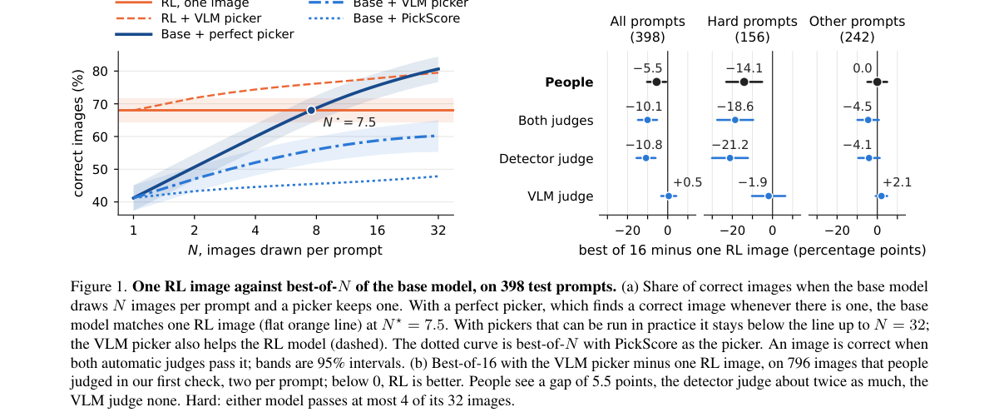

*Result - A person looks for a correct image among N base images. Blue: share of prompts for which at least one of the first N base images is correct, as judged by a person. Orange: share of prompts f*

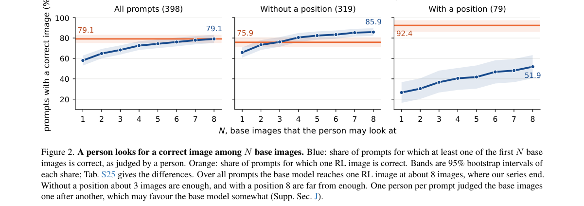

**Why this ranks #15**: 给 RL 后训练定一个汇率：在 398 条 GenEval 风格提示上，位置类提示里人看 8 张基线图的正确率仅 52%，而 1 张 RL 图达 92%；非位置类提示上 best-of-16 已基本追平。

---

### 16. What Does RL Post-Training Teach Text-to-Image Models? A Skill-Wise Analysis of Flow-GRPO

**arXiv**: [2611.33316](https://arxiv.org/abs/2611.33316) | **Score**: 9.0 (relevance 9 x 0.7 + quality 9 x 0.3) | **Direction**: `aigc_rl` | **Tags**: AIGC-visual, flow-grpo, pass-at-k, skill-decomposition, sharpening, unlocking, North Carolina State University | **Categories**: cs.CV, cs.LG | **Pages**: 19

**Authors**: Cheng Zhang; Jiesong Liu

**Affiliation**: North Carolina State University; Purdue University

**Abstract**

> Reinforcement learning (RL) post-training has become a standard way to improve text-to-image flow models: Flow-GRPO lifts the GenEval score of SD3.5-M from 0.63 to 0.95, a gain read as the model having learned compositional generation. We ask how much of that gain the base model's own samples already contained, by measuring pass@k over shared noise seeds, one skill at a time, before and after RL, on prompts never used in training. The answer differs by skill. On four of GenEval's six skills, where 32 base samples already solve almost every prompt, the gain is sharpening: one post-trained sample is worth 4 to 10 base samples, and pass@32 barely moves. On spatial relations it is unlocking: pass@32 rises from 0.69 to 1.00, 128 base samples do not match one post-trained sample, and prompts the base model never solved in 32 samples are solved 93% of the time, as often as those it solved. The benchmark average, 31 base samples per post-trained sample, describes no skill. Relations carry 35% of the gain; of the other 65%, selecting among 8 base samples with the judge behind the reward recovers nine tenths. We propose an account of when each occurs: within a prompt, a group-relative update re-weights only the outcomes its samples contain, and a flow policy cannot widen the noise that produces them; across prompts, shared parameters let successes on some prompts repair a deficit common to many. The same anatomy applies to a text-rendering checkpoint. The account's predictions are tested with a checkpoint trained without KL, within-prompt diversity, and controlled training that holds object classes out, where sharpening comes first and transfers, and unlocking follows, on practised objects before unseen ones.

**Key findings**

- **Finding**: 在 553 条提示、共享噪声种子、n=32 的测量下，GenEval 六项技能中四项的 pass@32 几乎不动，1 张后训练样本只值 4 到 10 张基线样本；空间关系项 pass@32 从 0.69 升到 1.00，128 张基线样本仍不如 1 张后训练样本。
- **Inference**: 组相对更新只能在提示内部重加权已有结果、无法拓宽噪声覆盖，所以锐化有天然上限，真正的解锁必须靠共享参数跨提示迁移。
- **Recommendation**: 评估 RL 后训练时按技能分别报告 pass@k，并区分锐化与解锁，否则基准均值会给出已经学会组合生成的错误结论。

**Key figures**

*Framework - Three prompts, three models, four shared seeds. Counts are verdicts of the GenEval judge over 32 seeds. Top: a spatial relation the base model never draws in 32 samples is unlocked by RL. Mi*

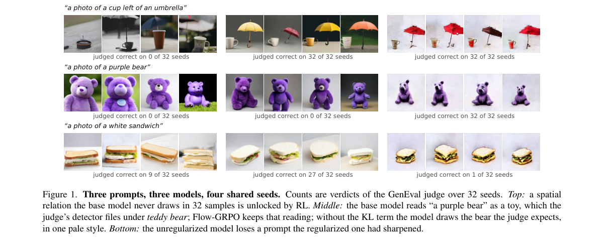

*Result - Two shapes. pass@k over seeds for the base model and the Flow-GRPO checkpoint, per GenEval skill (553 prompts, n=32, shared seeds). Dotted lines mark k∗. Four skills: the curves meet by k=32*

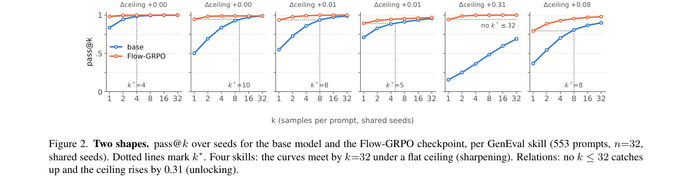

**Why this ranks #16**: Flow-GRPO 把 SD3.5-M 的 GenEval 从 0.63 抬到 0.95，但按技能拆开看：六项中四项只是锐化，1 张后训练样本只值 4 到 10 张基线样本；只有空间关系是解锁，pass@32 从 0.69 升到 1.00。

---

### 17. Agentic LongLive: Asynchronous Agentic Memory for Long Video Generation

**arXiv**: [2611.34907](https://arxiv.org/abs/2611.34907) | **Score**: 8.7 (relevance 9 x 0.7 + quality 8 x 0.3) | **Direction**: `aigc_rl` | **Tags**: AIGC-visual, long-video, agentic-memory, rl-planner, streaming-generation, consistency, NVIDIA | **Categories**: cs.CV | **Pages**: 28

**Authors**: Shaoteng Liu; Shuai Yang; Wei Huang; Luozhou Wang; Song Han; Yukang Chen

**Affiliation**: NVIDIA; MIT; CUHK

**Abstract**

> Real-time autoregressive video generators stream minutes of video and accept new prompts on the fly, but struggle to keep people, objects, and places consistent over a long interactive story. Agent systems provide such memory for offline multi-shot generation, yet they read the whole script in advance, plan each shot before generating it, and regenerate failed shots, which a live stream does not allow. We present Agentic LongLive, an asynchronous agentic memory for long video generation. A memory agent on separate GPUs reads only the prompts revealed so far, never the generated video, and keeps a text state and evolving images for every person, object, and scene. From this entity memory it composes a global image and a per-shot memory image, which an auxiliary GPU prefills into the generator's attention sink before the next shot starts, and writes entity cards for the prompts that name them, so the video never waits for memory and video errors are not written back. A small language model, trained with reinforcement learning and an image reward calibrated using downstream video outcomes, decides what to remember before the next prompt is known. On LongStory-Online, a new benchmark of 25 stories (857 shots) revealed one shot at a time, Agentic LongLive improves persistent-state accuracy of LongLive-2.0, its base generator, by 26.3 points, protagonist identity by 44.9, and revisited-place consistency by 40.4, at about 1% extra generation time on H100. The full system streams faster than real time on one 8xB200 node with the generator in BF16 (34.3 FPS), keeps image quality stable over 14-minute stories, and improves identity on two MiniMax-H3 generators, one of which, LongLive-H3, also runs in real time with it. To our knowledge, it is the first real-time video generator with text and image memory kept by an LLM agent.

**Key findings**

- **Finding**: 在 25 个故事、857 个镜头的 LongStory-Online 上，状态准确率相对 LongLive-2.0 提升 26.3 分、回访地点一致性从 15.0% 升到 55.4%，而额外生成时间只有约 1%。
- **Inference**: 记忆代理只读提示、不看已生成视频且与生成并行，因此既不引入等待也不需要重生成，这是实时流式约束下唯一可行的记忆组织方式。
- **Recommendation**: 复现实时长视频一致性时，先把记忆写入与渲染彻底分离并异步执行，再用强化学习规划器决定存什么，可避免视频被记忆阻塞。

**Key figures**

*Framework - Agentic LongLive keeps a live story consistent in real time. Left: a live 40-shot story (assembling a graphics card) during shot 14. Each prompt is revealed only when its shot starts, and th*

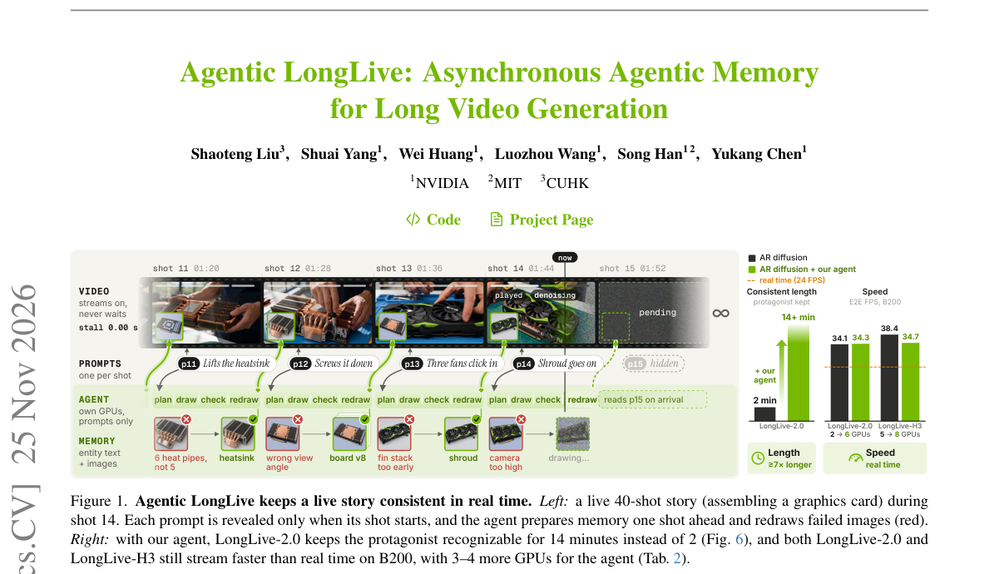

*Result - System overview: one shot of LongLive-2.0 on six H100s (agent steps to scale, decoding schematic). While shot i−1 is generated, the agent prepares the memory for shot i. Version 0 of Mi is p*

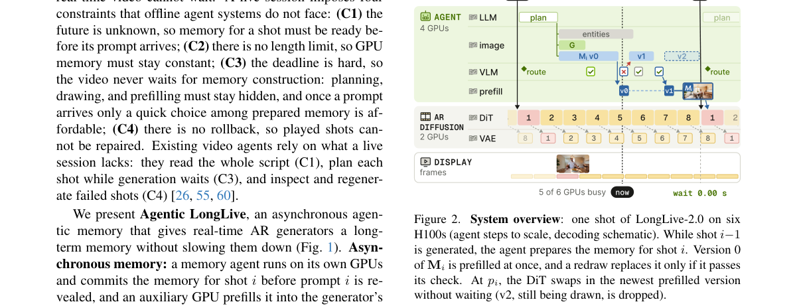

**Why this ranks #17**: 实时长视频缺少能边播边记的长期记忆：Agentic LongLive 让记忆代理在独立 GPU 上只读已披露的提示，LongStory-Online 的 25 个故事、857 个镜头上状态一致性提升 26.3 分、主角身份提升 44.9 分，额外生成时间仅约 1%。

---

### 18. PromptSMC: Enabling Particle Exploration in Flow Matching via LLM-Based Prompt Rejuvenation

**arXiv**: [2611.31471](https://arxiv.org/abs/2611.31471) | **Score**: 8.0 (relevance 8 x 0.7 + quality 8 x 0.3) | **Direction**: `aigc_rl` | **Tags**: AIGC-visual, sequential-monte-carlo, prompt-rewriting, inference-time-scaling, reward-guided, flow-matching, Uppsala University | **Categories**: cs.CV | **Pages**: 21

**Authors**: Wenyi Lian; Zheng Zhao; Thomas B. Schön

**Affiliation**: Uppsala University; Linköping University

**Abstract**

> This paper is concerned with prompt-image alignment at inference time through exploration of generative trajectories and dynamical prompt rejuvenation. We leverage sequential Monte Carlo (SMC), to offer a gradient-free and principled framework for this purpose through reward-guided trajectory selection. More specifically, we introduce LLM-based prompt rejuvenation, allowing for efficient particle exploration in SMC samplers along the diffusion time in flow matching models. The proposed method, PromptSMC, retains the selected latent states and uses a pretrained LLM to dynamically revise the prompts of duplicated particles under semantic-preservation constraints. These revised prompts induce alternative conditional velocity fields, allowing particles to explore different continuations from a shared intermediate state. The method further uses a reward model to evaluate each particle's alignment with the original prompt, and the resulting scores guide particles through resampling. PromptSMC thus integrates prompt-based exploration with reward-guided sampling, achieving faithful prompt-image alignment without additional noise injection, model training, or reward gradients. Our experiments and ablation studies across multiple benchmarks and backbones demonstrate the effectiveness of the method for text-to-image flow matching. Code is available at https://github.com/shermanlian/PromptSMC.

**Key findings**

- **Finding**: 在 SD3、FLUX.1-dev 与 Z-Image 三个骨干上，PromptSMC 的 GenEval 分别为 0.7899、0.7699 与 0.8358，均高于对应的 vanilla 与标准 SMC；代价是每提示 23.29 秒与 54.34 GB 显存，vanilla 为 14.10 秒与 35.01 GB。
- **Inference**: 改写提示能在不扰动潜状态的前提下改变条件速度场，让复制粒子真正分叉，这正是确定性采样下恢复探索能力的低成本途径。
- **Recommendation**: 推理时扩展请把改写间隔设为 5 步而不是每步都改写，并在指令里锁住物体、计数、颜色与空间关系，这类约束改写能把重复率压到 5.12%。

**Key figures**

*Framework - We introduce PromptSMC, an inference-time scaling approach merging sequential Monte Carlo (SMC) and LLM-based prompt rejuvenation for text-to-image flow matching. By revising prompts during*

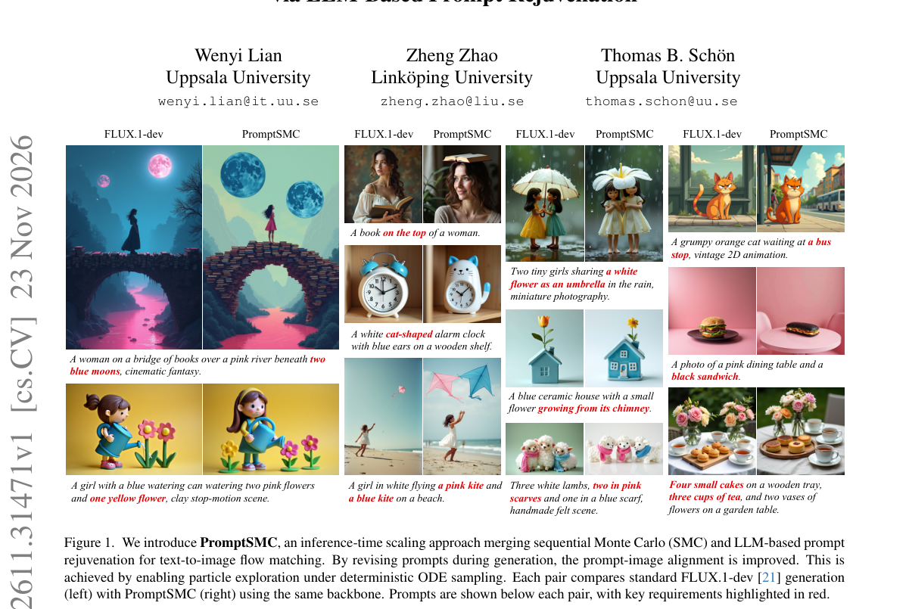

*Result - Prompt perturbation leads to different results. Each row represents images generated from the same latent noise. The same pretrained LLM [1] is used for prompt rewriting.*

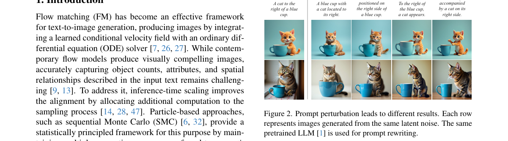

**Why this ranks #18**: 确定性 ODE 下复制粒子只会得到同一条轨迹：PromptSMC 用 LLM 改写复制粒子的提示以制造分支，再按奖励模型给出的 exp(λr) 权重重采样，SD3 上 GenEval 从 0.7214 提到 0.7899。

---

## Footer

- Total papers reviewed across all 4 axes: 60
- aigc_visual axis final count: 18
- Wild-cards in this axis: 0
- Figure assets: 2026-11-27/res/

Generated by `mine-arxiv-daily-digest` skill. Sister file: `2026-11-27_aigc_visual_entry.md`.
