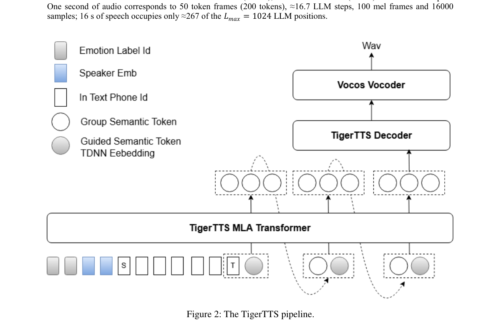
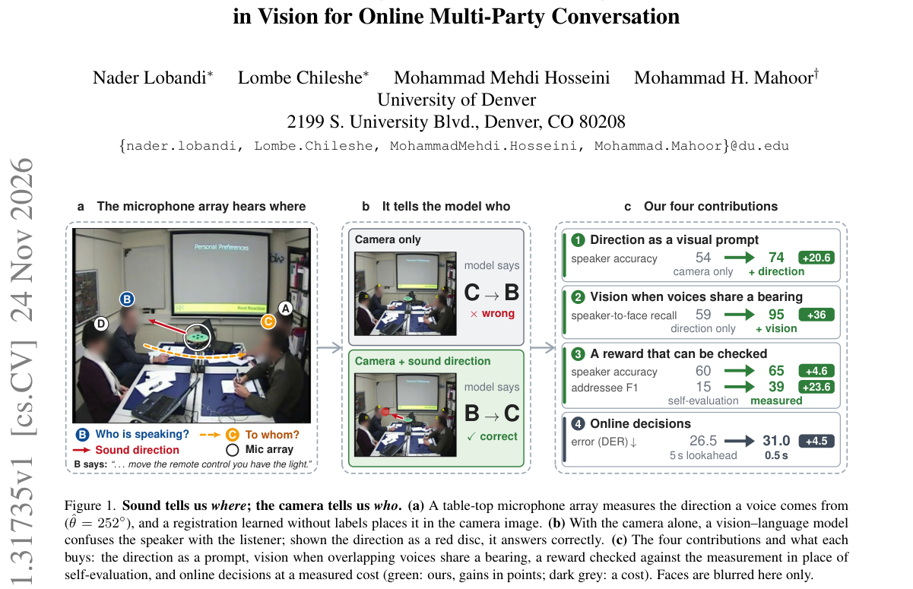
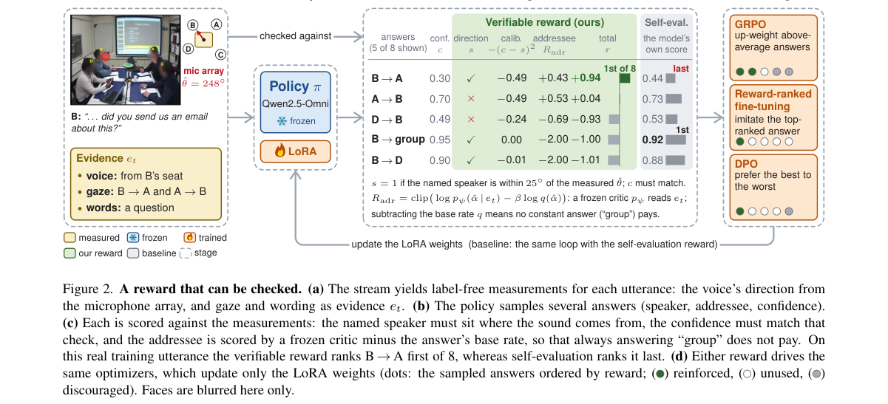

# Mine Arxiv Daily Digest - 2026-11-27 (全双工语音与语音 LM Axis, 2 papers)

**Generated**: 2026-11-27 01:51:48 CST

**Source**: arXiv cs.CV, cs.SD, eess.AS, cs.CL, cs.AI, cs.RO, cs.LG, cs.IR submissions, listing day 2026-11-25 (announced listing 11-25 于 2026-11-26 01:00 UTC 公告)

**Batch window**: 2026-11-24T19:00:00Z .. 2026-11-25T19:00:00Z（arXiv 公告批次窗口按 listing 日逐段相接：每段的起点是前一日的美东 14:00 截止时刻（EDT 为 18:00Z，EST 为 19:00Z），终点是当日同一时刻）

**Axis**: duplex_speech (2 papers, base 12, cap 20)

**Directions**: duplex_speech_core (1), speech_rl (1)

**Selection**: 2 papers ranked by relevance x quality, with 0 wild-card slots

**Day total**: 60 papers across 4 axes (target 60)

**Scope**: 全双工 / 实时 / 流式语音语言模型、speech-to-speech 语音助手、TTS / 语音克隆 / 语音转换，以及语音大模型的 RL 与奖励模型

**Wild-card**: 0 篇 —— duplex_speech_core 只有 25 篇够格候选（rel≥8 仅 4 篇）、speech_rl 够格候选仅 2 篇，供给本身就不足；按「让出而不是被填充」的口径，缺的 10 个名额让给其他轴，没有一篇靠邻接选题补位。

本轴只有 2 篇 vs 基准 12，缺 10 个名额，是最近几轮里最大的结构性缺口。证据链完整：候选池 1427 篇里 primary 落在 duplex_speech_core 的有 31 篇，够格（rel≥5）25 篇、rel≥8 仅 4 篇；speech_rl 的够格候选只有 2 篇，且已全部入选。这一批 arXiv 里带 RL 的语音 / 音频 / 全双工模型论文本身极少，不是归类漏了，是供给断档；缺的 10 个名额按规则流向 aigc_visual、llm_vlm 与 world_embodied。

---

## 全双工语音与语音 LM · `duplex_speech_core` (1 papers)

本轮只有 1 篇，选的是 TigerTTS：用一个无自回归的轻量 NAR 模型先出草稿，按帧对齐后注入 LLM 输入，0.15B 的 LLM 每步预测 12 个 token、覆盖 3 帧 4 组，FSQ 码本约 1800 bps、KV cache 降 4 倍，RTF 0.05，SEED-Bench 上 CER 1.09、WER 1.67。整条线只谈一件事——把 TTS 的延迟与稳定性一起压住。

### 1. TigerTTS: Draft-Guided Multi-Frame Parallel Speech-Token Language Model for Fast and Robust Text-to-Speech

**arXiv**: [2611.34241](https://arxiv.org/abs/2611.34241) | **Score**: 8.7 (relevance 9 x 0.7 + quality 8 x 0.3) | **Direction**: `duplex_speech_core` | **Tags**: duplex-speech, draft-guidance, parallel-frame-prediction, speech-tokenizer, streaming-tts, cuda-graph, Wiz Holdings Pte. | **Categories**: cs.SD | **Pages**: 11

**Authors**: Dewei Kong

**Affiliation**: Wiz Holdings Pte. Ltd.

**Abstract**

> Autoregressive speech-token language models enable high-quality TTS but suffer from latency growth with sequence length, word omission or repetition without explicit alignment, and fidelity limits from discrete codebooks. We present TigerTTS, a production-grade LLM TTS system built around a lightweight non-autoregressive NAR model. With explicit alignment, the NAR model drafts tokens for the entire utterance, which are refined frame-by-frame by a compact autoregressive LLM. The draft is aligned frame-for-frame with LLM targets and injected at the input, ensuring training-inference consistency. Leveraging its accuracy, the LLM predicts 12 tokens per step across 3 frames and 4 groups, while a conditional-total-correlation bound keeps parallel prediction nearly lossless. We use a codebook-free FSQ tokenizer with four parallel groups and about 1800 bps to avoid codebook collapse. The backbone keeps positional information only in input embeddings, enabling exact MLA weight absorption and a four-fold KV-cache reduction. Decoding uses CUDA Graphs with a graph-safe multinomial sampler. A Fast mode further reduces first-packet latency: the NAR generator acts as a prefix synthesizer with RTF 0.03, producing the first 500 ms before LLM decoding. With CUDA-Graph decoding, TigerTTS reaches RTF 0.05, about 20x real-time, on one GPU. Despite using a 0.15B backbone, it outperforms standard PyTorch inference of VoxCPM2 2B by 5x and CosyVoice 2 by 16x. TigerTTS achieves the lowest CER and WER on SEED, 1.09 and 1.67, and strong WER, NMOS, and speaker similarity on LibriSpeech test-clean, 2.22, 4.36, and 0.820. Fast-mode guided semantic tokens provide a well-aligned content prior, reducing dropped words, loops, and runaway generation without sacrificing speed.

**Key findings**

- **Finding**: 代码无关的分组 FSQ tokenizer 用 4 组 × 512 类、每 20 ms 帧名义 1800 bps，码本利用率 100%（2048/2048），在 CommonVoice / Fleurs 四个基准上的 ASR 错误率比 CosyVoice 2 的 FSQ 低约 36–43%。
- **Inference**: 草稿越准，条件总相关（TC）上界越紧，多帧并行预测才越接近无损，因此每步帧数存在甜点——1 帧 RTF 0.086、3 帧 0.050、5 帧 0.043、7 帧 0.04，论文据此把 3 帧定为默认配置。
- **Recommendation**: 要做低延迟 TTS，先照搬本文的「NAR 前缀合成 + LLM 续写」把首包 500 ms 的 RTF 压到 0.03，再考虑多帧并行；注意作者明确说明这里没有接受/拒绝机制，不要当成无损的投机解码来宣传。

**Key figures**

*Result - The TigerTTS pipeline.*

**Why this ranks #1**: 本方向当日只有这一篇代表作：用 28.8M 的非自回归草稿器为整句起草 token 并帧级对齐注入 145.7M 的自回归 LLM，每步并行吐 3 帧 × 4 组共 12 个 token；CUDA Graph 解码 RTF 0.05（约 20 倍实时），LibriSpeech test-clean 的 WER 2.22 / NMOS 4.36 也优于 CosyVoice 2 的 2.47 / 3.96，同时覆盖流式首包与合成质量两条线。

---

## 语音 LM 的 RL 与偏好优化 · `speech_rl` (1 papers)

本轮也只有 1 篇，是 BEARING：它用相机旁麦克风阵列量到的声源方向做几何先验，做出一个「可核对」的奖励，再分别用 GRPO、奖励排序微调和 DPO 训练，都优于主流的自评估奖励。方向上属于「把可验证性引入语音/多模态 RL」这一支。

### 2. BEARING: Who Is Talking to Whom? Grounding Acoustic Direction in Vision for Online Multi-Party Conversation

**arXiv**: [2611.31735](https://arxiv.org/abs/2611.31735) | **Score**: 8.7 (relevance 9 x 0.7 + quality 8 x 0.3) | **Direction**: `speech_rl` | **Tags**: duplex-speech, verifiable-reward, direction-of-arrival, grpo-alignment, online-inference, multi-party-conversation, University of Denver | **Categories**: cs.CL, cs.CV, cs.SD | **Pages**: 26

**Authors**: Nader Lobandi; Lombe Chileshe; Mohammad Mehdi Hosseini; Mohammad H. Mahoor

**Affiliation**: University of Denver

**Abstract**

> Understanding a group conversation means deciding, from video and audio, who is speaking and to whom. Leading systems treat these tasks offline on single-channel clips and align models with a self-evaluation reward. We propose BEARING, a geometry-first alternative built on one measured signal: the direction from which a microphone array beside the camera hears a sound. A label-free calibration learned from the stream registers this direction into the camera image, and an online registry of faces, voices and directions needs no enrollment. The registered direction serves as (i) a visual prompt for a vision-language model, a marker on the speaker or an arrow toward an off-screen source; (ii) one input of a reliability-weighted fusion with visual active-speaker detection, for speakers in the same direction from the array; and (iii) a verifiable reward for alignment: the named speaker must sit where the sound comes from, the confidence must match that check, and always answering "group" earns nothing. Every decision is online, with the lookahead as an explicit parameter. On 9,498 addressee-labelled utterances from three AMI sites and egocentric EasyCom, the direction prompt raises speaker accuracy from 54% to 74%; addressee accuracy moves by about two points, because telling one addressee from the group depends on the words more than on where people are. For co-located speakers on AVDIAR, visual active-speaker detection holds 95% where direction alone falls to 59%. The verifiable reward beats self-evaluation under GRPO, reward-ranked fine-tuning and DPO; shrinking the lookahead from 5 s to 0.5 s costs 4.5 DER points on AMI, and learning the registration online costs a dip in the first two minutes before the system overtakes vision alone. Code and evaluation protocols will be released.

**Key findings**

- **Finding**: 在 9,498 条带地址者标注的语音（AMI 三个站点 + 易懂的 egocentric EasyCom）上，方向提示把零样本 27B 视觉语言模型的说话人准确率从 52.4% 提到 79.7%（AMI Idiap），汇总 +20.6 分（95% CI [15.8, 24.5]）；换成打乱方向后 AMI 反而掉到 35–36%。
- **Inference**: 奖励能否被物理测量核对，决定了它比模型自评更有学习信号——方向奖励对「答案是否正确」的 AUROC 为 0.79，自评估奖励只有 0.57 且几步训练内就饱和到接近 1.0。
- **Recommendation**: 做多模态 RL 时优先用外部测量构造可核对奖励（这里是阵列方位角），并把前瞻窗口当作必须显式声明的变量：AMI 上把 lookahead 从 5 s 压到 0.5 s 要付 4.5 个 DER 点。

**Key figures**

*Framework - Sound tells us where; the camera tells us who. (a) A table-top microphone array measures the direction a voice comes from (ˆθ = 252◦), and a registration learned without labels places it in*

*Result - A reward that can be checked. (a) The stream yields label-free measurements for each utterance: the voice’s direction from the microphone array, and gaze and wording as evidence et. (b) The*

**Why this ranks #2**: 训练方法落在语音 RL 上：把麦克风阵列测到的声源方向用无标签标定注册进图像，再据此构造可核对的奖励，去 RL 对齐 Qwen2.5-Omni-7B 的 LoRA 策略；GRPO 下说话人准确率由 51.5% 提到 64.5%，比自评估奖励的 59.9% 高 4.6 分，DPO 下地址者 macro-F1 高出 23.6 分，因此归入 speech_rl 而非 duplex_speech_core。

---

## Footer

- Total papers reviewed across all 4 axes: 60
- duplex_speech axis final count: 2
- Wild-cards in this axis: 0
- Figure assets: 2026-11-27/res/

Generated by `mine-arxiv-daily-digest` skill. Sister file: `2026-11-27_duplex_speech_entry.md`.
