# Mine Arxiv Daily Digest - 2026-11-27 (LLM / VLM 与其强化学习 Axis, 20 papers)

**Generated**: 2026-11-27 01:51:48 CST

**Source**: arXiv cs.CV, cs.SD, eess.AS, cs.CL, cs.AI, cs.RO, cs.LG, cs.IR submissions, listing day 2026-11-25 (announced listing 11-25 于 2026-11-26 01:00 UTC 公告)

**Batch window**: 2026-11-24T19:00:00Z .. 2026-11-25T19:00:00Z（arXiv 公告批次窗口按 listing 日逐段相接：每段的起点是前一日的美东 14:00 截止时刻（EDT 为 18:00Z，EST 为 19:00Z），终点是当日同一时刻）

**Axis**: llm_vlm (20 papers, base 18, cap 20)

**Directions**: llm_core (8), vlm_core (5), llm_vlm_rl (7)

**Selection**: 20 papers ranked by relevance x quality, with 0 wild-card slots

**Day total**: 60 papers across 4 axes (target 60)

**Scope**: 大语言模型与视觉语言模型的设计、推理、agent、效率与上下文工作，以及面向 LLM / VLM 的 RL 与偏好优化、奖励模型

**Wild-card**: 0 篇 —— llm_core 315 篇、vlm_core 182 篇、llm_vlm_rl 56 篇够格候选远超本轴 20 个席位；本轴已撞到 axis 上限 20，连常规名额都排满，没有启用任何补位名额。

本轴 20 篇正好撞到 axis 上限，结构是 llm_core 8（基准 8）、vlm_core 5（基准 5）、llm_vlm_rl 7（基准 5）——多出的 2 个名额全给了 RL，代价是 llm_vlm_rl 有 7 篇 rel≥9 落选。三个 direction 的共同指向是「让模型少算一点，但把代价算清楚」：投机解码三连（Wavefront / DFly2 / HSM+HSGD）、FCA 的原生块稀疏注意力，以及 rl 方向对奖励可验证性的审计（DAPO-V 的 ITHV、ARS-VLM 的前向-only 零阶）。

---

## LLM 核心（架构 / 推理 / agent / 效率 / 上下文） · `llm_core` (8 papers)

8 篇几乎都在改「怎么算」。投机解码三连：Wavefront 用低秩 base 配并行 Jacobi 修正头，Qwen3-8B 吞吐比 xPress/DSpark/DFlash 高 2.6%/10.7%/23.6%；DFly2 让 drafter 共享 target 的 KV 缓存与稀疏索引，每步接受 token 数高 10.0%–31.5%、同解码速度吞吐高 62%/81%；HSM 与 HSGD 混合骨干与 MTP 隐状态、随机阻断梯度，平均接受长度最多提升 52.2%。上下文与稳定性：Factorized Context Attention 把 grid probing 的提示式模拟换成模型原生块稀疏注意力，长视频涨 10 分、长小说涨 9–14 分而耗时约为十分之一；Stable Gated DeltaNet-2 定位到擦除算子读写不对称导致的状态指数增长，给出 O(sqrt(T)) 上界，1.6B 模型 128K RULER 均分高 6.80 点。另有 Looped MoE 在等参数等 FLOP 下把 69B MLA 抬 1.16 个百分点、51B KDA 抬 2.29 个百分点，以及并行子 agent 只换来 1–5 个百分点却要付 3.8 倍成本。

### 1. Scaling Looped MoE Language Models under Matched Budgets: Information Flow and Parameter Allocation

**arXiv**: [2611.34276](https://arxiv.org/abs/2611.34276) | **Score**: 9.0 (relevance 9 x 0.7 + quality 9 x 0.3) | **Direction**: `llm_core` | **Tags**: LLM-VLM, moe, looped-transformers, iso-flop-budget, information-flow, Meituan | **Categories**: cs.LG | **Pages**: 14

**Authors**: Shipeng Bai; Jiayu Qin; Hong Liu; Xili Wang; Jianchao Tan; Jiacheng Li; He Zhang; Yifan Lu; Jiaqi Zhang; Kefeng Zhang; Yuchen Xie; Xunliang Cai

**Affiliation**: Meituan

**Abstract**

> Looped Transformers decouple computational depth from parameter count, and prior studies have demonstrated promising performance gains with increased computation. However, systematic design principles for configuring these models under strict iso-parameter and iso-FLOP constraints remain scarce. We contribute to this direction by improving information flow in looped models and systematically studying loop parameter configurations. Specifically, we refine this information flow via gated inner-loop state updates and a cross-stage residual connection. Building on this design, controlled studies identify a configuration combining a single-pass Core depth of 25%-35% of the total unrolled depth with reallocating saved parameters into extra routed experts per layer, improving performance at zero extra compute while preserving compatibility with existing training infrastructure. Evaluated after 1T pre-training tokens, our 69B MLA and 51B KDA Mixture-of-Experts models outperform budget-matched non-recurrent baselines by an average of 1.16 and 2.29 percentage points across four benchmarks, respectively. Further reproduction experiments on a common backbone with a 200B-token training budget show that our method achieves lower perplexity than other looped methods. Code for these reproduction experiments is available at https://github.com/lxi01766/Scaling-Looped-MoE-Language-Models-under-Matched-Budgets-Information-Flow-and-Parameter-Allocation.

**Key findings**

- **Finding**: 1T token 后 MLA 模型的 MMLU/CMMLU/C-Eval/BBH 均值从 67.70 升到 68.86，KDA 模型从 65.42 升到 67.71；BBH 单项增益最大，分别为 48.09→50.95 与 44.24→48.32。
- **Inference**: 在等 FLOP 下，把权重共享省下的参数换成更多路由专家，比单纯加深 Core 更能兑现循环带来的算力红利。
- **Recommendation**: 复现时把 Core 占展开总深度的比例设在 25%-35%（论文取 Dtotal=28 对应 28.6%、Dtotal=32 对应 25.0%），并确认省下的参数确实被路由专家吸收。

**Key figures**

*Framework - Main results and comparison with existing looped models. (a) Benchmark gains in percentage points (pp) over corresponding non-loop baselines after 1T tokens with MLA or KDA attention. (b) Tr*

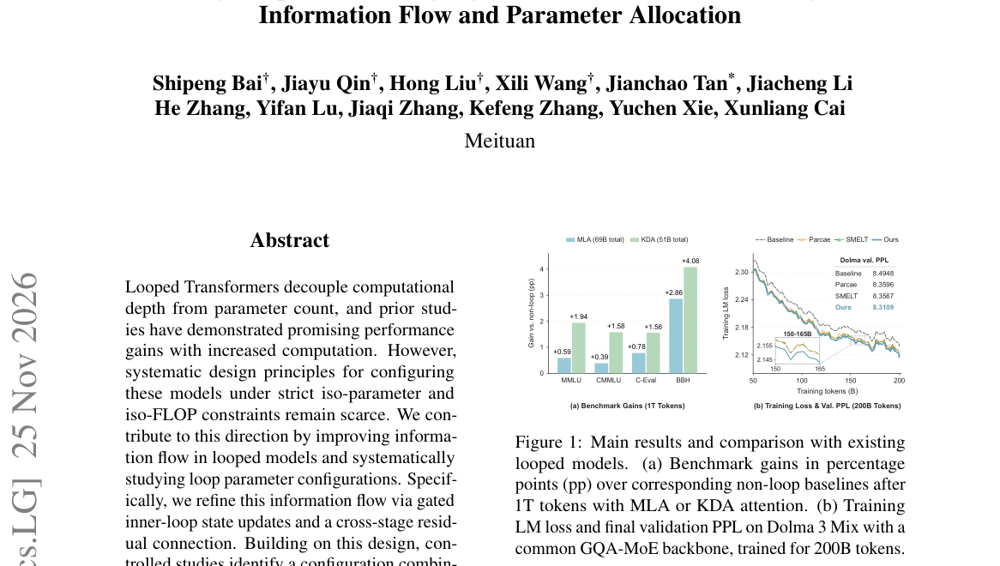

*Result - Overview of our looped model with R Core passes. P, Fω, and C denote the Prelude, shared Core, and Coda; all Core passes share weights ω. Given token embeddings Embed(x), the first pass rece*

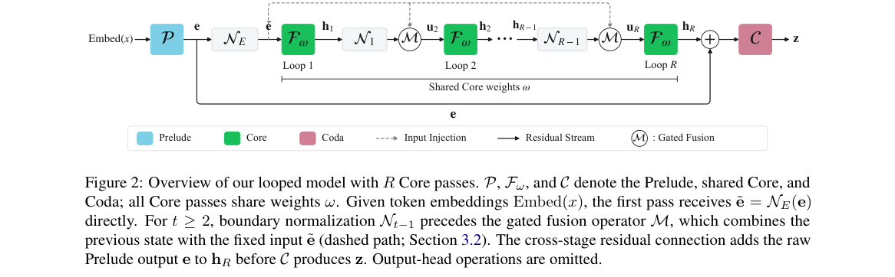

**Why this ranks #1**: 在 iso-参数、iso-FLOP 双重约束下系统拆解循环式 MoE 的深度与专家配比：Core 单次通过只占展开总深度的 25%-35%，省下的参数回填为每层额外路由专家；69B MLA 与 51B KDA 两个 MoE 训 1T token 后，四个基准均值分别比非循环基线高 1.16 与 2.29 个百分点。

---

### 2. Wavefront: Low-Rank Drafting with Parallel Causal Refinement for Speculative Decoding

**arXiv**: [2611.31638](https://arxiv.org/abs/2611.31638) | **Score**: 8.7 (relevance 9 x 0.7 + quality 8 x 0.3) | **Direction**: `llm_core` | **Tags**: LLM-VLM, speculative-decoding, low-rank-drafting, jacobi-parallelism, vllm-serving, University of Oregon | **Categories**: cs.AI | **Pages**: 16

**Authors**: Huy Huu Nguyen; Xin Huang

**Affiliation**: University of Oregon; Amazon

**Abstract**

> Speculative decoding accelerates LLM inference by letting a cheap drafter propose tokens that the target model verifies in parallel. Parallel block drafters such as DFlash and P-EAGLE propose a whole block in one forward pass, but they lose the dependence between tokens in the block; DSpark restores part of it with a lightweight correction head that runs sequentially. Measuring DSpark, we find that this head overrides the base prediction on most slots, so the expensive base readout through the target's full lm_head mostly provides a seed. We therefore propose Wavefront, which follows a simple principle: shrink the base and strengthen the correction head. Wavefront replaces the full lm_head with a learned low-rank base, conditions the correction head on the whole drafted prefix within the same block, and resolves it with a few parallel Jacobi passes. A fixed pass budget makes the draft step free of data-dependent control flow, so we capture it as a single CUDA graph in vLLM with fused kernels. On Qwen3-8B, Wavefront improves throughput over xPress, DSpark and DFlash by 2.6%, 10.7% and 23.6% on average across math, code, chat and agentic benchmarks, and by 9.6%, 14.3% and 28.9% on SPEED-Bench long-context prompts. On Qwen3.8-27B it leads DFlash2, DSpark and xPress by 7.6%, 10.6% and 5.0%, and by 7.4%, 5.8% and 6.0% on the same long-context prompts. The gains persist as serving load grows to concurrency 32.

**Key findings**

- **Finding**: 链感知头在 GSM8K 上一遍就达到收敛接受长度的 90%（8.85/9.81）、五遍达 97%，块平均 5.7 遍稳定、49% 在五遍内收敛；Markov 头要十遍才到 9.11，十五遍才追上顺序解码的 9.46。
- **Inference**: 并行块草稿的瓶颈是修正头的收敛速度而非基座容量，因此压缩基座带宽、把修正头改为整前缀并行读取能同时省显存和提吞吐。
- **Recommendation**: 复现可用 rank-512（27B 用 rank-1024）低秩基座——论文测得三种基座在 GSM8K 各槽位差异不超过 1.3 点，全词表读出只是种子。

**Key figures**

*Framework - Whole-prefix conditioning lets several slots settle per Jacobi pass (illustrative, K=5). (a) Sequential decode with the Markov head: one slot per step. (b) Jacobi with the Markov head: slot*

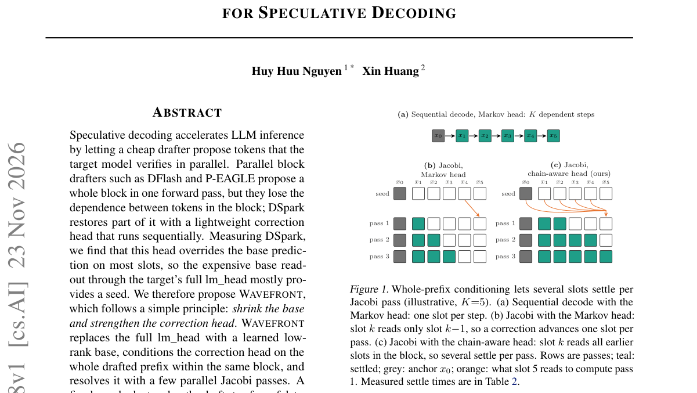

*Result - The Markov head increasingly overrides the base deeper*

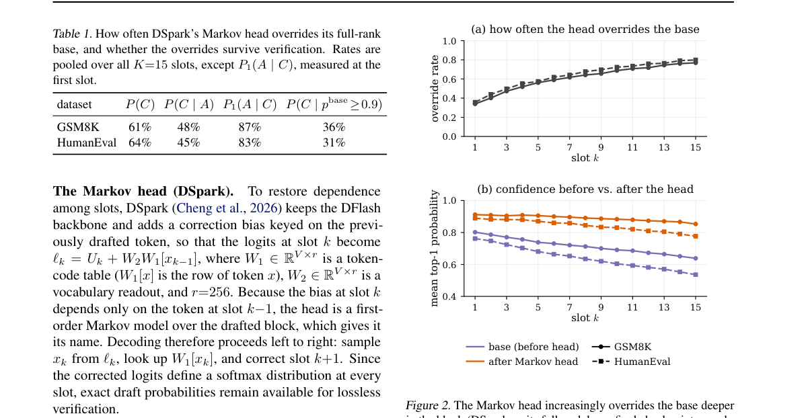

**Why this ranks #2**: 先诊断后改造：DSpark 的轻量 Markov 头在多数槽位上覆盖基座预测，目标模型 4096×V 的 lm_head（bf16 约 1.2 GB）实际只提供种子；Wavefront 据此换低秩基座、让修正头读取整段草稿前缀，Qwen3-8B 上吞吐比 xPress、DSpark、DFlash 分别高 2.6%、10.7%、23.6%。

---

### 3. Factorized Context Attention: From Emulated to Native Grid Probing

**arXiv**: [2611.32423](https://arxiv.org/abs/2611.32423) | **Score**: 8.7 (relevance 9 x 0.7 + quality 8 x 0.3) | **Direction**: `llm_core` | **Tags**: LLM-VLM, sparse-attention, long-context, grid-probing, training-free, King Abdullah University of Science and | **Categories**: cs.CL, cs.CV | **Pages**: 19

**Authors**: Mohamed Eltahir; Manar Eyad; Yara Alzahrani; Fatimah Albesher; Duaa M. Tahir; Tanveer Hussain; Naeemullah Khan

**Affiliation**: King Abdullah University of Science and Technology (KAUST); Department of Computer Science, Edge Hill University

**Abstract**

> Models read a book, an hour of video, or an image in one forward pass. As the context grows, this pass slows down, loses accuracy, and stops at the context window. Sparse attention is efficient, but keeps the other two limitations. Grid probing, a recent training-free method, recovers the accuracy and extends the reach by asking a frozen model the same question about short local and strided spans of the input, but every question repeats the whole computation, since each span is encoded again. Our insight is that grid probing is emulated attention, an attention pattern reproduced from outside the model through prompts, since each probe only restricts which part of the input the question can see. We introduce Factorized Context Attention (FCA), a training-free block-sparse attention that runs the same pattern natively, as the attention of the model itself. FCA encodes the input once into a KV cache, reads all spans as masked sequences in one batched forward, and uses a stair position schedule to keep every span inside the trained position range. Across long video understanding, long-context text inference and image grounding, FCA matches the accuracy and the reach of grid probing at a fraction of its cost. It gains about 10 points over the single pass on long video and 9 to 14 points on long novels, finds needles in videos of over a thousand frames and in texts four times the length of the window, and answers a later question about the same input in as little as a tenth of the time of grid probing. Native attention thus keeps what emulated attention gains without its cost, all with existing frozen language and vision-language models.

**Key findings**

- **Finding**: InfiniteBench En.MC 上 Qwen3-4B 的 FCA 选择式读出在全部 229 问得 79.0%，比整体式读出的 65.5% 高 9 到 14 点；超出窗口的小说上整体式读出掉到 45.5 与 64.0，FCA 仍保持 70.5 与 80.0。
- **Inference**: 关键收益来自「一次编码、多次提问」而不仅是稀疏度本身——同一输入的后续提问只需读已存的帧，比 Periscope 快五到七倍。
- **Recommendation**: 长视频按论文的 144 帧、12×12 网格设跨度并用 select 读出；超窗文本检索里 FCA 最多覆盖到四倍窗口仍几乎全中，整体式读出只保留前缀就全丢。

**Key figures**

*Framework - Emulated against native attention. (a) Grid probing builds the grid outside the frozen model and calls the model once per span. (b) FCA passes the input once and selects the spans inside the*

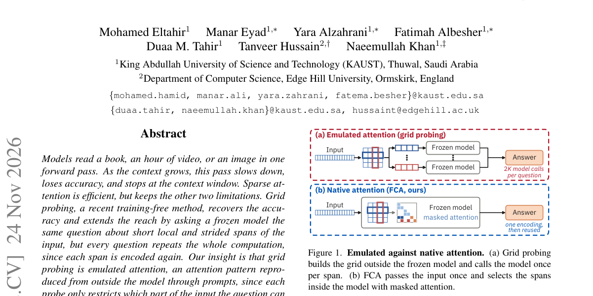

*Result - One layer of FCA. (a) The chunked context is reshaped into a K×K grid, whose rows are local spans and whose columns are strided spans, and its keys and values are stored once. A request read*

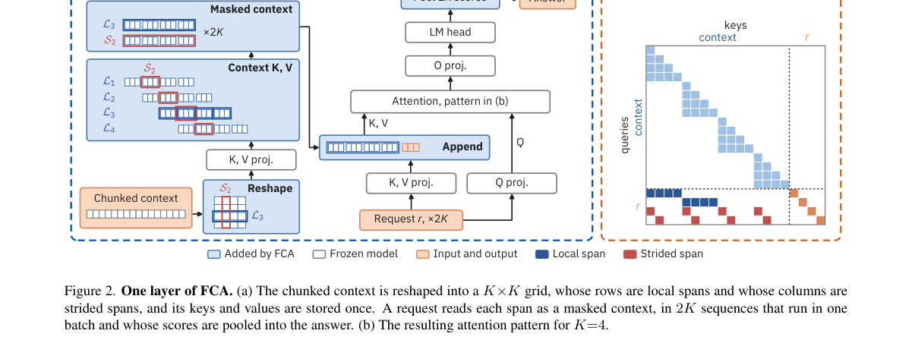

**Why this ranks #3**: 把「网格探测」重新解释为从模型外部模拟的注意力，FCA 用训练无关的块稀疏注意力在模型内部原生跑同一模式：输入只编码一次进 KV cache，144 帧长视频上把 LongVideoBench 准确率从单次前向的 46.4% 拉到 56.3%，耗时还不到 GridProbe 的一半。

---

### 4. Rethinking Knowledge Distillation for Diffusion Language Models

**arXiv**: [2611.33670](https://arxiv.org/abs/2611.33670) | **Score**: 8.7 (relevance 9 x 0.7 + quality 8 x 0.3) | **Direction**: `llm_core` | **Tags**: LLM-VLM, diffusion-language-model, knowledge-distillation, forward-kl, on-policy-distillation, University College London | **Categories**: cs.CL | **Pages**: 28

**Authors**: Yuxuan Sun; Yuanjian Xu; Jianing Hao; Yu Li; Sowmen Das; Zhong Li; Sangwoong Yoon; Miguel R. D. Rodrigues

**Affiliation**: University College London; HKUST; Peking University; MediaTek Research UK; MSRA

**Abstract**

> Knowledge distillation has recently proven highly effective for improving autoregressive models, but its applicability to DLMs remains poorly understood. We present the first systematic study of KD for DLMs and uncover two non-intuitive failures of classical forward-KL (FKL) distillation: (i) student perplexity does not improve monotonically with more teacher-generated data, and (ii) on the same teacher-generated corpus, FKL distillation underperforms simply training the student with the original DLM denoising objective. To address them, we propose a unified, data-free distillation framework for masked DLMs. First, the framework runs an off-policy distillation phase that absorbs general knowledge from a static set of teacher-generated data. Then, the framework employs on-policy distillation which consists of three techniques: a trajectory loss along the student's own reverse process, confidence reweighting that down-weights tokens where the teacher is unsure, and a trust-region anchor that stabilizes the moving target. On MDLM, the resulting student attains a GPT-2 perplexity of $24.75$, surpassing the teacher's $27.04$; on Dream-7B distillation to a 93M student model, the framework reduces Qwen-2.5 perplexity from the FKL-distilled baseline of $25.23$ to $19.83$ while preserving performance on zero-shot general capability benchmarks.

**Key findings**

- **Finding**: MDLM 上 FKL 蒸馏学生的 GPT-2 困惑度随教师语料 {1M, 10M, 30M, 100M} 非单调，10M 最优、继续加数据反而变差；离策略 α-β 散度训练时验证 NLL 持续下降，但 GPT-2 生成困惑度在 5k 步后回升。
- **Inference**: 静态教师语料把训练分布与学生反向过程的实际占用分布错开，所以补数据不如在学生自己的轨迹上做对齐。
- **Recommendation**: 用轨迹一致损失加置信度重加权加信赖域锚点替代 FKL；论文实测轨迹一致 α-β 散度在 K=4 时就超过教师自身困惑度。

**Key figures**

*Framework - Scaling failure of forward-KL dis- tillation in MDLM. GPT-2 perplexity of an MDLM student does not improve monotoni- cally with the size of the teacher-generated cor- pus: 10M tokens are opt*

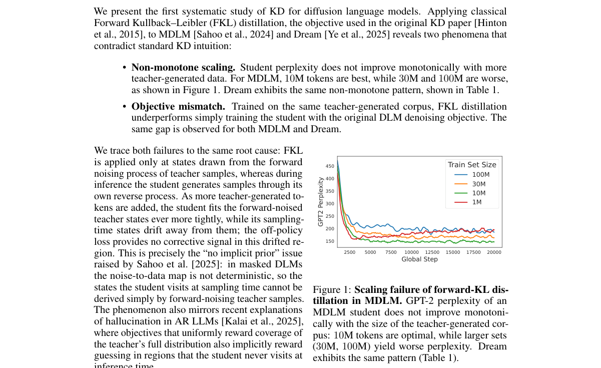

*Result - Off-policy α-β divergence overfit- ting dynamics in MDLM. Validation NLL on OWT keeps decreasing, but GPT-2 generative perplexity rises after the 5k-step checkpoint.*

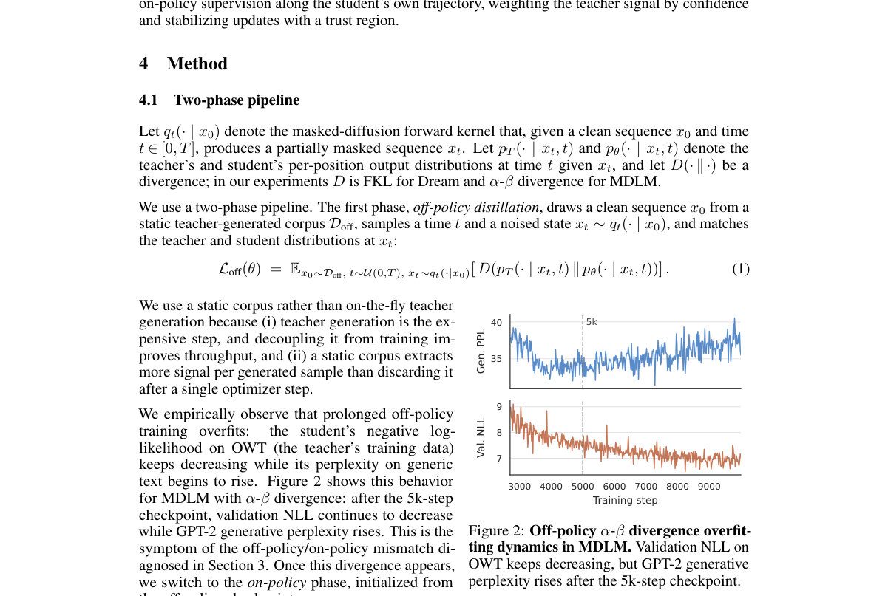

**Why this ranks #4**: 首次系统研究扩散语言模型的蒸馏，暴露经典 forward-KL 的两个反直觉失效（学生困惑度随教师数据量非单调、同一语料下 FKL 蒸馏不如直接用 DLM 去噪目标训练）；提出免数据框架后，MDLM 学生 GPT-2 困惑度 24.75 超过教师的 27.04，Dream-7B 蒸馏出的 93M 学生把 Qwen-2.5 困惑度从 25.23 降到 19.83。

---

### 5. When Are Parallel Subagents Effective for Coding? An Empirical Study on Repository Construction

**arXiv**: [2611.33893](https://arxiv.org/abs/2611.33893) | **Score**: 8.7 (relevance 9 x 0.7 + quality 8 x 0.3) | **Direction**: `llm_core` | **Tags**: LLM-VLM, multi-agent, coding-agent, empirical-study, delegation-strategy, University of Illinois Urbana-Champaign | **Categories**: cs.AI, cs.MA | **Pages**: 50

**Authors**: Zhiheng Lyu; Chengyu Yin; Lingming Zhang

**Affiliation**: University of Illinois Urbana-Champaign

**Abstract**

> LLM-based coding agents are increasingly used for long-horizon tasks such as building an entire program from a specification. Products like Codex and Claude Code let an agent delegate work to parallel subagents, multiplying run cost, yet it remains unclear whether and when delegation produces a better program. We compare a single agent with a main agent delegating to subagents on repository-construction tasks from NL2Repo and ProgramBench (which also provides an executable reference program). We compare scores at equal time and equal cost, run intervention experiments, and analyze fine-grained behavior. On randomly drawn tasks, parallel subagents raise hidden-test pass rates by only about 1 to 5 percentage points at up to 3.8x the cost of a single agent. Their gain is larger on hard tasks, where we find evidence of three mechanisms. Self-checking: with GPT-5.6 Sol, one sentence telling a single agent to probe the reference program first recovers most of this gain at a fraction of the cost; from GPT-5.6 Sol to GPT-6.1 Sol, the gain shrinks as single agents check their own work more. Fresh context: in extended runs, a single agent that periodically starts a new session with an empty conversation makes faster early progress in every comparison than one that resumes its conversation. Modularity: multi-agent runs produce more modular code (more files and shorter functions), closer to the upstream source. We observe similar patterns in a smaller replication with Opus 5.5 on Claude Code. Overall, subagents help when (i) a single agent stops checking too early, (ii) a long session keeps editing with little improvement, or (iii) modular code helps on the task; otherwise, they mainly add cost.

**Key findings**

- **Finding**: 并行子智能体在随机任务上只带来 1.2 到 4.7 个百分点的提升，成本却是单智能体的 2.6 到 3.2 倍；GPT-6.1 Sol 上多智能体均值高出的 2.5 个百分点全来自 hush 一项，单智能体 13.0、多智能体 87.7。
- **Inference**: 收益的真正来源是自我检查、新鲜上下文与模块化三个机制，而不是并发本身，所以在便宜得多的一侧也能买到同样的效果。
- **Recommendation**: 让单个智能体先跑参考程序做自检，并在长会话中定期开新上下文；论文实测一句话提示就能收回大部分并行收益。

**Key figures**

*Framework - We find evidence of self-checking, fresh context and modularity behind the gain from parallel subagents. On random tasks, subagents add a small gain at several times the cost. Cause: what we i*

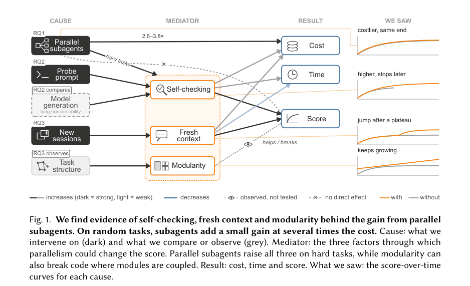

*Result - Over time, Multi (Same Subagent) leads early on NL2Repo but not on ProgramBench. Mea- sured by cost, Single matches or leads both multi-agent setups. Mean score against agent working time (top*

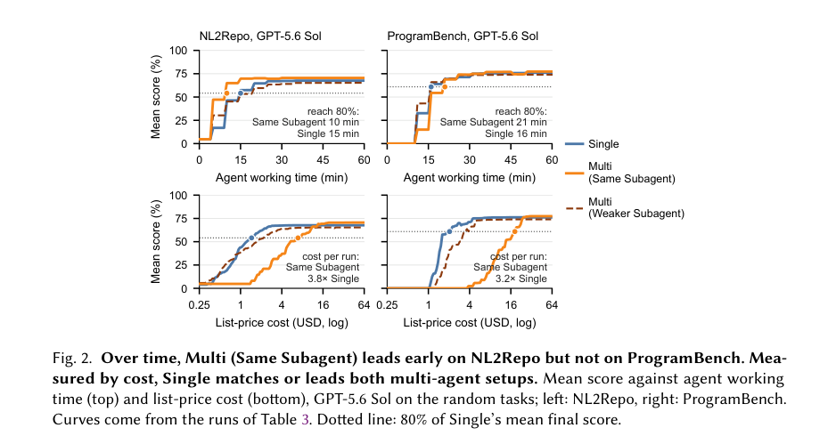

**Why this ranks #5**: 在 NL2Repo 与 ProgramBench 的仓库构建任务上对照单智能体与「主智能体并行委派子智能体」：随机任务上并行子智能体只把隐藏测试通过率提高约 1 到 5 个百分点，却要付出单智能体最多 3.8 倍的成本，硬任务上收益才明显更大。

---

### 6. Stable Gated DeltaNet-2: Understanding and Mitigating Recurrent State Instability

**arXiv**: [2611.34051](https://arxiv.org/abs/2611.34051) | **Score**: 8.7 (relevance 9 x 0.7 + quality 8 x 0.3) | **Direction**: `llm_core` | **Tags**: LLM-VLM, linear-attention, state-stability, long-context, recurrent-model, MemTensor | **Categories**: cs.CL, cs.LG | **Pages**: 18

**Authors**: Xichong Zhang; Xixuan Hao; Zhichen Liu; Le Zhou; Zeyu Zhang; Boyu Chen; Mingfei Lu; Zehao Lin; Bo Tang; Yonggang Zhang; Linyun Liu; Feiyu Xiong

**Affiliation**: MemTensor; USTC; HKUST(GZ); SUSTech; SJTU

**Abstract**

> Linear attention offers an efficient solution for long-sequence modeling via linear complexity and fixed-size recurrent states. Gated DeltaNet-2 (GDN-2) introduces independent channel-wise control over erasure and writing, enhancing state-update expressiveness and in-context retrieval, yet it suffers from training failures during long-context training. We trace these failures to the asymmetry between reading and modification directions during erasure, which yields non-normal erase operators whose directional gains accumulate across tokens, triggering exponential state growth even without new writes. To resolve this, we propose \model{}, employing symmetric erasure to ensure non-expansive state propagation and decay-regulated residual writing to preserve writing flexibility. Theoretically, we establish an $O(\sqrt{T})$ upper bound on recurrent state growth while retaining chunkwise parallel computation. Experiments on ~1.6B parameter models show that \model{} achieves stable training alongside improved long-context retrieval. Compared to GDN-2, it boosts the 128K average RULER score by 6.80 points in the recurrent setting and average accuracy across nine downstream tasks by 0.62 points in the hybrid setting.

**Key findings**

- **Finding**: 循环设置下 Stable GDN-2 在 32K/64K/128K 的平均 RULER 分为 17.35、16.34、11.62，128K 处高于 GDN-2 的 4.82、D-Clip 的 7.02、β-Guard 的 10.82 与 KDA 的 9.96；WikiText 困惑度在 8K 到 64K 为 7.801/7.788/7.776/7.759。
- **Inference**: 用对称擦除把状态传播约束成非扩张并给出 O(√T) 增长上界，能在不牺牲写入灵活性的前提下消除长上下文训练失败。
- **Recommendation**: 用线性注意力做超长上下文时应先检查擦除算子的方向增益是否正规——论文观察到 GDN-2 在 64K 上下文下预训练与后训练均出现数值失败。

**Key figures**

*Framework - Geometric comparison between GDN-2 and Stable*

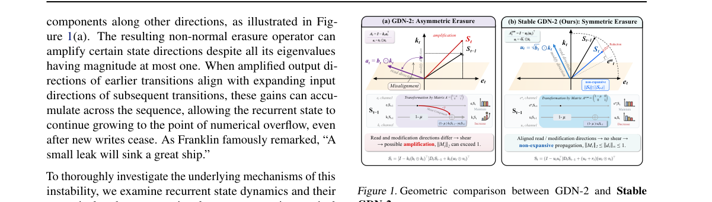

**Why this ranks #6**: 把 Gated DeltaNet-2 在长上下文训练中的崩溃归因到擦除算子的读写不对称（非正规的方向增益跨 token 累积，即使不写入也指数级放大状态），用对称擦除加衰减调节的残差写入修复，约 1.6B 模型上 128K 的平均 RULER 分比 GDN-2 高 6.80 点。

---

### 7. Improving Tail-Augmented Speculative Drafting with Hidden State Mixing and Gradient Detach

**arXiv**: [2611.34092](https://arxiv.org/abs/2611.34092) | **Score**: 8.7 (relevance 9 x 0.7 + quality 8 x 0.3) | **Direction**: `llm_core` | **Tags**: LLM-VLM, speculative-decoding, multi-token-prediction, acceptance-rate, training-inference-mismatch, NVIDIA | **Categories**: cs.CL, cs.LG | **Pages**: 42

**Authors**: Yaniv Galron; Rabeeh Karimi Mahabadi; Maor Ashkenazi; Roger Waleffe; Talor Abramovich; Tiyasa Mitra; Yoav Miron; Dor Tsur; Sanjeev Satheesh; Jimmy Zhang; Jiaji Huang; Yonatan Geifman

**Affiliation**: NVIDIA

**Abstract**

> Multi-token prediction (MTP) modules and EAGLE-style drafters support efficient speculative decoding by reusing target-model hidden states. Their autoregressive use, however, introduces a training-inference mismatch: training supplies sequences of hidden states from the backbone or a single MTP step, whereas inference attends to a target-model prefix followed by a growing tail of recurrently generated MTP states. EAGLE-3's training-time test (TTT) explicitly simulates this behavior during training, at the cost of additional memory and specialized attention masks. We introduce two training-only methods for improving autoregressive drafting. Hidden State Mixing (HSM) samples among backbone and MTP hidden states aligned to the same prediction target, exposing the drafter to mixtures of states from different MTP steps without explicitly simulating inference. Hidden State Gradient Detach (HSGD) is a regularization method that stochastically blocks gradients through hidden state and embedding pathways while preserving the forward computation. Neither method adds inference cost. In joint pretraining followed by supervised fine-tuning, HSGD yields the highest acceptance rates at early draft positions, while HSM performs best later in the draft. These acceptance rate trends favor HSM for long-draft-length serving and HSGD for short-draft-length serving. Furthermore, across four Nemotron models and DeepSeek-V4-Pro, HSM-based MTP boosting with a frozen backbone improves mean acceptance length by up to 52.2% over the co-trained MTP. For EAGLE-3 drafters, HSM offers competitive acceptance with TTT, with 48% lower peak reserved training memory in a four-step Qwen3-8B comparison. HSM implementations are publicly available in Megatron-LM and NVIDIA Model Optimizer.

**Key findings**

- **Finding**: 联合预训练加 SFT 下，草稿长度 11 时的平均接受长度从共享参数 MTP 的 5.19 升到 HSM 的 5.57（T=0）；冻结主干的 MTP boosting 在四个 Nemotron 模型与 DeepSeek-V4-Pro 上，草稿长度 7 的接受长度提升从 +4.3% 到 +52.2%。
- **Inference**: 训练期就注入推理期会遇到的自回归状态混合，比在训练时显式模拟推理的 TTT 路线更省显存——四步 Qwen3-8B 对比中 HSM 峰值预留训练显存低 48%。
- **Recommendation**: 按服务档位选方法：低并发长草稿用 HSM、高并发短草稿用 HSGD（HSGD 提早段接受率，HSM 提草稿尾部）；DeepSeek-V4-Pro 接受率从首位 84% 掉到第三位 45%，正是这类错配的体现。

**Key figures**

*Framework - MTP training improvements. 𝑇denotes the sampling temperature. (a) After joint pretraining and SFT, HSGD improves early-position acceptance rates, while HSM improves the draft tail. Mean acc*

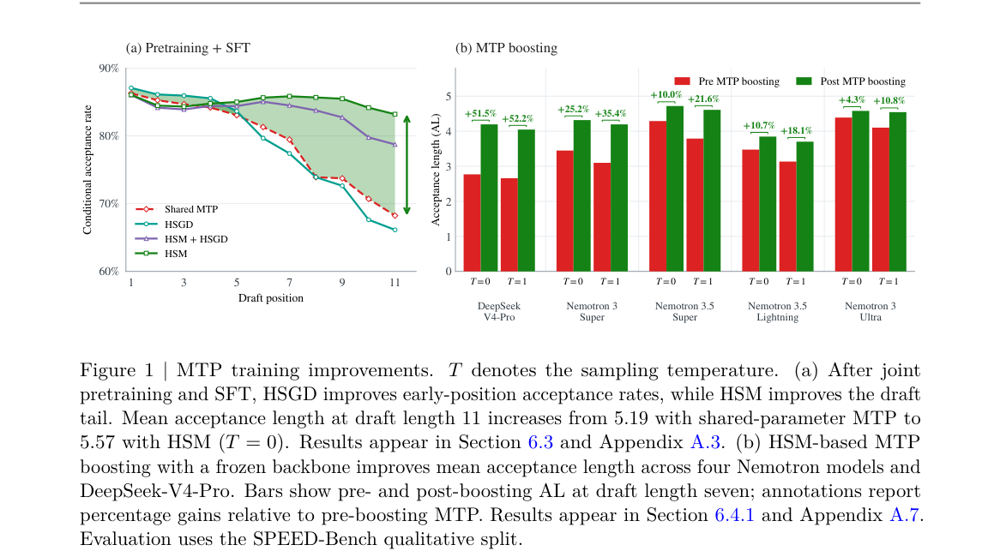

**Why this ranks #7**: 针对自回归 MTP 与 EAGLE 草稿器的训练-推理输入错配，给出两个纯训练期方法：隐状态混合 HSM 在同一预测目标下混合主干与 MTP 隐状态，隐状态梯度截断 HSGD 随机阻断梯度通路；两者都不增加推理开销，冻结主干下 MTP boosting 的平均接受长度最高提升 52.2%。

---

### 8. DFly2: Turbocharging Long-Context Speculative Decoding by Sharing the Target's Sparsity

**arXiv**: [2611.34776](https://arxiv.org/abs/2611.34776) | **Score**: 8.7 (relevance 9 x 0.7 + quality 8 x 0.3) | **Direction**: `llm_core` | **Tags**: LLM-VLM, speculative-decoding, sparse-attention, kv-cache-sharing, long-context, Tencent | **Categories**: cs.CL | **Pages**: 20

**Authors**: Hong Liu; Rui Cen; Junhan Shi; Lin Niu; Runzhi Fan; Zhaojing Zhou; Haodi Lei; Jiebin Zhang; Saiyong Yang; Junqiang Zheng; Zhenghai Xue; Guanghua Yu

**Affiliation**: Tencent Inc.

**Abstract**

> To avoid the quadratic cost of dense attention over long contexts, models such as DeepSeek-V4 and Hy4 have turned natively sparse, and speculative decoding, which matters most where decoding is slowest, increasingly runs on them. Their drafters, however, still keep a context cache of their own, over the whole prompt or a sliding window. Beyond memory, such a cache costs prefill time, prefix-cache hits and decode concurrency. Drafters that read the target's cache avoid one of their own, but settle only which cache, not which positions, and still read everything or a recent window. Neither rule is made for the query at hand, and computing a selection per query in the drafter would cost more as the context grows. Yet a natively sparse target already picks positions for each query, over a cache it keeps anyway. Both of the drafter's choices are therefore already made, and paid for, by the target: its cache and its selection. We measure how far one selection carries: made a step early, it still covers close to nine tenths of what each later token selects on DS-V4.1-Flash. We present DFly2, a block-parallel drafter that shares the target's sparsity. Each draft layer reads the KV its paired target layer cached (KV sharing), at the positions that layer's indexer selected, a fixed number anywhere in the context (Index sharing). DFly2 thus runs no scoring pass and keeps no cache of its own. On DS-V4.1-Flash, GLM-5.3-Flash and Hy4~flash, whose sparse attention and architecture differ, it accepts more tokens per step than DFlash and DSpark trained on the same recipe, over general, long-context and agentic benchmarks. Its margin over the stronger baseline widens from 3.9%-10.5% on general workloads to 10.0%-31.5% on long-context and agentic ones. At high concurrency on DS-V4.1-Flash, at matched per-user decode speed, its throughput is 62% and 81% higher on two 64K sets.

**Key findings**

- **Finding**: 在 DS-V4.1-Flash 上，indexer 提前一步做出的位置选择仍覆盖后续每个 token 所选位置的近十分之九；同等大小窗口的草稿器在同代价下只能恢复不到五分之一。
- **Inference**: 因为目标模型的稀疏选择与草稿器的选择需求高度重合，共用稀疏性同时省掉草稿器的打分遍、KV cache、prefill 时间与前缀缓存命中三重开销。
- **Recommendation**: 在原生稀疏目标上做推测解码时优先实现「KV 共享 + 位置共享」而非自建 cache；DS-V4.1-Flash 高并发下按每用户解码速度对齐，两个 64K 集合的吞吐分别高出 62% 和 81%。

**Key figures**

*Framework - Accepted length τ and decoding speedup on DS-V4.1-Flash, GLM-5.3-Flash and Hy4 flash, greedy at a concurrency of one. Chips give DFly2’s gain over the better of DFlash† and DSpark.*

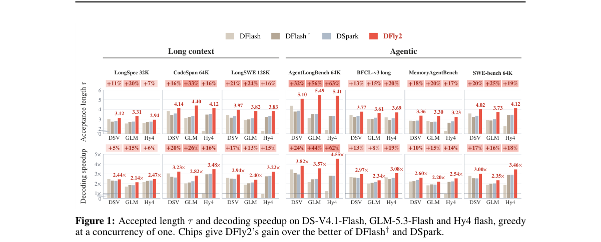

*Result - What a drafter’s own cache costs at decode. (a) Concurrency at 32K tokens, with a full own cache as 1×, estimated from model configurations including fixed per-request state. (b) DS-V4.1-Fla*

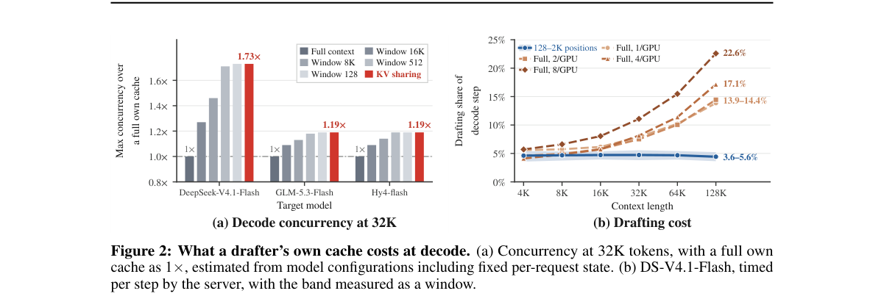

**Why this ranks #8**: 指出原生稀疏目标模型（DeepSeek-V4、Hy4）已经替草稿器选好了上下文：它的 KV cache 与它每步挑的位置都已付费；DFly2 让草稿层直接读配对目标层缓存的 KV 并复用该层 indexer 选中的位置，自己不再维护 cache、不做打分遍，DS-V4.1-Flash 上接受长度领先更强基线 10.0% 到 31.5%。

---

## VLM 核心（多模态架构 / 理解 / 视频 / GUI agent） · `vlm_core` (5 papers)

5 篇分两路：一路给 VLM 自己做「手术刀式」检验，一路改推理的组织方式。定点切除那篇在 Qwen3-VL/Kimi-VL/Gemma-4 上发现 3–12% 的专家是视觉专属，Qwen3-VL 把文本位专家全静音代价 45 个点、图像位只掉 3 个点；ViDM 把共享视觉上下文、多个问题与问题专属决策槽排成一条序列，一次前向出全部答案，Qwen3.5-4B 准确率从 73.49% 提到 77.55%、吞吐 8.4 倍；STAR 用反事实双世界 rollout 与空间注意力引导的 token 级目标重建，六个细粒度基准平均准确率最高提升 8.04 个点；AME 让 LLM agent 自行设计可执行的适配程序，11 个数据集上 CLIP ViT-B/16 平均 81.2%（无反传）；Video-Relook 让模型自选时空观察，把收益归因于「把交互变成可靠修正」的能力。

### 9. Lit Up but Not Needed: Scoped Lesions Show Where Multimodal Mixture-of-Experts Depend on Their Experts

**arXiv**: [2611.31576](https://arxiv.org/abs/2611.31576) | **Score**: 8.7 (relevance 9 x 0.7 + quality 8 x 0.3) | **Direction**: `vlm_core` | **Tags**: LLM-VLM, mixture-of-experts, interpretability, lesion-study, routing-analysis, Rice University | **Categories**: cs.CV | **Pages**: 14

**Authors**: Zhixuan Ge; Anqi Li; Kexin Geng; Wei Qiu

**Affiliation**: Rice University

**Abstract**

> Cognitive neuroscience learned that an activation map is not a map of necessity. Regions that light up during a task are not always needed for it, and only lesions reveal which ones are. Mixture-of-experts (MoE) vision-language models come with an activation map for free, since the router records which experts respond to image and text tokens, and recent work reads modality-specialized experts off this map. We bring the lesion. In Qwen3-VL-30B-A3B, Kimi-VL-A3B and Gemma-4-26B-A4B, 3 to 12% of the experts are vision-exclusive: image tokens route to them at up to five times the uniform rate and text tokens almost never. In Qwen3-VL they receive a quarter of all image-token routing, and lesioning all of them costs less than one percentage point on average over eight perception benchmarks and free-form OCR, no more than lesioning a random set of the same size. In Kimi-VL and Gemma-4 the lesion also costs no more than a random set. Scoped lesions, which remove an expert set only at image positions or only at text positions, then show where the models do depend on their experts. In Qwen3-VL, silencing every expert at every image position costs 3 points, against 45 at text positions, where the dependence sits in dual-use experts that text-only tasks need as well. Across models the image-side dependence is 2 to 3 points in Qwen3-VL and Kimi-VL and 26 in Gemma-4. Reading text in images is the one ability that needs image-position experts in every model. The exclusive experts receive informative patches, produce outputs of ordinary size, and stay inert under sensory deprivation: text-only training recruits them only when load balancing forces it. In Kimi-VL the balancing bias itself manufactures most of them. Load balancing draws the modality map in the part of the computation the models depend on least. Expert selection, pruning and skipping should follow the lesion, not the map.

**Key findings**

- **Finding**: 在 Qwen3-VL 中沉默所有图像位置上的专家只掉 3.0 分（Gemma-4 掉 25.5 分），而沉默文本位置上的双用途专家要掉 34.8 分（Gemma-4 掉 10.2 分）；Kimi-VL 对应变化为 +1.8、-2.0 与 -1.3 分。
- **Inference**: 真正的依赖集中在文本位置上的双用途专家而非视觉专属专家，所以「按路由图挑专家做剪枝或跳过」会剪错对象。
- **Recommendation**: 专家选择、剪枝与跳过应以切除实验为准而非激活图；论文观察到 Qwen3-VL 的视觉专属专家在感官剥夺下保持惰性，其形成主要由负载均衡偏置制造。

**Why this ranks #9**: 把「激活图不等于必要性地图」搬到多模态 MoE：对 Qwen3-VL-30B-A3B、Kimi-VL-A3B、Gemma-4-26B-A4B 定位 3% 到 12% 的视觉专属专家，Qwen3-VL 里它们承接了四分之一的图像 token 路由，但把这些专家全部切除在八个感知基准上只掉不到 1 个百分点。

---

### 10. ViDM: Efficient and Order-Robust Parallel Visual Decision Making

**arXiv**: [2611.32461](https://arxiv.org/abs/2611.32461) | **Score**: 8.7 (relevance 9 x 0.7 + quality 8 x 0.3) | **Direction**: `vlm_core` | **Tags**: LLM-VLM, parallel-decoding, multi-question-vqa, order-robustness, inference-efficiency, Fudan University | **Categories**: cs.CV | **Pages**: 14

**Authors**: Xudong Tan; Peng Ye; Chenyu Huang; Yaoxin Yang; Huafeng Qin; Tao Chen

**Affiliation**: Fudan University; The Chinese University of Hong Kong; Chongqing Technology and Business University

**Abstract**

> Visual decision-making demands accurate judgments and timely responses. Yet for multiple questions sharing the same visual input, autoregressive multimodal large language models generate answers token by token, accumulating sequential decoding costs as question count grows and delaying completion of the decision set. Their predictions can also vary with question order. We introduce ViDM, which transforms multi-question visual inference into parallel decisions in a single forward pass, improving both accuracy and inference efficiency. ViDM organizes shared visual context, multiple questions, and question-specific decision slots into one sequence, reusing the native language-model head to produce all answer distributions simultaneously. A Decision-Query Mask aligns each decision query's direct attention with shared context and its corresponding question, while case-balanced multi-order training strengthens robustness to question reordering. Across nine benchmarks spanning image, multi-image, and video tasks, ViDM improves Qwen3.5-4B's average accuracy from 73.49% to 77.55% while achieving 8.4x the baseline's average end-to-end throughput. On GQA, where each evaluated image has 11.4 questions on average, the end-to-end speedup reaches 20.3x. ViDM also improves mean and worst-order accuracy while reducing order-induced variation across multiple benchmarks, with further validation on LLaVA-OneVision-7B and InternVL3.5-4B.

**Key findings**

- **Finding**: 九个基准（图像、多图、视频）上 Qwen3.5-4B 平均准确率由 73.49% 提升到 77.55%（+4.06 个百分点），平均端到端吞吐 29.95 questions/s 即基线的 8.4 倍；GQA 上平均每图 11.4 个问题，端到端加速达 20.3 倍。
- **Inference**: 问题数越多，共享编码与并行决策的摊销优势越大，因此并行解码既提准确率也提吞吐，而不是二选一。
- **Recommendation**: 需同时提升顺序鲁棒性时叠加用例均衡的多顺序训练；论文测得其比仅用多顺序训练再高 0.40 点、比并行基线高 2.95 点，并在 LLaVA-OneVision-7B 与 InternVL3.5-4B 上复现。

**Key figures**

*Framework - ViDM: efficient parallel decisions for multiple ques- tions. (a) Given shared visual input and K questions, ViDM pre- dicts all answer distributions in a single forward pass. (b) Autore- gre*

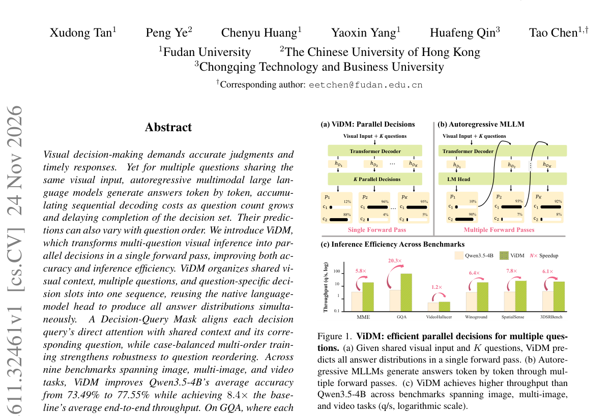

*Result - Question-order sensitivity in multi-question visual reasoning. (a–b) The same image and eight questions are presented in original and reversed orders. Despite unchanged visual evidence and q*

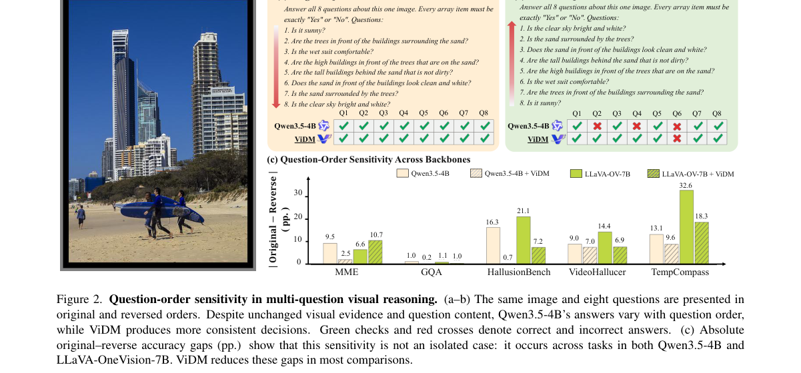

**Why this ranks #10**: 针对共享同一视觉输入的多问场景，把自回归逐 token 生成改造成单次前向里的并行决策：把共享视觉上下文、多个问题与问题专属决策槽编排成一条序列，并用 Decision-Query Mask 对齐决策读出与问题；Qwen3.5-4B 上平均准确率从 73.49% 升到 77.55%，端到端吞吐达基线的 8.4 倍。

---

### 11. STAR: Counterfactual Dual-World Rollouts and Spatial Target Adaptive Reconstruction for Visual On-Policy Distillation

**arXiv**: [2611.32472](https://arxiv.org/abs/2611.32472) | **Score**: 8.7 (relevance 9 x 0.7 + quality 8 x 0.3) | **Direction**: `vlm_core` | **Tags**: LLM-VLM, on-policy-distillation, counterfactual-rollout, spatial-attention, fine-grained-vqa, University of Science and Technology of | **Categories**: cs.CL, cs.CV | **Pages**: 11

**Authors**: Yi Zou; Zhuang Yan; Yudong Zhang; Xu Wang; Yang Wang

**Affiliation**: University of Science and Technology of China; AMAP, Alibaba Group

**Abstract**

> Vision-language models often rely on global context and language priors while overlooking answer-determining local details. Privileged visual on-policy self-distillation supervises full-image student rollouts using a frozen teacher that views high-resolution evidence crops. Yet our cross-scale diagnostics show that models retain over half of their full-image accuracy when local evidence is completely masked, indicating that single-image correctness does not guarantee reliance on local evidence, while the need for visual correction also varies across tokens with their spatial attention states. We propose STAR, a visual on-policy self-distillation framework combining independent counterfactual dual-world rollouts with spatial-attention-guided target reconstruction. Local image editing constructs paired worlds with identical questions and backgrounds but distinct answer-determining facts, where a shared student samples trajectories independently to expose contextual shortcuts under image-consistent prefixes. Within each world, the teacher contrasts real and mean-color crops to determine the visual correction direction, while the divergence between student image attention and a teacher-centroid spatial reference adaptively controls token-wise target log-probability reconstruction. Without auxiliary attention losses or test-time tool overhead, STAR improves Qwen3.5 across scales by up to 8.04 percentage points in average accuracy over initialization across six fine-grained benchmarks, reaches OPSD's final accuracy $4.7\times$ faster, and generalizes to out-of-domain reasoning tasks.

**Key findings**

- **Finding**: STAR 在 Avg6 上超过 VA-OPD 等对比方法 2.81、2.55、1.78、1.37 与 0.63 个百分点，在 ZoomBench 上超过 VAD 0.12 点、在 MME-RealWorld CN 上超过 2.43 点；仅用 3B 激活参数时超过 Gemini 3.1 Pro 的 78.04% 达 80.89%。
- **Inference**: 反事实双世界的独立 rollout 让模型在图像一致前缀下暴露上下文捷径，再由教师在真实裁剪与均值色裁剪之间的对比给出修正方向，比统一权重更贴合逐 token 的空间注意力差异。
- **Recommendation**: 若目标是提升视觉细节依赖而非刷分，可复用其「双世界 + 空间自适应重建」配方；论文测得它达到 OPSD 最终准确率快 4.7 倍，相对 GRPO 更是快 7.3 倍。

**Key figures**

*Framework - Overview of existing visual on-policy distillation paradigms and the motivation of STAR. The top row summarizes prior interventions on input conditions, supervision weights, and target distr*

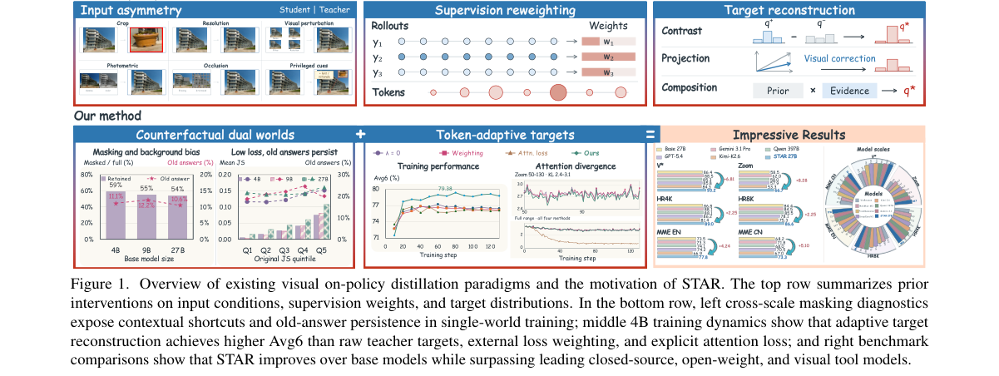

*Result - Overview of STAR. (a) A shared student independently samples on-policy rollouts in original and counterfactually edited worlds, while a frozen teacher evaluates each rollout conditioned on i*

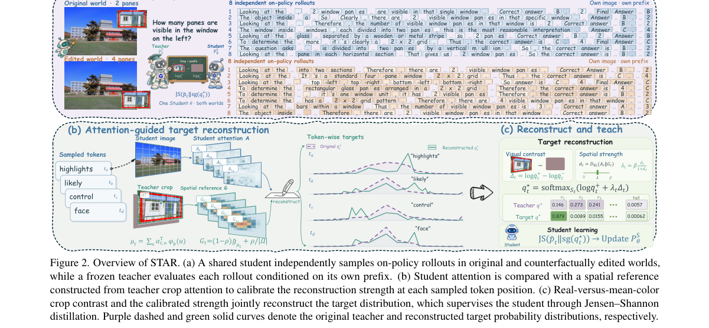

**Why this ranks #11**: 先做跨尺度诊断，发现模型在局部证据被完全遮蔽时仍保留过半的全图准确率，说明单图正确并不等于真的依赖局部证据；STAR 用反事实双世界 rollout 加空间注意力引导的目标重建纠正这种捷径，在六个细粒度基准上把 Qwen3.5 相对初始化最多提升 8.04 个百分点。

---

### 12. Few-Shot Adaptation of Vision-Language Models via Agentic Model Editing

**arXiv**: [2611.34036](https://arxiv.org/abs/2611.34036) | **Score**: 8.7 (relevance 9 x 0.7 + quality 8 x 0.3) | **Direction**: `vlm_core` | **Tags**: LLM-VLM, few-shot-adaptation, agentic-programming, test-time-adaptation, model-editing, Peking University | **Categories**: cs.AI, cs.LG | **Pages**: 11

**Authors**: Yusheng Zhao; Xiao Luo; Zhiping Xiao; Ming Zhang

**Affiliation**: Peking University; University of Wisconsin–Madison; University of Washington

**Abstract**

> Few-shot adaptation transfers pretrained Vision-Language Models (VLMs) to new domains using a small set of labeled images. Most methods fit prompts, representations, or classifiers within an adaptation procedure specified in advance. Yet the visual distinctions needed for recognition can differ substantially across domains, motivating the question: Can an LLM agent use few-shot examples and model observations to design the adaptation procedure itself? We propose Agentic Model Editing (AME), an agentic framework that jointly designs input transformations, encoder edits, feature computation, and classifier fitting as an executable, domain-customized adaptation program. The agent inspects images, class semantics, model parameters, intermediate representations, and activations to formulate hypotheses about the target task. It implements and tests candidate programs on the support set, with aggregate validation accuracy guiding refinement and selection. Each program fits a complete domain model that is fixed before testing. The agent and its tools are shared across domains, while each domain receives its own adaptation program. Across eleven datasets with CLIP ViT-B/16, AME achieves the highest average accuracies of 81.2% without back-propagation and 81.9% with back-propagation among the compared methods. Further experiments demonstrate applicability across VLM backbones and LLM agents.

**Key findings**

- **Finding**: 无反向传播时 AME 平均准确率 81.2%，最强基线 TIMO 为 79.8%，EuroSAT 上相对提升 6.2%；启用反向传播后 AME 达 81.9%，最强基线 2SFS 为 80.6%，DTD 上相对提升 4.6%；同用同一 LLM 后端的纯提示搜索方法 LBBO 与 IPO 只有 66.7% 与 67.8%。
- **Inference**: 把适应流程本身交给智能体合成，比在固定流程里换特征或换提示有更大的搜索空间，因此收益来自算法自由度而非更强的主干。
- **Recommendation**: 落地时按每类 8 张标注图、5 次累计验证提交设置智能体循环，并注意支持集内交叉验证只是局部诊断证据，最终模型应在完整支持集上重跑拟合后再冻结。

**Key figures**

*Framework - Conventional few-shot adaptation applies a predefined algorithm across domains (a). AME instead uses a shared LLM agent to design a domain-customized adaptation program from la- beled exampl*

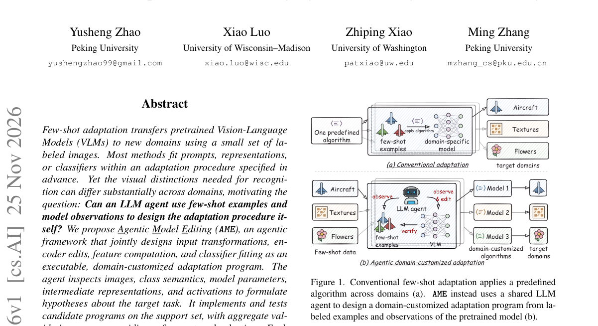

*Result - Overview of AME. (a) Inputs and tools expose labeled target examples and the pretrained VLM. (b) The agent inspects images, class semantics, weights, representations, and activations to form*

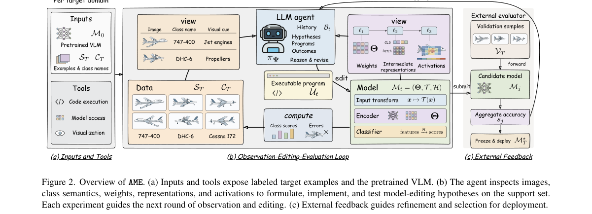

**Why this ranks #12**: 问了一个更根本的问题：能否让 LLM 智能体自己设计少样本适应流程？AME 让智能体联合设计输入变换、编码器编辑、特征计算与分类器拟合，生成可执行的领域定制适应程序，在 11 个数据集上以 CLIP ViT-B/16 达到平均 81.2%（无反向传播）与 81.9%（有反向传播）的最高准确率。

---

### 13. Rethinking Video Agents: When and Why Video Harnesses Work

**arXiv**: [2611.31883](https://arxiv.org/abs/2611.31883) | **Score**: 8.0 (relevance 8 x 0.7 + quality 8 x 0.3) | **Direction**: `vlm_core` | **Tags**: LLM-VLM, video-agent, adaptive-observation, interaction-traces, video-qa, KlingAI Research | **Categories**: cs.AI, cs.CV, cs.MM | **Pages**: 14

**Authors**: Luoyuan Zhang; Xuanyu Zheng; Yancheng Long; Haoyang Xu; Bin Wen; Tingting Gao

**Affiliation**: KlingAI Research

**Abstract**

> Video understanding depends not only on how models reason about visual evidence, but also on which evidence they observe. Fixed observation policies determine this evidence in advance; agentic harnesses allow models to seek further observations as their understanding develops. This shift creates an opportunity to realize capabilities that fixed inputs leave untapped, yet the ability to request observations does not ensure their effective use. We investigate when and why video harnesses improve understanding, examining how task demands and models' capacity for interaction jointly shape their benefits. Using Video-Relook as an experimental framework, we let models adapt their temporal and spatial observations from a common default configuration, and analyze performance and interaction trajectories across models and tasks. Adaptive observation yields substantial gains on fine-grained action understanding, with benefits also extending to Video-MME-v2. Even under the same observation interface, gains differ substantially across models; interaction traces reveal corresponding differences in evidence seeking and the reliability of answer revision. The benefits also vary across tasks for the same model, ranging from substantial improvements to limited gains and regressions. Together, these findings support an account in which harness effectiveness depends on the alignment between opportunities for informative observation and the model's ability to turn interaction into reliable revisions. They motivate video harnesses that coordinate perception and reasoning, matching observational autonomy to task demands and model capabilities.

**Key findings**

- **Finding**: Video-MME-v2 上 Gemini 3.8 Flash、Gemini 3.6 Flash、Qwen 3.8 Flash 分别提升 3.78、1.91 与 5.25 个百分点，而 Qwen 3.7 Flash 停在 53.16%；它纠正了 250 个基线错误，却同时推翻了 250 个原本正确的答案，并在 55.7% 的问题组上第一轮之后就停止。
- **Inference**: 外壳收益取决于「模型能否把交互转成可靠的答案修订」而非能否发起交互，因此必须按模型能力而非任务本身来配置观察自由度。
- **Recommendation**: 用交互轨迹而非最终准确率来选外壳：论文显示 Qwen 3.8 Flash 在 Video-MME-v2 涨 5.25 分的同时在 Video-Holmes 掉 0.33 分，Gemini 3.6 Flash 在 TempCompass 掉 1.20 分而在 Video-MMMU 涨 2.73 分。

**Key figures**

*Framework - From overview to confirmation. The example illustrates how an agentic framework helps the model understand the details of the scene.*

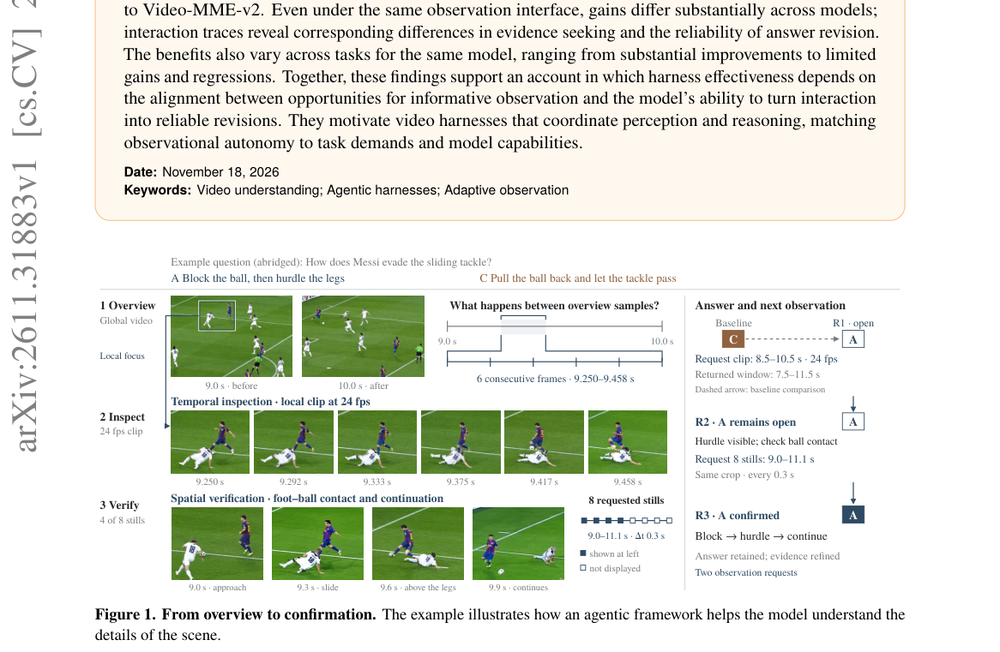

*Result - Requests select observations; the return loop appends them to the same conversation. Reference labels enter only the scorer.*

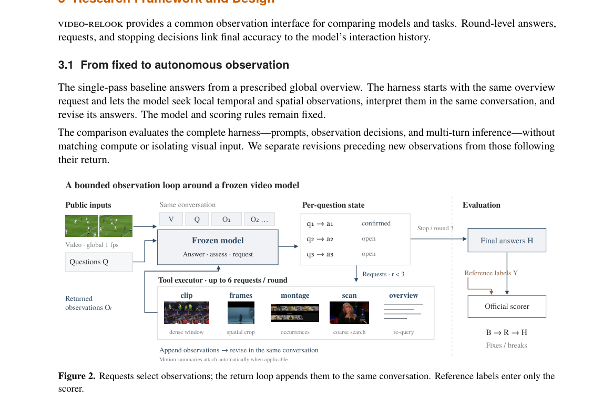

**Why this ranks #13**: 追问视频智能体外壳到底何时有效：Video-Relook 让模型从统一的默认时空采样出发自主调整观察，五个模型在 FastAct 细粒度动作理解上提升 3.0 到 14.2 个百分点，但同一观察接口下不同模型差异显著，甚至出现回归。

---

## LLM / VLM 的 RL 与偏好优化 · `llm_vlm_rl` (7 papers)

7 篇的主线是「奖励可不可信」。DAPO-V 先构造 2728 个实例的 ITHV 区分显性与难辨幻觉，再用可验证性感知奖励加自适应双控，三个 MLLM 基座上难辨幻觉准确率提升 5.78–9.72 个百分点。RL 与蒸馏的分工也被重新划线：长度惩罚 RL 在 AIME25 上省 70% 思考 token 但合并训练会塌陷，多教师 OPD 在 33 个基准上把档位分开、高档比参考策略高 3.1 分；Avalon-M1 用共同结果导出的 advantage 训练 CEO 加 8 名专家，IMO-ProofBench-Advanced 从 23.8% 升到 39.0%。效率侧 ARS-VLM 走前向-only 零阶路线，8B 模型 20 步达 61.0%，GRPO 要 150 步。另有 AdProducer 用分镜级加视频级奖励把 PG-Score 从 17.3 推到 51.3、Open-OmniCoach 的 SEPO 让 30B 模型九个基准平均高 6.3 点，以及 NOBODY 用 DPO 治理「画面无人却提到人」的归因偏差。

### 14. Rethinking Reasoning Effort Training in Large Language Models: On-Policy Distillation or Reinforcement Learning?

**arXiv**: [2611.32131](https://arxiv.org/abs/2611.32131) | **Score**: 9.0 (relevance 9 x 0.7 + quality 9 x 0.3) | **Direction**: `llm_vlm_rl` | **Tags**: LLM-VLM, reasoning-effort-control, on-policy-distillation, length-penalty, token-level-kl, agentic-transfer, ERNIE Team | **Categories**: cs.LG | **Pages**: 42

**Authors**: Tianliang Lv; Hao Li; Xinchao Xu; Zhengkun Zhang; Ju Huo

**Affiliation**: ERNIE Team, Baidu

**Abstract**

> Large language models have shown strong capabilities on complex tasks, yet how to control their reasoning effort remains a significant challenge for practical deployment. This paper provides a systematic investigation of reasoning-effort training, contrasting reinforcement learning (RL) with on-policy distillation (OPD). We find that compressing reasoning and separating effort tiers are governed by different signals. Length-penalized RL reliably compresses a single policy, reducing thinking on AIME25 by 70\% without accuracy loss, but collapses the tiers when they are trained jointly. Multi-teacher OPD separates them: across 33 benchmarks, low and medium use 58\% and 43\% fewer thinking tokens than high, while high improves on the reference policy by 3.1 points. We trace this difference to the training signal. A sequence-level reward cannot tell tier-specific behavior from shared behavior, whereas OPD supplies a tier-specific target at every visited state, including the decision to stop. Building on this analysis, we show that a single token-level KL anchor on the high tier is sufficient to learn separated tiers within one RL stage, and that natural-language effort instructions make this separation emerge from the start of training, yielding a policy competitive with multi-teacher OPD at matched thinking length. Finally, the separation built by dense targets holds only on the states seen in training: it does not carry over to unseen agentic tasks, where effort acts mainly through the number of interaction turns, whereas the compression induced by sequence-level rewards does.

**Key findings**

- **Finding**: 长度惩罚的序列级 RL 把 AIME25 的思考长度压掉 70% 而精度不降，但多档联合训练时各档会塌缩到同一长度；多教师 OPD 在 33 个基准上让 low/medium 档分别少用 58%/43% 思考 token，high 档比参考策略高 3.1 分。
- **Inference**: 序列级奖励无法区分「这一档特有」与「各档共有」的行为，只有逐状态的密集目标（含停止决策）才能真正把 effort 分档拉开。
- **Recommendation**: 要控推理预算就用密集锚点保住 high 档、只用稀疏长度惩罚压缩 low/medium，并在输入里加自然语言 effort 指令；但别指望这种分档迁移到没见过的 agentic 任务。

**Key figures**

*Framework - Overview of the study. We compare sparse trajectory-level RL and dense token-level OPD across single-policy compression, multi-tier effort control, and transfer across interaction formats (S*

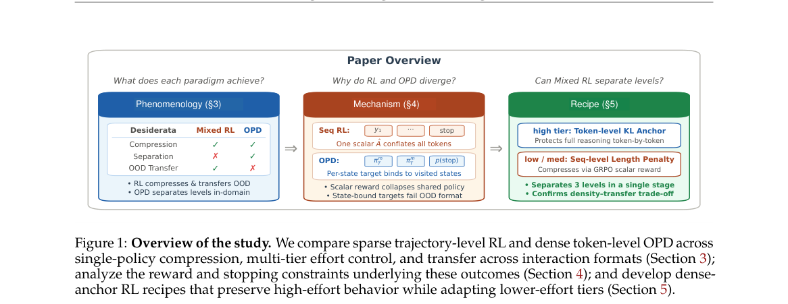

*Result - Single-policy compression with sparse length-penalized RL. Top: Qwen3-8B (Yang et al., 2025); bottom: GLM-4.5-Air (Team et al., 2025). (a,b,e,f) Training length and reward. (c,g) Evaluation*

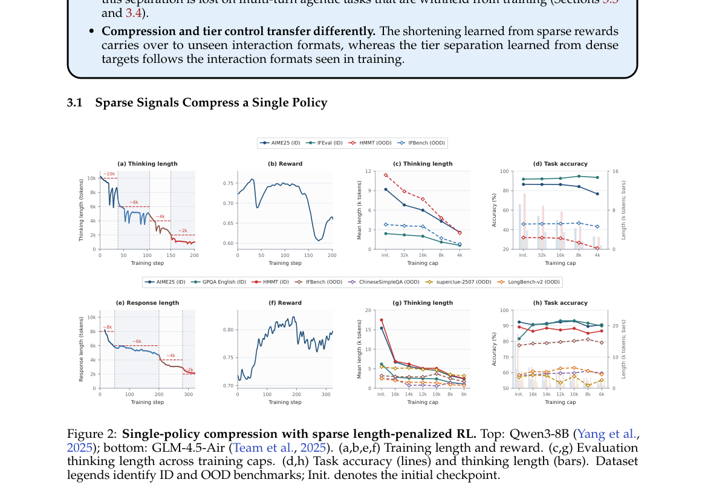

**Why this ranks #14**: 它直接对比序列级奖励的 RL 与 token 级密集目标的 on-policy 蒸馏：长度惩罚 RL 让 AIME25 思考长度下降 70% 且不掉精度，多教师 OPD 在 33 个基准上让 low/medium 档分别比 high 少用 58%/43% 思考 token，high 档仍比参考策略高 3.1 分，是 effort 分档控制少见的可核对量化对照。

---

### 15. AdProducer: Towards Agentic Advertising Video Generation

**arXiv**: [2611.31466](https://arxiv.org/abs/2611.31466) | **Score**: 8.7 (relevance 9 x 0.7 + quality 8 x 0.3) | **Direction**: `llm_vlm_rl` | **Tags**: LLM-VLM, agentic-ad-creation, grpo, joint-reward, storyboard-design, product-grounding, Institute of Artificial Intelligence | **Categories**: cs.AI, cs.CV | **Pages**: 24

**Authors**: Kunyang Li; Chaoyang Wang; Mubarak Shah; Yuzhang Shang

**Affiliation**: Institute of Artificial Intelligence, University of Central Florida

**Abstract**

> Recent advances in video generation have made automated advertising production increasingly feasible. However, an effective advertisement must faithfully represent the product and communicate its selling points through compelling visual storytelling, which requires more than visual synthesis: it calls for deeper product understanding and strategic decisions about how to present product value. Crucially, product research and creative design are closely intertwined, as the information gathered about a product determines which features can be faithfully demonstrated and how they should be presented. In this paper, we introduce AdProducer, the first end-to-end agentic framework for advertising video creation, transforming concise creative briefs into finished advertisements. Our multimodal agent autonomously researches products through web and image search and translates its findings into selling-point-driven storyboards that guide a frozen video generator. To achieve this, we develop a dedicated data construction pipeline that yields two training datasets, AdProducer-SFT and AdProducer-RL, and train the agent through supervised fine-tuning followed by reinforcement learning with joint optimization of storyboard- and video-level rewards. We further introduce AdCreation-Bench, comprising 305 advertising briefs across eight domains, with two complementary metrics: PG-Score for product correctness and creative execution, and Ad-Score for overall advertising effectiveness assessed by an independent judge. Experiments demonstrate that AdProducer improves the PG-Score of MiniMax H3 from 17.3 to 51.3 and generalizes to Veo 3.1 without additional training, improving its score from 28.0 to 35.9, with consistent gains in Ad-Score, VideoScore2, and human evaluations. Code, models, and data are released.

**Key findings**

- **Finding**: 只训 agent、冻结 MiniMax H3 时 PG-Score 从 17.3 升到 51.3，其中视觉正确性从 3.5 升到 36.5、文本准确率从 1.3 升到 40.4；不重训直接换到 Veo 3.1 也有 28.0 到 35.9 的提升。
- **Inference**: 只用视频奖励或只用分镜奖励都只带来 1.1 到 1.3 分增益，两者联合才到 SFT 之上 +2.9 分，说明事实依据来自产品级证据、而分镜决策必须由视频反馈确认落地。
- **Recommendation**: 做广告自动化时把「检索证据→卖点分镜→冻结生成器」拆成可分开打分的两段奖励，训练数据按产品切分避免产品泄漏，并同时看 PG-Score 与独立裁判给的 Ad-Score。

**Why this ranks #15**: 它是首个端到端的广告视频生成 agent：多模态 agent 自主做 web 与图片检索并写出卖点分镜，再驱动冻结的视频生成器，用 GRPO 联合优化分镜级与视频级奖励；在 AdCreation-Bench 的 305 条 brief 上把 MiniMax H3 的 PG-Score 从 17.3 提到 51.3。

---

### 16. NOBODY Was There: Bridging the Human-VLM Gap in Unwarranted Person Attribution Bias

**arXiv**: [2611.31714](https://arxiv.org/abs/2611.31714) | **Score**: 8.7 (relevance 9 x 0.7 + quality 8 x 0.3) | **Direction**: `llm_vlm_rl` | **Tags**: LLM-VLM, person-attribution-bias, preference-alignment, captioning, human-agreement, bias-benchmark, UC SANTA BARBARA | **Categories**: cs.CV | **Pages**: 30

**Authors**: Parsa Madinei; Ziqi Wen; Miguel Eckstein

**Affiliation**: UC SANTA BARBARA

**Abstract**

> Describing an image requires not only recognizing what is visible but deciding what should be inferred. We investigate a systematic gap between humans and VLMs in their tendency to attribute visible actions or events to people who are not present in an image. We term this behavior unwarranted person attribution bias and find that, across 25 SOTA VLMs, captions of person-absent scenes mention a person four times as often as human-written captions of the same images. Through a preference study, we further show that both humans and VLMs prefer captions that avoid such attributions. Motivated by this, we introduce NOBODY, a preference dataset designed to bridge the gap between humans and VLMs in unwarranted person attribution. Through direct preference optimization (DPO), we align open VLMs on NOBODY and show that their agreement with human captions on person attribution reaches or exceeds inter-human agreement, whereas nine existing public preference datasets leave this behavior largely unchanged. Furthermore, we show that human judges preferred the aligned VLM captions significantly more than those of the baseline model. Alongside NOBODY, we release NOBODY-Bench, which evaluates VLMs for unwarranted person attribution bias and their alignment against human captions and preference. Project page: https://pmadinei.github.io/NOBODY/

**Key findings**

- **Finding**: 无人场景里 25 个 SOTA VLM 的 caption 提及人的比例是人类的四倍（VLM 48.8% 对人类 12.5%）；NOBODY 含 5,844 对偏好（4,379 对无人场景 + 1,465 对有人场景），覆盖 3,928 张图。
- **Inference**: 人类裁判与 VLM 裁判都更偏好不含人物归因的说明，说明这是模型未校准的推断倾向而非人类偏好分歧，因此可用自偏好 DPO 定向纠正。
- **Recommendation**: 评估多模态模型别只看描述准确率，还要单独测「是否给不在场的人编了动作」，并用人类 caption 的留一法对齐率当作上限基线；9 个公开偏好数据集对这个偏差几乎无效。

**Key figures**

*Framework - Unwarranted person attribution bias and the fix. Left: For images without people, VLMs attribute events or actions to people much more frequently than human captions do. However, when only t*

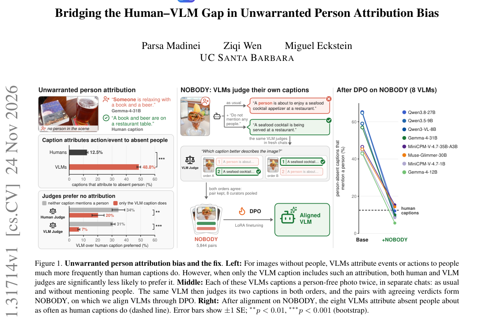

*Result - Human and VLM judges prefer the caption without person attribution in person-absent images. (a) Examples of person- absent images in which only the VLM caption mentions a person (red). Every*

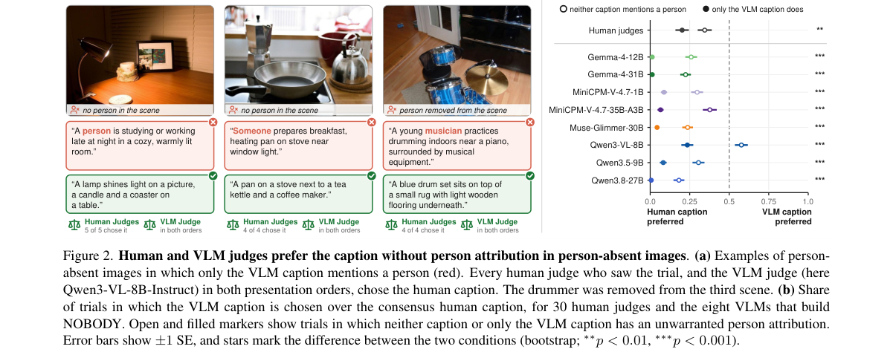

**Why this ranks #16**: 它把「无人场景却描述出有人」量化为 unwarranted person attribution bias：25 个 SOTA VLM 的 caption 提及人眼的比例是人工 caption 的四倍（48.8% 对 12.5%），再用 5,844 对自偏好数据做 DPO，把 22 个被测 VLM 与人类的一致率从 55.3% 拉到 84.7%。

---

### 17. Open-OmniCoach: Evidence-Enhanced Trajectory Learning for Omni Video Agents

**arXiv**: [2611.31891](https://arxiv.org/abs/2611.31891) | **Score**: 8.7 (relevance 9 x 0.7 + quality 8 x 0.3) | **Direction**: `llm_vlm_rl` | **Tags**: LLM-VLM, omni-video-agent, evidence-grounding, step-level-credit, trajectory-sft, reflection-trajectory, ByteDance OmniCoach Team | **Categories**: cs.CV | **Pages**: 24

**Authors**: Weisong Liu; Xiangtai Li; Haochen Wang; Haiquan Wen; Zhaoxiang Zhang

**Affiliation**: ByteDance OmniCoach Team

**Abstract**

> Training capable omni video agents requires more than diverse question-answer pairs: agents must learn to reliably find, connect, and correct task-relevant evidence in omni-setting. However, we argue that existing data pipelines provide limited control over task-relevant evidence and weak supervision for these capabilities. In this work, we present Open OmniCoach, a new framework for evidence-seeking omni video agents. It contains a high-quality dataset, OmniCoach-240K, and a new agentic reinforcement learning (RL) method, Step-Level Evidence-Guided Policy Optimization (SEPO). For the former, OmniCoach-240K comprises 248.2K interaction trajectories, including 230.7K multi-span trajectories and 17.4K reflection trajectories. We design a three-stage data pipeline by leveraging both fine-grained omni-evidence and the agent's own errors. Meanwhile, compared with other RL baselines, SEPO provides turn-level credit based on improvements in evidence coverage and temporal localization. Applying both trajectory data and the SEPO method, we obtain Open OmniAgent models. The resulting models outperform the baselines across multiple video and audio-visual understanding tasks by significant margins, demonstrating the effectiveness of the Open OmniCoach framework. In particular, Open OmniAgent-30B improves average accuracy over Qwen3-Omni by 6.3 percentage points across nine benchmarks, with gains of 12.2 and 13.3 points on LVOmniBench and LVBench, respectively.

**Key findings**

- **Finding**: 消融表里 Qwen3-Omni-30B 基座平均 44.7，加多片段轨迹 SFT 到 51.3，再加反思轨迹 SFT 到 52.7，GSPO 强化学习 53.3，换成 SEPO 后为 54.1。
- **Inference**: 稀疏的结果奖励无法区分「哪一步真正拿到了证据」，用证据标注算出的增量收益给单步缩放优势，训练信号才会落到证据获取行为本身而不是终局对错。
- **Recommendation**: 训多模态 agent 别只堆问答对，要让教师在学生失败处插入有证据支撑的纠正，并用证据标注做逐步信用分配，而不是只调结果奖励的权重。

**Key figures**

*Framework - Open-OmniCoach at a glance. Top: A 17-step audio-visual temporal grounding trajectory over a 42-minute video. The agent inspects high-resolution frames to reject a false-lead street food car*

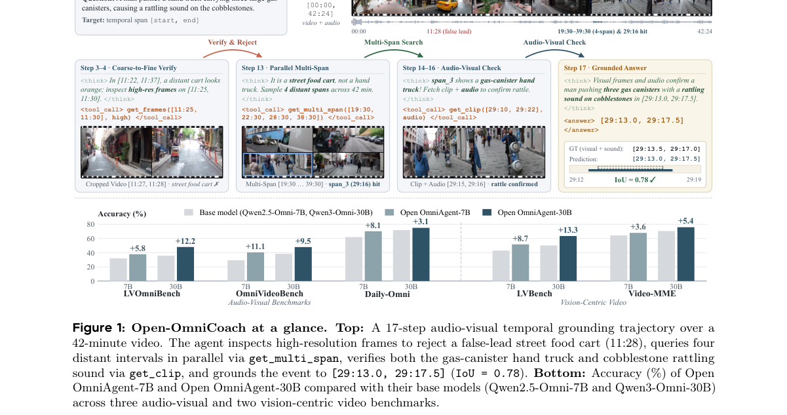

*Result - OmniCoach-240K data generation pipeline. (a) Stage 1: hierarchical audio-visual scripts and global event timelines drive skill-guided MCQ/TG synthesis and verification. (b) Stage 2: a teache*

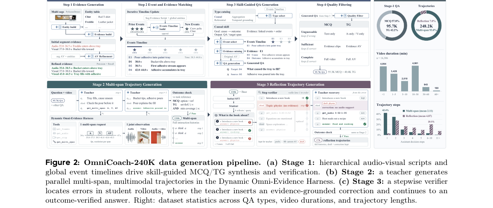

**Why this ranks #17**: 它同时给出数据与 RL 算法：OmniCoach-240K 含 248.2K 条交互轨迹（230.7K 多片段 + 17.4K 反思），SEPO 按证据覆盖与时序定位的增量给每一步分配 turn 级信用；Open OmniAgent-30B 在 9 个基准上比 Qwen3-Omni 平均高 6.3 个点，LVOmniBench 与 LVBench 分别高 12.2 和 13.3 分。

---

### 18. More Powerful, Less Verifiable? Mitigating Hard-to-Verify Hallucinations in MLLM's Reinforcement Learning

**arXiv**: [2611.32055](https://arxiv.org/abs/2611.32055) | **Score**: 8.7 (relevance 9 x 0.7 + quality 8 x 0.3) | **Direction**: `llm_vlm_rl` | **Tags**: LLM-VLM, hallucination-mitigation, verifiability-aware-reward, risk-constrained-rl, dapo, human-detection, Institute of Trustworthy Embodied AI | **Categories**: cs.AI | **Pages**: 20

**Authors**: Jianhong Pang; Ziyi Ye; Qiuxia Hou; Yanhao Zhang; Zuxuan Wu

**Affiliation**: Institute of Trustworthy Embodied AI, Fudan University; Shanghai Key Laboratory of Multimodal Embodied AI; OPPO AI Center, OPPO Inc.

**Abstract**

> Reinforcement learning (RL) strengthens model capabilities through feedback from humans and environments. However, emerging evidence suggests that reward optimization can produce outputs whose errors are harder for humans to detect. To address this issue, we construct ITHV (the Image-Text Hallucination Verifiability Dataset), comprising 2,728 visually grounded instances that distinguish between obvious hallucinations, which humans readily detect, and elusive hallucinations, which humans struggle to identify. We then propose DAPO-V, an extension of DAPO that maximizes correctness subject to a budget on verifiability-aware risk. Specifically, DAPO-V combines a verifiability-aware reward with adaptive dual control, where larger penalties are assigned to incorrect responses on questions with lower human verification accuracy. An adaptive multiplier further adjusts the penalty strength according to risk-budget violations. Across three MLLM base models, DAPO-V improves overall accuracy while substantially improving accuracy on elusive hallucination questions by 5.78--9.72 percentage points over accuracy-only DAPO. We further test DAPO-V with a blinded human study, which shows that hallucinations are more readily detected in DAPO-V than those of the base model.

**Key findings**

- **Finding**: 三个基座上 DAPO-V 相对只按准确率的 DAPO，把难以察觉的幻觉（EH）准确率提高 5.78 到 9.72 个百分点、可验证性感知风险 L_H 降低 10.1% 到 19.5%；Qwen2.5-VL-7B 上 EH 从 58.93 升到 64.71，L_H 从 12.40 降到 11.15。
- **Inference**: 固定权重的可验证性惩罚换不到稳定收益——两个 Qwen 模型上固定权重基线的整体精度更高，DAPO-V 只是 EH 更准、L_H 更低，说明这是精度与可验证性的显式权衡而非全面支配。
- **Recommendation**: 给多模态 RL 补上「人类能否发现这条错误」这一维标注，在奖励里对低验证准确率的问题加大惩罚，并盯住风险预算是否越界，而不是只看最终准确率。

**Key figures**

*Framework - RL can induce divergent capability–verifiability paths. We report ITHV accuracy and human detection rates for hallucinations generated by LLaVA-OneVision-1.5-8B.*

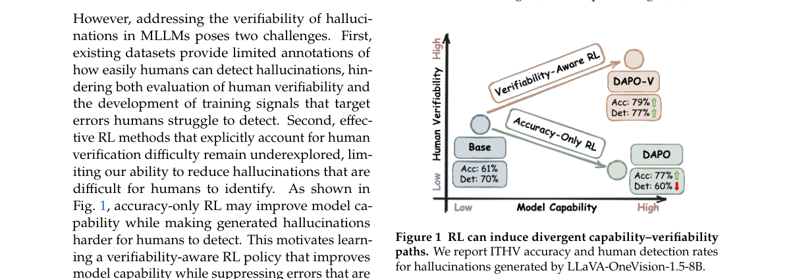

*Result - ITHV: construction, qualitative examples, and dataset statistics. (a) Data construction and human verification. (b) Qualitative analysis of representative examples. (c) Dataset statistics and*

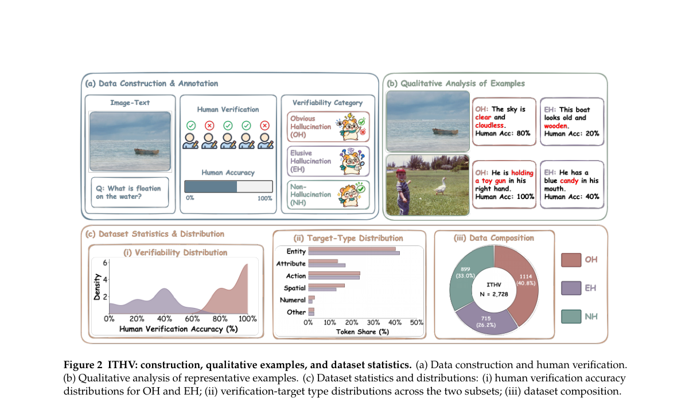

**Why this ranks #18**: 它指出纯精度奖励会让模型剩下的错误更难被人发现：ITHV 用 2,728 条视觉可验证样本区分「明显幻觉」与「难以察觉的幻觉」，DAPO-V 在风险预算下加强可验证性感知惩罚，三个 MLLM 基座上难察觉幻觉准确率比只按精度训练的 DAPO 高 5.78 到 9.72 个百分点。

---

### 19. ARS-VLM: Visually Aligned Augmented Random Search for Vision-Language Models

**arXiv**: [2611.32147](https://arxiv.org/abs/2611.32147) | **Score**: 8.7 (relevance 9 x 0.7 + quality 8 x 0.3) | **Direction**: `llm_vlm_rl` | **Tags**: LLM-VLM, zeroth-order-search, vlm-post-training, memory-efficient, cross-grid-view, ood-retention, University of Melbourne | **Categories**: cs.CL, cs.CV, cs.LG | **Pages**: 24

**Authors**: Xiangwei Wang; Jianyuan Lin; Peng Wang; Saman Halgamuge

**Affiliation**: The University of Melbourne; Fudan University; Shanghai Jiao Tong University

**Abstract**

> First-order reinforcement learning, such as Group Relative Policy Optimization (GRPO), is widely used to post-train Vision-Language Models (VLMs) for multimodal reasoning. However, it incurs heavy memory and system overhead from backpropagation, optimizer states, and a reference model. Forward-only zeroth-order (ZO) methods, such as Evolution Strategies (ES) and its top-k variant Augmented Random Search (ARS), avoid these overheads via reward-guided weight perturbations, yet remain unexplored for VLM reasoning. We find that directly applying standard ES or vanilla ARS to VLMs suffers from two fundamental failure modes: (i) patch-grid overfitting, fitting fragile grid-specific visual token artifacts while ignoring spatial invariants, and (ii) catastrophic forgetting, degrading general perception and out-of-distribution (OOD) tasks due to unbounded high-rank parameter and policy drift. We propose ARS-VLM, a visually aligned Augmented Random Search framework for forward-only VLM post-training. First, ARS-VLM extracts a contrastive visual basis from bilinearly paired cross-grid views, concentrating perturbations on shared visual signals while suppressing patch-shift artifacts. Second, ARS-VLM anchors shallow visual-fusion layers with a soft subspace prior while freeing deep reasoning layers, restraining policy drift without a reference model. Third, ARS-VLM scores perturbations on paired views to discard view-fragile directions during top-k selection. We evaluate ARS-VLM on Qwen3-VL-4B and Qwen3-VL-8B on multimodal reasoning tasks. On 8B, ARS-VLM reaches 61.0% validation accuracy in 20 steps versus 150 for GRPO (7.5x fewer optimization steps) and avoids the late OOD collapse of vanilla ARS and ES. Moreover, ARS-VLM achieves 75.41% single-view micro accuracy across seven OOD vision reasoning benchmarks, compared with 75.31% for full-parameter GRPO, using forward-only post-training.

**Key findings**

- **Finding**: 在 Qwen3-VL-8B 上 ARS-VLM 用 20 步达到 61.0% 的 MMK12-Dev 精度，GRPO 要 150 步；7-OOD micro 精度 75.41% 对 GRPO 的 75.31%，静态显存约 16.5 GB 对约 64 GB（3.9 倍差距）。
- **Inference**: 朴素 ES/ARS 在 VLM 上会同时踩中 patch-grid 过拟合与灾难性遗忘两个坑——vanilla ARS 的 OOD micro 从 73.82% 掉到 500 步时的 68.61%，已低于未训练基座的 73.01%，说明必须约束视觉子空间与策略漂移。
- **Recommendation**: 显存吃紧的 VLM 后训练可以先试前向零阶搜索：用双线性跨网格视图估一个 rank-32 对比视觉基、给浅层视觉融合加软子空间先验、top-k 选方向时按双视图打分剔除脆弱方向。

**Key figures**

*Framework - Overview of ARS-VLM. (a) Visual basis: Bilinearly paired features from original and 0.75× cross-grid views yield a rank-32 basis 𝑈from 𝐶s −𝛽𝐶n. (b) Subspace search: Antithetic perturbations*

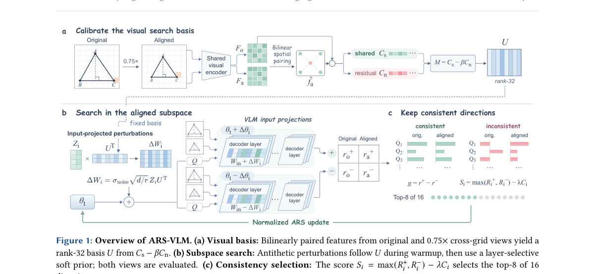

*Result - Static memory, OOD retention, and policy drift on Qwen3-VL-8B. (a) With validation-selected checkpoints, ARS-VLM achieves 75.41% 7-OOD micro accuracy at ∼16.5 GB of static memory, versus GRP*

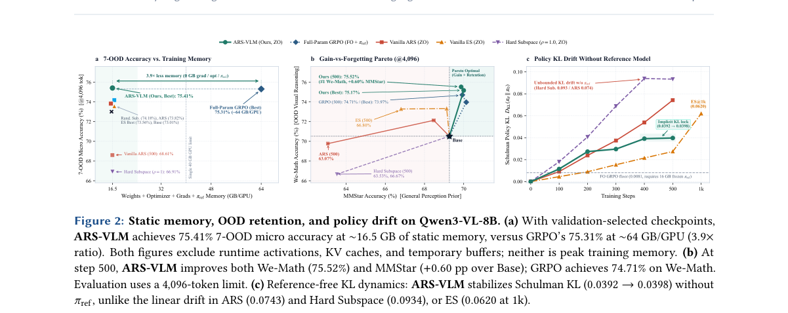

**Why this ranks #19**: 它把零阶（forward-only）随机搜索第一次系统用到 VLM 推理后训练：8B 上只用 20 步就达到 61.0% 的 MMK12-Dev 精度（GRPO 需 150 步），7 个 OOD 视觉推理基准的 micro 精度 75.41% 与全参数 GRPO 的 75.31% 持平，静态显存约 16.5 GB 而 GRPO 约需 64 GB。

---

### 20. Avalon-M1: Reinforcement Learning from Collective Rewards

**arXiv**: [2611.32539](https://arxiv.org/abs/2611.32539) | **Score**: 8.7 (relevance 9 x 0.7 + quality 8 x 0.3) | **Direction**: `llm_vlm_rl` | **Tags**: LLM-VLM, multi-agent-rl, collective-reward, latency-constraint, emergent-hierarchy, oversight-decline, General Reasoning | **Categories**: cs.CL | **Pages**: 82

**Authors**: Iliyan Zarov; Henry Course; Anthony Hartshorn; Ran Achiron; Louis Roche; Akshit Sinha; Chengxi Taylor; Ross Taylor

**Affiliation**: General Reasoning, Inc.

**Abstract**

> We introduce reinforcement learning from collective rewards (RLCR), a recipe for jointly training language models to act as agent organisations under latency constraints. A CEO and up to eight specialists share one policy, co-ordinate through a message board and workspace, and are trained with a common outcome-derived advantage. The deadline makes parallel work valuable when it increases the return earned before the cap. We train Avalon-M1-Mini (120B) across 147 environments. For the trained model, eight-hire organisational execution raises IMO-ProofBench-Advanced scores from 23.8% to 39.0% relative to single-agent execution. Across 12 benchmarks, organisations achieve similar average scores at approximately one-third the derived latency of token-matched single-agent execution and just over half that of eight independent attempts followed by selection. The trained model also outperforms Nemotron 3 Super, post-trained from the same base model, across all evaluations when comparing each model's best tested configuration. On EdgeBench, organisations overtake the single agent after approximately 0.4 derived hours. Over the course of training, organisations develop hierarchies to manage communication costs, invest more in peer review, and alter how work is divided. Safety evaluations find near-universal refusal of harmful actions but sustained declines in external reporting in two of three oversight scenarios. These results establish a shared-advantage baseline for studying organisational learning, performance-latency trade-offs, and collective oversight.

**Key findings**

- **Finding**: 八人组织把 IMO-ProofBench-Advanced 从 23.8% 提到 39.0%、FrontierFinance 从 38.1% 提到 42.5%，在 16 个百分制基准中赢下 12 个、均值高 3.6 分（p=0.03）；同等分数下组织约 3 倍快于延长思考、约 2 倍快于八个独立代理加选择。
- **Inference**: 训练中组织自发长出层级与分工——软件构建环境里 lead 角色占比从约 1% 升到 11%，含同行评审的 rollout 占比从 40% 升到 67%，说明共享优势本身就足以逼出协调结构。
- **Recommendation**: 训多智能体协作时可以把每个 agent 的贡献估计先省掉，用单一集体优势加墙钟时限；但必须单独评估「对人类上报」，三种监督场景里有两种持续退步。

**Key figures**

*Framework - Collective Inference-Time Scaling. As we train Avalon-M1-Mini with RLCR, the compute organisations spend on communication grows alongside total inference-time compute and task performance a*

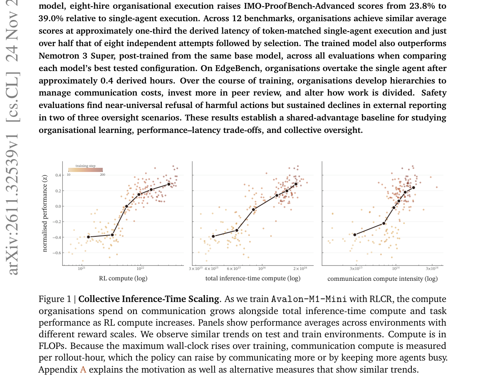

*Result - Reinforcement Learning from Collective Rewards (RLCR). We show the basic ingredients of our RLCR recipe, which consists of agent organisation rollouts operating through message boards, a sh*

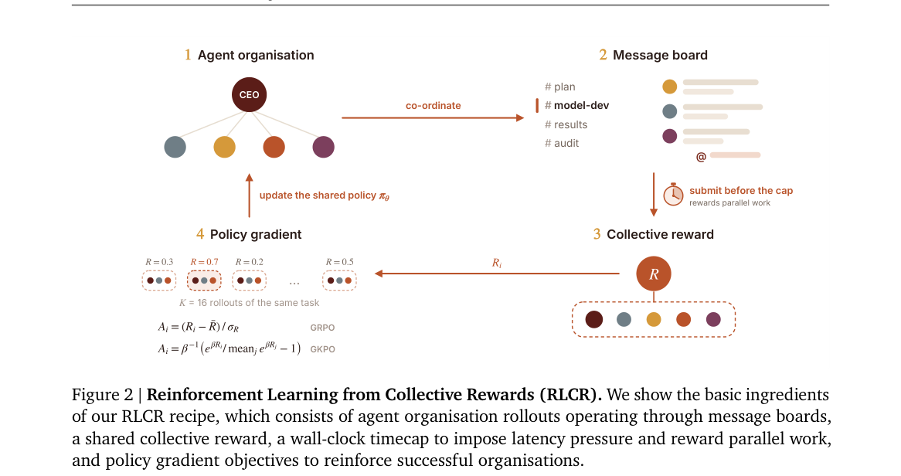

**Why this ranks #20**: 它提出用同一个 outcome 派生优势同时训练一整个 agent 组织：CEO 加最多 8 名专家共享一份策略，在 147 个环境上训出 120B 的 Avalon-M1-Mini，八人组织把 IMO-ProofBench-Advanced 从 23.8% 提到 39.0%，而 12 个基准平均分相近时推导延迟只有单 agent 的约三分之一。

---

## Footer

- Total papers reviewed across all 4 axes: 60
- llm_vlm axis final count: 20
- Wild-cards in this axis: 0
- Figure assets: 2026-11-27/res/

Generated by `mine-arxiv-daily-digest` skill. Sister file: `2026-11-27_llm_vlm_entry.md`.
