# Mine Arxiv Daily Digest - 2026-11-27 (具身智能与世界模型 Axis, 20 papers)

**Generated**: 2026-11-27 01:51:48 CST

**Source**: arXiv cs.CV, cs.SD, eess.AS, cs.CL, cs.AI, cs.RO, cs.LG, cs.IR submissions, listing day 2026-11-25 (announced listing 11-25 于 2026-11-26 01:00 UTC 公告)

**Batch window**: 2026-11-24T19:00:00Z .. 2026-11-25T19:00:00Z（arXiv 公告批次窗口按 listing 日逐段相接：每段的起点是前一日的美东 14:00 截止时刻（EDT 为 18:00Z，EST 为 19:00Z），终点是当日同一时刻）

**Axis**: world_embodied (20 papers, base 15, cap 20)

**Directions**: world_model (7), embodied_ai (13)

**Selection**: 20 papers ranked by relevance x quality, with 0 wild-card slots

**Day total**: 60 papers across 4 axes (target 60)

**Scope**: 世界模型、学习型模拟器与具身智能，含移动操作、人形控制、触觉反射、VLA 策略与面向具身任务的强化学习

**Wild-card**: 0 篇 —— world_model 57 篇、embodied_ai 193 篇够格候选远超本轴 20 个席位，本轴已撞到 axis 上限 20，且有 4 篇 rel≥9 因上限落选，没有启用任何补位名额。

本轴 20 篇撞到上限，world_model 停在基准 7，embodied_ai 吃到 13（基准 8）——多出的 5 个名额全部由 embodied_ai 吸收，因此该 direction 有 4 篇 rel≥9 落选。本轮这一轴的主线是「世界模型变成动作先验」：SplatWAM 直接在 3D 高斯上学动力学、M2R 把特征存到物体网格表面、CodeWAM 用可执行代码表示驾驶世界；而 embodied_ai 侧的体检（RoboARC 特权态 86% 对标准态 43%）与规模（HoloBrain-0.5、EgoLoAF、Any2Act）同时推进。

---

## 世界模型与学习型模拟器 · `world_model` (7 papers)

7 篇把世界模型从「预测画面」改成「动作先验」。M2R 把特征存到物体自身网格表面并靠光栅化检索，外观随物体移动与重访持久保持，物体恒存性翻倍、720p 40 FPS 实时渲染；SplatWAM 在 3D 高斯上学动作条件动力学，新视角渲染比视频世界模型快 12 倍、约 80 FPS，PSNR 高 2.0 dB；CodeWAM 把可执行代码当驾驶世界表示，NAVSIM v1 navtest 拿到 93.6 PDMS；SimPWM 用模拟器代理驱动视频模型，机器人 IoU 0.75–0.78 而端到端最多 0.69、漏拾取从 54% 降到 38%。另一半在修记忆与规划：M2-WAM 的分层记忆让 MIKASA-Robo 与 RMBench 提升 53.2% 与 61.2%；WorldReforge 用 62k 条扰动抓取轨迹让物体轨迹误差降 28.2%；Graph Anchors 指出潜空间距离在远处目标与接触处失效，免训练把 LeWM 成功率从 13% 提到 85%。

### 1. A Mesh to Remember: Persistent Appearance for Interactive Video Worlds

**arXiv**: [2611.32445](https://arxiv.org/abs/2611.32445) | **Score**: 8.7 (relevance 9 x 0.7 + quality 8 x 0.3) | **Direction**: `world_model` | **Tags**: embodied, surface-memory, causal-video-renderer, object-permanence, zero-shot-transfer, NVIDIA | **Categories**: cs.CV | **Pages**: 30

**Authors**: Joonghyuk Shin; Alex Trevithick; Katarína Tóthová; Liyuan Zhu; Shengyu Huang; Jaesik Park; Shalini De Mello; Laura Leal-Taixé; Riccardo de Lutio; Haithem Turki

**Affiliation**: NVIDIA; Seoul National University; Stanford University

**Abstract**

> Video world models synthesize photorealistic observations in response to user actions but struggle to remain consistent over long interactions. Coding agents and text-to-3D models instead generate explicit 3D worlds whose geometry and state persist by construction, but whose appearance falls far short of photorealism. Recent methods combine the strengths of both by rendering such worlds into coarse proxies that guide a video model. However, since these proxies only specify where things are, the renderer must invent what they look like as the world is explored, and anything it forgets is reinvented when a surface reappears. Our key insight is that a mesh identifies which surface each pixel shows, across frames and views, even as objects move, allowing it to serve as an address for what the renderer generates. We propose M2R (Mesh to Remember), a few-step causal video renderer that stores its own features on the surfaces they depict, in each object's frame, and retrieves them by rasterizing the mesh whenever those surfaces come back into view. Appearance thus travels with objects wherever they move, persists across revisits, and is shared by every agent that observes it, while memory grows with the surfaces seen instead of the number of frames. Trained only on synthetic data, M2R transfers zero-shot to real indoor scans and to worlds authored by coding agents. It outperforms state-of-the-art methods in consistency across static, dynamic, and multi-agent benchmarks, more than doubling object permanence and nearly doubling cross-agent consistency, while rendering 720p video in real time (40 FPS).

**Key findings**

- **Finding**: M2R 在静态、动态与多智能体基准上一致性均优于同类方法，物体持久性提升一倍以上、跨智能体一致性接近翻倍，720p 渲染达 40 FPS，记忆压缩 18 倍后 8,000 帧 rollout 仅占 45 GiB 显存。
- **Inference**: 用网格做表面寻址把「记忆」从上下文长度解耦到已见表面面积，长交互漂移因此是存储结构问题而不是模型规模问题。
- **Recommendation**: 评测交互式世界模型时单独报告物体持久性与跨智能体一致性，并检查长 rollout 显存是否随帧数线性增长。

**Key figures**

*Framework - Given an initial frame and a coarse, untextured mesh from a coding agent or a 3D scan, M2R renders photorealistic video for every agent in real time. It stores the features it generates on t*

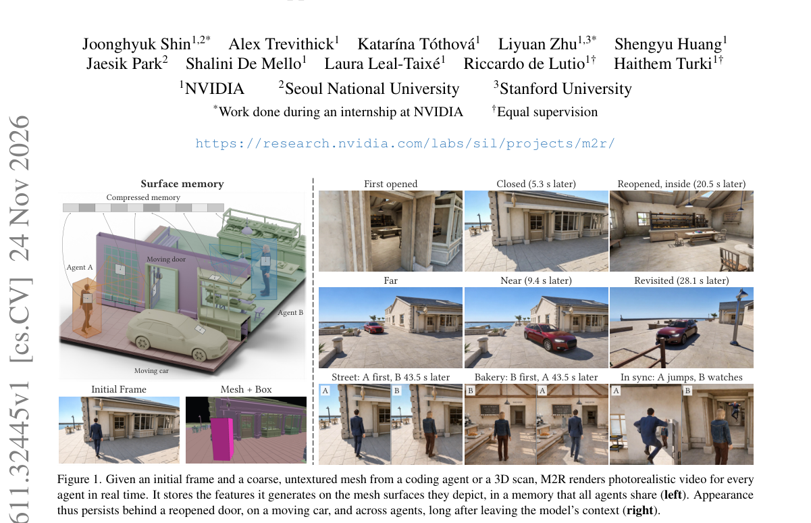

*Result - Method overview. M2R renders each agent’s view from the initial frame and renderings of a shared scene mesh. As agent A explores, it stores generated keys and values in a surface memory, ind*

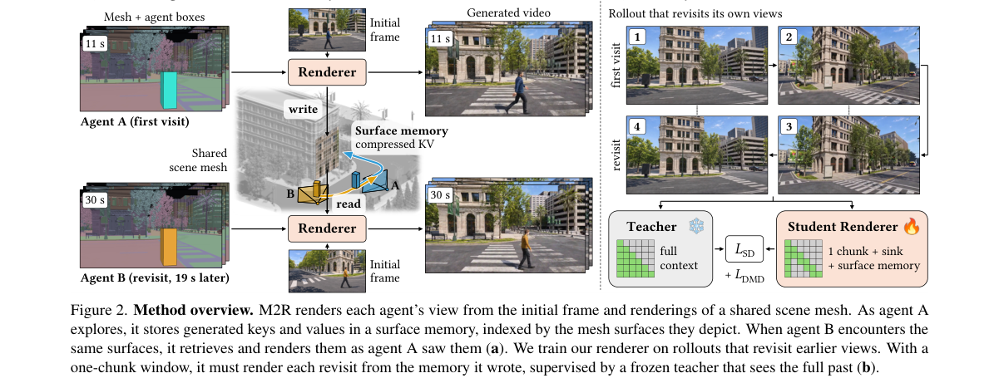

**Why this ranks #1**: 把网格当作渲染器的地址：特征写回各自物体坐标系下的表面，物体移动后外观跟着走，720p 实时 40 FPS，记忆用变换编码压缩 18 倍。

---

### 2. CodeWAM: A Code World Action Model for End-to-End Autonomous Driving

**arXiv**: [2611.32483](https://arxiv.org/abs/2611.32483) | **Score**: 8.7 (relevance 9 x 0.7 + quality 8 x 0.3) | **Direction**: `world_model` | **Tags**: embodied, code-world-model, autonomous-driving, executable-representation, planning, Nanyang Technological University | **Categories**: cs.AI, cs.RO | **Pages**: 23

**Authors**: Zhisheng Chen; Jinpeng Wang; Beicheng Lou; Zhengwei Xie; Hao Wu; Rui Qian; Kun Wang; Vivian W. H. Wong

**Affiliation**: Nanyang Technological University; Tsinghua University; Independent Researcher; University of Science and Technology of China; Fudan University

**Abstract**

> Driving world models anticipate action consequences through representations of how the world evolves. For autonomous driving, these representations must capture both the surrounding scene and the ego vehicle's motion under a candidate plan. We propose CodeWAM, a driving world model that incorporates executable code as part of its world representation. Code represents ego dynamics by expressing how the vehicle state evolves under plan execution, while a learned visual model captures scene-dependent consequences. Executing the code produces a candidate-conditioned motion sequence, which is evaluated relative to the prior plan and recorded motion history. The resulting execution consequences and learned scene outcomes jointly represent the candidate's future, enabling the planner to assess both what a plan may lead to and how the vehicle transitions into that future. The selected plan becomes part of the next decision's execution context, linking successive choices within the model. CodeWAM achieves 93.6 PDMS on NAVSIM v1 navtest, 92.1 EPDMS on v2 navtest, and 50.6 EPDMS on NAVHARD. Further experiments demonstrate improved pairwise execution consistency and gains on Hydra-MDP and DrivoR without additional training, supporting executable code as a complementary representation for driving world models.

**Key findings**

- **Finding**: CodeWAM 在 NAVSIM v1 navtest 达 93.6 PDMS、NAVSIM v2 navtest 92.1 EPDMS、NAVHARD 50.6 EPDMS，且在 Hydra-MDP 与 DrivoR 上无需额外训练即有增益。
- **Inference**: 代码执行给出的是精确的自车状态转移而非视频统计外推，所以计划与执行之间的一致性可以被显式衡量，而不必靠潜空间距离近似。
- **Recommendation**: 做端到端驾驶规划时，可把自车动力学写成可执行程序交给世界模型，让规划器评估「计划会怎样执行」而不只是「看起来像什么」。

**Key figures**

*Framework - Comparison of driving world model paradigms. (a–c) Predictive representations support planning through future video, latent prediction, or future conditioning. (d) CodeWAM explicitly models*

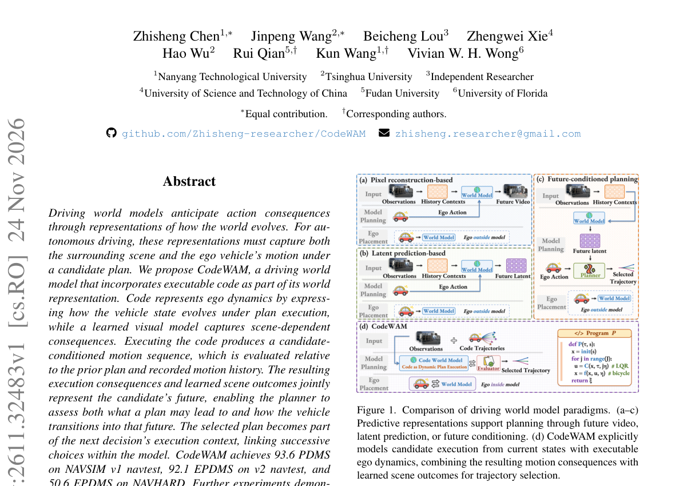

*Result - Overview of CodeWAM. For each candidate plan proposed by the policy, a program rolls out the motion the ego vehicle produces from its current state, and the resulting motion is compared with*

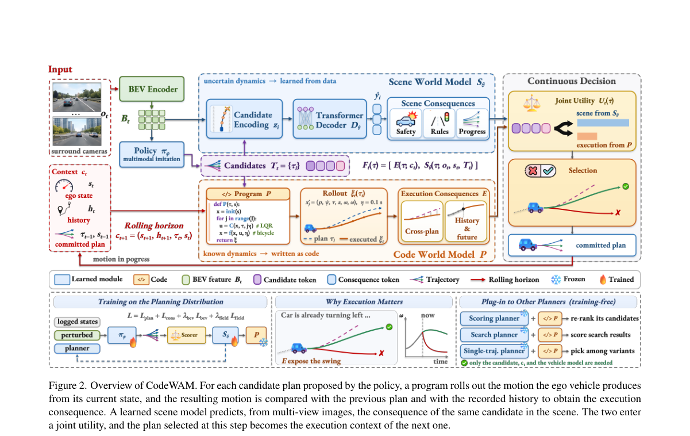

**Why this ranks #2**: 把可执行代码塞进驾驶世界模型表示自车动力学，NAVSIM v1 navtest 拿到 93.6 PDMS，v2 navtest 92.1 EPDMS，NAVHARD 上 50.6 EPDMS。

---

### 3. Simulator-as-Proxy World Model for Robot Manipulation

**arXiv**: [2611.32786](https://arxiv.org/abs/2611.32786) | **Score**: 8.7 (relevance 9 x 0.7 + quality 8 x 0.3) | **Direction**: `world_model` | **Tags**: embodied, simulator-proxy, video-world-model, state-perturbation, manipulation, Mohamed bin Zayed University of | **Categories**: cs.CV, cs.LG, cs.RO | **Pages**: 27

**Authors**: Tingting Liao; Mingjia Huo; Hao Li; Zhengzhong Liu; Eric P. Xing; Guangyi Liu

**Affiliation**: Mohamed bin Zayed University of Artificial Intelligence; University of California, San Diego; Pinscreen

**Abstract**

> Video world models for robots are increasingly conditioned on a simulated or rendered proxy of the scene, on the assumption that the video will show what the proxy shows. Testing this assumption requires a proxy whose state is explicit and can be perturbed. We present SimPWM (Simulator-as-Proxy World Model): given a calibrated camera, it represents, from the first frame alone, the robot by its 3D model and the objects the gripper may touch as 3D points; a rule-based simulator with no trained parameters moves them under the actions, and a video model renders the result. SimPWM returns the realistic video together with the simulated state. We then freeze the simulated objects while the arm moves as recorded and check whether the video still shows the object lifted. On DROID episodes from unseen setups, the answer differs for the arm and for the objects. With each of three base video models, the arm follows the proxy (robot IoU 0.75-0.78, against at most 0.69 for end-to-end models); rendering the robot alone already gives this. What the simulated objects add is the object state: against a robot-only proxy, they cut missed pick-ups from 54% to 38%, and the video follows them only with some base models: on rigid objects, freezing them lowers the lift rate of MiniMax-H3, fine-tuned on episodes whose simulation agrees with the real video, from 42% to 10%, but that of LTX-2.3, trained on the same episodes, only from 57% to 49%, as if it inferred the grasp from the arm motion; more than half of the remaining lifts of MiniMax-H3 are of cloth and rope, which the simulator carries rigidly. With any base model, the simulated state records what the simulation did; under perturbed actions, a video that disagrees with it reveals that the video ignores the simulated state.

**Key findings**

- **Finding**: 冻结被模拟的物体而让机械臂按记录动作运动时，MiniMax-H3 的举起率从 42% 掉到 10%，LTX-2.3 只从 57% 掉到 49%，说明基座模型对模拟状态的依赖差异很大。
- **Inference**: 视频世界模型即使渲染出正确的机械臂也不代表它遵守代理状态，所以代理一致性必须用扰动实验单独检验。
- **Recommendation**: 评估条件化视频世界模型时加入「冻结代理状态」的对照实验，并单独报告物体状态指标而不是只报画面质量。

**Key figures**

*Framework - Following the simulated state. Under the recorded actions (top), both base models lift the cup as the proxy does. With the gripper held open (middle) or the simulated objects frozen while th*

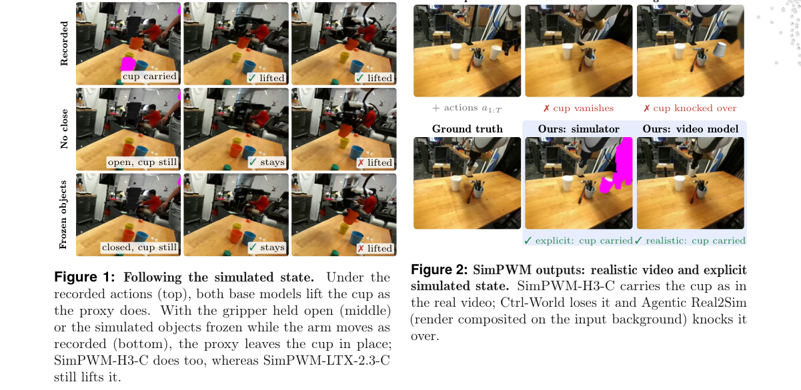

*Result - SimPWM outputs: realistic video and explicit simulated state. SimPWM-H3-C carries the cup as in the real video; Ctrl-World loses it and Agentic Real2Sim (render composited on the input backg*

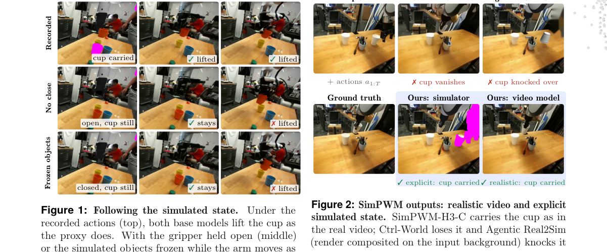

**Why this ranks #3**: 用无训练参数的规则模拟器代理物体状态、视频模型只负责渲染：DROID 未见场景上机器人 IoU 0.75–0.78，漏抓率从 54% 降到 38%。

---

### 4. SplatWAM: Splatting World Action Models for Real-Time 3D Imagination

**arXiv**: [2611.33467](https://arxiv.org/abs/2611.33467) | **Score**: 8.7 (relevance 9 x 0.7 + quality 8 x 0.3) | **Direction**: `world_model` | **Tags**: embodied, gaussian-primitives, world-action-model, real-time-rendering, flow-matching, CVSSP | **Categories**: cs.CV, cs.LG, cs.RO | **Pages**: 21

**Authors**: Frank Tsu-Fang Lu; Karthik Sundar Senthilkumar; Christopher Thirgood; Oscar Mendez; Simon Hadfield

**Affiliation**: CVSSP, University of Surrey; Locus Robotics

**Abstract**

> World models typically predict future observations in pixel or latent space, limiting their ability to directly represent true 3D scene evolution. We present SplatWAM (Splatting World Action Model), a generative world model that learns action-conditioned dynamics directly over compact 3D Gaussian primitives. A tokenizer SplatWAM-T first encodes a variable number of unposed views into a fixed budget of Gaussian tokens. A dynamics model SplatWAM-D then predicts future Gaussian states in a single forward pass per action, using log-Euclidean covariance coordinates and differentiable rendering supervision to facilitate learning in an explicit 3D space. Each predicted state can be rasterized from arbitrary viewpoints, enforcing a shared 3D representation across views by construction. On OGBench Scene, SplatWAM renders novel views 12x faster than video world models (~80 FPS on an RTX 5090) with up to 2.0 dB higher PSNR. We further introduce SplatWAM-P, a lightweight flow-matching policy head jointly trained with the dynamics model. Across 8 task suites, model-free Gaussian-token policies outperform pixel-based counterparts by up to 24.8 percentage points. SplatWAM-P improves over Latent Particle World Model (LPWM) by 12 percentage points and matches HIQL without a learned value function. On LIBERO, our ~1B model outperforms WorldVLA (~7B) and the robot-pretrained OpenVLA (~7B), while matching OpenVLA-OFT when both are trained without large-scale robot pretraining. Code and checkpoints will be released.

**Key findings**

- **Finding**: SplatWAM-T 把数量可变的无位姿视图编码成固定预算的高斯 token，SplatWAM-D 每个动作一次前向预测下一个高斯状态；LIBERO 上约 1B 的模型超过 7B 的 WorldVLA 与机器人预训练的 OpenVLA。
- **Inference**: 显式 3D 高斯状态既保留跨视角一致性，又能让策略直接读同一份几何状态，省掉像素世界模型到动作之间的额外接口。
- **Recommendation**: 评估世界模型时同时看渲染速度与基于同一状态的策略表现，只比 PSNR 会漏掉「能不能直接当策略输入」这一关键属性。

**Key figures**

*Framework - SplatWAM imagines in 3D. SplatWAM predicts future 3D Gaussian states, rasterizes them from any viewpoint, and outputs actions from the same states. We show a 32-step rollout with a sweeping*

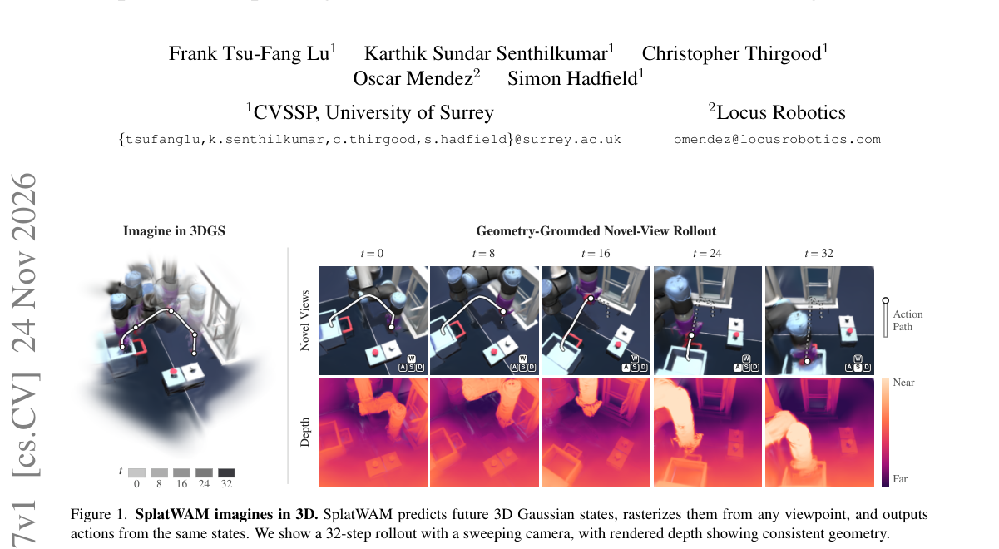

*Result - SplatWAM overview. SplatWAM-T lifts unposed context views into Gaussian states. SplatWAM-D denoises the next state given the action, repeated H times. SplatWAM-P’s agent tokens read the obse*

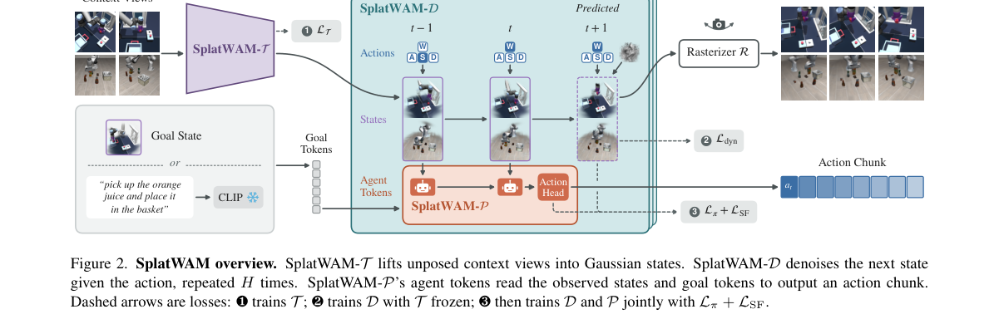

**Why this ranks #4**: 直接在高斯图元空间学习动作条件动力学：OGBench Scene 上新视角渲染比视频世界模型快 12 倍（RTX 5090 上约 80 FPS），PSNR 高出最多 2.0 dB。

---

### 5. $\mathrm{M}^{2}$-WAM: Efficient Hierarchical Memory Across Modalities and Timescales for World-Action Models

**arXiv**: [2611.33710](https://arxiv.org/abs/2611.33710) | **Score**: 8.7 (relevance 9 x 0.7 + quality 8 x 0.3) | **Direction**: `world_model` | **Tags**: embodied, hierarchical-memory, world-action-model, long-horizon, gated-delta, Harbin Institute of Technology | **Categories**: cs.RO | **Pages**: 26

**Authors**: Xiaopeng Zhang; Weiqi Yuan; Xin Zhu; Jiaxi Huang; Yueqi Hu; Yin Zhang; Jian Yao; Yanjie Li

**Affiliation**: Harbin Institute of Technology, Shenzhen; Robotics Foundation Model Team, XPENG

**Abstract**

> Long-horizon robotic manipulation requires historical context, yet retaining extensive visual histories incurs growing storage and retrieval costs, while aggressive compression risks losing fine-grained information needed for subsequent decisions. Moreover, executed action histories capture intermediate behaviors that sparse visual observations may miss. Preserving this complementary context efficiently calls for modality-specific memory mechanisms that balance recent detail with long-term retention. To this end, we introduce $\mathrm{M}^{2}$-WAM, a world-action model equipped with hierarchical visual and interaction memories. $\mathrm{M}^{2}$-WAM preserves recent visual observations in dense short-term memory while consolidating entries evicted from this window into fixed-size associative long-term memory through gated delta updates. Within the same short- and long-term hierarchy, interaction memory encodes executed action prefixes into compact temporal representations, complementing visual observations with behavioral context. These complementary memories are integrated into world-action modeling through layer-wise retrieval, enabling memory-augmented action generation with a bounded online memory footprint independent of episode length. On the memory-dependent simulation benchmarks MIKASA-Robo and RMBench, $\mathrm{M}^{2}$-WAM achieves +53.2% and +61.2% absolute improvements in average success rates over Fast-WAM, respectively. These gains extend to real-world manipulation, where $\mathrm{M}^{2}$-WAM achieves a +29.3% absolute improvement over LingBot-VA in average success across three tasks. These results suggest that $\mathrm{M}^{2}$-WAM offers a promising approach to efficient memory-augmented world-action modeling.

**Key findings**

- **Finding**: M2-WAM 用稠密短期记忆保存近期视觉观测，被淘汰条目经门控增量更新并入定长联想式长期记忆，交互记忆把已执行动作前缀压成紧凑时间表示；相对 Fast-WAM 在 MIKASA-Robo 上 +53.2%、RMBench 上 +61.2% 绝对成功率，真机三项任务上比 LingBot-VA 高 29.3%。
- **Inference**: 长程任务的瓶颈不在视觉细节而在「多久以前发生过什么」与「我做过什么」，把记忆按时间尺度分层能以恒定在线开销换取这份上下文。
- **Recommendation**: 做长程操作时先区分需要保留观测时长与需要保留动作历史的子任务，再分别设计短期窗口与定长长期记忆，而不是保存全历史。

**Key figures**

*Framework - Motivation and overview of M2-WAM. (a) Memoryless WAMs lack historical context. (b) Full-history memory incurs growing storage and retrieval costs. (c) M2-WAM organizes visual and interactio*

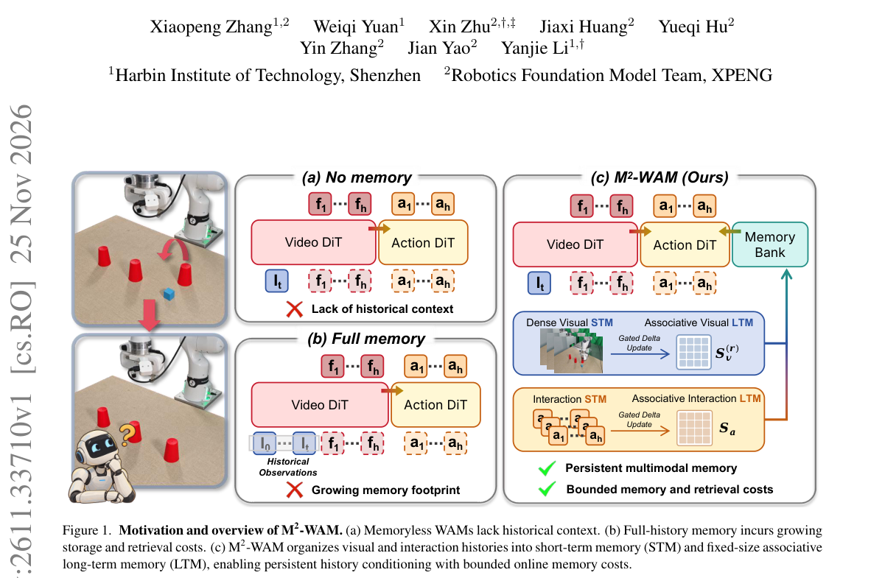

*Result - Overview of the M2-WAM architecture. (a) Video and action diffusion transformers form a mixture-of-transformers backbone; future-video prediction is training-only. (b) Action features retrie*

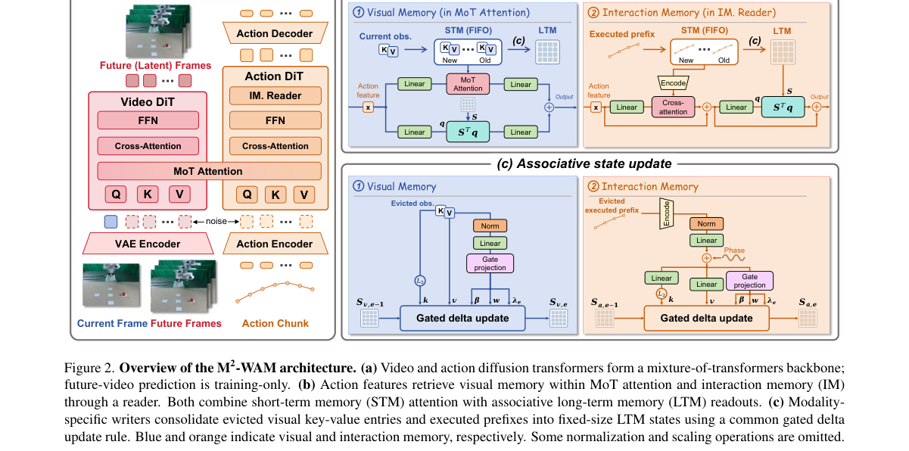

**Why this ranks #5**: 稠密短期视觉记忆加定长联想式长期记忆，被淘汰条目经门控增量更新迁入：MIKASA-Robo 与 RMBench 上平均成功率比 Fast-WAM 高 53.2 与 61.2 个百分点。

---

### 6. Beyond the Happy Path: Generalizing Robot World Models from Simulated Failures

**arXiv**: [2611.33925](https://arxiv.org/abs/2611.33925) | **Score**: 8.7 (relevance 9 x 0.7 + quality 8 x 0.3) | **Direction**: `world_model` | **Tags**: embodied, failure-data, world-model, contact-supervision, trajectory-error, Zhejiang University | **Categories**: cs.AI, cs.RO | **Pages**: 24

**Authors**: Zhiyue Zhao; Mingyu Liu; Bolin Zhang; Liyang Li; Guangyu Huang; Canyu Zhao; Jinchuan Shi; Haokai Zhang; Hao Chen; Chunhua Shen

**Affiliation**: Zhejiang University; Shanghai Innovation Institute

**Abstract**

> Robot world models are increasingly used to evaluate and plan policies, yet robot training data are dominated by successful demonstrations. Off the happy path, when a grasp is misaligned or mistimed and the object is pushed, tilted, or slips, their predictions break down. Across five pretrained action-conditioned models, object-motion error is at most 10.4% lower than that of a static baseline that copies the first frame, and two models are worse than this baseline. We present WorldReforge, which teaches world models what happens when manipulation goes wrong. We construct the Reforge dataset of 62k simulated trajectories by perturbing reference grasps in position, orientation, and closure timing, recording each resulting push, slip, or failed pickup with ground-truth object pose, contact, and surface points. WorldReforge turns this ground truth into two training signals without additional inference cost. Interaction Alignment focuses reconstruction on the small object and contact regions that a global loss underweights, and Surface Correspondence trains backbone features to follow the same physical surface points across frames. On Cosmos3 Nano, WorldReforge reduces object trajectory error by 28.2% overall and by 35.0% on unseen objects, and it lowers the error in predicting how two actions' outcomes diverge by 43.3%. Although trained only in simulation, it also improves reconstruction on DROID and on real failure videos. Controlled data studies show that failed contact and successful holding teach complementary physics: failed contact teaches how objects respond, and holding teaches how a grasped state persists. Our code, data, and models are available at aim-uofa.github.io/WorldReforge/.

**Key findings**

- **Finding**: 五个预训练动作条件模型的物体运动误差相对「复制首帧」的静态基线最多只低 10.4%，其中两个模型还不如基线；Reforge 数据集含 62k 条仿真轨迹，使 Cosmos3 Nano 轨迹误差总体降 28.2%、未见物体降 35.0%，预测两个动作结果差异的误差降 43.3%。
- **Inference**: 现有世界模型在成功轨迹上学到的「物理」更接近静态外观惯性，所以一旦交互偏离成功路径就退化成拷贝首帧。
- **Recommendation**: 评测动作条件世界模型时加入失败与滑脱片段，并优先用「两个动作结果差异」的误差而非单条重建误差作为指标。

**Key figures**

*Framework - WorldReforge combines structured interaction experience with physical supervision. 01 The Reforge dataset links execution variations to observed consequences. 02 Interaction Alignment emphas*

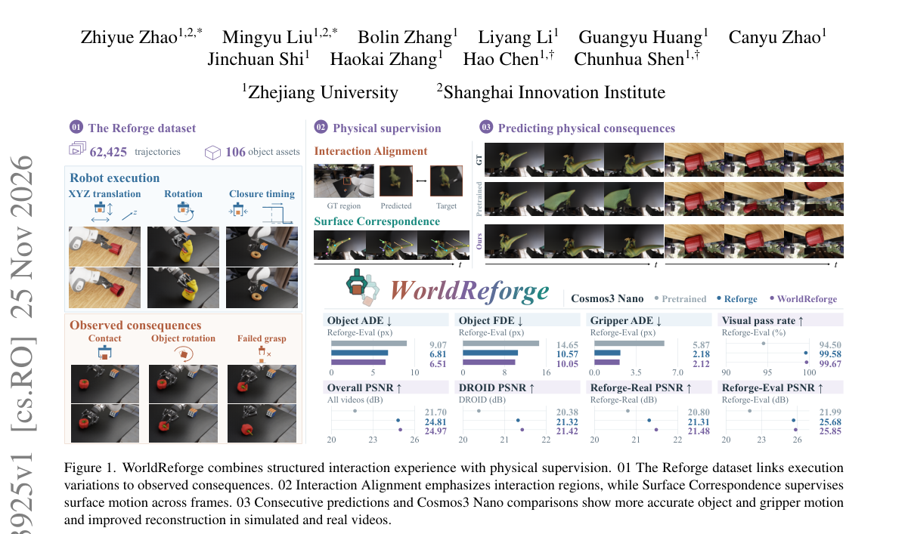

*Result - Overview of the Reforge dataset. Execution variations span translation, rotation, and closure timing; observed conse- quences include failed contact, object responses, and grasp out- comes.*

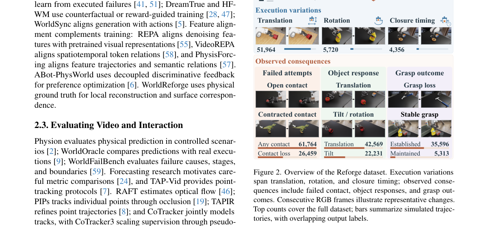

**Why this ranks #6**: 直接造失败数据：扰动参考抓取的位置、姿态与闭合时机得到 62k 条仿真轨迹，让世界模型在 Cosmos3 Nano 上把物体轨迹误差降低 28.2%。

---

### 7. Long-Horizon Planning with Latent World Models via Graph Anchors

**arXiv**: [2611.34509](https://arxiv.org/abs/2611.34509) | **Score**: 8.7 (relevance 9 x 0.7 + quality 8 x 0.3) | **Direction**: `world_model` | **Tags**: embodied, latent-world-model, training-free-planner, long-horizon, goal-distance, Robotics and Mechatronics Engineering | **Categories**: cs.AI, cs.CV, cs.RO | **Pages**: 48

**Authors**: Syed Nazmus Sakib; Abdul Monaf Chowdhury; Peizhen Li; Nafiul Haque; Chandak Chakma; Md Mehedi Hasan; Zehong Cao; Shifat E. Arman

**Affiliation**: Department of Robotics and Mechatronics Engineering, University of Dhaka; Department of Computer Science, University of Oxford; School of CSIT, Adelaide University

**Abstract**

> Latent world models plan in a compact latent space by predicting the outcomes of actions. Their planners judge a plan by the latent distance between its predicted end state and the goal image. We show that this distance fails in two distinct ways. First, it loses directional signal a few steps from the goal, causing distant goals to fail. Second, it weighs the robot arm over the manipulated object, causing manipulation to fail at contact. We measure both failures directly on recorded data by asking whether a lower latent distance corresponds to true progress toward the goal. Across five environments, six visual representations (including raw pixels and V-JEPA 2), and nine Meta-World tasks, this ranking test cleanly separates the two failures, and the graph distance to a goal predicts where closed-loop planning breaks down. Both failures share a single remedy: replacing the distant goal with a nearby target that lies on a recorded trajectory. We realize this principle with Graph Anchors, a training-free planner for frozen latent world models. It builds a sparse graph once over the model's own training frames and aims each planning step at a node a few moves ahead along the shortest path to the goal, keeping paths on recorded transitions wherever contact matters. On goals up to 400 steps away, Graph Anchors raise LeWM's success from 13% to 85% on PointMaze-Medium, from 8% to 87% on PointMaze-Large, and from 5% to 71% on Push-T, where stronger search toward the goal fails and where prior training-free planners break down under missing step horizons, subsampling shortcuts, or fragmented contact.

**Key findings**

- **Finding**: 论文在五个环境、六种视觉表示（含原始像素与 V-JEPA 2）和九个 Meta-World 任务上做排序检验，证明「更低潜距离」并不对应真实进展，且图距离能预测闭环规划在哪里崩掉。
- **Inference**: 目标距离同时丢掉方向性并把机械臂权重压过被操作物体，因此失败分别出现在离目标还远和接触瞬间两处。
- **Recommendation**: 免训练规划器也应改用沿录制轨迹的近邻锚点做中间目标，而不是拿远端目标图像比潜距离。

**Key figures**

*Framework - A distant goal misleads the planner, while near targets on a recorded route guide it. (a) LeWM aims every plan straight at a goal 200 steps away and loses its way in the maze. (b) Graph*

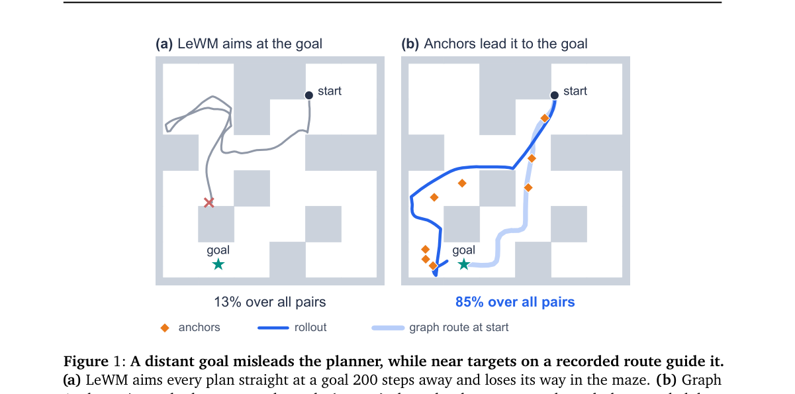

*Result - The diagnosis in four steps. (a) Directional ranking accuracy ρ(h) of the LeWM goal cost against graph distance to the goal across 300 goals per environment, with navigation tasks in bold/da*

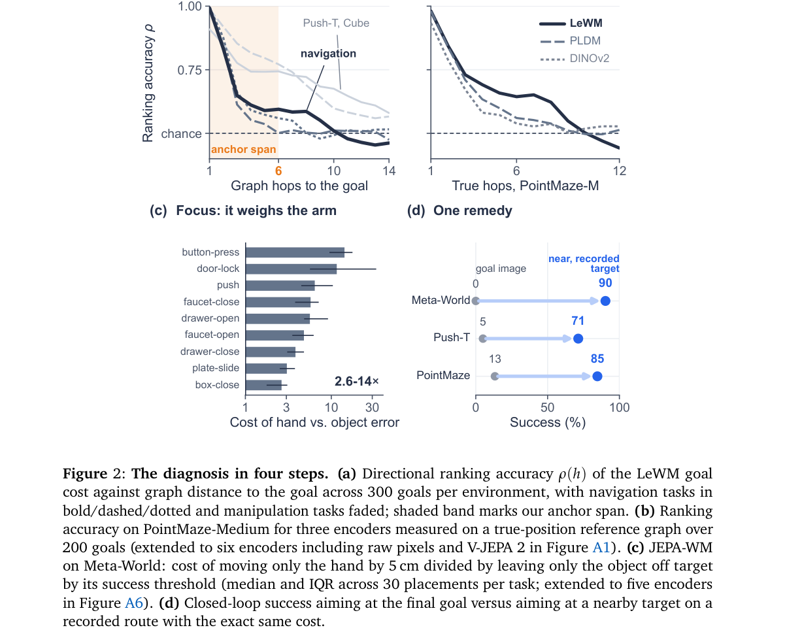

**Why this ranks #7**: 指出潜空间目标距离在两种情况下失效，改成瞄准录制轨迹上的近邻锚点：400 步以内的远目标上把 LeWM 成功率从 13% 提到 85%、8% 提到 87%、5% 提到 71%。

---

## 具身智能与机器人学习 · `embodied_ai` (13 papers)

13 篇里 4 篇在给具身做体检、4 篇在把规模推上去，其余在修执行。体检侧最刺眼的是 RoboARC：90 个空间约束任务里最强的编码智能体在特权态解 86%、标准态只剩 43%，四个零样本 VLA 全未解。规模侧 HoloBrain-0.5 用超 1 万小时、15 种本体数据预训练，后训练真机成功率 94.52% 超过 π0.5 的 86.25%；EgoLoAF 不用穿戴动捕与遥操作就释出 128400 episode、1000 小时的人形 loco-manipulation 数据，4 个真机任务 73.1 对遥操作 74.4；Any2Act 用 1.2M 真机轨迹预训练后，单演示未见任务 57.5% 超过每任务 50 演示微调的 VLA。执行侧，Skill Envelope 让 LIBERO-Goal 两步接缝成功率从 82.8% 升到 92.3%；Screw Attention 只要 30K 参数就拿到 LIBERO 96%、五种未见机械臂 80.2%；DiffGR00T 用动作条件世界模型替代不可微仿真器，HumanoidArena 四任务从 59.2% 升到 71.7%。

### 8. HoloBrain-0.5 Technical Report

**arXiv**: [2611.34449](https://arxiv.org/abs/2611.34449) | **Score**: 9.0 (relevance 9 x 0.7 + quality 9 x 0.3) | **Direction**: `embodied_ai` | **Tags**: embodied, vla-model, multi-embodiment, fsq-tokenization, diffusion-policy, Horizon Robotics HoloBrain Team | **Categories**: cs.RO | **Pages**: 23

**Authors**: Xuewu Lin; Jiahao Wang; Jiawei Li; Mengdi Li; Zhengmao Sun; Yiwei Jin; Hongyu Xie; Zhengyang Feng; Kun Wu; Zihao Chen; Lianzhou Zhang; Lichao Huang

**Affiliation**: Horizon Robotics HoloBrain Team

**Abstract**

> We present HoloBrain-0.5, a family of vision-language-action (VLA) models for manipulation across robot embodiments. The policies plan in a shared action space using robot state, kinematic structure, and calibrated camera observations. We standardize joint axes, coordinate frames, and tool-center points in robot descriptions (URDFs) and encode their kinematic graphs in a shared 3D representation. HoloBrain-0.5-Continuous generates action chunks by diffusion, while HoloBrain-0.5-Discrete uses residual finite scalar quantization (FSQ) and delayed autoregression. We pretrain both policies on over 10,000 hours of real-robot, simulation, and human-manipulation data spanning 15 embodiment categories. Across six closed-loop simulation settings, the discrete policy converges faster and reaches a higher mean success rate than the continuous policy (56.77% vs. 49.71%). On seven real-robot tasks, it achieves a mean progress score of 87.76% without task-specific post-training. After post-training, the continuous policy outperforms $π_{0.5}$ on the seven-task benchmark (94.52% vs. 86.25%) and an 11-task dual-arm benchmark (79.07% vs. 69.41%). The discrete-initialized continuous policy transfers five tasks zero-shot from Piper to Piper-X, scoring 63.28% on average. With target-robot demonstrations, the continuous policy scores 89.2% on Franka Panda and 92.94% on a mobile dual-arm platform. Although pretraining includes no Unitree G1 data, post-training with limited G1 demonstrations yields a mean progress score of 70.24% across three humanoid tasks, compared with 11.00% for $π_{0.5}$.

**Key findings**

- **Finding**: 离散策略在六个闭环仿真设定中收敛更快且平均成功率达 56.77%，高于连续策略的 49.71%；七个真机任务上免任务特定后训练即得 87.76% 平均进度分，后训练后连续策略在七任务基准以 94.52% 对 π0.5 的 86.25%、11 任务双臂基准以 79.07% 对 69.41% 领先。
- **Inference**: 把坐标约定、关节轴与工具中心点在 URDF 层先统一，比在策略网络里靠数据学本体差异更省样本也更容易跨本体迁移。
- **Recommendation**: 复用别家的 VLA 时，先检查关节轴、坐标框架与工具中心点定义是否被标准化，否则微调成本会远高于预期。

**Key figures**

*Framework - Overview of HoloBrain-0.5. Shared multimodal features and standardized robot state condition either the continuous diffusion policy or the discrete delayed-autoregressive policy with residua*

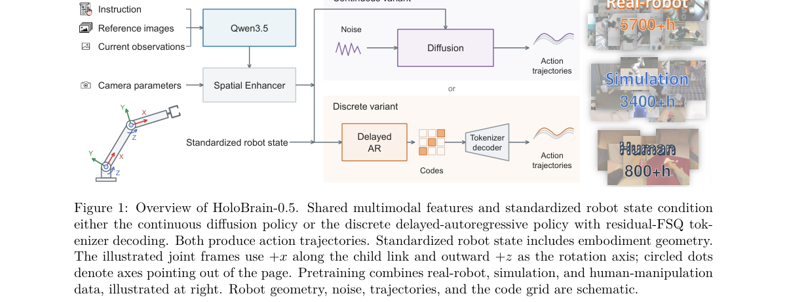

*Result - Joint and TCP frame standardization. (a) The joint’s right-handed source frame is reoriented from local x-axis motion to local z-axis motion. Attached-transform compensation preserves physic*

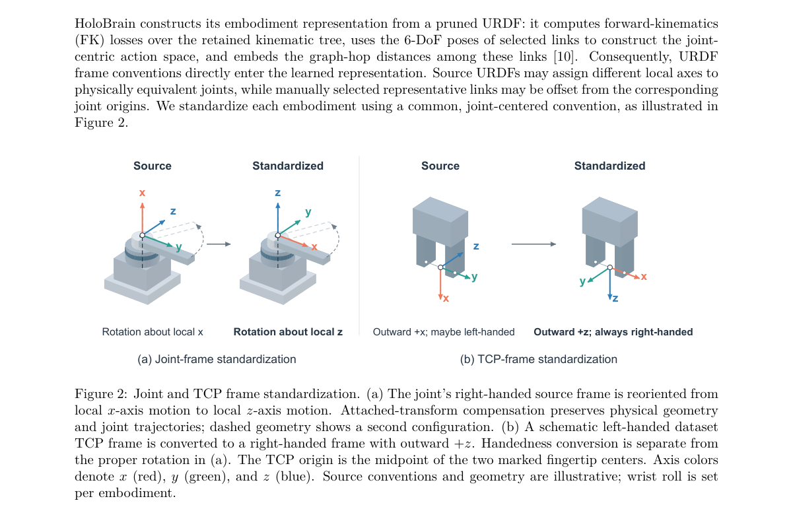

**Why this ranks #8**: URDF 标准化抹掉本体差异后在超过 10,000 小时、15 类本体数据上预训练：离散版在六个闭环仿真设定中以 56.77% 对 49.71% 胜出，七个真机任务免后训练即达 87.76% 平均进度分。

---

### 9. Ground, Guide, Act: Improving VLA Spatial Generalization with Multimodal Foundation Models

**arXiv**: [2611.31452](https://arxiv.org/abs/2611.31452) | **Score**: 8.7 (relevance 9 x 0.7 + quality 8 x 0.3) | **Direction**: `embodied_ai` | **Tags**: embodied, vla-generalization, spatial-grounding, capability-router, dense-caption, University of Science and Technology of | **Categories**: cs.CV | **Pages**: 18

**Authors**: Guangting Zheng; Shaoxuan Wang; Yu Yuan; Zhipeng Tang; Jiajun Deng; Yanyong Zhang

**Affiliation**: University of Science and Technology of China

**Abstract**

> Vision-Language-Action (VLA) models effectively learn action policies from robot demonstrations, but struggle to generalize to changes in object positions and task goals. General multimodal foundation models (MFMs) offer complementary scene understanding and spatial reasoning, but remain slow and unreliable for direct fine-grained control. To understand how MFMs can improve VLA spatial generalization, we conduct a systematic capability analysis across multiple VLA architectures using atomic-stage interventions, revealing that many failures stem from poor target grounding and global spatial routing, while local manipulation skills remain largely usable. Based on these findings, we propose MFM-VLA, a selective collaboration framework in which an MFM provides target grounding and spatial guidance, controllers execute free-space motion, and the VLA retains control over fine-grained manipulation. We fine-tune the VLA with action-chunk-level dense geometric captions and perturbed-state recovery data to improve local guidance following and recovery from unfamiliar handoff states. A development-calibrated capability router selects between direct VLA execution and MFM-assisted execution to avoid unnecessary intervention. Across LIBERO-PRO, ALOHA-Sim-PRO, RoboCasa365, and real-world chemistry tasks, MFM-VLA improves success rates by 14.9, 74.0, 3.6, and 30.9 percentage points, respectively, over the corresponding base VLA. The project page is available at https://tom-zgt.github.io/MFM-VLA

**Key findings**

- **Finding**: 论文用五级 PDIS 干预阶梯在四种 VLA/WAM 架构上各跑 390 个扰动回合做原子阶段分析，发现失效主要来自目标定位差与全局空间路由差，而局部操作技能仍基本可用。
- **Inference**: 多模态基础模型慢且不稳，不适合直接做精细控制，但它的空间理解恰好补上 VLA 短板，因此分工而不是整体替换才是正确接法。
- **Recommendation**: 遇到 VLA 位置泛化问题时，先用干预阶梯定位是找不到目标还是不会移动，再决定要不要接多模态模型，而不是整体重训。

**Key figures**

*Framework - Generalization gaps and visual scene shortcuts in pretrained VLAs. (a) π0.5 degrades sharply under Position and Task perturbations. (b) Across four VLA/WAM architectures, updated and empty i*

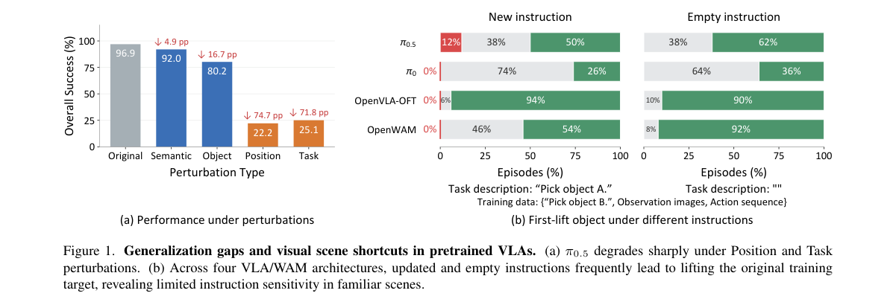

*Result - Atomic stage analysis across four VLA architectures (390 perturbed episodes per setting). Task success is reported in percent. Assisting free-space reach (+R) and carry (+RC) improves task s*

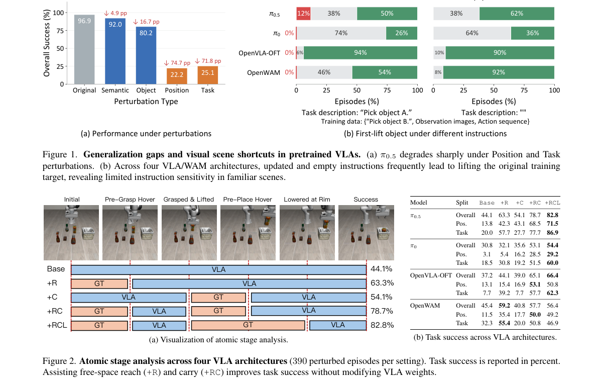

**Why this ranks #9**: 把多模态基础模型降级为目标定位与空间引导器、VLA 保留精细操作控制：LIBERO-PRO 涨 14.9、ALOHA-Sim-PRO 涨 74.0、RoboCasa365 涨 3.6、真人化学实验涨 30.9 个百分点。

---

### 10. RESET: One Demonstration, One Verified World, Self-Improved Skills Across Embodiments

**arXiv**: [2611.31894](https://arxiv.org/abs/2611.31894) | **Score**: 8.7 (relevance 9 x 0.7 + quality 8 x 0.3) | **Direction**: `embodied_ai` | **Tags**: embodied, one-demonstration, coding-agent, world-reconstruction, cross-embodiment, Chinese University of Hong Kong | **Categories**: cs.RO | **Pages**: 16

**Authors**: Zheng Sun; Zhuo Li; Zhihao Li; Hengyi Sim; Ge Wang; Ziyue Zhu; Mingkai Jia; Fei Chen

**Affiliation**: The Chinese University of Hong Kong; The Chinese University of Hong Kong, Shenzhen; Nankai University; The Hong Kong University of Science and Technology

**Abstract**

> Large language model (LLM) coding agents can iteratively self-improve robot manipulation skills in simulation benchmarks, yet real-world tasks provide neither ground-truth success scorers nor resettable practice environments. Our key observation is that a single real demonstration simultaneously specifies scene geometry, defines the terminal success criterion, and serves as a physical reference trajectory for verifying world fidelity---all decoupled from the source robot's kinematics. We present {RESET}: we reconstruct a contact-rich world and derive a frozen read-only criterion from one demonstration ({R}ebuild); check that world against the demonstration by open-loop replay and silhouette consistency ({E}xamine); evolve modular white-box task graphs and skill code from per-node failure evidence ({S}elf-improve); deploy frozen code on real robots with zero runtime LLM calls ({E}xecute); and share the verified world and criterion with unseen robots without new demonstrations ({T}ransfer). On 8 manipulation tasks, each rebuilt from one real demonstration, RESET achieves 97% average success on unseen layouts in simulation, whereas zero-shot code reaches 27%, per-task fine-tuned pi0.5 policies 31%, and Diffusion Policy 50%; injecting reconstruction defects shows that practice tolerates many reconstruction errors, that geometric errors can still stall or mislead it, and that the check flags most of them while physical randomization covers the rest. Without any target demonstrations, 3 heterogeneous robots acquire the same task skills in the shared world: a robot with similar arms copies 95% of its skill functions unchanged from the source robot, while robots with different arms and hands write their own. In real-robot experiments, the resulting programs run on 4 robots and succeed in 80% of 280 trials.

**Key findings**

- **Finding**: RESET 在 8 个由单次真实演示重建的操作任务上，未见布局平均成功率 97%，而零样本代码只有 27%、逐任务微调 π0.5 为 31%、Diffusion Policy 为 50%；真机上冻结代码在 4 台机器人、280 次试验中成功 80%。
- **Inference**: 编码智能体缺的不是更聪明的规划器而是可验证的世界与判据，用开环回放加轮廓一致性把两者一起补上就能自举技能。
- **Recommendation**: 想用 LLM 写机器人代码时，优先投资重建与校验这一步，让智能体在可重置的世界里练习，比直接让它在真机上试错更省成本。

**Key figures**

*Framework - Overview of RESET. (a) One real demonstration implicitly specifies the task procedure and terminal success condition. (b) One verified world: RESET reconstructs a contact-rich world and read*

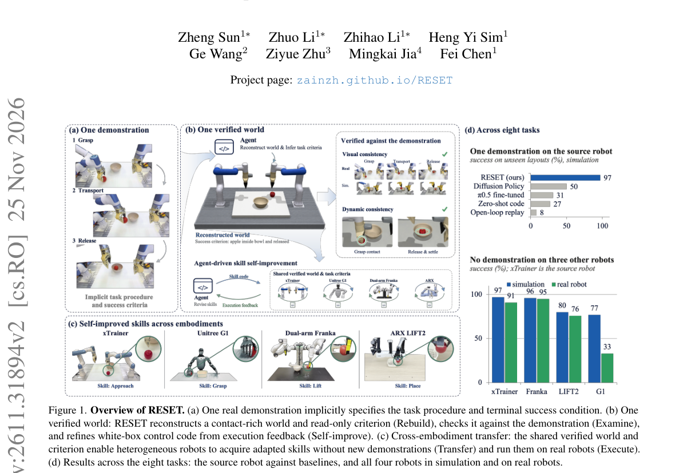

*Result - The five steps of RESET, illustrated on the Apple task. Rebuild turns one RGB-D demonstration and the robot’s URDF into an interactive world and a success criterion. Examine checks that worl*

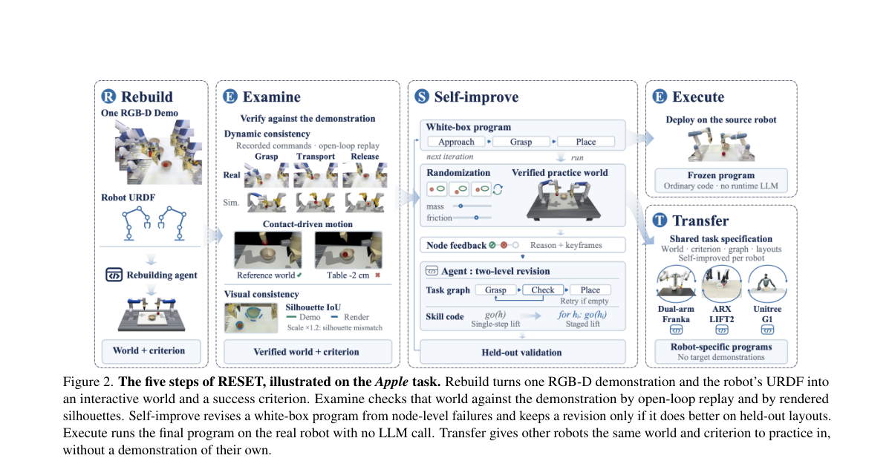

**Why this ranks #10**: 一段真实演示同时充当几何、终止判据与参考轨迹，8 个任务上未见布局平均成功率 97%，对比零样本代码 27%、逐任务微调 π0.5 的 31% 与 Diffusion Policy 的 50%。

---

### 11. VLAs Execute, Code Recovers: 3D Skill Envelopes Bridge the Compositional Gap in Agentic Manipulation

**arXiv**: [2611.32245](https://arxiv.org/abs/2611.32245) | **Score**: 8.7 (relevance 9 x 0.7 + quality 8 x 0.3) | **Direction**: `embodied_ai` | **Tags**: embodied, skill-composition, collision-prediction, vla-planner, precondition, Hong Kong University of Science and | **Categories**: cs.RO | **Pages**: 6

**Authors**: Jiajie Zhang; Yankai Xiang; Changhao Chen

**Affiliation**: Hong Kong University of Science and Technology (Guangzhou); ShanghaiTech University

**Abstract**

> Composing frozen Vision-Language-Action (VLA) skills under an agentic planner promises scalable long-horizon manipulation without long-horizon demonstrations, yet strong atomic skills routinely fail at seams even under a correct plan. Standard remedies reset the robot's pose or draft entry conditions in language, missing the physical cause we uncover via causal interventions: even after re-homing, a frozen VLA rigidly retraces its habitual trajectory and collides with displaced scene residue, whether or not it can see it. We propose the Skill Envelope, a policy-measured 3D geometric precondition capturing the volume a frozen skill sweeps during successful executions. Exploiting the insight that the rigidity making a frozen skill fragile at seams also makes its trajectory predictable in advance, we expose each envelope as two classical 3D tools (CHECK to detect blocking residue and FREE to locate safe placement regions), establishing a division of labor where VLAs execute in-distribution manipulation and code repairs out-of-distribution states. On LIBERO-Goal with frozen $π_{0.5}$, our zero-failure envelope predicts collisions at 0.946 AUROC (0.944 from one RGB-D view) and beats frontier VLMs on seam readiness (0.902 vs. 0.793); using it for skill ordering and code repair lifts success from 82.8% to 92.3% on two-step seams and from 29.7% to 93.8% on drawer-bearing 3-4 step chains, matching privileged world reset. Together, these results show that reliable VLA composition hinges on measuring a policy's physical workspace rather than guessing preconditions in language. Ongoing work closes the loop with autonomous LLM orchestration, synthesized free-object recovery, and cross-policy evaluation on cluttered benchmarks and real hardware.

**Key findings**

- **Finding**: 零失败包络预测碰撞达 0.946 AUROC、接缝就绪度 0.902 高于前沿 VLM 的 0.793；用它做技能排序与代码修复后，两段接缝成功率从 82.8% 升到 92.3%，带抽屉的 3–4 步链从 29.7% 升到 93.8%，与特权式世界重置相当。
- **Inference**: 冻结 VLA 的失败根因是它会僵化地重走习惯轨迹去撞上被挪动的残余物，所以需要可测量的物理工作空间而不是语言里写的进入条件。
- **Recommendation**: 拼接冻结技能前先用成功执行统计扫掠体积，把它做成几何检查器，再决定技能顺序与修复代码。

**Why this ranks #11**: 用策略实测出的 3D 扫掠体积作为前置条件：冻结 π0.5 下碰撞预测 AUROC 0.946（单 RGB-D 视图 0.944），两段接缝成功率从 82.8% 升到 92.3%，抽屉类 3–4 步链从 29.7% 升到 93.8%。

---

### 12. EgoLoAF: Learning Humanoid Loco-Manipulation from Egocentric Demonstrations with Hand-Object Affordances

**arXiv**: [2611.32260](https://arxiv.org/abs/2611.32260) | **Score**: 8.7 (relevance 9 x 0.7 + quality 8 x 0.3) | **Direction**: `embodied_ai` | **Tags**: embodied, humanoid-loco-manipulation, egocentric-data, hand-object-affordance, cross-attention, Xi'an Jiaotong University | **Categories**: cs.RO | **Pages**: 22

**Authors**: Yiming Zeng; Jiangyuxuan Dai; Yuheng Na; Tan Zhu Xuan; Zihan Lin; Xinfang Qi; Shijian Zhang; Chengqi Shi; Yihan Kuang; Zhide Zhong; Junjie He; Junfeng Li

**Affiliation**: Xi'an Jiaotong University; The Hong Kong University of Science and Technology (Guangzhou); Xbotics

**Abstract**

> Training humanoid vision-language-action (VLA) models relies heavily on costly real-robot teleoperation. Recent efforts convert egocentric human demonstrations into humanoid training data. However, most methods still require wearable motion trackers and leave important hand-object interaction cues implicit. Many also mix in real-robot teleoperation data for VLA post-training. These dependencies limit scalable data collection, while implicit interaction cues make precise contact harder to learn. To overcome these limitations, we propose EgoLoAF, the first paradigm to derive all training data for humanoid loco-manipulation directly from egocentric demonstrations without wearable motion trackers. We post-train the VLA on the converted data alone, without real-robot teleoperation demonstrations, and use explicit hand-object interaction cues to guide action generation. Specifically, to obtain humanoid action targets, we estimate torso motion from recorded camera poses and reconstruct both hand trajectories from video. From the same recording, we use each hand's current pose relative to the object to represent hand-object affordances. During post-training, we inject these affordances into the action expert through cross-attention while keeping the vision-language backbone frozen. Additionally, we release 128,400 egocentric demonstration episodes spanning 1,000 hours and 1,284 tasks, together with converted humanoid action trajectories and rendered robot-view observations. Across four real-world tasks, EgoLoAF nearly achieves teleoperation performance (73.1 vs. 74.4 in mean Task Progress Score), while achieving a mean 4.03 times improvement in data-collection efficiency.

**Key findings**

- **Finding**: EgoLoAF 从 128,400 段第一视角演示（1,000 小时、1,284 任务）导出人形动作目标，并在后训练时通过交叉注意力把手物可供性注入动作专家、冻结视觉语言骨干；四个真机任务平均进度分 73.1，接近遥操作的 74.4，数据采集效率平均提升 4.03 倍。
- **Inference**: 人形 loco-manipulation 的瓶颈是接触语义而非轨迹精度，把「手相对物体的位姿」显式喂给动作专家就能补上视频里隐含的接触线索。
- **Recommendation**: 做人形数据规模化时优先投资第一视角采集与手部重建，并单独把手物可供性作为一路输入做消融。

**Key figures**

*Framework - Overview of EgoLoAF, a novel data collection paradigm for humanoids. Top: We release 128,400 egocentric demonstration episodes spanning 1,000 hours and 1,284 tasks, collected without wearable*

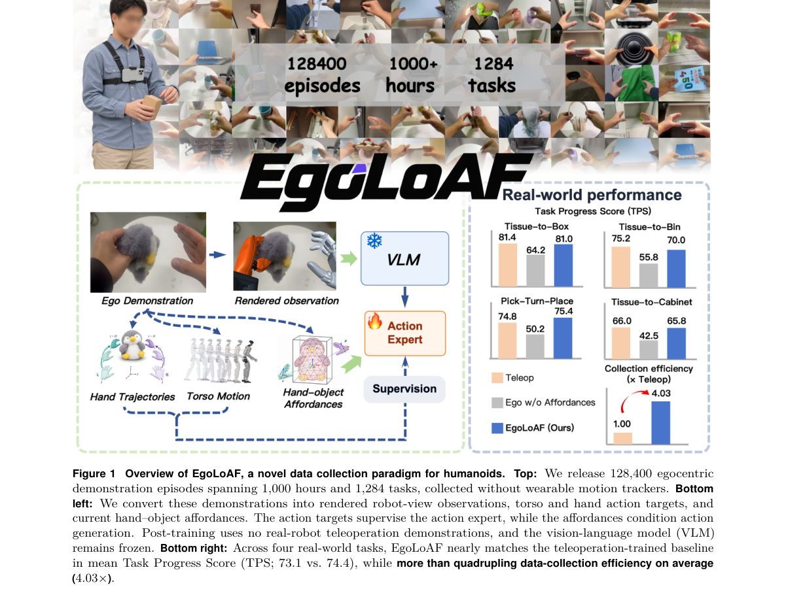

*Result - Pipeline of EgoLoAF. (a) Hand reconstruction and camera-to-torso mapping produce future torso and hand action targets in the current torso frame. (b) Monocular depth is scale-aligned with rec*

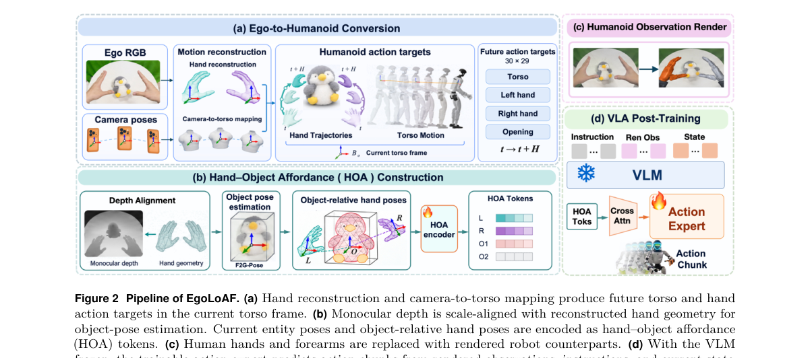

**Why this ranks #12**: 不依赖任何穿戴式动捕，只用第一视角视频重建手部轨迹与手物可供性：发布 128,400 段演示、1,000 小时、1,284 个任务，四个真机任务平均进度分 73.1 对遥操作 74.4。

---

### 13. Any2Act: Scaling In-Context Robot Learning from Heterogeneous Demonstrations

**arXiv**: [2611.32353](https://arxiv.org/abs/2611.32353) | **Score**: 8.7 (relevance 9 x 0.7 + quality 8 x 0.3) | **Direction**: `embodied_ai` | **Tags**: embodied, in-context-learning, heterogeneous-demonstrations, source-routed-adapter, foundation-model, University of Hong Kong | **Categories**: cs.RO | **Pages**: 23

**Authors**: Ziang Ren; Zifan Wang; Zhuoyang Li; Benhao Qin; Haoyang Li; Qingtao Liu; Xuchuan Chen; Zekun Qi; He Wang; Yanchao Yang; Li Yi

**Affiliation**: The University of Hong Kong; Tsinghua University; Peking University; Shanghai Qi Zhi Institute; Galbot

**Abstract**

> Robot in-context learning (ICL) enables a policy to perform unseen tasks by following contextual demonstrations, without task-specific fine-tuning. This is increasingly valuable as large language models reasoning at low frequency can specify tasks through demonstrations and delegate high-frequency execution to such a policy. However, methods conditioned on human videos are bounded by scarce human-robot pairs, while those conditioned on robot demonstrations accept only one or two source types at limited scale. We present Any2Act, a foundation model for robot ICL. Our key insight is that a demonstration should be expressed in the camera layout and action space of the robot that performs it (the executor), not of whoever provided it (the demonstrator). This unified embodiment-grounded representation decouples learning to follow from admitting a new source. Any2Act learns to follow once, from robot-to-robot pairs that already take this form in 1.2M real trajectories spanning 10K tasks. Human videos, simulation, UMI, and other robots are then translated into this representation, and source-routed adapters trained on only a few hundred pairs each absorb the residual gap while the pretrained model stays frozen. For long horizons, a training-free tracker feeds only the demonstration window around the executor's progress, bounding the context and rolling back to redo failed steps. From a single demonstration, Any2Act achieves 57.5% success on unseen tasks without fine-tuning, exceeding VLAs fine-tuned on 50 demonstrations per task; other demonstrators retain 74-91% of the success achieved with the executor's own demonstrations.

**Key findings**

- **Finding**: Any2Act 用 1.2M 条真实轨迹、10K 个任务的机器人对机器人数据学会跟随，人类视频、仿真、UMI 与其他机器人再经源路由适配器（每个只用几百对）转入同一表示；单条演示在未见任务上 57.5% 成功，其他来源演示者保留执行者自身演示 74–91% 的成功率。
- **Inference**: 把「如何跟随」与「接入新来源」解耦后，新增一种演示来源只需几百对数据适配，而不必重训基础模型。
- **Recommendation**: 复用别家采集的演示时先统一到执行端机器人的动作空间与相机布局，并用一个轻量源路由适配器吸收剩余差距。

**Key figures**

*Framework - Any2Act lets an executor robot follow any demonstrator, whether teleoperator, simulator, UMI, human, or another robot, via a unified embodiment-grounded representation for real-world long-ho*

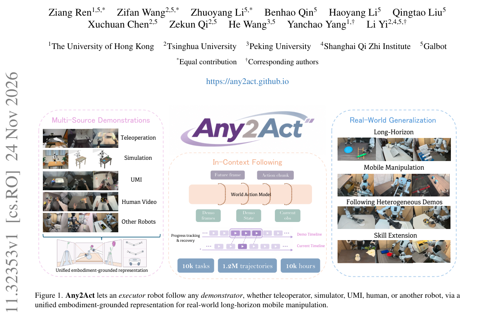

*Result - Demonstration sources. Top: robot-to-robot pairs from routine data collection supply pretraining; recordings of the same task are VLM-filtered and grouped, and any two form a pair. Bottom: h*

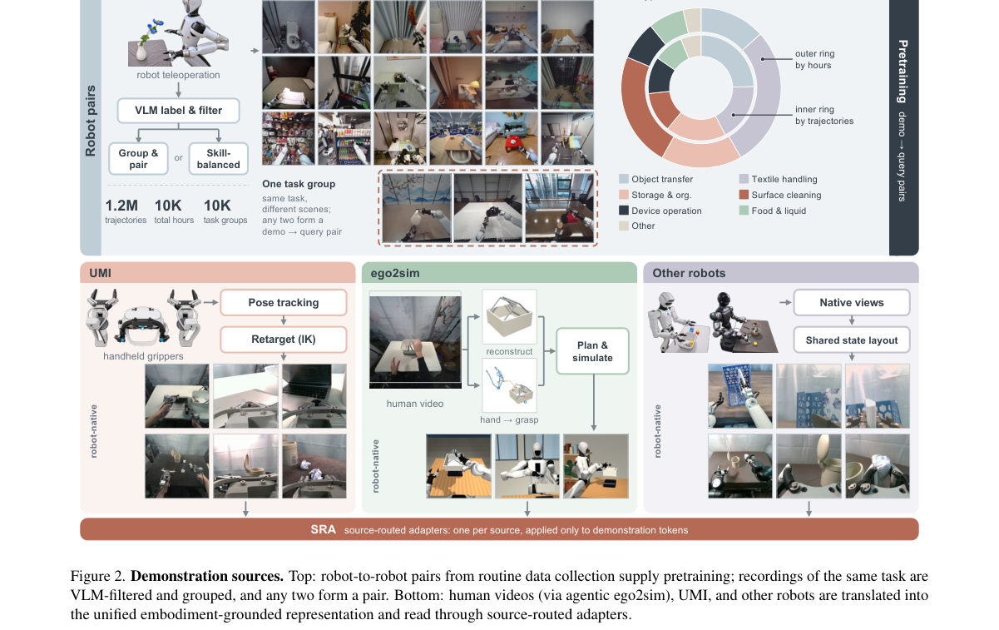

**Why this ranks #13**: 把演示统一表达在执行者机器人的相机布局与动作空间里，在 1.2M 条真实轨迹、10K 个任务上预训练跟随能力：单条演示在未见任务上 57.5% 成功，超过每任务微调 50 条演示的 VLA。

---

### 14. ViTacLab: Physically Consistent Visuo-Tactile Simulation, Benchmarking, and Representation Learning for Robotic Manipulation

**arXiv**: [2611.32476](https://arxiv.org/abs/2611.32476) | **Score**: 8.7 (relevance 9 x 0.7 + quality 8 x 0.3) | **Direction**: `embodied_ai` | **Tags**: embodied, visuo-tactile, tactile-simulation, contact-solver, vq-vae, University of Hong Kong | **Categories**: cs.RO | **Pages**: 8

**Authors**: Linjing You; Zeming Yang; Zhenhao Shen; Shengqiang Xu; Guanda Li; Wenxuan Li; Jiyu Guo; Jasper Lu; Kyle Xu; Shawn Xie; Junjie Zhu; Siyu Wu

**Affiliation**: The University of Hong Kong; Ant Group; Shenzhen Loop Area Institute (SLAI); Peking University; Zhejiang University

**Abstract**

> Tactile sensing is essential for contact-rich robotic manipulation, but existing visuo-tactile simulators trade physical fidelity for scalability, and benchmarks largely focus on two-finger grippers. We present ViTacLab, a framework comprising ViTacSim, ViTacBench, and ViTacPolicy. ViTacSim uses a tri-modal tactile primitive: a global sparse contact-force lattice, a local dense force array, and tactile images. Anchored to PhysX contact-solver outputs, it corrects normal inconsistency through local stiffness alignment and reconstructs tangential forces under decoupled slip-stick regimes while preserving GPU parallelism. A joint projection preserves the sparse wrench and enforces local friction cones. ViTacBench spans parallel grippers, dexterous hands, and bimanual systems, with tasks ranging from vision-dominant to tactile-dominant regimes. ViTacPolicy aggregates variable numbers of heterogeneous tactile inputs using spatial-pose embeddings and a Transformer, and aligns force-array and tactile-image modalities through a two-stream VQ-VAE with a shared codebook. Controlled Hertzian-reference indentation and real-sensor sliding tests reduce normal and tangential force RMSE from 2.31 and 1.85 N to 0.42 and 0.53 N, respectively. Throughput reaches 2,482.9 tactile-pipeline FPS at 256 parallel environments. Simulation and real-world experiments show gains on several contact-rich tasks, while low absolute success on tactile-dominant tasks highlights the remaining difficulty of purely tactile control.

**Key findings**

- **Finding**: 受控 Hertz 压痕与真实传感器滑动测试把法向与切向力 RMSE 从 2.31 N 与 1.85 N 分别降到 0.42 N 与 0.53 N，触觉管线在 256 个并行环境下跑到 2,482.9 FPS；ViTacPolicy 用双流 VQ-VAE 共享码本对齐力阵列与触觉图像两种模态。
- **Inference**: 过去触觉模拟器要么牺牲物理保真度换规模、要么基准只用两指夹爪，把求解器输出直接锚定为触觉原语才能同时保住精度与吞吐。
- **Recommendation**: 做触觉策略评测时，先用法向与切向力 RMSE 这类物理量校验模拟器，再看任务成功率，并注意纯触觉控制成功率仍然偏低。

**Key figures**

*Framework - Overview of ViTacLab. ViTacLab unifies three components: ViTacSim, a contact-solver-anchored, GPU-parallel tactile simulator; ViTacBench, a hierarchical benchmark spanning parallel grippers, de*

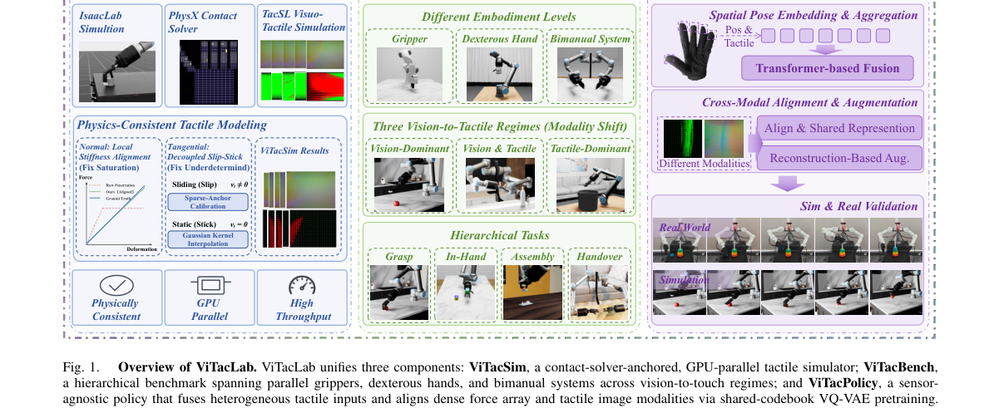

*Result - ViTacSim unifies a global sparse contact-force lattice, local dense force array, and local tactile images through normal correction and tangential reconstruction.*

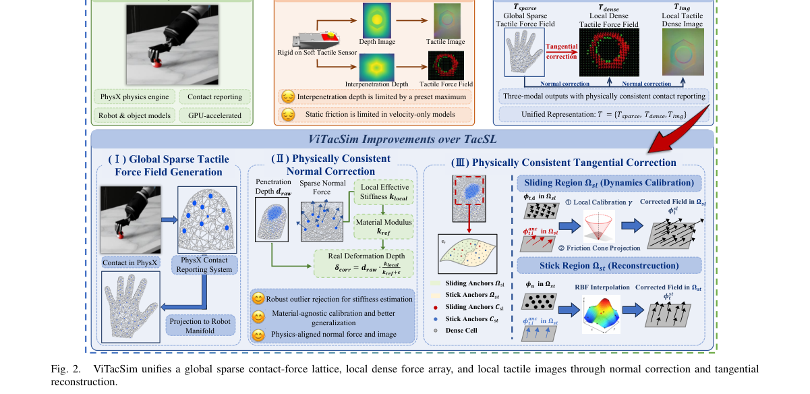

**Why this ranks #14**: 锚定 PhysX 接触求解器的三模态触觉原语（全局稀疏力格、局部稠密力阵列、触觉图像）把法向与切向力 RMSE 从 2.31 与 1.85 N 降到 0.42 与 0.53 N，256 并行环境下达 2,482.9 FPS。

---

### 15. GeoVLDrive: Geometry-Grounded Vision-Language Reasoning for Autonomous Driving

**arXiv**: [2611.32510](https://arxiv.org/abs/2611.32510) | **Score**: 8.7 (relevance 9 x 0.7 + quality 8 x 0.3) | **Direction**: `embodied_ai` | **Tags**: embodied, driving-vla, 3d-grounding, latent-cot, trajectory-ranking, Xiaomi | **Categories**: cs.CV | **Pages**: 25

**Authors**: JiaHui Huang; Songyan Zhang; Hanbing Li; Hanchao Leng; Kuiyuan Yang; Guang Chen; Hangjun Ye; Chen Lv

**Affiliation**: Xiaomi Corporation; Nanyang Technological University; University of Missouri

**Abstract**

> Vision-language-action (VLA) planners inherit semantic knowledge from pretrained vision-language models, but their reasoning is rarely grounded in 3D scene structure and its evolution over time. We introduce GeoVLDrive, a geometry-grounded VLA framework for 3D spatiotemporal reasoning and planning. Multi-layer features from a 3D foundation model augment the vision-language backbone through gated cross-attention. A structured latent chain of thought (CoT) organizes future scene geometry, key-agent motion, and meta-actions into ordered, separately supervised latent states. An action expert generates trajectory proposals from these states and multi-layer scene features, and ranks them using scene-grounded, interacting score tokens. We also introduce NAVSIM 3DQA to train and evaluate metric 3D spatial and motion understanding. GeoVLDrive achieves 91.8 PDMS on NAVSIM v1 and 90.9 EPDMS on NAVSIM v2. On NAVSIM 3DQA, the geometry-grounded backbone scores 89.2% overall, 4.6 percentage points above the fine-tuned Qwen3-VL-2B baseline. On LingoQA, the backbone achieves 68.6% Lingo-Judge accuracy.

**Key findings**

- **Finding**: GeoVLDrive 把未来场景几何、关键智能体运动与元动作组织进结构化潜思维链，动作专家据此生成并用场景接地交互分数打分轨迹；NAVSIM v1 91.8 PDMS、v2 90.9 EPDMS，注入几何把 v1 PDMS 从 90.1 抬到 91.8，NAVSIM 3DQA 总体 89.2%、高出微调 Qwen3-VL-2B 4.6 个百分点。
- **Inference**: 驾驶 VLA 缺的往往不是语义知识而是几何随时间怎么变，把未来几何做成独立监督的潜状态能迫使推理落到结构上。
- **Recommendation**: 改造驾驶 VLA 时优先给骨干注入带深度的多尺度几何特征，并单独测一项度量 3D 空间与运动理解的问答集。

**Key figures**

*Framework - Comparison of representative driving frameworks. (a) VLA policies map images and text to trajectories through a VLM [18, 54]. (b) Geometry world action models condition planning on observed*

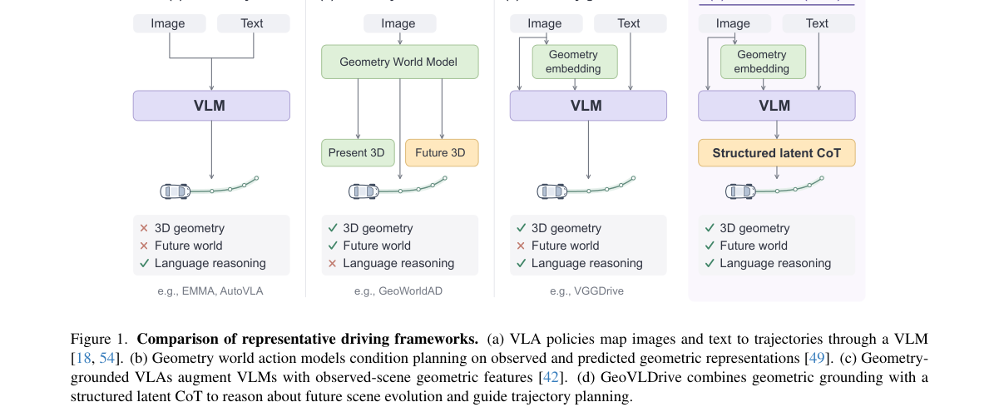

*Result - Overview of GeoVLDrive. (a) Model framework. The geometry-grounded VLM encodes future scene geometry, key-agent motion, and meta action in a structured latent CoT that conditions the action*

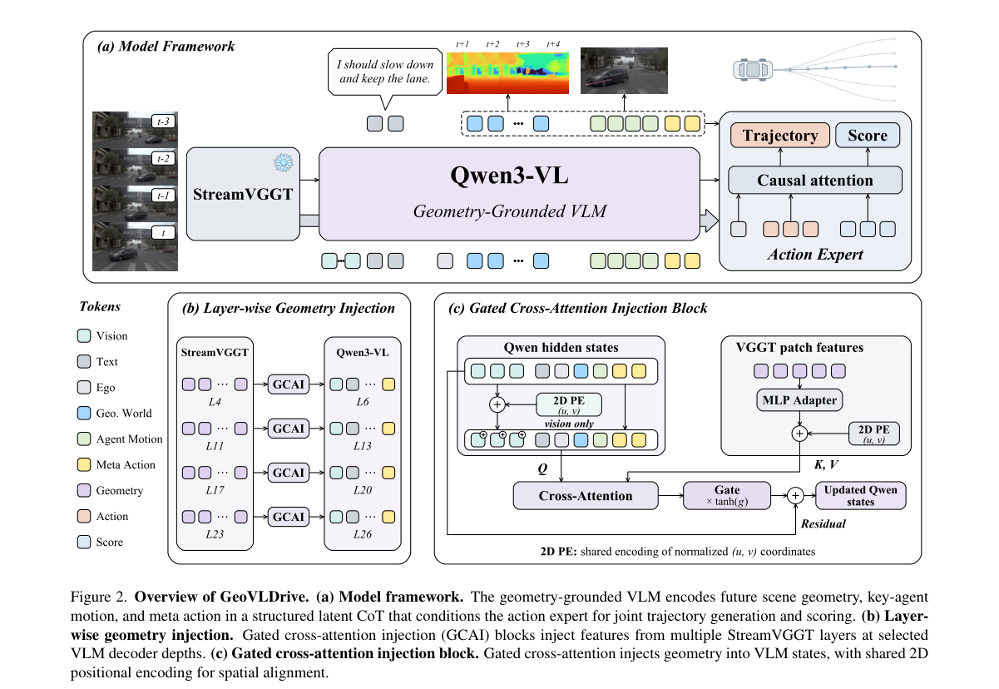

**Why this ranks #15**: 用 3D 基础模型的多层特征经门控交叉注意力注入视觉语言骨干，NAVSIM v1 达 91.8 PDMS、v2 达 90.9 EPDMS，NAVSIM 3DQA 上 89.2%，比微调 Qwen3-VL-2B 高 4.6 个百分点。

---

### 16. DiffGR00T: Execution-Aware Differentiable Training for Humanoid Whole-Body Vision-Language-Action Models

**arXiv**: [2611.32665](https://arxiv.org/abs/2611.32665) | **Score**: 8.7 (relevance 9 x 0.7 + quality 8 x 0.3) | **Direction**: `embodied_ai` | **Tags**: embodied, humanoid-vla, differentiable-training, world-model, whole-body-control, Automation | **Categories**: cs.RO | **Pages**: 14

**Authors**: Sichen Wu; Qian Sun; Mengfan Liu; Weikai Qin; Bike Zhu; Hesheng Wang

**Affiliation**: Department of Automation, Shanghai Jiao Tong University

**Abstract**

> Vision-language-action (VLA) models have achieved strong results in arm-centric manipulation, yet humanoid whole-body control (WBC) requires dynamic balance and tightly coupled full-body coordination. Existing hierarchical humanoid VLAs typically decouple motion generation from physical execution, leaving tracking and balance errors unable to directly optimize the VLA generator. We propose DiffGR00T, an end-to-end differentiable training framework that couples GR00T N1.7 with SONIC, a pretrained whole-body behavior foundation model. To enable execution-aware differentiable training, we replace the non-differentiable simulator with a learned, action-conditioned world model, allowing multi-step body-execution losses to backpropagate through the frozen whole-body controller and the flow-matching sampler directly into the VLA action head. On four HumanoidArena simulation tasks, DiffGR00T improves average task success by 12.5 percentage points over the supervised base VLA (59.2% to 71.7%), demonstrating that execution-aware gradients effectively align high-level motion generation with closed-loop whole-body dynamics.

**Key findings**

- **Finding**: 训练时冻结 VLA 骨干、SONIC 解码器、世界模型与仅训练用的 critic，只更新 GR00T N1.7 的动作头；四个 HumanoidArena 仿真任务上平均任务成功率由 59.2% 升到 71.7%，相对监督基座 VLA 提升 12.5 个百分点。
- **Inference**: 人形全身控制里跟踪与平衡误差必须能直接优化高层动作生成，而分层式方案把生成与执行解耦正是丢掉了这条梯度通路。
- **Recommendation**: 训练人形 VLA 时优先打通执行段到动作头的梯度通路，哪怕代价是引入一个可学习的动作条件世界模型替代精确模拟器。

**Key figures**

*Framework - DiffGR00T teaser. The VLA action head is updated while SONIC and the world model are frozen; the world model replaces the simulator during training. Simulation-only average task success rises*

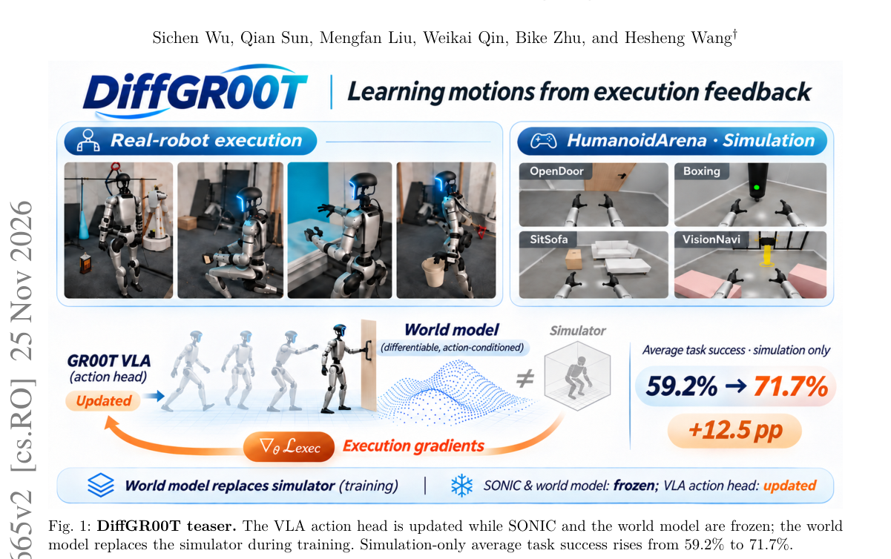

*Result - DiffGR00T architecture. The GR00T N1.7 VLA action head is trained; the VLA backbone, the SONIC decoder, the action-conditioned world model, and the training-only critic are frozen. The executi*

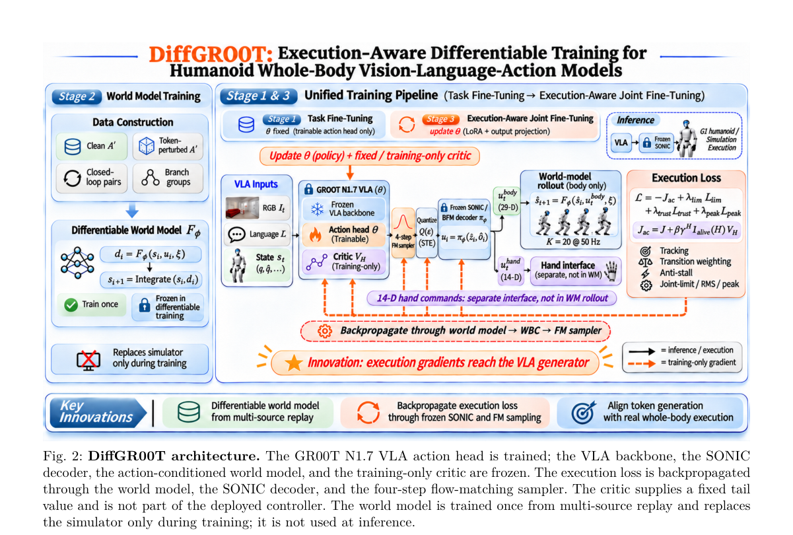

**Why this ranks #16**: 用可学习的动作条件世界模型替掉不可微模拟器，把多步身体执行损失回传进 VLA 动作头：四个 HumanoidArena 任务上平均成功率从 59.2% 升到 71.7%，涨 12.5 个百分点。

---

### 17. Supply Geometry, Learn Execution: Screw Attention for Zero-Shot Policy Transfer in Robot Manipulation

**arXiv**: [2611.32797](https://arxiv.org/abs/2611.32797) | **Score**: 8.7 (relevance 9 x 0.7 + quality 8 x 0.3) | **Direction**: `embodied_ai` | **Tags**: embodied, geometry-centric, zero-shot-transfer, se3-relation, manipulation-policy, School of Computer Science | **Categories**: cs.RO | **Pages**: 6

**Authors**: Aly Magassouba

**Affiliation**: School of Computer Science, University of Nottingham

**Abstract**

> We present the Screw Attention Policy, a geometry-centric manipulation framework that supplies task geometry explicitly and learns only execution. The policy operates on object poses, relative SE(3) transforms, and joint screw axes provided by perception and robot models. The policy requires only 30K learned parameters. Trained entirely in simulation on a single robot arm, the policy generalises to new scene layouts, transfers zero-shot across robot embodiments, and deploys directly on a real robot, without adaptation or fine-tuning. It achieves 96% success on LIBERO, 85.8% under layout changes, 80.2% across five unseen robot arms, and 21 of 24 trials on a real robot. These results suggest that much of what manipulation policies learn at scale is geometric structure that can instead be supplied.

**Key findings**

- **Finding**: 策略只在物体位姿、相对 SE(3) 变换与关节螺旋轴上做注意力，30K 参数即在 LIBERO 达 96%、LIBERO-Plus 换布局 85.8%；跨五种未见机械臂 80.2%（SkelWAM 33.0%、最佳 VLA 0.2%），真机 24 次试验成功 21 次，重排布局下 74.7% 而同样给定位姿的基线低于 30%。
- **Inference**: 大规模操作策略学到的东西里有相当大一部分其实是几何结构，既然能被外部感知直接供给，就没必要再用像素学一遍。
- **Recommendation**: 预算有限时优先搭几何接口（物体位姿与相对变换）再学执行，并单独测一次只给位姿的基线以确认瓶颈在哪。

**Key figures**

*Framework - The Screw Attention Policy learns manipulation from geometry rather than appearance. Frozen perception and language models convert images and instructions into object poses, task goals, and ge*

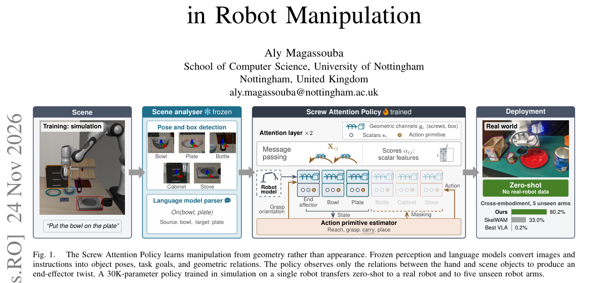

*Result - The policy on a real Panda, trained only in simulation, executing “Put the bowl on the plate”. Over 24 runs on different random layouts, 21 succeeded, two of them after a missed grasp and a re*

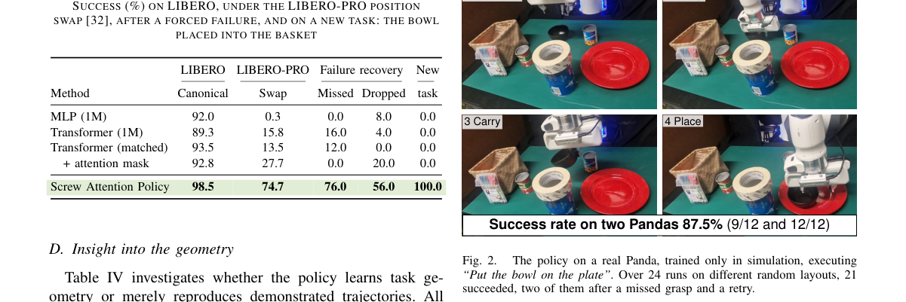

**Why this ranks #17**: 只学执行、把几何当外部供给：策略仅 30K 个可学习参数，LIBERO 96%、换布局 85.8%、跨五种未见机械臂 80.2%（此前最好 33.0%），真机 24 次成功 21 次。

---

### 18. RoboARC: Physical Puzzles for Robotic Manipulation under Spatial Constraints

**arXiv**: [2611.33390](https://arxiv.org/abs/2611.33390) | **Score**: 8.7 (relevance 9 x 0.7 + quality 8 x 0.3) | **Direction**: `embodied_ai` | **Tags**: embodied, benchmark, spatial-constraint, coding-agent, mujoco, Northwestern University | **Categories**: cs.AI, cs.RO | **Pages**: 72

**Authors**: Qineng Wang; Jianwen Lyu; Pingyue Zhang; Reuben Tan; Xiaoyu Huang; Tonghe Zhang; Kangrui Wang; Yelong Shen; Jianfeng Gao; Guanya Shi; Ruohan Zhang; Manling Li

**Affiliation**: Northwestern University; Microsoft; UC Berkeley; Carnegie Mellon University

**Abstract**

> Many hard manipulation tasks come down to a spatial constraint that only a few motions satisfy, such as passing a part through a gap barely wider than itself or separating two interlocked parts. These motions depend on the exact geometry of each scene, so demonstrations and skills recorded elsewhere rarely transfer. We therefore ask: when manipulation hinges on spatial constraints, can robots reason out the right motions? We introduce RoboARC, a benchmark of 90 tasks in six constraint types over rigid and soft materials, on three robots in MuJoCo. Every task is a frozen scene with a physics-based grader and a verified reference solution that replays bit-identically. Each task comes in a Privileged regime, with the full simulator state and resets, and a Standard regime with real-sensor inputs (camera images and proprioception) and a single attempt without resets. We evaluate seven coding agents and four VLA policies, none trained on these tasks. The strongest agent, GPT-6 Astra in Codex, solves 86% of the tasks in the Privileged regime and 43% in the Standard regime, and the four VLA policies, run zero-shot, solve none of their 18 one-arm puzzles. On 15 puzzles that GPT-6 Astra solved in the Privileged regime and failed in the Standard regime, object poses add 4 points and part geometry 13, but both together add 36, from 24% to 60%. Only 7% of the coding agents' failed runs pass more than half of a task, and 53% of the failed runs in the Standard regime are stuck on a single step. Frontier coding agents already reason out the right motions for many of these tasks once they know where the parts are and what shape they have. From their own sensors, in a single attempt, the strongest solves fewer than half of the tasks. The website can be found at https://roboarc.embodied-first-exam.ai

**Key findings**

- **Finding**: 在 15 个特权设定解出、标准设定失败的谜题上，补充物体位姿只加 4 分、补充零件几何加 13 分，两者同时给加 36 分（24% 升到 60%）；标准设定中 53% 的失败卡在同一步，只有 7% 的失败跑过了任务的一半。
- **Inference**: 前沿编码智能体其实能想出正确动作，只是缺了东西在哪、什么形状这类几何信息，因此它的短板是感知而非推理。
- **Recommendation**: 用智能体做物理操作时优先补齐几何观测接口与中间状态回报，而不是一味换更强的模型。

**Key figures**

*Framework - RoboARC asks whether robots can reason out the right motions when manipulation hinges on spatial constraints. Its 90 tasks span six constraint types over rigid and soft materials (left and*

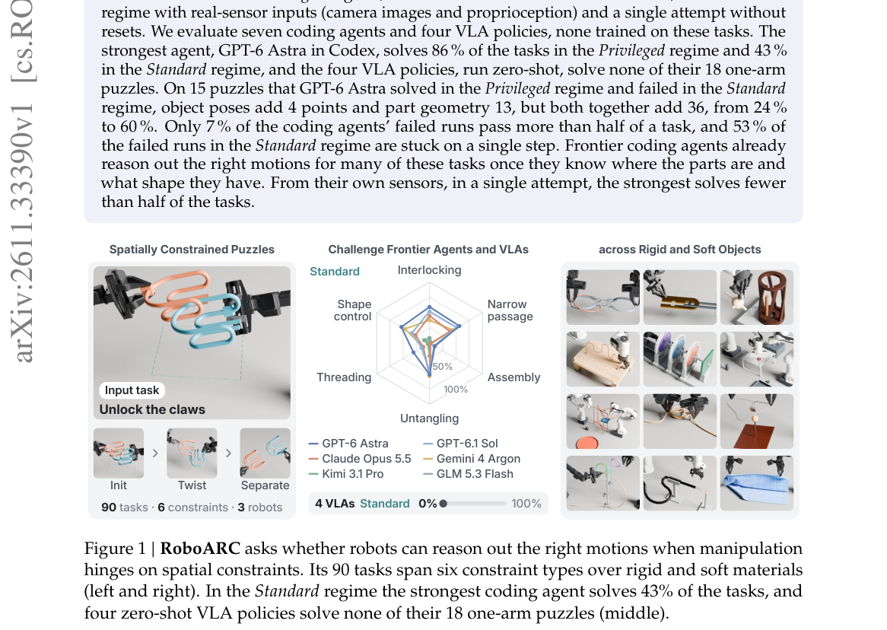

*Result - Overview of RoboARC. Top: the two regimes share the scene, physics and grader. In the Standard regime a coding agent sends action chunks and receives RGB-D images, joint readings and the in*

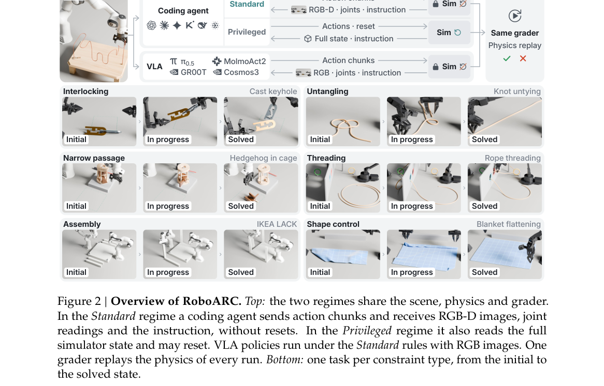

**Why this ranks #18**: 90 个空间约束谜题、六类约束、三种机器人：最强编码智能体在特权设定解 86%、标准设定只剩 43%，四个零样本 VLA 在 18 个单臂谜题上一个都没解出。

---

### 19. DexEngine: Scaling Human Demonstrations into Physically Executable Whole-Robot Data

**arXiv**: [2611.33579](https://arxiv.org/abs/2611.33579) | **Score**: 8.7 (relevance 9 x 0.7 + quality 8 x 0.3) | **Direction**: `embodied_ai` | **Tags**: embodied, retargeting, dexterous-hand, residual-rl, data-scaling, POSTECH | **Categories**: cs.AI, cs.RO | **Pages**: 30

**Authors**: Wongyun Yu; Honggeun Kim; Donguk Lee; Minchan Kim; Kyoung Whan Choe; Minsu Cho

**Affiliation**: POSTECH; RLWRLD

**Abstract**

> A growing body of recent work addresses the retargeting of human hand-object demonstrations to robotic hands. To train whole-robot policies, however, the retargeted motions must be kinematically feasible and physically executable, and be produced efficiently at scale. We present DexEngine, a simulation pipeline that turns human manipulation data into train-ready, physically executable arm-hand trajectories. DexEngine first places each clip's hand-object motion where the arms can reach it, finds an arm motion that follows the human hands, and then corrects the motion in physics simulation with residual reinforcement learning. From nine human hand-object datasets, we generate about 5,200 clips for each of four dexterous hands, augmented into 65,000 trajectories (116 h) and 325,000 episodes (578 h) in total. Even with arms attached, DexEngine tracks objects more accurately than prior floating-hand methods and runs over 10x faster than RL-based ones. Policies trained on our data far outperform those trained on the same clips without physics correction or with the arms attached after a floating-hand correction, showing that fine-tuning data need physics correction. Mid-training on our data further improves them at equal fine-tuning budget, in simulation and on a real robot.

**Key findings**

- **Finding**: DexEngine 先把人手物运动放到机械臂够得到的位置，再在物理仿真里用残差强化学习修正，修正后每片段 3.9 GPU 分钟、比基于 RL 的方法快 10 倍以上；一个策略最多可修正 64 段片段。
- **Inference**: 人手轨迹直接迁移到带臂的系统上常常不可执行，物理修正这一步是把人类数据变成可训练数据的关键而非可选的后处理。
- **Recommendation**: 用人类数据训练整臂策略前，务必加一遍带物理修正的重定向流程，并对比未修正版本确认修正的必要性。

**Key figures**

*Framework - DexEngine turns human demonstrations into physically executable data for a whole bimanual robot, in under 5 GPU- minutes per clip.*

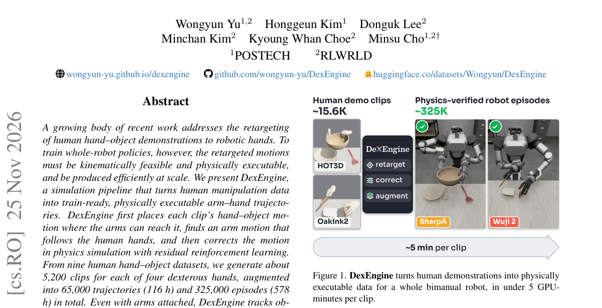

*Result - DexEngine pipeline. Human demonstrations are split into clips, a scene placement that the arms reach without penetration is found, and the resulting kinematic reference is corrected in physi*

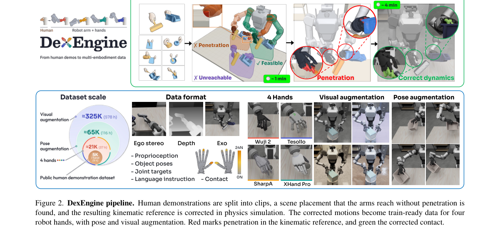

**Why this ranks #19**: 从九个人类手物数据集为四种灵巧手各生成约 5,200 段片段，增强成 65,000 条轨迹（116 小时）与 325,000 段回放（578 小时），比基于 RL 的方法快 10 倍以上。

---

### 20. FreshVLA: Frequency-Regularized Time Scale Hierarchical Latent Actions for Vision-Language-Action Models

**arXiv**: [2611.33635](https://arxiv.org/abs/2611.33635) | **Score**: 8.7 (relevance 9 x 0.7 + quality 8 x 0.3) | **Direction**: `embodied_ai` | **Tags**: embodied, latent-action, frequency-regularization, flow-matching, long-horizon, Hong Kong University of Science and | **Categories**: cs.RO | **Pages**: 20

**Authors**: Jiaming Liang; Yifeng Zhan; Rongyi He; Mu Li; Jiaqi Fan; Zhiyuan Zhang; Qiwei Liang; Zhengjie Zhang; Boyang Cai; Ningyuan Zhang; Xingjian Jing; Qiang Nie

**Affiliation**: The Hong Kong University of Science and Technology (Guangzhou); XPENG Robotics; Shanghai Institute of Intelligent Science and Technology, Tongji University; City University of Hong Kong

**Abstract**

> Learning reusable latent actions from action-free videos offers an effective route to improving Vision-Language-Action (VLA) policies. However, reconstruction-oriented latent actions do not necessarily benefit policy learning: as they may encode task-irrelevant static appearance with scene identity, or entangle slowly varying task progress with fine-grained execution dynamics in limited discrete code. We propose FreshVLA, a VLA framework built on a frequency-guided, dynamics-sensitive learning paradigm for acquiring temporally hierarchical continuous latent actions. FreshVLA uses a high-pass prior to guide visual transition encoding toward dynamical regions, thereby reducing reliance on static appearance cues. It further organizes latent actions into coarse-grained task progress and fine-grained execution dynamics through cross-timescale sampling and frequency-domain regularization, enhancing their capacity to represent long-horizon behaviors. During policy training, we freeze the pretrained latent action encoder and transfer its representations to robot control through joint flow-matching of latent and robot actions. FreshVLA achieves 98.2% average success on LIBERO and 98.0% on LIBERO-Long, exceeding GR00T-N1.6 on the latter by 3.6%. It also reaches an average sequence length of 4.52 on CALVIN and strong overall success rate of 80.4% in the zero-shot LIBERO-PLUS evaluation. Furthermore, FreshVLA exhibits greater robustness to visual perturbations and a more distinct division of roles between two branches in modeling low- and high-frequency motion, respectively. In 35-step action regression, it achieves a 51.3-percentage-point higher relative error reduction than its hierarchical discrete counterpart. Real-world experiments demonstrate that FreshVLA improves the average success rate over $π_{0.5}$ by 7.5%. The FreshVLA project page is available at https://freshvla.github.io/.

**Key findings**

- **Finding**: 冻结预训练隐动作编码器、只做潜动作与机器人动作的联合流匹配后，LIBERO 平均成功率 98.2%、LIBERO-Long 98.0%、零样本 LIBERO-PLUS 80.4%、CALVIN 平均序列长度 4.52；在 35 步动作回归上相对误差降幅比层次化离散版高 51.3 个百分点，真机平均成功率比 π0.5 高 7.5%。
- **Inference**: 重建式隐动作容易把场景身份与缓慢进展混进有限码本，高通先验与频域正则把外观与动力学分开后才能同时服务长程与精细控制。
- **Recommendation**: 复用无动作视频学隐动作时，先检查表示是否被静态外观主导，并用层次化连续版本而非离散码本承载长程行为。

**Key figures**

*Framework - FreshVLA uses a high-pass prior to extract dynamics-sensitive features and organizes them into hierarchical latent actions that capture long-horizon task progress. For policy learning, a fr*

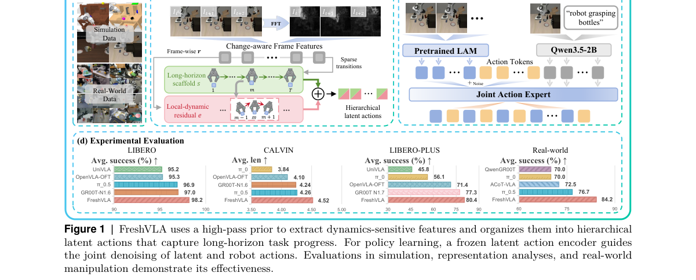

*Result - Illustration of the pretraining architecture. DINOv3 and DynaAdapter first extract dynamics-sensitive visual transitions under FFT-based PAWKL guidance. The latent action encoder H then con*

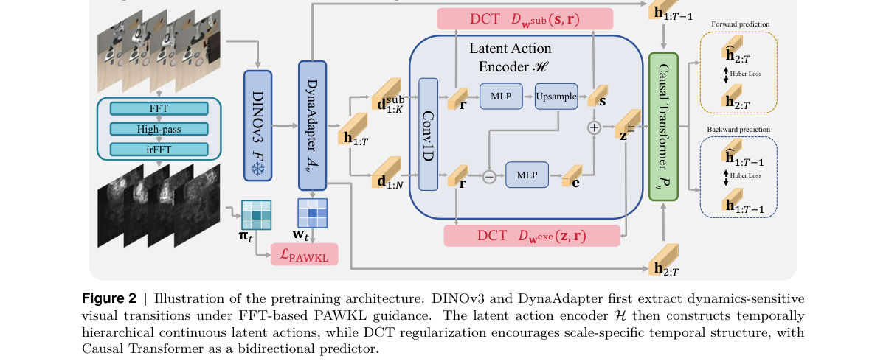

**Why this ranks #20**: 用高频先验把视觉变化编码推向动态区域，再分出粗粒度任务进展与细粒度执行残差：LIBERO 平均 98.2%、LIBERO-Long 98.0%（超 GR00T-N1.6 3.6%），CALVIN 平均序列长度 4.52。

---

## Footer

- Total papers reviewed across all 4 axes: 60
- world_embodied axis final count: 20
- Wild-cards in this axis: 0
- Figure assets: 2026-11-27/res/

Generated by `mine-arxiv-daily-digest` skill. Sister file: `2026-11-27_world_embodied_entry.md`.
